# 【2024】【精译⚡TinyML和高性能大模型推理】麻省理工学院•6.5940 p16 Lecture 16 - Vision Transformer (Zoom Recording) (MIT 6.5940, Fall 2024) [BV1c8wNe1ErX_p16]

Okay， good afternoon everyone let's get started at the Halloween I will prepare this demo for you to play with and generate any images for example here is' generating Halloween and pumping this is using the hybrid autoregressive model we developed we are going to talk about that in the later part of this lecture it's super fast it's running on a 6000 GPU in the basement。

Lets take a few seconds to generate new images the website is heartt。mt。

edu so feel free to play with it。Okay， so today we are going to talk about lecture 16。

 Let me start a slide。

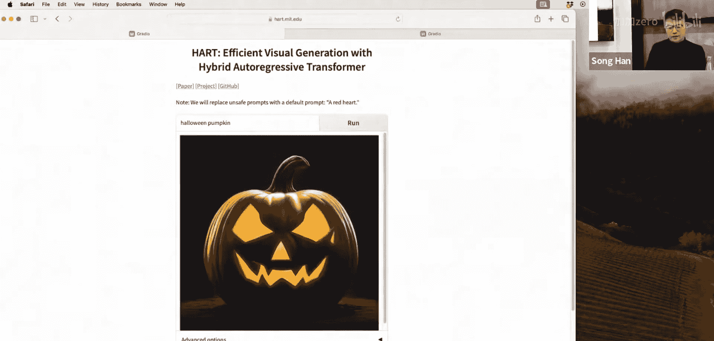

Okay，We to lecture 16 about vision transformers， so we learn about using transformers for language modeling for such as large language models。

 also LLP tasks， but the transformers is so powerful that we can also use the same architecture to model the images to extract features for images so this is the agenda for today's lecture。

 we' are going to first talk about the basics of vision transformer and then talk about how to accelerate that because vision transformers are basically super big。

 how do we make it faster using Windows attention using linear attention such as the E VIT and also using sparseity using sparse attention to accelerate these vision transformers。

Next， we are going to talk about selfsupvised learning for vision transformers。

 how to continue to scale it up without having to have access to many labeled data using contrasted learning。

 using mask image modeling。And finally， we' will talk about VIT with auto regressive image generation。

 in particular， we'll talk about the techniques the model behind the demo as I shown。

The hybrid auto aggressive transformer by O T Hao Tian。

So let's start with the basics of vision transformers。So remember in transformers。

 what is the basic building block？So the input， the granularity of the input is tokens right so text is very easy to be converted into tokens。

 each word is roughly a token right some words are two tokens。

 but how do we represent images with tokens and how can we tokenize images？

A natural way is actually to patch to convert the image into into patches， like in this case。

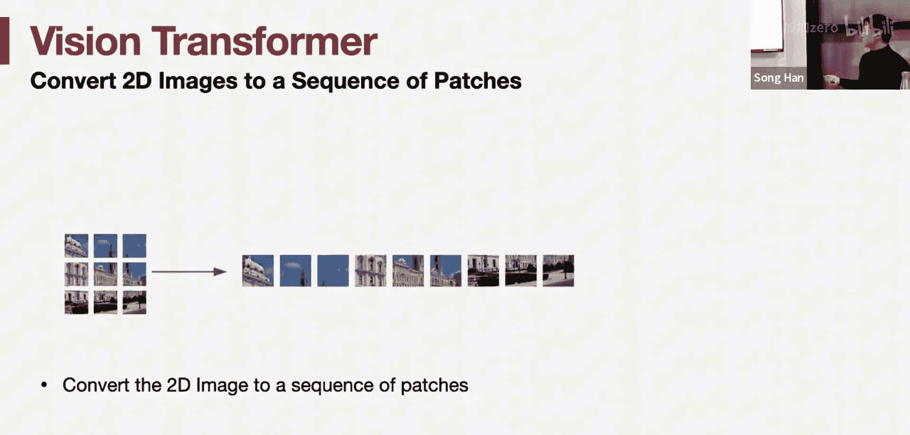

We have a image and we divide it into three by three， nine patches， here are the nine patches。

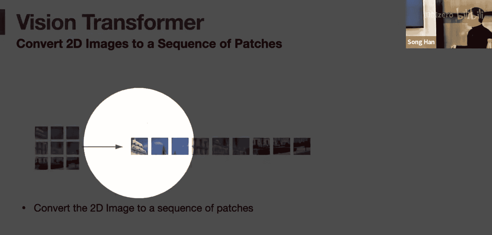

So we convert the 2D image into a sequence of patches。 and we。Consider each patch as a token。

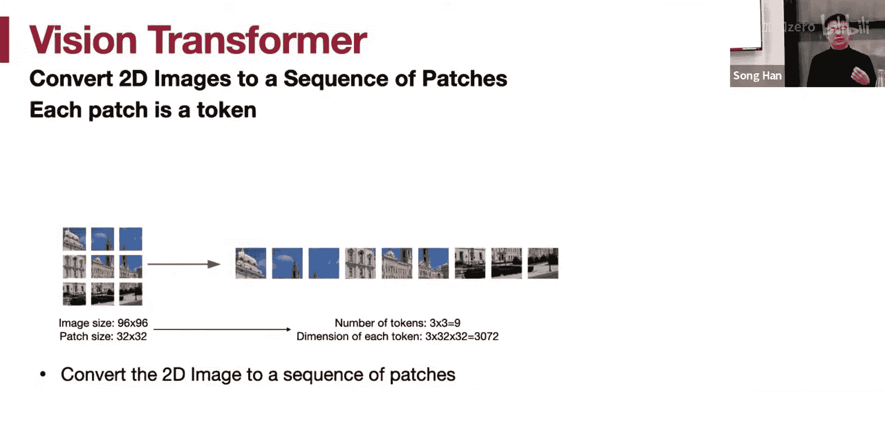

Okay so for example in the original image the dimension is 96 by 96 the attach size is 32 by 32 so right here we have nine tokens okay so we have nine tokens。

 the dimension of each token is three by 32 by 32 a roughly 3 k。

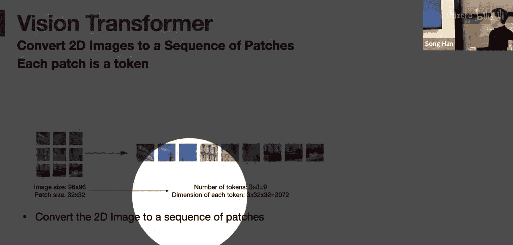

And then we do a linear projection to flaten the patches， the patch is 2D。

 we flaten it into a single into 1 d and we projected from roughly 3k to 700 766 to68 in this case。

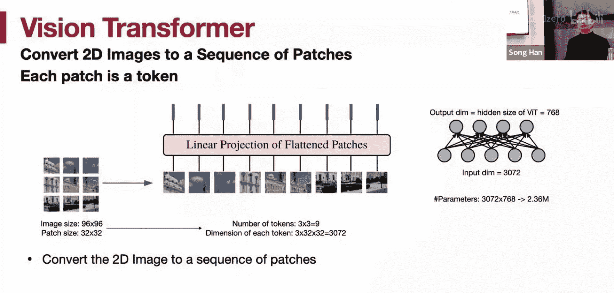

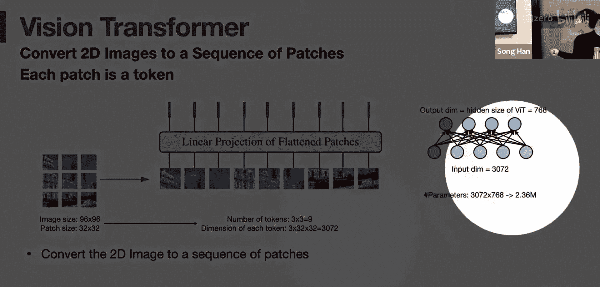

So we convert 2D image into a sequence of patches using this way。

What is the practical implementation of that， so rather than using the F layer to project between 3072 to 7 68。

 we can just use a convolution use a convolution。

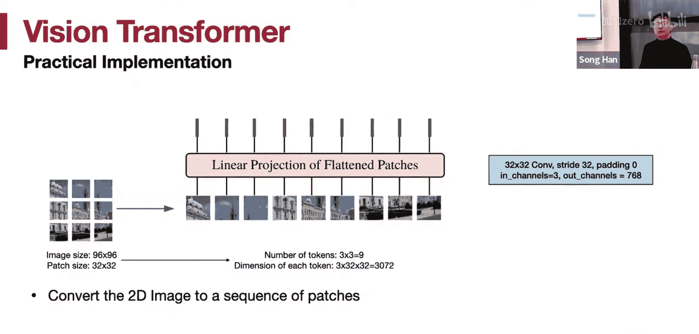

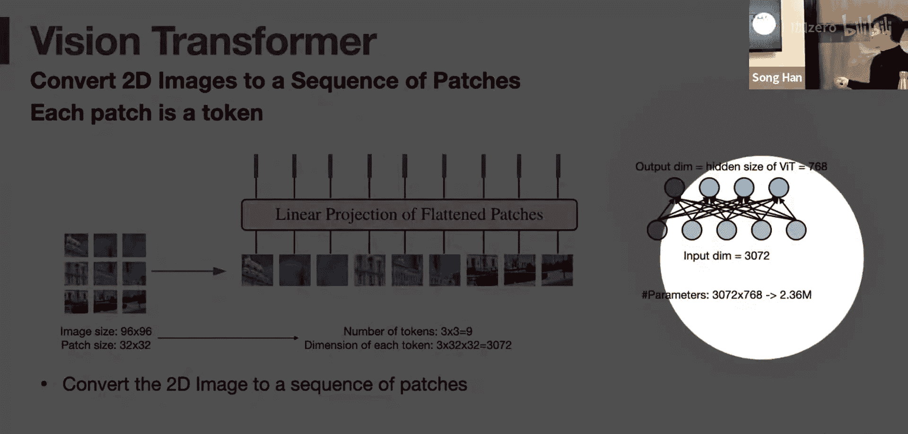

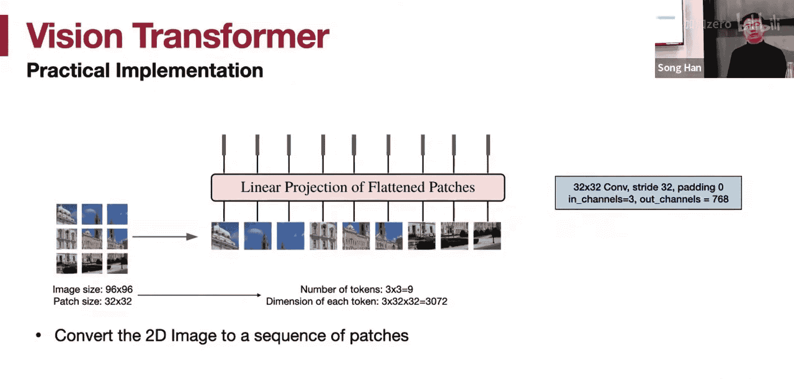

The kernel size is 32 by 32 plus a dimension for each patch， 32 by 32 and the stride of 32 as well。

 and ti to be 0 in channel is3 since input we have three input channels。

 RGB the output channels is 768 for the output channel。

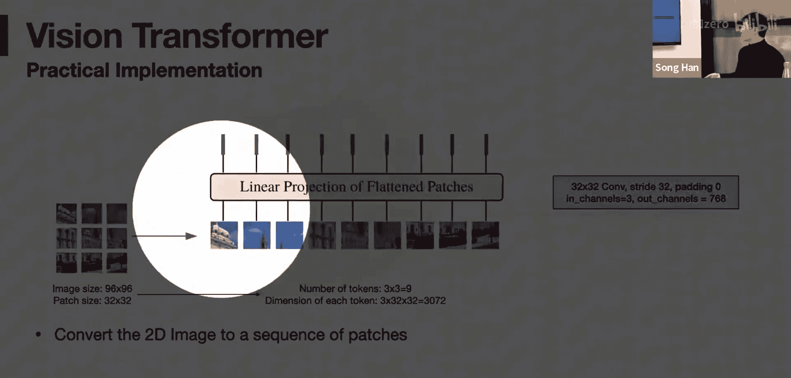

And then we can apply that standard even standard and transformer architecture after applying。

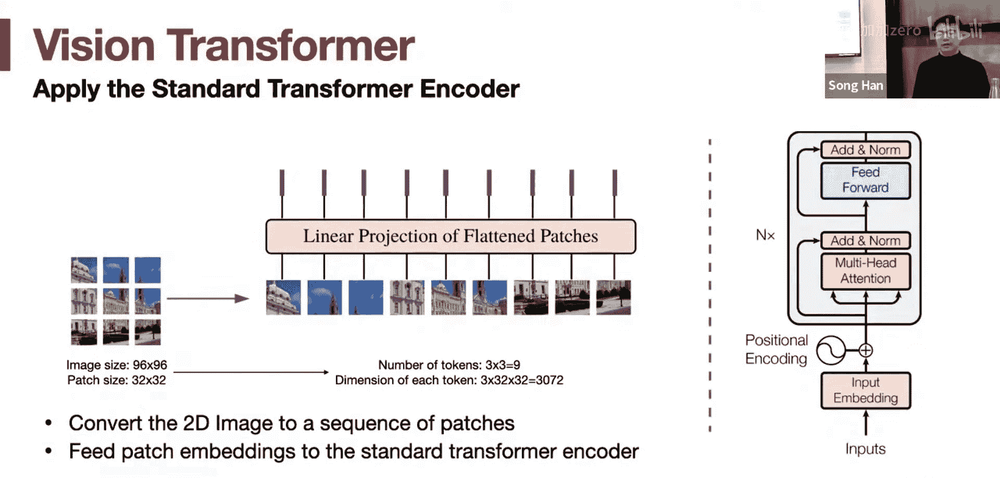

The positional encodings， right otherwise we don't know where the pixel comes from。

 so we need to apply the position encodings。

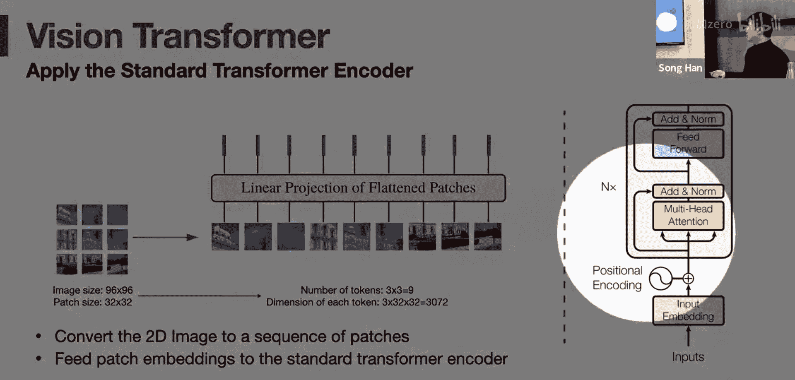

And then we can feed the patch emddings to a standard transformer encoder， just like language。

And there are several variants of the vision transformers。

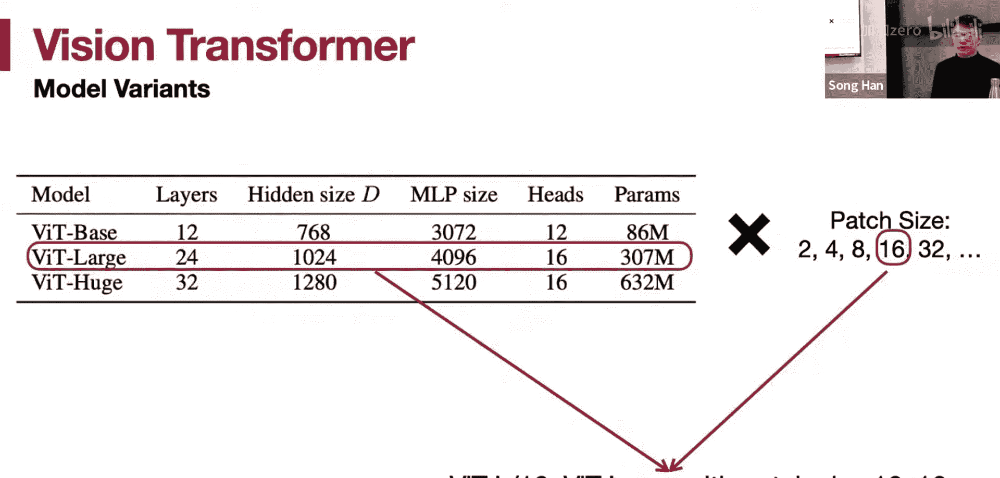

For example， theres VIT base， VIP large， VIT huge， they have different layers。

 VIT large has 24 layers hidden dimension size， plus 1k， N0p is 4k 16 highs， 300。

 roughly 300 million parameters。

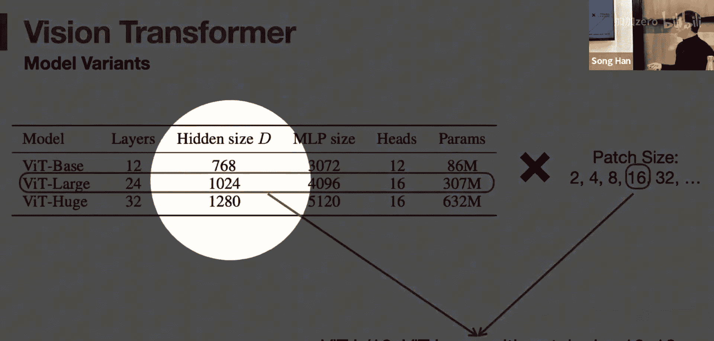

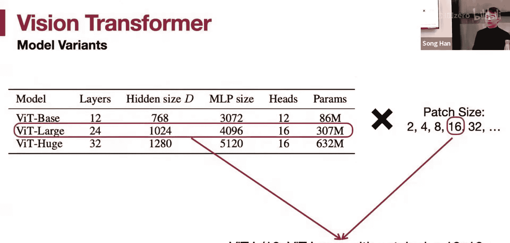

Usually there's another notation， slash 16， that means。

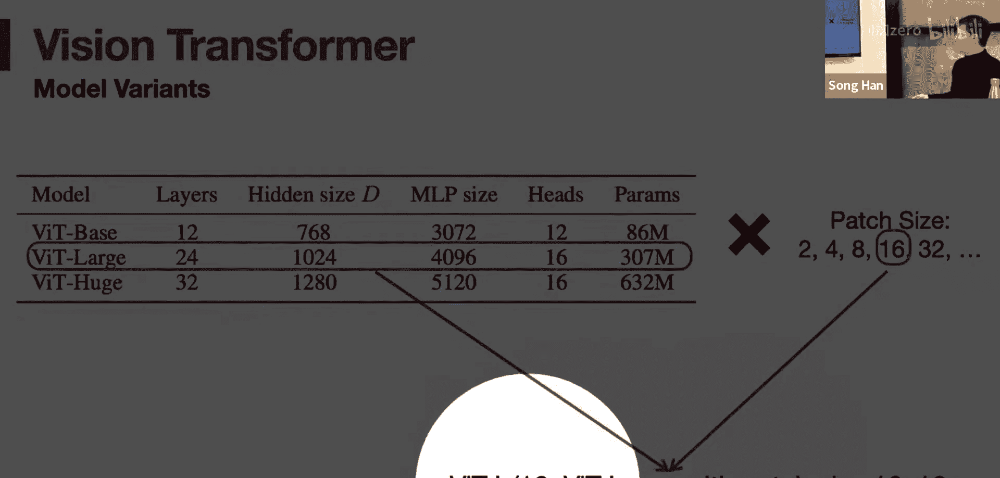

The patch size is 16 by 16 okay， so you can have different patch size。The larger the hedge size。

The more course， the granularity is。So how does VIT compare with ZNs okay so this is showing the number of cleaning samples。

 the Y axis is the top line accuracy。

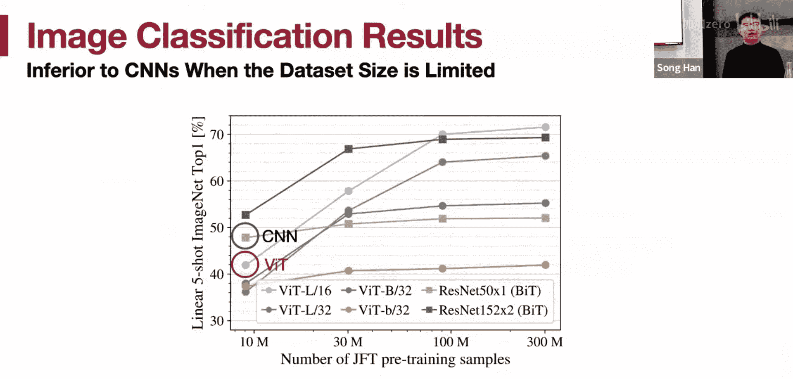

We're comparing the U BIT and C when the training data is not a lot， not a lot。

 actual BIT is inferior compared with C。However， when we have a lot of supporting data。Okay。

 so VIT actually sur has since when approach training with a very large data set。

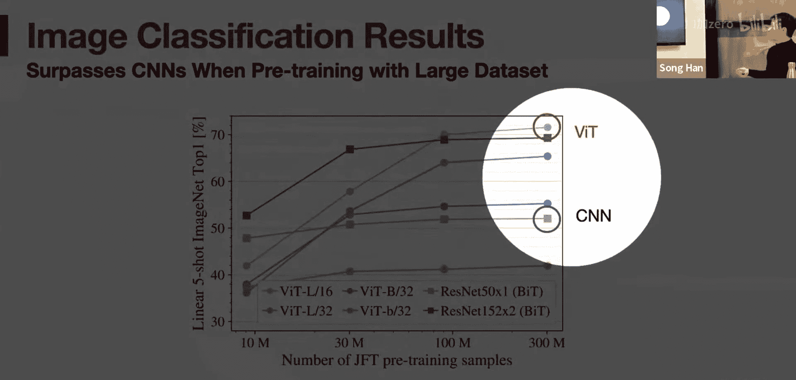

So VIP scales better than Cs， but when the data is small， C is more efficient。Okay。

 so having introduced the basics about VIT， let's talk about how to make it more efficient。

 how to make it tiny。

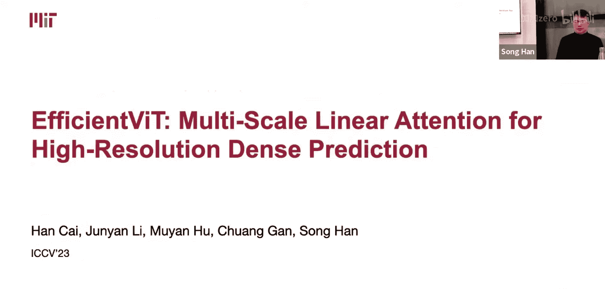

We are going to introduce the efficient VIT techniques before that let's first introduce why it' crucial to let BIT handle this high resolution。

Images okay for example， medical image segmentation we need to have those fine grainined details。

 for example， this is diagnosed and kidney sized we need verifyinggrained resolution。

Lot of tasks require this high resolution， dense prediction such as super resolution。

 this is low resolution， this is higher resolution， we can accelerate it to make it much faster。

 41 frames per second compared with 16 frames per second， such super resolution pass is widely used。

 for example in MDDLL ELSS， basically doing the super resolution given a low resolution video make a high resolution and that require real time processing。

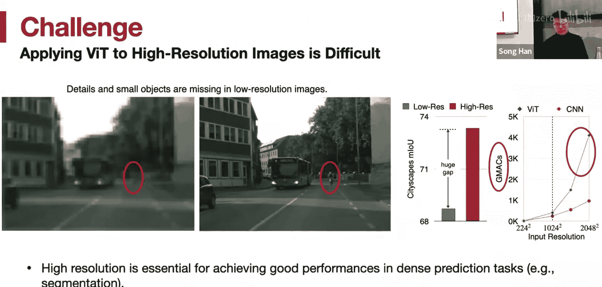

And also higher resolution is important for autonomous driving tasks。

If you are using a very low resolution， like in this image。

 you can hardly distinguish somebody riding a bike right here， but right here。

 given the high resolution image you can tell actually there is a people riding a bike or a motorcycle right here。

The accuracy actually grows with the resolution and so here we're comparing the IIOU which is measuring the quality of the segmentation task。

 the high resolution the red bar compared with the low resolution that we bar。

 actually there's a big gap， there's a deep improvement。From low resolution to high resolution。

However， increasing the resolution， is no free lunch， you see the max， T max implementation。

For VIT it actually grows much faster compared with the CNs from 1k to 2k the computation for VIT grows much faster。

 why is that the case？

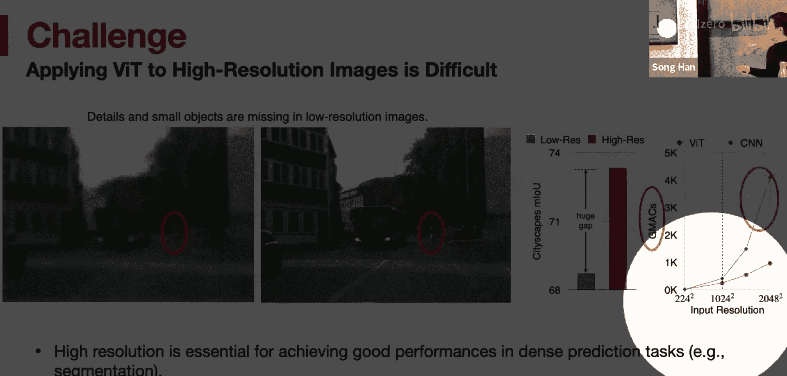

Think about the attention mechanism。It's all in square right N is the number of tokens。

The number of Mac is ON square， you need to calculate token by the tension between each token。

 so the computation complexity is ON square。And the number of token is。U。

Equal to the resolution to the power of two right so therefore it total computation is resolution to the power of four。

 so it's pretty computing。So how do we solving this problem？

Actually efficient VIT can make it much faster this is comparing the baseline which is running 1。

6 frames per second second For is very pioneering work using transformer for segmentation task at that time the frames is pretty low but after the acceleration we can find efficient VIT can make it much faster from one frames to 21 frames per second but still while maintaining the accuracy so this is measured on a amediadia Json or a driving GPU driving mobile GPU in FP16 by slice so while。

And high resolution dance prediction is also helpful for these AR and VR applications like during the thought。

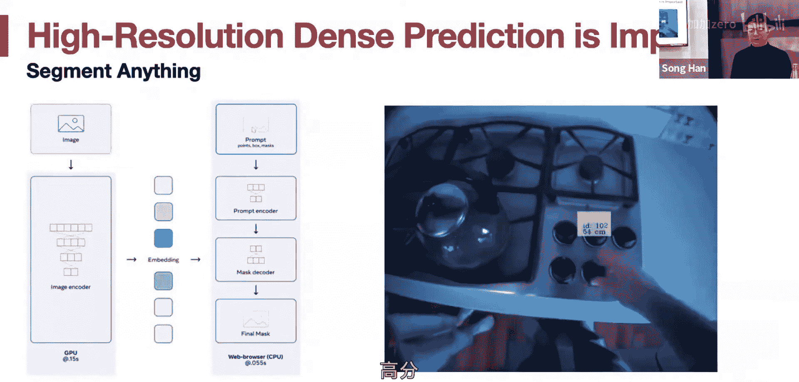

Inindicating where you are looking at and it human health took to segment the stuff you are looking at。

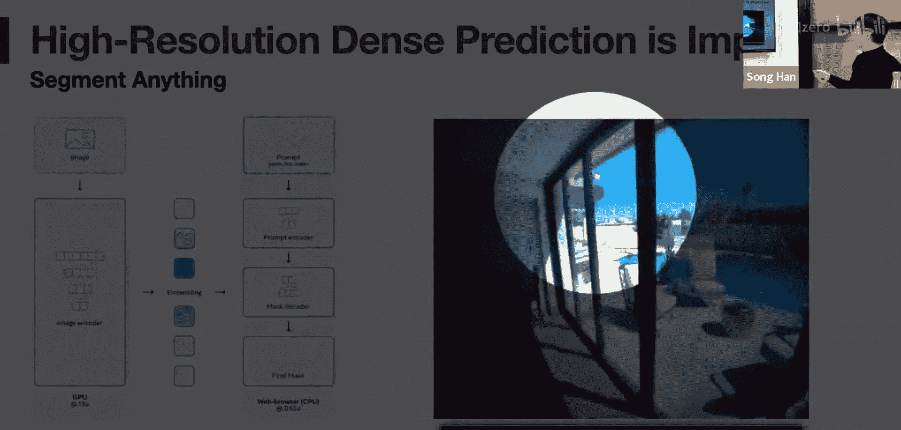

And that is using this paper called the segment Anything。

 basically image is passed through a image encoder， which is a VIT。

 this is taking the majority of the time and get in and then prompt would be a point would be a above to be a mask。

 encode the prompt and then mingle the image encoding with the mask and finally predict the final mask。

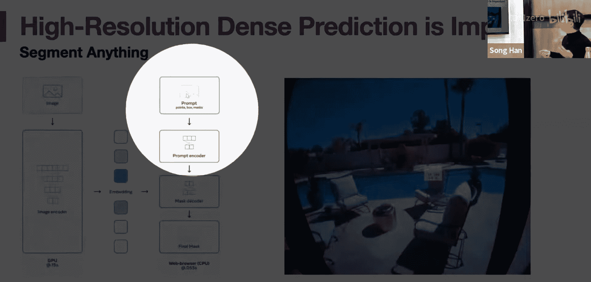

So such work require pretty heavy image encoder based on the edge and then it can take mask as input as input prompt point as input prompt or box as input prompt or even text。

 which is not released in this paper， so it's profitable image segmentation。

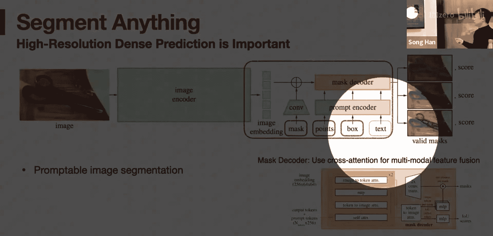

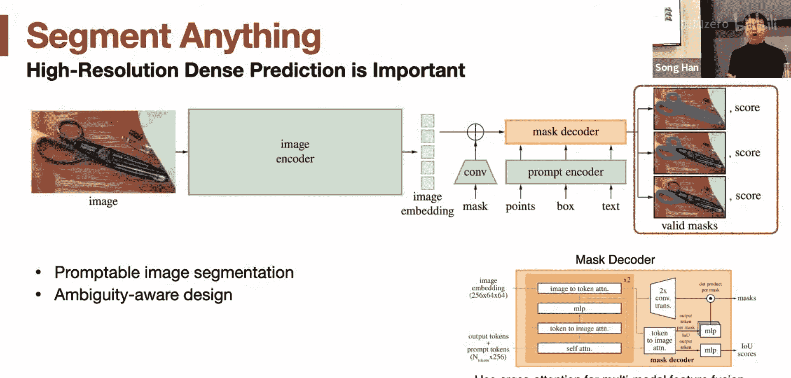

I can it is ambiguly aware design， like you can segment the entire scissors or only the handle or only one of the handles。

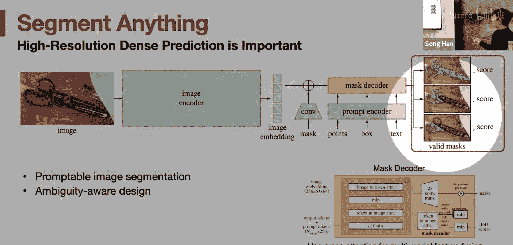

It has automatic data engine to use this model to annotate more data and use more data to train the model。

so those are some of the use cases about denr prediction。

And the use case or VIP as the image encoder can do a lot of applications。So given those motivation。

 let's see what are the ideas to accelerate and make it more efficient to deal with the VITs。

 starting with the window attention。So obviously， we are converting the patches across the whole image。

 so every patch in the image can attend to each other， so if the image resolution gets pretty large。

 the computation grows progressively。So instead of doing attention computation over all the tokens。

 we can apply window attention okay so the attention mechanism only happens within the window okay。

 so say this window size is  seven by seven so the attention only happens within this local window since the number of tokens in each window is fixed it fixed the computation is complexity is linear rather than quadratic in this case。

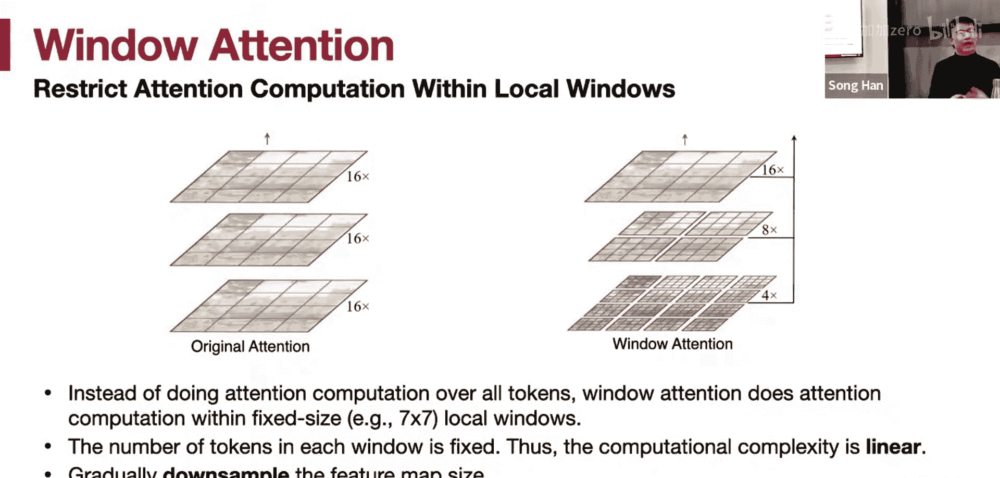

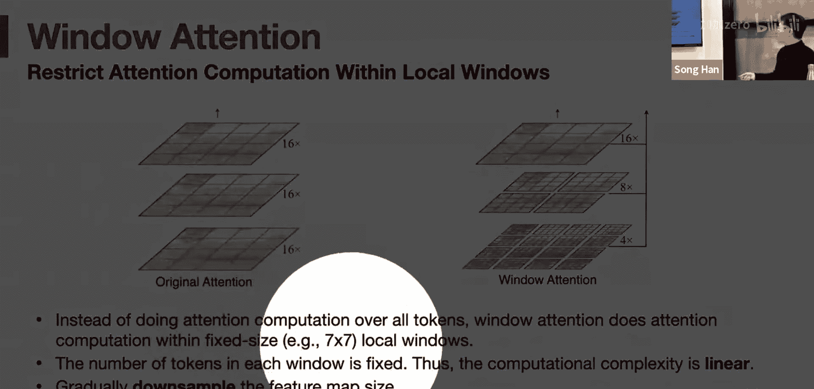

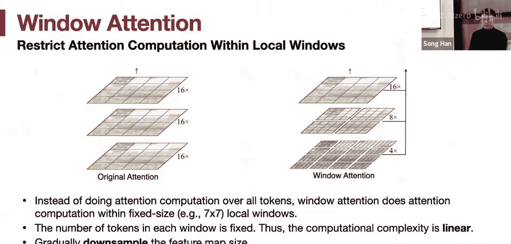

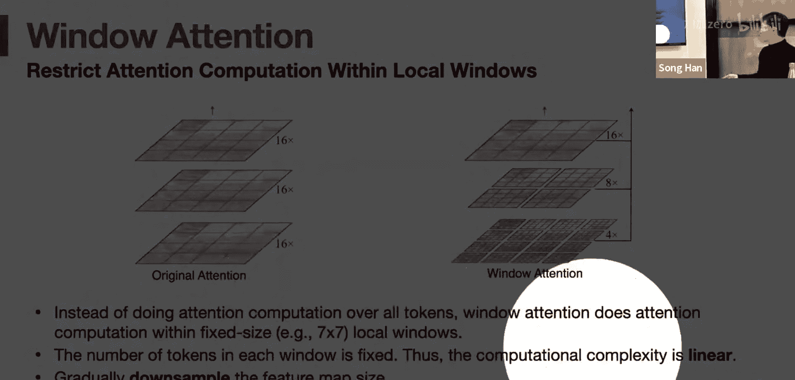

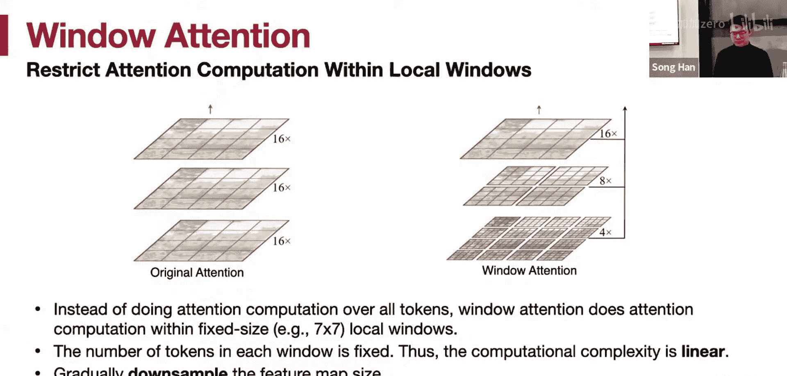

For example， here， each patch is  seven by7 and we do the attention within the patch and we have many patches right here。

啊。So this is the original attention where each patch has to attend to each patch now we can divide it into several windows and only the tokens within the window will attend to each other。

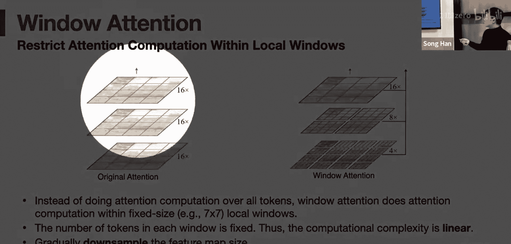

So what is the problem of this case？Tokens only attend to each other within that token within that window。

Right， so adjacent Windows。The tokens cannot attend to each other， so the information cannot flow。

So that's the problem， so how do we that solve that locality problem to enable this kind of global a lot much largerer receptive field。

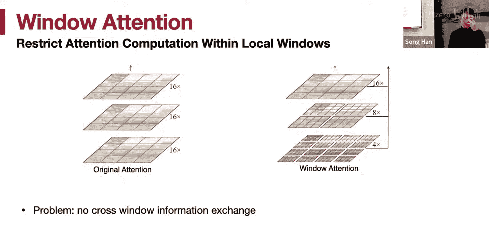

So actually a shift operation is added to this window attention so for the layer one。

 this is the window divided by two by two windows and layer layer two。

 we actually shift the window and shift this window by two boxes so that adjacent windows。

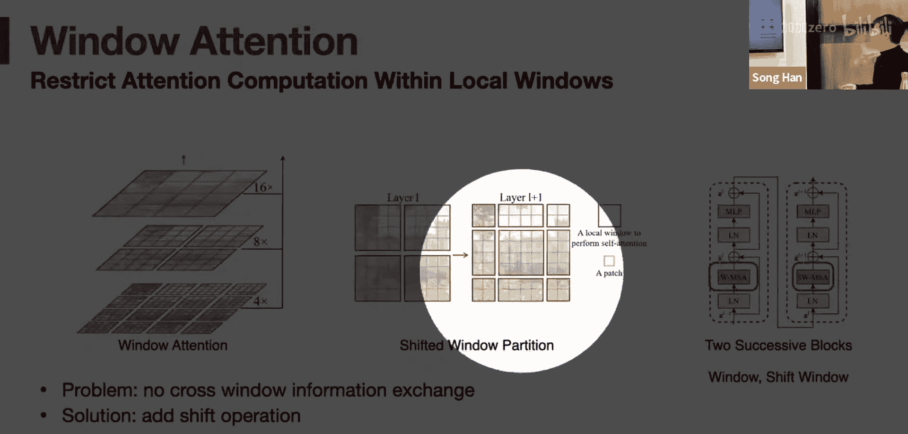

The tokens in the second window can also attend to the first window and in the second layer。

 so if we repeat this process， all the tokens will be be able to attend to other tokens。

 no matter if they are in the same window or not thanks to this shift operation。Okay， as a result。

 this method actually achieves better imagenet accuracy than the VIT。

 so these are the VIT topine accuracy this the screen transformers， shifted window attention。

 screen transformer accuracy better than the original VIT， not only on imageNe。

 but also on other tasks like object detection， and also image segmentation tasks。

So are the all the windows useful， actually。It's not the case， sometimes sparsity can also help。

Not all the windows are useful， we can safely discard a lot of windows， especially in point cloud。

Actually 99。9% of the vsos are actually sparse we there is no object like right here。

 there's no object。So the spatial sparsity is pretty high。So how do we exploit those parts。

 we can use window attention， the white area shows there's no point， so it's zero。

But how do we divide the window like， how do we set the window。

So one way is to apply this Eco window group， an Eco window， like this is a window， C itself。

 AE it's a window， HBG， this is a window it's very regular， it's two by two， right？However。

 you can do it in this way。The window size is highly unbalance。

 but the purple window has only one element， the next one has two elements。

 but the red one has three elements。So this little to difficulty author right so this slow one need to influence fast one another way is actually。

To apply equal size grouping rather than this equal window of grouping。

 so group based on the number of elements such that for each group we have exactly the same married balance。

Distribution about the number of9 zero elements so we group the first three elements， first window。

 the next three in the second window， the next three in the third window actually it that perfectly balanced。

And as a result， you can imagine this is much more hardware friendly and can run much faster compared with different transformer based models and even faster than evolutionvol based models。

 this is combvolution based model， this is a transformer based model measured on a media Jason Orient driving chip。

Hey， so this is using window attention and Sprse window attention。

Since the attention mechanism has open square complexity， a natural optimization is， can we。

I'll simplify that to linear complexity， okay so that may be used with linear attention okay。

 so let's switch gear to a linear attention。

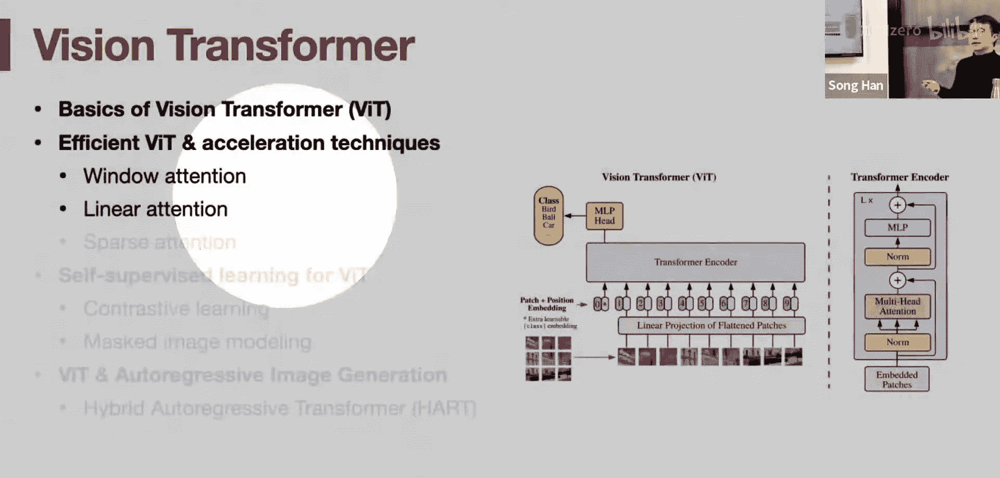

Before that first see the softm attention equation okay so we have  QK V， we first qK transpose。

 we get an n by n attention mask， this is O square and scale it by square root of D find the soft max and use that to do the weight is sum with the V you at the final output okay so the cost is O square primarily only due to Q。

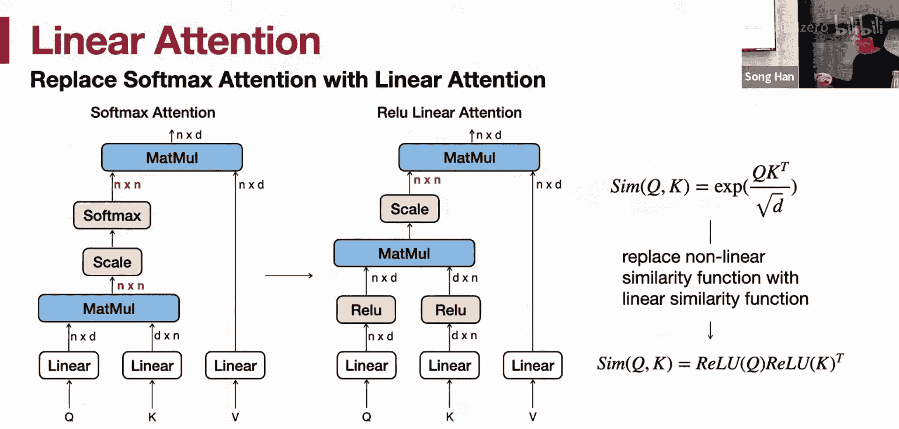

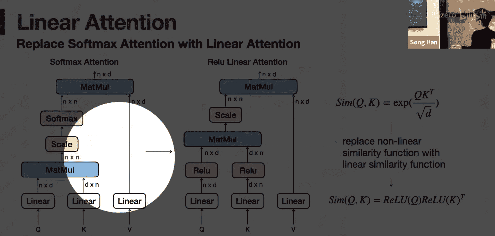

This is a slightly changed version and also using rather linear attention， so refers to the。

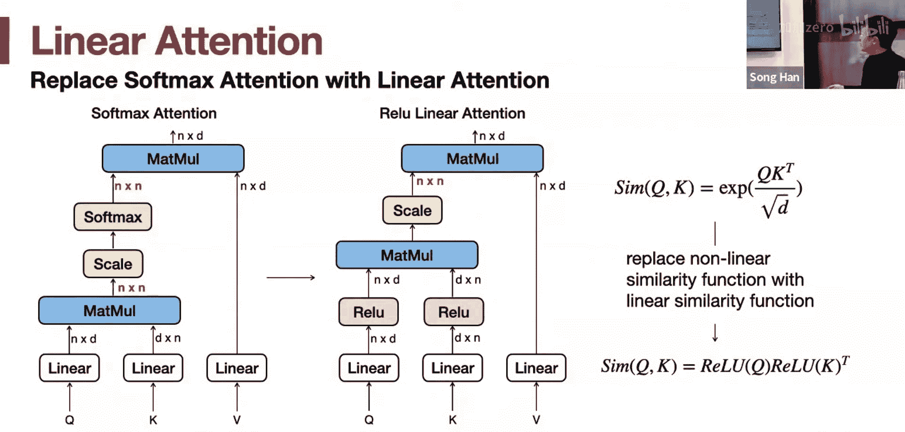

Q and K， we pass the R activation function right here we pass it through the math mark， scaled it。

 and then finally multiied out with me， so the cost is still O were in that case。

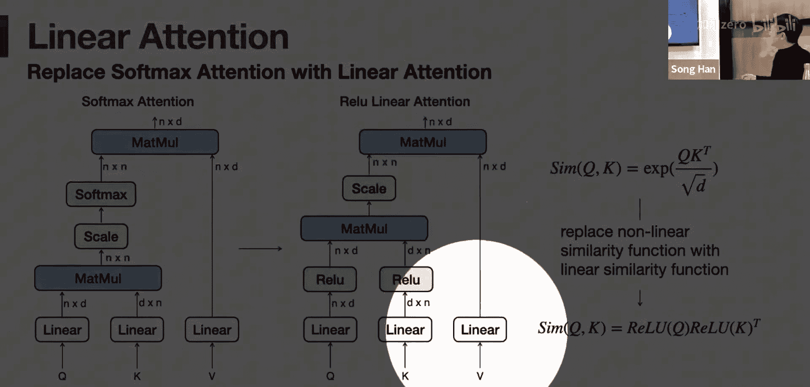

So can we change the order such that we can have ON rather than ON square complexity？喂。

So that they used the third solution。

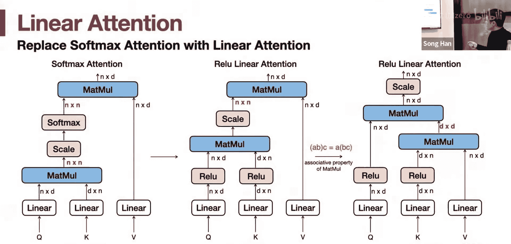

Since AB times C equal to a times B。 so this is the associative property of the matma operation。

 Okay so rather than QK first we do the K leaf first and we do the K first so it's D by N N by D so is O N D square A N D square is proportional to N rather than O N square and so this is ON D square。

And then we multip type of Q in the last order， so by changinging the order。

 I become a switches from Os n square to O D square okay。

 so it's proportional linear proportional to n rather than to O squared。

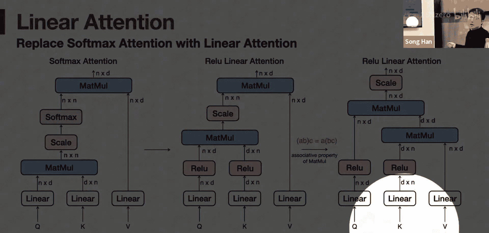

So we change the orderer of the Mac mall using such associative property and we can reduce the computation complexity。

Does this work？Actually not， right， you can imagine reducing the computation there's no free lunch。

Originally using the self max attention， the attention is very strong at the points of interest。

 like the eyes of the dog， the nose of the cat， that is very strong， very strong attention。

But using linear attention， everything becomes really weak。The eyes is no longer red。And the cat。

 the nose is no longer heavily attended， depends very flat。If you plotted。

 it's indeed the case that using the softm versus without using the soft max tension。

The blue curve becomes much flatter compared to the red。

Wwhichch shows that the rather linear attention cannot produce the sharp distributions。

 okay so it's good at capturing global contact information but not good at capturing those local information like this local information is not captured in the linear attention。

And also lacks this knocky scale learning ability， so how do we deal with that？As a result。

 you can see there's a big accuracy gap if you replaced the soft match attention with the relatively linear attention and carbon and accuracy dropped a lot。

So how do we alleviate such limitationmentation？Without losing efficiency。

 but can effectively handle the local information extraction。

So let's bringstorm what is good at extracting local information to compensate？

For the laws of local information instruction for the。That's convolution， right。

 convolution is our it is our friend to extract local information。

 so we can simply add a convolution branch。to do the local feature extraction without。

 but in order to not to lose efficiency， we use a depth convolution followed by one by one group convolution to save the computation right here rather than using the full convolution to decouple the spatial resolution spatial modeling versus channel modeling。

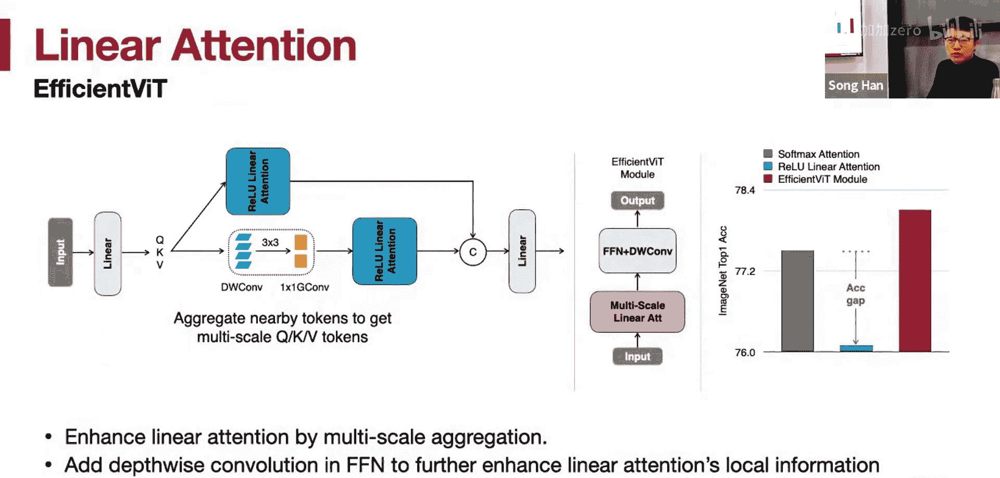

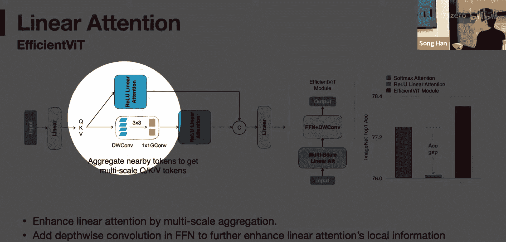

So we can enhance lending their attention by such multi scale。

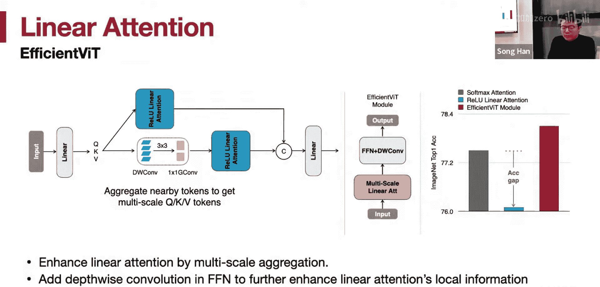

Igregation with the convolution。And so here， the FFN layer， we added a steps wise convolution。

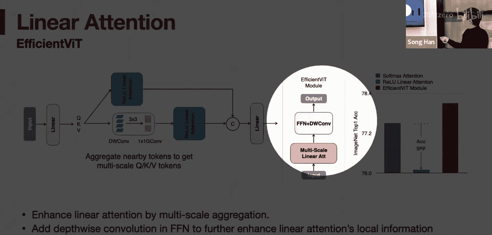

To compensate for the loss of accuracy。It added very little computationut。

 but accuracy wise and fully brought back the accuracy and also actually improved the accuracy a bit。

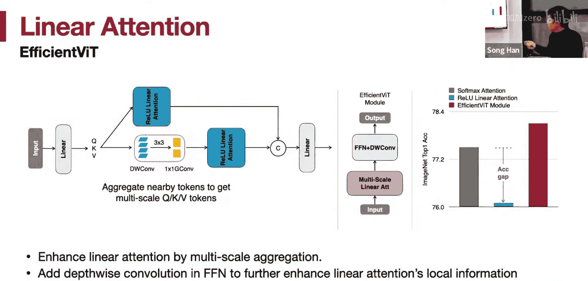

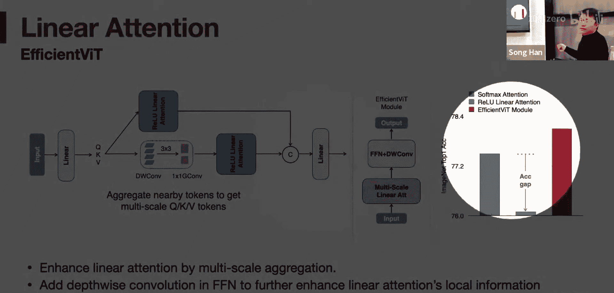

So add the depthwise convolution and further enhance the linear attentions local information and extraction capability。

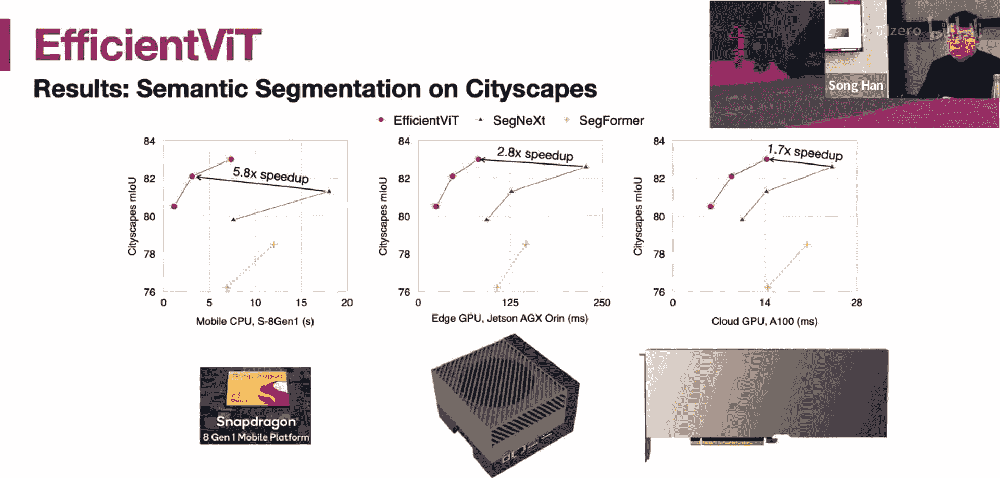

And as a result， we can see the speed up right here， this is on the mobile chip。

 becomes San Dragon mobile chip， it achieved about 5。8 times speed up。

With even higher accuracy on segmentation tasks in the middle is on Or Amy address Or for driving applications。

 so I achieve about 2。8 times speed up。

On the right hand side is on a cloud GPU， which is the A100 or about 1。

7 x speed up for better accuracy。

Not only on segmentation， but also on super resolution tasks so。Here is on two data sets。

 one is the FFHQ data， which is human base data， we are trying to do the super resolution from 512 to 1k from512 to 1k。

This is the original PSNR， the higher the better we can achieve even higher PSNR。

 originally it takes 92 milliseconds， now it's only 170 milliseconds or five times faster。

If we see the details houses， this is the Baubic。Whi is not quite good， this is new Ster， about 3。

6 images per second and this swing IR about 4。7 images per second in this hours efficientIP 17 images per second。

And similarly， for another data set， driving data set， the PSNR。

The be higher originally is 15 milliseconds now is 2。8 milliseconds。And let's see。

 how does that apply to the segment anything task？So here we are using the box box prompt。

This is segmentation results， very good quality， but the throughput is increased from 11 to 182 images per second with segmenting the pad。

But mentioned with fluids。Secumenting a very thin poll right here， it's very thin。

 but it's very well segmented for this poll。Another example is showing the dot dot prompt prompt。

 you have a single asterisk， this is the prompt segmenting the pumping， this is the chair。

 this segmenting the person， segmenting the car right here。We can also segment everything。

 so given a lot of dots everywhere in the image and trying to segment I think this is before acceleration。

 this is after acceleration you can see the quality is very well maintained。

And this is the image classification result。

This is the latency， the lower the better， this is the accuracyd， the higher， the better。

 so ideally we want something right here。So this is comparing with local baselines。

This is the I you didn in trade off。

This is the throughput accuracy data who want a high throughput and high accuracy。

So why do we measure latency on our and through put on a 100。

Because this is an edge device usually serving a single user， like a single driver。

 while this is a cloud device， it simultaneously serves multiple multiple users before we care about throughput on the cloud and we care about latency on the edge。

Hey， so having talk about linear attention， let's further use sparsity to accelerate and simplify these region transformers。

So this is a driving scenario in Boston， the seaport area of Boston。

there's a question about the resolution right since the computation complexity works quadraically with the resolution。

 a natural question is can we use a lower resolution。

 okay so we can resize the image by using a lower resolution like half of the resolution but using dense pixel 100% density。

You can see there's very low resolution。Some details are lost。

 so you can hardly tell this the person anymore。So how about we use sparse but high resolution in those。

 so high resolution is yx the resolution， but sparse pixels 25%。

Because the total activation size would be the same in this scenario。

 quadratic growth with the resolution， so here we have 25% sprsity。Which wine is better？

So the first step about sparse VIP， which is sparse region transformer。

 is to apply this windowed activation p with non uniform sparsity。

 so we p away those redundant regions and only keep these useful areas like the person here the cars right here。

 which is the pointer。The important windows。And how do we determine the importance of the window。

We can just look at the L2 activation magnitude， the activation is magnitude of that window。

 the larger， the more important we think we think it is。Okay。

 and then we can sort and gather by the importance the most important second important。

 dirty important on and so on。This is just one layer and the second layer， the third layer。

 we can make it getting sparsr and spar， okay？But how sparse should we allocate the computation to each layer going need a search for that？

So as the model model is originally trained with only dense activation。

 so we want to gradually improve the sparsity awareness。

 so we need to find tune the model given such sparsity so。

Here we are doing the random randomly sampling different sparsity the first layer is always dense second layer get a spars spars third layer gets even spa we can also sample a different sparsity schedule so for each2 iteration we are sampling a different sparsity pattern but what is common here is that the later layer is always more sparse than the first layer since if a token。

It's prun it cannot recover in this case。And finally。

 how do we select the correct scarcity for each layer？

We use this evolutionary search evolutionary search。

 we have implement that in the newer architecture research chapter。

So， given a。We first check whether it is satisfied the latency budget， yes， we keep it。

 otherwise we reamp it。

So this is showing the across different search ipoOs， this is the accuracy。

 the evolutionary research keep getting better versus the random search pretty much stays the same without improvement。

So now let's see how much we can improve。 So here is the latency lower the better， here is the MA。

 the higher， the better。

So here we are comparing with several baselines， for example， this is under 256 resolution。

 this is under 224 resolution， so sparse VIT can be 1。

5 times faster compared with the baseline without using sparse VIT in this case。

So this is for 3D operate detection， so this is for 2D， instance， segmentation。

And let's visualize what is the sparsity mask， what kind of mask did we learn in this case？

So given these are three frames in a driving scenario and sparsely I try to ruin those relevant background。

 for example。This is the 24 millisecond layer model and focus on those foreground rather than the background。

The even faster and even smaller model focuses on the person， the car here。

 walker here rather than the background is our dark。I the car is bright。

 so it's pruning away those irrelevant。Background windows and retaining those informative foreground windows。

This idea might also be helpful for visual language models which we can discard those areas that is not interesting。

 both in the spatial dimension and also in the temporal dimension。Hey。

 so let's take a break and then we are going to jump into the self supervised learning。

So supervised learning for region transformers。So the motivation is that labeling the data set is pretty expensive right but these VITs is helpful when we have a lot of data。

 but this such a large amount of data is difficult to acquire so how do we train the model without needing to label the data。

So we want to train with unlabeled beta to mitigate this issue right so how do we given a target task Okay so how do we use unlabeled data。

So we are going to talk about two techniques， one is using contrastive learning。

 the other is using mask image modeling。Okay so contrastive learning basically consists of positive samples and also negative samples giving a cat we're going to give two views of the same cat okay so this is one view this is another view they are both cats so we we tell are those are positive samples。

And then we have a negative sample， which is a do so both the cats passing through a encoder and then get embedding。

The embedding from the cats should be similar with each other。

 so we are going to apply the laws to pull together。Pu together the features from the pan。

And pull apart the features between the cat and the dog。诶。So as a result， so with the random elite。

 we can see onci 10 as the model gets larger， it doesn't help， the accuracy gets even lower。

But with self supervised learning in this way， when we are increasing the model capacity from VIT base to VIT。

 huge。It delivers stronger performance。And it's actually the self supervised VIT actually delivers stronger performance than the supervised counterpart。

And the accuracy increases when using a larger VIP model。

We can also apply multi model contrastive learning multimod means here we can learn between the text and also the image。

 so famous work is contrastive language image pre training。

So during the training time， we have a piece language。

And we have an image now we pass the language into a text encoder and can be embedded。

And also we pass it through the imaging code and get the imaging body and then naturally different images and different tags。

They can have a attention map， so the image corresponding to the text description。

 the image corresponding to the text description， which is in the diagonal position。

 will receive higher attention score。So by using such paired image text samples。

 we can try to supere it by maximizing the diagonal part。

Which can effectively align the image and text into the same space， into the same space。

So at inference time。

We pass the image into an image encoder and then an inference time there could be different vocabularies。

 and then we select the one that they have the highest second and score which showing that this text will align best with this image in this case dog will align best with this image。

So this is showing the accuracy of this is zero shot clip this is linear probing or clip linear probing means just adding an F layer to do the classification you can see it actually enables zero shot this is a number of labeled training examples per class even。

Given a zero new class label， it can give very decent accuracy prediction versus conventional methods require at least some amount of swinging data but those pretty amazing clip can enable zero shots。

啊，呃 capabilityability。And the next technique is mask auto the encoder which borrows the idea from BRT from language modeling so we can mask the way some of the pixels in the image okay we pass the remaining patches into an encoder and then we pass into an encoder and try to recover the original image so this in target。

 this is the input which is masked， we try to predict the missing patches based on the same patches。

Which reminded us about the mask language models， MLOM。

 which we talked about in the previous lectures。

So here we are asking some of the token here， the movie is very boring， we must very boring。

 we passed the remaining words into the language model the transformer。

And then we try to supervise you by predicting the mask啊 token。

Okay。😊，So we can mask a certain percentage of the input tokens that random and predict those masked tokens。

And can we use a similar pre traininging strategy in the region domain。

 so in that way we don't have to label the images， we try to just predict the missing patches。

 which is coming for free。

I say that works quite well so we here use two encoders。

 one is a hybrid encoder process only those unmasked tokens so it is five by five altogether we have 25 tokens and here we just have  one through34。

678。

We just have eight un mass tokens， so we pass these un mass token through a heavy encodeder。嗯。

And then we you build that together with the mask， so here the gray part means those tokens are masked。

And we pass that through a light decoder， okay， so we decocode all the output tokens。

So here have 25 from8， and you try to reassemble them in the raizing order。

 try to recover the original image。

So why do we need a heavy versus light because the heavy encoder deals with fewer tokens well。

 this light encoder can deal with more tokens。

Actually this method works quite well， for example， even if we must a lot of components。

Like here the clock becomes almost this undistinguishable but amazingly this approach can still recover the clock the bus or the dog the lamp only with a few pixels。

 only a few pixels you can imagine there should be a limit we can mask away we cannot mask away like 99% of the pixels right and it turn out。

The mass ratio get a sweet spot at around 75%。So this is from 10%， this is 90%。

 so the sweet spot is roughly achieved。At a  75%。Ma ratio。

 they can surely cover elevator later but well。え。嗯。So it has a pretty high mass ratio。

 like birds master ratio is only about 15%。But I mean you can actually ship 75%。What does that imp？

Actually， that implies that image data has lower information density。

 very low information density and more redund。Compaired with language data such that we can mask away more information and still we can recover the original information。

So this is comparing the accuracy， actually these masks of the encode works quite well。

 consistently higher accuracy than the baseline。

Okay， so now let's switch gear to the third section and talk about generation。

 which is very very new work done by our T Hao Tian。To talk about autoregress image generation。

So far we all talk about something about disriative models right segmentation detection classification right so these are discrimative models we try to predict like what is the class。

 for example， feeding in the image patches tokenize。

Tokenize the input image and then pass it through a transformer and then predict the final class。

 so those are distriive models。

Now we want to design generative models can generate images， right？

So autoregressive models can generate naturally generate tokens so the natural way natural thinking is we use the autoregressive transformer to generate visual tokens in a token in token out manner。

 the input token would be the language something we wanted to generate and output token would be the image token。

Actually， such auto aggressivegress image generation benefits multimod language models， for example。

i， Google gized I report。

hs that they are using the auto aggressivegressive model in individual generation example with the important distinction that the models are multimod from the beginning and can natively output images using。

Using discrete image tokens。

So we designed this ultraaggressive generation ultraaggressive short for AR that kind of achieving even faster speed than diffusion models。

 so we are going to introduce diffusion in the next lecture but here we'll be a little very quick it has many timestamps try to predict the noise and try to denoise right to predict noise and then subtract the noise。

And you require many steps。And the heart require a much lower。

 fewer number of stas and they achieve much higher throughput。

 like two images per second compared with the 0。2 images per second。

 much faster compared with here SC XL， pixelix R， sigma playground SDD，3， etc。

So how do we generate image tokens， what kind of order do we generate the image tokens？

so in this paper summarize the three ways， the first way is just using the raster order like one。

 two three，4， five， six，7， one by one each time we just generate one more token for a one patch in the raizing order okay。

We can also use the random order okay， next time we can generate this pixel so next time we can also generate another patch。

 right random order。But the problem here is that it generates each token at a time。

 which is memory bonding， that's been learned during the quant part。

singleingle token generation， you need to go through all the weights， which is a lot。

我 can also generate multiple topics。

And it also generates multiple tos。at the same time。

 so rather than a single token and we generate do multiple tokens at the same time。

 So those are three basic approaches。So what is different from language generation to image generation？

For language， we have a fixed vocabulary right in English we have like。Several tens of thousands。

English words， right they are discrete。So that we can use the CE loss very easily to add a loss to supervise these discrete tokens。

But images are different。Those pixels are naturally continuous， right there's not such a vocabulary。

Like。10000 English words， there is not like 10000 image patches right so but for for which makes it difficult to supervise right so a natural way to harmonize these two modalities is to use discrete image tokens eventvent discrete image tokens。

So that we can fit it into the same auto aggressivegress infrastructure or a large language model。

And we can supervise it by the same loss as language model。

Okay， so previously， we have an encoder decoder。 Now。

 we added a new vector quant encode and vector quantize the decoder。Together with a code book。

So we turn those continuous image patches with visual tokens into discrete image tokens， okay。

 we can decode it。

Although there there is a limited amount of。

Tokens in the codebook， we can have different mingling for these tokens。

 such that we can decode them into various diverse images。

This is highly related to the code book that we talk about during the quantization lecture。

The difference is that previously we areizing individual waves or activations， okay。

 so this is a scalar。

We are doing a scalear quant。Like these two these three values are all falling into this centralroid and Reg store those central index okay。

 so now we are not quantizing individual weights， but a vector。

Of pixels， Okay so that's why we call it vector quantization in here， that's the scr quantization。

So we can do a vector quantization into the AI generation where each index may correspond to one of the indexes。

For example， this vector that closes the color probably is right here， so we are storing index two。

And this color。It's different from any of them， but the closest one is V3。

 so we store actual to three。The blue is closest to this code， the entry in the codebook。

 therefore we are storing entry zero， an index of zero。

And you can see previously those continuous continuoustiguous vector now， they are discreteized。

 but they are discreteitized represented by integer values。

So we can tell this is like the important of the deep compression from the closest central lookup to the closest vector lookup and use the integer index to represent a vector instead of a single wave。

So that we can generate those indexes， which is discrete。

And this work called VAR basically introduced a new order to generate。The tokens。 remember。

 the rule of thumb is try to generate more tokens， not just one token。

 generate more tokens at a time。 So what it does is actually first generate one token。 Okay。

 pull the entire image into a single token。And then two by two， two by two or to。

And then four by four， 16 tokens， five by five bit satellite will actually increase the number of tokens to generate。

You I also imagine this is like the big picture， very raw。

Big picture versus the last stage will be a very high resolution details also from the big picture to the fine grain details from coarse grained pixel to the fine grain pixel so that's the order where it's going to generate those tokens。

And the interesting part is the tension mass。It's no longer a triangle shape。

 so what is the new shape？So imagine initially we generate just one token for the entire image and then two by two。

 four tokens， and then three by three nine tokens， the mass will be like this， starting with one。

 and then four and then nine。Okay， so in this way， when we are at this stage like three by three token。

 we can generate nine tokens at the same time， its no longer memory bonded。

 like generate token by token， you have to fetch the entire weight for each token is purely memory bonded now is no longer memory bonded which is pretty hardware friendly。

However， this is not perfect， you can tell the generated picture compared with the original reference。

 the eye looks different。The quality is not quite good， right。So on top of that。

 we design a new technique using a hybrid approach。

That can match perfectly with the original reference。Now let's see。More details here。

So the discrete tokenizer inherently has its limitation， the world， the images are contiguous。

 you force it to be discrete。So you can see the recover quality for the VR model the as。

 it's not quite well covered similar right here， there's a lot of distortion in this area through this area person's heart。

I to recover them quite well。So how should we build such a tokenizer。

 What's the limitation of existing discrete tokenizer？So we introduced。

The capability to decode both the continuous and also the discrete tokens Okay。

 so the this is the continuous token， this is absolutely the VQ fontizer we get the discrete token。

Okay， and if we steep the entire vector quantr， just use the continuous token。

 basically the decor becomes a。啊The capability has the capability to decode continuous tokens。

But in the training time， we sample sometimes we sample from directly from the continuous token viizer。

 sometimes we the discrete tokenizer。

So to make sure that they are in the same space so that the same decoder can decode both the continuous token and also the discrete token。

But at training in time， we try to learn the residual token the residual is the difference between the continuous and also the discrete token。

 you can imagine。

It's very difficult for us to learn those fine grain details purely from these kind of discrete tokens so we can offload the difficulty of learning those fine grain details by a very small diffusion model probably residualid diffusion that model can be as small as like 30 to 40 million parameters compared with hundreds of millions of parameters parameters just 30 or 40 million parameters。

 very small residual diffusion model to learn the difference between the continuous token discrete token just to learn the difference so that we can make this diffusion model super super small and super fast。

And let's try to see what are we trying to learn from the3 token。

Which is basically the big picture versus the residual token， This is learned by a small。

 very small diffusion model。 those are the。We can hardly tell。

 but it's roughly the fine grade details versus if you combine them together。

 the discrete token versus the Virginia token together， it can give you very fine grade detail。

Like previously， you can see the eyes right here versus the eyes。Compared with the heart。

 this is the district only this is the district plus that we did do added more。

 a lot more fan in detail。诶。😊，So that these three tokens are basically learning those big picture versus the rigid tokens are learning those fine details like the eyes。

 the hair， etc。And the next question is how to efficiently model this discrete and rigid tokens at high resolution。

I'm guided by text prompt， not just the class prompt。Okay。

 so for class prompt it is very easy like we just input a class index occupying a single single token like squirrel。

 and then it's going to generate a squirrel， but so we cancatenate the first text。

 but so the first class index with the generated image tokens so from two by two to business three by three。

Soly this nine by nine since group three by three， January  nine tokens。

 everything has to attend to each other。

And so this is purely using the discrete tofi， so from step one， we get a one by one， step two。

 we get two by two， three got three， all the way to much larger resolution。

Adding a text prompt is pretty simple， we will just pass through the text prompt through IOM。

 like a beautiful cborg Google golden hair， we' passing through IOM， get a few text tokens。

 for example， showing three here， but we can have more， we just cancate them together。

 and then it's going to generate the image。

But this is actually not enough。嗯。Because the generated just using this discrete token。

 the generated image quality is not quite good。The generally image particle is not quite good we need to also add the diffusion model okay to predict the difference the difference between the original image versus the sum of the predicted token at different resolution like one by one two by two3 by three4 by4 we add them together okay but the task of the small diffusion model is model the di model the di between the sum of the discrete tokens versus the。

The final output and this becomes quite easy and only 30 or 40 million parameter is enough to complete this task for the residual diffusion to learn these residual tokens and finally we add the residual tokens with the original discrete tokens to get the final output。

And that's how we achieve such high fidelity， visual generation。Right here I here。

And also achieve by a high throughput。And this is comparing the heart versus the diffusion models to the left column。

 is a heart， the Trumpmp is a boy and a girl falling in love， this is heart， this is a playground。

 speak art。This is IXL， these are all diffusion models。

 is the second example who body shot a French woman photography Phil French streets。

Compar to business playground， XR， stateL， third one is strong view of waves crashing against the rocket waves and be sir。

Learn comparable accuracy。And the most exciting thing is heart can run at interactive speed on a laptop。

 you could have a laptop with a 4090 mobile GPU we can do image generation on it。So。

 let's play the video。This is stream punk makeup。In the style of we ray tracing。It's almost instant。

 just click the button and then you can run the model。This is an astronaut riding a horse。

 a classic demo。You can also do a dog that has been meditating all the time。

A new autolography Bristol cat。Or crystal dog。 Just take one second。And this is everything is local。

 no internet connected to the laptop here。

I answertronaut in a huge GPU classroom。If you're interested to play with the more demos。

 you come to try just go to heart。mT。edu there are more examples we can also try new English。你英 fall。

With the river。不的。houseuse。And then you can immediately generate our new images。

Or we can try some default。Zal hograph theres to path。我 running it。And we generate it instantly。

。Go back to the slide so let's summarize today this's lecture we basically talked about started with the basics of fusion transformer。

 everything can be tokenized， not only language， but also images can be tokenized so we can have token in and token out。

The basic architecture of VIT grows the computation grows quadraically with the resolution。

 so how do we make it more efficient we can first try the window attention so only everything is constrained locally within that window and can also use linear attention using efficient VIT users sparse attention。

 not all the windows need to be attending to each other。

And then we talk about how do we deal with the data efficiency of VIT。

 basically not requiring a lot of well labeled data but using self superervised learning。

 including contrastive learning and also massed image modeling。And finally。

 we talk about not only the understanding or disive model， but also the generative model。

 how do we use this token in token out approach combined with a very lightweight diffusion model to do autoaggress to apply this hybrid autoaggressive transformer heart to do image generation。

So in the next lecture， we'll introduce diffusion models for image generation。

So the code for EIT and heartRT is open source so if' are interested in continue developing heart or use heart as a tool for other applications welcome to talk to us and the TA is Hao Tian he's the author of this paper。

 feel free to try it out。And we will release the reading for lab two and three by this weekend by this Sunday。

 so if there are any questions， feel free to talk to us。

And it's time to get started you think about the final projects we already released many project ideas。

 some of them is very hardcore， some of them is related to application。

 we don't want to constrain your imagination， so feel free to select the one you are most interested in and we are always here to help during the office hour。

All right， that's all for today's lecture， happy Halloween。

