# 【2024】【精译⚡TinyML和高性能大模型推理】麻省理工学院•6.5940 p22 Lecture 22： Quantum Machine Learning Part 1 (Zoom Recording) (MIT 6.5940, Fall 2 [BV1c8wNe1ErX_p22]

， thank you Professor Han， for the kind introduction。 Thanks everyone for coming。

 So my name is Henry W。 I'm an incoming professor H C S， and I just graduate from MI T this year。

 So I'm going to talk about something about the intersection of the machine learning and also quantum computing the two buzzword of this。

 So you musted a lot of about the recent advance in the quantum computing actually yesterday。

 the alphaqubit was released from Google's team， So basically they try to use some advanced AI models The transfer models to decode the quantum error correction code。

 So and also several years ago， the Google Google quantum team also have the quantum supremacy demonstrated which means that the quantum is available can perform better。

😊，Quantum can have a better performance compared to the best classical computers and also IM。

 they also a big player in the field。 they have this quantum utility demonstrated。

 which means you can do some computation on the quantum device。

 which is very difficult on the classical computer。

 but maybe not generating some real values because those computation may not be very useful。

 but at least for those computation it's very difficult to perform on the classical ones and we are trying to find some useful applications for them。

So in this today's lecture I will going to just give a very brief introduction of the basics of the quantum computing from what is the Qs quantum bit and also how can we perform different gates how to operate those qubits how to apply different computations on the qubits and also we are going to introduce quantum circuit。

 which is the basic building block for the quantum program which means you can have a bunch of qubits and also some quantum gates to manipulate the states of the quantum bits and also we are going to introduce the current era which is the noisy intermediate scale quantum era or called Ni which means we are still pretty at the early stage where we have a lot of noise and also not large number of qubits available and finally we also introduce some example workflow to compile a basic quantum machine circuit to the available quantum devices。

 especially for the superconnecting and also the neutral item quantum devices。

So here is a figure showing the number of  cubbits that is fabricated in the recent 10 years。

 so back to 2017 we have five cubbits on the superconnducting chip which is shown on the left side and we are placing those chip in the refrigerator which is called dilution fridge which is like a large chandelier on the roof of a room and then basically the temperature of the inside this big fridge is going lower and lower as we going down to the layers and all the way down to several mill kelvin。

 which is very close to the absolute zero temperature so in that case the cubbits will have some superconducting effect and the energy will have discrete levels so we can represent information in zero or1 degrees and after that we also take several years for the scientists to further advance this field to build a larger and larger qubbits for example back to。

2019， we have 27 qubits and also in 2020， we have 65  cubits and last year。

 actually IBM released this condor chip， which has over 1000 bits and on the bottom side。

 we also see a lot of demonstration on the error correction side。

 which means we not only care about the size of the qubits chip。

 but also we care about the quality right so because even if we have a large number of qubits。

 for example， in terms of the machine learning scenario。

 you may have a 10000 GPUs or even 100000 gUus， but how to fully utilize them It's a large problem。

 that's also the case for quantum。 So now we have 1000 bits， but for many cases。

 we cannot fully utilize the computing power within those 1000 qubits because of the large noise when you have a use all the qubits altogether。

 the final results may be very noisy and the correct answer cannot be retrieved from the computer。

 So in that case， many of the recent advancement。Also goes to the logical quantum qubits which leverage the error correction code on the bottom side we can see around like 4 48 of the larger qubits demonstrated on the neutral item device at Harvard and they try to leverage the basic idea is that you can add more redundancy for each qubits so say we can have 25 qubits physical qubits to represent one logical qubits and in that case we can tolerate a larger amount of errors and still obtain the correct answer。

So for the fabrication of the quantum device， I like the classical device。

 We are all using the CM most， the semiconductor technology roadmap。

 actually for for the quantum device， there are many different technology roadmap。

 which differs significantly to each other。 for example， and the supercon。😊。

They are fabricating the artificial chip with the serverconing trans devices。

 hardware device and the qubits are fabricated are artificial ones are not the natural ones。

 so the first you can see the IBM on the left the most side。

 which has over 1000 bits and also Google， the second one is from Google sware machine。

 they have 53 qubits。 and also there are other technologies like the trap ion so we can use the ions as as the qubits to control the space of the ion and also we can have a neutral item device where we use the charge neutral items as the qubits and we can use the laser to control the space of those items。

 And besides those， we also have the other road map such as the photonics quantum device and also some of the others like the semiconductor based quantum device based on the spin qubits。

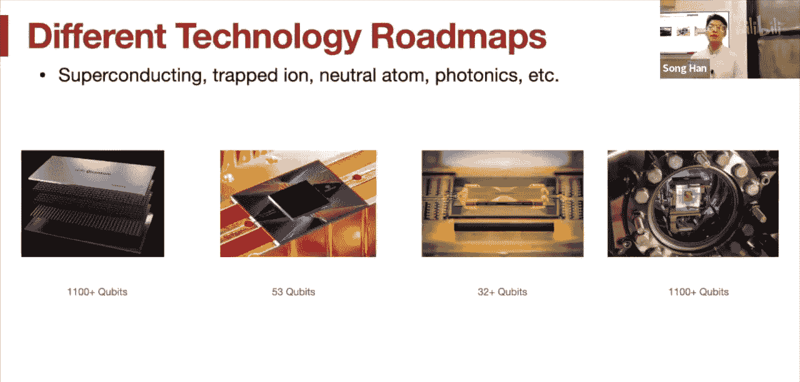

So in the recent years as we see the number of qubits actually increase exponentially so we can see it actually doubles every year in terms of the number of qubits and also the computing power inside those qubits actually also increase exponentially with the number of qubits the reason of that we introduce later。

 but intuitively when you have more qubits is not like in the bit you have one more bit you have just one more bit of information but if you have one more qubits the states the size of the vector the size of information you can represent with one more qubits is actually doubled so we can imagine the computing power also increase exponentially with the available number of qubits so that's increased the computing power actually increase with this double exponential rate how can we leverage this large space so we know that every day we are generating around the three bits of the information from all over the world and actually we can just represent。

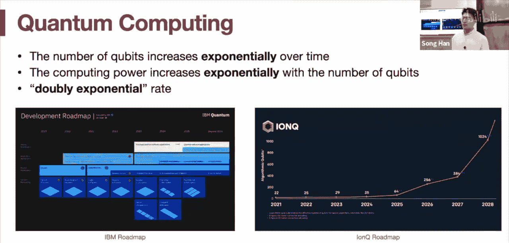

All of those information with only 64  cubits， because we have a two to the power of 64 of the length of the state vector that we can use inside those 64  cubits。

 So if we have a 100  cubs machine。And then the size of the information we can store inside those 100 qubits is actually pretty pretty huge。

 which is one1 to the power of a 30 bit of information。

 so that is equivalent to 1 billion years of the information generated by all the human being at the current rate。

So you can imagine that we have this large space and we have the enormous power to control those qubits。

 but in order to obtain some meaningful results or execute some of the meaningful algorithm。

 we still need to carefully manipulate those states and also design specific algorithms for the quantum device so the history of the development of the quantum algorithm can be separated to multiple stages back to 1980 to 1990s people are actually developing a lot of novel quantum algorithms。

 so actually one of the pioneering pioneer of the quantum algorithm Profesor Peter Sho is also professoror here at MI MIT and he developed the factory algorithm which is a famous algorithm to find the integer number the five factors for large integer numbers so as we know actually for the encryption domain so we are using the RA algorithm so the fundamental foundation for。

Say is that it is very difficult for the classical computers to find the factors of large interval numbers。

 It is easy to compute the product of two large inter numbers。

 But once you have the large inter number， you cannot easily find what are the two original。

Original numbers to start with。 so in that case quantum device actually provide there is a algorithm called a short algorithm to do this with exponentially speedup compared to the classical ones so you can imagine that's a very huge impact。

 so actually back to 2018 there's a national quantum initiative started by the by the US government trying to replace all of the this vulnerable R algorithm to the quantum safe protocol so recently from the needs they have already narrowed down the encryption algorithm to only four so in that case in the future if if there' is no hopefully no new quantum algorithm cracking those encryption encryption schemes protocols and then we can switch to those quantum safe ones so。

So back to the 1980s， people very excited about this quantum algorithm because for the first time。

 you can do something that is very difficult on the classical。

 but with exponential speedup on the quantum。 However， they are have a large assumption。

 which is that the quantum device is very good。 So there is no noise at all。

 So all the things operate with the pure noiseless scenario。

 And also they assume they have a very large number of  cubits， right。

 So maybe millions of  cubits that we can use at hand。 But actually。

 those are not realistic back to 30 years ago， because people are not fabricating any of the quantum device。

😊，So。After 10 years around 1995， people also start to realize that actually we don't have to fabricate the perfect quantum device because there is a theory called quantum error correction theory。

 which means that we can we don't have to fabricate those perfect qubits we can just fabricate some some good enough qubits and then we can use the redundancy from a large number of qubits to build hierarchy of qubits。

 which means we can get a lot of qubits from the physical ones that can correct some some errors。

 so that give us a very large very large confidence that we can just fabricate qubits as many as we want as many as we can and then we can use those qubits to build to for trade redundancy for better reliability。

And then in the last 20 years driven by this concept。

 many of the research teams and also scientists from industry and also from Columbiaia。

 they try to build those new quantum devices and try to push the boundary of the number of qubits so for example。

 Google is building this superconducting device and also IBM they are trying to build a larger and larger number of qubits and also from USTC they are building photonics ones do their photonics quantum device and with this recent progress in the quantum device we are seeing some of the breakthroughs like the utility demonstration and also the supremacy demonstrated by the Google quantum team So there those are some of the practical so there is a question mark on practical one because we know that those algorithm may not have a real applications。

But we do know that if we have some of the quantum device that we can continue increase create the size at one day we can achieve the practical usage on those factorization algorithm or some other quantum simulation algorithm。

So nowadays5 five years later， after the demonstration of the quantum supremacy right now。

 the whole domain actually。It's having an agreement that people。

 we have to continue to push the boundary of this quantum error correction because we still need to make sure the quantum device not only have a large number of qubits。

 but also each qubits have to perform very well for example。

 the error rate should be lower than 10 to the power of minus-8 to perform the meaningful RSA 256 of the factorization algorithm。

Al right， so that's basically the current status of the quantum device。

 A lot of the researchers are trying to demonstrate what is the best quantum error correction scheme。

 For example， the quantum alpha qubbits paper from Google released yesterday is actually trying to do the error correction decoding process using the transfer models and also some other researchers also trying to use the available device because available device。

 they still have a thousands of qubits and whether we can find some meaningful application from the existing domains to do that。

 So that's the density trend or roadmap to do the needs computing。

So so now let's dive a little bit deeper into the basics of the quantum device。

 So just like in the classical device， we are using the bit to represent information so you can you can have a 10 bit to represent 10 bit of information。

 either all zeros or all ones or some combinations of y and zeros。

So the basic component of the quantum device is similar to the classical one conceptually。

 which is that we use the quantum bit to represent information。

 So So we also called those quantum bit at qubit in in short。

 So in inside the qubits even wondering what is the mathematical formation that we can describe the system of the qubits。

 So actually， we are using a vector called state vector to describe。Sorry。

 all the information inside the quantum system。 So just like imagine in a classical system。

 So now we have we are driving a car on the road and then we want to tell another another people。

 our friend， where is our location， right， So we can say， hey。

 we at the location at the mile 100 mile on the on the highway。

 So that's like we can use a number to represent the state of our current current location on a linear1 one day system。

😊，So this is a very compact formation。 So we can just use one number to represent all the information in terms of the location of the car。

 So however， we can imagine we can also use another more redundant way to represent the location of our of the car。

 For example， we can say there are discrete for example， in total 12 different locations。

 and then we can use a vector with the length of 12。 and all the other numbers are just0。

 and then we use one hot representation to say， we are we are at the fourth fourth place only one。

 and then all the other places are zeros。 so we can also send this whole vector to our friend to say。

 hey， we are at this location。 So that also represent all the information inside this system。

So this is very inefficient。 You can imagine originally， we just need one。

Timo number right now we are using this 12 binary numbers。 So however， for the quantum device。

 actually this representation is pretty efficient because in the quantum device。

 we are not the car can not only not only can be placing at one space。

 but also there is a probability of the car being at any of the locations。

 So there will be a combination of different locations。

 a superposition of the locations of the car on the whole road。

 So that's the the magic or the special point of the quantum device。

 So which means with only one qubits， we can represent many different states， not only just a0 or1。

 but but all the different combinations between the zero state and also the one state。

So more rigorously， we can use the the qubbit notation。

 the bracket notation to represent the state of a qubbits。 So classically， we have a。

Either the bit in0 or one。 But in the quantum， we can use this direct notation or the bracket notation。

 So for the zero state， we are using the 10 and for the one state， we can， we can use the。

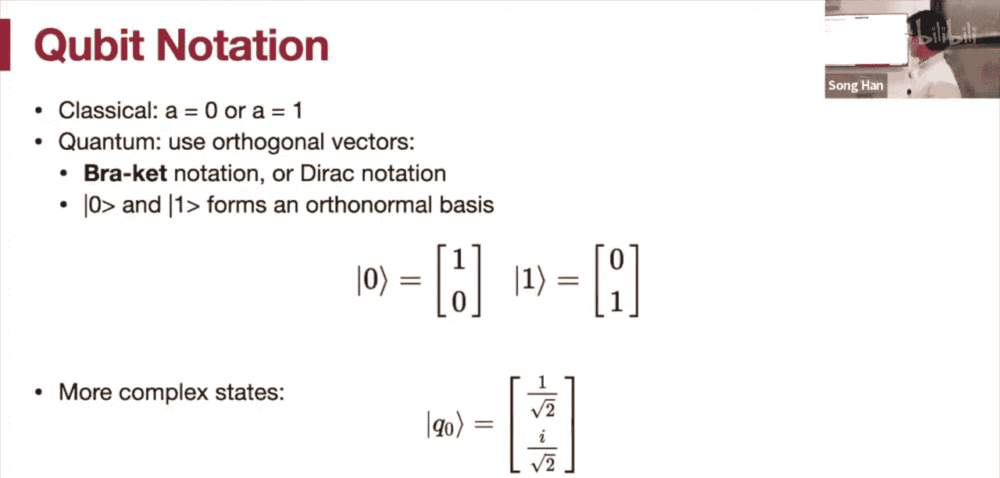

We can use the01 as the as the state。 And for a very complicated state， for example。

 this  Q0 is a superposition between the one and0， so we can have the numbers on both this zero state and also the one state。

 So in that case， you can imagine for one qubits。 We are not only able to represent just one bit。

 but also two numbers， two complex numbers。 So that has a much larger representation power compared to the classical bit。

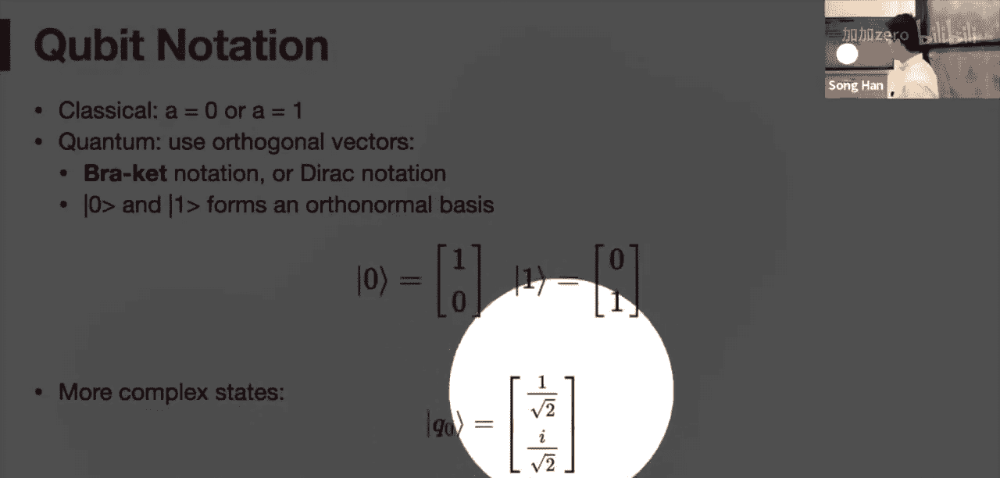

So we can also write this state in the form of the combination of the two basis state right so for example。

 the  Q0 here can be a square root of21 over square root2 of the0 and also plus i over square root of two of the one。

 So that means we have a sum of the energy of the system is is sitting on the zero state。

 another part of energy is on the one state。 So this form， the superposition of the two basis state。

 which is a linear combination of those two。So however。

 when we are actually doing some measurement or the observation of the qubits。

 we are still need to go back to classical1 so the qubits can stay there for a very long time。

 but but in order to read the information from the qubits。

 we have to perform a process called measurement right so the measurement actually for example we can assign some microwave pulses to the qubits to retrieve the information where we can take a picture of the qubits to see what is the state so the important or the non intuitivetued thing about the measurement is that when we actually measure the qubits there the qubits will collapse to either a zero or one so there is no way to directly measure the overall information all the information of the qubits and also during the this measurement process。

 the collapse of the state will be randomly randomly processed so for example。

 for the original state this between the zero and one after we do the measurement there will be some possibility that we get one。

From the qubits and also another possibility to get a zero from that。

 So you be wondering how how can we on earth to do some meaningful computation with the qubs So the answer is that actually we can do the computation for many times right so say we can prepare the qubits for 100 times and then we measure 100 times and then you can get a distribution of the one state and also the zero state so in that case you can obtain the meaningful results from the distribution of the classroom state out of this out of this quantum bit。

So specifically you wondering what is the probability of the distribution。

 how can we know what will be the measuring results。

 what is the probability of measuring zero or measuring one？So mathematically。

 the probability to measure a0 can be computed with this dot product production。 So basically。

 the x here is the same we just introduced。 And also the the here side here is actually the the say we want to measure。

 So here we can use this x， for example， if we want to know what is the probability of measuring measuring a 0。

 And then we can directly compute this process， which is the dot production between the0 vector to the target vector。

 And then we can compute the。Norer two of this process。 So for example。

 the combination process can looks like this。 We can compute this overall value to around to y over2。

 which means that we when we measure this state inside this zero zero dimension。

 there will be a half of the probability that we we obtain a zero state and also， of course。

 there is another 50% of the probability that we measure the one state right So in that case。

 intuitively the qubits that we prepared has half of the energy on one and also another half of energy on0 right So in that case。

 when when you do the measurement， the qubits must collapse to one of the discrete state。

 either a0 or1 and this process， this do production can help us to compute。

 will be what will be probability distribution for this measurement process。Alright。

 so for the measurement process， theres actually one restriction。

 which is that when we measure the state in itself。 for example。

 we want to measure poses here with a self， so the state must be one because the measuring state is the same as the state we are preparing so in that case we know that the down production between the row vector of the poses to the column vector should be one and in that case we know the two coefficient for those two a state should be the norm two of them should add up to one。

 so the alpha square to beta square should add up to one。So as we mentioned。

 there will be observer effect， so which means that we when we measure keys。

 we know that with certain with the probability that we obtain each of the a seat。

 either a zero or one。So the quantum state is called a collection to the classical state。

 so we don't know what is the exact state before we do the measurement so that is very intriguing effect fact because for example。

 if we know that there is a very very famous this conceptual experiment which is called Scher's cat so you are putting short the cat in a box and then there will be some of the some of the itemer counter to count the number of items from this specific device and then after a certain point when you measure when you open the box you know after a certain count of the counter and then there will be a poison released to poison and then the cat that so but before you open the box you don't know is whether the state of the box or the cat will be triggered so that means when do when you do the observation you decide what is the state of the current of the cat。

But before you open the box you don't know what is the state so that is the superposition of the leave or dead of the cat so that's a very interesting mind experiment to do so actually that also observed in a real experiment so in the cus after you you prepare the state in a superposition and then you do the measurement you will see sometimes you measure zero。

 sometimes you measure one， but you do have a distribution of zero and one during this process。Okay。

 so in order to have a very intuitive and also visual understanding of this visual understanding of the state of the cus so we can also use another powerful tool。

 which is called the block sphere。 So here we know the mathematical representation for  cubs is alpha0 plus beta 1 and alpha beta are the complex numbers So we can also represent the beta as the Ei phi beta with this polar representation。

 So in that case we know we can change this complex number representation to the real number。

 So in that case we have this alpha beta and and also the phi those are the degree of the freedoms and also we know because alpha square plus beta square。

 they also need to add up to one So in that case， we also further eliminate one degree of freedom。

And that will concern us all the all the country。 all the degree of freedom will be just two real numbers。

 which is， which is the theta and also the five。 So we can actually represent the state of arbitrary  cubs。

 a single  cubbits on the sphere on a sphere， which is called a block sphere， right， so the。

So one of the one of the this degree of freedom will be theta and also another will be phi so we can see that any of the of this point on the sphere will be uniquely represented by one of the qubs data so this is very useful for us to understand where is the qubbits for example。

 the north pole of of this Bpher will be zero and if we are applying a node gate we are doing this revert of the zero to1 so。

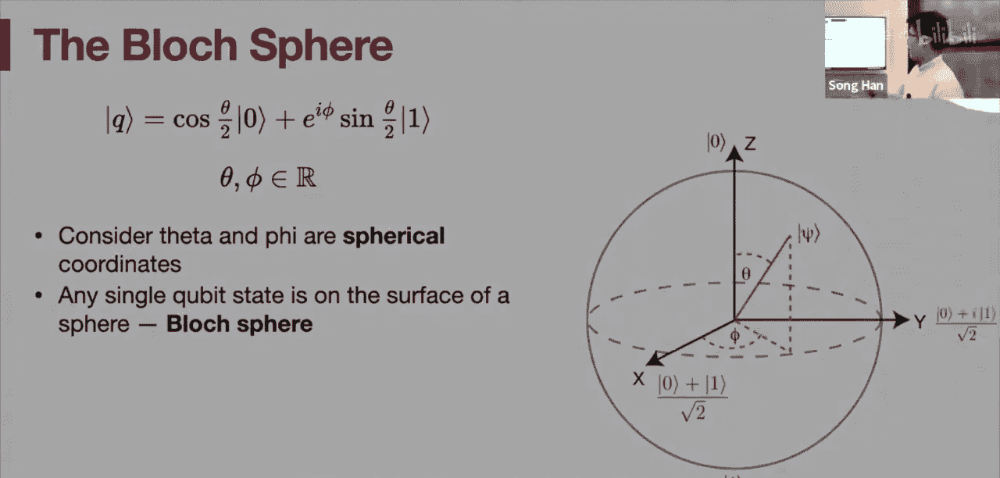

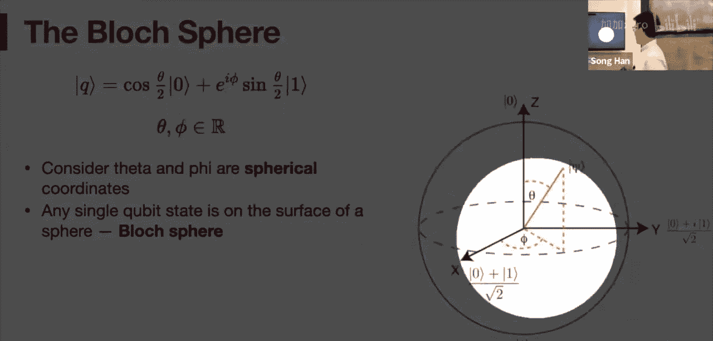

That is essentially doing a pulling this direction from this North Po to the south Po。

 so in the later slides we'll show what is the how we can use this B sphere to better understand operations on the cubits。

So now we have this Q states， we know that we can use the vectors to represent the state。

 and we also want to do some operations or the computations on the state。

So one thing that is very different from the previous classroom computation is that all the quantum gates are reversible。

 what is the meaning of that so reversal means that after you do the computation you get the results right and then from this operation and also the result you are able to 100% to retrieve the original inputstate so。

So for example， if we are doing this node gate with one qubits。

 so say we want to do this flip of the zero state to one stage and then because the not get here represent in this in this matrix is actually a reversible gate and then we know if the final result is one and then the original one original input would be zero so that process is a reversible process。

So one， one question for you is that what is the simplest the reverseersal gate in the classical conversation。

 So we know that the the not gate and also a lot of others like the the X4 or the the the C do gate。

 So what will be the the simplest one。😊，For the reverseers work games in the classical conversation。

Based on the knowledge you learned。Any ideas？不道。It not's simpler than Northgate， yeah。Yeah， exactly。

 yeah， exactly。 So the simplest reversal gate is doing nothing right。 So it's just identity。

 It's mapping the input to output right So in that case。

 you know the input when you get output output because the identity gate doesn't change the state at all。

 So in that case， all all the gates in the quantum actually are the reversible gate because we have to make sure the energy of the system stay the same as the original state So reversible gate can all be represent as these mates or the rotations around this block sphere for example。

 the node gate can represent with this two by two matrix right So for example， in this case。

 when we do the node gate on the quantum state we can we can， for example。

 starting with the quantum QB0 with the zero state and then we apply this node gate and then the zero will be flipped to one So in in that case the pointer will pointing to the source pole of this block sphere So also if we are applying this node gate to the。

One， we also rotate back this vector to the Northpore， which is the zero state。

So besides this node gate， there are also other poly gate for example。

 the y gate also the z gate right so the y gate is in the form of this0 minus0 state and also the g gate which is100 minus1 gate So basically when we have this different basis gate the x gate and also the y gate and z gate。

 we can have a look at what is the what happens when we actually apply those gate to the different states。

 for example if we are applying the z gate to the zero state。

 we know that after computation we are stilling the zero state right So if we are applying this g gate to the one state So where will happen So finally we get the minus1 but physically actually the minus1 vector is not distinguishable with the one state because minus1 here and one only different with this global minus-1 So when we do the global phase actually the data。

Called the global phase， which is not cannot be measured during with the normal physical process。

 So next case， we also consider that the Z get applying。

To the one state will also be the same as as the original state right so in that case we know that0 and1 actually the eigen state of the z matrix because after we apply the C。

 the original state will not change right So in that case。

 the all the combination basis formed by the zero and also one state are also called this z basis combination basis。

So you can imagine that also we have this the the some state that is stay the same after applying the not gate。

 which is the x basis， right for example， the if the original state is the。It's the plastic state。

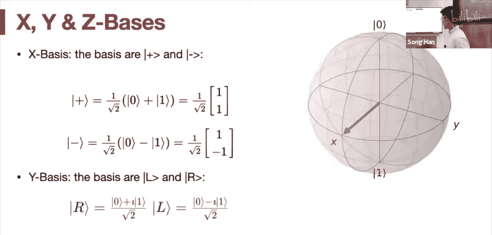

Plus here， and then we can apply this x gate to the plus gate and then we can see the final result will be still the same with the original one and also that's also the case for the minus gate minus state so that case we can we know that the basis gate of the x bases will be plus and minus which is in the form of this one。

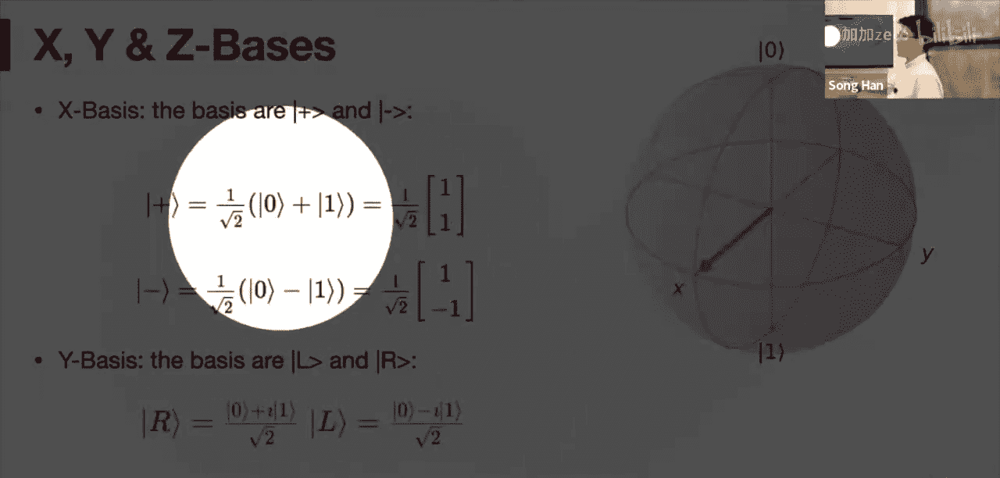

And also similarly for the y basis， we also have the left and right which is this0 plus I1 over square root of two。

 So for the right and left states so those are the actually the several different poles on on the blocks sphere so for example we know the zero and one states are the north and soft pole and also for the plus and one theyre actually the front one and also the back one and for the right and left they are the left the leftmost and also the rightmost pole for this block sphere so that case you know what are the several anchor point on the block sphere that we can easily understand the gates when we have the understanding of this different locations on the blocks sphere。

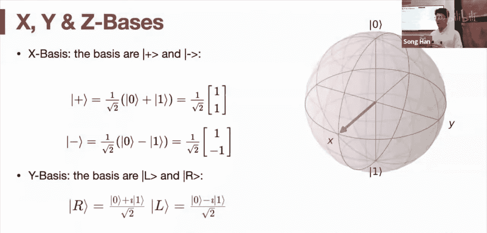

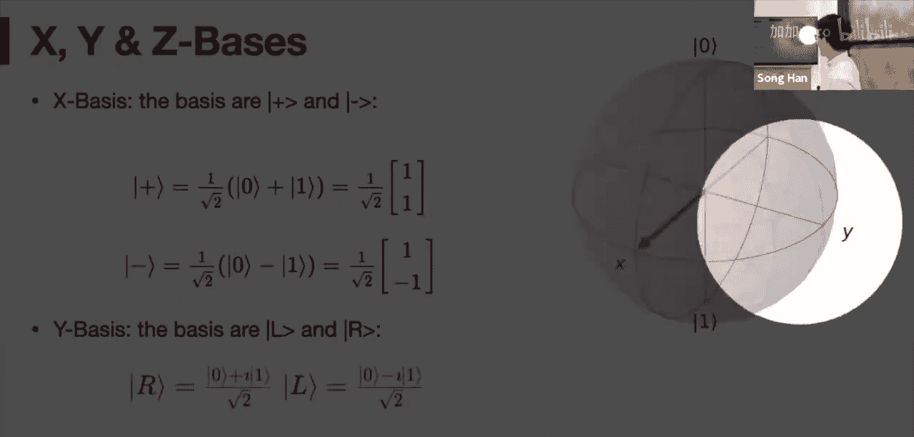

And then after this several polygates， another very interesting gate is actually the He gate。

So the hammer gate is actually a very different one from the classical one because starting from a classical state。

 which is the pure zero state， after applying this hammer gate。

 we are actually creating some superposition right for example。

 initially we can have a this pure zero state and then after applying the hammer gate。

 we are obtaining the plus gate， which is the superposition between the zero and also one。

That's also the case for some other gates， for example， here。

 we are introducing several of the very commonly used single  QbB gates， for example， the face gate。

 the S gate and also the S dagger gate。The most general form of the single qubbit gate can be represented with this U gate right so here we have three parameters inside this U gate so basically when you applying this Ugate to any of the qubbit state on the blocks sphere you can perform the rotation from arbitrary arbitrary location to another arbitrary location as long as you configure those three parameters according to commission you want to do so in that case the three parameters u gate is a universal transformation gate for a single qubit。

All right， so in that case in the second one， we basically introduced the single qubits and also how we can manipulate those gate。

 so just like in the classical computation we are applying those node gates and also those syn node or X gate or X gate we have different kinds of gate inside the quantum device to manipulate the states of the quantum bits to perform the computations we want。

Alright， so in the second two， we are going to introduce a multiple quantum bits。

 So because we know that we cannot just use one qubits or even one bit to compute any of the meaningful computation。

 So we we have to perform the computations on multiple qubits。

 So here here the interesting part comes that for two bits actually we have the length of the vector will increase exponentially to the number of qubits right So for example。

 if we just have a two qubits， and then the vector to represent all the possible state for the two qubits will be of the length of two of the length of four。

 which means we have the energy energy on on the00 state the 1。

10 and also all the way to 11 So in that case， we have to represent n qubits with this。

To to the power of n of the vector and also the normalization principle that we introduce。

 which means the norm to norm of of all of the coefficient for each each of the base will add up to one so that that still holds。

So in that case when we have n qubits actually we have to use this two to the power of n of the complex amplitude in the state vector to represent out state。

 so you can imagine that when we have a  three qubits。

 the size of the vector will be two to power of three which is8 and then if we have 10 qubits and then the size of the vector will be two to the power of 10 which is over 1000 so it is very difficult to simulate a large number of qubits as you can imagine because when we have 20 or even 50 qubits and then the size of the vector that we have to store in the classical memory will be2 to the power of 50 so that is too large to the simulation so that also give us actually give us the advantage of us to store the information or do any computation in the quantum state。

So here we can give an example for a complicated case。

 which is the collective state for three qubits， so basically all of the qubits will add in this hammer gate we introduced in the first section and then the collective state for the three qubits will be one to the one over square root of eight and then there will be a equally distribution of energy and also the probability on all of the possible basis gate。

 which is all eight one here。So you may imagine you may wondering what is the effect of the single qubit gates on a multiple qubit system right so what happened if we just apply one node gate on one node qubits in the three quB system So actually when we actually doing that we can do this computation for a chronic product between multiple gates for example。

 we have this hammer gate on the first qubits and also the node gate on the second qubit in order to compute the overall effect of this H gate and also x gate。

 we can perform this Ch product between the x matrix and also the hammer matrix and we obtain this overall computation matrix in the size of the four by four and then we can compute what will be the final state after applying this two gates to the two qubits。

And also we have this joint energy matrix， which means when we have this。For example。

 the node gate only on the cubebit1， which is similar to the previous case。

 we can also compute the chronicer product between the x and also the I。

 and then we can obtain this4 by4 matrix for the multiple QB system。

So here I'm going to introduce one very interesting gate， which is the SL gate。

So C node is actually the short for control node gate the control there are two qubits as input in this syn node gates。

 one is the input one is the control qubits， another is the target qubits。

 so the control is the Q0 here and also the target is Q1。

 so the control node means that when the original qubits the control1 qubits is0。

 and then we don't do any competition on the target qubits。However， if we have a1 on the Q1 Q0 here。

 and then we have to perform a not on the Q1， which is a flip， the state on the Q1。

So in the middle here， we can see the true table for this gate。

 So if the target and control are both0 and then the output will be also 00。 However。

 if we are doing the control qubits will be one as in the second row here and we know that the target qubits have to also be perform this flip operation so the final output will be 11 all the way to the bottom row。

 which is the input as11 and then we need to flip this target as the flip from1 to 0。

 so the output will be 01。So in that case， we can construct this true table for the signal case。

 right， so we can know that all all the input are in the in the yellow representation and also the output will be green。

 So when we actually input this0，0 state。

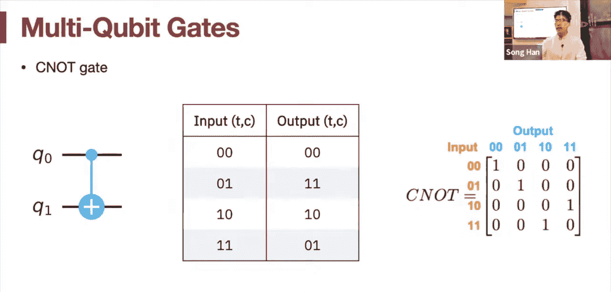

And then the output would be also0，0。 However， if I input this1011 set。

 and then the output would be 10 because of this flip of the target qubits。

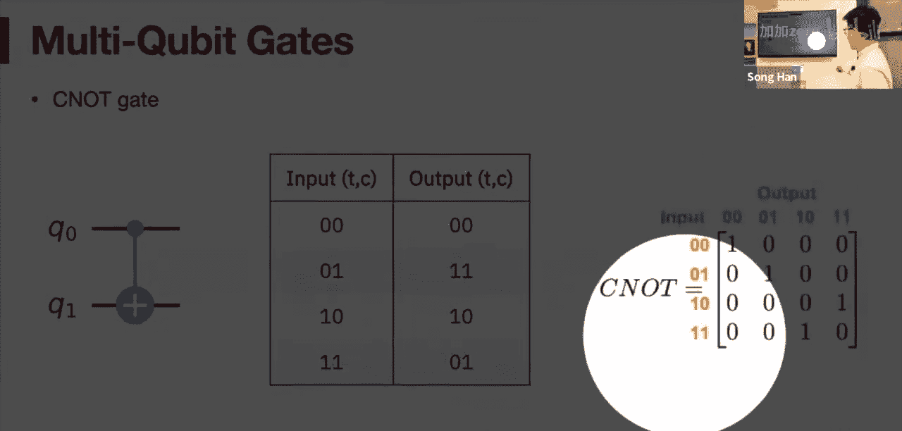

So in that case we can imagine that the syn node actually performing performing a swap of those two right so when we actually input this agent in in this format and then the output will be simply swap the location of this a11 coefficient and also the a01 coefficient as shown here。

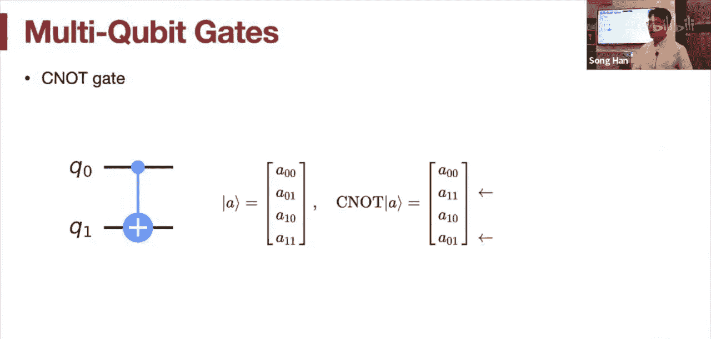

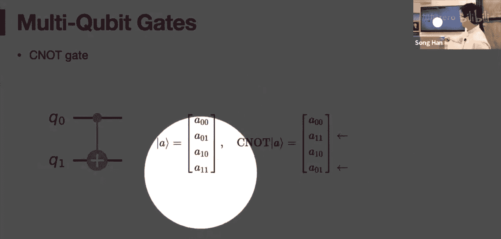

So how can the syn gate create one very important concept in the quantum computing。

 which is entanglement， so imagine that if we are doing this hard gaze on the Q0。

 and then we can obtain this zero plus state。So if we are performing this syn node gate the from the Q0 to Q1。

 after we applying this hammer gate on Q0， we can actually obtain a very interesting state。

 which is the silver position entanglement between the2 qubits because the state here is actually one over square root2 of the00 plus 11。

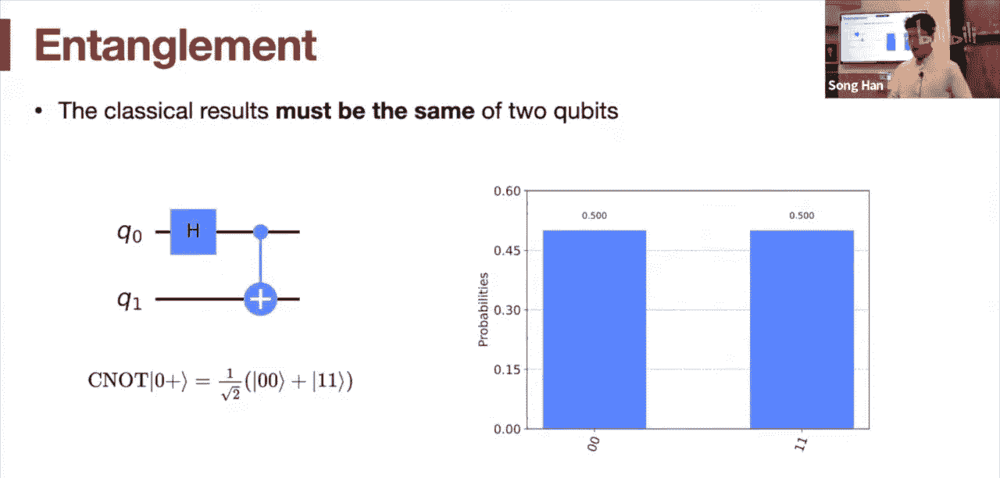

So what is the implication for that， So that means the two que are either in the all in the zero state or in the one state。

 right， So for example， if you are preparing the state for 100 times and then you measure that for 100 times。

 you can see that 50% of the times you obtain this00 state and also another will be  one1 state。

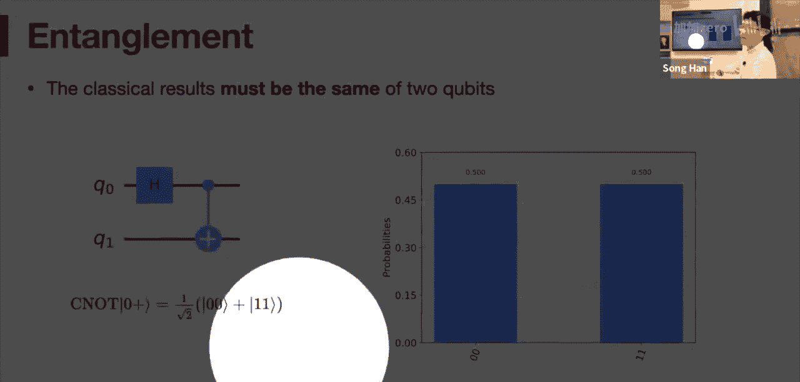

So let's imagine a very interesting scenario。So say I prepared this entangled pair of two qubits with thin 00 and 11 state and then I give one of qubits to you and you get on the starship and then you can go to another side of the universe and then you can measure the qubits right you measure qubits and then you obtain say hey we obtain a zero and then if I measure also measure qubits at the same time。

Or just one one second after you measure cubits， I will obtain the same thing with you R estate。

 no matter how how long its distance between us。So that is because two quebits is already entangled。

 So neck case even the distance between those two qubits are far longer than than the traveling distance of light in one second。

 we can still obtain the same result。 either you measure 0。

 And then I also measure 0 or you measure one and then that case measuring result will also be one。

 So that is called actually a spooky interaction interaction in the distance。

 which means somehow there there seems to be some power that the conducting those two qubits。

 And then if you measure this in one side of universe that also impact the result of another side。

 right So that case you may ask whether we can do that using this entanglement between the two qubits to do some communication So that case we can achieve this。

Faster than light of the communication between two places， right So however， unfortunately。

 we cannot do any of the communication with this process。

 actually that's the no non communication theoryorem。 So the reason for that is that for example。

 you measure one on your side。 and then actually you are not able to configure the qus。

 right So it's a purely random process。 you just measure one。 and then I know I measure one。

 but you cannot flip the qubits to to communicate one bit of information because all the process is random。

 So in that case the only thing we can guarantee is that the two states are the same。

 but we cannot send even if one bit of information through this process。

 So that is the non non communication theorem of the quantum communication。Alright。

 so let's back to the entanglement here so actually besides syn node gates there are also some other gates that can create some entanglement or perform this interaction between two qubits。

 for example one gate is C gate so C means that we can use  Q0 to perform a Z gate which is the the Z gate we introduce in the first section to the second qubits that is equivalent to perform hammer gate first on the target qubits and then perform a syn node and finally perform another hammer gate。

And also we can perform a swapet， So what is meaning of swap。

 So say if I have something and then I can swap this to you。

 that means we can swap the information of two qubits right So swap means we can we can totally change the information of two qubits with those swaps and swap can be also implement or decompose to three syns interleaved to each other。

And also beside this s gate， we also have the controlled rotation X gate and also other many of the other signal gate。

 many of the other twoubic gates， so control control RX or the CRX actually is in the format at the bottom。

 which is that if we have this one state on the first qubits。

 and then we can perform this rotation X of the arbitrary degree on the target qubits。All right。

 so now we， yeah， please。So that's a great question。

 So the actual implementation differs for different kinds of the technology roadm。

 So on the superconducting chip， for example， we are fabricating the artificial qubits and then the gate is implemented with the microwave pulses microwave pulse signal so we have this transmission line to the qubits and then we can compute the shape for the pulse and then the area under the shape will determine say the determine the rotation theta here。

 the angle here so we can change the shape of the microwave to perform different gate on on the superconect qubits and for say another technology roadm like neutral item device we are placing a neutral item in the vacuum chamber and then we use lasers to to illuminate the items and then we can determine the length of the laser so how many seconds or microwavesecond we illuminate laser so in that case we also apply those gates to the actual qubits So that differ based on different kinds。

Of the technologies。Any other questions？Okay， cool。呃。

So now we come to the third section which is the quantum circuit so the quantum circuit actually now we already learn which what are the qubits and also what are the basic gates on the qubits right so the next step will be construct a quantum program that we can do some meaningful computation right so we don't just want to manipulate one qubits we want to manipulate a set of qubits to perform some minimal computation and also obtain the result。

So here we can firstly have a look at the overall component of the quantum circuit right so firstly we have this initialization and also recite part of thequBs which where we want to initialize the QBbit state with our with our problem formulation。

 for example， if we want to do some quantum machine learning task and then we want to encode the information。

 say mainly it is the image or some of the sentence we want to encode embedding to the qubits。

And then we want to apply some of the quantum gates， for example。

 the hammer gate or the syn gate to perform the manipulation of the states。

And then finally we have the measurement of the qubits to obtain the final result so that's like we can stay we can just like in the classical CPU right so in the CPU you can fetch those different information from the D to Sri and then use ALU to perform operations and then finally we need to load we need to store those different computer result to the SraM or to the cache as the final result So that's also similar here we need to initialize the  Qbits and then do the computation and then finally do the measurement。

After the measurement direction can also be some of the classical post processing of the qubits。

 for example， we can based on the measurement outcome。

 we can do some classical controlled quantum gates here。

So here let's just have a very quick look at a very simple circuit。

 which is the either circuit right so this is also the I believe this first class we learn in in the digital circuit design so we want to design an either circuit So what can we do in the classical digital circuit design we can add those actual days right so because when we actually do the adding of those two inputs we have this true table on the bottom right and then for one of the bit which we can directly use that as the fleet this first bit and then we can do the C note of the Q0 to Q1 as shown on the bottom left So in that case we can create this quantum circuit。

 which is basically performing this either circuit。

So what happened if we also want to perform this half now we have this half error right so what happen if we also want to perform this full error。

 which means we have to calculate this carry bit right so in that case。

 we can also use this controlled multicontl syn to based on the state of the  Q0 and  Q1 to flip the  Q3 right so for example if we are inputting one either of the  Q0 or  Q1 is a1 and then we know the carry bit should be to be also one in that case we can obtain this number on  Q3 but if all of the two all of the Q0 word the Q1 or the0 and then we don't have to perform any of the flip on the  Q3 So in that case we can see the basic operation to get this。

ババにですなてり返えず。Is it。😊，Like where the green boxes and I know that blues are the CNnots。

 but do you need the green boxes properly done。So we mean the first state here。Oh。Okay。

 so let me see。Is the initial state yeah， so here is the initial set to you can see the two separation line here。

 right， So the first one is the the initial state that we we want to add a one to a one， right。

So in that case， we need to perform an Xk to perform the initial safe preparation。

So and then all the calculation in the middle between two dash lines are the provider we are using。

 and then for the two measurement we obtain the final result。Okay。

 so that is the basic process of the flu。 So here we can have a have a look at a very quick example of a very simple quantum machine circuit right so for example。

 if I want to do some m classification So in that case。

 the first one we need to do first thing we need to do is to encode the m image to to the quantum bit。

 So there are many of the process to encode the classical state to the quantum bit。

 So here we are just using a very simple one， which is the phase encoder。

 which means we are encoding those values of the pixels So here we can roughly see theres a downsled number two So in that case we can use this four by four image and then we have the pixel values for each of the pixel here in the gray scale and then we can encode the value of the pixel grayscale number to the rotation angles for those different rotation gates so here we can use four by four of the array of the encode。

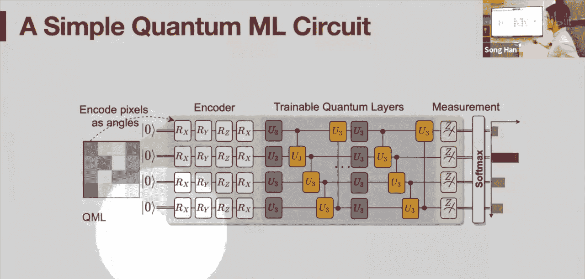

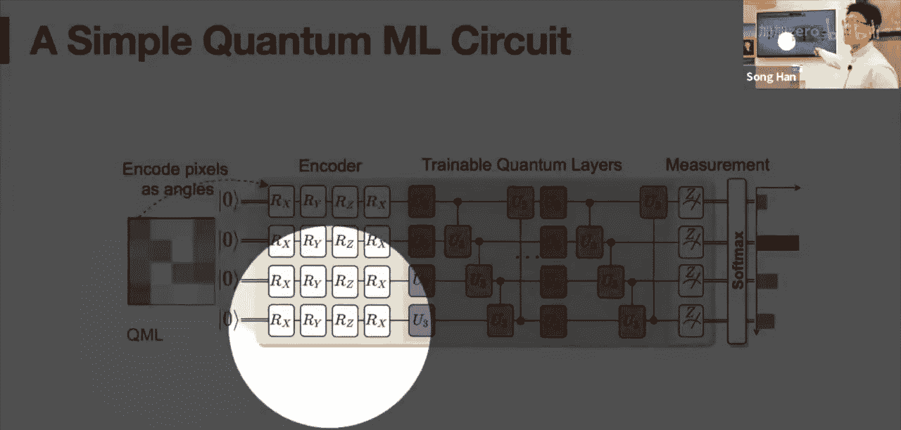

Ecoding process， but also there are many of the other encoders that we can use。

 Some of them are using this using this amplitude encoding。

 which means you directly encode the state of the image to the to the qubbit state or you can use this binary input where you can where you can basically just use this a large number of qubits and each of them is a one either one or zero。

 So there are many ongoing research to trying to find what is the best encoding process to encode the classical state to the quantum state So after that we can also。

Haveable quantum layers in the middle in in the color of the gray and also yellow。

 So those values those are the U3 gaze and also the controlled U3s right So those gates actually can perform the the desired manipulation of the input state。

 for example， you can train those values based on this propagation process to make sure that the state you are performing on is actually the final you are doing the computation represent some of the unique aspect or unique information about the number or the digit that we are in the input image right So in that case after this computation or of the input state。

 we can finally do a measurement So the measurement we can obtain the full numbers right So imagine if we are just doing say full number four digit classification。

 we can simply do some post processing， maybe just adding one soft max as the post processing and then we can obtain the values for each of the digits。

え？So that is a basic workflow of the quantum machine process。

 So we have this encoder to encode the classroom input。 and then we have a。

Different layers of the quantum device to perform the manipulation， yeah， question。你说的。

That yeah4 weeks。Yeah， so the question is what happened if the output dimension is different from the input or the number of classes we want to classify。

 right？So the answer is that actually the post processing here one thing is that we can perform the measurement on many different basiss right here you can see we are just measuring on the allz basis right so we can also measure on the for example all X basis or X basis。

 So the actual number we can obtain from this four qubits is at least two the power of four which is a 16 numbers so in that case we can we can we can later on adding a post processing like a fully connected layer to classify as 10 class or like another number of classes So important thing is that we can doing different measurement to obtain the information from the quantum device and then we can adding one more layer of the final post processing to match the dimension of the information we have to the number of class we want to classify。

はい。Other questions？There's single like five5 to five that we have five with RX file wire， RX file I。

嗯。さす。Yeah， so the question is what happened if we have a5 by5 image。 Yeah， that's a great question。

 So actually if we have a five by5。 So the encoder here， first of all， is actually only one example。

 So there are a tens of different kinds of encoder So the quick answer is that we can just adding one more qubit and then we can encode the five by5 gate to this where we can also use like maybe 25 qubits right and then we can just adding one gate to each of the qubits to encode state So it's just like the neuro architect search in a classical machine learning in the first layer。

 you can use you know three by three convol， we can also use a five by5 right we can either we can even do a flat of the image and then just adding the just adding the the fully connected layers where we can use transformer models So there's a tenth of a probability or a very large design space to encode the information to the quantum gates but in this scheme typically we can increase the size to5 by5 to。

To stored information， yeah。够。All right。Okay， so this is a very basic scheme for the quantum machinening circuit。

So basically we had this idea of how we can use the qubits right and also how we can construct the circuit to compute the meaningful results obtaining from the quantum state。

 so you can imagine that actually for this quantum quantum circuit imagine that we have a very large input by for example。

 a very long documents for a long context learning so in the classical device we are suffering about this projecting increasing of the attention if are're using the transfer models。

 so however on the quantum side， we can easily encode we can easily use relatively the log a logithmic number of the qubits to encode the very long context because with this four qubits we can store the two to the power for of the information and with say 100 qubits we have extremely large space so we can imagine if we are able to find very efficient way to encode the information to the quantum state and then the processing power would be very。

And also， the number of  cubits required is a very small number compared to the classical device。

 however。In order to encode the information to the quantum state actually there is a large difficulty so typically in order to encode a state very accurately to the quantum state。

 you also need to pay the cost of the exponential deep of the encoding circuit right because typically all the qubits are initially to the all zero state and then if you want to say if you want to encode to arbitrary state and then the number of gates you have to apply in the initialization stage is also very large so that's actually the current bottleneck or one of the challenge for the quantum churn community is thed data encoding or data uploading process how can we efficiently represent the state in the quantum device with a very small cost so that's an ongoing research efforts to trying to reduce reduce this cost and also like fully leverage the available number of qubits。

Allright， so now we have the idea about on the algorithm side what we can do to manipulate the state of the quantum base and also what are the gates we can perform and also what are the quantum machinening basic models and on the device side we are going to just introduce some basic idea of this noise intermediate scale quantum era So as you know in in the in the machine learning community people also want to for example。

 classified this different several different train of the deep learning or machine learningning and currently we are staying in the the third third train of the machinechi learning right so that's also the case in the quantum so we are actually have several large waves for quantum and right now we are actually in this needs era So N means that we are have a noiseisy qubits so that means the quantum are quantum base are very sensitive to the environment So when we actually doing the computation on the classical device For example you are open the laptop and then you just use。

In this one plus one and then you are。You you enter the the equation you want to compute。

 and then 100% of the time you obtain a correct answer。 However。

 if you are doing this on the quantum device， right so you are doing this full error on the quantum device1 plus one as we just introduce in the last section there will be a pretty large non significant probability that we obtain obtain a wrong answer。

 that is all because of the noise on the quantum device because all of the operations like the node gate and also the syn gate cannot be faithfully implemented because of all kinds of noise For example。

 the control wave。 the microwave pulse are not are not this perfect shape and also there are some interactions between the qubits to the to the environment and sometimes the。

The cosmic rate from from the universe and also from the sun。

 they also will impact state of the qubits。 So it's a very vulnerable and also very fragile process to compute on the qubits So that's why we are calling this a noisy process right so typically you can see that error rate for for the single qubit single period poly they are on the range of the10 to the power of minus-3 and also for the thin they are 1 to power of minus-2 So that means when you compute 100 times of one plus one on the quantum device you will get one run answer wrong answer right So that is actually not very very good result because we want to when we actually do a more complicated communication。

 say you want to execute some quantum machine models so there will be tens or thousands of gate or even millions of days and then if the device is not reliable enough and then the result will be also not correct。

And also besides this noisy， we also have limited number of qubits right so typically we have a tens to hundreds or up to several thousands of  cubits in the available device。

And also we have a limited connectivity between the cubs。

 so here is a figure for the IBM Washington device for example。

 we had this this brick like the shape of the quantum piece。

So it is called a heavy hexagon because on the each of the ring here there are 12  cubits and also theres six vertices and also there will be one additional  cubits on each of the edge。

 so it's called a heavy hackxagon topology for the IBM device。

So right now there you can if we are placing those available devices from superconing IBM。

 Google and also Tri ion those INQ continuum devices on this two dimension grid we can see one dimension is the system size and also another dimension is the error tolerance right so we can see it's better to have a very large device and also have a very large error tolerance on the top right corner。

However， we can see on the top right corner there are actually the requirements for several quantum algorithms。

 so one of them is the shores start with them to do the factorization large number of factor factory and also the grow search for the structure database search and also several others for quantum chemistry task we can see that there is still a pretty large gap between available devices and also the requirements from the hardware side right so our idea is that whether we can do some computation。

 especially for our from the computer system background and and also the architecture background how can we do some of the optimization on the middle layer to close this gap right so for example。

 one of the very important task and also one thing that we can contribute from not only the device but also the C computer system side is that we can do the qubit mapping process to choose those good qubits to start with so for example in the。

IBM device here。 We have 127 cubits， but not not all of thequbits are created equal， right。

 You can see that some of  cubits。😊，Have a darker color and some others， they have a lighter color。

 So that actually indicate the error rate for each  Qs。

 So one in very intuitive way is that we can just choose those very good qubits， right。

 We can choose those  cubs with very high reliability of the operation to do the computations。😊。

So that's also the case for all the intuition behind this  cubid mapping process。

 But also there is another difficulty。 So for example。

 here we have four qubits Q0 all the way to  Q3。 and we have the topology on the right hand side。

 So if we want to do the first gate， which is in this red dash line。

 and we can simply perform a direct interaction between the P0， physical qubit0 and P1 Ph quid1。

However， if we want to perform this gate between the Q0 and Q3 so we can see that the p0 and p3。

 they are not directly connected to each other。 So in that case。

 there is no direct control direct gate that can be performed between those two qubits。

 So what we can do is that we can perform a swap gate between the p0 and P1 P0 and P2 right so we can swap the information of the p0 and also p2 right So after this swap gate。

 you can see that the p0 right now is locating in the center of the grid and that has a direct connection to the P3 on the top right corner。

In that case， we can later on apply this directly between the P0 and P3 to finish the computation according to the quantum program on the left hand side。

So we can imagine that in this process we are adding one additional gate。

 which is the swap gate between the P2 and P0。 So how can we actually reduce this overhead so we can imagine that because of the large error rate every swap gate we insert to the system we also introduce a large error so in that case we want to minimize the error that we introduce to the whole system so that is actually one of the very widely studied widely studied topic so how can we reduce this swap insertion overhead during the cube mapping process So here I'm going to introduce this one example which is called a sub cube mapping process which is also used in the IBM key framework right so basically the idea behind this is that we can have a look at all of the swap candidates so we can see for example。

 we can do the swap for the p0 P2 and also p0 P1。 So there are six available。

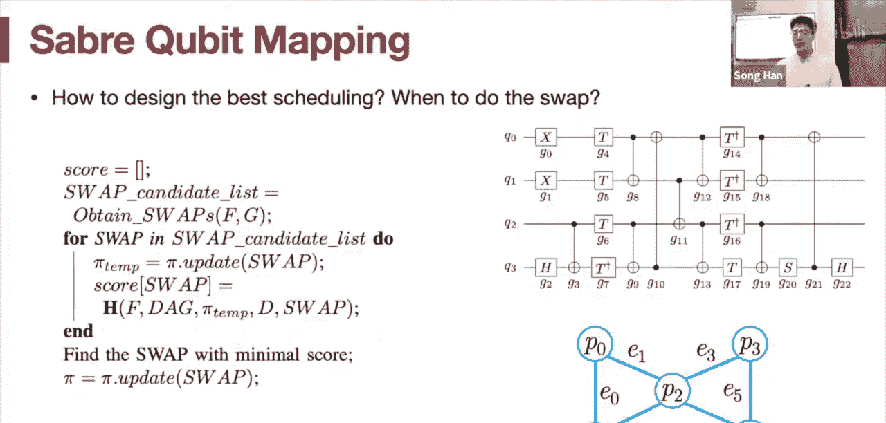

Sb in the candidate list and then we can see each of them to see what happened if we performed the swap between those two and then there will be a H which is a hereuristic function to compute the score for the topology after this。

 for example， if after this swap is， there are many of the direct gate can be computed and then we have a high score for that swap。

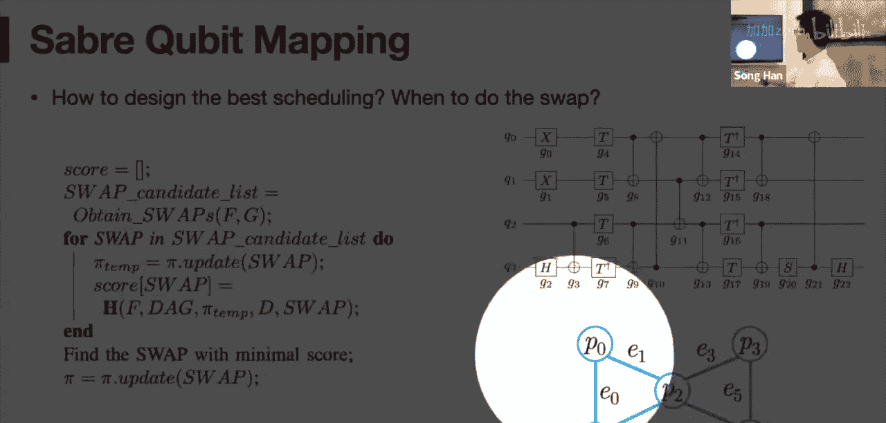

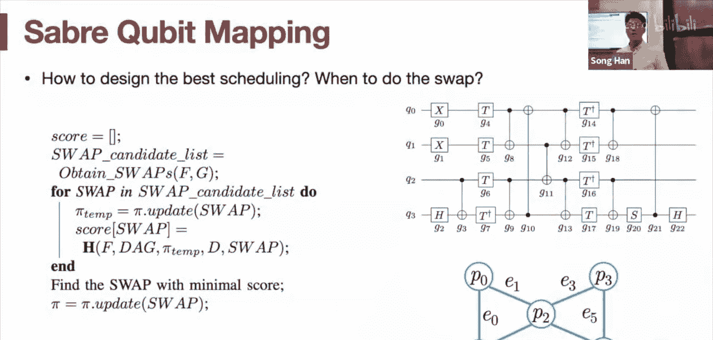

RightSo we can do this to compute the swap for the score for each swap gate。

 and then finally we can find the swap gate with the minimum score to perform the swap。

 and then we can perform that at the end of this comparison process。

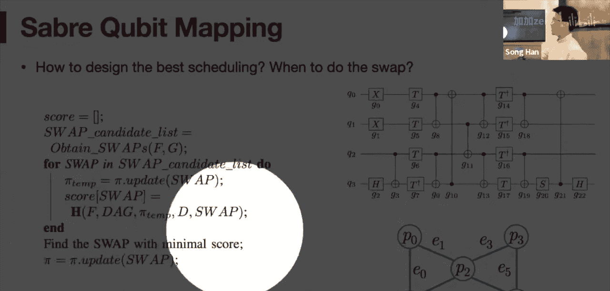

And then with this， there is a interesting heuristic also to do this firstly。

 with this initial mapping， right， we can perform the swapb insertion case。

 and then we can obtain the final mapping。😊。

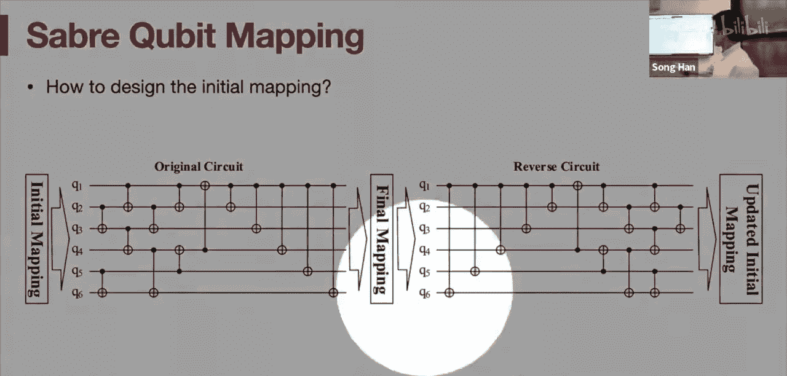

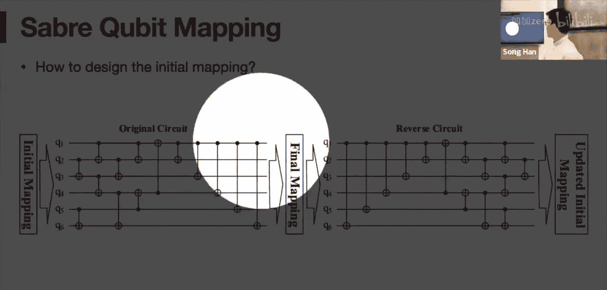

And because all of the clone circuit， they are reversible， right？

So the hereacy here is that we can just reverse the original circuit and then we can do the mapping from the start and then we can all the way going into to the initial one right so which is the updated initial mapping so in that case we can update initial mapping and then do the completion to the end and then do the reverse one to go all the way to the first so in that case it's like a bootsstr process to always improving the initial mapping of this process and then we can always have found a way to reduce the number of swaps we have to insert to this system。

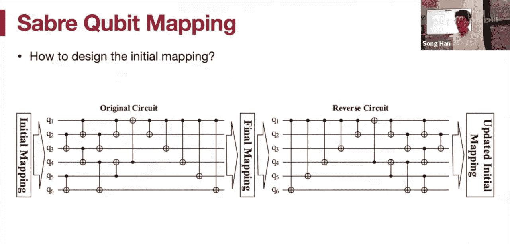

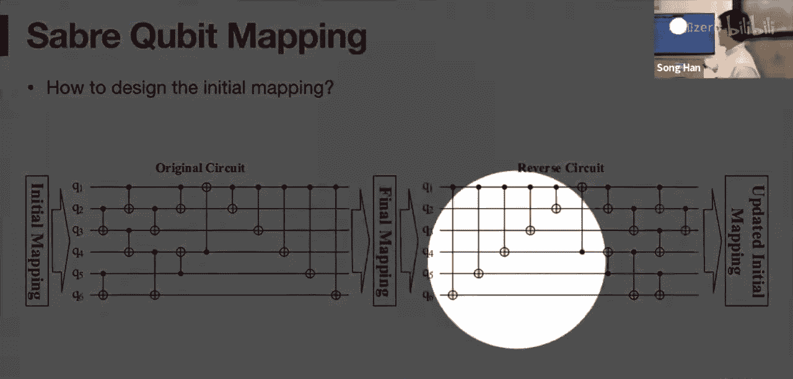

So this is the Hubased acute mapping process and later on we also introduce the quantum nuts framework which we develop in our lab。

 which is actually basically trying to use some of the machine based method like the evolutionary search or the basin organization or reinforce learning to find the best initial mapping so the basic idea is that we have this evolution search engine on the left hand side and then we can generate a lot of the initial mapping candidates and compute what are the actual overhead on the real device and then we can provide feedback to the original search engine。

Alright， so finally， I'm going to introduce a very simple example on the neutral item device compiler。

 So as we introduce and also。😊，The questions we discuss we have the superconducting device and also another very popular device that we have on hand is actually the neutral item device。

 So for the superconducting ones， a neutral item and also some type ion device。

 we actually can just access them on the Amazon Web service or Microsoft Azure so we can just log in AWS and then you can just know directly access to those device to play with。

So for the new type device， we can see the number of qubits inrison is also very significant right so back to20 around 15 years ago。

 we have two qubits demonstrated and then last year over this year。

 the start of this year there's already been over 60。

000 left qubits demonstrated by the contact team。So in the neutral item device。

 we are actually placing all of the item all of the item inside this vacuum chamber right so we are placing those items in this 2D grid and then we can do some illumination of of the laser to those items to perform the necessary gates。

So this kind of device is important is very important because several aspects。

 first one is because all of the qubits are just items right so the items are prepared by the mother Natures all of them are identical to each other so also they have a very long qubbit lifetime compared to the superconducting they typically have a 10 seconds which is around like 1000 times longer of the cubbit lifetime and also within a very small area。

 one millim square we can fit over 10000 of qubits。So here inside this quantum device。

 this new item device， we actually have different types of thequbs array。

 one type of the array is controlled by this spatial light modulator work called SOM lasers right so basically we have this later to create this light pattern and then we can place those different items on this grid and during the computation of the whole process we cannot change the locations of those items。

And also， there is another very interesting kind of the neutral item array。

 which is called this mobile item array。 right， So the mobile item array means that when we actually change the locations of the lasers and then。

😊，Those items st on the crossings of the grid will also change to corresponding locations。

So in that case you can imagine that the topology of this neutral item device is actually pretty flexible right for example。

 we can perform the movement of those items during the computation and then there will be some new pairs of the items can be performing this eligible twocbic gates right so here we are showing that all of the cubits within a certain range of the distance which is called rubber radius can perform the eligible gate。

So in that case， you can imagine that that gave us a very large design space to start with。

 but also some of the challenge to perform the compilation。

So here one of the framework is the atomic framework which for this kind of device。

 so the goal of this framework is that we can provide the software framework to perform。

 to decide which item to use to start with and also schedule the movement and also provide this insight and also guidance for the future device right so because we want to understand what is what is the best the mapping between the items to the specific locations and also what is the scheduling of the movement of those lasers during execution。

So here I'm going to give a walking example。 So basically the top the circuit on the top is the quantum circuit we want to execute right so in that case we first map those items to the corresponding locations and then we can move those items the to the corresponding positions and then because we want to perform the gate between the Q0 and  Q1 and also  Q2 and  Q3 So in that case we can directly illuminate the global laser to perform all the gates between them right so in a second step。

 we can also perform the illumination of those。Those two gates。

 So all the gates within those distance， the the pair of the one and 2 and also pair of five and7。

 they have to perform this gaze altogether。So in that case。

 we can perform this the movement for each step until we finish all of the gates indicated by the Qua circuit。

So this is the basic compelling process for the news item device。

 So there is also some of the recent progress on on this device to trying to minimize the disrupt gate that have to insert during this process so the basic intuition is that for all of the qubits all of the items inside of a。

 So if we have a look at the one array here， for example， the blue one on the top left corner。

 we know that we can always perform the movement of other arrays to make sure any item in another array can be very close to this one。

So in that case， we can formulate this company map of company of this device as a complete multipart graph。

 So the reason for this is that for any of the item pairs as long as they are in different sub different sub graphs。

 we can always perform a computation between them because we can always perform the movement right So in that case。

 one of the strategy to reduce the swapwab overhead is to perform directly perform construct those two gauge frequency graph。

 and then we can find the mass cut mass K cut of the graph so that we can find the separation of thosequbits to different subgraphs。

RightSo that is one of the compiler optimization we can perform to make sure we can reduce the overall number of swaps we have to insert to the completion process。

All right， so we also have several other organizations， for example。

 how to perform the mapping inside this process and also how to perform the scheduling but here I'm going to skip this。

So the basic intuition is that we can always perform this part by part。

 for example we can firstly find the gate in the front side and then do the completion for this process and then to eliminate the lasers and then we can do this process for multiple times to make sure we can finish all the completions。

Okay so here I'm going to just briefly show the result compared to the previously previous work。

 so basically there are some works on this compiler trying to formulate all of the completion process as the S SMT problem and then they can use an ST solve to find the opt solution so we can imagine the SMT server can always provide the opt solution。

 but the difficulty for that is' not able to scale to a large number qubits large number of qubits because of the cost of the ST solve so in that case compared to the solve based method。

 the compiler here， the atomic can always be a very scalable so basically for a large number of qubits over 1000qubits we can also use this compiler within the 260 seconds of completion time。

 we can find a feasible solution to run on the available device。

So this is very important because imagine that we already have access to those large devices。

 so we need to find this very specific completion process for us to run those different combination and lots of different algorithms on this device。

And also here the compiler here can also provide the guidance for the movement speed。

 so basically we can say what is the time for movement and also unless the error rate for each of them so in that case we are able to provide this a very important insight and also the guidance for the future development of the new item device。

Okay， so this is the overview of the compiler process for the niche item device。

 which is another very popular available device now ofdays。

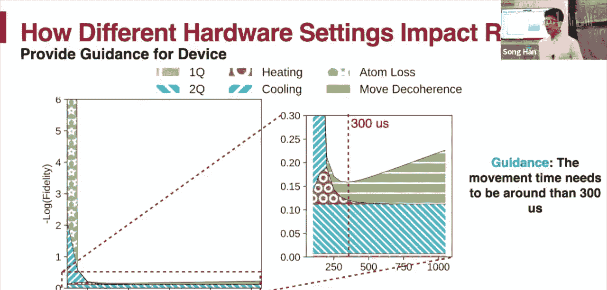

All right， in summary in this lecture we introduced some basics of the quantum device to give you a big picture of how can we copy manipulate those devices and also the qubits。

 we introduced a single qubic gate and also multiple qubic gates to manipulate this large exponential size hubber space and also we introduce the quantum circuit to perform the either process and also the quantum sharing circuit and also we introduce the NC era which is the current era and also the compil for the supercon device and finally we also give an example for the neutral item compiler。

And in the next lecture， well also continue our introduction of quantum sharing。

 So we'll introduce more advanced models of the quantum sharing。

 And also how can we incorporate the noise of the real device to improve the robustness and also scalability of the quantum machine models。

 So with that， thank you very much for the attention。 I'm happy to take any questions。 Thank you。😊。

Yeah， I。How it's like people go on IBM design there like we just have to any build of their designs in the dance on their。

So your question is how what is the specific process they fabricate the device？

Does go illustrate how Web IBM design and connections we be to build in that to kind like。

Okay so one of our work actually influenced the software stack of IBM so basically they try to for example。

 after they fabric device and then they need to have a software framework to do the compilation so one of our compile is actually one of the default process or the ecosystem process in the IBM device to the quantum machine process so and for the device we do have some of the work and also the community have some work to do some code design of the device to the quantum algorithm so I think right now the IBM device is still mainly the same strategy as they fabricate in the first place so they didn't change much of the heavy hackxon device but I think in the future we do have a lot of work to try to implement the quantum error correction code on the device so in that case we propose some of the best topology of the device to implement those code according to the structure。

The error question code， the checkings and also you know the the interactions。

 And I think in the future， the device must be co designed with the error correction code to implement the most efficient error correction for tolerant computing。

Yeah。嗯。Yeah。And there's a question there。对。And also for the Google they have this alpha qubbit paper right so they are using the transformer based models So actually before that we also have a paper which is a transformer QEC So actually we also propose transform based decoder for the surface code So I think we have also this influence on the algorithm side So how they design this decoder part So I think for the hardware side is so we try to find some more impactful way to collaborate with them So one example is we collaborate with Dr。

 Wi Oliver's group here， so we try to do the placement of qubbits with some of the automated process and then we try to in the future we try to have some possible takeout of the qubbits that will be a fully automated design with the machinery method。

