# 【2024】【精译⚡TinyML和高性能大模型推理】麻省理工学院•6.5940 p23 Lecture 23： Quantum Machine Learning Part 2 (Zoom Recording) (MIT 6.5940, Fall 2 [BV1c8wNe1ErX_p23]

CoSo today we are going to continue our lecture on the quantum machine learning and this is the part two。

 and in part one， we actually introduce some basics of the quantum computing， how thequbbits works。

 how we can implement different kinds of thequbits and also what are the basic gates and how to implement a very basic quantum classifier and also what is the status of the current quantum computing。

 for example， the noisy intermediate scale， the era and also how to perform some of the compilation on those NIS devices。

And today we' are going to further to introduce more details of the quantum machine learning specifically we' are going to introduce parameterized quantum circuit or called PQC and also how to train those PQCs to finish some of the specific tasks like the quantum classification and also how to perform noise aware on training to improve the robustness and also reliability of the quantum parameterized quantum circuit。

And also we are going to introduce the library which is a torch quantum library developer at MIT to perform those quantum machine tasks。

 and finally we are going to introduce four different kinds of the architecture we can use。

 how can we choose the one with the highest reliability to do those quantum machine tasks？

Okay so for the first section we are going to introduce some of the basic this testonomy of the QML approaches。

 so we can have two dimensions one is the types of algorithm right so we can have a quantum algorithm or classical algorithm and also we have type of data classical data or quantum data so in that case we can separate this whole landscape into four regions and on the top left corner that is the classical data classical algorithm and we already learn a of a lot of those different types of the classical efficient algorithms for classical depending in the previous lectures and also we have those classical data quantum algorithm so that's how we can use the power of quantum computing to process the classical inputs such as the images and that's what we are going to introduce in this lecture and also for others those quantum data classical algorithm those are typically referring to how to perform the control of the quantum devices like how to。

send different control signals to the qubits， how to do the calibration and also how to read out。

 And finally， we also have this quantum data quantum algorithm that means you can also process some of the quantum information for example。

 you can use the qubits as a sensor right to sense some of the environment and then you want to decode what is the information we can get from the quantum sensor quantum qubs sensing。

 and then in that case we can use also quantum algorithm to process the quantum information。

 but in this lecture we are mainly focusing on how to process the classical information classical data with the quantum algorithms。

 which is the second line of the taxonomy。All right。

First of all we want to understand the concept of the parameterized quantum circuit so in the last lecture we introduced in the quantum circuit basically we have multiple stages we want to initialize the qubits and also then applying different gates and finally we can do the measurement to obtain these classical outcome from the quantum quantum information qubits so here is an example for the quantum circuit parameterized quantum circuit we can see some of them has this yellow color which contains those those parameters parameters or tunable values so that means for example this Rx theta gate you actually can configure the rotation angle of this gate and for different rotation angles。

 the actual effect of the gaze will be also different。And for other ones in the gray color。

 such as the S gate or the X gate or the H gate here。 So those are the fixed gate。

 So that means those are basically the ones that is performing the fixed fixed operation。

 So just like in the in the classical depending， we have multiple layers， right。

 some of layers such as the convolution or the multi layer perception layers。

 they have the ways to tune。 However， there are also some down sampling layer right like like the maxpo or some other flat layers。

 though they don't have any of the parameters to tune。

So one thing that we are carrying about this effect the property of the quantum circuit is the expressiveness or the expressivity。

 so we want to understand how expressive is the quantum circuit to represent arbitrary states how the circuit can cover the Hu space right so here actually the extent to which the states can generated from the circuit debate from the uniform distribution can be characterized as the express expressivity of the quantum circuit。

 so here we can see two examples one is on the left the quantum circuit A which has firstly a hammer gate and also the rotation Z gate and on the right hand side we have another circuit which have one more operation or more one more parameter so we can firstly rotate on the Z basis with this R Z gate and then after that we also apply a R gate with thehi。

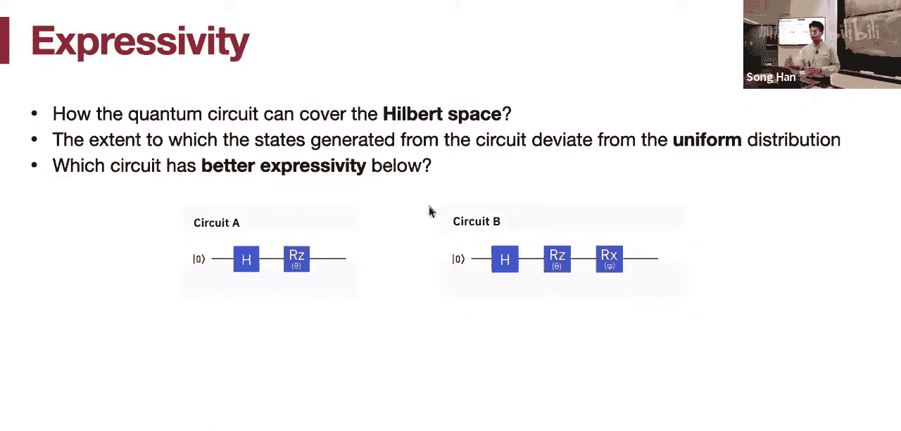

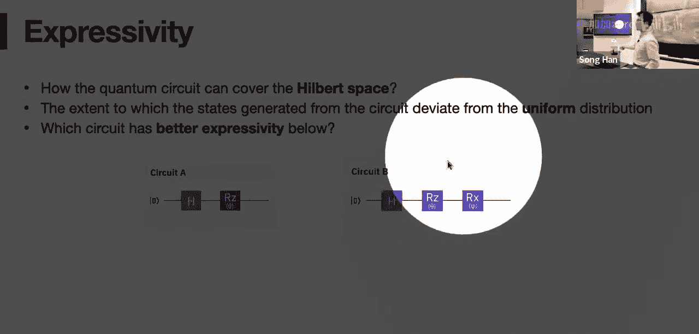

Pter here， so it is very intuitive that if we have more parametersers right。

 for example on the run side， we have a larger expressivity。

 which means we can represent more state the in the whole hubber space。

So how exactly can we visualize this right So here on the top side we can see the3A when we actually changing the theta values here。

 we can see the coverage of the block sphere on the top right corner here is actually a ring on the tropical here and then for the circuitB here we we actually can have a more larger coverage of the whole space because after we have a different combination。

 different random assignment of those theta and five values we can have a coverage of the overall space So it's not just limited to a ring of of this block sphere So in that case we can understand actually visually or intuitively the circuitB here has a better representation power compared to the3A。

So in other words， actually we can have a more rigorous definition of this expressivity。

 so here we have more examples， the first one we have the idle circuit which does nothing and also we have circuit A B to the arbitrary unitary rotation So if here we actually we want to compare we want to understand what is the coverage of this whole space with this given quantum circuit so here we are actually comparing the the circuit to some of the arbitrary state which is called higher measure so here on the bottom side the higher measure is actually measuring that for is's a uniform distribution so that means for two arbitrary state in the hubber space what will be the difference between those two states right so for example we can do a sampling and then we can sample many different pairs in the whole space and then we compute what is the difference between those two it can be computed as the infidelity。

Between the two states right in that case we can imagine for a single  pbits that is actually uniform right so because we can sample two states which are very close to each other。

 We can also sample two state are very far from from each other。

 So the distribution of that is actually arbitrary。

 and also if we want to evaluate the expressivity of a given circuit。

 And then the way we do that is that we can sample randomly sample many different pairs that can be represented by the circuit。

 So specifically in order to do that， we can sample two different values of the Rz gate and then compute the fidelity of that。

 So in that case， we can also have another distribution shown in the in the yellow yellow distribution here。

 So in that case， we want to compare what is the k dirgence between this yellow distribution to the uniform distribution。

 you can imagine that if we have just idle circuit。

 And then no matter where we sample we always get the same state。

 and then the fidelity of that will be always one。 So in that case， there。

A very large value or large probability in the first figure here。

That we have a 100% of one fidelity here。 And then in that case， if we come。

 if we compute the dirgence of this distribution to the higher measure。

 and then the value will be extremely large。

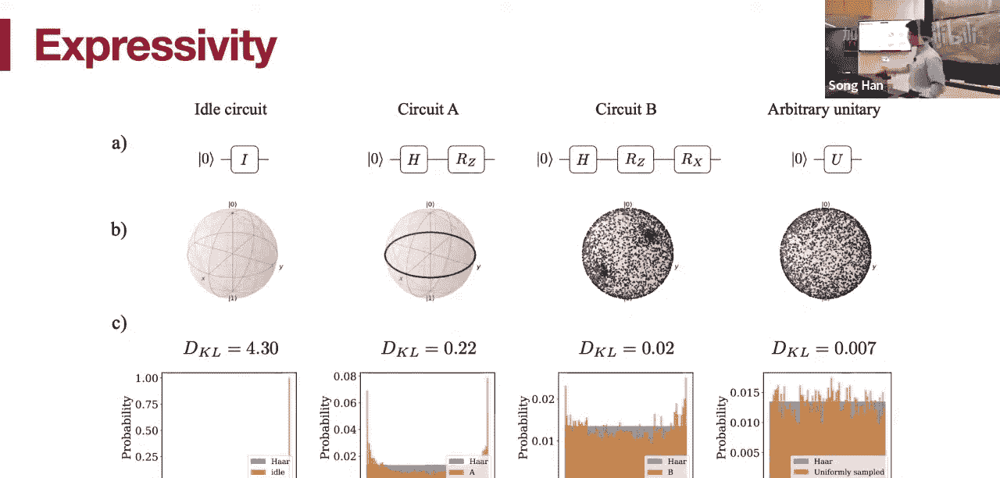

And then if we have the arbitrary unit here， and then if we just compute the distribution of this uniformly sampled two。

 and then we can know the fidelity of that can be very close to the uniform distribution。

 and then the k divergence of this distribution to the uniform distribution。

 the higher measure will be very low。 So in that case。

 you can imagine the lower the k divergence here， that means the higher the expressivity of the quantum circuit。

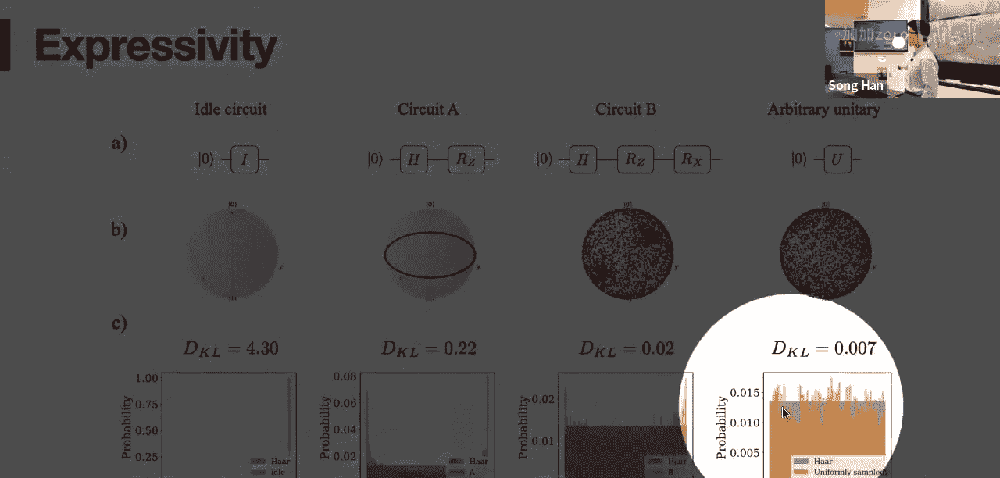

So besides this expressivity， we also want to understand what is the entangling capacity of the circuit。

 so we want to know like say given this circuit， whether we can entangle the states of two qubits so here we can use a me Vloc performance measure to tell us or called the MW measure so for the MW measure actually have a range of0 to one and if for an un entangled state and then we can compute the MW measure at0 and for two four entangled state of two qubits and then the MW measure will be one so。

In that case， we can actually use an average MW measure to measure this entangling capacity capability of the quantum circuit。

So here we can first have a look at the many different kinds of the quantum circuit structure。 So。

 for example， the circuit one here， we can we only have those gates on the each of the individual qubits。

 right So there's no。There is no there's no quantum gate between the two qubits at all。

 So in that case， there is no entangling between any of the qubits。

 because if you don't do any gate between the qubits， how how you can entangle those twos， right。

So we can also see the QB circuit2 here， we have many of the synOs between the QB4 to third。

 QI3 and QB3 to QB4， QB2 and also QB2 to QB1。

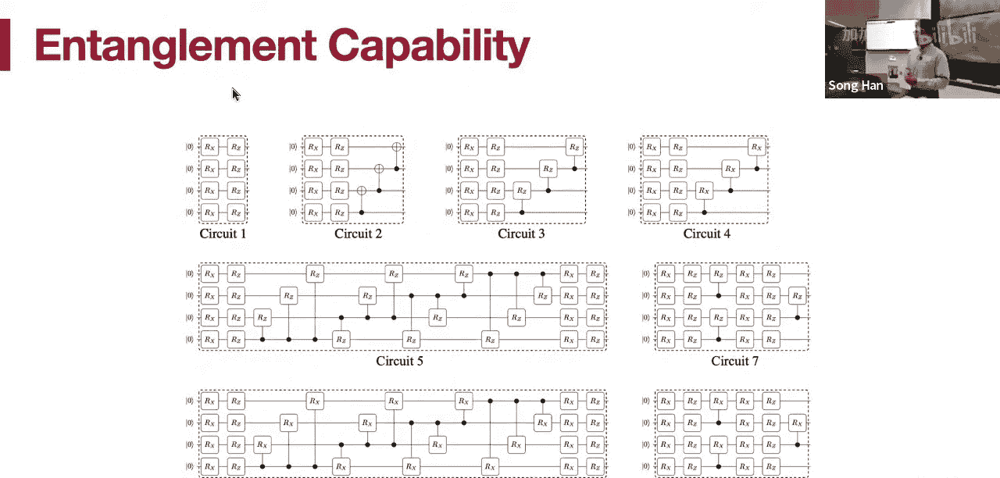

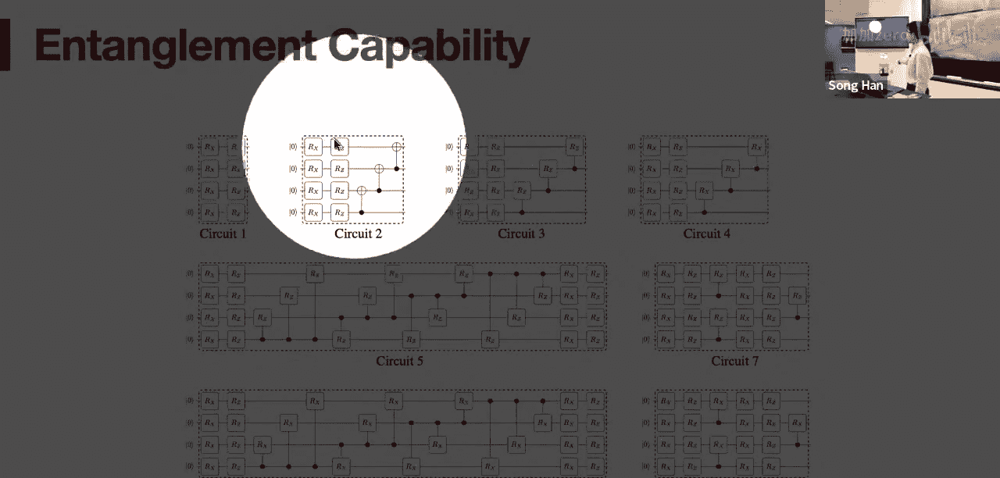

Right and also we also have other circuit with the different structures。

 so for other circuit we can always see that there are some enangled in power between the qubits。

 which means you can do the perform you can do the dis entangled state preparation using this quantum circuit。

So there are more circuit that can be constructed with a different structure here。

 so here we can actually leverage this MW measure to have a visualized plot of this integral capacity of all the quantum circuit。

So here we have a different colors first， so different colors means that how many layers you can apply this block。

 for example， you can just apply a single block here or you can apply multiple copies of the block to prepare those those entangled states right so so first of all we can see that for the circuit ID1 on the leftmost corner we can see that no matter how many layers are you are using this corner circuit。

 you are always not able to perform this entgling operation between the qubits。

 two qubits any of the  two qubits because there is no gate between any of the qubits here。

And also we can see another one is the quantum circuit9 on the redmost of the axis。

 So here we can see that actually， when we have a reasonable number of layers here。

 the entangling capacity of this kind of circuit is very large because we actually have a lot of entgling gate between those cuB pairs。

 and then we can create an entangled states between other qus。Alright。

 so besides this enling capacity so intuitively here。

 we actually want to have some quantum circuit that can have a large en in power because remember in the first lecture。

 we introduced that we want to encode actually a large space of the data to the qubbits so so only if if we have a large en power between the qubits。

 we can leverage this large exponential hubber space。

 if were not able to entangle them together and then we cannot encode a large number of data to all of qubits altogether。

So besides this expresssivity and also the entangling capacity， we also have another measure。

 which is the hardware efficiency。 So in the last lecture， we introduce that yeah， please question。

So。而是。You have a who have already maxally disabled， would you ever be for playerss？Yeah。

Yeah that's a great question so here we can see that one interesting observation that actually with a very small number of layers here。

 one，2 or three and then the enling power here is already one so I think the value here is because of the randomness when we actually compute this under measure so the the larger the number of copies of the layers we have to sample more circuits to compute this measure so if we are not able to sample enough that's actually number is minimally increasing so but the short answer is that for entanling capacity that is using one or two or three layers is large enough but for the expressivity is always better to have more parameters to learn。

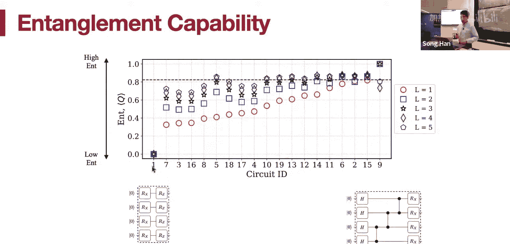

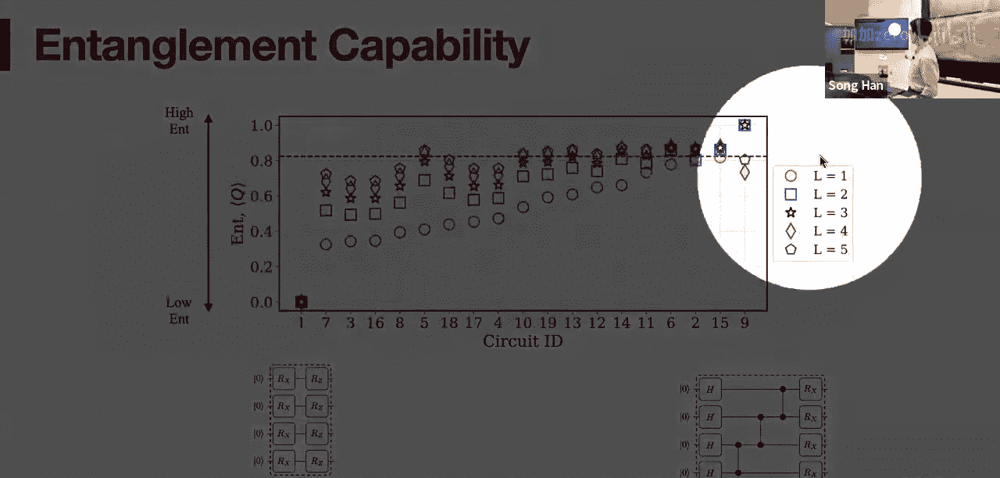

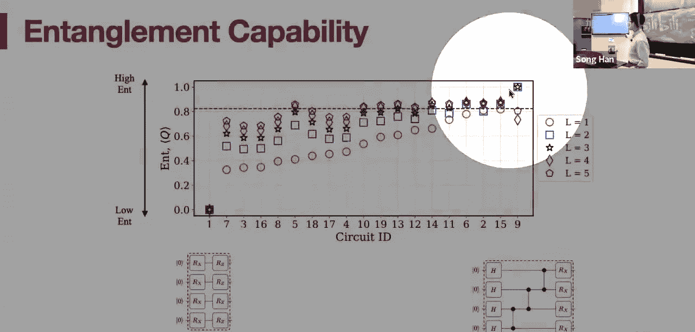

Yeah。Okay， re question。Right， so for another aspect is the hover efficiency。

 so basically whether we want to implement those quantum circuit on the actual device so we can see that for example。

 if we have five qubits with this topology， and then we also need to consider what is the architecture of the quantum circuit。

 whether we can perform those operations natively on those quantum gates quantum circuit or quantum device。

 So the first question is whether the PqC design consider the qubit connectivity， For example。

 in the previous one， we can see that there is connect their connections between the neighboring qubits0 to 11 to 2 and 2 to3。

 So in that case we'd better to place those different qubits on the P0 P2 and P1。

RightSo in that case， at least two of the gates can be directly computed。And also。

 we also need to consider whether the gates are native gate， right So for example， here。

 the gates are the C gate， the controlled Z rotation gate。 So in that case。

 we also need to see what is the actually supported operation on the actual quantum device。

 if the operation is not directly supported， and then we have to perform a lot of transformation of the gate to to decompose those quantum circuit to the native operations and then the decomposition process will introduce also a lot of the overhead。

So those are the several aspects we have to consider when we actually construct those quantum circuit and and for the encoding part。

 we also have multiple ways to encode the data to the quantum circuit， for example， consider。

A classical data X which consisting of the m samples each of them has n features right so in that case we need to encode each of the value or each of the vector to the quantum circuit to do the to do the processing with the encoding module so there are multiple ways of the encoding ways of encoding those different information to the qubits。

 So for example， we are going to introduce four different encoding methods。

 so the first one is called the basis encoding so that is very similar to the binary representation in the classical machines right so for example。

 if we have just one value number two and then we have the binary representation of this value in the in the10。

 and then we can create a quantum state just representing this 10 state we have all the energy on the10 state。

 however， it is not very efficient because we can only encode one data say if the x here is two。

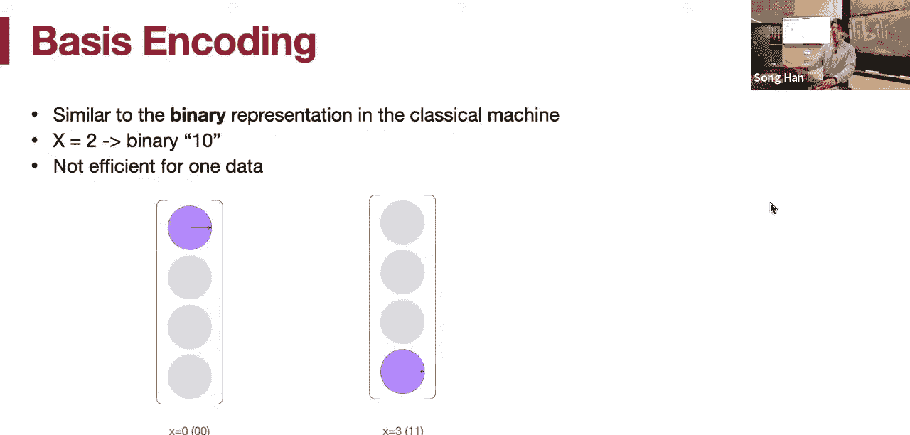

And then we have 10， but if the value is0 here， and then we just have all of the energy for this00 state。

 and if the value here is three， we have to encode all the information or all the energy to the 11 state。

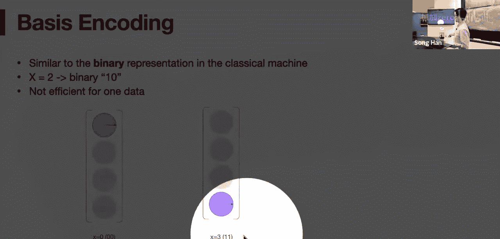

So。This is not very efficient for only one data point， but if we have multiple data simultaneously。

 for example， we have the data set contains multiple values， for example。

 a vector of two with a value 0 and also value3， and in that case。

 we actually can encode those data simultaneously because we are able to represent multiple multiple values with a limited number of qubits。

 For example， here we can create a entangle state the00 plus 11 using the quantum circuit we introduced in the last lecture。

 Basically we have the hardware gate and also a s gate and then we can create a entangle state between the zero state and also the 11 state。

And also， if we have multiple values further， we have0，1 and3。

 we can also use a vector to have enough to have the same energy on all of the basically all of the sectors here from the 00 to01 to the 11。

So we also have other encoding， which is the amplitude encoding。

 So basically using this amplitude encoding is very straightforward。

 So we just want to encode this input vector to the state vector of the qubbits right So for example。

 if we have this input vector as 10，00。 So this is the input vector and then we know that with few qubits。

 we can actually create this vector with the length of4 right so in that case we can have a just the first vector。

 All of the energy will be on the first qubits in that case we can create this 10，0 state so。

If we have another vector， which is the  0。80。20。6 and 0。4 45 here。

 we can also allocate energy of different states here to represent the ratio between different inputs and then we can recover this input vector through the states of this quantum circuit so in that case for n features we can imagine that we only need a log two of n of the qubits because we are able to create a vector of two to power of n with n qubits so this is a very efficient encoding method。

Yeah， question。Simply that。That's yeah， that's a great question。 So actually。

 we required input the length should be one。 So the overall the length for example。

 the norm two of each value squared， and then something together， we should have one。 in that case。

 typically what we did is to do a normalization first， and then we have a normalizing factor。

 and then we can encode the remaining information to the  Qbits。 So in that case。

 we have to store the normalizing factor in a classical device。Okay。

 for another one is the amplitude encoding another example here。 So basically we can。

We have two values and then similar to the previous one。

 we can concate them together and then we can use this quantum circuit below to represent state。

 So the reason why I'm showing this quantum circuit is that although we are thinking that we have a large space to encode the data actually the actual encoding process its not very tri So basically we have to construct a very complicated quantum circuit to prepare the quantum state from the r0 state because initially all the quantum all the qubits will be initialized to all0 state。

 and then that means the vector will be 10，0，0 and how can you prepare this arbitrary state from this 10。

0 state， that is a large problem because we have to have a large number of gates in the middle to prepare the state that we want for example。

 even if we want to just encode those four numbers and then we can use we have to use a large number of gates to represent the state。

Alright， so another one is called angle encoding。 So basically， we can encode。😊。

Different data in the rotation angles of the  Qbic gates。

 so here is an example on the bottom right corner， so basically if we have values different values of the input data。

 and then we we can encode those values to the rotation angle of the gates， for example。

 we have this R gate for on each of the qubits and then if the input vector is this zero pi over2 and pi in that case we can just directly encode those values to the rotation angle of the  QB0 and  QB1 and  QB2 So that case this one this way is very efficient because we don't have to perform any of the compilation process to to construct those complicated circuit to do the state preparation we can just directly input those values to the rotation angles of those column gates。

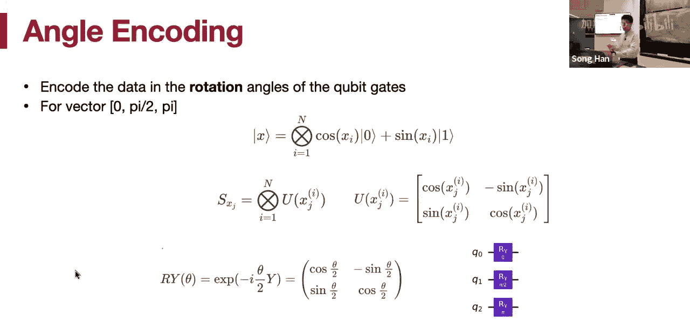

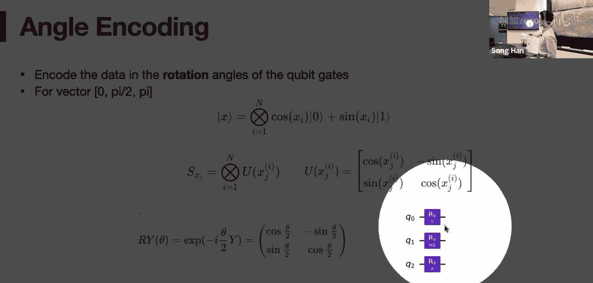

And also there are also several other ways to encode data， so one way is call the arbitrary encoding。

 so basically you can construct the combinations of those different previous encoding method and then for example。

 we can firstly have these two layers of the rotation gate and then we can perform in some entanglements between the qubits using those S gate and finally we can use another layer of the several gates of the entangle gate to encode another remaining values in the classical vector right so that case we can see that for this vector with in total 12 values we can use those rotation angles on the bottom to perform encoding of those input input data。

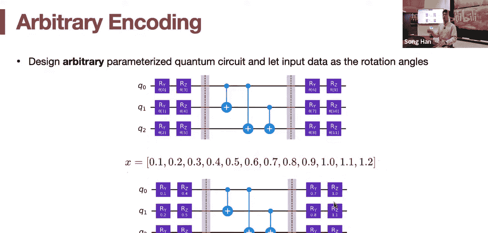

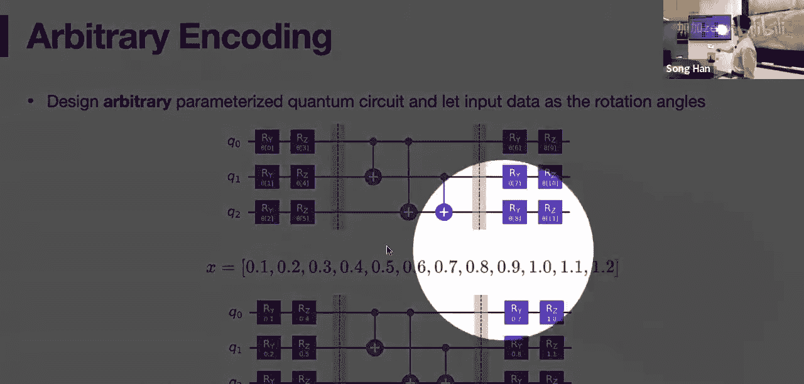

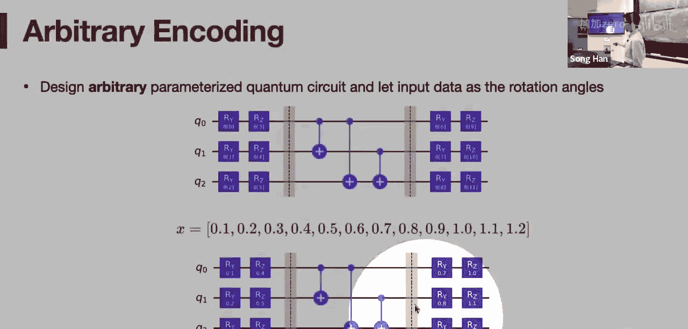

So after we have those encoding process we need to perform the training of the primary quantum circuit so basically the intuitive way to understand the previous encoding data is that for example you have this in a classical deep we want to perform this image classification right and then the first step will be performing some of the say denoing or some of the down sampling of a very large input image and right after that you can apply those different layers of the trainable trainable deep layers like convol or some other layers to the input input image so just like here in a quantum device the first step is to perform some preprocessing to encode the classical data to the Qs and then after that you can apply in different kinds of the parameterized quantum circuit to transform the input state to some of the target state to perform the classification or some other task。

So typically the parameterized quantum circuit training， they also use this data drivenri method。

 so basically we have a lot of parameters in the trainable layer and then we want to do this iterative parameter updates according to the objective function right so basically we have this iterative loop so we have some parameters initially and then we can first compute what is the objective function。

 what is the cost function， for example for the classification class。

 we can still use the cross actually loss， and then we can do the back propagation or some other optimizer to optimize those values to minimize this overall cost function。

So one way to do that is find a different differentiate method。

 so basically we can just use this very， we can just have a small preation of the input data values and then we can compute the local derivative of those of that point and then we can use this gradient to update the parameters。

So the accuracy actually really depends on what is the site how large is epsilon because if you have a very large epsilon here and then the derivative of your are computing is actually very different from the actual gradient so for example here for the epsilon here very large to the very large epsilon here and then the actual gradient you are computing is very different from the the gradient compute actually very different from the true gradient so in that case the problem of the final difference method that you have to carefully select the epsilon value to compute gradients。

So in order to overcome this drawback， we also have another way to compute the analytical gradient for if each of the quantum gate in the quantum circuit So that is actually called the parameter shift rule。

 So in the parameter shift rule here is actually the overall overview of the parameter shift。

 So basically we have those different layers different gate in the quantum circuit the way to compute the partial the gradients of this the loss function to this to this rotation angle or to this value is that you can add pi over two to this value and then actually the quantum circuit again to compute the final loss function。

 and then you can distract this you can subject this。P over two value from the original theta。

 and then you compute value again。 So the final gradient will be the same as the will be the true gradients or the true analytical gradients。

 So here we are going to do that expanded step by step。 So basically。

 we want to compute the gradient of theta here with regard to the F theta right So the F theta here is actually the measurement outcome of this this qubits。

 the first qubits。So we want to understand what is the gradient of partial F theta here over partial theta。

So in order to do that， we can shift the theta twice， right， So firstly。

 we can add pi over two to the theta， and then we can compute the function again。

 which is the F theta plus pi over  two。 And then we can also shift the theta to another direction by pi over 2。

 which is theta theta minus pi over  two。 And then the actual gradient of those partial F theta over partial theta can be directly computed as F theta plus pi over two subjecttract F theta minus pi over two over2。

 So why is that case。 So that seems to be not very intuitive， right so。So actually。

I'm listing the actual the proof of this process here in the slide。

 but I'm not going to show all the details of those process。

 So one very intuitive way to understand that is that for example。

 if we have we want to compute what is the gradient of the cosine function right so we know that if we compute the derivative of cosine and then the function will be aine sine function right so that would be cosine theta plus over pi over2 right so actually when you shift the cosine function。

 this period function by pi over2 that is actually align with the derivative function of this original function So that's the intuitive understanding of how we can just shift the original value by pi over two to compute gradients for this angle because as long as we are using those rotation angles because of the mathematical representation of those values those cosine for example。

 if we are doing this rotation X and then we can always。

We can always this do the decomposition for convert to the exponential representation and then we can know that the basic element of them is actually the cosine and sine functions。

 so that's why we can directly use those parameter shift rules to compute analytical gradients instead of the actual inside of the the a gradients。

Okay， so basically we another way to do the gradienting computation is of course。

 the back propagation， which we are very familiar with familiar with in the classical。

 So we can we can compute using the chain using the chain rule。

 we can compute gradients for each printer on the whole computing path So here actually we are we are doing some experiment to show that actually the using the back propagation。

 we are of course， getting the analytical gradients of those values。

 and then we can also verify whether our parameter shift rule compute gradients align with the back propagation。

 So here basically we can see there are two there are two path here and on the top one here is actually showing two different two different。

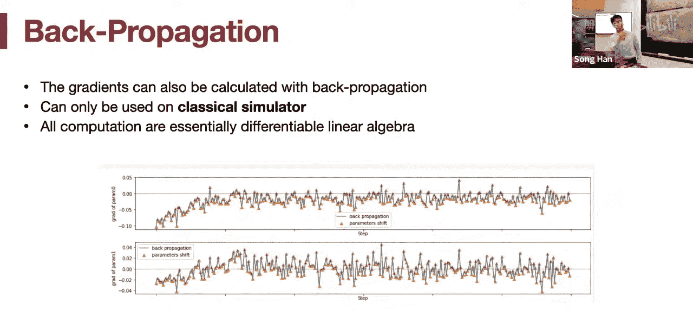

Gredients here。 So one is in the in the blue， which is the gradients computed by the black propag。

 And also for another one is using the parameter shift rule。

 So we can basically see that all of them are aligned to each other。

 So that means using the parameter shift can can always give us the same result with the black propag and which are the analytical gradient of the value。

 So however， the back propag， as you know， we have to understand， what is the。

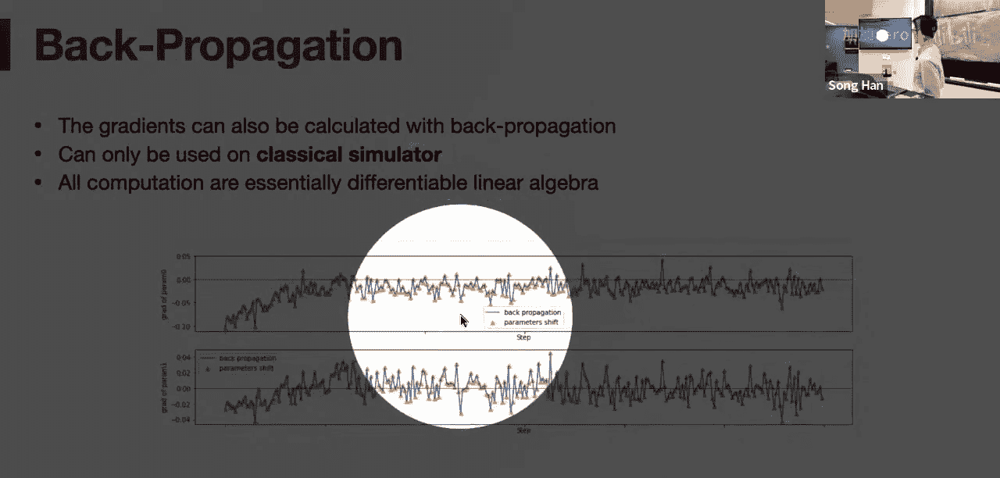

We have to have the whole computing graph so we can do that on the classical classical device right so we can compute the first layer and we know all the intermediate results and then we can do the back propagation。

 However， if we are computing that on the actual quantum quantum device we cannot obtain the intermediate results so that's why actually the back propagation can only be done on the classical simulator because in that case we have the whole computing graph however on the actual quantum device。

 we are not able to obtain all the intermediate results。

 So that's why we cannot perform the actual back back propagation on the real device So on the real device on the other hand we can perform this parameter shift role because on the real device for the parameter shift role here we actually don't require any of the intermediate results we only require the final output from the device So that's the reason why we can always rely on this parameter shift role to compute gradients。

 but for the back propagation is only。Is suitable for the coststco simulators。

So here we can see as we say， it is doable to perform the primary shift row on the actual device。

 so how exactly can we do that right so for example。

 here we have the rotation X theta gate so we want to understand what is the partial F over this partial theta value right so in marked by the yellow block here。

And then on the actual quantum device， so we can firstly perform this quantum circuit without the shift to this firstly obtain the F function values。

 which is the original value。And then we can compute。

This classical part classical part of the forward loop。Because we can for example。

 we want to perform this classification task and then from those F1， F2 all the way to F4。

 and then we want to perform， say the soft max function and then we can compute the cross entropy loss according to the classification result and then after that we can perform this propagation on the classical side because on the classical side we can always record interent result right so in that case we can we are able to obtain this partial loss over the partial F where F is actually the measurement outcome from the  Qbits。

And then on the actual device， we can perform this shift role right so because we want to compute what is the partial F over the partial theta？

So the so the overall goal is to compute partial loss over the partial theta so we can use the chain rule to separate that to firstly partial loss over partial F and then partial F over partial theta。

 So easy for this partial F over partial theta here。

 we can use the parameter shift rule we just introduced。

RightSo in that case we can sum over those two four passes because of the submission principle。

 and then we can use the chain rule to compute the value for the overall partial loss over the partial theta。

 which is the on the bottom right corner which is actually using we can obtain this partial F over partial theta using the parameter shift rule on quantum device。

 and then on the classical device we have this partial loss over partial F。

 and then we can do the overall computation of partial loss over partial theta using this chain rule。

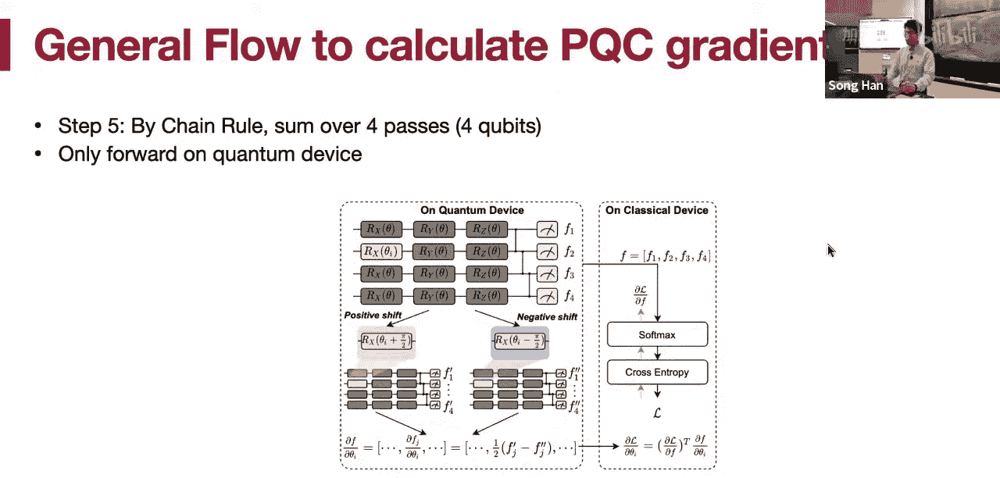

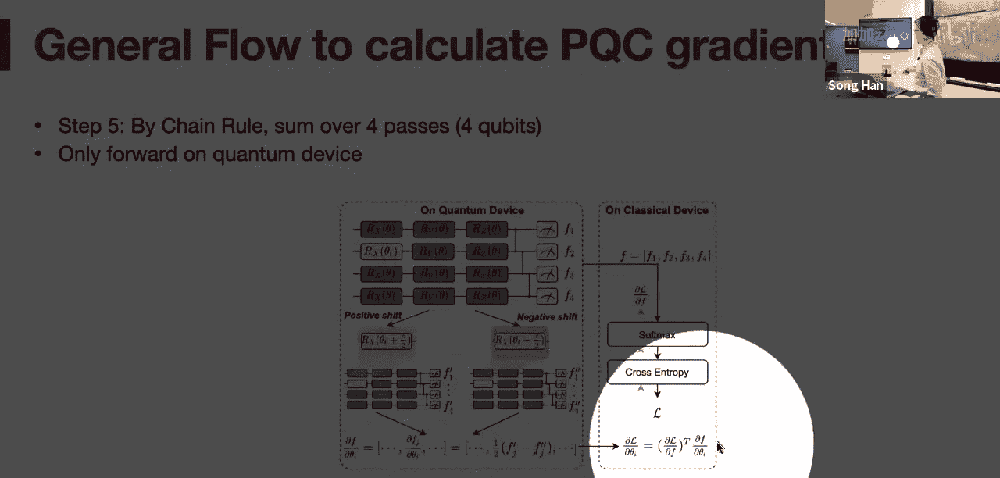

So after this competition we can understand or we can obtain that what is the derivative of this theta value。

 what is the impact of the theta value to the final loss。

 and then we can update the theta according to our goal。

 either there' a classification tasks or some other generation tasks。别亏是。Thank you that。

Like twice or every parameter or every update staff things that you do。But not scale knowledge。

It saw in anyway ways to。parallelYeah， so that's a really great point。

 So you actually capture one of the fundamental challenge of the parameter shift rule。

 which is the for each of the parameters analytically we have to just shift that that only value with all the others remain the same right so in that case the number of actual search run scale linearly to the number of parameters so that's actually not very scalable so that's the reason why there actually many research。

 for example， we can do the simultaneously simultaneously perturbation spa so which we will introduce later so we have some ways to approximate this process we don't have to rigorously remain keep the other values the same but we can perturb a subset of other the parameters altogether so in that case we can reduce the coefficient but in general that's the case we have paid the linear cost to the number of parameters but that's also the case for the classical deep learning。

Also have the linear scaling training costs if you have a really large number of bun in the classical neuro nice。

 but we have some way or some ongoing research trying to reduce the coefficient。

 reduce the scaling factor。有。O。All right， so here comes the we're going to introduce some of the training technique including the SBSA we will also introduce actually just next slide。

 so the vanilla gradients descend is that for many different iterations so this is just a very intuitive or very very conceptual plot so we want to make sure we reduce the loss function right for example we want to do the quantum classification we want to train those parameters until we converge to some of the target with a satisfactory accuracy。

And so just as we discuss， if we just do the circuit execution for each of the parameter and then。

The number of circuit1 will be two times n where n is the number of parameters right So in that case is very very costly processed to all the parameters。

 So in that case， they are actually the algorithm called SA。

 which is simultaneous perturbation schastic approximation So the basic idea is that we can actually not we don't have to just keep one value changed。

 we can actually change all the values altogether right so for example we can perturb all of the parameters in the quantum circuit altogether。

 and then we can obtain this value obtain this vector。

 which is the the F theta plus epsilon minus F theta minus epsilon。 So in that case。

 we can actually over assumption is that when we actually perturb all the parameters together the value will be not very far away from the previous perturbation of。

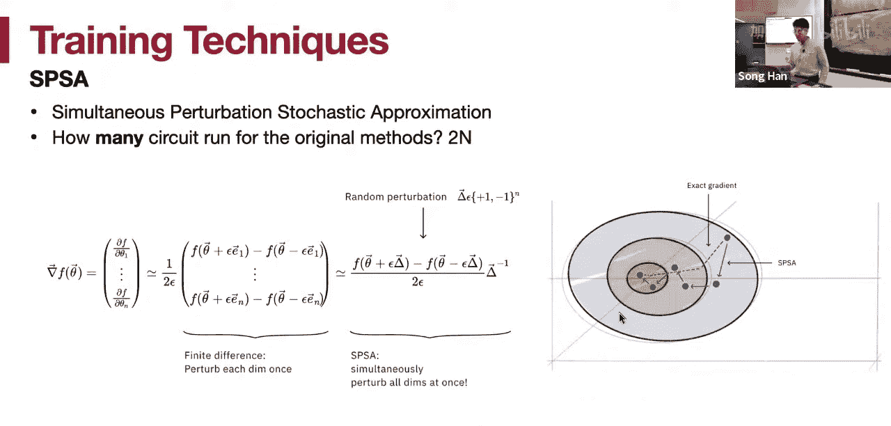

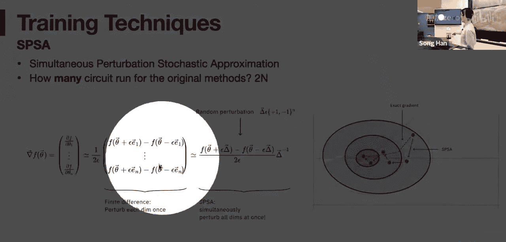

Only small number value or even only one value right so the hope is that when we actually do this process the new value on the on top here is very close to only perturb one value so in that case because we are changing a small very small absin to each of the parameter so in that case we can consider those two very close to each other and then we can use this and then however。

 after we compute this gradients we will have a gradients for each of the parameter here using the spa because we will have a vector。

 some of the perturation will be plus one， some of others will be minus one right so in that case we can compute one single value gradients for each of the parameter and the magnitude of that value will be always the same but direction for that value of each parameter will be different Some of them is is on the positive direction some others on the next direction so that's how we can。

Perform this simultaneous preturbation to compute the gradient of all the parameters in just one round of this forward process。

So here we can see what is the performance of this SP I compared to the vanilla gradient descent。

 So basically we have multiple multiple like curve here。

 So one the first one in the blue is the vanilla gradient descent right so just using the using the back propagation were using this just using the this natural。

This fine different and then that will be the blue curve。

 but using the SPA we can see that is' very close to the vanilla gradient inscent and then we also have this point of natural gradient so that is like the performance of that one is the best but the cost of that one is much larger than the vanilla gradientscent or the SPa。

Okay so there is another issue that I want to also introduce or mention a little bit which is the baron plateau issue so in the classical deep we know that after we stack in many layers of the neurals so there will be a gradient vanishing problem because when we actually doing too many layers of the back propag and then the gradients of the first layer will be too small to update it will be too small to update meaningfully change the parameter values so that's also there the similar case in the quantum circuit so basically if we have a very large number of qubbits and then we have many different layers a large number of layers and then the gradients of the first several layers will be also very small。

So here we can see that intuitive plus here， so the x axis is the number of qubits and y axis is the variance of the gradients。

 so we can see that when we have a larger and larger number of qubits。

 the variance of the gradients will be reducing exponentially so that's actually one of the bottleneck or one of the ongoing challenging challenging point of the quantum machine models which which means we don't have we cannot stack too many layers in the quantum circuit because of this vanish very gradient problem。

Okay， so and then here， yeah， question。Yeah， that's a question。

 So in the classical side classical depending we have these residual connections the bypass right so we can directly have those different layers of the back propagation of the grid all the all the way to the first layer so actually there are some similar process in the quantum to adding this bypass layer to the quantum circuit but in general they are not working greatly so the reason for that is actually on the quantum device we cannot copy the state of the intermediate state to the later layers because we cannot directly there is a non cloning theory actually right here so we cannot directly clone the state of all the qubits to a new site of qubits so it's not like in the classical device it is very easy for you to clone one value or all the values of a layer and then bypass that to the final layer but on the quantum device you are not able to do the cloning of the qubits so that's why。

Cannot create two copies of the site and then merge altogether in the later layers so right so in that case the using the residual connection is not a solution or it's not a complete solution for the quantum sh right now。

Yeah。Great question。Okay， so。Now we can have a recap of the quantum classifier we just introduced in the previous lecture。

 so basically we have this encoder， we can encode those pixels as the angles with this angle rotation angle encoding and then we have those trainable layers。

 those unitary U3 layers U3 is basically you can arbitrary changing these states and then also we have the controlled U3 gate so we can train those parameters using the SPPSA method or using the finite different difference method and then after that we can do the measurement of the qubits and then do some of the post processing to obtain this classification results。

So here we can see basically this training process is also similar to the training process of this classroom when neural so if we have a here on the left hand side is visualization of this optimization process。

 we want to make sure we are going to the minimum minimum places to con to that point to have a good prediction result。

So besides this classifier， actually there are also other tasks that we can use the parameterized quantum circuit。

 so one task we can do is actually the variational quantum eigens over so the basic task for this variational quantum es over is to find what is the smallest eigenvalue given given a matrix right so that is for example we can decompose that matrix to multiple multiple polymatrices and then we can measure that for multiple times and then the variational quantum eigs over is actually trying to prepare state which is the eigen state corresponding to the smallest eigenvalue so you can imagine that we can prepare the state and then evaluate what is the value。

 what is eigenvalue for that state and then we can always tunening the parameters in the quantum circuit to approach those the final eigen state which has the smallest eigenvalue。

So finding the smallest eigenvalue have a lot of applications， for example。

 we can use that to find the ground state energy of some molecule we can represent the molecule Hamiltontonian state。

 we can represent the molecule feature with the Hamiltonian matrix and then if we find the smallest eigenvalue of the Hamiltonian matrix that will be the smallest ground state energy。

So that is that means that for the stable process， stable stable for example。

 if we want to understand what is the stable length of the bond between some some of the molecule。

 some of the item inside the molecule and then we can simulate or compute the energy for different distance right so in that case because of the because the chemistry reactions we always go to the state which has the smallest energy right so in that case we can understand after this this chemistry process。

 we will be the length of the bond between all of the items so that is one of the application of the primary quantum circuit So another one is the QAOA or the quantum approximate organization algorithm So using the QOA we actually can find solve the comminatorial organization tasks so。

So ensure those are the variational some of the PQC tasks， the classifier for the machinery task。

 the BQE for quantum chemistry， or some of the QOA algorithm for the comm organization tasks。Okay。

Okay， so let's continue to the section4， which is the noise aware onship20。So。

So we have introduced that how to construct quantum circuit。 So actually on the real device。

 there is a large impact of the noise we're actually doing this noise gradient computation。

 So actually the noise can reduce this reliability of the on computing gradient significantly right so here we can see that there is a noise induced gap between those two curves one curve in in in the blue is actually the classical training。

 which means we just simulate all of the process on the classical device and then the red one here is actually showing the actual actual partnership rule on the real device on the IBM quantum device so we can see the accuracy of this evaluation process can be can be significantly reduced by this noise on the actual device So how can we deal with that right so here we can we have a very interesting observation is that when we when the gradient magnitude is very small。

And then the relativearrow of that will be very large。 So it's also very intuitive。

 So imagine that if we have a very large gradient value and then the noise on that noise is more unlikely to change the direction of those gradient but if the gradient is very。

 very small。 you can imagine only a small noise， a small perservation a real device will change the direction of the gradient So in that case。

 the overall ideas that we can find those very small value of the gradients and then we can prune those unreliable gradients during the training。

 we only use those reliable gradients to perform thoseer updates right so in that case here。

We propose a method called this probability gradient pruning。

 so the basic idea is that before this pruning we actually in each of the training step。

 we can always perform in the updates of all the parameters right so and however using this gradient pruning we only perform those update of those gradient those parameters with very reliable gradients。

So how can we know whether the gradient is reliable enough， So actually， we just。See。

 what is the how large is the gradients that we computed from the this process， right。

 So specifically before this pruning process， we are updating all of the parametersers on the left hand side and using this gradient pruning。

 we are only updating a subset of the parametersers with the reliable gradient。

So in order to determine which subset of the gradients is reliable enough。

 we actually have a this iterative process at the window based method。

 so we can firstly have an accumulation window to accumulate the gradients of multiple steps to accumulate the absolute value of those gradients and then。

For example， we can accumulate for three steps to see how large are the gradient for each paners。

And then we can do a summation of all of the absolute value of the gradients for each bumper。

 And then we can do a sorting。 We only use。Those values with a very only use those gradients with a large value to perform those pruning process and for those gradients very small gradients。

 we will not use them to update the parameters of the quantum circuit。

 so let's make sure that we are only using the reliable information to update the parameters。Okay。

 so we are。Actually comparing this QC trend using this probability probabilistic gradient pruning compared to the other ones。

 so basically we are able to improve around like5% to 10% of the accuracy on this four classification task using this probabilistic gradient pruning method。

And also we can see that for this accuracy on this two fashion2 on the Seneggo machine on the IBM device。

 we can achieve around2 x of the training time reduction because those unreliable gradients。

 we not only we don't use them and also we actually don't have to compute for from the first perspective。

 so we actually don't have doing the computation for thosereliable gradient。

 we only compute those reliable ones。So。Here we can see that the。

Ged pruning for different times of the inferences。 So the axis axis here is the the number of inference where you we are doing on the real device to compute the parameter shift rule gradient。

 And then the y axis is the test loss。 So the loss is the lower the better。

 So we can see on the classical device。 There is no error at all。

 So we can see the the loss is always the lowest。And then the blue curve here is the QC train。

 which means we are using the real device to perform the parameter shift rule and then because of the noise there will be a gap between the ideal case to the blue curve and for this quantum on training we are able to close the gap to further push this curve the ideal case to the gray curve。

And also the on training here is actually also very scalable because we are not using any of the classical process during the whole training training pipeline。

 we're computing those gradients on the real device and then real quantum device and then update the parameters。

 so imagine that if we're using the classical simulator and then the cost， for example。

 the runtime costs or the memory costs will be exponentially large when we have a large number of qubits because the size of the same vector will increase exponentially to the number of qubits。

 but using the quantum device quantum device to train model。

 we don't have to pay the increasing cost in terms of the runtime and also the memory。

So here we can see the probaistic pruning we also compare to the deterministic pruning。

 so basically in the probabilitybabilistic pruning we are using the magnitude of those values to determine which parameterer has a larger probability to be pruned。

 but this process is not deterministic so that means we are not always or removing the parameter the gradientance forever we are having using the sampling method to sample those different values to prune so that is also give us some advantage compared to the deterministic pruning method around like 1% to 9% of the increase of the accuracy over this several different tasks。

All right， so we are also actually developing a library which is called the Torch quantum library。

 which we are actually implementing all of the classical process using this Piyfor framework because all of us are very familiar with the Ma process and we are using this Pytorch Pych framework or Tensorflow if a Google Google prefer for the Google frameworks and then actually Google have their own quantum framework which is called a Tensorflow quantum but the Pytorch we are actually developing the TQ framework。

 the Torch quantumum framework。So we want to make sure the developing of these quantum machine models has a very good infrastructure to start with。

 right， so we we want to make sure the developing of those models have a fast speed and also very convenient to use and very easy probability between different frameworks among those common quantum I and also scalable computation。

So and also we won't have those GPU acceleration process and also those density matrices support and also different converters to other frameworks and also in the platforms we know one of the advantage is the dynamic completion graph and we can have an intermittent results very easily and that can facilitate our debugging process。

So basically。Here I'm just going to show a very simple example using the TQ framework to construct a quantum machinery model。

 So basically this is very similar similar to constructing the classical neural networks。

 So we have this model of which is a。2 class of the end dots module。

And then we can firstly instantiate a quantum device。

Using the TQ dot quantum device and we can specify how many qubits with the number of wires and after that we can also specify the encoder gate。

 so remember previously we introduceds rotation angle encoding so we can have those rotation X。

 rotation Y and also all the other four layers， the Rx R Y RZ and Rx and then we can also specify some of the trainable gates。

For example， we have those rotation x gates to train right and also whether those have parameters or not。

 we can specify them in the in function。And also we have that is basically the construction of the model and how can we use that right so we also have this forward function the same as the other classical hetero models。

 so basically we have this we want to first reset the quantum device vector reset the same vector and then we can encode those classical pixels using those encoder layers right so just like the diagram we are showing we have those different layers to encode the classical images and then we can apply those trainable gates to different qubits and then we can apply those nine trainable gates for example some of the hammer gates or the Ix or the arbitrary unitary we can apply some unitary case arbitrary ones to the qubits and then finally we can measure。

This we can have this measure process， the measurement function to measure the Qbs device back to the classical values。

 right， And then after that， the X here will be purely classical value， and then we can。

You can apply any of the your favorite classical layers。

 either it' a MLP layer or some attention layer or any other ones after we obtain these values from the class from the quantum device on the classification classification side and then finally we can do this。

We can perform the softmax to obtain this final classification task or either some some you can also generate perform some generation tasks using this framework。

So basically as we introduced we have this quantum device supported as the TQ。

 quantum device and also we can perform different ways。

 so just just like in the Pytors we have this Pyth Tor n dot functional。

 we also have the Torch quantum dot functional， similar to the quantum Pyth syntax。

 and also we have another supported gate supported way to perform the gate we can instantiate the gate first and then we can use that gate to process the value the quantum device。

And also we have we can perform this the third way of performing the case is that you can directly initialize this quantum state and then you can use the quantum state。

 H to perform the gate。So the underlying implementation of the TQ is actually using all of the data structure in the Pyth right so for example。

 we are using the state we using the to native operation。

 the Tor zero to initialize and also all of the operations。

 all of the unitary circuit unit gate will also using the Pythor tensor。So in that case。

 you can imagine the classical simulation process or any of the quantum forward process will be fully differentiable。

 so we can very simply use all of the off the shelf optimizers provided by titles to optimize over quantum Sch model parameters。

Alright， so we also provide some of the macros in the in the basically some of the macros in the。

third in the framework， so we have this amplitude encoder。

 you can directly use the TQ dot amplitude encoding to call that and also TQ dot face encoder to call this angle encoding using those rotation values。

And also， of course， we have this supported way to convert those TQ models to other frameworks like the Kisket。

 so if you want to run those quantum circuit on the real quantum device provided by the IBM quantum platform。

 we can also use some of the some of the functions that we already bake in the TQ framework to directly write those converters and then we also provide some of other functions to draw the circuit or constructing some of the predefined layers and also different kinds of。

Different kinds of quantum machine learning models that are right in the library that we can directly use。

Welcome to check it out， so I will now introduce all the details of the model so you can just go to Torchponum。

org or search Torchpontum on the Gitthub to play with the library。Al right。

 so in the final section well introduce one example that we can use the TQ to perform some of the robust quantum3 architecture search so actually quantum3 architecture search is one of the fundamental challenge in the quantum learning so that's actually also the challenge in the classical deep learning so I believe that in the previous lectures we we are learning we have learned some of the neuralarch search of the models right so you don't know how to how to construct the model which is that is the best suitable for the target tasks so we can do some of the NA method the neuro architectit search to find the best model。

So that's also the case that's also the challenge for the quantum quantum machine learning。

 So basically you have a large design space you can perform many different kinds of different kinds of the gates for example。

 we have a many different types of the gates either the U3 gates or the node gate or Cn or you can have a different numbers of gates right can you can just put one layer or you can stack as many layers as you want and also the positions of the gate it's also very different so if you're directly applying this U3 gates in the first layer or you can do some perturbation of the gates。

 so there's essentially very large design space for us to explore so how can we find the best quantum circuit to perform the target target task right so for example if we want to perform those this kind of classification task。

 what would be the best best quantum circuit structure to start with and also what are the structure for some quantum generation。

so here we are going to introduce this framework called quantum nuts。

 the quantum noise aware search to perform those search process。

 So of course you can use any of the any of the naive search method that is already available or already whether used in the classical。

 For example， you can just list have a random search， right。

 so can you can have many of the different structures and then you can train each of them according to our previous process。

 and then you can evaluate the performance of each of the quantum circuit on the real device to see which one is the best。

 However。If you are doing this search process， for example， you can have many different for example。

 you can have1 different layers on the 213。Then you have not pen days or。Both啊。

So in that case you actually have many different combinations you can just use one case the first layer and two days in the second row were oblig in the third so there is actually a very large design space right so one way you can do search is you just between many different circuit you can create one here。

And then obtain the performance and 90% of this or you can fit another one here。

So it is money it was 18% of accuracy。However， that way is not very efficient because you can imagine you have to train each of them to obtain the accuracy and then find the best one so the goal of the quantum nu framework is actually whether we can just train once right whether we can train a super of all all of the possible circuit super side of that here and just train once and then we can sample the parameters from that super circuit and then directly evaluate on the real device to obtain the performance so that's the basic idea behind this quantum nu framework so you can train once but use many so it's a similar to the classical like one single pass one shot of the nu method。

So there are actually four steps in the framework so the first one is that we can construct a super circuitcu right so we want to make sure the super circuit has a large enough representing power so we can construct say we have three layers here and then each layer has say four days or nine days and then we have maximum we have nine layers and then we can after that we want to train this super circuitcu and then after training we can do some noise aware this evolutionary search of this sub circuitrcuit and also the Q mapping and then after you find this reliable circuit and then we can train this from scratch and finally we can also perform this pruning method of those values。

So let's go through them one by one。 So the first one is the quantum super circuit and sub sub circuitrcuit。

 So as we just introduced。We want to construct we want to cover a large large enough design space right so for example。

 the super circuit with this U3 and C3 gaze， so we have many different candidatesies in the design space those are called a sub circuitcu right so during the training process the reason why we are using a super circuit is that we can just do the training for this super circuit for one once。

呃，两 question手。So this sense if is clarify。我需三百我升。Yeah。

 so the issue for the barren plateau is actually still there。

 but there are some of the actually this method is orthogonal to the quantum circuit structure that is can can can kind of solve the bar plateau issue so we are proposing that inside this design space how can you find the most reliable circuit right but you can start with design space that have a better immunity to to the barren plateau plateau issue right so or the short answer is that we are not this method cannot directly solve the bar plateau but we can firstly start with the design space that has a good property or we can during the search we can evaluate the gradients to find those one without the bar plateau issue so that can always be done during the search process so either you want to search a very reliable one or you want to search one without the bar plateau issue。

Yeah。Okay， so let's continue so basically those when we are actually using a super circuitcu method。

 we want to make sure those sub circuitrcuit can inherit the train values directly from this super circuit。

 so we don't have to train those values again so we just train the super circuit ones and then we can use that for the evaluation of all of the sub circuitrcuit in the design space。

So in order to achieve that。 So you may wondering how can we do that。

 because those values are typically cannot be inherited to to by all of the sub circuitcuit， right。

 because if we are training those individually and then the final value for example。

 if we training this sample circuit individually even they have the same location of the gate。

 they may have different values。 why we can directly inherit that one to all of all of the sub circuit。

 right， So that is same to be impossible So so here actually we are introducing one heuristic to train this super circuit。

 right， So that is this sample and training process， right so。For each of the each of the sub step。

 we each of the step， we actually can sample a sub circuitit from this super circuit。

 We just sample sub during this training step。 and then we only do one time of the parameter updating。

 For example， in the first training step we can sample this structure。

 and then update factors inside the structure。 and for the second step。

 we between we sample this structure， and then we continue to update values right So that is after enough number of training steps。

 we can imagine that all of the sub circuit in in the super circuit are already undergoing the same number of training steps right So even though they are not the same level of accuracy compared to the train from scratch sub circuitit。

 they can still indicate what is the performance or the relative performance order between those all of the sub circuitcuit。

 So here we can see a。We can see a quantitative result for that。

 So basically here on the x axis is the loss function for those sub circuitcuit using those inherent parameters and y axis is the values that is the ground truth。

 basically the loss that we train from scratch so we can see a pretty good positive correlation between those two so that means because we are just want to find the one with the best performance。

 so we are only carrying about the other preserving property between the sub circuitrcuit with the inherent parameters compared to all of the sub circuitrcuit train from scratch So that case we only need to to make sure this correlation between those two are very very large so。

In that case， we can use this super circuitcu to facilitate the later search process so we can do the evolutionary search inside this this sub circuitrcuit。

 basically we can search for we can use a reinforce learning or any of the search engine。

 your favorite search engine and then we can sample the sub circuitrcuit from this super circuitcuit and then we can evaluate the performance on the real device and then do this itly until we find the best sub circuitrcuit。

So we are also also as we learn in the in the first several lectures。

 we also have the pruning technique that is also applicable to the quantum machine domain。

 So basically some of the gate after we train those sub circuitrit can be very close to0 so as we introduce in the previous previous last lecture。

 So if we have a value very close to0。 and then the actual unitary matrix is actually a identity mapping between input and output。

 So in that case， we actually don't have to perform the actual implementation of this gate。

 So if the value， for example， rotation of the zero degree and then the actual result will be same as the input right So in that case。

 we can also。Perform those iterative pruning of those values very close to zero。 So basically。

 we can find those we can do a search of those values or those gate close to0。哎 question。Good by。

Yeah， that's a great question so basically we can do the remember that we introduce the parameter shift rule in the last section right so the super circuitcu training process can always can also be done be done on the real device right so we can use the parameter shift between the super circuit so all of the process the super circuitcuit training the sub circuitr training and also the search can be done can be done on the quantum device so that's actually scale with the number of qubits。

Right， great question。Okay， so after that we can do this pruning process to remove those small value number。

 small value gates to make sure our the final resulting circuit is most efficient containing the most essential message。

🤧嗯。Alright， so there are also some other search frameworks， for example。

 the one that using the machine learning based predictor so basically you can train a model to predict which sub circuitcuit has the best performance so we can use some graph neural networks works to approximate the structure of the quantum circuit and then train a predictor on the real device and then there are also some other framework that directly encode the structure of the quantum circuit using a graph right so for example。

 if there are three different qubits we can use a three row of the pixels to encode the data and also some other framework using the reinforced learning for the architecture search and then here we have this quantum computer on the top and then the action will be generate whether we want to add one more layer so we can do that using a bottom up approach so whether you want to adding one more layer or reducing one more layer so there are action space and then you can evaluate the performance on on the real device to generate the reward and also。

The observations and then you can feedback to the RL agent to decide the next action and also there are some other work using the differentiable search and also some proxy based search which are not going into other details。

 but welcome come to check out those papers。

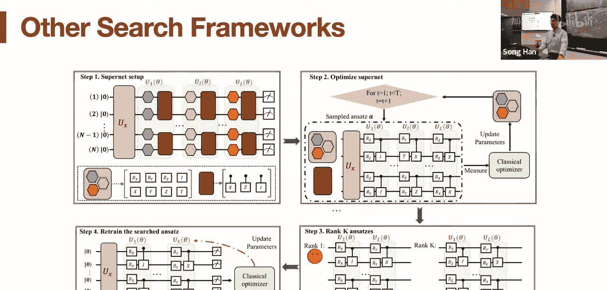

So finally a summary of today's lecture， we introduce the primaryized quantum circuit。

 the training process how to do the classification using the simple classifiers and also how to improve the reliability using those noise where primary search。

 the TQ library and also how to find the find the most robust quantum markets using this quantum nice framework All right so with that thank you very much for your attention heavy to take any questions thank you and also have a heavy nice Thanksgiving。

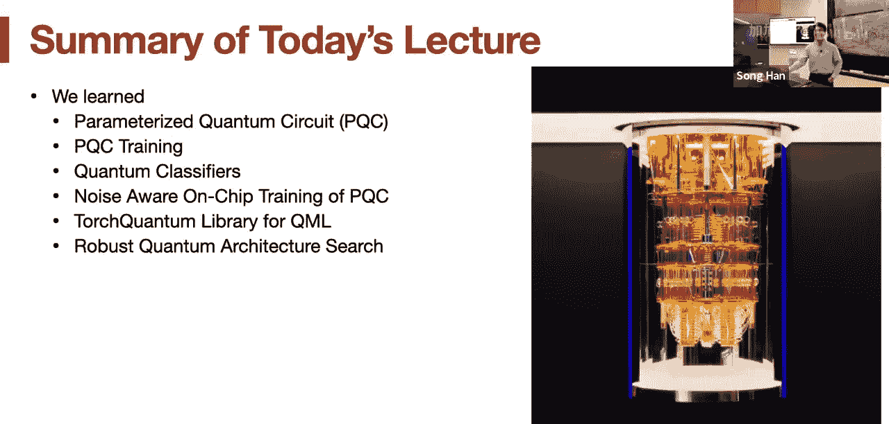