# 《统计学习理论和应用｜9.520 6.860 Statistical Learning Theory and Applications 2019》中英字幕 p01 -01- Class 1.zh_en -BV1CrnXzoEGA_p1-

Welcome to 9，520 and 6，860， the statistical learninging theory and applications course Can anybody here。

😊，I think they can。This seems to work。So I， I'll give a short overview of how the course works。

 And then I'm going to give it to Tommy Poggjo， who's going to give the first lecture。

So as you can see， the class is going to be taking place at 11 a on Tuesdays and Thursdays in this room。

 apart from two days where we're going to move over there to 31，89。嗯。

There is going to be several things that I'll kind of do interactively with you。

But some some announcements， that is the website for the course。Does Google 9，5，20 MI T。啊。And。

You might want to remember this email， which is 95，20 at MT WDU。 This is how you can contact all。

 all the people who are running this course。We are looking into the option of not using the mailing list this year。

 Is everyone here comfortable with using stellar only for communication。😊。

I someone here not okay with it， speak up now。Because if you do not speak up now。

The mailing list will get deleted。Snail mail， snail mail。 Okay。

 you can write it down on a piece of paper for me and its going to go specifically to you。

 Anyone else。Okay， there is no mailing list。

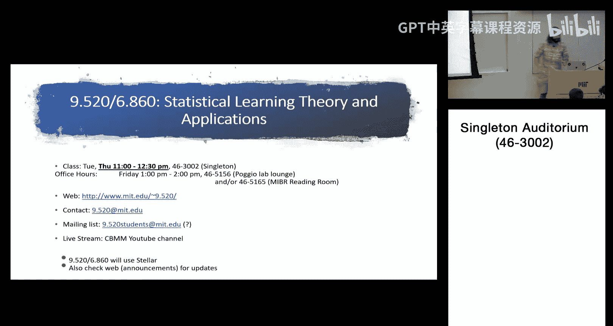

A correction to the slide。Okay。

That is gone。No。There is a live stream。 You can open your cell phones right now。

 Go to the CBM M YouTube channel， go to the live streams， and you'll see us live right now。😊。

All the lectures are going to be streamed live on YouTube。

 prefer ones that are not going to get permission。Most of them should be。AndRight now。

 we also have overflow with screen over there。 I don't know if anyone is watching， but hello。嗯。

Anyway， we're going to use stellar most for most of the things， as we've just decided。

 And we're also going to ask you to check the website every now and then。

Mostly because a lot of stuff is going to be actually posted on the website， not on stellar。So。

Slides are going to be posted on the website。They're going to be updated after each lecture。

As fast as I can put them online。The videos you can check on the CBM YouTube channel。

 And there's going to be some notes that we're going to distribute with you on stellar。

They're going to be more or less irrelevant for the first half of the course or so。

 The one that Lorez is going to be teaching。So now， onto the faces of the course。

 you're going to have Lorenzo Lorenzo as a first instructor for the most part of the course。

 A apart from the first lecture。 After Lorenzo， Sasha Rane is going to take over。

And then Tommy is going to open the course and close the course。 We might have some guest lectures。

Possibly。I might give a lecture。 I gave myself a pretty cool picture here。嗯。

And then we have some amazing Ts。 There is Michael Lee， who is not here right now。 We have Chen Li。

 who has a very cryptic picture。 But he's somewhere there。😊。

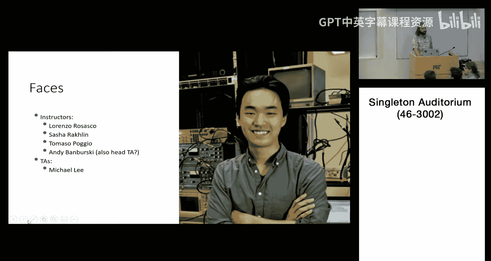

Is waving。We have Mortea， who's over here， again， waving。And we have Abbey in the front row， nearly。

So。That's it。These are going to be available for you and you can look at their faces as much as you want。

This is the course at a glance。 You can find this on the website。 Basically， as you can see。

 the first。Half of the course the first， I don't know。 Ha third is by the Lorenzo。

 Then Sasha takes over。 We have some guest lectures。 Tommy finishes this might encroach in here。

We'll see。This is what the course will look like。And now onto the boarding stuff。

 which is the thing that actually matters here。What's the grading policies for this course。

 We're going to have problem sets， and there are going to be the majority of the cars。

 There is no exams， which is the good thing。But this means that four problem sets are going through the majority of the grade。

They're going to be mostly。Mathematical exercises， there might be some Matlab codes involved or Python code involved。

 We'll see how that goes。And there is going to be some specific aid policy and so on。

 Then there is going to be the projects。 And there is going to be participation。

 The final projects are going to be something I'll discuss in a second。 Participation is fun。😊。

In the sense that we want you to attend into class， we're going to learn in this kind of， I mean。

 this is。Theoretical subject。 And you would want to attend the lectures， hopefully。

At some random lectures， a sign up sheet is going to be circulated。

 also online on the YouTube channel。嗯。So we'll somehow figure that out。

If you have any questions about this， ask me later。Now onto the problem sets， we're going to have。

 as I said， four problem sets are going to be like 2 to three questions each。

Theres going to be one week for each of these problem sets。

You're going to have two types of it in latex。 So if you do not know latex。

Now is the time to learn it before the first assignment。

We're going to have a late policy for the course， which is pretty， pretty neat。

 You're going to have four or free late days through the whole term。

 You can use up to two of them per assignment。There is no late this for the project。Beyond that。

 we're going to start deducting somehow a penalty from not handing them in。

 apart from some very specific circumstances。 if you come to us personally。

There are some dates that you can find on the website。

 one they're going to be the first problems that is going to be out and。Two weeks。And you may。

 you know， collaborate。 We invite you to do that， but you should write your own thing。

 your own solution at the end of the day。

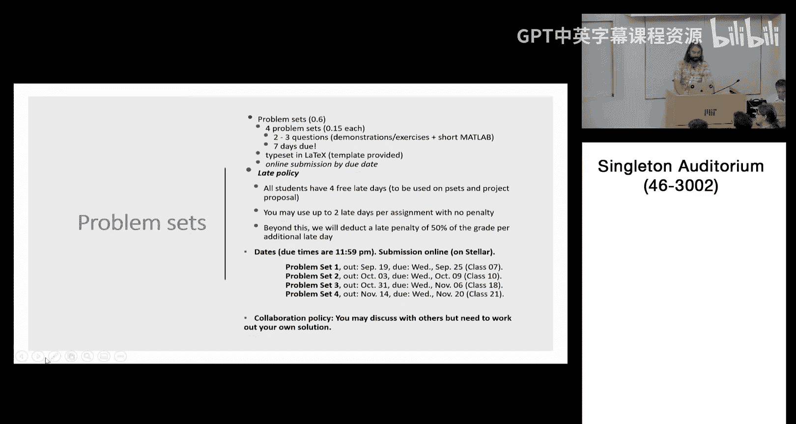

嗯。Now， on the last bit， the projects of the course。Basically。

 they kind of go in four different categories。 The two top are kind of connected。

 There's going to be more theoretical projects that are probably the thing that would you would like to have out of this cars。

And understand， like the deeper understanding of something interesting in machine learning and statistical learning theory。

This could be in the context of creating new algorithms or studying something more in depth in a theoretical and mathematical way。

We're also fine with you reviewing broadly and in depth， some kind of field of。

Something related to statistical learning theory。 And then we're going to have applications。

 And you'll notice that this is the only part where the title of the course。

 statistical learning theory and applications has actually applications。 is in your final project。

And this is， again， not the data science course。 This is a machine learning course。

 So we'll not care about you collecting any data or anything like this is what you do with the data given learning on data。

 So if you end up you know， spending。Most of your project time preparing a data set。

 we don't really care。This is a different course。So the application bit is a bit more risky。

And that's why we're kind of like， you， you'll see that the whole course is somehow structured that on more the theoreticalical。

 theoretical side of it。But applications are definitely welcome。The reports are。

 So how we're going to grade these things。 We're going to again write a late report。

 It's going to be style for it。And you're going to have to submit an abstract and a title by November 1。

 We're going to get back to you with some maybe suggestions and improvements of it。

 And then the submission is going to be December 11。And with that。

Are there any questions before Tommy you can take over？Individual project。

We recommend individual projects， but two group two person projects are also okay。

 They will require more work。Proportally。Other questions。If not。

We're going to have office hours every Friday， at 1 PM。

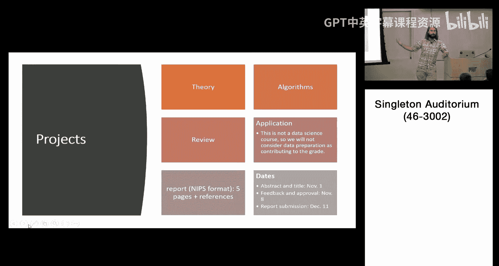

You're welcome to ask your questions then。Okay。还个。在哪里啊？

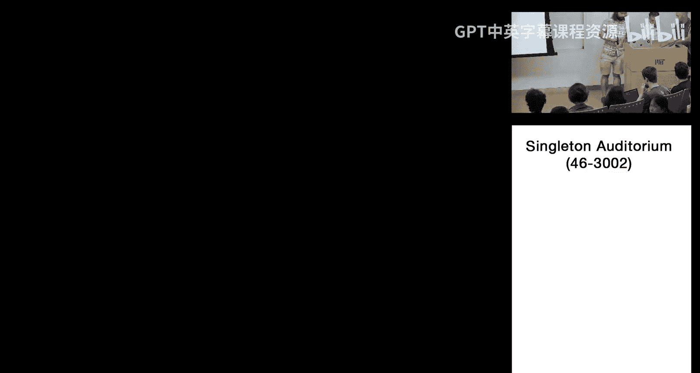

And no videos right。Okay， so I Thomaso Pajo and， and Andy told you already about the roots of the game。

So today is just an introduction and an excuse to give you a feeling。

 a little bit of a feeling for what we'll be doing in the course plus the background of this class。

 which has been going on for a long time here at MIT。

 I think it's the oldest learning class at MIT by now in continuousuous operation as they say。嗯。So。

First of all， just adding to。What Andy mentioned， there are essentially two parts of the class。

 One is algorithms。 The other is theory。 Despite the title， there are no applications。Okay。

That there wouldn。C courseour is important for applications。

 but there are no applications in the course。And so the first part is about， this will be Lorenzo。

 is about。Algorithms and one of the core messages here is the role of regularization。

And everything that goes with it from retro regression to kernel machines， and so on。The second part。

 which will be Sasha。Is about generalization and generalization bounds。

And concepts such as rather mark complexity another measure of complexity of models and theories。

And then we'll go still at the level of theory into deep learning。

 and this is more the more recent and less tried out part of the class。In which we try to dispel the。

The notion that deep deep networks are different from previous learning techniques like can machines。

 And there is more magic to it。 Not true。But that would be part of this。Third。嗯。Section of the class。

 So now， let me go。Into。嗯。You know， motivation for all of this。Overall， motivation。

Is behind this course， is becoming more and more central。Also， to the rest that I of M I T and。

Tell you in a second way。This question of learning， how。We learn from experience。

 how a machine can learn from experience is a core part of the general problem of intelligence and。

As you know， there are great problems in science。The usual one， the origin of universe。

 the origin of life， the structure of time and matter and so on。

And the problem of intelligence is one of them。 I arguer is the most important of all。

And the reason is that if you can make yourself more intelligent， more like Einstein。

 or you can have a machine next to you that can help you think better like computers are actually doing。

 then you can solve more easily all other great problem science， right。

What the problem technology is the greatest to。Okay， and of course， since it's a great problem。

 you can， if you are really good， if you have made progress or make yourself smarter。

 you can win not only a touring prize because you make an intelligent machines。

 but also a Nobel prize because you understand something about biological intelligence or more Nobel prizes。

😊，So this is really at the forefront of both science and technology。Now。

 this was the reason why seven years ago， we started a center for brains， minds and machines。

That was focused on making progress on the science and the engineering of intelligence iss a center that exists。

Here， in this building。And。嗯。And I'll tell you in a second why we think that combination of science and engineering is important。

 first of all。How many of you know who Francis C is。What it was。Yeah。

 with Jim Watson discovered the structure of DNA。You know，53 is when。The Nature paper was published。

 which was the beginning not only of a new branch of science。

 but also a new branch of industry with molecular biology and genetics。And。

It's just a definition that it was very strict to。You define。As science。The study of natural things。

 So physics is science。 chemistrymi is science， astronomy is science。Biology， science。

Mathematics is not。Mathematics studies， human artifacts。Ideas。

They are not something you find in nature。And， and so it's just a definition。 You know。

 it's not saying that mathematics is less because it's not natural science。

 So let me use this definition。Okay。Now， if you look at two of the main success stories in the recent five years in the field of artificial intelligence。

A two person are responsible for them。 One is Dami Sa Sabiis。 The other is Amnon Shahua。

 I chose them because they are both postdocs of mine so that。

But Des is the founder and CEO of Deep Mind。And Anon is the founder and CEO of Mobile。

 which is now part of Intel。And so， deep mind。Did achieve this big milestone in artificial intelligence of developing a system called Al 0。

 Alpha go first。 And more recently， there is an alpha 0 version that。Was was able to learn Alpha 0。

 the rules of either chess or go by playing against itself and then beat human champions at both games。

Okay。Which is， especially in the case of Go， is really a major achievement was not thought to be possible for several decades。

And Am and these company mobilee are at the forefront of autonomous driving， vision based。

Out on I was driving， so。All the Tesla initially used Mo eye。嗯。

Har do and software until we as a board of Mobile fired alon mask because it was not behaving properly。

 but that's another story。Okay。So if you look now at these two success stories and you ask yourself。

What was at the core of them， Well， at the core there were two algorithms。

One is reinforcement learning。Played an especially big role for in the game story。

The other one is deep learning， which played a big role in both。And。Where are they coming from。

 If you look at history。Reforcement learning had this origin in the work of Pavov 1900 or so in Russia。

And then more recently in 48 or so， Donald have in Canada。And they work so neuroscience。

And they work deep learning。At this origin in work of David Huber and Trssten Viel up the river at Harvard。

 working with。The visual system of monkeys， recording from single cells。In the brain of monkeys。

The architecture that they suggested was taken up for quantitative model by Fukushima in Japan more recently in my group and others more recently。

 and the architecture is exactly the same as the one of deep learning today， not a way to train。

 but the architect， theerarchical layer wise。Architecture。

 so the point here is that both of these breakthroughs。Happen。Inspired by neuroscience。嗯。So。呃。

I think it's a good recipe for the future。 If you want to get to new breakthroughs。

Or you want to look where it may come from is to look at neuroscience as one area where there may be new ideas that would be important for the future of machine learning and AI。

Okay。This is， in fact， a was。The paper up saying that the dems。嗯。Agreed with this。

Agreed with the idea that to build better。Computer brain。

 you need to understand more about neuroscience and that's why at the Center for Brains Min Mach。

 we have a collections of not only of different institutions。

 but of faculty and students and postdocs from different areas of science， cognitive science。

 machine learning， of course。But also neuroscience。 And we have number of people。

 especially from MI T and Harvard， but from different departments inside MI T and Harvard and。

 of course， companies。That are the usual suspects in the marketplace of intelligence。

 from Google to Deep mind to。IBM and Microsoft。And intel， and so。Let me go over so let me just。

 this is a bit of a advertisement if you are interested in one of the most successful activities of our center。

Is a summer school at Woods Ho。 Cape Co is an hour and a half driving from here。Three weeks。

35 students from 300 applications。They are there for three weeks， lectures， and especially。

Three weeks， long projects。With around about 10 years or so from all these three different areas。

Neuroscience， cognitive science， machine learning。Trying to learn the different languages that are going to be important for。

The future of AI。Okay。So。It's important also for MIT， I mentioned， because。

M myT is now something called the quest for In and of course， a new。Collge of ops。Too many boxes。And。

 of course， a new college for computing。对。Okay， college for computing。And in a sense， CBMM is the。

At the center of it， the intersection between。Sciences and engineering。Okay。

 let me summarize this brief。Part。You know， the real motivation for a course like this is living in this。

Golden age for machine learning， especially applications with the technology that we have today。

 but we want to push the technology。Forward。Now。嗯。I want to tell you again。

 it's a bit of an examples。Some。Bits about。History first。

 very briefly on statistical learning theory。嗯。This is。From in the 80s。The idea。Of。

Learning from examples。Became kind of fashionable， again。And。

And the basic framework is that you want to find a magic box that's call it a function， a network。

Which you can train with pairs of inputs and outputs， inputs， the X are vectors， outputs。

can be a number or like plus1 minus1 or a vector itself and you have a lot of these data points and you want to learn the mapping from the input to the output and the inputs could be the weather yesterday without possible data in differential location。

 the word temperature pressure and so on and you want to predict the weather tomorrow。

Or same for for financial markets， right， same story。 want to predict。

What will happen tomorrow or in the case of autonomous driving。

 you may want to predict whether the images you're getting is the image of a pedestrian or or not。

 whether you should break or accelerate。And so， the kind of。Problems you have here。

Conveniently described as regression or classification， regression when your y， for instance。

 is a real number and classification when it's a discrete label。

 the extreme case being one or minus-1 Yeah is it is it a pedestrian or is not right you have to。

Say whether your input is a person or is not a person。 And in the case of regression， you have just。

Fit a curve。 Now， these problems are easy。If I describe this classification and fitting in terms of the examples you have seen in terms of the training set。

Obviously， you just look at your training set。 You have the answer。But the key part of learning。

Is really that you want to predict。For new inputs， the correct output， right。And so。

 it's a prediction。嗯。Problem and。What does it mean to predict and can you give really guarantees about whether an algorithm can predict that's kind of core questions in machine learning theory and the usual setup that is kind of classical for the last decades I've shown this slide for a lot of times。

 a lot of years。Is that， and this is the kind of vanilla one for supervised learning。

Is that you have a probability distribution。On。The space of input outputs， X， Y。And this。

You don't know this measure。This probability distribution mule。嗯。And then。We have also。嗯。

A training set。🎼Which are samples drawn。I I D from this unknown measure mule。You also have。

A set of models。 This is。A space of theories， a space of function。This could be a space of networks。

 you know， networks with certain architectures。And， and then the problem is。嗯。都 to。

Look at the training set S， which is finite。And based on this。

 select a function or the parameters of a function in the space you have。Such that。

When you apply this function。To an input X， it gives to I in a predictive way。

 And what does the predictive means。One way to define this is。Is to measure the expected error。

 That's the error you expect to。To do so you you expect to do in the future。

And that's just the average error over this unknown measure mu， but the measure mu is unknown。

 so you cannot compute that integral。 and so instead of that。

 you just take the empirical average over the training set。So the error on the training site。Is。

Ideally， a proxy for。The unknown， expected error。And。And then you have to say， whether。

Under which conditions。This empirical。Measure of your error is a good proxy for the real unknown。

 expected error。If you have a guarantee that this happens。This is。

This means that your algorithm has a generalization guarantee， you know， it will generalize。

That empirical error。Will convert to the through future error。

And then if you have $1 billion to invest in how the market will go up tomorrow。You。Happy to do it。

 because， you know that if you do well on the training set， you're going to do well on the。On future。

 on the future。We'll see this in the class。And here， I just mentioned that some of。

Of this result are are are almost at some level， philosophical in terms of。You know。

 scientific theories， because， for instance， one result that I like。

 because I was involved with Sasha and a couple of others。

Students to prove it is that there is an equivalentence。Between generalization。

 this guarantee that the empirical error will approach the expected error。

 there is an equivalence between that and the stability of the learning process。

Stability in the sense of that it must be a well pose problem in the classic of sense of world post problems。

And the consequences of this are， like。That。In order for a theory to be predictive。You cannot just。

Change the rules。 Make it。A bigger range of parameters are possible after you have seen the data。

 this is astrology。That's not。Astronomy， you have to。Fix your models before looking at the data。

And typically。Your models are simple。 This is。This idea of simplicity of models。

If you want the to data， future data。Is not an accident。But demonstrate the power of the model。

 The model is to complicate too many parameters to fit。Well， then almost anything will work。

And there is saying this。Is equivalent to say the theories。Should not change very much in time。

So there should be few revolutions。Thomas Khn called them what they called it Scific revolutions。

You know。Can be some， but rarely a theory to be stable over time。Essential。

 it has to fit most of the data in order to be predicted。 Anyway。

 we will see some of this and the related concept in the in the rest of the class， but。

One of the messages。嗯。That this type of arguments and many other ones。Held。Emphasize in the 80s。Was。

Well be， very careful not to overfit the data， because then you can fit you。

 you have a model that works very well on your training set on past data from the stock market。

But would be a cut It will be terrible on future date。Should not overfi the data。

 And the early days in the 80s， people were overfitting the data were testing models of using parts of the training set。

 You know， there was。And after a few years of battles about this， I think the community understood。

The risks of overfitting。All right。Now嗯。One of the classical arguments that we willll see very soon。

 probably class。7， Lorenncealization。6，5，3。Classs free。Is this idea of controlling。

The complexity of an algorithm。By adding a。Term called the regularization term。

That will constrain the complexity。Of the algorithm。 So on the left side here， V is a loss function。

 like the square loss。So you have， you are trying to find the function。Your network。

 which minimizes the square error over the training set。 you know。

 the error between your prediction X I and the true Y I， the true output。嗯。But you want to do this。

 while keeping。The complexity of your network， F， your function， F。Constrained， and you do this by。

Adding this term that is measuring the norm， the， the size of F in a certain way， a。

reproducing Can Ibert based north。Okay， and again， you don't need to understand this right now。

 but just to give you a feeling and and。That's one important point to。Do。

To remember this regularization term that uses a norm。

 And the other point of this slide is that this kind of。Algorithms that。Typically。

 go under the name of camera machines。Also， correspond to。Networks that have。Inputs。

Have one hidden layer。For instance， of depending on the norm you choose， this could be a kernelel。

 could be a Gaussian， could be a do product。Between the inputs and some parameters stored in each unit。

 And then what you learn from the data is the weights of this。Outputs。That then get sumated。 Okay。

 so you're doing something like this。So this is a one hidden layer network。

 just what with one layer of parameters。And they would be what we would call a shallow network。

 as opposed to networks。That are used today deep， in deep learning， that have several layers of。

Of weight。To be learned from the data。Okay， so。I just told you a couple of little things about。嗯。对。

The past， past statistical learning。I want to give you now a few bits of applications。

 mainly from my lab， just to follow what has happened saved from 1980 to 2000 or so。

And also to give you the feeling that many of the things you see today as application of deep learning are similar to what people did。

 20 or more years ago with somewhat different techniques。

So this was one of the very first demonstration of an algorithm that was a support vector machine。

 basically so was traineded from data and was designed to detect faces。So now you have it， of course。

 you know， each。Each phone has this kind of things。 but this happened about 15 years after this。So。U。

We were among the first。 This is a funny mistake that the algorithm did， of course。嗯。嗯。So。

 this became。Commercial thing。 And another thing that we did was a system that was trained。

 This was 97 to detect pedestrian。 And we had。嗯。I'll show you， yes。So this was detecting pedestrians。

It was a project together with Diimner Benz， Mercedes。And。

Mercedes has Di Benz has their research labs in Um。Which is in southern Germany。

 between Stutgart and Munich。 and is also the place where Albert Einstein was born。嗯。

And so we ran in Uma a test with our computer was a PC in the trunk of the Mercedes。

To detect pedestrians。

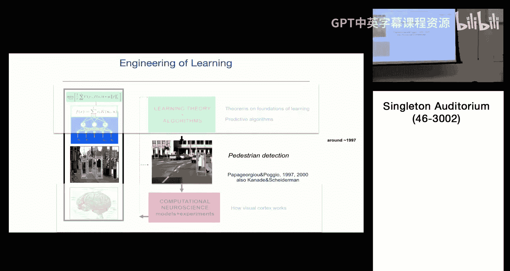

And I'll show you a better。Let's seeThis is。The algorithm， then， this was。More than 20 years ago。

 25 years ago。So this was from inside the Mercedes。In normal， the algorithm was trained with about。

2000 photos of people taken in Boston。 And so there is transfer to whom。And it detect pedestrian。

 But you see So some false detection for it a traffic light at the end， okay。So。The， this system had。

error rate。Of one error。A very free frames。So， this was。10 errors per second。

 at 30 frames per second。Now， we are very happy about the quality of this。

 This was the first time it was done。But of course，10 errors per frame， it's unusable。

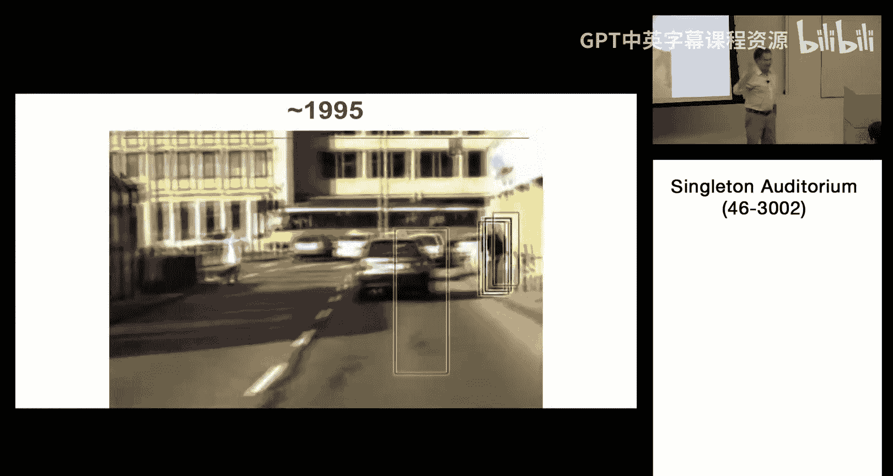

嗯。Moe。

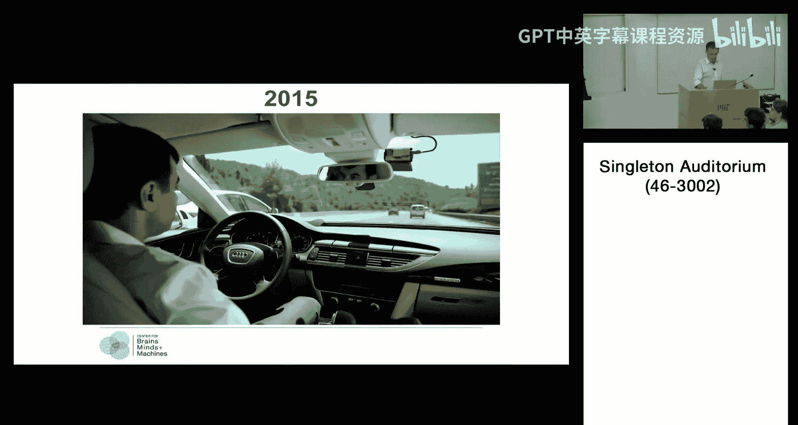

In addition to preventing collisions， the system must sense the road at great detail。

 including lane markings， curves， barriers， obstructions。

 recognize the large vocabulary of air traffics。

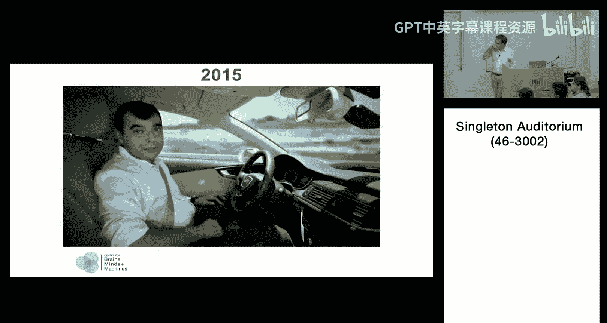

Anyway， Moe。Has an error rate for the same problem of pedestrian detection。

 which is about one error every 50000 kilometers of driving。Instead of 10 arrows per second， right？

So。Some back of the envelope calculation。Means。That is。1 million times better。

Than it was we had in 95。It's like doubling accuracy， every year。For 25 years。

 So that's kind of the more law。For machine learning。

 that's why has become so commercially attractive。Okay。

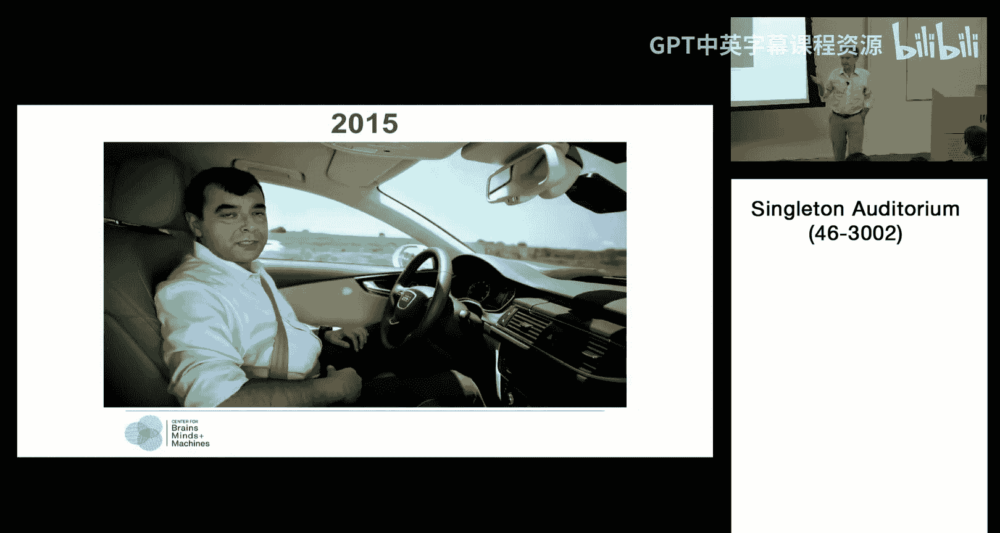

All right。So we did this kind of things， but many other ones from computer vision is face detection。

 pedestal detection， seen understanding meaning classified various objects in a scene。

 categorization in video video compression， estimation of pose， and then we did computer graphics。

 speech recognitions， speech synthesis， bioinformatics， artificial markets and so on。Here。

 for instance， was a prediction of。Of cancer from。DNA array data。With a broad institute。

Here was the idea of reading。The faults of a monkey from electrical activity in the brain。

 you can decode the activity of a few hundred neurons in cortex and decide which object the monkey was looking at just from the neural activity of the brain。

 and this is a technique which is now used a lot in physiology。Or by。

Inverting the recognition process。 So now I have。A network in which。You know。

 typically in computer vision， you have an image as input and the output could be something like which object and which point of view if you want and other parameters。

But suppose you invert input and outputs。 Then you have some kind of unconventional graphics in which。

有。inputputs。Some object type and parameters of its pose。 And you get out an image。

It's a bit similar to what happened today David with Gs， but were pretty high quality。

 is in a moment。So this was a system developed by Tony Edt。Using machine learning at the time。 and。

 and the system。was。You could do this。 You could。Train the system on 4 minutes。Of video from， from。呃。

We had that。Sttored， and then。We。嗯。呃。We， we could。Input。The speech of another person。And have。Our。

Mary 1，0，1， apparently speak with the voice of the other person。So， we can put。

The voice of anybody in her mouth。And adapt her mouth movements to the new speech。 Okay。

 so these are some example of。

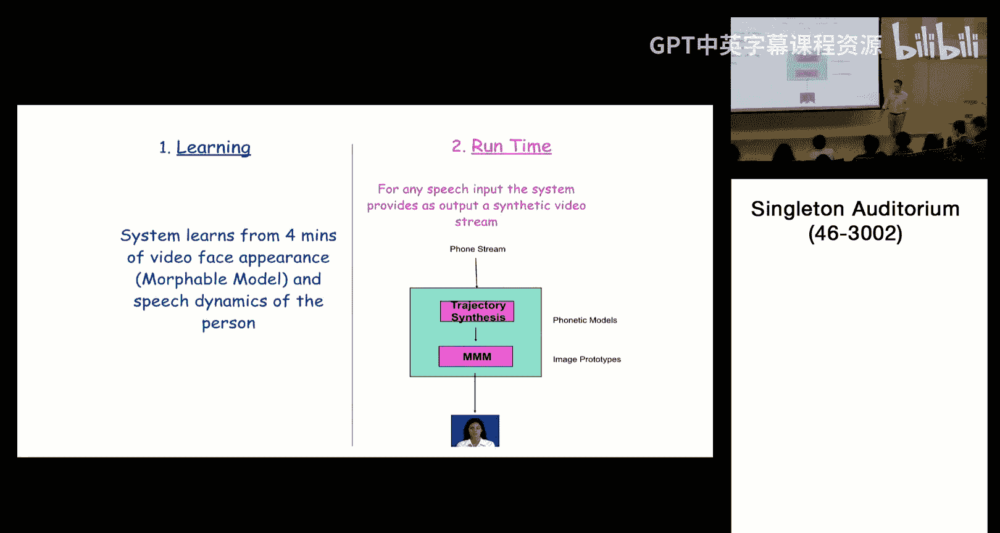

嗯。Of this， let's see。

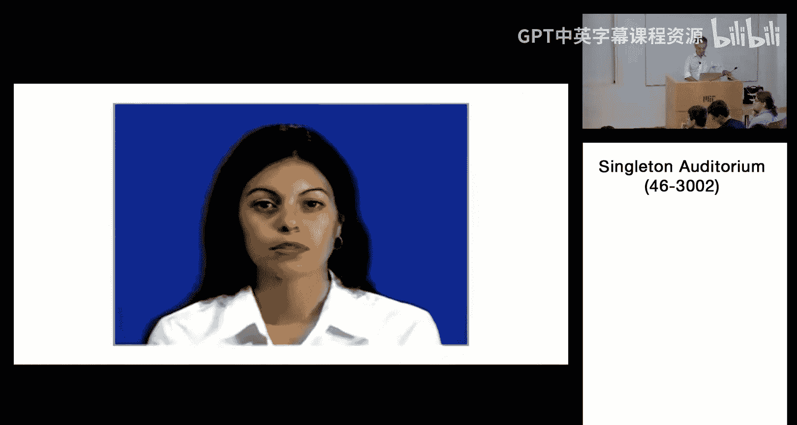

O皮。

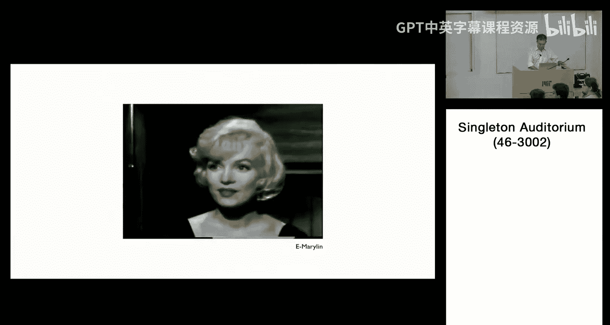

With what。

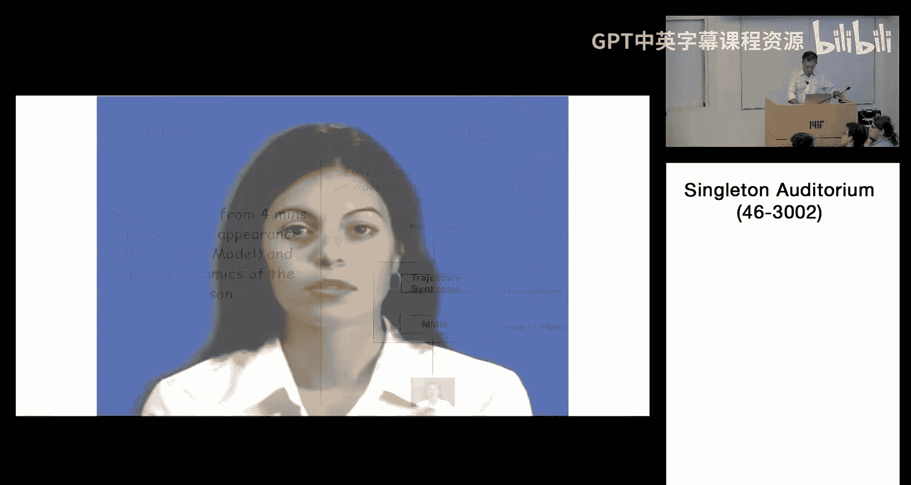

🎼With one light on。🎼And one。🎼I know you。🎼When I get home。

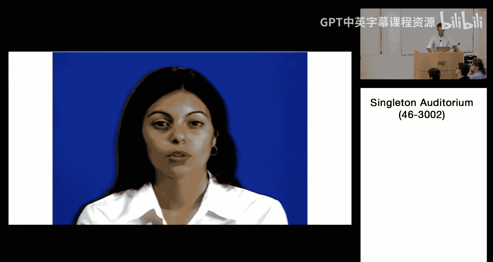

Moving the lips or not。🎼结触。🎼今。🎼真爱。🎼The system does not care whether just Chinese。

 Japanese is or angry。🎼With one light on。🎼And one。🎼I know ya。🎼When I get home。🎼This is less good。

 but yet not much。🎼terms of training me home Marine。

🎼Princple you can have me model make as dining more I。

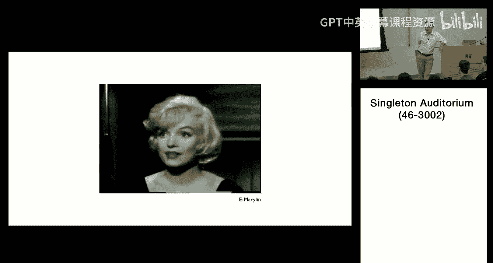

你说是。

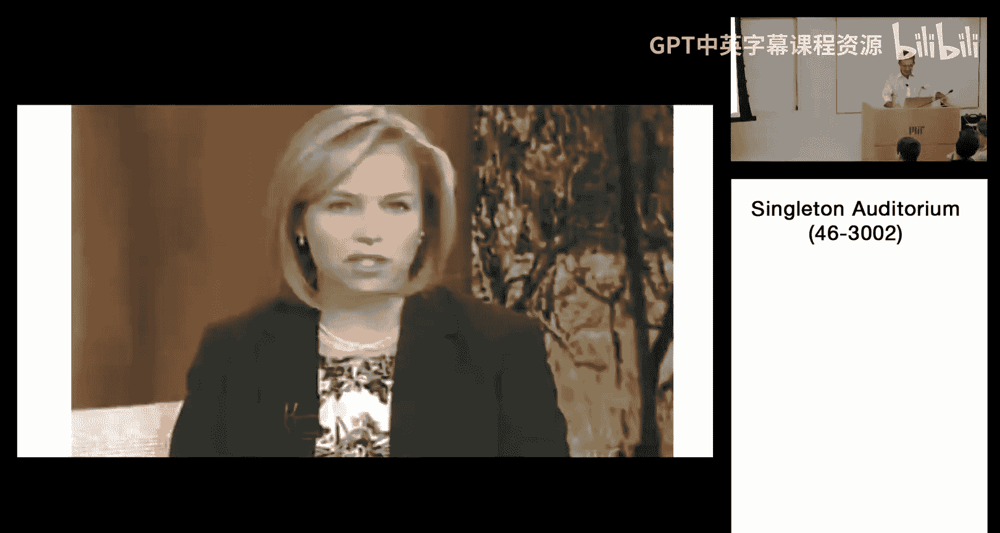

don't believe everything you see or hear a graduate student at the Massachusetts Institute of Technology has developed a computer program that can manipulate video to make it appear as if you've spoken or sung words that in reality you have not evenrick in today show Tony Iat is the MIT student who developed the program。

Each animation and professorfe Tamaso Poio is his advisor nice to see you both how are you all right let's talk about it what from New York not from the beaches of cannes TV news legend Walter crnkite he'll be hosting this year's 61st annual George Foster Peabody award ceremony on Monday him about that。

The new technology can take anyone's voice， including mine。

 And by reprocessing it through a computer， my voice can sound and look as if it's coming out of someone else's mouth。

And the voice was by this lady。🎼I we make she didn't know that。We made up sink。B。

The meeting was frank。The meeting was f， the53% the one is53%。More news in a moment。

More news in a moment。It's a matter of money。It's a matter of money。That's all for tonight。

That's all for tonight。It could take months。It could take months。So， you know。

 that's a kind of touring test。 Can you distinguish the real one。

 the human person from the artificial one。 And for naive people， basically， they could not。

 It was 50，50。So kind of passing the to test， okay。All right， so。嗯。What I told you is。

A couple of old applications just to give a feeling of what was going on。Yeah。20，30 years ago。

Im more mostly using kamel machines techniques。嗯。But a lot of application， similar to today。Now。

I want to give you a couple of bits about。Deep learning， which is a relatively new part of the class。

And。We， we said that we are going to。嗯。Look at。Free， we are going to look at free。

Key puzzles in deep learning， One is。How powerful are they in terms of approximating or representing。

Functions。Why， if， if they are more powerful than。Then shallow network like machines， why。

Why it's so surprisingly easy。To solve the optimization problem that you have in training a large network。

Seems a very hard problem， because of you have。undred thousand of millions of data points and hundred of thousands millions of parameters。

It can be solved。 You find minima。And why is that so relatively easy。And the third one。

 which is the 1 I want to。Give you some more feeling about today is why。This networks。

Seems to do well in terms of predicting well。Despite the fact that you have。Typically， more。嗯。

Weaiights more parameters to fit than data points。Okay。嗯。So the last one， you know， when I was。

Studying physics many years ago， one thing that。Stuck。In my mind or everybody， it was。

 was the fact that if you ever， say， a model of some something in mechanics or in physics。

And this model has 10 parameters。 You know， you better have at least 10 data points。

 but more normally 20 to fit those parameters right。But。Now， the situation seems to be， you know。

The more parameter， the better。也 know。In the 80s， I was asking speakers。

 are you sure you are not overfitting the data， Are you sure you are you are not using as a validation sets。

 even in part。Something in the training side。 Are you sure you have， you know。

 more data than parameters。But in the last few years， since deep learning started。

I'm asking when I asked the same question， I said， well， the more， more parameters and data。

 the more there are， the better。So what's going on， right？嗯。So， first of all。

 you probably know everything about deep learning， who doesn or not。Raise your end。

 if you don't know。Anything about deep。everybodybody knows。It's。

A layered system input for instance is an image。 output is some label。 What is the。

The object became really。Ttracted a lot of attention when。

When Jeff Hinton and two of his postdocs published this paper in 2012 about doing pretty well much better than previous attempts at classifying images in a large database called ImageNe。

Which has。Thous0 classes of objects and 1 million images， at least at the time。

Of these thousand classes。And what's going on in。嗯。In a vanilla version of a。

Of a deep learning network is。Quite simple because you have a set of neurons in each layer。And。

Each neuron gets inputs。From the image， for instance， or from the layer below。And sums these inputs。

And then pass them past this number。Through an R， the rectifier only linear narrative。

 which has become the standard one。That's it。And then this number is past to layers。Later layers。And。

How do you find the weights？Of all this， there are a lot of weights。 You do it by。

Using one of the most straightforward techniques of doing gradient descent on the loss。

 which typically now I'm not。Is for。Csification problems and most of the problems in。

The deep learning literature or classification is an exponential loss function I'll say something more in a second is not a square loss。

And you don't typically do。Straight gradient descent。

 but a variation of it called stochastic gradient descent。In which you are taking the gradient。

 not respect to all the。TheT set， but only to a random batch of them， at teach iteration。Okay， so。So。

As I said today， just to give you a feeling for the kind of things you are going to look towards the ending of the class。

And the kind of things we were building up during the class towards。You know。

 is this question of the puzzle of good juization means meaning good productivity， despite。

Despite over parameterization。And one example of this is。This graph I think Shi Li made it。

 This is on Cfer。 Cfer is a little bit like Inet， but simpler， easier。

 The images are smaller 32 by 32 you have in this one only 10 classes of things like cars and buses and so on and you have only 60000 images in your database instead of 1 million。

And what we did here is to have。A standard network of five layers。

 but we have different number of units， so。So here is the network with few parameters， few weights。

 and then more and more， okay。And we trained with 50000。Examples。So。In this region。

When the number of weights is less than 50，000。You are under parameterized。And。

From 50000 up to 1 million and 10 million parameters， you are over parameterized。Is that the clear？

So we are vary the the size of the netO and the number of parameters in the net。And。

 as you can expect。As long as you are under parameterized。

 you have fewer parameters than data points。Your training error is not 0。You don't fit the data。

You don't interpolate。But as soon as you， you get over parameterized。Then you start fitting the data。

 Your training error goes to 0。Now， the interesting thing is that。The generalization error。 So the。

 the orange one is on a separate set outside the training set。Thats set。Goes down。But， at some point。

Detaizes。And it does not suffer at all， apparently， in this experiment。

Even if we over parameterize a lot。So that's a typical situation。And。The intuition。

 which is also empirical true， is that if you are in this over parameterization regime。

You have an easier time in finding the minima during training。We'll come back to this in the class。

 why。So。Conclusion will be， why not？ Let's over parameterize， easier to train。

And it does not make performance， prediction performance worse。Right， that's， that's essentially。

The past。But it's also。It's interestingtic to see， you know， I discussed before。In the past。Often。

 you want to have to be in a situation in which。嗯。The training error can be a proxy for the。

Testing error。And in this case， it's not。Yeah， you had  zero。Traing at all。Okay。So like a few things。

 first of all， learning theory has made the clear since several decades that。

What matters is not the number of parameters。You have to control the complexity of the theory。

 as I said before。But。The parameters， what you have to control， really。

 is not the number of parameters。But other quantities that are a better measure of the complexity of a model。

 of a theory， of a function， of a network。 And these are things like VC dimension。

 Ramatic complexity covering numbers of the functions。And。And the norm of the function。

 the appropriate norm of the function is correlated with this。Kind of quantities， right。

 And that's why， in the example of。Of the kernelnel machines that I had before。

 when I introduced Shao network， there was this normal tale because this is a way to。

 to control the complexity。not so much number of parameters is the norm of the parameter。Okay。嗯。So I。

 actually， I I， I have this slide here， I think。Yeah。So this thema lambda F。K square。All right。

 let me skip the definition of covering numbers， but。嗯。How many of you knows。

What covering numbers are。Okay。Now we'll get to it。嗯。嗯。Now， so I said。As I said。

 the number of parameter is not。The important one， you can。If you control the norm。

 that's the important thing to do。 But in deep networks， typically。

You can have a regularization term or something equivalent to it， like weight to decay。

She's equivalent。To a square terming the parameters after you take the gradient。嗯。But。Dip matter。

 most of the time。Have this over parameterization magic。 So good prediction performance。

 even when they're parameterized， even without way decay or regularization。So this is still。

E positive。There is one question， and。Whether there is anything similar to that in classical mathematics。

 And one thing that。To keep in mind， as kind of a。An example of something that may happen here is the pseudo universe。

Again， how many do of you know what the pseudo universe is。Okay。

 the pseudo universeverse is called also called the more penrollose pursuitverse and。Penrose。

 you know， pen roses。Roger Penrose is a quantum relativistic physicist， quite very well known。

And his paper about the pseudoan verse was。The first paper he ever wrote。

 I think he wrote at the age of 21。And they essentially rediscovered work that Moore had done earlier。

Anyway， one of his definition about the putinverse。Is this one is essentially。That you are。呃Tking。

The inverse of the transpose of a times a。 But this inverse may not exist。 So you add a term。

 which is kind of a regularization term。 And then you take。The reverseverse of that。And。

And then you do the limit for this delta going to zero。嗯。So do， here you have。嗯。

And it turns out that when you're doing。Graadian descent of a linear network。Under the square laws。

You are。Converging to the pseudoinverse solution for the weights。

So a kind of vanishing regularization。If you start from close to  zero weights。

 So that's kind of a analog。In the linear case。Of what may happen。With neural networks。

 I'll tell you in which sense is an analog。But。This is a situation you know in which you converge to the limit of something regularized without having a regularization term when you do gradient the site。

Can look at it。 but this is a well known classical。Situation。Now。

What I'll explain later in the course， I'm telling you this， not because you need to understand it。

 but just to give you a feeling for the kind of things that you will discuss。Is。嗯。

Is the following this。Recent results is。That if you look at gradient descent on an exponential loss。

This means your loss function is over there。 You have this data。

 Yn is a binary number in this example， minus-1 plus one， you are doing binary classification。

F is your multi layer networks， and the W are the weight matrices for all the layers from one to K。

 The network is a。Without a you。And I can rewrite。This F， in terms of row F Tilde， where F Tilde is。

The same network in which the weights in each layer have been normalized。

 The norm of each layer is now forbidious norm。 The sum of the square of the weights is one。

And I take the norm out。This raw。From each of the layers。

 So this row is the product of the norms of all the K layers。Okay， I can do that because of R LU。

Aum is homogeneous。So I can take the norm， you can verify this， and we'll see that later。

 you can take it out。It's a property of linear function and homogeneous function by currently。Okay。

 if you do this， first of all， forget the row and so on， but if you take directly the derivative。

 you always， you know， this is a version of what you do and you do gradient in the scent。

On exponential loss， exponential loss is very similar to the logistic。It's simple to deal。

 to write it。You get this dynamical system， as many differential equations as you have weights。Okay。

You have the matrix of weight， WI J for each layer K。Now。I can show， and。つ not。It's straightforward。

 but it requires free or follow slides。That this equation， this dynamical system。

 is completely equivalent to this one。So instead of doing the dynamical system in the W。

 which is you always do， I could run this dynamical system in the row。And V。

So now I have two variables per layer。2， I mean， each are nice。嗯。This is one per layer， this is Ij。

 so it is all there。Okay。Now。Interingly。I can look。I know that if。At some point in the， in the。

In gradient descent， at some point， I separated the data， which means。That Y， N， F of X， N。

It's positive。So F is the correct side。And this is， you know， in general， is a strong assumption。But。

For instance。If I have a linear network， this would mean my data are linearly separable。

 which is a strong assumption of the data。But here I have a network。

 which is much more powerful than any narrow one。 And essentially， I can separate almost anything。

 given enough parameter。So it's much less stronger assumption。Anyway。

 if at some point of the iteration have separability and so I take away the y and the F are positive。

 then all these quantities here are positive， I know that row from that point on will grow。

Because is that you have a positive derivative。 grow to infinity。A role remained positive。So。

So I can look at the0， the critical point of the gradient of V。

 which is really the direction of the weights。Is the normalized weights。

 iss the directions of the weights。And I can see that this can be 0。 So unlike the W， which。

Divergge to affinity。The V， which are really what I care about。

 because it's the direction of the weights。They have critical points。

Which are the necessary condition for minimumma and。And these critical points。I can write them down。

嗯。As up there。And suppose。I have only one support vector。 So when I wait long enough。

Because the exponential works like a soft mark。So essentially， the X n， the one of the data point。

Which as F of x 9 is the smallest one will be the only one that survive after a long time。

 because all the other terms in the exponential will go to 0。Because row would be very large。

 So there will be one super vector left。Just one of the XN。

 And then that equation reduces to this one。 This is just for simplicity。To look at。

 And this is the equation of the critical points。And they I。For instance in the linear case。

 this gives me exactly the solution of the support vector machine。Hard margin support。嗯。Anyway。

 the interesting part is that if I， I told you what happens with the standard gradient descent。

But now， instead of that， consider this other minimization in which I minimize the。

The exponential loss。Same data， same function。 But I add now this constraint that the weights。

We are normal one。It's a large branch multiplier。Dap。Set up。And I got a dynamical system in R and V。

And there is a constraint on Lambda because I want v squared to be  one。

The way you can compute this is， I can multiply。On the left。

 the both sides of this equation by transpose of V。Since I know that。V square is constant。

The derivative in time of this square has to be 0。And so V transpose V dot has to be 0。

And so I can write zero equal this。Time V transpo D F。V transpose this。 V transpose V gives me one。

 So anyway， I get to this equation for lambda。Okay。And now I plug that back in。And。I get。Again。

 the critical points of that system。And I get exactly the same critical points as before。

So this two different dynamical system。 One is the one you always run， where there is no explicit。

Regization term。In terms of the critical point， it's completely re into this one where you have a regular inexpl regularization。

Vanishing， by the way， because lambda goes to 0。So very similar to the pursuit universeverse。嗯。Okay。

 so。Constrained and unconstrained optimization with a exponential loss by gradient descent。

Correspond to dynamical system with the same critical points。

 So the same they converge to the same points。For any final。电你。To die。All right。

Let me tell you in the last five minutes， a couple of things about this last part that we promised in the class。

So whether well do it in the class， it depends whether there will be enough time at the end， but。

It has to do with。Neuroscis， and。And so these are a little bit blue sky faults。That I。

We may discuss at the end of the class。 One is。嗯。In terms of directions of research for the future。

One is。What I call neoclassical view。Which is essentially believing that deep learning is。嗯。Really。

 the solution to the problem of the brain。And then the is to push in that direction， I think one。

This is equivalent to believing that you can build。Or explain。Human intelligence。

As something that is really a giant lookup table or an associative memory， I don't think。

Deep learning is doing more than that， right？😔，嗯。Okay， in this case。

 there are some interesting question for neuroscience。For instance。That are。

We have to find some biological。Clussible alternatives to gradient descent。

For it's a layer wise learning， because gradient in descent itself。

 back propagation seems very implausible biologically because you need to transfer such precise information across different layers。

 which is biologically difficult to imagine how you could do it。

And also you probably need to find an alternative to supervise learning of the batch type because again。

 this sounds biologically very impusible that you store all examples then at some point when you run it many times through your brain to learn that。

嗯。And。And it seems very improbable。 You know， a baby can see probably。

A million or two images by the age of two。But only a small percentage of those images。

 very small percentage would be labeled by their parents， by parents also。

So there is no way a baby can get 1 million labeled image。

By the time we know it knows to recognize objects。So these are a question in this framework that one has to solve if we want to use that as basis for a theory of the brain。

Or you can look at our。 Maybe deep learning is wrong。From the biological point of view。

Maybe depth is misleading。诶。There are many reasons for that， for instance。In呢。Visual cortex。

 it looks like you have several areas， and。Several of us， including me。

 have used that as an argument for， you know， having several layers， you know。

 starting a few billion vi and so。嗯。But if you look， for instance， at the visual cortex of the mouse。

The eraarchis is not there。There was a recent paper just the last few weeks by the Allen Institute。

 their measure of Yarch， the visual system of the mouse ends up with a number which is 1。3。

Not two layers， just a little bit more than one。And if you look at the auditory system in humans。

 it may be two。Maybe not very Iraqaic。嗯。Furthermore。嗯。嗯。Now， there are many other arguments。Against。

This interpretation of deep learning may be correct， but there are heavy problems with it。

If typically the equivalence， for is in the recent very good work by Jim Di Carlo and others in this group comparing neurons in the monkey to deep networks。

 you the correspond is you have one layer in the network。

And you have one visual area like V1 or V 2 or V 3 or V 4。 How many people know what I T is。Okay。

 not anyway， these are visual areas in the brain。Of the monkey， and。因为。There is a level。

 the difference in the level of complexity that it's a bit worrisome。 I mean， in the。

One layer of a neural network， as I said， is neurons。 and what they do。 They submit the input。

 And then what else through an neural group。 That's it。And if you look at one of these visual areas。

 there are six layers of neurons， many different types， that are pathways going up and down。

 It's much more complicated。 I would be very surprised if the only thing they do is sum and then R。

So you know， this is kind of blue sky， but I think it's interesting to explore。It may simply be that。

 you when we think of cortex as having deep learning， it's kind of assuming that after learning。

 everything is fixed and essentially you have just a fit for old site of nonlinear filters。🤢。

That's it。Can you build intelligence out of it？What about the idea that instead？

Evolution is discovered。A general purpose computer。can run any kind of program。

And the obvious part of the brain where evolution could have done that is the cortex。Okay。

In any case。嗯。You know， you can imagine that。If you look at computer science from where we are today。

At some point， there were expensive programmers。Then now there are labelers cheaper。

A lot of work goes it to。In to providing examples so that you can deal with， you know。

 Alexa can deal with all possible accent and Caey and so on。Memory based intelligence。

 You' just build in。Through examples， all kind of rules and exceptions。

And so there is still a lot to be done。Before we get to systems that can learn by themselves。

Like children do。All right。See you next time。

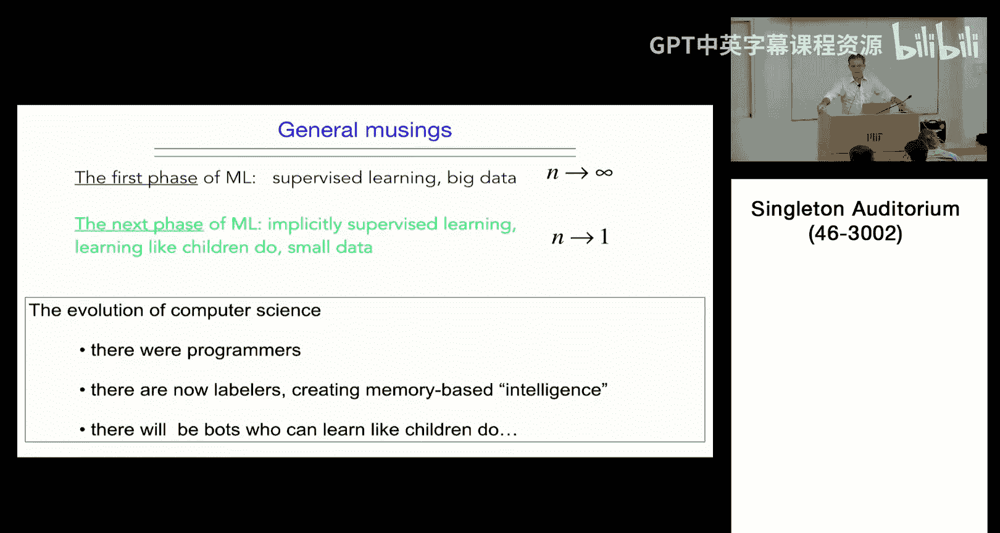