# 《统计学习理论和应用｜9.520 6.860 Statistical Learning Theory and Applications 2019》中英字幕 p24 -24- Class 26.zh_en -BV1CrnXzoEGA_p24-

Okay。Welcome， this is the last class。Sorry for my flu。 We'll try to get through it。嗯。

I want to finish a few items from the dynamics of deep networks of last class and then make a few consideration back。

To the old class and to the foundations of。The machine learning。

Approach that we have been looking at。So。嗯。First of all， let's finish a couple of things。Dep on。

On time。I would like to。To just summarize that we were interested in。The dynamics， how G D。

Greing decent。Gradient flow converges and what。嗯。And the reason is really to understand。

If there is any complexity control that take place during this convergence。😔。

This has been a topic in the last three or four years。嗯。Whether there is kind of implicit。

Regization or maybe something due to flat minimum or so that provides。

Good performing solution to gradient descent。

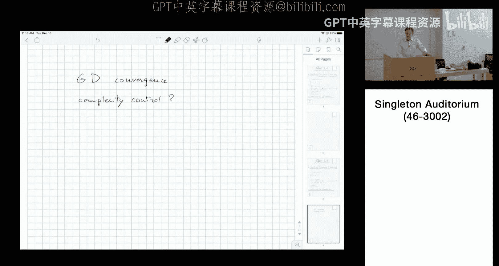

嗯。We have gone through。嗯。A couple of properties of networks， in particular， thegeneity property。H。

off。This is。Through， not for。Deep neural network， but for R L U networks。And this allows us to write。

In neural network F。Which usually is a function of。嗯。Wight matrix is that K at1。And of course。

 input X。As。As。R。Of till there。Where this is now in terms of normalized weight matrices。

And Ro is the product of the。AFrobius norm， say or another norm， but say the Frrobius norm。

Of the matrix of each layer。So。嗯。And then， one can look at。Graaddian descent。

 which will be gradientcent with respect to。The weights V。Of the loss function， L。

And this would be in the special case of the exponential。The sum over N， the example of Y N。

 which is a binary variable row F。X。嗯。Now。We have seen。嗯。

Instead of the this unconstrained optimization that I can do， of course， on V K and also on raw。

Giving me two sets of。嗯。Gredian the center equation。嗯。I can consider， also。嗯。

Constrained optimization， which we did last time。In which we do the same optimization。But to impose。

During the optimization。The V to be normal one。Okay， so。This was。Here。Where you。

 you introduce a Larange， a set of lagrange multiplier。One per layer。And。And then， we went through。

The situation in which we have a fixed role。And we are looking at the equations。Graing descent in V。

And。One point， we had a little discussion。 I want to clarify。 this is。We can find the value of。

Lambda K from the constraint of Vk， the normal B K equal one。 And the way we do this。

Is this is especially for Sasha。 This is。We know。That if V K norm is one， then the derivative of。

It temporary derivative。off。V K Square。Is， which is2 V K transport。 V K dot must be equal 0 because。

VK the normal。2 is constant。 is one。So that must be equal 0。So this means that under this constraint。

 transpo to vacate。Time Vk， these are vectors。Dot must be equal 0。And。And so。By using this。

So么 amusing。That。This property。And I use it by。Creating。Diving a new equation from the this one。

By multiplying on the left， by。VK transpose。So I have VK transpose V dot under a constraint that must be equal 0。

 So I set 0。And then I I multiply on the left the right hand side of this equation。And。

And what happens here is that I have V K。Transpose。Time， D F， DVK。

And because of the structural lemma， this is equal to F。

Do you remember the structural of lema that which。We had that， considered as vectors。K transpo D， F。

TV K is equal F。So。This is exactly what happens。嗯。With this term here when multiplied by Bk。

This term here， by multiply by V transpose， this becomes one。And so， what I have。At the end。

 is this equation。Equals 0。And I can now solve it for Lada。And Lada2 Lambda comes out to this。

So now I have a value of Lada。And this will be also a value that changes with time with role。

 in fact。That ensures me。Vk norm equal 1。I can plug this in in the。Original equation here。

And obtain this final equation without the lambda。Is is that clear。Session。

There are different ways to obtain this。 So this is one of four different ways。

You can check that in this way， the norm of Vk is is one。From the point， view of the。Algoriths。

In terms of running gradient descent。And keeping the norm of V K constant。

One way is La grandrange multiplier。Another way， which is the courseest one。

 is to renormalize and teach iteration。Essentially， to reset the K equal1 each generation。嗯。

There is another one with is the tangent gradient technique in which you are projecting the gradient on the sphere of V K。

Norm equals one。嗯。And they all give the same result， yeah。Soれ。Yes。

 it will go through the the constant look。This first。This first property that this is 0。

Does not depend on which constant。When we multiply by， on the left， by。We transpose。嗯。

The zero on the left does not depend on which constant。诶。This curve here。

Which gives one that will change if you have a different constant。

So the constant would be taken care of。Okay。So， we have seen。嗯。So， this would be。嗯。Dynamic equation。

 under a。This La ranrange multiplier constraint。And。Of course， the。Stationary point of the gradient。

 where the gradient should。Stop for V R， when this is 0。And， of course。

 this term will go to 0 at infinity because row will grow。Slow， more slowly and slowly。

 but to infinity。But this can go to 0 earlier， if。This terms will。Be 0。At some point， and。

Because it's a mixture of term。我。What happens that they can be 0 when they are reduced to one or a set of equivalent to one。

 if you look at here。Among all the XN is a sum over N。

There will be one or more with the same value of Fx N， which would be the smallest of all。

 that's called。The margin。Those would be。The ones data。That。Are farther from。Zeroing the exponential。

Because I have the smaller， positive， exponential。They will be the one that survive when the other ones are already zero or negligible。

When you have。Sa。Assuming one of them left。Then。Then this would be a function of one variable say x star。

Same here。And。That。Equation can be。Satisfiyed。And in this case。You have convergence。Do。

Maximum margin。嗯。One question is。嗯。Whether convergence is。嗯。Stable or not。

 where before time goes to infinity for any finite time。Jacoian of F。

 the asEian of the laws is negative definite or not。 And I can show you later， that it is。

Before doing this， we have also seen that if we。Don't have the constraint of the La grant multiplier。

But you look。What happens to the normalized part of W？Then。You get the same stationary points。

She's a little bit surprising。嗯。So even in the unconstrained gradient descent。

 you get equations that are slightly different。 There is a different。R factor here。But。

The0 of this differential， this set of differential equation， one for each of the weight is。

Is the same in both cases。 You have this term parenthesesis， which is the same。So。One。

One point also that we saw last time was that。嗯。Maximum margin solution can be regarded as minimum norm solution。

In the following sense。And I did it。As essentially for a one layer network here。

 I'm doing it for the multi layer network case。嗯。We have a multilayer network。Which is。

F of the various。Weight matrices。 I have homogeneity。 So R U。 So if I multiply。

A matrix that layer K by some positive number Alpha K。 This is like multiplying。This。F by alphapha K。

Bary classification。 I'm assuming we are in the separability regime， so that。F of x N Y。

 N is greater than 0。 And， and so the maximum margin problem。Is。To find the。嗯。

The maximum over all the WK。呃。Of the minimum of the margin。

Of F margin being the minimum over the training example of Y N， F of X， N。This subject to。

Norm of each of the layers equal one。That's。The maximum margin。

This is similar to the definition in the case of super vector machine。Only that here。

 we have several。W。Instead of。Just one。Now。呃。We want to show that this problem。The maximum。

 maximizing the margin。Is equivalent to this other problem， which is minimizing。

Minimizing the norm of the W。Subject to， I'm sorry。Subject to the margin being。

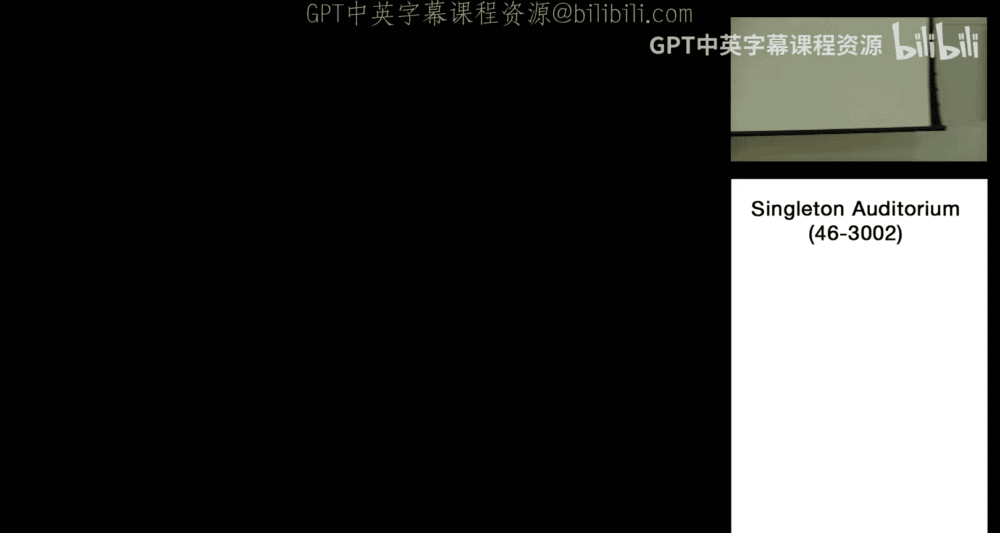

At least to one。

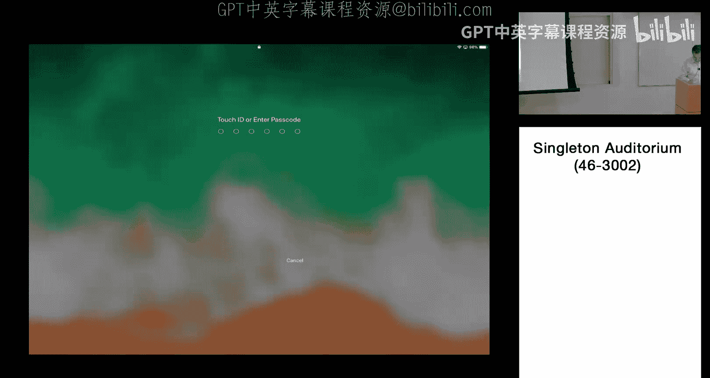

So why。And to claim is that problem there is equivalent to minimizing the norm。

Of K WK for all K subject to this constraint。And。嗯。

The prove goes through a few step in which you have。That。This margin。

Can be written in a slightly different way。As。The maximum over gamma。Of。

Of this expression being greater than gamma。 So I want all of them， including the minimum one。

 to be larger than gamma。Is that。Okay。Then呢。The max margin problem。This one not。This完了。

Using this definition of margin can be written。 New definition of margin can be written in terms of gamma as the max。

Over gama。Maximizing over W K， W1， gamma。And subject to WK equal 1 for all K with y。

🎼F larger than gamma for all I。So。嗯。So this。Have to be larger than gamma。And。This implies。嗯。That。嗯。嗯。

Since it has to be true for。This equal  one。I can。Normalize here because of homogeneity。

 I'll take it out。So this old thing， including this condition。

Its equivalent to this divided by the row。The norm of WK， W1， and so on。

That has to be larger than gamma。Soorrry。Yeah， it's one of the condition。Soorrry。No， Ro is not one。

Yes， why should be be one。Well。

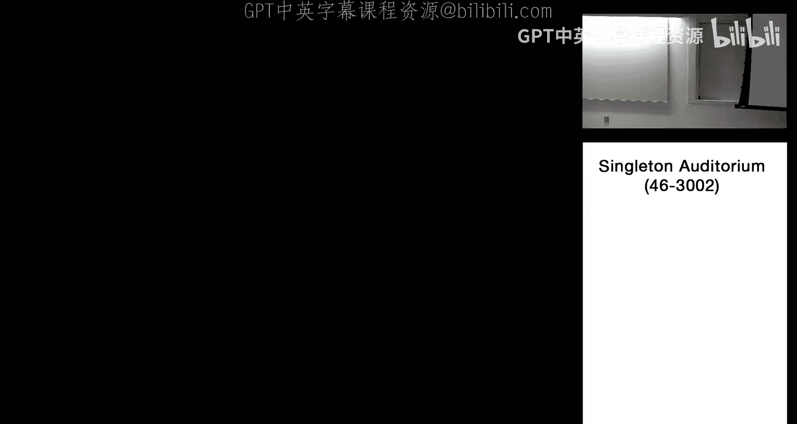

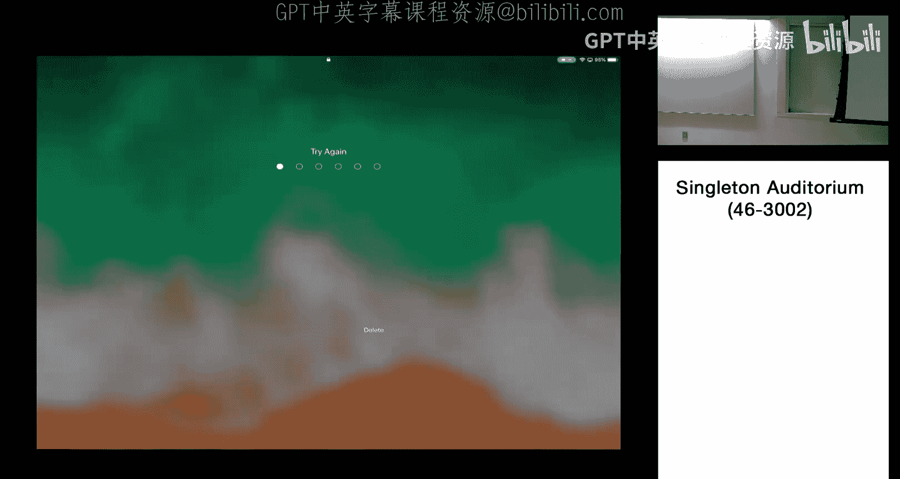

This says that。Y FWK and greater than Gamma。Subject to WK。Equal one， right。So。I'm in。Tperting this。

 saying that。I have this margin larger than gamma， and this。嗯。If I impose WK。

Equal one then has to be true。So I want to impose。The WK is has norm 1。 And in order to do this。

 I divide。I divide here。A divide here。Say by W。佢。Like this。And。

But this is the same as not dividing here。And dividing outside， because of homogeneity。Sorry。

They are two separate。 Yes， how do should I write。Yeah， it's for arbitrary W。 I want to impose this。

 So I'm saying。Okay。I think you are right。Let me see you。I have for arbitrary W。But then。

 I want this plus。Is that better。Union， I want to impose that。I want to。To have that。That condition。

Plus， the fact that has to behold for WK equal 1 is equivalent to what comes next。

If you want two conditions。Let's go back。We are correcting things， which is， I think is appropriate。

 Inter for you guys。嗯。I lose Gamma then， right？Proy does not matter。You see what I'm saying。

I can certainly avoid that， divideide。 but then I have to。To divide the gamma by a row。嗯。

I think that's probably a better way to do it。You're right。嗯。To in which case。

This will be larger than gamma prime。啊。And this would be。Let me say gamma second and。Yeah。Yeah。

 nothing， nothing should change， yeah。We check， but。嗯。But， I think you can。

Concncluding in the same way that。嗯。Going this route， you make it。 you show that。

ItIt's equivalent to。Maximize theverse of row， which is minimize。Minimize them。

Product of the norms of the Ws。P러。Y。Yeah， you're right。Wherehy do you think the product？

Of the norm is different from the norm of the product。Sorry。Frobinus norm。Soorrry。No。

 I was just making。He was asking with norm， I said forbinus just for。Well， actually。

 you can bound it， but it's not too equal， right？So。嗯。For them。Yeah， let's discuss a later。

 That's a good。I think we have this also in the deep learning case， but not from this argument。No。

The other thing we have looked， and I mentioned already， is。That and。

This is here the level of intuition。Is that。嗯。During gradient descent after。Separability is reached。

After essentially， all turning point are classified correctly so that F of x n。

Time wide is positive then。Then。The various terms of the exponential in the loss function decay。

The one。The ones that dec fastest are the ones。嗯。That are farther from the margins， a farther away。

 larger value of F of x。The one we survive will be the margin。

 the ones with the smallest values of F Tilde。嗯。You know。

 the worst essentially of the training points。And。If one is left。呃。During while row is growing。嗯。

At some point，1 is left， then。Instead of having a sum of many terms， you have one term and。This。为了。😔。

嗯。Can be 0 and will determine convergence to。A minimum， statutory point。

Which turns out to be a minimum。And which satisfy。A set of equations。For each one of the layer k。

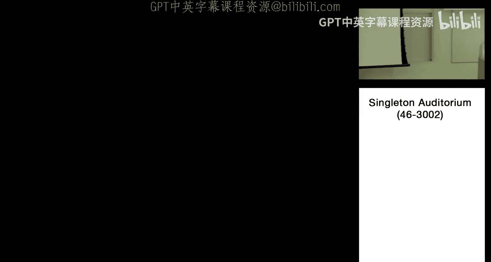

And， for instance， in the case in which。F。Is。It's a linear network。This equational direct clean。嗯。

Give X would be one of the data point。And this will be。嗯。VT。X。So， this will be。F of x。Eal。嗯。X V。

 and this means that。Wes。We了。😔，Converge to。The support Act。嗯。So the linear case you get immediately。

嗯。The maximum margin solution。嗯。Soorrry。They will have the same value。Of。F of X star。Right。

So the question， the question will be the same。This equation would be the same。But。嗯。F of x。

Maybe a linear。It's like the sum of different points。Or the average of different points。Okay。

 another item to discuss later。嗯。I will not go through the Jacobin。 I want to show。We got。

So the Jacobian of or the ASEN。Will comprise three different terms， this A， N， B， N。And the C，Here。

 the V。Are vectors where we use a collective index for instead of the I J in the matrix。

And it turns out。Not going to go through it。 That is。Negative definite for any negative。

 for any positive。Finite row， not for infinite row， not for infinite time。

 at which for infinite time or infinite row。The asEN will be degenerate， but not。

For any finite role or any finite time。嗯。So， the idea is that。You get。You get。

During this gradient descent on the exponential laws， what happens。When you you run。

Read in the center on a deep network， say this particular case is the exponential loss。

 but I would expect the same from cross entropy。嗯。After separability， you are running into。

One exponential type。Potential hole。 And there are many similar channels。 So there are many minima。

 Each one is stable， because。It is in a hyperbolic minimum。They become flatter as you go to infinity。

 The ASE is going。To become the generated infinity。And so， one prediction。It is， first of all。

 that after separability， you are in in one of these stable channels。

The second one is that you'd expect to be able to jump from one of these to another minimum。

With a different。Test error， a different maximum margin。Solution， if you perturb。Stng enough。

And so got。Beginning to do this kind of experiment。 And here。Is one example in which。You have。

Various epochs。 This is a mini version of cipher Andy。And。And here， you have。

At this point you have a separability， so every data point is now classified correctly。

And then there is one of the training point。呃。That is the last support vector。

Determinming the value of， of the function。 So that's a situation without perturbations。都这样子。Thank。

Yeah， but it's possible that there could be situation with more。Sorry。I don't know whether。

PDF transform correctly。 The next one。 Maybe I have。Reasonably， so this is by perturbing。 So here。

This is separability， right？There are two superb vectors， are they？So it's not yet separable or。Yeah。

Oh， I see。Yeah， so this is trying to， to map the landscape of the minima during。

Convergence by applying perturbation and seeing。What， whether。You jump from one solution to another。

Yeah。The y axis。Its basically， the training points。Because the function value becomes the。

What the value at one of the training points。It's not changing the training data。

 You are perturbing the weights， not the data。And then you're running again， gradient descent。

If the perturbation is small。It will end up。 You go back to the same。

It's like you have a particle in this potential hole。也不乐意。Yeah， because。Yes， you are。嗯。You为。

For a certain fixed row， it's like you are in potential all like this， something like this。

 You are in one of them。And then。You are applying。Perturbation noise to the weights。

 And this means your point here， which is the where the weights are， the coordinates of the way。

🎼We move， because they are pertuurrbing。But then gradient descent would bring it back。

If the perturbation。Is not big enough。The perturbation is big enough。You would jump over him。

And then it in the center will bring it down to another minimum。So this is a way to。

To map the landscape。We are this is work in progress。 I don't。

 I've not seen anything like this before， but。I don't know whether Sasha has seen something like this。

With， trying to map the landscape of the minima by perturbing。They waits。Soorrry。Well。

 these are predictions you're making。Based on the convergence to the maximum margin and the fact that you have hyperbolic。

Haian。For finite road， The prediction is。That if you perturb。The perturbation is small enough。

Graing the center will bring it back to the same。Equiilium point， if the perturbation is large。

You may jump to another hyperbolic minimum and greatly thecent we converge to that one。

So that's the prediction。 that's what we find。For this。So I've not seen any such attempt， have you。嗯。

There were these results by。嗯。One of my students， Xan Zhang， and。And by wreck and a few others。

About the fact that you can fit the training data with a deep network。And。In other words。

 have zero error on the training set。嗯。And。And。Essentially， being。

Enable from performance on the training set to distinguish。Future performance on the test set。

For instance， the most。Clear case where was one in which they trained。 They used the Cfa。

Set of data in which。All the labels were randomized。And the network could learn。To fit to the data。

 So 0。Classification error on the training side。And， of course。Was doing。Very badly on the test set。

 because it was random。

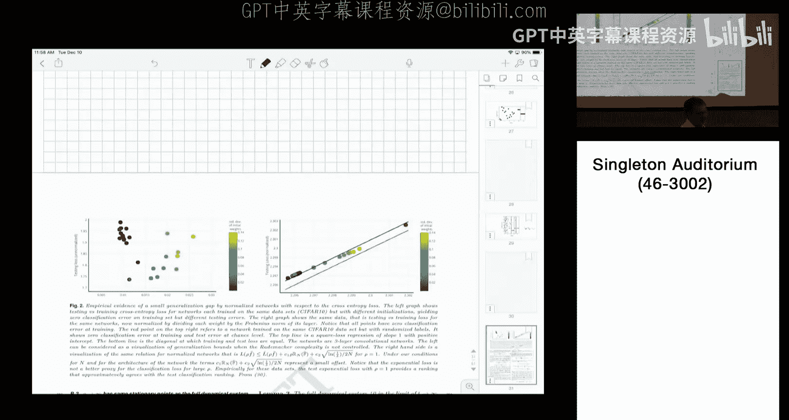

On the other hand， was if you trained on the real。While labeled training set。

 it was also getting zero training error， but then was going to do pretty well on the test set。

So as if performance on the training set was no。Had nothing to say about performance on the test set。

Okay。嗯。And this is， in fact， what happens with。The kind of interpoolating。

Cnel networks that fit the data， even noisy data。And then may do well on you know， future data。

 but these are all cases in which the training error， which is 0， does not say much about。

The future performance。But。

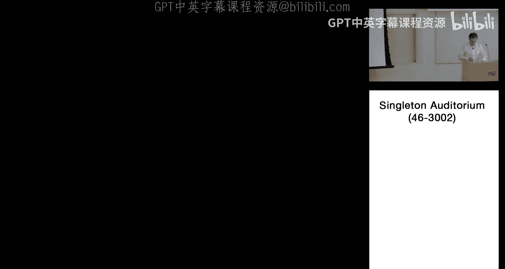

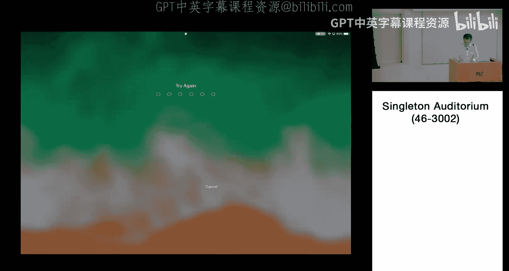

If you so these are the data。I， I think， training error and testing error。Testing laws。

Exponential laws。In Car。嗯。But。You know， the argument we just had about the results on Deep network say that what。

Matterters。Is certainly not the classification error on training。

 after sometimes you have separability。 What matters is。Maximum margin。This will be the predictor of。

Future performance。And so。If you plot the maximum margin。

You actually get a straight line here between。嗯。Between。

Performance on the training set and performance on the test set。

And you could save from the performance on the training set that are randomly labeled。

situationituation in which we have。嗯。Change randomly the labels of all cipher images。

You can predict you can see that the test performance is essentially。

 the training performance is bad。 and so we will know that the test performance will have to be bad。

The margin is， is small。

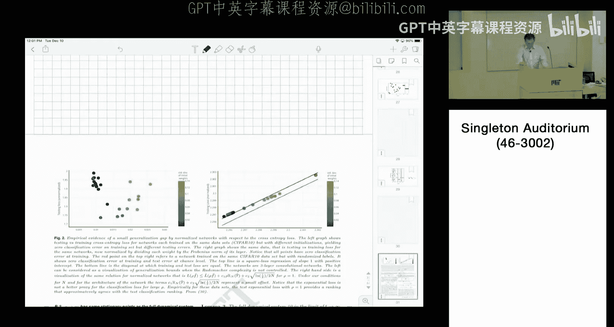

So， there was me。Couple of。Additional things， I want to。mentionedention quickly， one。Which is。

A kind of interesting。 And it's very simple is。It's an observation by。That they found in。A paper。

That I can give you the reference to， but。The proof is a bit different and it's very simple is the fact that you ingredient the same。

 you expect the weights of each layer to grow at the same rate。So if， in particular。

 if you start with。Weights at each layer that are roughly the same size， the same norm。

 you expect them to remain。The same during gradient descent。It's a little bit puzzling。

 but the prove is so very simple。Have this equation in the W now。Yu。嗯。嗯。嗯。Let's see。You consider。

This derivative。The derivative in time of the norm of W K of the。Norm of the。Max K。And。嗯。

This would chain rule。 you get this expression。And。This is one of the equation I derived。嗯。Earlier。

 and so。The derivative of this is equal to W normalized。And so。When you compute。

This by plugging in the W dot up there。You get， I'm sorry。You get。

You get an equation which is one over okay and so on。嗯。And so。If you now。

If you not consider the derivative of。W。The norm square。You will get。嗯。You will get this expression。

In which。The roque has disappeared。And there is no K at all。In。Here。So， this is。

The rate of change in time。Of the norm square of WK， it does not depend on K。H。

Let me skip this weight to normalization。嗯。I said。The other time that weight normalization。

 which is at the clinic similar to batch normalization that people use is。

Leads to the same dynamical system as。The constraint and normalization that we have looked at。And。

The key property here is to show that in the equation for weight and normalization。

 which are this G dot and V dot。嗯。This。This norm here turns out to be one。

I did not see it in the papers so had normalization， but you can prove。The normal V is。

Can be said to one。So anyway， if you' are interested， we can discuss that more， but。Let me， instead。

Thing。Discuss a little bit about。About。What we have seen in terms of machine learning over。The last。

 the， the course and。Also， you know， personally， I'm reflecting about machine learning over the last two。

 three years or so。And even this class used to be。That we are emphasizing what I would say is the classical regime。

So now I'm forgetting for a moment， deep networks and focusing on the classical techniques like kernel machines and similar and so。

The， the kind of。嗯。Classical foundations， mostly set up by Wpnik。Where。In terms of。Having a。

Fite fixed， not finite， but a fixed hypothesisy space。嗯。And this means。Having。Fixed。

Say dimensions of the algorithms and。And。Number of parameters and， and so on。 And， and then。

Typically， in terms of。Statement about consistency and generalization。

 looking at what happens as symptomtically， meaning when the number of example grows to infinity and so。

Because of this setup。嗯。嗯。You add。The concept like generalization， meaning that。

You have generalization when the error of the。

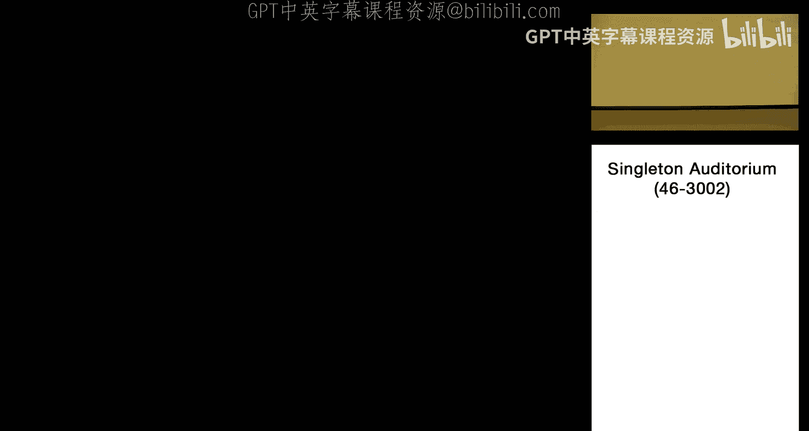

The loss of the expected。

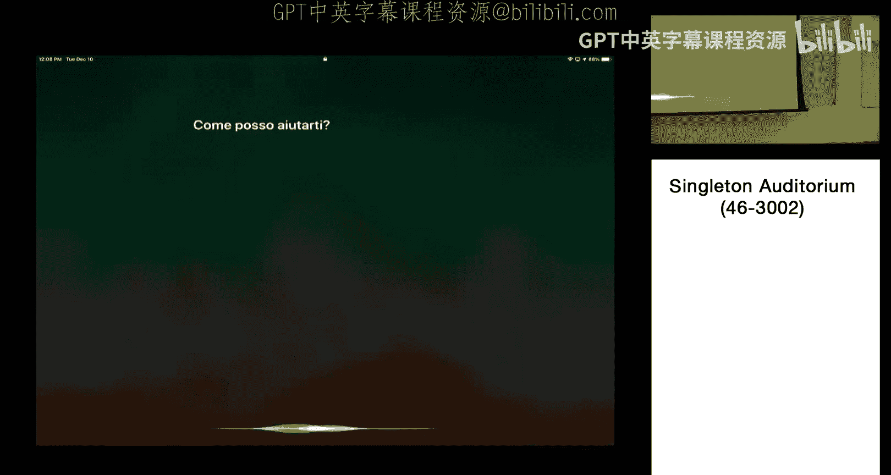

So the， the。The loss of the。The expected the loss of the minimizer。嗯。Or let me put it the other way。

 the empirical loss of the empirical minimizer FOs。

That approaches the expected loss of the empirical minimizer for and go into infinity。

This would be generalization。And consistency will be that the。呃。

Expected loss of the empirical minimizer。Approaches the best you can do in the class。嗯。Now。

 because them。Re like this assumed that the part space， the algorithm was fixed， then。

This all essentially results for number of data larger than the number of dimensions or number of parameters so。

The kind of regime that is coming out about which， for instance， Sasha spoke last time。Was。

In thats class。Is one。In which the hypothesis space is not fixed in the sense of the dimension。

Can increase with， with N。What you what you impose is that for instance the ratio of dimensionality or number of parameters and number of examples does not change while both increase to affinity。

And。And so。In， in this case， the notion of generalization。

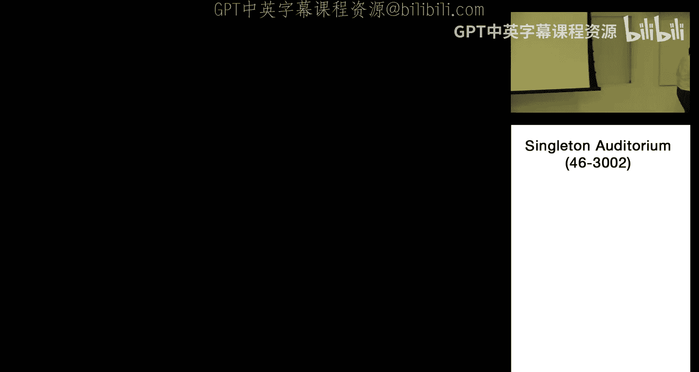

These are cases。Because you have。You may always have， for all your。

And you may always have more parameter than data point。You can always have interpolation。嗯。And。And。

 of course， you don't expect generalization to be。To be validd or to be useful。Yeah。This set up。Now。

The results in in the classical case were。Of the type that in order to have generalization and consistency。

You needed to have。Your hypothesis space to be。finite V C dimension or uniform grveco can tell you。

For year I'm algorithms。嗯。So those results stand still。

And there is no contradiction with this new regime。Is just that。

this idea of a fixed hypothesis space or finite ad dimension don't work anymore without any contradictions。

Now， an interesting question is， is stability。 We did show。People have shown that。

The finite VC dimension or UGC。Apothey space。嗯。Was equivalent itself to some notion of stability of the algorithm。

The idea that you have to have。Continuity in the inverse problem of inferring a function from the data。

You know，Stability in the sense of robustness。The perturbations in the data。And。

That notion although is equivalent to finite V see。For for supervised learning ErM。嗯。

Does not seem to depend on。On a fixed hypothesis space。The stability itself。And so， I think there is。

An open question of whether。One can find define a notion of stability。That。That。

Could work also for the modern regime。 And just to give you。嗯。Some ideas。Last time。Yeah。

 Sasha spoke about。An analysis of。Carel。Solution。This would be。To a supervised problem。

I think you spoke about。Not much， probably， but there is the paper more in detail about bias andvari estimate。

Of， of this。 and provided。A complete solution。 The question is whether there is。嗯。

Some more qualitative way to connect。This kind of results。To notions of stability here and。

An obvious one in this kind of problem。Where you are looking for F of x。Equal to K X X。

 These are the kind of things saw。In。The regularization classes。

 and this is the inverse of the kernel matrix。So。The then。The rest question is。Normally。

 when you have something like。The inverse of a kernel matrix。

There is a classical notion of stability。Stability of the inverse。Which。

Which is usually given in terms of the condition number of the matrix。

 many of you guys have heard the term condition number of a matrix。Have you have。Nobody。

No course of linear algebra。嗯。Okay。conditiondition number， it turns out， was。Was introduced in。

 I think， in the 40s by Alan Turing。And。Play the pretty。

The relevant role in numerical analysis is basically。How much。How sensitive a function is。

To changes in the data or parameters。And。It's similar to our notion of stability。

 which we would like to know。嗯。For instance， in learning how sensitive what do we get。

As a solution is from small changing in the data。If it's very sensitive。

 that's not very good because there may be noise in the data。嗯。That's true for all inverse problems。

 The condition number is。Is a key concept for measuring how stable the problem is。

 And we spoke about ill post problems。 I post problem。 One definition is。

 is when the condition number。Brows up。This is a ill post problem and problems with bad condition number are problems that are close to be ill post。

So。Turns out that if you。嗯。If you look at。The condition number。Of a random matrix。You find。

A double descent curve。呃。Which。You know， this is a plot of。

How many rows versus how many columns the matrix size。So a square matrix when theverse exists。

Has the worst condition number。And a rectangular matrix， which means either underdeter or overdeter。

Has a much better condition number。Do you find that surprising？You know。

 when the verse exists is the worst。Can be surprising。And why you have an overdeter problem。

In terms of the condition， but in terms of stability。You're much better off。

Ideal condition numbers are around one so that any error does not blow up。If you have，120， it means。

Some error in the data got blow up in a linear problem by。1 and20。

So this would be what you have if you have， if you look at。嗯。Problems like cleaner equation。

It's a condition number in the case of a linear equation。 How much sensitive。

The solution X is to noise in the data B。嗯。There are similar results。As said， for random matrices。

 similar results for kernel matrices。This is， in fact， a kernel matrix。

And so this will be like the k minus1。嗯。In the expression for the。嗯嗯。嗯。

For the solution to the kernel problem that I shown before。3500。嗯。So one question。

 open question is whether。It may be possible to。嗯。You know， to adapt the analysis。

That's such a very careful analysis to something less， less careful， but that。Can put in direct。嗯。

Can put direct light on。The condition number of k as。A key part of providing stability。

I know that there is interference between。The K X， X and K -1， but。

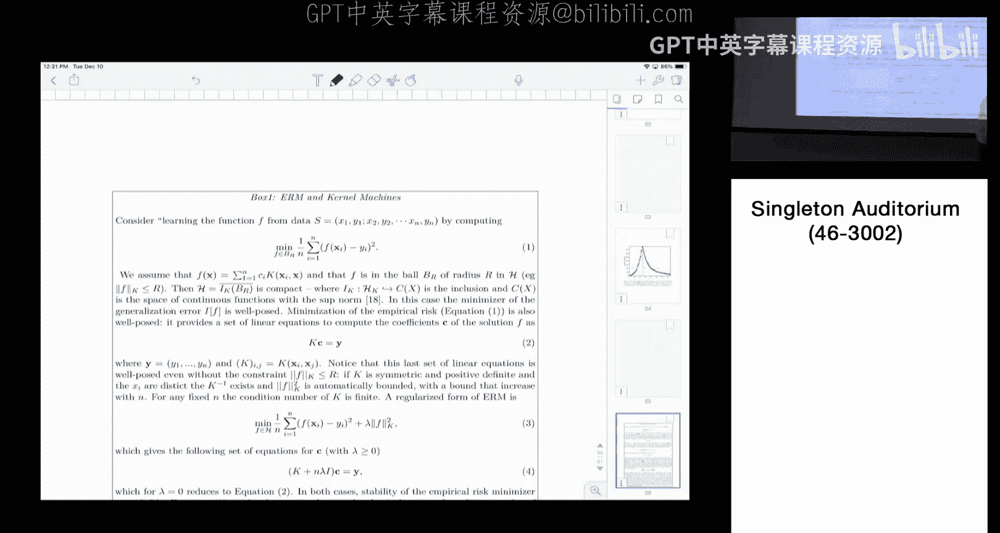