# 《如何AI所有事情｜MAS.S60 How to AI (Almost) Anything》中英字幕（Claude-4-s翻译） p01 [01]Lecture 1 – Course Introduction.zh_en [BV1UhawzQErD_p1]

hi folks。我更。Welcome to How AI almost Anything。

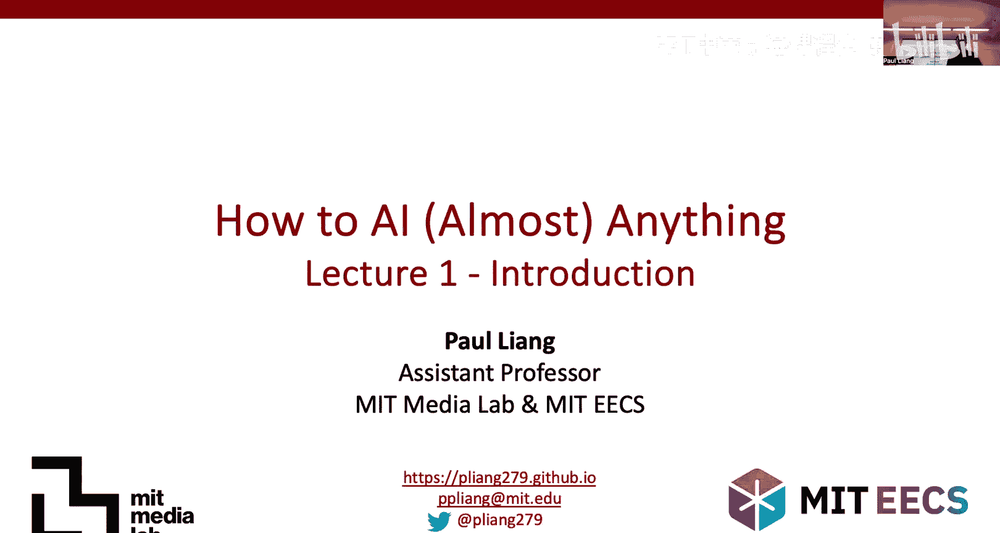

So we're very excited to offer this course for the first time as is Media La tradition。

 following the courses on how to make and how to grow almost anything comes the third edition of how to AI。

 almost anything。We're really excited to be our teaching team this semester， you don't know me。

 my name is Paul， I'm a new faculty at the MIT Media La and MITECECS。

 I direct the Multisensory intelligencetelligence research group and alongside myself we have two fantastic TAs for my students。

 Shaa and David will be helping out with some of the assignments and supervising some of the course research projects。

As I mentioned， we're all part of this broader group called Multisensory intelligence。

 a new research group at the MIT Media map， our research focuses on clearly AI systems that are actually able to take in anything in the world。

 we call that this next generation of AI systems that are multisensory in nature。

 your understanding language to vision， gestures and various sensors in the world。

And therefore law of focus of this course will be about how we can design AI systems。

 that are truly multisensy and take in almost any sensory modality in the world。

We also build systems that actually help the human experiences。

 not just AI systems that replicate or duplicate what humans can do。

 but how can they actually help humans to lead to better collective outcomes and that will be a focus of this course as well and finally because we're all seeing AI systems that are very closely。

 very powerfully in understanding and interacting with humans it's also really important that we make sure that they're safe reward interaction so towards end of the course we'll cover different parts of how we can make these AI systems truly safe our robust。

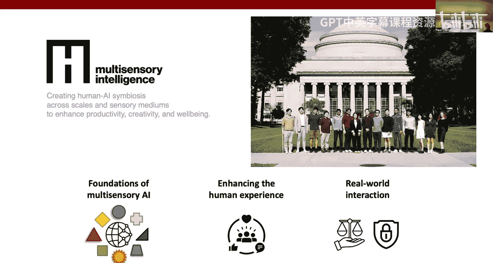

Do you have anything。The whole world around us is multisory and we have started to see a glimpse of AI systems that are able to start processing and interacting with more and more of these mediums in the world。

We have seen AI large language models or spoken words or typed text on the computer。

 we started seeing systems that can understand our speech and our vocal expressions。

 they can understand our facial gestures and body language to holistically understand how we communicate with other people。

We see has progress for AI and healthcare， these AI systems are able to make reasonable predictions on Xray images to help doctors in the final prognosis of a patient。

It can also be used to understand different cells， various formss of medical sensors and that's just the tip of the iceberg we've seen AI literally apply to almost all of these modalities in the world。

So it's really exciting thanks， and I want to start with some of my favorite motivating examples。

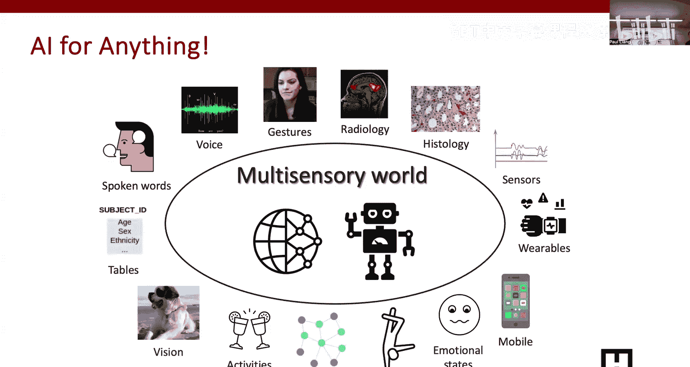

Of AI for anything， AI has really made its way into physical sensing。

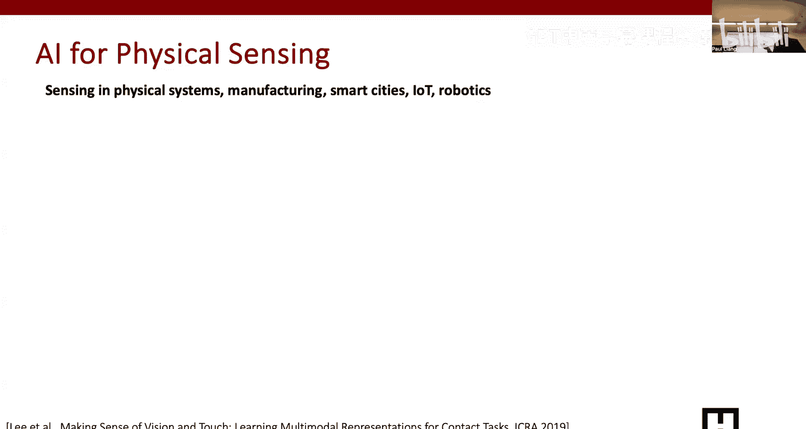

So in robots， for example， there requires understanding force and tactile information。

 so that allows robot arms to feel whether they're grasping a hard or soft object。

 they can feel where they're supposed to put this object into and whether that's the right position and at the same time most of these robots also have cameras on them can use various shapes。

 color， sizes and things in the environment。And the more sensors that you put on these robots。

 the more robust。You can start pushing these robot arms， the messing of the force。

 to simulate an earthquake， for example， and they can rely on vision to solve task。Likewise。

 you start occ some of these robots cameras with a folder to simulate rain or fog。

 it can then rely on force to solve the task。

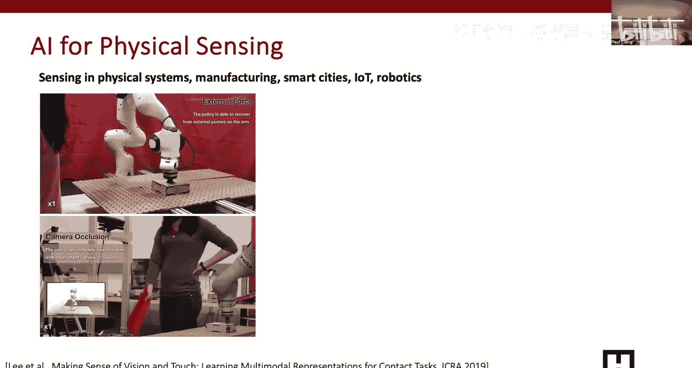

Some of the cool things that's also happening in our group include building AI for smell so here's a chip that is able to sense volatile gases that are released by different foods and beverages so that's a different type of sensory modality you can train AI systems after you've collected enough data to essentially detect the so-called smells of different foods and beverages。

So over here in this video， this chip is programmed to smell the presence of peanuts。

 so you can bring it to a candy bar or a piece of cake or a jar of peanut butter and it will detect peanuts if it' present that can be very useful for someone who might be allergic to peanuts。

Of course， in this course， we're also going to cover geneative AI。

 generative AI that are able to take in any modality and semantically translate it to some of the modality of interest。

 for example， typing in a text and coming up with a video corresponding to that info caption。

Given a video generating an audio film。That corresponds to that video， for example。

 choosing the right music or soundsh to go with the video So'll cover these generative models that are able to translate from any modality to the other。

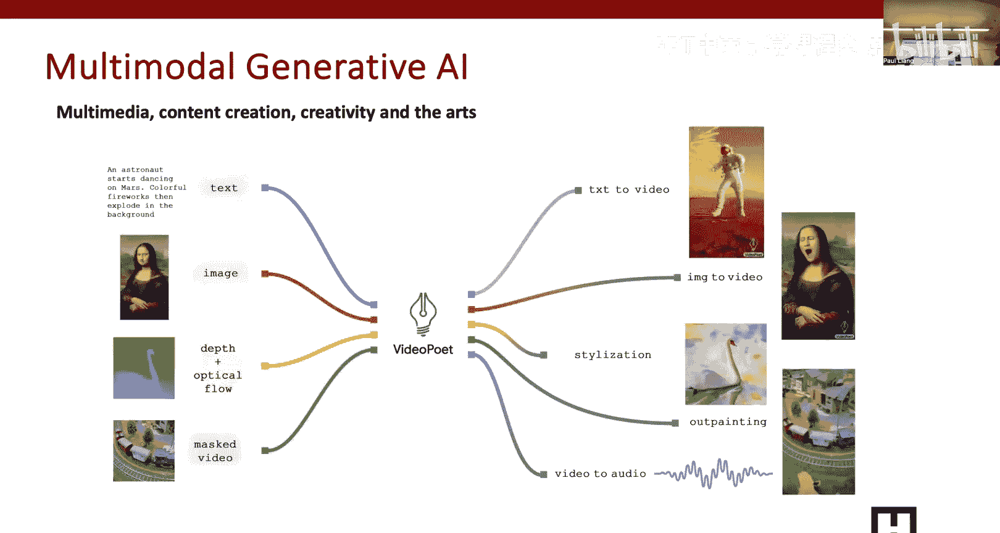

We're going to cover examples of applying AI for all these holistic indicators of health and a lot of these holistic indicators of health are not going to be taken in the doctor's office and we go to the doctor maybe once or twice a year。

 but there's so many ways that we can sense our daily health and wellness on a day to day basis。

So example， in the area of physical health， there's opportunity for building AI that can be really at a high resolution to understand the status of patients in the ICU。

 whether these patients are sitting up， falling down。

 whether they need help from doctors and nurses and you can re that information in the context of the emergencies to these doctors。

In that area of emotional wellbeing， there's an increasing amount of sensors that are on our bodies。

 on our mobile phones that can sense first aspects of our mood， stress and emotion。

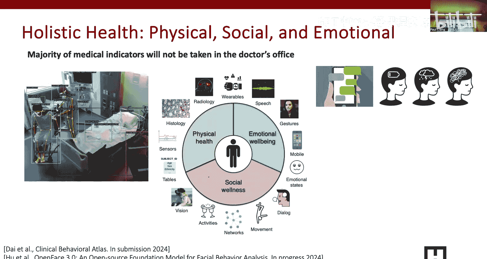

And finally， there are aspects of AI that can be used to understand how will we interact socially with other people through the exact verbal words that we say or also using any nonverbal expressions or gestures that we use to communicating in groups。

And finally， everything that we've discussed so far has mostly been in perception。

 so given some data modality in the world can I predict something。

 there's also a new generation of AI that's emerging that's about interactive agents and go beyond making a single step prediction to taking multiple actions to solve tasks for humans。

So some of you either have seen these agents for the web where you might be giving them some natural language instruction。

 for example， for to Amazon and purchase from me set of earphones with this color and at least 4。

5 stars in ratinging。And these agents can then understand this instruction and essentially execute a sequence of actions。

 for example。Googling and typing for the word the keyword search for earphones， sorting by rating。

 choosing a color based on previous purchasing practices， adding it into your cart and checking out。

This is new generation of agents that are interactive。

And this has enabled a new generation of these agents interacting with humans， for example。

 they can understand instructions that the humans give。

 they can be grounded in various digital mediums， we've seen these agents on websites very soon and perhaps even already we can also build agents that can help you manipulate PowerPoint and spreadsheets。

And eventually， we're going to see agents for a multitude of computer tasks。

So that's a quick glimpse of the opportunities for building an AI for anything。

 going from understanding of physical environments to being able to process and generate various digital mediums on the internet。

Being able to understand holistic indicators of health and wellness。And finally。

 interactive agents that doesn't just make a prediction but can do tasks for us and improve our productivity in our day to day lives。

So hopefully all of you will learn something from this course。

 right The whole goal of the course is to teach。The principles of applying AI for any modality。

 especially new modalities that are not really at the forefront of AI research and when I say principles。

 I really mean being able to think intuitively about what kind of data you need and where you will collect that data from。

What kind of model architectures you will need and how you design those model architectures？

How would you quickly experiment and evaluate the success of your models on your data and what are the real concerns。

 real concerns that you got to tackle before you can actually deploy such an AI system in practice。

So it's going to be quite different from traditional introduction to machine learning and introduction of AI courses because over there the focus is primarily on the models right you have 15 weeks of lecture each week you learn about a different algorithm one by one or rather here we're trying to teach you the principles not the methods themselves the principles of how to think about what data is useful and how to collect it various forms of model architectures and all these iterative evaluation and deployment pipelines that youve got to take care of after you design your initial model。

I've put some examples over here， very lot of people are interested in gestures， medical data。

 lots of interest physiological sensors and wearable sensors， mobile data。

 I don't think people mentioned social networks， that's also another pretty understudy area of AI。

So that's the first theme of the course， AI for Ne modality。Naturally。

 the second theme of the course is going to be about multimodal AI there's many applications that people have mentioned where you have to connect different data modalities together。

 so for example you might want to connect language and gestures to holistically understand a person in their social interactions you want to connect sing and actuation and have a loop that senses and takes actions in senses and take actions in multiple times。

So we're also going to cover elements of multimodal AI。

 how do you conceptually build data that enables you to learn the connections between modalities。

 how you you build the model architectures to learn these connections between modalities and how you would evaluate and deploy these systems in practice。

So that overview of the course， there's several learning objectives I want to highlight。

It's going to be half lectures and half independent research and discussions。

 so the goal in the readings is to really study recent pinnacle achievements in AI research these to be communicated through lectures but also individual paper readings and critiques of these papers。

For reading these papers， the goal is also for you to improve your critical reading and critical thinking skills。

Another big goal of the course is for you to not just understand what exists so far。

 but also how to project and understand future challenges。

 future visions of what AI might be able to achieve and how we can make those achievements。

And finally， there's a big handson component where we would explore and implement some of these new research ideas and go towards that future。

Logistically， several prerequisites。Preferre prerequisites。

 so don't worry if you don't satisfy any of them or try to tailor the experience of the course depending on what you know or not。

 but ideally that you have some knowledge of programming。idedeally in Python。

 although you should be able to pick up Python if you program in some other language。

 because most of these AI toolkits and implementation will be done in Python。

Even you have some basic understanding of modern AI capabilities and limitations。

 so basic understanding you don't need to dive into the technical and mathematical details。

 but you should be able to know what are some of the latest events。

 what are their capabilities and what are the limitations scrolling Twitter every day is a good way of achieving that prerequisite。

Ially you will bring some external non AI domain knowledge into this course and from what everybody has described we have a ton of that it'd be great to bring some external knowledge about a sensor or some task or some domain or problem that you're still working with and collaboratively find solutions to tackle those domains。

And as a bonus itvi grade， you've experienced or tried or prototype some AI for some modality。

 and maybe you could take it an next step further to really dive deeper into the research questions。

ok。So the core delivery format is that we meet twice a week on Tuesdays and Thursdays， one to 2 p。

m over here。Tuesdays will primarily be one hour of lectures from usually myself or maybe some of my students。

 other guest lectures。And Thursday is going to be more hands on and more interactive。

So that will be a mix of either readings。Done before the class in which we bring them in and we discuss some controversial topic about those readings in class。

 or it could also be some tutorial that is getting people hands on experience to work on some code or implementation。

The reading assignments。Will also be given outside of class。

 there's celebrating assignments that you have to read in preparation for several of Thursday's discussions and finally there's also a very significant research component that is expected to be done throughout the course of this project。

IDDD research component would synergize with the current domains and modalities and tasks that everybody is already interested in and working on。

Some might closing a door。Thank you。😊，O。So let me just first cover quickly the lecture topics。

 there's going to be four main modules in this course each lasting about three to four weeks。

The first module will cover the foundations of AI， so in today's lecture we're giving introduction to AI and also the logistics of the course in Thursday's lecture as an exception to be a lecture this Thursday。

 we're going to cover the basics of doing AI research。

Everything from doing literature review and reading papers to coming up with good research ideas in AI to quickly experimenting with them and verifying them to writing a paper and publishing the results the we one is going to be just introduction to AI and AI research。

In the next three weeks， we're going to cover the principles of how we can apply AI to anything。

As I mentioned， these principles are going to cover three parts。Firstly， how do you think about data。

 what are some properties of data that I you would want to model using some AI system。

We're also going to cover different forms of data and how you can collect this data from either the internet or the world。

Following that。After discussing these principles of data we're going to uncover several common model architectures and again the goal is not to cover all of them in detail like you would in an AI course。

 but it' really about teaching the general principles so that you can then design some new architecture that is suitable for your data so most likely these architectures are not just going to be vanilla architectures already exist it's probably going to be some adaptation needed to get it working for your deal。

That's going to be week three covering models and architectures。

 and week four is going to cover learning and generalization。Once you obtain a data。

 you're going to define some model that you would train on the data。 How do you actually train it。

 That has to be some training function。 So we'm going to cover different examples of training functions。

 How do you monitor the learning process to make sure that your models are actually learning and how do you choose the right models that we then generalize and work in the real world。

 Now you have new data。So I highly that we cover the accommodations of AI in the first four weeks。

Module two is going to be the foundations of multimodal AI now oftentimes you have multiple sensors or multiple data modalities that need to be connected to each other。

So we're going to cover different reasons why modalities are connected and ways of learning these connections using machine learning。

We're going to cover different ways modalities interact with each other to give new information and learn this new information through fusion methods。

And finally， we're going to cover crossmodal transfer this idea that you might have limited data in the modality that you care about。

 how do you find something else to supplement and improve the learning process so you do better than the limited data that you only have。

Just nice we have spring break marks the midpoint of the semester。

 and when we come back from spring break， we're going to cover large models and modern AI。

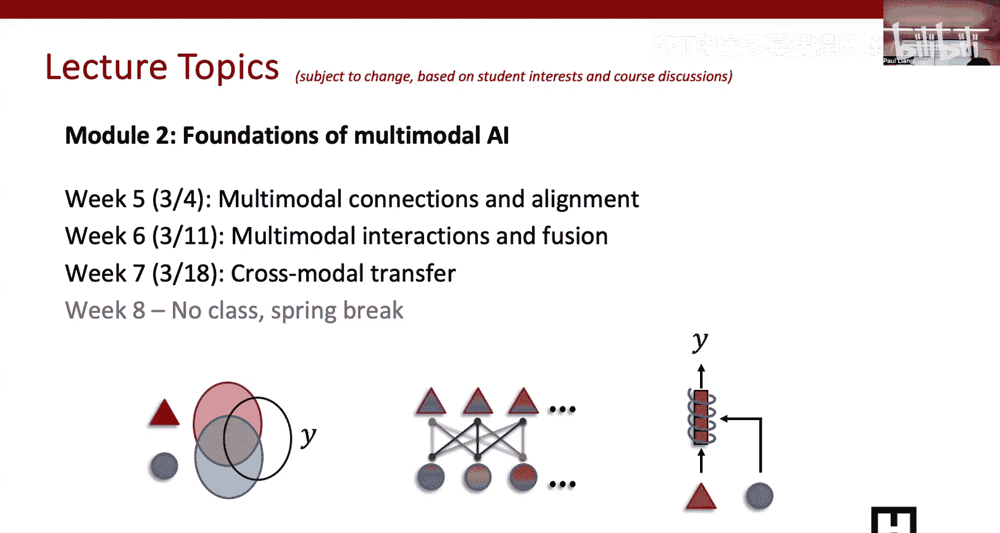

So everybody's going to be excited by this theme， we're going to have several lectures on the key elements of how people currently do pretraining。

 scaling and fine tuning these large language models with a bigger focus on fine tuning because I don't expect anybody to be doing pretraining on on the labs。

 but as many applications in which you want to fine tune them through aesthetics。

 what are the best practices for fine tuning them to your particular domain。

We're going to skip plus for Member week and we're going to come back and look at large multimodal models。

 large vision language models， video language models， LL plus more modalities。

 and again we're going to cover how we can quickly deploy and adapt these large language models to your modalities of interest which may not be language which oftentimes is not going to be language。

And finally， we're going to cover modern generative AI systems that don't just make a prediction or output text。

 but can actually generate more data， so generating images， maybe generating sensor data。

 generating videos， music， art and all。

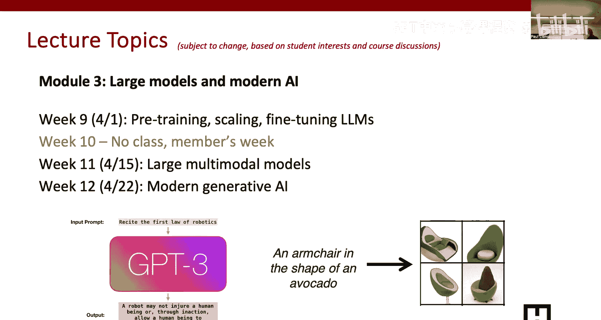

More generally than a样。And finally， the fourth the will be on interactive AA。

 how do build systems that can interact through multiple steps with humans in the book。

So we're going to start that module by first looking at AI systems capable of multi step reasoning。

So complex problems like mathematical problems or reasoning problems that require you to take multiple steps of actions before you achieve the final target。

We then cover elements of interactive and embody tangible AI how we build some of these AI systems that can actually work in the real world that have a physical manifestation and embodiment in the real world。

And finally， in the last week， we'll cover elements of human AI interaction with there's humans in a loop in which safety and other concerns will be very important。

Okay， so about 12， 13 lectures spread out of course across four modules。Okay。

 so not grading overview。40% of the grade will be a on reading assignments so there's going to be several assignments where you're going to distribute several papers you have to read them。

 you have to take what you read and bring into class on Thursdays and discussing groups。

Sharing different opinions about criticing newspapers。As we move roughly 40%。

 I'm going to cover more detail soon and 60% of the grade youre expected to do a high quality research project。

With several checkpoints， proposal with reviewing the literature understandinging the problem。

 a midter with implementations of your ideas and a final report。

 more implementation and more error analysis of your ideas。

Proly 40% readings and discussions and 60% course research project。So in more detail。

 this's going to be seven reading assignments they're going to be。

Roughly spread out across a semester， not every week。And in each of these reading assignments。

 we're going to assign roughly two papers， they are required and about five to six optional papers。

The number of optional papers and together with these papers also going this to assign several discussion groups。

 these are probes that test your understanding of these papers by themselves and also how these papers fit into this broader context of some research area。

So there's maybe three main assignment parts that are meant to be done individually that are due kind of the weekend before the discussion。

These three me or assessment reports are going to be done individually。

 you're supposed to read the papers， you're going to summarize some notes from these papers。

 you're going to look for several other papers that are also related in this broad field and you're going to take a first step at answering some of these discussion questions for yourselves。

I think of it as general reading the papers in that understanding them and critiquing them using some discussion probes that we have provided。

 So all this is meant to be done independently in the week before。大りスかッシ。

The discussion will be done on Thursdays in Thursdays class。

It's going to be a joint portion where everybody meets over here and for 15 minutes， several leaders。

 which I will describe soon， will make a short presentation about summarizing those papers。

 maybe answering the clarifications questions students have about the papers and also summarizing the papers and other students have scouted that are related to this research area。

And the joint portion， mostly these students presenting。It's going to be a separate session。

 which is going to be some number of discussion groups I'm trying to keep the discussion groups to about 10 students per group。

 so the number of groups would depend on how many students finally enrolled in their class。

And for about 40 minutes。We're going to essentially a roundtable discussions。

 back and forth discussions， each student voicing some opinion about the discussion probes and other students either agreeing or disagreeing with it。

And there's going to be several note takers which summarize the outcomes of the discussion and writes it out in a procurent report。

So that's going to happen on Thursdays。So theres several discussion roles。

 the first role is that of reading lead so there's probably going to be one or two reading leads per week these reading leads are in charge of the short presentation at the beginning of Thursday class so they prepare a short presentation。

 summarizing the papers， answering clarification questions。

 and also summarizing other resources students have found that are relevant to that week's topic。

And they also help with note taking during discussions。The other role is the synopsly。

 they were at first held with no taking during the discussion。

 but their bigger job is to summarize everything that has happened in a discussion or the back and forth conversations into a coherent report that is going to be publicly released and shared with the entire class。

There's going to be one of these per discussion week。

 reading leads do most of the work before the class and present at the beginning and synopsis leads do most of the work after the class so they summarize and write out this coherent report summarizing the discussion。

So it's one， one of each， maybe one or two per each， each of these rows every week。

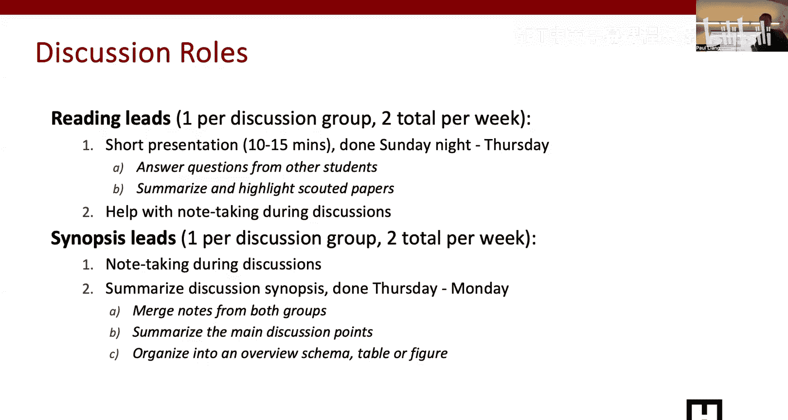

So here are some of the discussion topics， not going to a discussion for the first few weeks。

 that's more mental。For introduction to the course。

 we're going to start by discussing properties of learning and generalization。

So what are different ways that we can make sure our models learn smoothly。

 what are different ways of selecting the right model and what are different ways of assessing how well our models generalize to new unseen data that you want to actually test it on in the world。

We're going to have a pretty controversial topic in my opinion on whether it's better to build specialized or general model architectures right most of machine learning start off specialized you would have a problem you design a very specific model to your problem。

 but nowadays we see the trend of building general purpose large models that are applicable to everything。

Or are the pros and cons trade offs， how do webalance both？By the discussion on crossmodal transfer。

 we're going to listen to all of your thoughts on the current modality that you have of interest。

 probably not going to have that much data， for example， medical or sensor data。

 what are ways that we can find different data resources and put them to help you solve your task of interest。

Were going to have several discussions around reading of these latest papers on large language models and large multimodal models。

 these long reports and discussing various aspects of them， how they train， how they scale。

 how they scale， and how they can be fine tuned and deployed for different instances。And finally。

 we're going to have discussions on geneative models and human AI interaction。Okay。

 so seven discussion topics roughly spread out throughout the semester。So again。

 just quickly all this is provided online， but it's going to be a grad scheme。

 recall that all the readings and discussions had up to 40% of your grade。

 so 15% of the grade will be done individually， reading the papers， filling out some forms。

 answering the questions， this is breakdown that you can read by yourself。

15% of the grade is going to be on the day of Thursday discussing so just to make sure everybody's voicing their thoughts。

 you're supposed to say something independent and also reply to other people when they share their thoughts so that's going to be 15% of the grade participating in the discussions and that's 30% so the last 10% will be for the special needs the special needs for that week。

 the reading lead who does more work before the class preparing that initial presentation and the synopsis leads with us more work after the class summarizing the discussion and writing out the coherent report。

Okay， so 40% total for readings and discussions。We're also gonna know TBD depending on how the discussion goes。

 we may also experiment with other roles， this is something that I really enjoy doing。

 but the several discussion roles include， for example， a peer reviewer。

 you might assign a paper and one of the roles might be students expected to pretend their peer reviewer and really review this paper cocuremently。

 what are strengths， what is weaknesses， how it can be improved。

 whether there's any experimental or mathematical errors in the paper。

That's one role we're experiment with。Another cool role experiment where this is archaeologists who a student might pretend that they found this paper in the class。

So how do you， for example， contextualize a paper in the context of some of the more recent events that have happened。

 the recent work to become inspired by that paper or the recent work disprove that paper and so on as an archaeologist facing the history of that paper。

an academic researcher， you're going to pretend that you are someone who works in that area。

 you've read this paper， how do you generate new ideas space on top of that。

 coming up with new research visions and directions on top of that。Industry practitioner。

 we're going to pretend that you're head of research at a big company and trying to convince your boss why this paper is going to make a lot of money for the company。

Hacker， someone who has to build something quickly system quickly。

 how can you read the paper and come up with a quick and dirty demo implementing that paper and what you learned from actually implementing a demo yet。

And find a private investigator， how do you aroll where you're trying to trace？

Why the authors of their paper worked on this paper in first place， what were their backgrounds。

 how did they get inspired by that idea how they might have done things differently if they had a chance to redo it。

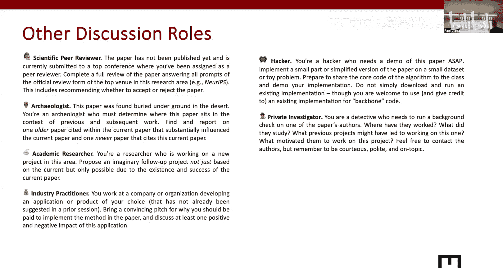

And finally， social impact assess how this paper either is positive for negative social impact on the world。

Okay， so some interesting discussion roles， you might play around with this。

 I don't expect to have all of these on every Thursday。

 but we'll play around with it to maybe simulate a discussion。Okay， so summarize for a typical week。

For those seven reading assignments again not every week， usually the previous Wednesday。

 the reading assignment will be released with the two required and several optional papers we're also going to give several discussion probes and assign the roles you're going to first individually reading those papers over Wednesday。

 Thursday Friday the weekend and submit the individual reading assignment on Monday so just your personal reflections answering those questions。

The reading leads will then spend Monday to Wednesday preparing their slides。

 answering clarification questions， and summarizing the resources that students have found。

On Thursday， we're all going to meet in class， their reading leads first present。

 we're going to discuss in several groups that they of how many students。

'St anops and willing need to take notes。And the synopsis meets within then summarize the notes and come up with a coheent report。

 which they will then share with their us。え。So that's about 40% of a break typical week with these readings and discussions。

你快去说话。

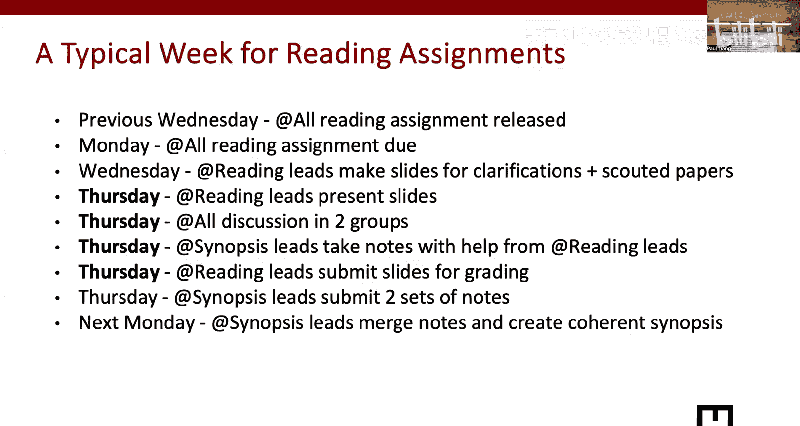

ok。I'm going to send out a poll for people to choose which weeks they like to take the lead on。

 let me send out that poll， look at which topics they're most interested in and also book out any weeks in what she might not be available due to travel or occurrences。

Okay， so that's 40% of the grade the other 60% of the grade you're expected to do a high quality research project this project will be similar in spirit to an independent study project。

We're expected to do these project teams ideally in groups。

 but there's a reason in which you want to do it by yourself we're also open to that of course it can share some commonalities to the research that you're currently doing as part of your your master's of PhD research but it should not be a perfect duplicate so for those which seem similar we're going to try to。

Find a way such as not exactly the same and double countered for both research and this course。

The final report should be like a high quality AI research paper and you are expected to really go out and explore new ideas instead of just implementing what is already out there。

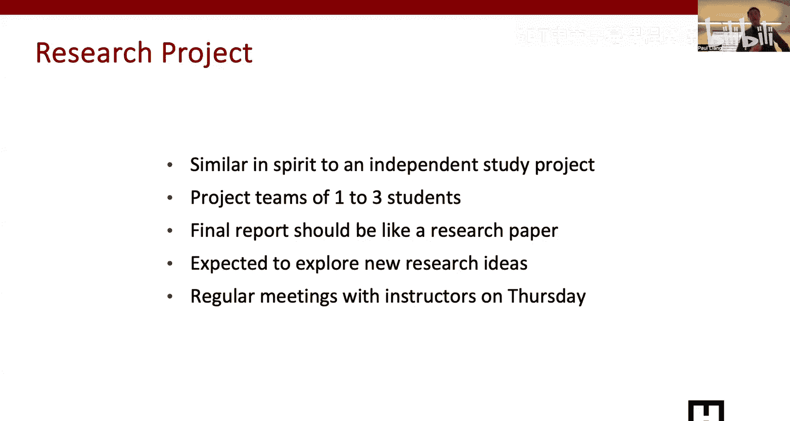

Okay， so several research ideas that I think people might be interested in these are just themes。

 of course you're free to propose your own ones。I mean a all of you are working on new modalities。

 how you build these AI systems that are currently mostly for language vision audio and adapt them to these new modalities。

 whether it's a data challenge， either collecting data。

 annotating it or a modeling model architecture challenge or coming up with the right evaluation frameworks for your new modalities。

 these are a potential research intervention。Some things are really interesting in particular。

 for example， deep learning has not found to be very effective for time series and physiological sensor。

 centular data。Most of the traditional methods like gradient staying still work really well。

 how do we reconcile this？啊。It would also be great if some people were interested in， for example。

 taste， art music， smell taste， art music， and tangible and body systems。

 these are great directions for research。

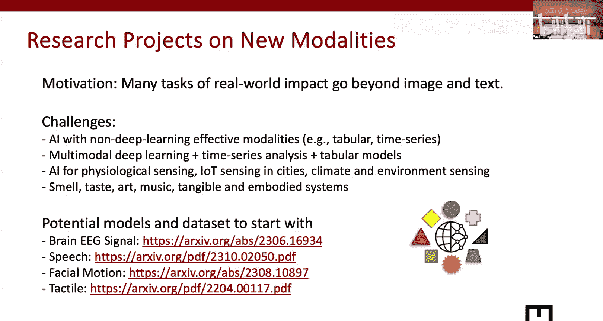

啊。Also big challenges in AI reasoning， I think that is the hot topic nowadays。

 how do we get AI systems to actually reason robustly across multiple steps for these challenging problems like mathematical reasoning。

 logical reasoning， building agent systems that require you to interact over multiple steps。

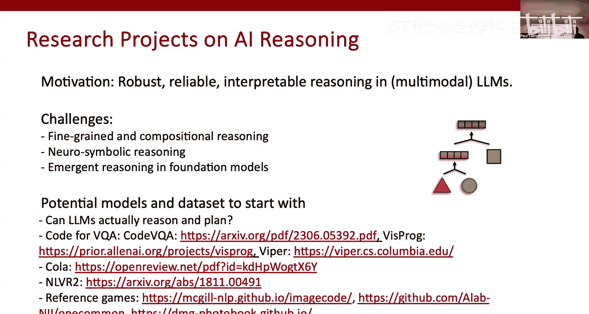

你是。Ferral direction。Interactiveed agents as well， a lot of you have mentioned problems that are mostly of a predictive nature。

 but how do you extend it to the next level where you make a prediction that actually can help control the system。

 for example you might want to understand a sensor the person is worry not just send something from the person but also maybe take actions to regulate the person so that they some notion of well-being is maximized so that requires you to build systems that will sense and take actions。

Research on building AI that is more embodied and tangible。

 so coming up with a physical medium so that you could deploy these systems in which case a core research question is how do you。

 for example， get those AI systems to run quickly on the device there's going to be physical constraints on these real work systems。

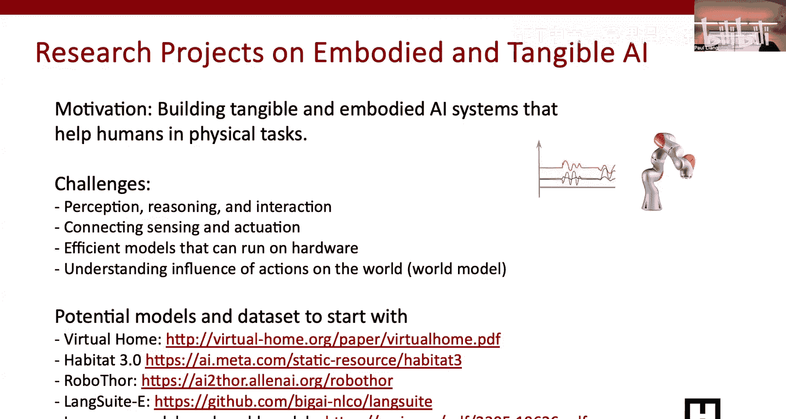

Socially intelligent AI， how do you build AI systems that can really understand human social interactions through different mediums of communication。

 how do you build systems that can understand social relationships。

 things that you can just infer from 10 seconds of a video speaking from might require months or years of data interacting the person。

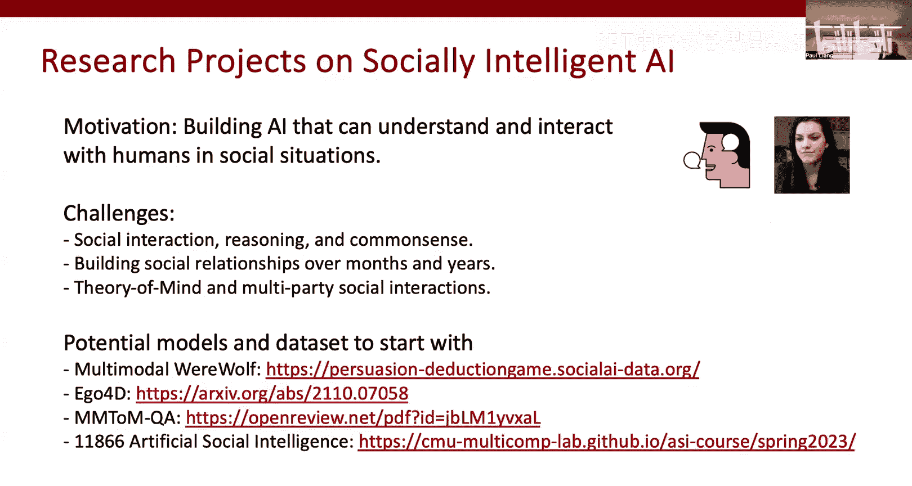

I finally for second to last human AI interaction， how we build new mediums for human AI interaction。

 most of these AI systems are simply on your computer。

 what are some other places or mediums that we can put AI on so that it's more interactive。

 it's more intuitive for a human to interact。How do you build systems that can better convey uncertainty so that humans can trust these systems more。

 how do you build systems that can ask humans for clarifications so that humans do that they have the agency they're not just in the background of the AI systems controlling them。

And finally， new tasks beyond just imitate humans， right most of AI today is about some benchmark for get humans to annotate a measure of human capabilities and use AI to mimic how humans do。

How can you come up with new tasks where humans themselves cannot even accomplish leading to true collaboration？

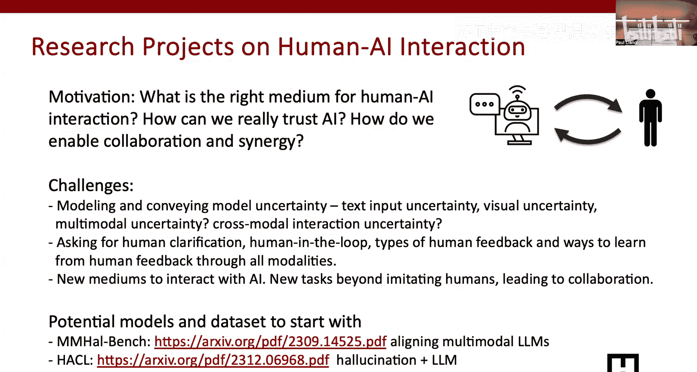

And finally， research projects on ethics and safety we know these systems are great。

 but they also have a lot of limitations in I not being controllable or emitting unsafe text or generating dangerous images。

 how do you come up with the taxonomy of all these types of safety concerns？

And perhaps come up with new data or training objectives to make sure they are more safe when deployed in the world。

Okay so a bunch of research questions Thursday's lecture is going to be introduction to AI research。

 we we'll cover all of this and cover more tips for coming up with research ideas。

But just to complete some of the logistics。嗯。The TAs and myself are really committed to helping you come up with a successful research project。

And therefore， this is going to be required by weekly meetings with us about 20。

 30 minutes per meeting after Thursday's class or during Thursday afternoon。

 if're going to be assigned a primary mentor， either myself or or the TAs。

And you're also supposed to prepare for these meetings by updating a common Google Slide or Google Doc。

 showing the progress， but also more importantly what things that you're stuck with。

 right things that we can help with to debug to try to think of how we can improve the system。

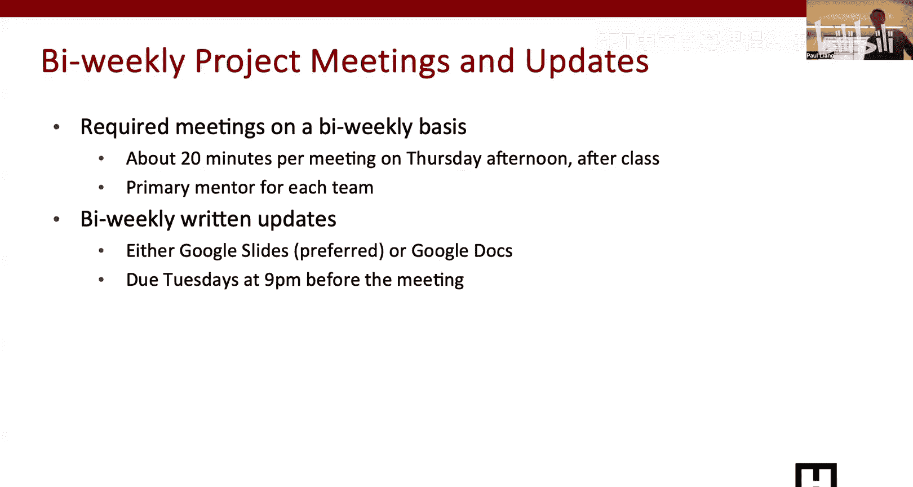

Okay， so why are you the meetings？Here's a rough schedule of the Bi meetings together with the key checkpoints in board。

So。Week one is this week week two there's going to be a pre proposalpo where you have to submit at least just like a short Google form with you know your name any group members that you want to work with or if you feel strongly to work alone a one two sentence description of the modalities and tasks that you want to work on so that's maybe week two week three。

All the groups will present their proposals。 So by then， you are kind of expected to。

You're expected to embed the literature within the field that you want to study。

 taxonize the state of the art and outline some of the challenges in a state of the art that you would subsequently want to target。

 doesnt maybe be free presenting and we followed a report version of that。Two weeks later。

 by week six。We're expected to have some initial implementation of the ideas that you've come up with and again between a week four and week six will give you feedback on your proposal to make sure that the ideas you come up with are reasonable。

So week say is your idea， ideal you have some initial implementation of your ideas。

After you come back from spring break， the midterm report will do that should have a first round of results with your new ideas。

And we'll also present both in class again to get more feedback from the instructors and your peers。

By week 11， you should have updated results， you should have fixed whatever wasn't working in the mid presentation。

By week 13， you should have delved deeper into your method to really understand your successes and limitations。

And maybe visualize how the method is working to user the studies to see if it's actually helping the desired goal and week 14 with the final presentation in class and week 16 last week of class will be when the final report is due。

So road structure staggered to make sure that every team is able to complete a final research project by the end of the semester。

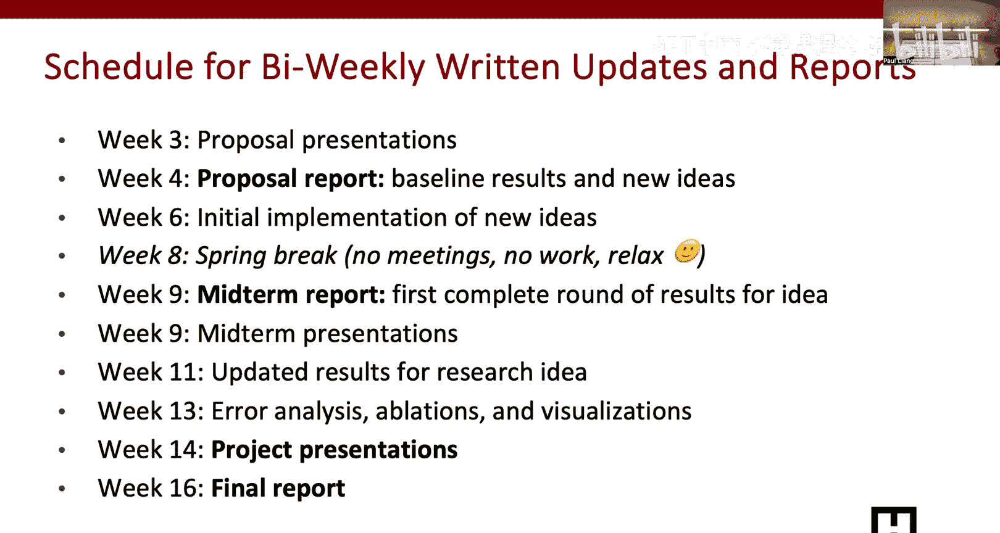

はい。Yeah， so all this you can actually do by yourself just the key deadlines。

Between your preference forms， the proposal， midterm， and the final reports。

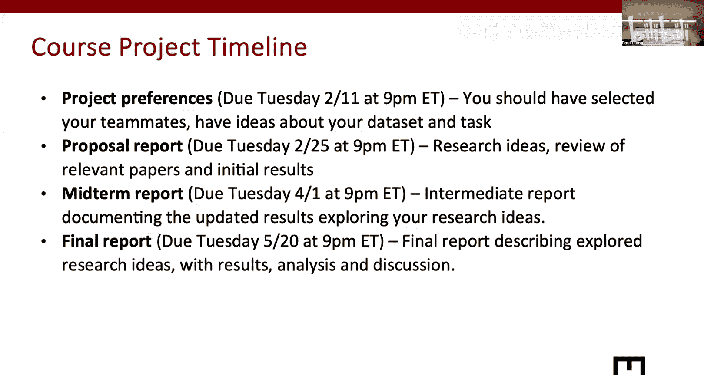

Okay， and just lastly quick logistics about grading the final report the final report sorry the course project is going to be 60%。

 10% for the proposal， 15% it are。25% for the final report and 10% for the biweekly updates。

 so we'll check that you're making reasonable progress in the biweekly updates。Right。😊，啊。

Everyone is expected to come to class if you decide to officially register for credit。

 we can also accommodate some number of listeners depending on how many people register。

 we have to make sure that the discussion groups can actually happen in small groups。

So if you're registered， please come Tuesday and Thursday to class。

 let us know if you have long period of travel， plan ahead so that we can plan accordingly。

And there's going to be several wildcard that students can use to extend the deadline by 24 hours。

 so two wildcard for reading assignments， there's just seven reading assignments in totals where two of them we can submit then one day late and for the project report wallcard2 per team。

It can be used to either extend the deadline of your midterm or final report by one or two days。Okay。

 and the course website contains all the information。It's also open to the public。

 so all the lecture slides， videos and discussion notes summarizing the discussions will all be posted online and will also open up Canvas for the submissions of reading assignments and project reports。

Okay， so no assignments this week are no meetings。It you start'd be good to start thinking about what projects you want to work on and if you are committed to taking the course for credit or interested in doing the course project。

 then also maybe finding out teams and partners that share common interests with yourself。

So we're going to release a Google form that's going to be due Tuesday next week for project preferences。

And this Thursday， we're going to meet here again one to 2 PM。

 It's still going to be a lecture on how to do AI research。

 so we're going to cover how to read papers， how to generate ideas。

 how to quickly execute research ideas and how to write and summarize your results。Right。

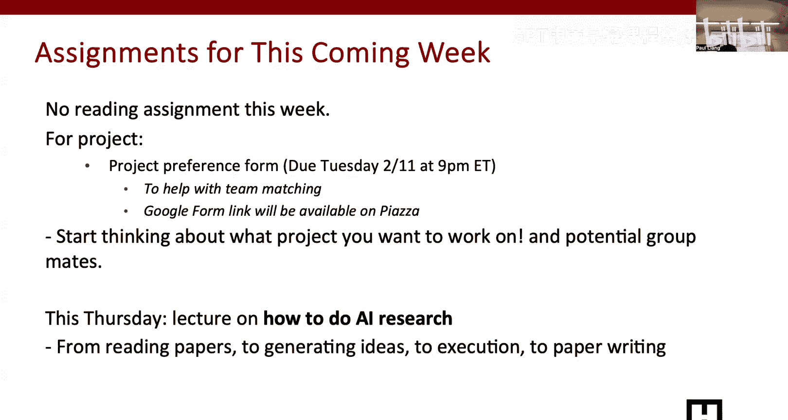

Any questions for everybody？