# 《如何AI所有事情｜MAS.S60 How to AI (Almost) Anything》中英字幕（Claude-4-s翻译） p02 [02]Lecture 1.2 – Introduction to AI Research.zh_en [BV1UhawzQErD_p2]

H， welcome back。I'm going to pass this sign up sheet around just to get a final tally on how many people want to take the class there's going to be several sections here so put your name and email in the first section if you're taking it fully for credit that means you're supposed to come to all lectures。

 do all readings， discussions and the final project。And for those who want to be listener。

 there's several sections in the back， depending on how much you want to participate in the course。

 either just coming in for the lectures。Lectures， plus reading and discussions。

That's important because you've got to know how many people are going to be in each Disc group。

Those who are listener with lectures and projects so we've got to know how many projects they are and finally listener who's doing everything。

 but I don't expect anybody to fall into that category Okay。

 so please put your name and email in the right category and tell me how much you want to be involved in your course。

2。Okay。嗯。Can someone close the door to that please？All right， so this is lecture 1。

2 how to do AI research this is an exception normally we're not going to have lectures on Thursday it's probably usually be some more hands on tutorial hands on discussion。

 but today I want to spend the time just covering the basic fundamentals of doing AI research。

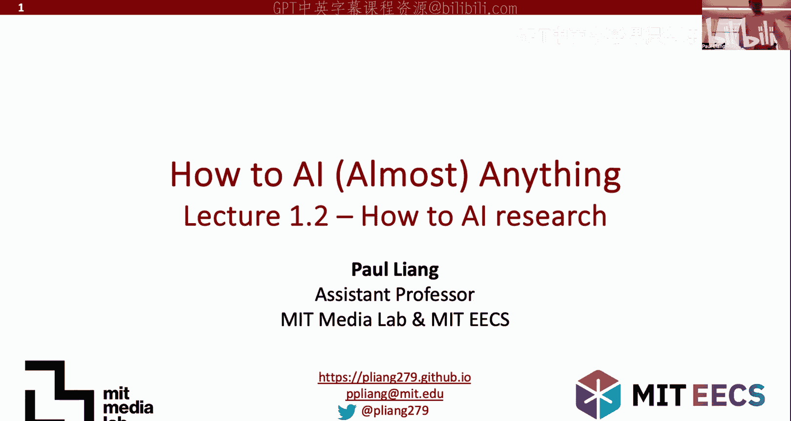

So're going to start by discussing how to generate research ideas。

 several ways of coming up with good ideas， we're going to cover how to broadly do literature review and read a paper in depth I'm going to call for some potential topics and I'll just do a live demo of how I typically do literature review and find good papers and a review literature。

We're want to discuss several tips on how to best ob research ideas so that you can make fast progress and we're also going to cover how to write a paper。

 provide a report as required as part of the class and also give some live dissection of some of the papers our group has written recently。

Okay， so broadly， everyone who does research probably follows this research process。

 which is iterative loop。

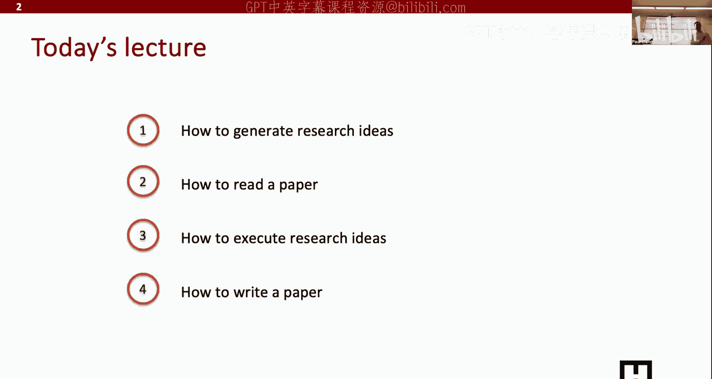

Between first starting out with some initial observations and ideas that you have。

 they really want to test。Fll by is some review of the literature to see whether this idea is known before or how well it sitates in relation to existing work followed based on your idea and based on what's in literature。

 some research questions or some hypotheses that you come up with。

Whether this idea could work and so why would it work？

And you will then test it with experiments in the context of AI， usually writing code。

 running experiments， seeing how these models perform， you will then analyze the results。

And you report your conclusions and depending on what those conclusions are satisfactory。

 you would reiterate with more observations， ideas， more contextualization of previous work。

 new research questions， new implementations and so on。

So I're going to cover this entire loop right coming up with initial ideas。

 finding out whether your idea is contextualized in literature， quickly experimenting。

 and also how to write a good report。

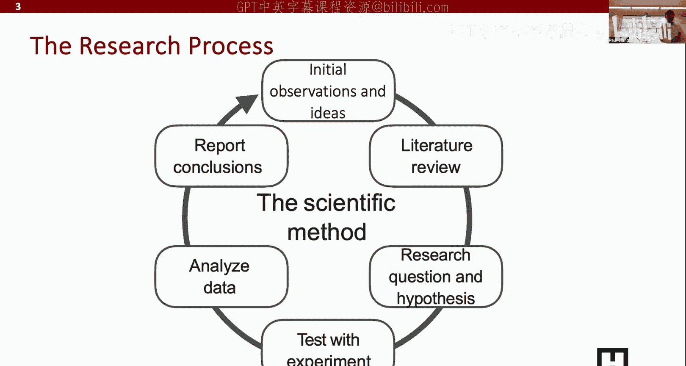

So firstly， how do we get research ideas， there's two general ways not up getting research ideas。

The first way is more bottom up discovery， bottom up discovery basically means that you are surveying what is happening in some field。

 you're trying out the state of the art models and you're seeing what works and what doesn't and based on what doesn't work。

 you're using that to inspire what you should do next。

So we call that bottom up it's usually a great tool for incremental and steady progress is usually safer because you're starting out with something that works in these scenarios。

 but doesn't work in these other scenarios as long as you can fix it the scenarios in which it doesn't work。

 got a new method that works better。It's a great tool for incremental progress， more safe。

 but it doesn't allow you to make large leaps in research。

So bottom up research is in opposition to top down research。

Essentially top down research instead of starting from the lower level details of what works and what doesn't you instead start from larger research themes larger research themes that if you say to a person they immediately think yeah that's never been done before that's going be great if we had that idea so you start from bigger topdown research themes and of course that's not going to be feasible you then maybe break it down into individual parts that might be achievable within a couple of months a couple of years and so on that's more top down design research ideas guess。

Papers， bigger ideas， but usually at the risk of being usually being more risky。

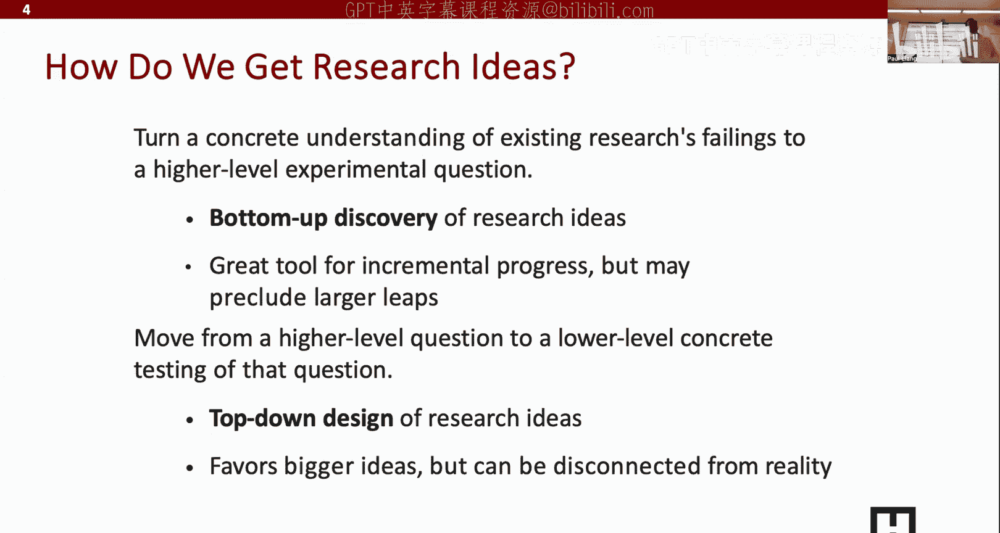

Okay。So。To be safe， we're going to design the course in a way that everybody can at least do bottom up research of course you're also free to do more pop down think of this new North star and make your progress towards it。

 but you want to be safe and make sure that everybody can at least do some bottom up research and get something working by the end of the semester。

So how that's going to work the several stages to bottom of research in the first proposal report。

 which we' do in about two to three weeks， you should scope out which area research you're interested in。

 you should scope out some of the state of the art existing methods。

Or they don't directly exist for their area， porting state of the art methods from other areas to the area that you care about as new proposalal reports。

But the midter report， you should have experimented with some of these existing methods。All right。

You should after experimenting， analyzing cases where they work and cases where they don't work。

 do error analysis， and essentially taxonomize all these failure modes。

 and then you can identify ways in which you can fix these errors。So for context。

 everyone who's thinking of doing other them or chat GT rappers。

 you're essentially only at a midterm report。Right so just applying LLMs， fine tune to your data。

 calling APIs for your data， that constitutes experimenting with a certain state of VR method。

 but then you still have to analyze successes and failures and come up with hypotheses on how you can subsequently enhance performance。

And definitely due right after a spring break， the second half of the semester will be focused on coming up with a solid final report that has implemented the new ideas that you proposed and summarize whether it has actually fixed the issues that you've discovered in the mid report。

O。😊，So that's a solid timeline for bottom of discovery everyone's expected to do at least something in this bank。

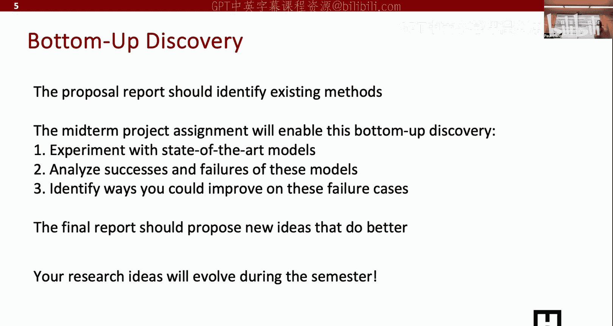

Of course， we're also happy if you have more moonshot ideas。

 if you don't want to just try out different state of VR methods and see what works and what doesn't。

 we're also happy to support research visions that have more top down moonshot ideas。So for that。

 it's really important that you come to office hours to brainstorm with myself and a TAs。

 technically office hours， we're going to put them on a website。

 office hours are going to be right after class on Tuesdays and Thursdays in our space just around the corner。

It's really important to brainstorm so that we can come up with something feasible that can be done within the semester。

Literature review is still going to be very important， you might have oneshot ideas。

 but you still got to contextualize it well with current work。

 either finding current data sets or finding current methods that are also in the similar vein。

Again the midter my final report， will be less structured。

 so you're not going to be required to first implement what exists。

 do error analysis and then propose a new method， but it will instead be more incremental progress versus high level idea that you came up with。

Thanks。

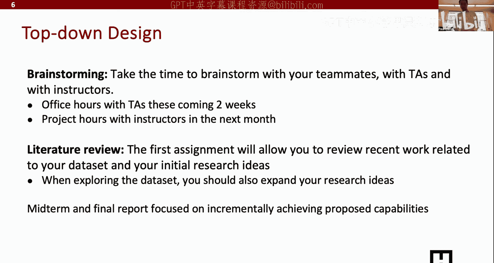

Alright。So all of these ideas typically come because theres some research question that you're asking right let me just also cover you know what a research question is and what a hypothesis is and research questions are explicit questions that you're asking about something that the community does not know yet。

Re questions are really key because that defines what is novel about the research and what is not novel so usually when people criticize reviewers for unfairly saying that paperper is not novel is usually because either a research question is something that's already been answered in the community or that you did not do enough to answer that research question completely authority。

And research questions really outline what is norm about the research。

I find it's usually easier to draft research questions that are yes， no in nature。

 rather than how in nature。So I'm going to give you some examples very soon。

And hypotheses are essentially what answers a primary guess should be the answer to these research questions。

And it's very useful for research questions to be yes， no， because then you can very easily check。

Vify and also falsify your research questions right you see some observation that either that either verifies it or falsifies it now give a very solid answer to your research question。

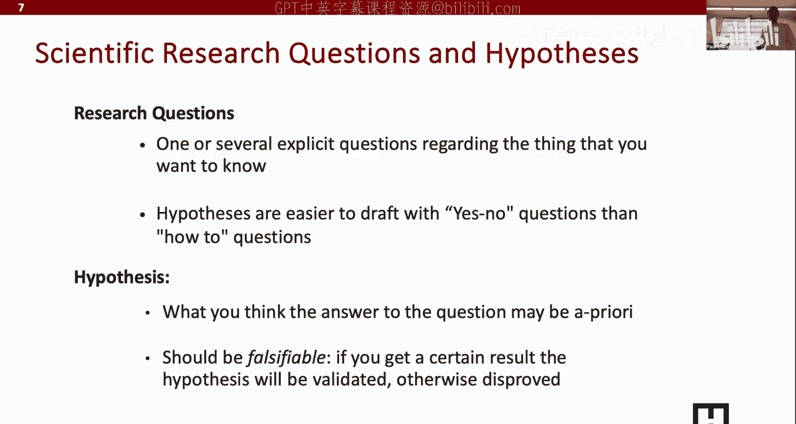

So here are two examples so this first paper from Coloradodra 2018 asks。

 are all languages equally hard to language model？That's a pretty good research question because first of all it's pretty open question no one really had an answer to this prior to 2018 and second of all it's very clearly a yes no question either yes。

 they are all equally part to language model in which case you could perhaps train a universal model in all of them or no。

 they're not all equally hard2 language model in which case you could might want to prefer specialized models for each language。

So there's an example a very solid research question and over here。

 highlighted in red is essentially a hypothesis， the hypothesis for what the answer to that research question may be。

For example， based on crosslinguistic compatibility。

 it is unlikely that all languages are equally easy or that our methods are equally good at all languages。

 so this gives an hypothesis because it's hypothesizing that no。

 all language is not going to be equally hard to language model and at the same time it gives a particular reason for that hypothesis because of this concept of crosslinguistic compatibility which I'm guessing that authors would define in their way。

So here's a good example research question it's pretty novel， gives you new knowledge。

 it phrases a yes know so it's easily verifiable and falsifiable and this was a good example of phrasing a particular hypothesis for that research question。

 and then you can think of how their experiments will do right they would define what cross-linguistic compatibility is to find some languages that are compatible some languages that are not compatible and they would essentially do controlled experiments。

 testing whether it's equally hard to model one or other types of languages。

Here's another example from our social science perspective。

 research question is what makes a particular podcast broadly engaging？

So right here is an example of a more complex research question because it's not yes no。

 but to answer this research question， youve got to have some hypotheses on what particular factors might there be or you can't start from nothing。

 you got to start with some potential hypotheses so their hypothesis is that hip such as reducing filler words and fluencies or inporating emotion could make a particular broadcast podcast broadly engaging。

So again， good hyposes， broken down a research question in individual parts。

 and then for each of these parts you can use a yes。

 no experiment to check whether reducing filler words or not reducing filler words。

 whether incorporating emotion or not incorporating emotion and those will help you verify that research question。

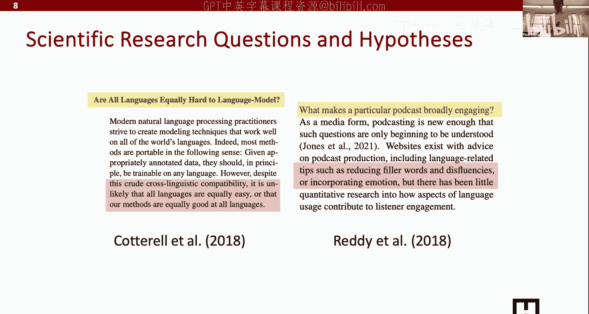

O的。😊，So usually these two questions are exploratory， there's a mix between those that are more yes。

 no， that more verify existing knowledge， or there's more exploratory。

 such as the one that we saw in the second example where you hypothesizing multiple factors and you're seeing which one of them actually succeeded in being explored。

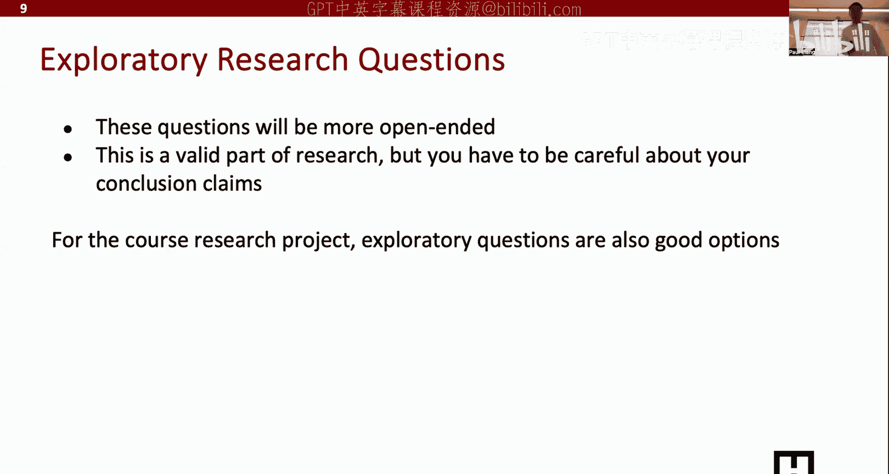

Also， beware questions that。Or of the form， does x make y better？This is a valid research question。

 but is usually indirect。Because if x does make y better， for example。

 a particular model component makes some downstream task better， that's good。

 but if x does not make y better， you're stuck。You don't really know what to do next。

So usually you want to rephrase this question as。Y X makes y better。

 not just whether it makes it better or not， but some property of x would make y better。

So that in itself allows you to test， for example， that particular property。

 and if that property doesn't work， maybe it might hypothesize some other property about x might make y better。

So different ways of asking more detailed research questions。

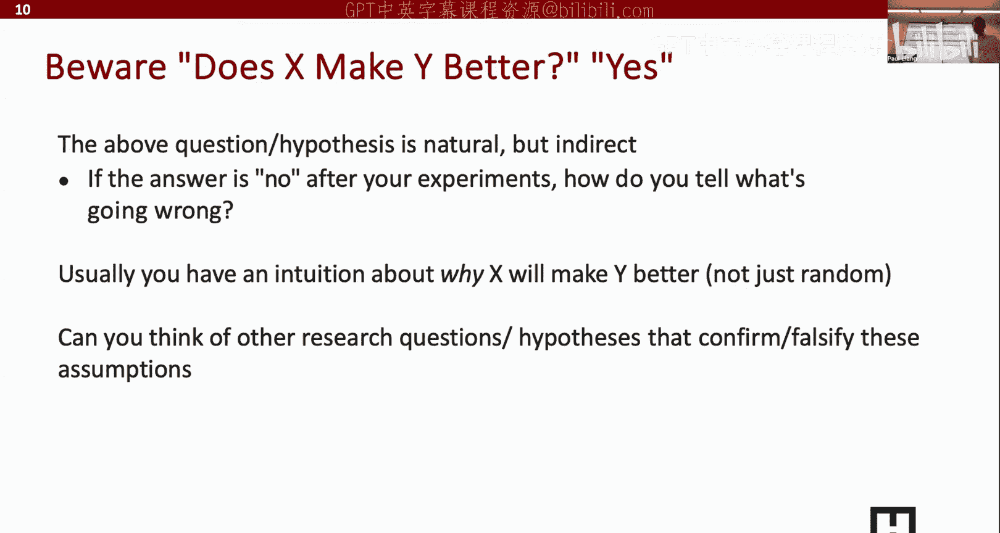

Let me go through some examples， I think these are all examples curated in a way that is broadly relevant to the interests of the group over here。

As mentioned， a lot of you are interested in research projects and new modalities that go beyond image and text。

 so things like sensing data， brain data， tangible data， and so on。

So there's several challenges here， all of which warrant for the research study。For example。

 how you do AI with non deep learning effective modalities？

A of you just look at tabular data or time series data and look at the state of the art。

 many of them are not based on neural networks and transformers。

 they're still based on more traditional methods， so perhaps there might be a way to come up with a hybrid method that combines the strength of deep learning with some of these more traditional nondeep learning based methods。

Same thing if you want to do multimodal fusion， if you want to fuse language and time series data。

 for example， the best model for language would be deep learning and LLMs。

 the best model for time series might not be deep learning。

 how do you make them compatible so that you can train both systems together。

One research question typically is。You know does specialized or general purpose models work that are in some particular setting that's still a big question nowadays a lot of natural language processing started with specialized models。

 but you've seen that general purpose models are able to use lots amount of data and crush a lot of these benchmarks does have same trendhold true for other data modalities。

 especially those that don't have that much data。Another general research question is what type of domain knowledge to include in these models。

 for example， if you hypothesize that you know something about how EEG data should be processed by domain experts by medical experts does putting that knowledge into your model。

 improve performance or allow you to get the same performance with fewer less data than。

Methods that don't incorporate this domain knowledge。that's not type of a research question。

And here I'm just putting several existing models and data that they start with。哎。Book。

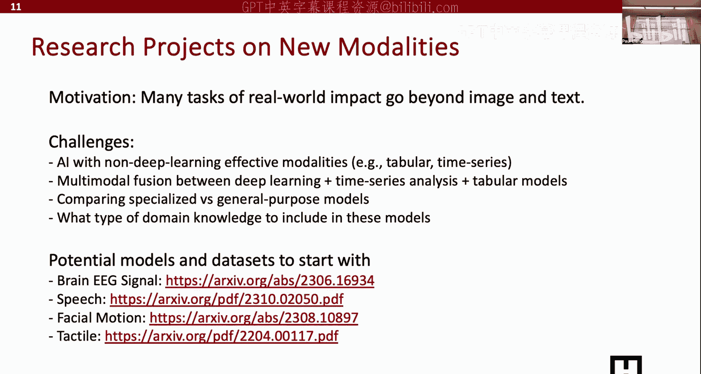

啊。AI for sensor data is probably another research theme that I think a lot of you are going to be working on I mean the motivation is that while this sensor data is very high frequency is very long range。

 it goes beyond what these current sequence models can handle but several research questions。Firstty。

 how to tokenize sensor data into semanically meaningful boundaries right a key component of these LLMs nowadays is to tokenize them into words。

 but even better sub wordss so they can think of eat and work and play as individual words and the ING to make it working eating playing are just additions and transformations of those subwords。

Same thing， how do you tokenize sensor data into boundaries that are semantically meaningful。

 if nothing is happening and suddenly it's a spike。

 can you understand that all this is nothing is happening and a spike is happening afterwards。

Most of these sensor data has been shown as been previously processed by signal processing。

If you want to build an AI system most likely you're going to need a hybrid of signal processing based methods and deep learning based methods right both of them give you complementary features that you can extract how do you build such a hybrid。

If you want to build， for example sensor based large language models。

 a key component is to collect their sensor language data， either in a form of sensor coming in。

 here's a classification label or sensor coming in。

 here's the natural language description of the sensor or other forms of question answering and reasoning on these sensors。

 so you're going to need to collect that type of data。

A research project can also be data set and benchmark driven。

finally most of the sensor data is going to be super long， it might be years worth of sensor data。

 you're going to design need to design some adaptive method that doesn't sense all the time because that'll be very expensive。

 but it's usually off and maybe only census when something important is going on that could be another research question how to achieve that。

O。😊，So。Tons of time series foundation models that me released recently worked a look as initial state of the art。

 and for example， how to tokenize these ideas from time series analysis called change point detection to identify changes in sensor data。

 how do you make that compatible with today's foundation models？

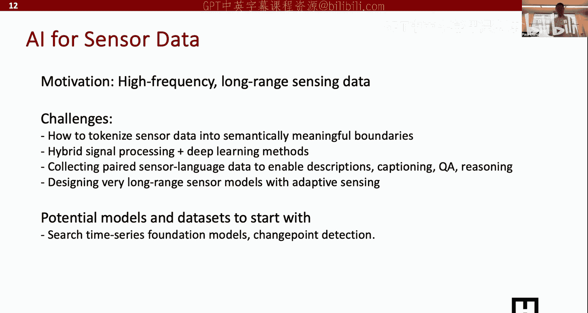

Right。AI reasoning， a whole goal of reasoning is to build systems that doesn't just perceive and identify a prediction but can rather take multiple steps。

 multiple complex steps to solve some difficult task。Nowadays。

 you've seen tons of work in showing that foundation models actually enables reasoning to emerge。

you just give it， for example， the answer to a math question without showing the intermediate steps。

 these Lms are still able to learn the intermediate step by step workings。

How to solve that math question so that's kind of called emergent reasoning we're going to have a lecture dedicated on that。

 but before emergent reasoning came into play there were methods based on explicit reasoning where you gave supervision on each of the steps that you wanted the model to take before solving the answer。

How to give supervision， there are ways of doing neurosymbolic methods。

 there's ways of collecting that intermediate steps。

 there are ways of doing a tree search over possible things that a model can do。

I'm again putting a lot of references here， people have been able to successfully reproduce deepse R1 reasoning using just 1000。

8000 examples， so that's something you want to investigate or adapt to your particular settings here are some resources。

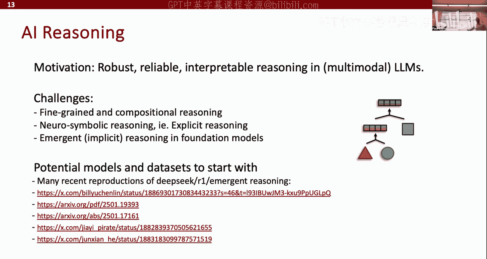

Interactive agents。So following on reasoning comes interactive agents where you want these models to take multiple steps of actions to help you solve some task。

 so this' is extremely popular nowadays where you could embed LLM onto your computer so that you're just typing something like help me do this shopping or help me book this travel。

 help me make this PowerPoint slide， you can go somewhere towards helping you do that。Again。

 lots of questions still。AI systems are really good at understanding natural images。

 but web images or screenshot images or PowerPoint images are still very different how you build better vision models to understand these type of images。

Asking a human clarification， we're never really on trust these systems that they're running fully autonomously on our computer。

 how do we design these models that can at some point if they're uncertain to stop and to relay the information to a human so the human can take over elements of human in their loop learning。

And here are just some common benchmarks that are being used nowadays to benchmark how good these interactive agents are。

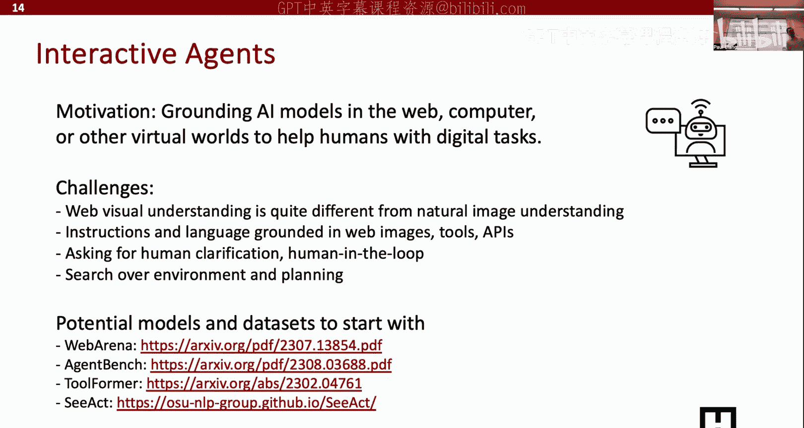

Right。Emmbbodied and tangible AI， How do we bring AI from merely digital form to physical systems in the world。

 That will be something really exciting。 So this will require you to solve。Of course。

 the hardware building the system itself and also come up with an AI prototype that can run ideally on device on the system。

So we will cover the core some ways of。Downsizing these models to make them really efficient by reducing the amount of memory that they take to run。

So several challenges here。Efficient models they can run a hardware。

 how do you connect sing and actuation so an AI model might send something in the world on this device。

 the device might move and take some action， which then allows the AI system to send something again and take actions again。

 so we usually phrase this as a reinforcement learning problem。

I cover reinforcement learning in their class， but effectively doing that for renewableable tangible systems in body systems is still pretty challenging。

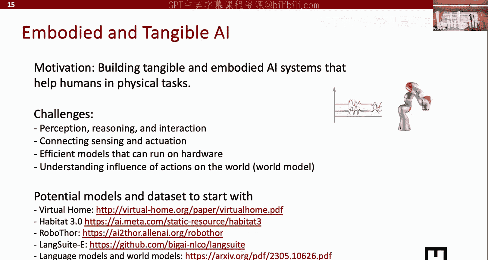

对。Socially intelligent AI， we have AI that can perceive physical world and physical images very well。

 but they're still quite far off from truly understanding and interacting with humans。

So this interaction has to be very multimodal in nature， understanding our speech。

 but also other nonverbal expressions。They have to have common sense。

 there's so many things that we don't say in these social interactions。

 but we know they are there because we have common sense about how to interact with people in social settings so how do you imbue AI systems to this form of common sense。

A lot of social relationships that are built between humans also take months and years to develop。

And AI is not going to develop that same level of social interaction。

 it' just talking to you over a couple of minutes， so how do you actually scale these systems to interact with people over years。

And finally， theory of mind and these systems understand what you think they might be thinking about and do this multiple times across perhaps multiple people。

Lots of recent data set here。We also taught of course a CMU on artificial social intelligenceance。

 which again covers a whole semester of some of these topics building socially intelligent AI。

One thingWE center is somebody works on。Are games that on AI that can play games like real world or aval。

Who knows we're open have？Yes， that's a great example because you have hidden roles。

 you're lying to people so that they don't uncover what your role is。

 so how do you actually build an AI system that can effect effectively play and lie and tell if other people are lying in such a scenario。

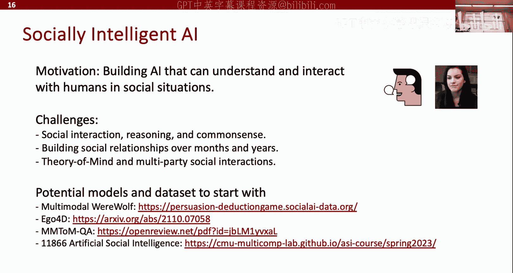

嗯。哎。Human A interaction。A lot of these systems are still very autonomous。

 but there's some core research questions on， for example。

 how you get these models to reveal how certain or uncertain they are about something so they can relate to humans for feedback and clarification。

How do they come up with different mediums that might be more intuitive for humans to provide feedback。

 not just upvos or down on a computer， maybe even using facial expressions and gestures and overall mood of the dynamic to better inform AI systems about their feedback。

Human AI interaction， several benchmarks I here。

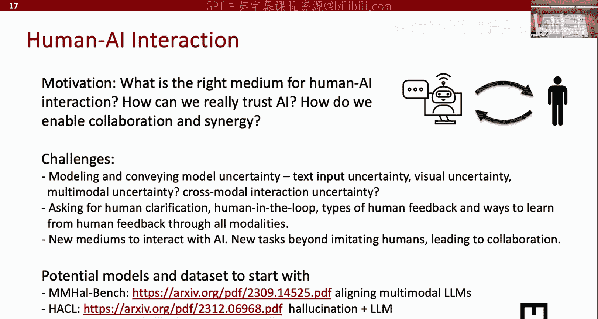

And finally， ethics and safety right we know these systems work really well when they do。

 but they can also be very disastrous when you prompt them without of distribution or prompts that could potentially Joebreak or get them to say dangerous things so how do you better taxonomize these types of biases violating of safety and how do you perhaps come up with new ways of fine tuning them to mitigate these issues？

Right， and again， this is a not exhaustive list， it's just things that。

I'm interested in some of my students in my group are currently working on。

 some of which I think are broadly the group is interested in based on the experiences we discussed on Tuesday。

 but you're all welcome to come up with your own ideas。Any questions about。Rese here so far。

All right。😊，Good。😡。

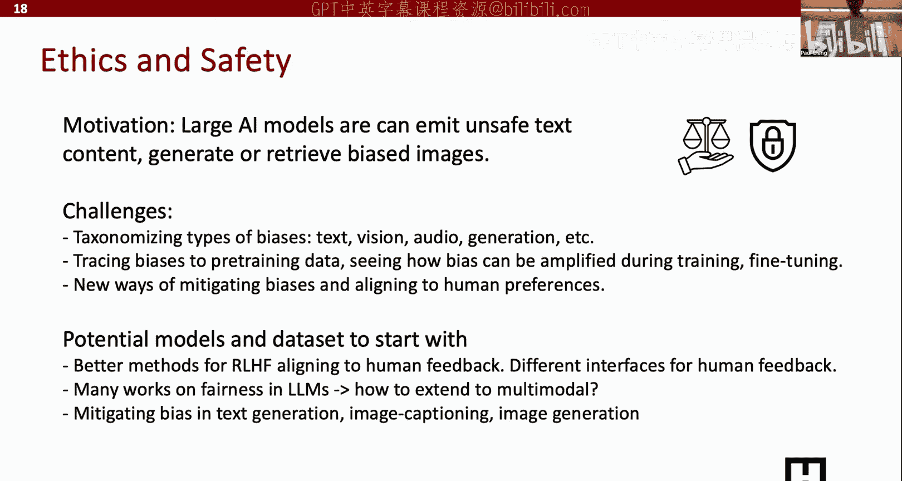

So in this next part。We are going to cover how to do the review and how to read a paper。嗯。

And there's several， I mean， just putting several resources over here。

 some of you might have used all or subset of them， Google Sch， papers with code， GitHub。

 hugging face， conference proceedings， blog postss， survey papers for those courses。

 and I usually go through that in this order。I first start by you know given some particular topic just typing a Google scholarar browsing through the first couple of pages seeing what comes up I'll then focus on implementations so papers with code givethub and hugging face are essentially platforms where where you know people upload their code online after they've completed a project and some of them are more structured than others so Github is just scattered all over the place different people have different reposories but papers with code and Huging face and I'll show you in a second。

 I'll essentially centralized code by a particular research area or buy a particular data set so it's easier to find out the progress that they made on this particular task。

I'll then look at maybe different conference proceedings of your favorite conferences over the years。

 especially recent ones， and then I don't know if a lot you do four and five but something I like to do。

 I like to type whatever I'm trying to find out about with blog posts added and afterwards。

Right who does that？Okay， some of you， blog posts are essentially written by domain experts or introductory people into the field。

And usuallyly pitched at a much， much more shallow， much more introductory level。

And that can be very useful because you know maybe I want to find out about this area。

 but I don't have time to dig through all the math and all the recent papers for the overly technical audience。

 I just want to know the key highlights and key trends that have been made in this field so blog posts are usually very very helpful for beginners。

Very friendly for beginners。And like blog posts， I will also add survey paper。

 I will search plus tutorial plus courses that are being taught again so it iss more friendly to a beginner and you can also see how they structure the field。

 right structure into a consistent pedagogy。

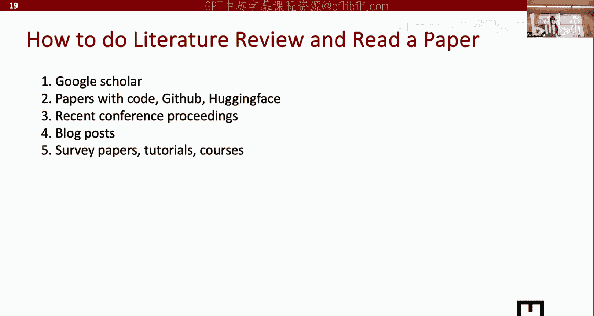

三个人就。