# 《如何AI所有事情｜MAS.S60 How to AI (Almost) Anything》中英字幕（Claude-4-s翻译） p03 [03]Lecture 2 – Data, Structure, Information.zh_en [BV1UhawzQErD_p3]

Okay， so today we're going to look at lecture2 on data structure and learning。

So in this lecture we're going to look at various forms of data data is probably the most important ingredient in machine learning and AI nowadays。

 we look at examples of visual language， auditory sensing。

 set and graph data well then generalize all these data forms into a general discussion of what makes data unique。

 what are the properties in your data， how you should think about your data and what are the right modeling architectures to design for your data who give examples of visual data sets and what comparable labels often you have raw data coming in。

 trying to learn some features so that you can label or make some emphasis on that。

So in order to make these inferences， we'll cover types of label and types of learning paradigms。

 what are different objectives that you can impose on your methods so that they can actually learn well in practice。

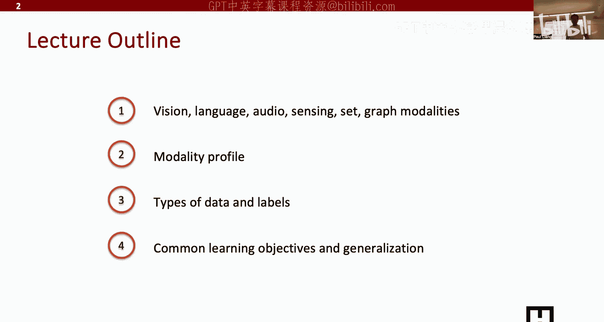

before getting into the lecture， just some logistics all of you should have been added to Piazza if you haven't please let me know as soon as possible after the class Piazza will be our resource where all the announcement will be made for example this first announcement and also including a links to all the websites lecture slides course calendar syllabus and so on so please make sure you are enrolled in Piazza emails have been sent out probably have to activate and register your account if you haven't used Piazza before so please do that as soon as possible。

Speaking of Piazza our first announcement is that we have this project preferences form that is due by the end of today。

 so if you are planning to take the course and do a course project as part of it。

 please fill out that form okay so that form is very short form asking for your name。

 which team members you already have or if you're looking at the team members and you need us to help you match students of similar interests together and also general interests that you have in doing the course project。

All right， so please register on Piazza and fill out that project purpose is formed by today。

I also end the lecture a little bit early， so students who haven't found teammate yetN have a chance to mingle and find those of similar interests。

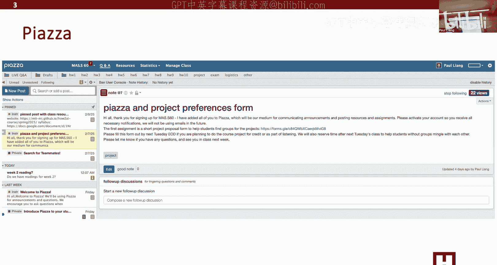

Another quick areaial logistics， we realized that next week week three Tuesday and Monday are actually swapped if all you didn't know that Monday is President's Day。

 but instead of canceling class on Monday， the canceling class on Tuesday and moving Monday to Tuesday instead that seems to be the official university policy and as a result everything on Tuesday is cancelled we won't have a lecture next Tuesday so if to reshuffle some of the things around to fit more content into these lectures okay。

This calendar if we haven't seen it before is was going to be very useful and will cover the topics for every week and also any important assignments。

 so in red for example， you see their project purposes that form is due today。

 February 11th and very soon a very important checkpoint is that next Thursday not this Thursday but next Thursday。

 February 20th， 20th is going to be your first proposal presentation so we're going to send out those instructions for roughly everyone and their teammates who are doing a research project will present for about five minutes outlining their broad ideas。

 different data sets and models that they want to get started with and the point of it is to get feedback from the instructors and other members in the class。

Okay， so just look out for this calendar， it's again linked on Piazza。

 so please join Piazza if you haven't yet。Several other logistical things， for example。

 this Thursday you'll see that there's a tighttorrch and hugging phase tutorial that's going to be led by some of my students。

 mostly introduction tutorial to different tools that you'll be using in machine learning。

 covering how to quickly iterate on code， use GPUs， monitor your experiments and so on。

And some of you also asked when the first readings will be released， so over here on Thursday。

This Thursday is going to be applied for your hockey Place tutorial next Thursday all of you will be presenting your proposal presentations and the following Thursdays when the discussions will start discussion one234 four discussions before spring break and that means readings will be released roughly a week before the discussions okay so the first reading will be released on February 19th。

All right， so definitely check out your calendar。😊，O。

Jumping into today's lecture。So in machine learning， we often talk about data。

 right data is key to any accomplishments in machine learning。

You want to think of this data as belonging to some sensory modality。

 this sensory modalities essentially refers to some way in which data is expressed or perceived in the world。

When you look at data， you often think that there's some sensor behind which data is collected。

And you can essentially look at data modalities from more raw。

 which are closer to the sensor to more abstract that are further away from the sensor。So raw data。

 for example， can include a speech signal that's directly collected from a microphone recording somebody in the image directly recorded or captured from a camera。

And you can then think of making abstractions from the raw modalities， so for example。

 you can extract the language， the specific words that a person is speaking from their speech signal。

It's making an abstraction by keeping some information and throwing some other information away。

You can then start detecting objects from images， again that's a form of an extraction。

 extracting out what objects are there， what locations there are。

 or throwing away some other parts of the image。And you can go even more abstract right from language。

 you can detect somebody's sentiment， whether they're feeling positive or negative about the topic that they're speaking about。

From detect objects， it can extract the exact object categories。

So machine learning and AI is mostly about learning these abstractions， going from raw data。

 which often very high dimensional， noisy， unclean in the world to learning useful abstractions。

And making inferences on that data。So the whole lecture and the whole point of a course is to cover what all the data they are and what are the right ways to learn these attractions that are useful for some task that you care about。

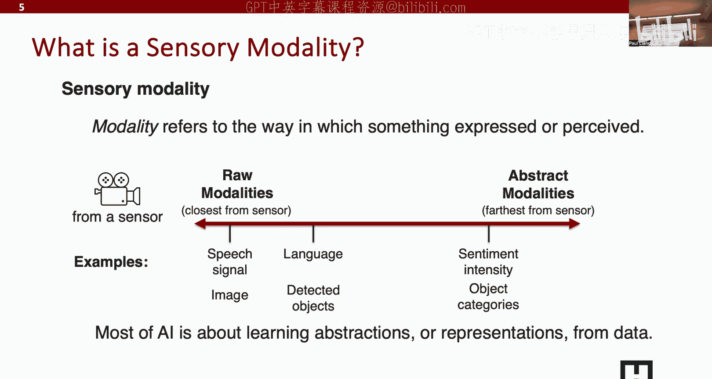

So to see some of that in practice well all of you have probably seen visual modalities here has a color image and when you look at these modalities they often have to be represented in some way on your computer right so images they want want to classified will be represented as pixels where you have a height you have a width and each dimension has some channels the number of colors RGB behind them so it's usually a three dimensional matrix height width and channels。

And for these images， you can classify the presence of an object。

You can also classify technical poses a binary classification problem。

 so whether there is a dog or there isn't a dog， you can also pose it as a multiclass classification problem。

 so you might have a large set of categories that you're trying to infer from the image and your goal is to choose one of the right categories。

Okay， so that's an example of visual data and some of the inferences you might make on visual data。

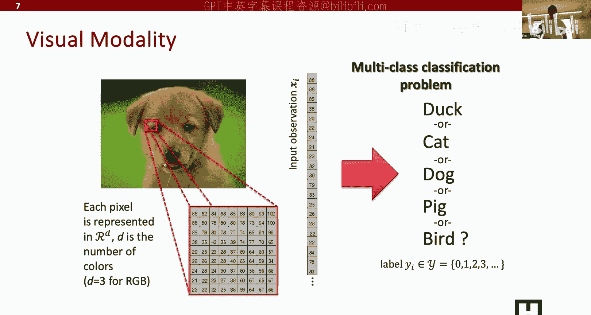

Language data， you can get lots of language data on the internet。

 here's a here's some written language on Amazon， for example。

 that somebody might have written after purchasing an item。And you can also get spoken language。

 for example， actual recordings of people speaking and movies or TV shows。

 another good source of data。So from language data， you could try to infer， for example。

 the sentiment， whether a particular word that appears in the whole language data， for example。

 the word humorous can that be inferd as positive or negative。Again。

 how would you represent this data humorous， it's a string on your computer。

 but how would you represent it in a way that can actually be taken in by your machine learning or AI algorithms？

Well， bag of words is one simple way of doing it， this bag of words。

 what this essentially means is that you first collect a dictionary of all the words that appears in a sentence。

So multiple words and you're essentially putting an index one if that particular word is of interest。

 so humorous is that that you know eighth word in a dictionary。

 we're going to put an index one at the eighth position and zero everywhere else so that's an easy way of representing the words in a digital format that your computers can take in。

So you could class， for example， this words， whether it's positive or negative。

You could classify what part of speech it is， is it a noun or adjective。

 you can also classify whether it's a name entity， for example。

s whether it's a particular location or a particular object。And nowadays， of course。

 we've seen we don't really train word level models， we train sentence or paragraph level models。

 so you might take in multiple words in paragraph or in a dialogue and you're trying to make some emphasis on it。

Whether the whole paragraph indicates that a person felt positively or negatively about the object that they purchased。

 whether this whole paragraph encoded in a model and generate a response。

So the customer agent might automatically respond to this review that a person wrote。

So these are more sentence or documentlel classification tasks against easy ways of representing it you can continue using your bag of words。

 you will basically just count which words appear so maybe the word ideal appears that's the second spokenken and dictionary。

 the where anyone appears as the fifth spokenken， the word humorous appears that a token essentially putting a one on all the words that appear in a dictionary in your sentence and zero everywhere else。

Its been a way of representing your data。Of course。

 all of you might realize that these are very simplistic ways of representing your data， for example。

 a bag of words， just counting which words appear doesn't really deal with the ordering of words。

For example， not happy these two words one after the other actually mean something very important versus happy。

 blah， blah， blah， not somewhere else。 So of course we're going to look at more examples throughout the course on better ways of representing your data and better ways of learning from your data。

Again， this just meant as an introduction to various forms of data。So we saw vision， we saw language。

 audio is another common modality， sometimes you might obtain acoustic signals from a microphone and usually these signals are discretized in some way because these microphones are sampling at some fixed frequency from the continuous data in the world。

So again， from this audio signal， you might try to infer what the person was speaking as a task of automatic speech recognition。

And there's several key parameters for audio data， for example， what the sampling rate is。

 so how often you're recording a person at a frequency， what is the bit depth。

 how much are you recording for each sample。And also other things that you might want to consider。

 for example， what is the time window， what is the time window in which you want to recognize what word was being spoken right you put your time window too short。

 you might only hear a particular phony or a particular character that a person was saying you put your time window too long than you might recognize more than this a word might start recognizing more things and your model may not be as precise in aating in measuring words。

Different ways again representing audio modalities。

 this is basically a time dimension representation in my overer of spectrographs。

 which essentially transforms the time dimension to a frequency dimension， you can see an amplitude。

So spectrograms are another way of representing audio。

 people have found surprisingly that you can treat the spectrogram as an image and even give it to an image recognition model to make inferences on spectrogram。

 so there's some relationship between audio modalities and visual modalities。O。😊，So again。

 you can start recognizing audio by essentially putting input observations from the first time step with some fixed time window and with the next time steps with some other time window and use that to recognize things in audio。

Naturally， you can recognize spoken words， but you can also recognize emotion。

 whether someone seems to be feeling positive or negative， not just from the words they're saying。

 but the way they say it， maybe the magnitude and amplitude of their voice and also how fast or slow they're saying things。

And you can also see what the voice quality is。

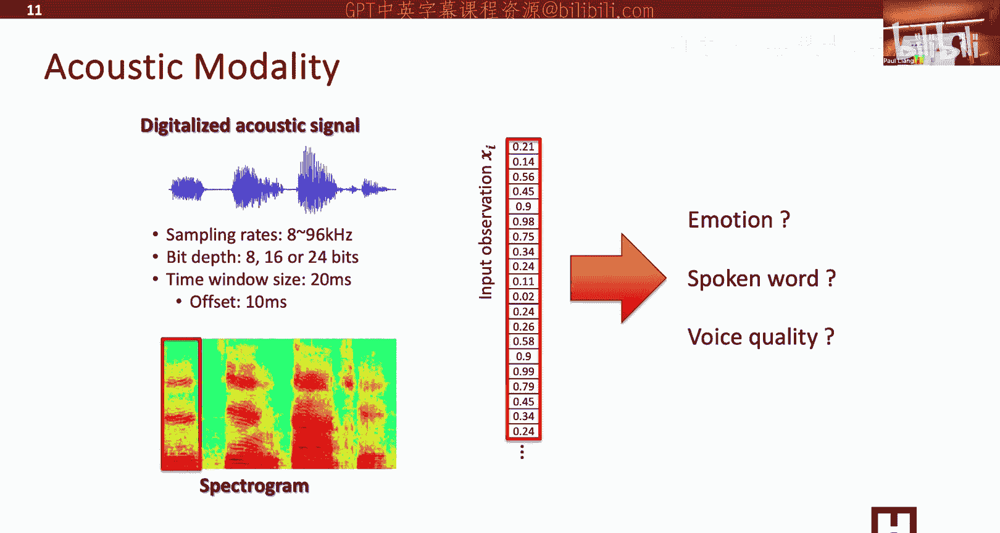

做一首 audio个 mod。Sensing modality， so if you're working with robots or environmental sensors。

 you often collect data across time you are measuring some particular physical phenomena across time and on the Y axis you're showing how that sensor varies So we here is an example of a force toque sensor that is often applied a robots where sensing across time and each dimension is some six axis force toque sensor so it's measuring the force across six different components。

Often when you work with robots you also have some internal propoception data。

 a lot of these embodied systems have some internal states within these internal states。

 might measure where the robot is what angles the robot are and are and maybe speed。

 velocity and other parameters that are internal to the interactive agent。So again。

 this is data across time， So there's a T， there's a time dimension， and in this case。

 it was just measuring the current position， X， Y， Z axis and velocity of this robot arm。

 So it's something like T by2。And with all this photo sensor data。

 you can essentially train a model that takes in this sensor data and output something。

 you can output and try to predict what object the thing is grasping。

 and you can predict some property of the robot arm。

 a property of object that's being grasped by the robot arm， for example。

 whether it's a soft material hard material， rigid。

 different shapes and you can also try to predict the next actions。

So that's a current sensor data you might try to predict the next action that a robot should take in order to better grasp the object or to better manipulate the object。

 and that will then give you a new set of readings for the next hi step or a new set of force recordings and a new set of compile section readings in the robot。

So that covers sensor modality。Again， key idea is that now you have some time dimension。

 you probably want to app it to see this time dimension and magnitude of the force。

 and that can be used to recognize things in the physical world and also to take actions so you can see the new occurrences of this data and maybe take actions again。

So that's sensor modality， sometimes people say sensor， sometimes people say time series。

 they're often used quite interchangeably time series is the generalization of sensor data to something that anything that has a time dimension。

So financial data， also as is kind dimension mentioned， and you're measuring for example。

 how a stock price changes， that's also considered time series。

 but you probably wouldn't consider sensor data。So you're looking for models to encode sensor data e search。

 sensor models， but alsoium I series models。

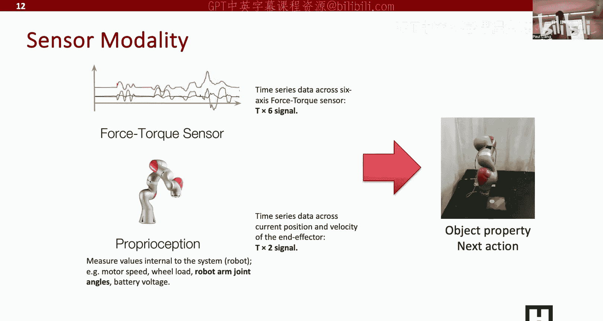

O。Haveular modalities。Here I'm showing a mix of both tabular and timeM series。

 this is a common data set used in a medical domain it's called the mimic data set is two modalities。

 tabular information about the particular patient， so what their age， gender， ethnicity。

 previous medical conditions， all these things that you would typically see in a tabular form。

And at the same time， you were time series modalities。

 so once a patient has been admitted into the ICU what was a ventilation and their blood what was their heart rate across time。

 what was their glucose rates across time from when they were admitted into the ICU to when they were discharged。

So that together， have and time series can be combined to essentially make inferences on many medical medical procedures。

 for example， where their mortality rate is， what disease they might have had as measured by ICV9 codes。

 how long they stayed in the ICU and so on。Okay。So tabular modality is pretty unique in a sense that。

One of the key properties is that you can essentially interchange， for example， any of these values。

 right whether you put the age and the gender first。

 age and gender or you put gender than age technically shouldn't change how you make inference on your tabular data right so if your model is actually sensitive to the ordering within these values then you can be in trouble right。

Another common challenge of tabular data is that data is often more discrete in nature。

 so gender there may be a couple of buckets， ethnicity there may be a couple of buckets。

 so it's not the type of continuous data that we are used to if you're looking at images or sensors so there' are some challengers working with tabular data。

Graph is also another form of data that is quite interesting。

 but I don't think anybody really mention graphs as their favorite modality。

 so graphs are everywhere if you look in a social network for example。

 you don't want to just make inferences on a single person in that social network you want to use that person but also is relationship with other people in that social network so that's an example of a graph who these other people are connected to。

Economic networks， biomedical networks that's very common if you're looking at different proteins。

 you have to look at how the proteins interact with other proteins and which ones is not interacting with so that can be pose as a graph。

And also things like the internet and so on so if you look at graph modalities。

 typically you have a set of nodes， those are individual points in the graph and you have edges essentially telling you which nodes are connected with which other nodes。

Several important tasks on graphs。Note classification。

 so can you classify some property of each node， for example。

 in a social network can you classify each person as being more positive or negative or maybe their political status right leaning left leaning that's a property of a node。

 but you can' just use that node to make their prediction you probably have to look at other people they're friends with or other pages that they click on in the social network to make inferences on that person。

Li prediction， so given two particular nodes are probably that they might be linked together。

 for example， given to proteins， the likelihood that they will interact with each other or bind with each other。

 given to people in a social network， the likelihood that they were bigger friends with each other。

So those are more classification tasks on graphs， there's also a lot of tasks which involve using graphs as a database of data and using that to improve other things。

So if you're looking at you know， building a question answering system。

 a lot these early question answering systems like IBM Watson， which was superhuman at jeopardy。

 these question answering games， they had a big access to knowledge graphs of all this kind of common sense knowledge that you would need for these tria games and they essentially queryied these knowledge graphs。

 retrieve answer that they could answer these questions in real time。Nowadays， of course。

 people use large language models， but there's also lots of work on the hybrid between large language models where the knowledge is stored within these parameters versus explicit knowledge graphs that you might want a large language model to really query and retrieve answers from。

Soal networks for sentiment analysis and so on so lots of opportunities in just graphs itself making emphasis on graphs and also using graphs as an additional auxiliary modality to make predictions on other tasks。

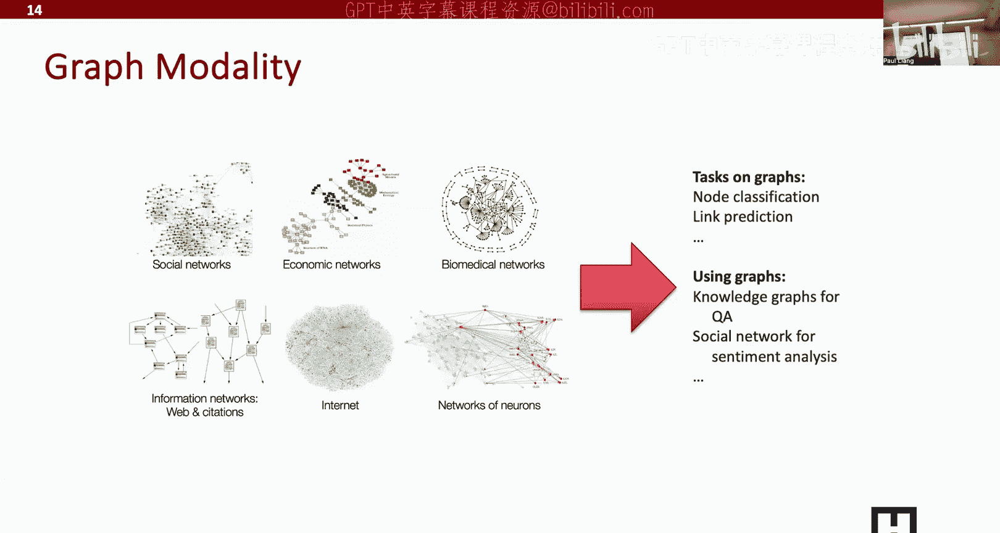

Okay， set modality sets， so set modality share some commonalities with tabular modality。

 so you might have some group or some distribution of objects where again。

 each of the objects are important， which objects are in the set and not in the set are very important。

 but critically the order of elements within the set is not critical right so over here。

 I might be looking at a bunch of celebrity images that a common task lots of machine learning data sets for those and you might be trying to classify some properties with what color hair what color skin。

 maybe age and so on， say by about set of objects， but whether know this celebrity appears first this other celebrity appears first is not critical。

 In fact， if your model is sensitive to the order in which these images appear。

 the model will not work as well as one that is not sensitive to the order。

To get us sets what you can do， you can。Deect anomalies， right。

 figure out which people or which image does not belong long in that set of a set of images。

 you can expand do set expansion， so if I want to generate more images with a particular property。

 how do I sample more elements in that set？And we talk about sets。Point clouds is another example。

 so we saw 2D images。Just hide and width point clouds are essentially 3D versions of that。

 so it's called point clouds because each point is X Yz。

 that's why you have this two dimensional nature and clouds because you have a bunch of points where the order isn't important。

 particularly set of points allow you to kind of reconstruct and visualize these 3D objects。

So point clouds。Again， so if you're working for example some 3D representation you will often be represented as point clouds。

 you might want to do more sampling， for example I want to sample different you know chairs in different 3D orientations following this semantic category of a chair that's an example of a point cloud expansion task you might want to classify which particular object you might want to detect anomalies in these 3D objects that's all tasks on point clouds。

So to summarize， you know， set modality also very important。

 key difference is that you a bunch of elements in the set or these points in your point clouds。

 but the order does not matter。So if you build a model which is sensitive to the order of the elements you set or a point in your point cloud。

 then you're essentially not leveraging your data enough and your model will not work as well， okay。

We'll make all of these ideas about no。😡，Models working well and not well in the next lecture where we actually discuss the specific models。

All right， so there's a quick glimpse at all the data forms that are out there。

 completely non exhaustive and also the tasks that are out there。So， oftentimes。

I like to generalize things that are come up with a unified framework。

 so I'm going to call that modality profile， given any particular source of data from any modality that you end up collecting that you end up labeling your data for。

 it's only useful to think about several dimensions of that modality。

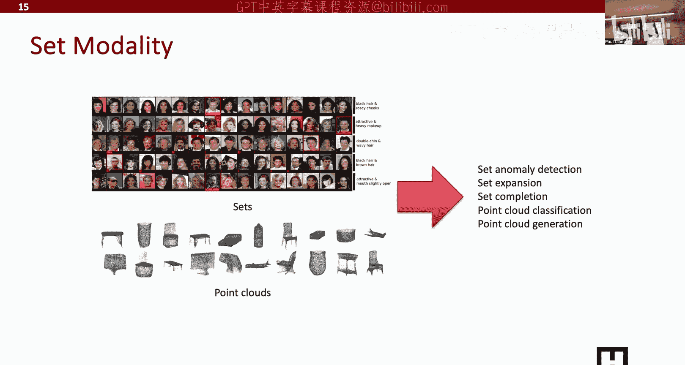

So I call that a modality profile， roughly speaking。

 it is the unique qualities and structures that are unique to that modality。Okay。

 so let me show some examples of what dimensions would fall under this modality profile using these two examples。

 one from the visual modality and one from the language modality。

And you can see that these two are correlated， so this is kind of a rough caption。

 a teac on the right of a laptop in a clean room， it is a rough caption for this image。

So what goes into this modality profile， how should I start reasoning about the data？Well。

 one first dimension that is very important is the distribution of individual elements in your data。

So I have this image and'm going I start realizing that one element is the sofa。

 one element is a keyc， one element is a laptop， one of them is a table right same thing for language you know there are some soft words that I might not care about of in these are not very important words。

But there are some key words， you know key elements within my sentence that I care about， modeling。

 teaika， write laptop， theme room， for example。So I'm going to start reasoning about what these elements are and specifically that distribution。

Whether they continuous distribution， whether the discrete and what their support is。

 so what are all possible elements that I have to capture。So an image will be both three。

Bounding box regions and in language it might be those words。

So the first thing I' got to start looking at is how do you model these individual elements。

 how do I learn a group representation that actually captures this this being a laptop even though it's partly included by the TA。

 how do I learn a group representation that actually captures this as being a visual representation of a sofa with all its properties？

And same thing， how do I learn the write representations for the elements in language？Okay。😊。

So first I mentioned the elements， what the distribution is。

 and how it could potentially represent these elements。So second dimension is set of granularity。

 we thought what the individual elements are， but now how frequently do these elements occur on images you might see a couple of objects per image doesn't seem to be very cluttered。

 maybe they' like three four primary objects of interest。And maybe in the text， again。

 whether a person is speaking， they might be words per minute。

 if it's a sentence or a paragraph or a document is how many words I might care about。

So that was also influence。And the granularity will also influence how we subsequently designed models that after having learned representations of the individual elements。

 compose these representations across their granularity and frequency。So a third key idea。

 a third key dimension is that of a structure， right a structure essentially tells me how these elements compose will form higher level information。

And we started with this bottom up process， we looked at these individual elements and represented them and looked at their frequency。

 but eventually you got to learn a representation of the entire image or of the entire sentence or entire paragraph。

So the structure essentially tells you how these elements should comp to get higher order meaning to form higher order abstractions。

So an image is often a spatial structure right we're looking at elements of images in relation with each other spatially right the chair is in front of the table the teac is is on top of the table the laptop is on the left of the teac and so on it's a very spatial arrangement and you should take into account the spatial relationships when you're composing these elements to form image representations。

For for language， depending on philosophy， some people think language should be composed hierarchically through a grammar。

 where you have to first look at a teacup that's a noun and I don't know。

 I don't know what deep stands for but some precursor to re noun the right on something some people think that language should be composed by looking at words and hierarchically composing them to form higher order meanings through some grammar so there's been lots of work and for example。

 building neural networks that respect this grammar。

Very chosky way of thinking about things Of course nowadays people know that empirically what works best may not be exactly to respect with all this grammatical structure。

 you can just simply treat it as sequences maybe one sequence and use something like a sequence model transformer other of them and that can work well say for other things you know if you have a graph or a tree there might be some certain structure in which your elements are composed to form more abstract representations and that's something you should design your model with respect to。

Okay。😊，So that structure， so you looked at the individual elements， how we represent them。

 the frequency of those elements and how these elements combine， what's the structural combination。

Oftentimes we also care about the total information， sorry the total information in your modalities。

 so this you once you combine them before more abstract high level representations。

 what information does they provide and what inferences can I make on these images that I care about。

 what inferences can I make on the sentence that I care about。So naturally。

 some modities would have more information than others。Actuallyat。

 some of that have more information than others。And oftentimes。

 these modalities can also overlap in the information that they have。O。😊，And lastly。

 one dimension that we typically don't occur don't think about。

 but it's also a very important set of norm when you start collecting these modalities from some sensor。

 they're often going to be imperfect so cameras are going to be prone to to jitters and shakes and olusions。

 language if it's being typed on a computer is going to be prone to various typos if it's being spoken is going to be prone to know different mistakes that people make when speaking and there's often a unique pattern to this types of noise。

So thinking about what types of noise could potentially occur in your data and also actually occur in your data is also very another important dimension when you collect it and work with it。

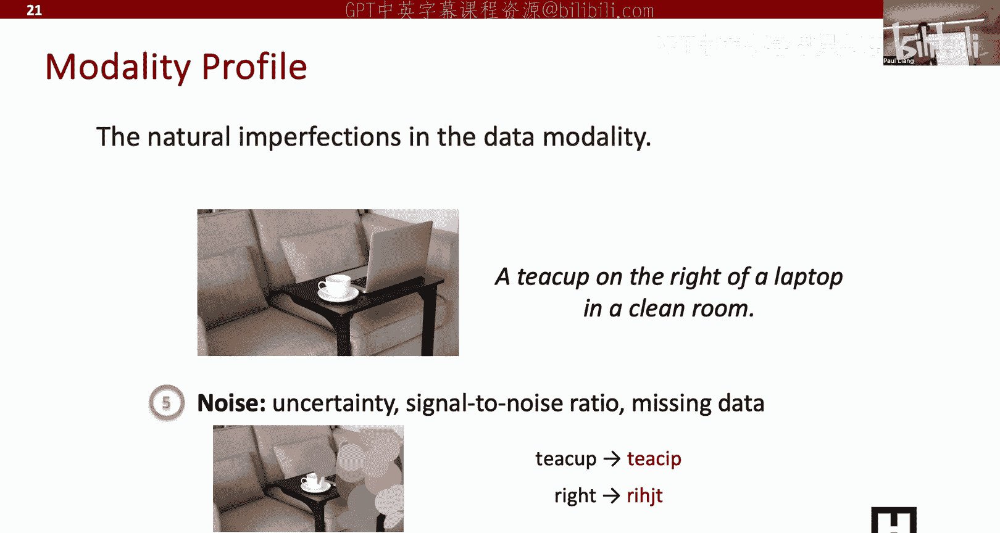

O。😊，So there's a summary， a summary of various forms of data。

 non exhaustive and also a general view of。Different profile。

 different dimensions that it' often very useful to think about when you start collecting data。

 what the elements are， so that's just one element of data， their distribution and frequency。

 how this structure emerges when you compose them into higher level abstractions。

 different forms of information， whether there's noise or imperfections and what those are。

 and also I didn't really cover this but how relevant it is to the task。

 that you care about predicting。嗯。Okay。So that's data。So now that you have data。

 we often to talk about learning， right， how do you learn from data？

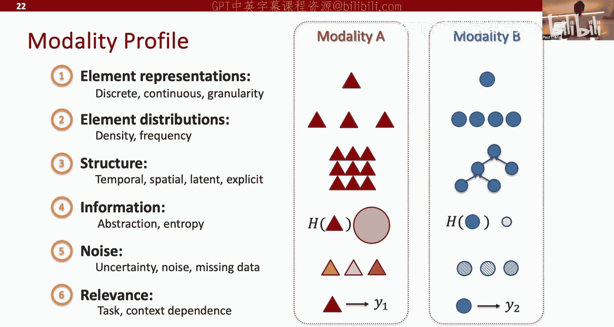

And I'm borrow some slides from introductions of machine learning here that I'm also teaching this semester。

 but there's generally three types of learning paradigms at a high level okay these are non- exhausthaive。

 they also overlap with each other that things in the middle and they're constantly expanding。

 but it's usually useful to think about you know three types of learning objectives。

 supervised learning， unsupervised learning and learning。啊。

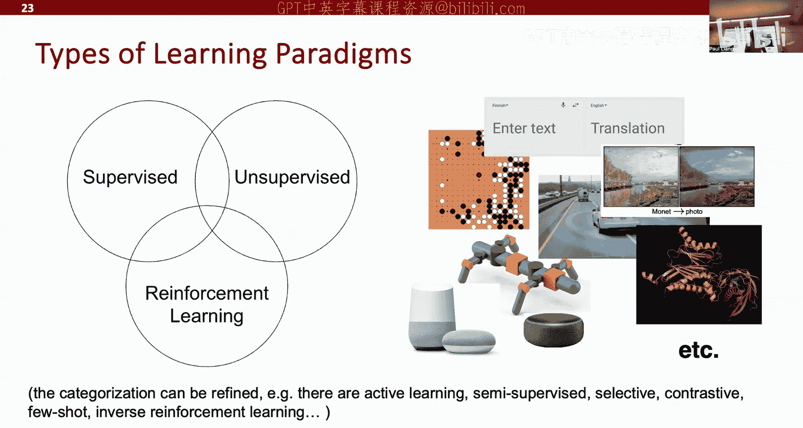

Supervised learning essentially means that there is some supervision for your data。

 so raw data comes in， supervision usually comes in a form of some labels。

 something that you want to predict for your data。So you might have a bunch of images and you have labels for what objects are recycls images。

 cat dog， table person， pretty easy， you might have a protein structure and you have some labels on which proteins it interacts with or which proteins it find with。

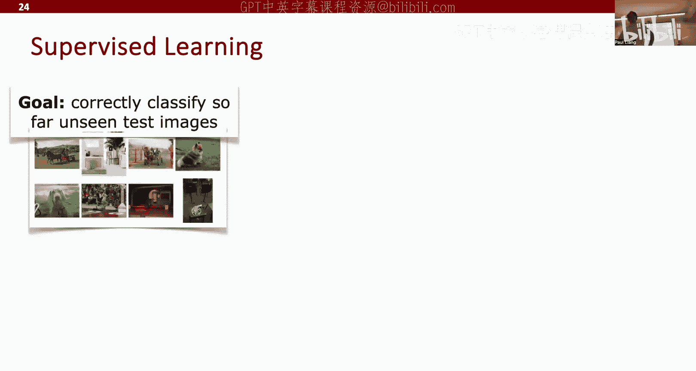

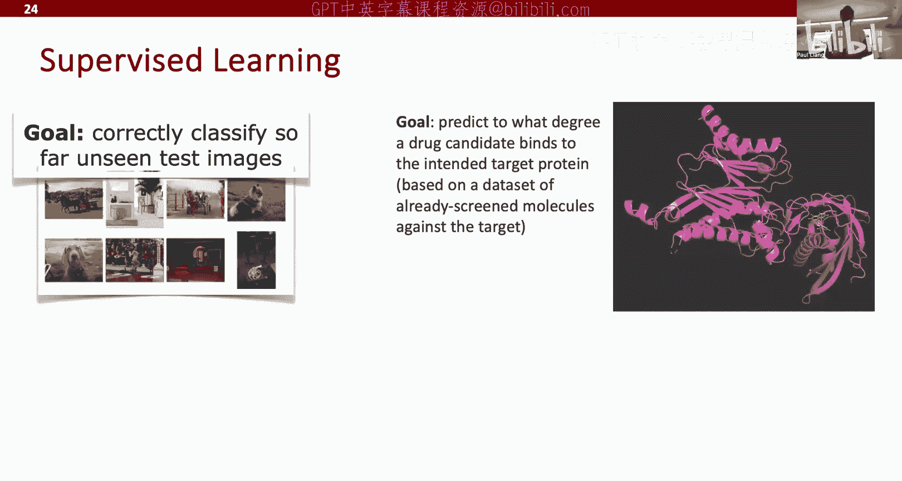

You might have a sentence in one language， for example Spanish that's your input data and you might have labeled for what is the corresponding translation in some other language so all these are examples of supervis learning name we have data X。

 we have labels Y， you're willing to provide that supervision， how do you learn from it。

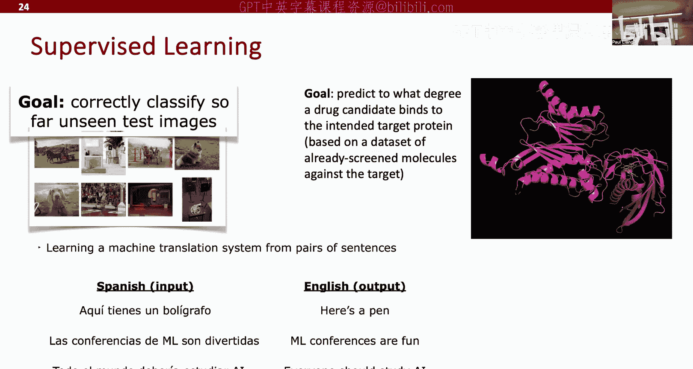

Unsupervised learning is different so un basically meaning no no supervision so now you have data but you're not willing to provide the supervision in collecting the labels because maybe annotating a data is expensive or requires lots of human labor or the labels themselves may be very subjective like a person's emotion may be very subjective。

So then you might want to do unsupvised learning where you only have the data X and you're hoping to learn some features that might eventually be useful for labels that you're willing to collect or for some other tasks。

So several types of un supervised name， you might just care about reducing your dimension。

 visualizing your data in lower dimensions doesn't require a label just can be done with your data。

 so can you visualize words these like award word namess and they have some structure because certain countries are grouped together。

 certain words are grouped together。

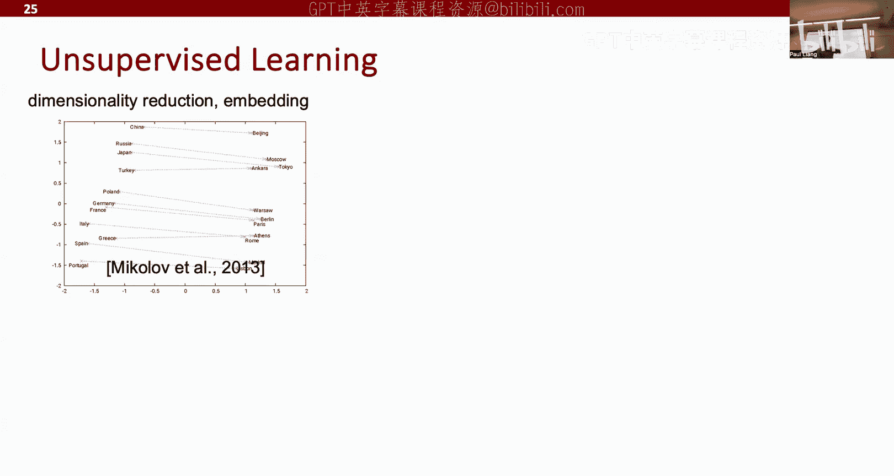

You might want to train generative models， so if you have lots of protein data。

 but you don't have labels for what these proteins are or how they interact with other proteins。

 you can still learn a model that essentially estimates the distribution of your proteins and maybe generate more of them。

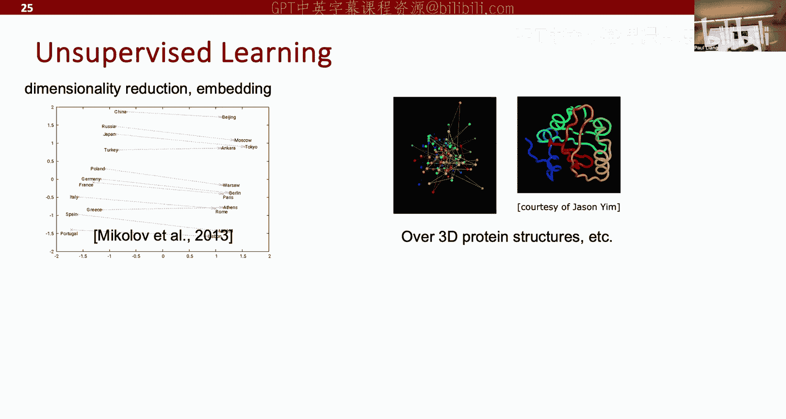

You've also seen that images， right you pun of images。

 you don't want to label the fact that there's some dog inside。

 you can still take lots of images and train a model that is able to generate new images。

And of course， nowadays， unsupervised learning and supervised learning have really intersected with each other with this idea of selfsupvised learning。

 so you might have lots of data， unsupervised no labels， labels are too expensive。

 but you can still define some good training objectives on your unlabeled data to learn these abstractions。

 these features that can be done。Transfer or find you where you have some little amounts of label data and supervisor。

 sos some intersection between them。One example is this right。

 these are images of dogs if you're successfully able to learn the distribution of all dog images。

And generate new dog images， then those teachers are likely going to be very useful in predicting and identifying dog images。

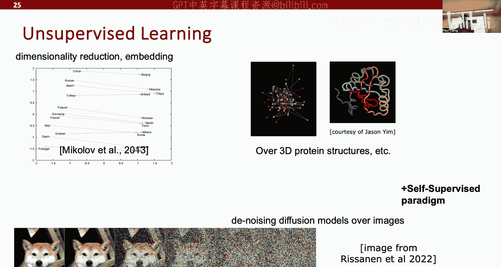

O。😊，Third learning Para reinforcement learning， well。

 supervised unsupervised learning typically looks sad。Hoasks that involve a single step。

 So you make a prediction you're done or you generate another sample and you're done or you visualize your data and you're done。

 reinforcement only looks at problems that often occur across multiple time steps。

 So games are a good example of this。 If you want to train a system that is interactive。

 I can play a game like chess and go。Then there's usually some state of the game， for example。

 the current state of the chess pieces， some actions that you're taking， for example。

 playing a particular move that transitions into a new state of a game with a new configuration of chess pieces in which you might want to take another action and so on all the way until you've won the game。

A key difference in this multistep process is that we can no longer maximize and choose the best action in a local step。

 there might be many cases where you take suboptimal action in the short term to gain longer term better actions in the long term。

So that's one of the biggest challenges in reinforcement learning。

How do you press for both short term for actions to get long term really good actions？

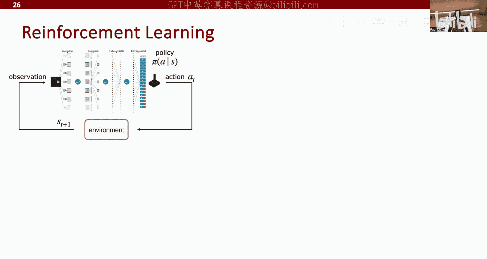

We see them in games， we see them in robotics， and nowadays we also see them in large language models right you can think of these large language model interaction with humans as some multistep interaction where you might prompt it。

 give you an answer， you prompt it again， give us some answer and this dialogue across across multiple steps and your goal is to really maximize your long-ter reward。

So there's lots of work as you and might have seen on applying reinforcement learning methods in order to maximize long term interaction quality between humans and elements。

 and we'll cover some of that in the class。Okay， these three might be pretty trivial， most of you。

 some of you might have seen them before more learning paradise that I also want to quickly cover these are very useful as you start looking at your course projects and thinking about what forms of data you can collect so they fit into one of these current ways of learning from data。

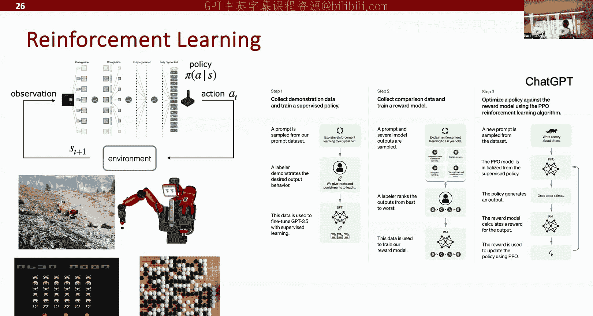

So you saw supervisorvis name x comes in bottle predictx y。

 so you need data that contains both x and y paired and labeled data with x and y。Of course。

 this is a multimodal learning where you have multiple access that come in。

 each of them providing complementaryary information and you might make some inference on why this of course gives you more information that x and X1 x2 are chosen well。

 but now you need data with X1 x2 and Y right so there's more requirements on the data that you need and oftentimes less data。

There's also multitask learning where X comes in and you predict y1 and y2 together。

 leveraging the fact that two tasks are complementary。

 so for example you might want to predict the emotion of a person but also predict the stress of a person these two tasks are very often related to each other。

You might want to predict you looking robots， some properties of the object and also taking next actions to manipulate the object。

 again， those two tasks， although one is a label and one is the action are related to each other。

So monitor learning， if it works well can work really well， of course。

 limitations is that now you need x and y1 and y2 together right the data and both labels together。

 which again could limit the amount of data that you have。Transfer learning is slightly different。

 so you might train a model X on your first task to y1。Train that model。 and then。

Take that model that you've trained and transfer it to the second task。

 so continue creating that model on the second task Y2。

So slightly different from multitask learning because now you're doing things in two stages and for the first stage you need x and y1 data for the second stage you might just need x and Y2 data。

Also very common， this two stage process is particularly useful when you have an unequal distribution of y1 and y2 axis。

 so let's say by train an image model to classify natural images。

 you can get tons of bad data from the internet， you can get tons of labels of natural images。

 but then I want to transfer to some medical image， medical image collected in the hospital。

So you're going to have much less medical images and medical labels。

So transferary allows you to deal with that asymmetry。

Acrossmodal learning is kind of the extension for different modalities。

 sometimes it might be very helpful to train x1 modality for y。

And transfer to x2 modality for y or maybe a slightly different y so crossmod the input modalities are different and when you're doing this idea of transfer learning nowadays x1 could be language you train other lamps for some task and surprisingly these other lamps don't just transfer the language they can also transfer to code to math to protein structures to genomic sequences even to sequences of robotic state and actions。

Even to you know game states your transfer go to a bunch of things right so how can we push the limits of cross modelal learning？

Okay， so different modalities。Are you doing this transfer？Of course， can combine this。

 you can do cross models so modities are different and also transfer。

 so the tasks are also slightly different as long as there's some relationship between them。Okay。

 unsupervised and selfsupvised pretraining also very common it's an extension of transfer learning where instead of training your first model in a supervised manner from x to y1。

 you're doing some unsupervised learning on your first model， so x to x prime。

X prime so x so in this case you see that in this first step you don't need any in labels or you need is x and x prime is in effect this you know self supervised label that you've created。

Several ways of doing that you can use the left half of an image to predict the right half of an image。

 you can break your image into different parts and like a jigsaw puzzle and have the model recreate which puzzle parts should go where to recreate the full image you can use you know the first five words predict that six seventh word autoregressive generation you can rotate your image or add noise to it and try to remove that noise or unlimitedrotate that image so lots of ways as long as theres some relationship between x and X prime then you can do automatically you know do it on your computer and you can essentially have unlimited access to pairs of x and X prime so you can prepen your model。

Okay， and then usually those features， if designed well。

 are going to be very strong because firstly you have lots of data。

 there's a lot more of x data than X Y label data so you can leverage lots of data and if your features and your x to X prime is designed well then it actually learns very good features they can then be transferred to some task Y。

Okay， so we call that unsupervised or self supervised freetrain。Any questions so far？Yes。哦。

So in the reinforce learning， you mentioned LM。 so my question is for LM right so you mentioned it always often involves multiple steps right with human interactions。

 but isn't a goal of LM to generate one great answer。

 That's why we have the R right we make the answer great in one ground rather than having fact important vision LM also for LM right in other to so for the reinforce learning of the objective functions right but for LM。

 there's no objective function， we don't give feedbacks right like all this part one this minus one So how。

So do you think in a future IM should have object function and then that would involve multiple staff in order to achieve the overall。

I'll direct to。I mean， great questions and will discuss this much more we you look at LLMs。

 but I think short answer to your question， of course you want to maximize the best response that you get in one step but oftentimes an interrupt LLM I don't mean asking clarification questions if you have clarification questions can make a multistep that's not good。

 but oftentimes you get a good answer you keep talking to it So there's gonna be some natural longter interaction which you can model using reinforcement learning Okay。

 reinforcement learning can be one response but where each of the steps are one word。

And the whole response can be treated as a R multi step problem， it can also be multiple responses。

 each of them treated as the one response， one immediate response that also gives you a multistep problem and for rewards。

 I mean there are tons of work where people rate good。

 bad or evaluate the quality of LLM outputs and all that human supervision goes into the reward function to better tune these LLMs。

So that's also very common， of course it'd be great if some of these metrics are automatic。

 but most of these current methods and ROHF still relies on some amount of human supervision and human feedback。

Okay。Yeah， well question you're going the South training so the model of that is training the first step without labels or for the second step。

 it isn't just using the same s block or is it also including like adding honored blocks at the end or conjunction for a second step。

I've seen all of them so you can be most of the block if probably want to keep most of the block it this is a big model。

 but once you bring it here you might train a separate linear classification head。

 you might you know adapt some of the final layers of the model you might do low rank adaptation so there tons of ways。

 but as long as you kind of preinitialize it well。And you bring it over。

 then with some minor adjustments to it。 Okay hope is just do something minor， right。

 You don't have to retrain entire model， find to an entire model。はい。ok。

More interactive learning paradigm so that was mostly just nonin making predictions。

 but interactive learning paradigm so we saw RL where X your data or in RL usually call it state comes in。

 you might take multiple actions because multiple states。

 there's multiple you know multiple observations and multiple actions that you have to take。

And you might eventually get some reward， your goal is to maximize this long term reward。

 so you want to think of RLS you know multiple actions， multiple steps。

LLM adaptation is also something that's very common to make models more interactive。

 you might have some model that were supervised in nature X Y， so x predicts Y。

 just a category or a number or classification， you can start adapting LLM so that you' model and output something in language。

Right that can be very useful because now instead of just predicting whether it's a cat or dog。

 you could then maybe ask footballball questions， right。

 what type of cat it was what kind of dog it was， You can also maybe even prompt the model to。

Explain why it was a cap， so the model identified that it had four legss with different colors and so on。

So essentially adding language to the aqua space by using allMs makes your model more interactive in answering all about questions or even explaining its decisions。

Of course， how to do that perfectly， robustly without hallucinations is still a question。

Curriculum learning or active learning， this is a very common paradigm where let's say you want to have some tasks why that's really hard right so you you just train a model on why the model is going to be terrible so what you can do is you can first supervise the model with some tasks that are easier。

Just like how a student learns student learns from some curriculum from easier tasks to more difficult tasks。

 so how to choose that curriculum is an open question。But there's to of work on it。

Active learning is a similar paradigm where you might first have your data。

 a model make predictions on easy data， and then based on the current state of the model。

 you will then will search for increasingly difficult data or increasingly difficult tasks for the model you tackle。

And finding human your loop learning， everything before was mostly just done automatically in a computer。

 so of course as many settings in which you have X to predict some label or take some actions。

 there's some human feedback that's in the middle of it which can then be used to train a model for new access and to make new predictions so this can be done iteratively to as many loops as you need until you are satisfied with the performance right。

So啊。It can be raw human feedback， or perhaps after you've seen enough human feedback。

 you can then train another model to mimic how the human gives feedback so that can be a way of automating from some human feedback to eventually automating and predicting how the human would give feedback。

O。😊，So let me just finally go through several other important tips。

 so we looked at different forms of data， how you should think about the properties of the data you're collecting。

 different learning paradigms to learn from data and find a learning process so。Essentially。

 the whole goal of machine learning AI is to find a good way to model， learn relationships。

 to learn features from your data。And oftentimes you consider a model or a class of models。

 so a class of models could be a class of neural networks， lots other lamps。

 a class of linear functions， a class of decision trees and so on。So this， for example。

 it just in one dimension， if you have x， you have Y， you have some data with both x and y label。

So data and labels， youre essentially learning a function that learns the relationship of your data。

So you often see these blocks where x comes in， you learn some function F for H。

 and you make predictions y。So in the next lecture， we'll look at， you know。

 essentially how to define these models， what these models look like。

 how well your model basically performs really depends on how you choose the model or how do you define the parameters of the model。

But before diving too much into the model itself， how do you even evaluate？

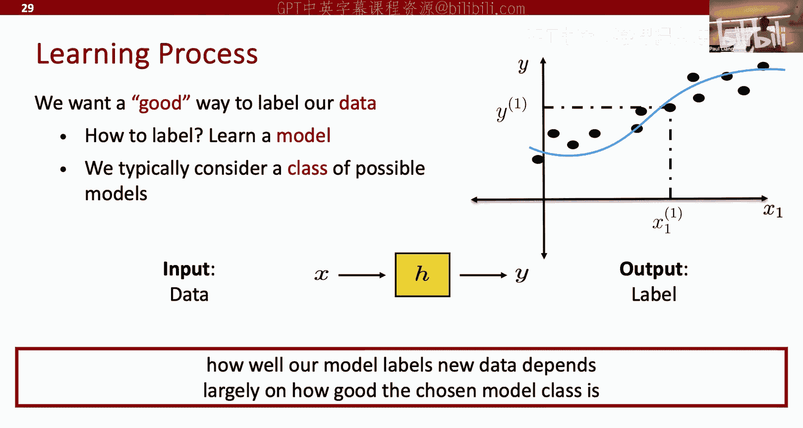

How good a model is， right， So there's this often problem that you see called overfitting versus generalization。

The real goal is to generalize to future data。In machine learning。

 we talk about all this data that you've collected。Unice。

 you collected a bunch of images and you labeled them for different objects in it。

You're essentially training a model on their data， but your hope is to generalize to new data， right。

 if I take a photo of a new image tomorrow on my camera。

 I want to be able make that prediction if I have someone interacting with my other， you know。

 tomorrow or a year from now， I want L them to do well on that interaction。So there's risks。

 you know sometimes the model doesn't， we might capture the relationship。

 so that's the X and y relationship over there， you learn this function that's called underfitting so it's not learning the relationship well。

 your model or workbe， and if it's really cap the relationship too well。

 we call that orbit so it's already specializedize to your training data and it might not generalize to actually when you deploy your model on test data。

So this blue curve is clearly overfitting and fitting too well with the training data instead of actually have you a smooth relationship。

So that's a worry。And generally in practice， you would collect your data。

 you would split it into training， validation and testing。

 this is mis meant to simulate this notion of collecting data to train on before testing on new data。

AndYou're essentially training a model a training set。

Validating tiny hyperparameters on a validation set and measure how a model does on a test set as a mimic for how the model would do want true future data which you don't have yet。

Okay， and of course， it's critical to make sure your test data conditions match as closely as possible to the conditions in which you want to actually deploy a model in the real world。

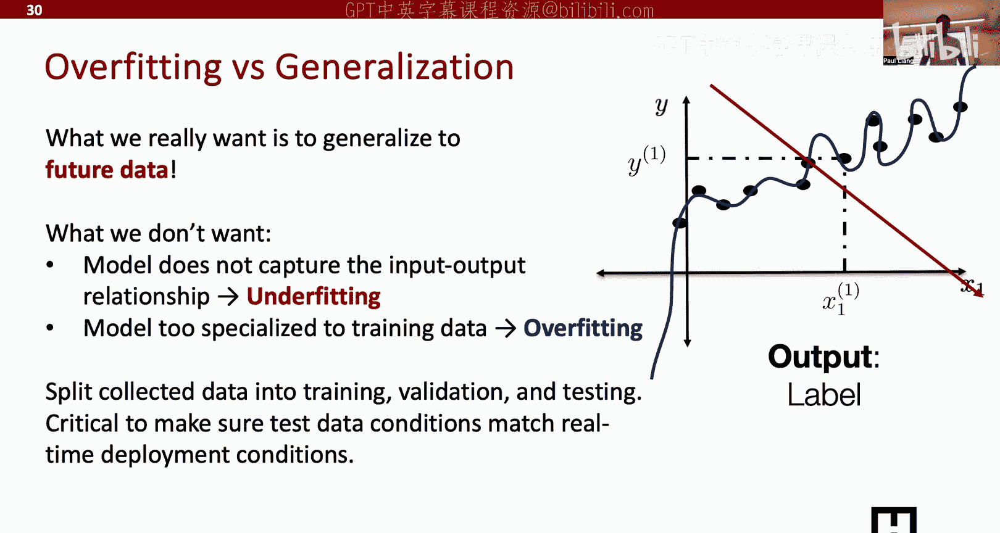

Al right。So summary， how to data， I'm going to add every slide， how to something。

 but this team was data or how to data。Firstly， decidete how much data to collect and how much to label。

 assuming that you are going to collect labels well take into account the costs of collecting data。

 the cost of hiring human annotators to label the data and monetary costs， time costs and so on。

Clean data， usually there's some normalization or standardization of your data they need to do so that everything fits into a good range。

 find noisy data， detect outliers， anomalies， there's all packages to do this。

Visualize your data not many people do this enough。

 but you want to plot it right if my this is x1 and this is y I app plot it I know that I'm looking for a linear relationship between x and y so that gives me the idea of what model to design。

This is a 1D， so it's easier to plot what of your data is in higher dimensions and there's ways of doing dimensionality reduction called PCA。

 TS andE to basically identify the clusters right do my data even fall into the clusters that I want to predict in the first place before I design any model on them。

Are these sort evaluation metric？What is a good way to evaluate how good a model is。

 whether it's something that wherever between doing prediction of a continuous value。

 whether it's a classification error， or maybe something more involved like a user study or usability test simply you also want to look at proxy metrics and real metrics if your real metrics is how human uses in the future you don't want to iterate with humans when you're just designing a model。

 you can use it to get some proxy metrics which are approximations of the real metric。

And quality measures single quantitative and qualitative。

And then and only then you would choose a model class learning algorithm and do the machine learning no starting with this。

 one， two， three， four needs to be done first。

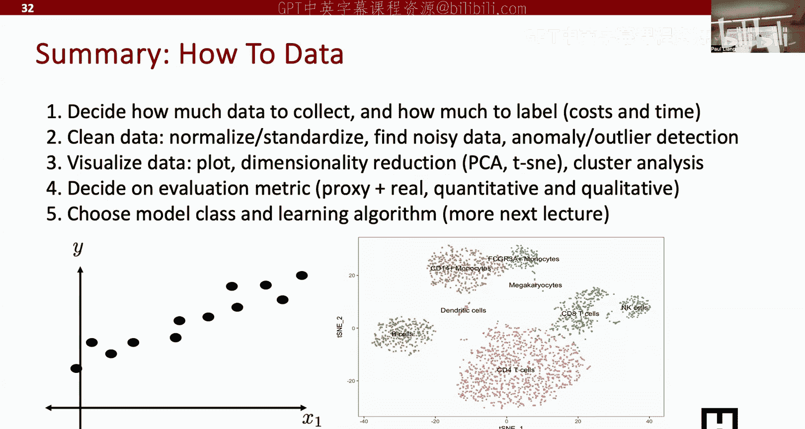

Allright， so to summarize， look at several examples of common data modalities。

 We give a unified sing framework on how we can think about the dimensions in your data。

 We looked at types of data， labels and learning objectives and also。Challenges with， for example。

 overfitting underfitting and actually generalizing to real world examples。

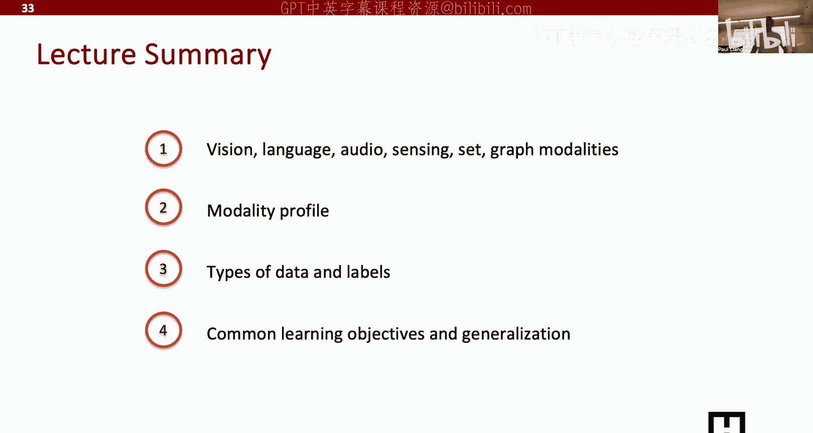

So assignments for this coming week， so no reading assignments yet， that's going to start。

 I think next week， make sure you fill in your project preferences form by today to give us an outline of what tasks and data and teammates you're looking at。

UmIf you haven't found a team yet， please you know maybe go outside and mingle and try to find people with similar interests。

The project proposal for the patient will be next Thursday。

Roughly five minutes per team we' give out the instructions and for this Thursday。

 we're going to have a tutorial by some of my students on ML tools and practical tips for training and debugging the pipeline。

All right folks， and for today and Thursday， if you want to meet about the projects。

 I'll be my office say some time on two to three today and two to three on Thursday so we can discuss your course projects if you need any feedback on it Al right。

 thanks everyone。

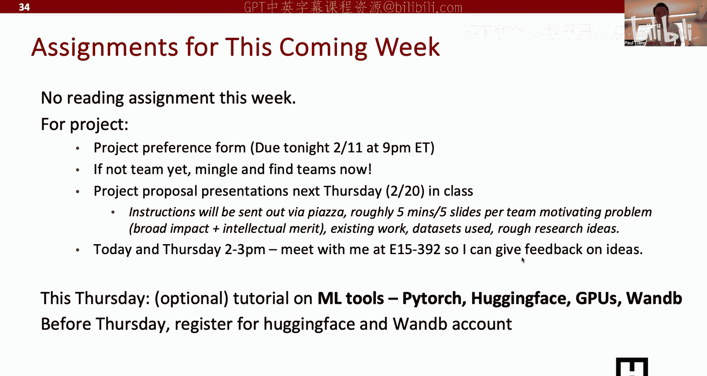