# 《如何AI所有事情｜MAS.S60 How to AI (Almost) Anything》中英字幕（Claude-4-s翻译） p04 [04]Lecture 2.1 – Practical AI Tools.zh_en [BV1UhawzQErD_p4]

Okay， everyone。Welcome back。So today we're going to have a presentation by some of the TAs if you don't know yet this is David。

 one of the students working in my group who's helping as a TA in the course and Chanaka is the other TA。

 Chanaka will also be presenting later in the lecture and so make sure you're familiar with their faces because they're going to be having office hours you're going to be helping you with your projects they' are going to be moderating or the readings and discussions。

The before they get started a couple of logistic saying first of all。

 make sure you've submitted your project proposal project free proposal so theres a short form for you fill in your teammates and your preferences I've shared the responses with everybody on Piazza so we don't have team members yet and you look locate it from a team use that spreadsheet to maybe reach out to people who have similar areas of interest okay and the first assignment is that next Thursday we'll be having project proposal presentations so by then you should have from your team decided on an idea and it's basically a five minute presentation per group to just quickly run through what you want to work on what ideas。

 what data sets you're going to use and to get feedback from the course so those instructions around Piazza exact grading instructions for that proposal presentation and the following week are going to submit a short report for that proposal so just the text version of that so that we can create and get feedback okay so remote fill in that form to help look for teammates。

Also to start working on the project proposal presentation and reports Okay。

 so David and turnga today we're going to tell us some tutorials on practical tips for high charginggging phase。

 building， iterating and debugging your ML models go ahead。Right。

 thanks for the introduction so I'm David I'm the T for this course and I'm going to first cover how to use password and then talking about how to find a very simple project model on target base。

And before we get started， please open these two links and you should see like two co pages and you can follow along as I work on these co apps。

So the tutorial today aims to make that you started with the patchwork， so if your original patch。

 then this tutorial may not be done for you， but I aim to structure this so that everyone will at least know a little bit more。

Hopefully。So let's get started with hightor。

Is everyone able to open this co lab， okay。对。So first very brief introduction into the Pi work so Pi work is a library that helps accelerate machine learning。

Processes so。The central piece of the pie is tenor。

 Tensor is just like a bunch of richrices that you learn in linear algebra。And。Well， first。

 we need to import the Pytorch。And we， let's first go through some of the simple operations on P。

First， you can initialize。A tensor in several different ways， but if you have a 2D array of like 1，2。

3，4， you can just call like40 dozen0 tensor data to initialize the tensor of that particular data。

And if you have worked with Shanghai， already already before you can。Of course。

 convert the nu array into a tor tensor。You saying the work from Nnhai command。

Excus meCould you pull up the slide Yeah， yeah， sure certainly。

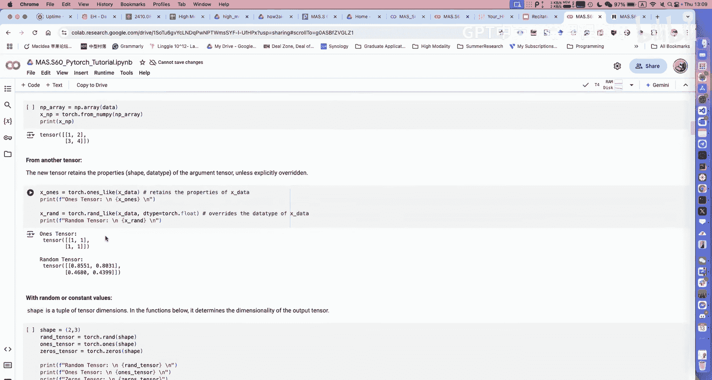

我跟别人认识过。So there a slide showing if we copy this slide。Deice。Oh yes， yeah。

 you can also visit the slide page here。Which contains the。URL as well。

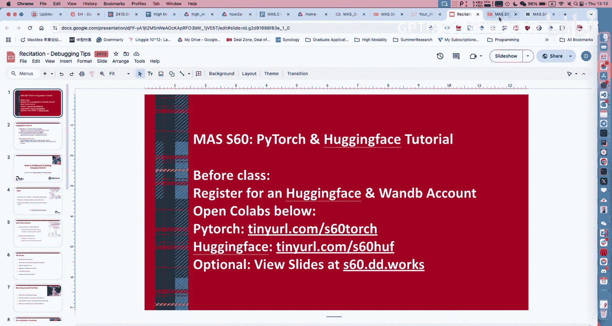

We' just going to a quickly go through this art because that's some basic stuff that's not very like relevant。

O啊。😊，And then we can initialize a tensor of a particular chip if we want two by three matrices。

 we can initialize a tensor。Using the torch dot R， this is a command for initializing a random tens。

 and then torch dot  one tor dot zeros to initial the tensor of particular shape of like ones and zeros。

And one important thing about the canceror is that they have different。Tpes。

 so so you can call the tensor dot D type to see the type of the tensor and one common source of bug when you deal with like machinery models is that the type of tensor is not the type you intended it to be。

 So if you initialize the tensor of like intesor type， you can。

Like multi it with the flow type and then like put the result back into the integer type because that's not compatible。

 So make sure when you know the data， you check the tensor type using the tensor do D type。

 you can just use print or if you're familiar with debugger。

 you can use the debugger to check the type of each tensor。And。

Because password is like a machine learning library， the tensor can be used on like multiple devices。

 namely like the CPU and the GPU。And you can also use the tensor device to check the device of the tensor。

 and that's also a very common source of error， for example。

 you have a tensor of on different devices， one on CPU， one on TU， you cannot multiply them together。

So you need to use some command call like Tensor to device。

To move the tensor to the device you want need to compute。

And then of course we have some very simple operations on tensors， for example。

 if we have two tensors called X and y， you can use x plus y to add them together。

And one thing to note， though， like the x times y here。

 this is not the matrix matrixes multiplication， you know。

 this is actually the element wise multiplication。So you， if you come from like a more of background。

You may know like at times why it's like matrix multiplication is not case in high。In Pi。

 if you actually want matrix modificationification， you use this one for dot M。U。

And that's the common like row M's column as together that kind of matrix modification。

So that's just a very brief overview of the torch operations。

Here I'm going to go through like a complete。Small projects using the small data we collected in our lab。

So in our lab， we actually have a small like male sensor orsome like a bunch of gas sensors that collects smell data from a particular like substance and I think it would be my you can use this like very simple data to。

Build a small project in this tutorial to walk you through the entire process of like training。

 data processing， evaluation of that kind stuff。So before we dive into the model。

 we first need to look at the data and that's something I strongly suggest like。

The data may not be in the format。 you intended it to be。 And that's very common in a。

Both like the data you collected and the data downloaded it from the internet。So from my experience。

 it's very common that like on the documentation page， the data has like this format。

 but after you download the data set it has another format or something。

 so it's very important to actually look at the data before you do any model modeling and maybe like training on that kind of data。

早啊。Here， I run J cell to download the small data we have collected。

And then will download a bunch import a bunch of libraries。And。啊。For this project。

 we are doing like a three way classification of like three spells， which are ambience。

 alcohol and coffee beanss。And then let's run this to load a bunch of like data pass。

 So if you look at the this folder page， if you open the folder， open the small sensor。

 small data switch， you'll see a bunch of like。CSV files that correspond to each of the categories。

 We have more categories， but for this simple tutorial， we are going to only use back three。

Which are like amben， alcohol and coffee beans。And then。

Here we use the O do director to list all the files here。

And then we open a file to see how it looks like。抖音。

Very important to look at the data and from the data here。

 you will see like we have a bunch of columns which correspond to each like。

A particular like gas sensors and don't want to situation with which。

 they will see it that kind of stuff。And。I think it's very important to actually visualize the data if you are working with like time series data。

 visualization is very important because youll see like which data are kind of like relevant to the category and which are not that relevant。

So as you can see here， so this is for the alcohol detection and this is like the region of like each。

以 of the。呃，改 sensors。And we the right region here is the actual reading of the sensor。

 So what we did is that we first collect some like ambient readings in this by region。

 and then we move the substance close to the gas sensor to collect the actual reading of that particular sensor。

So this way we can like eliminate the effect of like ambient factors。

Which are we found to be like very useful for this particular project。So as you can hear。

 some of the guest sensors are very like。Sitive to the substance。And for example。

 like the2 B see this kind of thing and some other stuff are not very relevant， for example。

 the alcohol sensor， I think its not working and。Also we have something like temperature regimes pressure readings these are not very related yes for the state was actually something you were manually collecting or like how was that actually how is that data actually collected Yeah we have like hasn't switch to automatically like switch between state equal one and state equal zero so。

Not automatically any it was like so like you were like having some robot on working looking get it closer prison and that's what state equals one state zero。

That's human art human Okay， so like on a screen， you have01 human Cs1 is like， I'm going it closer。

 Okay， That's right course robot will be great human I wish we will have some robot arms。😊，So。

 so you will see some channels are relevant to the substance and some are not。

 So the question here is like， should we just eliminate this column or should we actually include this in our training。

 So my suggestion is。Very likely， like most of the time you should not need to eliminate any channels because if the channel is irrelevant to any of the categories。

 the neural network will automatically learn that and after the training the neural network should ignore this channel like automatically。

so啊。But these are like something you could keep in mind if the neural network like doesn't work at all。

 maybe you should try like。Removing some of some of the channels。

 but most of the time they is not needed it。So David， if you know the sensor is not working。

 why do you still include that？I think the sensor this sensor is not working in this particular sample。

 it was' working in some other samples so。Yeah， so if you do want to remove a channel。

You should look at all the data instead of like just this one。5。

So basically featuring the array is now necessary in the training Yeah。

 I feel like neural networks are usually like very robust to a noise in one like particular channel。

If the noise are like spread across like different channels。

 that may be a bit too difficult and then we need some kind of like PCA to to remove some some of the noise but for this one you can actually see the。

This data is actually pretty clean， so you don't need any kind of like preprocessing to fix that。

But we did take the average。Of like each period and sometract that with the ambient reading。

 because like we found that the ambient region is actually the in initial region of each sensor is actually very。

Variable， I think stochastic from session to session， so we subtract them。

readings from the MBn ratings to get a relative change so that data is like better that's simple or like when you are。

啊。And this is a part of the prepro， so it's not a part of the data collection process。

And then another thing we found is that like the range of each readings are a lot different like for LP。

 we have like a range between like 0 to 2000， but for a lot of other things， for example。

 the0 to type5 to 100， So this。This tells us one thing is that like we need to do some kind of normalization。

 So this is this is actually one of the most important prepros you need to do。

 because the neural networks。Are not that robust to the rank change。 So if you have a column。

 a channel that's like 2000， very likely the this column。

 this channel will dominate the entire like training process。But you can see here。

After we load the model， I mean， load the data。Comfin the data， split the features and labels。嗯。

Will need some black normalization。So here we use the standard together。

 This is from the circuit learn package。 We use this to transform the X， the input data to a range。

 I think its 0 to1。So that it's more like robust。And then we use data splitting of like 8% versus 20% we use 8% as training 20% as testing。

And then we initial data set and data loader。So if you are not familiar with this terms the data loader。

 the data set actually gives you the data and the data loader is a loader from like I that initialize the multiple like worker process。

 which speeds up the data loading process through like parallel processing and then it gives you。

Data a batch of a time， like each time you ask for the data。

 it they were like sit in samples instead of one sample。

So the benefit of this kind of processing process is that like if you work with like multiple samples at a time。

The gradient， the model calculatealculus， which is like。

Like how to update the model to make it better。The gradient will be like more robust because that's the average across like different samples。

So another like practicalal tip is that when you change the model。

 make sure you use the as large batch size as possible that can。B on like one GPU。

 so that the training process is the most like robust。And finally we can design our model。

 this is just like a very simple like MLP models with stack like multiple linear layers and back norm and red activation。

 so these are like very simple models。That we can adjust here if you wait wrong this sell。

You can adjust layer sizes here we have an input size of 13 and up two sides of three because we are doing like three way classification。

 so these two numbers you can okay， but anything in the middle you can change it to like。

Other values or making art make。So usually like four our simple data。

 would just mean maybe two or three layers， and that should be enough。对。

Yes so how how do you decide the number of layers and the is still or that's I think the good starting point is that you start simple like you just use maybe two or three layers and see how you perform and I will have a lot of like how to debug your model tutorial afterwards so。

Maybe we can discuss more in detail about that later。And then we have a training loop here。

 I don't think I have time to go through all these lines， but the essentially that like。

You get the data the label from the data loader and you feed the data into the model and you compare the model' output with the ideal output to get a loss and the loss after you get the loss。

 you calculate the gradient which tells you how to update the parameter to make the model better and then finally you call the optimizer dot step to actually make the model better and that's the entire life what this says。

嗯。And after the training， we can run the evaluation， which is very similar to training。

 you just feed the data into the model。 but this time we compare the model output with the ideal output。

And we just don't update the model anymore。And as you can see， we've got an accuracy of like 75%。

 which you you， which is kind of okay。And then we can also see， like the。

More precise breakdown of like。Each of the categories。

 you can see like the model has a pretty high recall and F1 score like ambient and alcohol。

 but the model doesn't work so well in like recognizing the coffee beans。And after you've done this。

 you can improve model like iteratively， the way you do that is that you are first identify which。

I great perform the best and which one performed the worst and for the ones perform the worst。

又要看视野来了。Is it because that we don't have enough data or is it because some other things？

And if we don't have enough data， maybe can collect more examples from the top and just how you type the model。

没有。And finally， don't forget to save the models so that you can use them for further analysis later on。

So this were the passwordwork tutorial for like training a very simple model and know escape a lot of things。

 but if you have any questions now is a good time to ask。

Yes what is the row that we're classifying is it a full time series or is it just like a sample from the I think we sampled a bunch of periods as I think one period like1 thems。

And we like segment the entire like reading into these different elements。

 and then we do the correct page。And the classification。

 it's on one of those segments and what1 something or yeah， yeah。

But these are probably design decisions that are super important in your application。

 what is a window， bigger， smaller what's the label with respect to each window。

 and I think they will also skip through how you should split your training and test data they can also be very important for example。

 your test data such that they from the same day or the same within the same hour of click in a sample。

 then it could basically just memorize the sample without actually generalizing to when you want to apply the sensor and a computer day。

All of these hyperparameters， all hyperparameters machine learning are things that you probably have to east and design very carefully about。

Yeah， so， so that's actually a pretty good question。 So when we do the train test。

 we want them to be as like。Those to the real life scenarios as possible。

So if you are going to like train the model on one day and use the model on another day。

 then the train test split should be exactly like that。So you shouldn't use like。

Maybe the first part of the session for training and the other part of the session for testing that's not the model will perform maybe pretty well。

 but that's not that will not translate to the real life performance。

One other example is that we did some data collection in one of the rooms that we have in our lab space and we trained a model。

 but it wouldn't work in some other room or outdoors because it basically was never learn how to differentiate between different amb factors like temperature or humidity and so on so that means you train on something to test somewhere else make sure you collect both sorts of data and split the data accordingly。

Yes。So I'm also going to very quickly go through a model and classification with the random forest。

 So random forest is not like a deep learning model。

It's a very simple model that you have a bunch of like decision trees， decision trees。

 and you use majority version to combine the output of each decision tree。

So this training should also be very fast。 We do a train test， and。啊。With just。

Initialize a random forest cut fire。 This is from， also from the cycle learn package。 And then we。

Can evaluate it here。And then we get accuracy of like 95。8%。

 which is actually a lot higher than thedisciplinary models。

So this also tells us like for very simple and noisy data， sometimes a simple model。

 a shallow like random forest classifier will actually perform much better than like the fancy Gi models which have constructed。

So another practical I。Have is that when you deal with a data that's like low dimensional。

 like each data point is like a couple hundred on。A couple hundred like numbers。

 very likely the model。That will perform the best are like shallow models like canano forests or like SVM。

 that kind of things so。We deal with like that kind of data I suggest you to start with very simple like shallow models before moving to deep models。

Yes， so with this statement of like oh we're like testing it in different rooms and getting like different results is the random force like robust to that or like。

Oh it its like that adding kind of like another。For that I'm not quite sure。

 so I don't see if it has chat data from another room yet at least it's not in this GiHub remote so but in general I think aside from model it more robust noise。

Because like a more complex model， it has a very complex decision boundary and it's more more likely to overfi on the noise of the clean data so that it's not back to an environmental change something。

If but to ask it more a question。None of the models work very well yet you can go to different locations and maybe new outdoors。

Yeah， for sure。Yeah， this is when like you don't have enough data to work on that。

 So if you have like duration data because where you have like very powerful vision coders。

 it will likely work on like any of the data you have but if you have like time series data So this is not very externalizable to other domains。

 so very likely you have a。Very simple model that works under like one environment。

 but doesn't work so well in another environment。嗯。

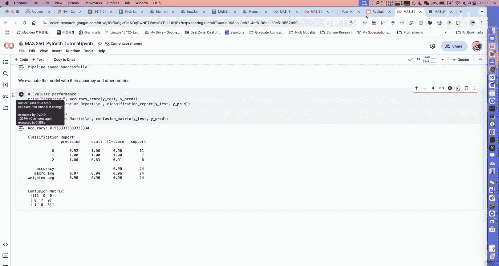

This is for the P tour tutorial。Let's quickly go through the Hu face tutorial before we dive into the。

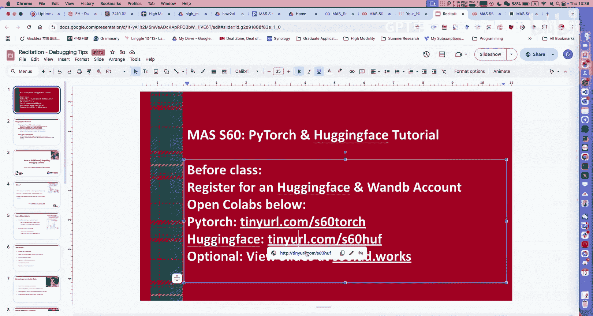

How to give us the model。So the hug phase， you may know hug phase。

 but hug phase is actually not a single package， it's a set of packages that allows you to train larger models with less code。

So it has two main like sound packages， which are transformers and data sets。

Yes they are called that。And transformers provides API to initialize large models with cr wayss。

 so if you work with like large range models， you use the transformer package to initialize the pretrain models and data sets is for you to download public data sets from the internet。

So嗯。You may ask like how how do I choose the models or the data well you can actually search online on the Hugggen face website and see like which models are popular for your use cases and you can just pick one and plugging in the name in your code and you should be good go。

And there are also some packages that's not from Hollywood。

 but it's very popular because it makes the train more efficient， we are like bit and bias。

 this provides function to quantize the large model to make it smaller and fit better in your like GPO memory。

And announcing the fast attention。The flag extension package makes the training process faster and then with best memory。

 Okay， so they' are pretty much the same but。Yeah。😊，And for this tutorial。

 we'll show a large language model with Laura， so the Laura is basically an adapter to train a large language model with less trainable parameters so that you can train it with less memory。

Okay， so let's go to the hug fish tutorial。我 is这。Okay， here。Is everyone able to open this call。 Okay。

 nice， so。Before we use the model， we we need to log in to Hu face using this like notebook to log in。

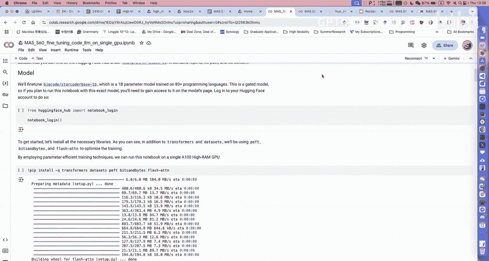

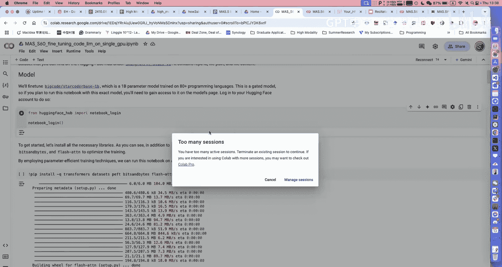

I have  too many sessions， okay。嗯。啊。Let。这享啊哦。嗯去就行。Okay， interesting。I only have one session。

That too many。😀Okay。😊，And before you run this， any of these cells。

 make sure you select the runtime type and select the GPU here。

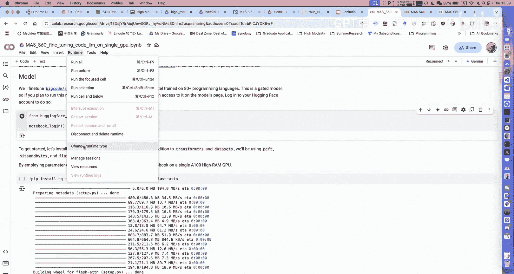

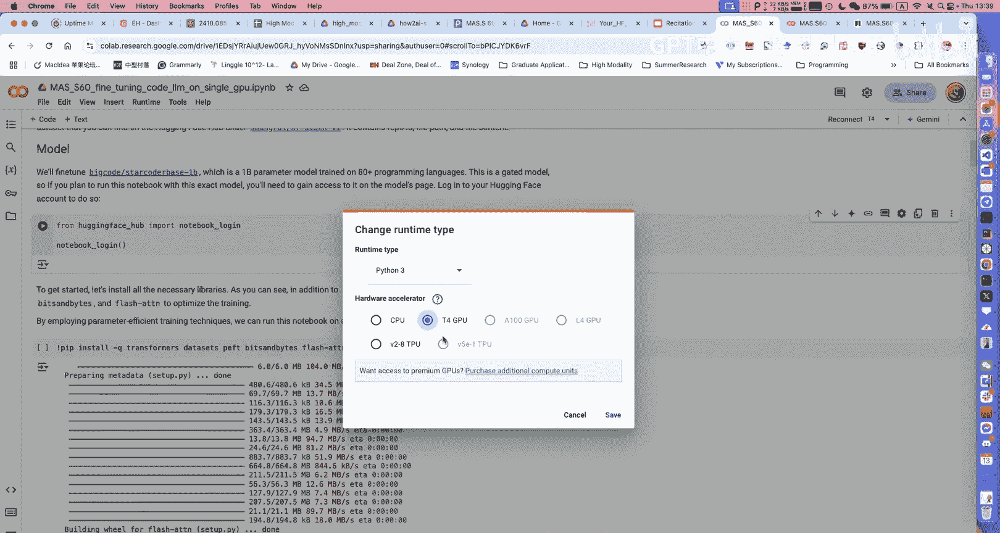

I actually don't think we have time to to complete the entire tutorial because the training will be pretty like time consuming。

 but。Will at least go to the training part。So after you click this cell。

 you'll see like this webage that asks you to input your hug face tokens。

And if you open your like face page， you can initialize create a new token here。

 make sure you select the right if you want to publish your model actually on Hu face。

And we can give the model a name， for example， call。And then， play quit talkingken。

And then we can copy and paste the token here。臭脑筋。So the reason why we want to log in is that like the model we use is actually have a。

Have a gated access。 So you， if you open this page on the cold lab。

 like the big code dark code base 1 B， you actually see like。啊啊好。Of大管 apo like。

Applying for access to the model。 So here I already have the access to the model。

 but if you haven't gotten access， youll need to like agree to their。Agreement and click。

Maybe apply for access， and then it should give you access automatically。

And then we want to install a bunch of packages。 These are mostly the one we talk about。

 which are from the Hu face。And well， it's doing that。

Let me go through a bunch of the parameters here。So嗯。Here on the first line。

 you'll see our model name， data set name and the data column which are which are about like which data we want。

 So were using a model called star code base 1 B， this is a one D parameter model。嗯。So。

The PPPO we are using it the。It's called key4 on Aviia， it has like four gigyte memory。

So the way to determine like what kind of model you can create on your GPU is to look at this。

 this number， the final number here， if you have like one0 model。

It's very likely that it will fit on a four gigyte GPon。

So I think the rule of thumb is that you multi the number before the B here by two。

 and that's the rough minimum memory you will need to run the training process。So if it's like 1 B。

 you'll need at least two gigabytes of keeping memory。If we want to train the model。Actually。

 that's for like inferencing on the model for training， you will likely need a bit more memory。

 but that depends on the process like how you want to train right。

And we have a bunch of parameters about Laura。So the lower here， youll see a bunch of parameters。

 and this basically like determines how much you want to modify the model。

 so the larger this R and alpha is the more memory you will need and the larger the modification will be。

down。Okay， I think that's done。诶。And we can load the data set using like this one line。And。

But this tutorial we are only going to take like 4004000 samples because we don't really have enough time。

To do it。And then we will initialize a tokenizer， so if you don't know how what tokenizer is。

 it basically like translates the English words into tokens that LOMs can understand。

So if you are working with such language models， you then very likely you will need to deal with the tokenizer。

 but that's actually pretty simple。And you just call the for that。Yeah。

 we also have some kind of like FIM transformation systems are not very important because I don't think people use it anymore so I can skip that。

😊，And then we define the data set。So the data is something that defines how the model。

 how the training process should extract the data from the rural data。So this one is already done。

 I think the only thing I need to mention here is that you need to call the tokenizer here to convert the。

Wors into tokens。So this is something that you don't need to do for like traditional models。

 but you do need to do for equal of the large model tuning。And。And then we can load the models。

Will you around this say。And right now， we are loading the model in fourp。

Because of the like the memory requirement。Ideally。

 I think you should load the model in 16 bit if you want a pretty like stable training process。

Because for is not that stable。But for this tutorial we're using for bid because that's only thing。

That's only size we can fit into the。啊，Call F KPU。And then we'll set up the Laura。

And train the model。O，再玩 they were running。And one thing nice about the hiring phase is that it has a very nice like integration with1 DB1 DB is like a training monitoring tool that tells you like how the training process goes。

到啊。When you run this training。Now， you'll see。嗯。This thing from like1 D B。

 and if you open the1 D B dot AI slash authorized page。

 and then you sign in with your like one D B account。

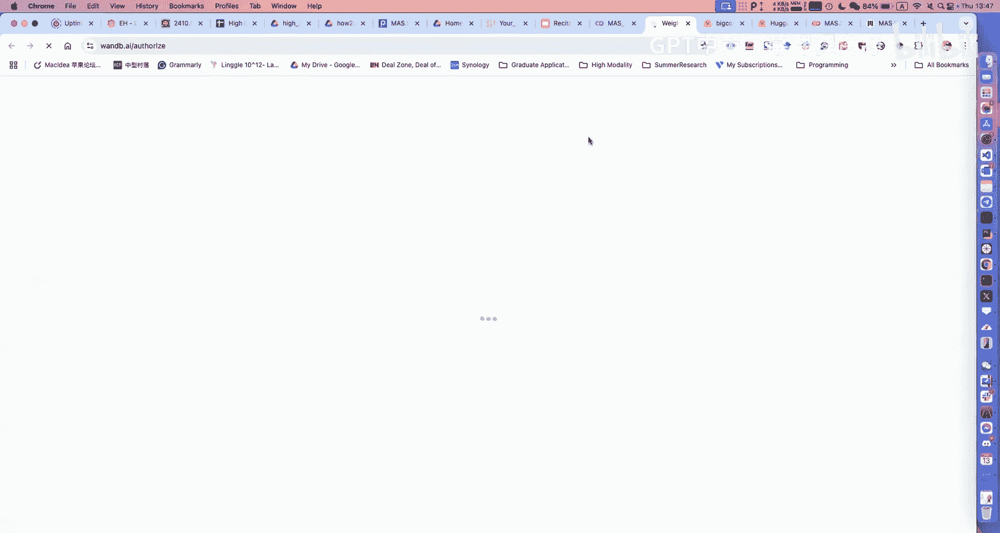

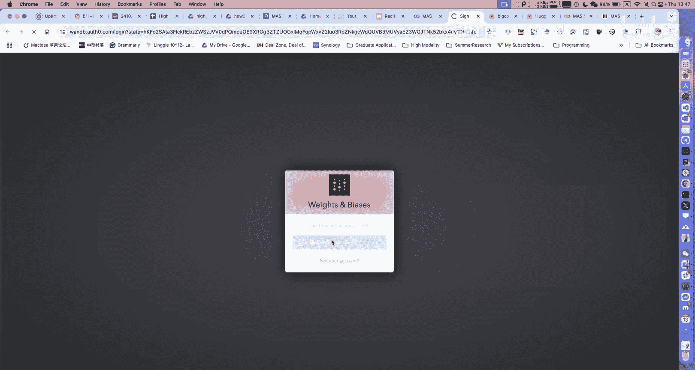

嗯。You can。Copy and paste the API can from one give B to this training。是吧。

And then you can actually see the training wrong。Live on this like web page， which is great。

If we wait a few seconds。I think he will show。帮条。Things we care about。So， so before they log in。

 any like。Traing laws or like evaluation laws， one thing I tend to look at for each training around these two panels。

 which are like keep your memory allocated and the GP power usage。

So these are two important indicators and GPO memory allocated is for like how much GP memory did you are you using for this training run。

 so the if the GPO memory allocated is like too large for example。

 like 95% its actually be very likely that your training will like。

Have out of memory error later on in the training process。But if the GPO memory is too low。

 it means that you have a too small， like batch size and training。Process is not that ideal。

So my suggestion is to， if you are working with like large end models。

 my suggestion is to like keep the digital memory allocated。

I run like 80 to 90% so that it's less likely that you have like out of memory error and also you're utilizing most of the memory available for your GPQ。

And another thing I can look at is GP power。So this one tells you like how busy your GPTO is during this like training room。

So if the GPU power usage is like 10%， very likely is that like your training pipeline or the data processing pipeline is not very efficient and your GPU is like idle most of the time。

走。I would say for this one， I you feel polar。Larger than like maybe 60% is kind of ideal if it's like less than 60%。

 you may want to check your data set。Implementation processing script and the training pipeline to see like which parts are very slow。

So this is for the hug phase。 I don't think I can finish this training wrong in this past。 So like。

 but do you have any questions。Yeah can also cover equal to weight biases the other things they could look at？

Beyond the CPU usage。You mean the，I don't think it's。Lg in the loss yet。Oh， it has loss。 Okay。

 but what just for one， one step。Okay， the loss is also very important。

 you want the loss to decrease。 So so that's， that's the main idea。 If the loss doesn't decrease。

 you have a problem。So。But it's actually very normal that the law doesn't decrease for the first few steps because you may be using like a learning rate schedule or the model is just like very not ideal。

 so it's possible that the loss doesn't decrease for maybe a couple hundred steps。But after that。

 it should decrease otherwise， the training is not going to converge。

So this is something you want to look at。嗯。The thing that they also log the grad norm here。

 this is the average size， average magnitude of the gradient。Of it like20 steps。

 So if this thing is pretty large， it means that your model is。

Getting a very large step of a like a update for each like train step this is sometimes intended。

 but this should also kind of decrease as your model converge to an optimal point。

Because like if the model is getting better， you don't want it to make a very like larger and larger updates。

So if the ground norm is increasing， then something is wrong with your training process。

And that's basically it。So don think we can go over the evaluation，Like taking。Okay。

 we need another one hour for this to finish so。Yeah。

 I think we can go over the household Debra model now。Great time， yes， I don't think you having me。

我要 내 byさ。Okay。😊，And I I'll it on too。The same slides are。Yeah， yeah。 so this is。Where's my？嗯嗯这个。Yeah。

 I think this is your size， right。Yeah。う。I think the philosophy here is like rebugging air models is more of an art than a science and that's what we're trying to do here。

And towards that， like normally when you code up a program。

 you have some signal that you get that the program is correct on。

 but in the machine learning model is not very clear when your model works when it doesn't work。

So the idea behind this， say this debugging checklist is just so that you have a bunch of checklists that you can go over just to understand what you can improve for your models。

And right now， if you haven't trained a model before in your life， this might seem a little pedantic。

 it might feel very obvious， but I think these things are very useful in in the long run。

Ts to begin with so training neural networks it's more of an art right it's less to do with something work and some things don't work sometimes your models trained sometimes you don't drain and the idea behind that is can we sort of demystify this process。

And towards that you have some weird bucks， sometimes your gradients are very high。

 sometimes they're very low， sometimes your losses are infinity and then what do you do with that that's basically the idea。

Okay。And this is the recipe， I think this is one slide that covers everything that we want to do and whenever you want to train your modules。

 we would suggest you look at this first before starting training your module。So towards this。

 I think this is something David also touched upon which is you have to become one with the data as machine learning engineers and scientists we love trying to use the most fancy module possible right。

 but I think that's counterintuitive to what really you need to get good performance。

thanksそれ can see思います。That's the most important。😊，So having said this I think that initially you should spend a lot of time just looking at your data understand the distribution of your data and seeing if you can come up with your own patterns。

 the idea is that in most cases specifically if you don't train neural networks for your use cases you won't have a lot of data such as you know for these large language models in that case you need to come up with models that actually sort of model some patterns or identify certain patterns in the data that you have and that's the reason why we're saying that look at the data spend a lot of time just looking at your data and trying to understand some intuitive patterns that you can model。

诶。Having said this like once。嗯。对以。Yeah， so once you've already come up with once you've already looked at the data and you sort of have some intuitive understanding。

Try to come up with a very simple model where you can get some signal in the sense that maybe if you come up with a very simple model。

 it could be linear regression or a simple column there and try running that on whatever data you have。

In some cases， if you're using like data sets that have already been curated before。

 there's a very high chance on GiHub， someone started to solve this problem。

 so pick up those models try using those and then see what happens。

And in these cases as well in torch you initially start with something called the random weight matrix right which is essentially sampled from some distribution doesn't matter the point were trying to make is fix the seed first so that you can understand so that's a domestic process it's not like you have an additional variability there。

Having said this try to like simplify your models as much as possible and always look at the losses initialization so sometimes a lot of the time your losses that initializations are infinite this could be due to a bunch of reasons and this is a very good cross check to understand if your models are actually working well or。

😊，Partly the last thing what we would suggest is if your models don't seem to be working very well at all。

 try to overfit them on a single data sample， what that means is try to make sure your model memorizes what the data is for one single sample just to identify if the model is capable of learning the data or not if it's not capable in the first place then you can go back and start coming coming up with a better model for whatever you wanted。

So I think this sort of likebleeds over from the previous slide。

 which is come up with a simple model to over on a very small training data set。

And this is basically what you keep trying to do and once you do do this。

 see if you cannot reach a lower error rate， if you can't reach a lower error rate。

 you can go back to the part where you look at the data once again or you come up with a better modeling strategy for the same thing。

And towards doing this， you need to visualize your lost dynamics in the sense that how does your loss decrease increase are the certain weird things that happen？

And try to also look at your gradients so sometimes your gradients go up to infinity for multiple reasons you might not have quoted it well enough or your initializations are not wrong but you haven' a normalized data well enough so this gives you some understanding of what you need to fix to get your model working。

And I think the biggest takeaways don't worry so much about your architecture initially I think a lot of times we end up focusing on trying to come up with some cool architecture assuming that you read some research paper and so on so forth。

 but the ideas don't do that it's sort of counter to what you want to do。Finally。

 if you've done all of this， I think one interesting thing here is in machine learning。

 we don't really care about memorization， we care about generalization。

And towards going to generalization， we need to do some regular techniques such as dropouts wait decays and so on so forth so once you know your model does overfi on asset then try on this until then don't do any of that。

And finally， I think I cannot reiterate this enough that in most cases your model could be working perfectly well you just might not have found the right have hyperparmeter for it。

So it is in your best interest to try and search for multiple hyperparameters specifically if a model is small just for to get the right performance and most of the times what happens is I've seen a lot of data scientists just run the model de facto and then they get a very bad accuracy or whatever。

 but if you just train them well enough you do get really good result so try doing this。And finally。

 once if you've done all of this use like different ensembles if you want't and try try to attain models past convergence because sometimes that does help and if you've done all of this then finally start looking at more complicated architectures。

 which is something that you can do。So I guess this is the basic pipeline you obviously focus on the data first come up with simple models in those simple models try overfi your data once you know you can overfi on the data recognize it and then find tune for whatever dancing performance you want and I guess this is the rough sketch the basic debugging tips that we have if you have any questions i'm happy to answer them。

Just to。I think there are two blogs which we will share with you and another blog by Aliah Hemi。

 I think you guys should just go over and sure that youll get a handle of whats right of stuff。喂。

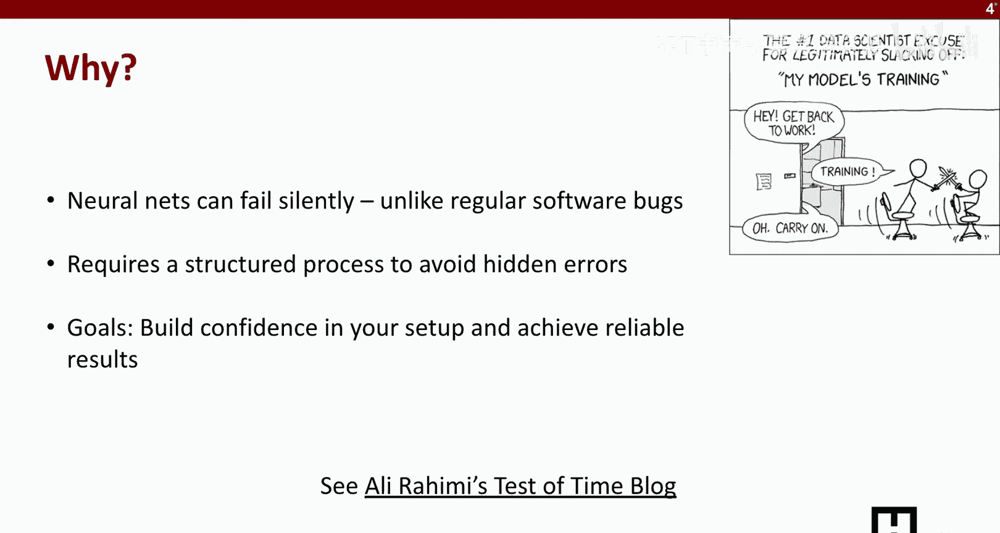

那就。没事有。Okay if there any。