# 《如何AI所有事情｜MAS.S60 How to AI (Almost) Anything》中英字幕（Claude-4-s翻译） p05 [05]Lecture 3 – Common Model Architectures.zh_en [BV1UhawzQErD_p5]

Close the door to that， please， thank you。Okay， so this is lecture three。

It's going to be like drinking out of a fire hostse today because I'm going to try to cover all the common model architectures and deep learning in one unified framework in this one lecture。

Hopefully some of you have seen some of these architectures and it's not completely new what I'm going to present today。

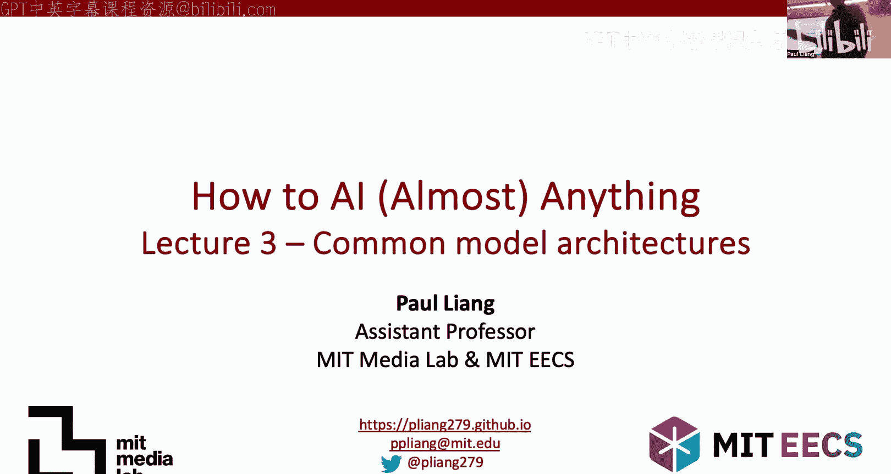

So before starting logistics for the project， please submit your four page project proposal by tonight。

 just email it to me and I'll also reply with any feedback that I have。

If you need any more feedback on your project ideas before you finalize it。

 Ill again be free to 3 pm after class in our lab space。

Your reading assignments are due tomorrow in preparation for this Thursday we'll have our first reading and discussions the topic for this week is on data and learning right so it's not to be two papers that are required。

Everybody should read these papers， reflect on them。

 try to look at the questions with those and answer those questions。

 The first paper is on this phenomena called the bitter lesson。

 which is a phenomena that you know as more and more private made overwhelmingly it is the big models the ones that don't use too much inductive biases and domain knowledge that work the best So how do you。

How do you interpret that phenomenon， how does that imply what you should be doing in your own AI practices？

Second paper that we'll be reading is called Rocking or double descent again。

 a very recent phenomena in modern AI， which really goes against conventional wisdom and prior AI the fact that you can actually seem to be overfitting and not doing well and suddenly do really well as you training a model for longer So again what are the implications of that phenomena on how you will be deploying and training your models So two recent papers very much the paradigm of modern AI but very much different from what conventional introduction of machine learning or AI forces will teach you。

So very excited。Okay and also quick logistics for reading assignments everyone has to complete that form。

 so basically answering some questions， writing or reflections but there's 10 of you who are selected every week to do some more tasks these are the roles that we've shown one of the roles as a peer reviewer so other instructions are on the PDF。

Other role include， for example。Digging more deeply into why that research was done maybe looking at the code and giving people a tips on how to implement it looking at the reward impact of that work and so on and this was the spreadsheet that was just randomly assigning people to those 10 roles every week。

Make sure you've seen this all this is linked in the assignment， let me know as soon as possible if。

Well， maybe not some of weeks don't work for you because you're traveling。

 living room as soon as possible and we'll rearrange that assignment， okay？

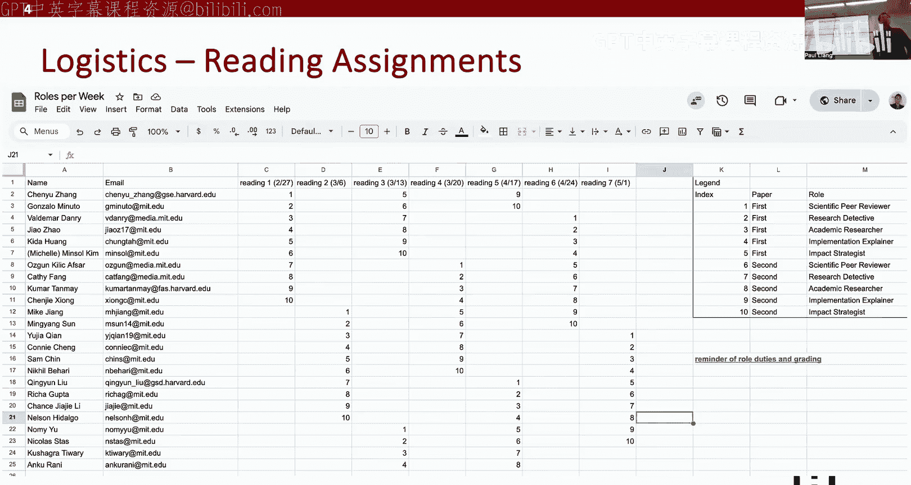

Great， so today we are going to cover four things we're gonna come up with a unified paradigm for looking at different model architectures and deep learning again different from traditional AIMl classes where every week you present a different model or algorithm I'm going try to unify a view of how you can look at different architectures and how you could go about designing your own custom architecture。

 what those principles might be and thenll look at some common case studies or to sequence models that are very suitable for temporal sequences like time series。

 con models that are suitable for spatial data and also models for sets and graphs if that's the data you're working with。

So at a high level you again want to think of these modeling paradigms as a spectrum any machine learning AI model you design probably fits somewhere on this spectrum for more domain specific methods that really take into account the structure of the problem and the expert knowledge from that problem to more general purpose models that leverage more data and computation and therefore less structure of the specific domain or problem that you have。

So if you're designing a custom neural net with a very specialized architecture in a very specific way。

 that's something more domain specific。You're designing some custom training objective that really embeds something you know about the problem or some property that you know your data should have。

 that's again something more domain specific and things that are more on the site of general purpose include。

 for example， taking it off the shelf model， either directly applying it in which case would be really general purpose or maybe doing some fine tuning or adaptation of that pre-trained general purpose model off the shelf model。

So all the methods they're been designing based on the data， the architecture。

 the training objective will sit somewhere along the spectrum。

And where that position sits exactly would depend on many factors， right。

 you need to know what is a good model or a good model。Has many factors。

 ideally it should be one that first of all captures the right semantic information。

 so you're trying to make some prediction or you're trying to generate data with a certain of property or you're trying to make some forecasting a good model should be one that captures the right semantic information。

Of course you should also capture it at the right granularity。

 some problems require you to do really fine grain localizations。

 some problems require you to have a more high level summary of the information。

It should use an appropriate amount of data and labels that's going to be a very important factor。

 we're going to see that different points of where you sit on this spectrum is going to require fundamentally different amounts of data。

 both unlabeled data and the labels in your data。It should respect right resource constraints when you deploy it。

 sometimes these models are more suitable for running a large GPU。

 some of these other cases are more suitable for running on more edge and small devices。And finally。

 you should provide the right level of usability， whether that is some interpretation quality that you care about。

 spinningning the model decisions to a user or making it more accessible in some way。

 that will also again affect where this point sits on。

And find more there's probably a lot more considerations。

 this is probably the first thing you to think of right before you even start designing a model。

 what is a good model， what are the properties， what are the ones that are good to have。

 what are the ones that you will not absolutely compromise on。

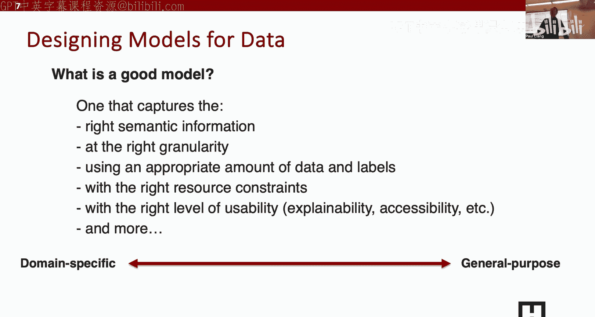

Okay， so the next couple of lectures will essentially cover this spectrum today's lecture is going to be more domain specific it's going to cover some more custom model architectures if you want to go more domain specific route。

We're going to then start talking about multimodal architectures。

 which sit somewhere in the middle there's going to be some custom architectures。

 there's going to be some more general purpose architectures as especially when you start getting the crossmodal transfer and then after spring break when you come back is really going to be more about the general purpose architectures and how do you fine tune and adapt them to your tasks so you're going to cover the spectrum from one domain specific to more general purpose and adapting these general purpose models。

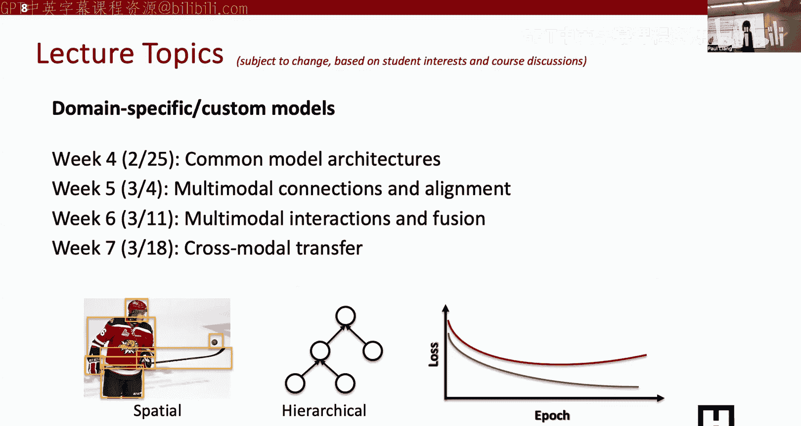

So to start a discussion with some of these more domain specific methods。

 well I want to get a recap what we talked about two weeks ago on data right so we had this idea of a modality profile every data that you collect every task that you're trying to model is going to set some characteristics and I find it useful to essentially break down your problem into each of these characteristics and for each one of them you need to understand that from your data I need to understand how you're going to model that characteristics so one is the elements and how they represent。

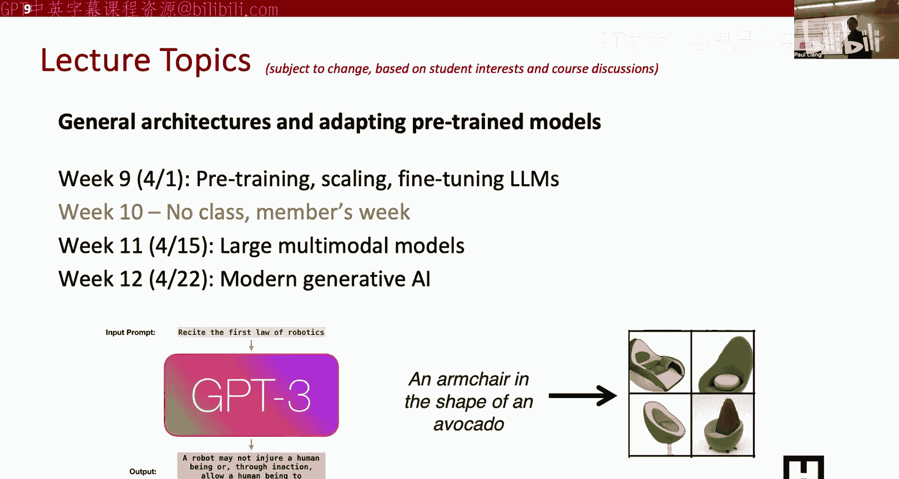

The second one being the distribution of elements are you looking at just two or three parts of the image or high frequency data。

 what is the structure if you're looking at more spatial or graphical what is the information。

 different types of noise in your data that you have to be robust to and what's your task how relevant it has to be for your task so modality profile is again just a summary of given your data these are the first of the things that you should be looking at and trying to understand your data。

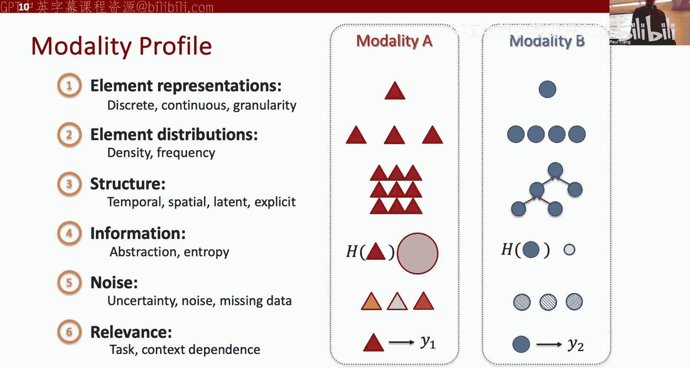

So after you've understood your data， including breaking it down into the individual elements and how they're composed and their distribution and so on。

 they start probably building some deep model。And a unified view of deep learning models is that these models always have several steps one step is to learn representations right and learning representations。

 the definition is that you're going to take some data that's really high dimensional so raw data and trying to learn more abstract features that extract information from it。

So there can be some model that essentially transforms into some denser。

 lower dimensional features and capture some important information from your data。

And a second key property in almost all these learning models is that of combining representations right you might have learned representation for the plane in the image。

 you might have learned representation for the sky。

 you might have learned representation for the ground with houses on top of it。

 all those are representations that represents some meaning。

 how do you combine it to learn the information in the holistic scene。

It's always alternating between steps of extracting features and learning representations with combining these features layer and layer as you go deeper into the model to learn more informative and summarized representations。

So given that those are two purposes in deep learning。

 you can essentially view different deep learning blocks as you know。

 just ways of achieving those two purposes。So to learn representations。

 there's several blocks people might have seen， so fully connected networks are basically much matrix multiplications。

 Relu is basically an activation function so if everything is linear that is fully connected Those are linear functions if you have too many linear functions youre gonna end up learning a linear model things like relu。

 these are nonlinear activation functions so you can start approximating more complicated nonlinear functions and you can prove that in the limit it can express essentially any function layer normalization has been shown to help you standardize your data and make everything into a nice normalized range。

 convolution and self-atten will cover Well these are essentially building blocks for basic learning of features of representations。

And the second point， as you mentioned， was locks for information aggregation。

 so if have features learn from one part of the image， features learn from other part of the image。

 how do you combine them to learn a feature for the whole image？And again。

 there's several blocks that you could think about concatenating is a very simple way of combining information across attention will cover even things like adding point wise addition。

 pointwise addition of two vectors or point wise max taking a max between two vectors are ways of combining information。

And essentially， any， probably any modern AI model that you were design for your application is going to be some。

Perhaps simple， perhaps complicated composition of these blocks right so you have data these small triangles represent some elements。

 for example some parts of your image， some sentences in your paragraph。

 some words in your sentence and youve got to apply itly layers of extracting features to learn representations and given a couple of them are layers or blocks where you're combining information to learn more informative semantic features so you could look something like this right。

Once you've designed this forward pass。You essentially compute your loss。

So a loss essentially measures the label that you predict and how close that is to the real label。

 if you have some label data， compute some difference and essentially treat that as a loss function that you want to minimize。

 you want to minimize the difference between what you predict and what the real label is。

 you can essentially minimize that by taking the gradient and applying something like so constant gradient descent which essentially minimizes that loss and update your parameters。

Okay。😊，Sofully this isn't really new to anybody who are just basic deep learning。

 basic of machine learning， I'm just put in a way where it's more unified。

 these are just different building blocks that you can define and you can compose。

 you can compose an arbitrary number of these building blocks as long as everything is mostly differentiable and you can essentially compute forward pass computer loss。

And computers gradients to update the parameters。Right。

And we also see that any probably any machine learning paper。

 any deep learning paper that you read whether it's transformer or CNN is going to be some composition of these blocks the key idea is just how you put these blocks in which place at the rich location。

Allright。So speaking of you know how do you place these blocks and how do you think through about how you design your models let me just start with a simple example Im want to use sets and point clouds as an example。

 I like the example very much so you have some form of data sets essentially means I say you a bunch of images that are all actors or actresses with a certain property and you might want to detect some anomaly right which person does not maybe have the same demographic properties as others。

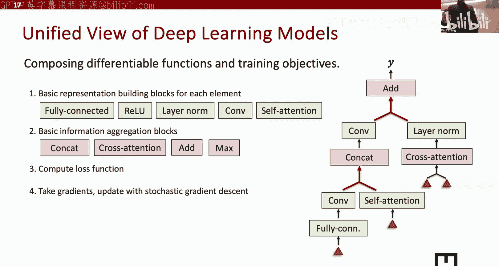

Or point parts， right these are 3D meshes each point each essentially X， Y。

 Z coordinate and you can put a bunch of them together to essentially make up a 3D shape。

volumetric shape and maybe your goal is to detect anomalies within your set of images。

 maybe expanded to get new images to classify these point clouds into different types of furniture or maybe to even generate new 3D models of your point clouds。

So how would you go about designing neural net？For this example， again。

 it's going to be some combination of these blocks。

 you need to extract some features from your sets and your point clouds。

 you might need to aggregate the information because now you have multiple images in your sets and multiple points and your point cloud So the question is maybe how I should do this feature extraction。

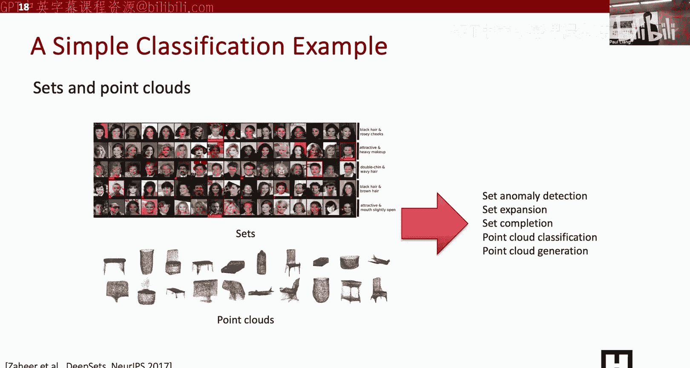

Learn representations and how I can really aggregate all this information。

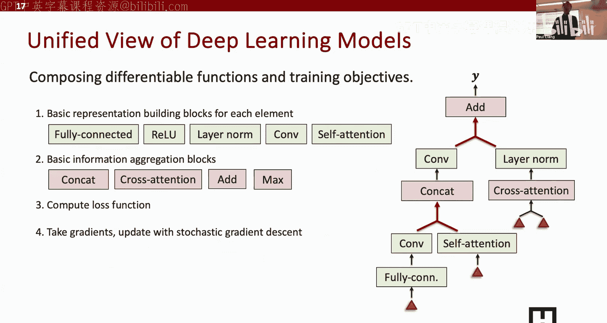

So the way you want to think about it is clearly this data comes in the form of a certain structure right and probably the most important structure that you want to think about when you have set or graph data is the fact that any model that you should be building should be invariant to the order of elements in your set。

Right， whether I present to you。And when I present to you， for example。

 my set of images in order ABC DE and I try to ask you to find the anomalous image。

 or if I present to you to order ECDDA， some reverse order and I ask you to find the image that is anomalous。

 your model should give me the same answer。theomalous image within a set of five images should not depend on the order which I present these images to。

And therefore， there's two key ideas in almost all successful deep learning models that are designed for sets Well the first key idea is that first you should share parameters。

Of the model that encodes each set element。Shard parameters here as you know by the same color with the same parameter as fine。

Right and a second key idea is that you should aggregate the information。

 learn from each of these individual representations where relevant using a functionalized permutation invariant。

 so something like addition where these are all vectors and you add them up element wise。

 that is something that is permutation invariant。So once you have that feature。

 you can input it through some more layers and you can make a prediction on the label。

Now to see why this is important， just imagine I had presented to the model。Different order， right。

 EC， B， EA， so different order of the P image。Now， each of these elements are going to go through the exact same feature extractor to get the same a lot of same representations。

So that doesn't change。And this addition function， whether you add EC E plus E or you add。

 you know C plus E， you get the same outcome right。

 so now this this final feature that you learn from extracting data that's A B。

 D CE or this some other order is going to be exactly the same。

So that means what you predict a synomalous image will also be exactly the same。喂。

So essentially the idea that if I present to my model is training data。An example with order AB DCE。

 I am also essentially giving the model all possible permutations of those side images。

 which are different orders， the model will learn the same representation regardless of which order I get it to。

So let's say you don't satisfy these two constraints。

 let's say don't do parameter sharing for each element。

 so now you're designing a model where for each element in the set that you presented to you're going to use a different feature extractor so as noted by different colors and also a different parameters 51。

52 automated 55。Well， that essentially means you present a model that is the same sex just permuted。

The answer should be the same， but the model will end up learning a why that is different because each of the cell elements goes through a different feature extractor once you add them up。

 the final feature will be different。喂。😊，So in effect。

 that means you need to give the model the first order of the elements。

 you then you given the second order， you will learn something else so you have to give it to the model and train it on this new order。

 you will given it all the possible orders， you essentially needing the model to look at five factorial more samples than the first case where you did share parameters and five factorial is it right 2030 times more examples than you need to give to the model。

Same example so what if you do do parameter sharing。

 but you don't make the aggreg function per mutation andvari so one example of that is you're doing parameter sharing each of the features goes through the same encoder with the same parameters。

 but instead of doing something like an addition。Which is not sensitive to the water。

 it do something like compassionation。So in concatenation， whether you stack A B or you stack B A。

 that's going to change the output vector that a model outputs。So do something like concatenation。

 then again a label is going to be different， which means to train this model successfully。

 you need to give the model all of these permutations before it's able to successfully learn from your data。

So again， you need five factorial more cycles。All right。😊。

So that's just a very simple example and hopefully people find that intuitive。

 the fact that if you design your model architectures carefully。

 you're going to need much fewer samples than if you don't design your model carefully。はい。

Any questions so far？

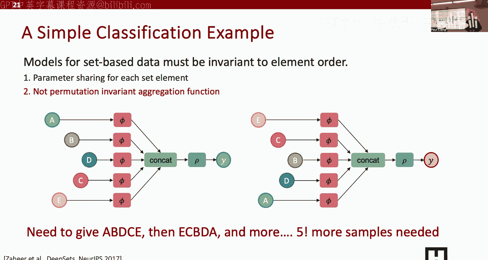

Right。So to generalize this discussion， I find that when you collect。Your data or look at your task。

 There's two ideas that are very important。Both are generally lumped under this idea of structure so the first idea is data invariances so what are transformations that you can make your data where the label or outcome should not change So if I give you this example。

And an image with three highlighted and your goal is to classify what digit or classify it a three So if you just move this image maybe up down left by a couple of pixels if you rotate the image 45 degrees。

90 degrees， if you make it black and white instead of you RGB you should still come up with a label3 right So that's an example of invaris that ideally your model should capture because if your model doesn't if your model is sensitive to the color or your model is sensitive to the rotation the model is sensitive to small shifts and pixels left and right。

 then you're gonna need a lot more data to essentially learn that same task。

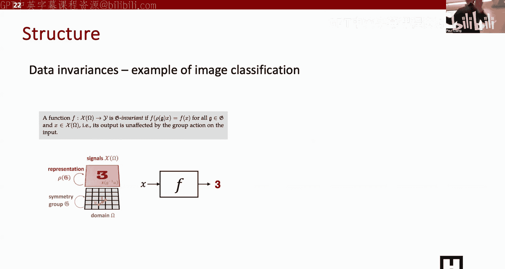

So image classification is one example where you have certain invariances in your data。

So invariances are changes to the input where the model should not be sensitive to。

 that is opposed to equivaris， equivaris are changes in the input data that the model should be sensitive to。

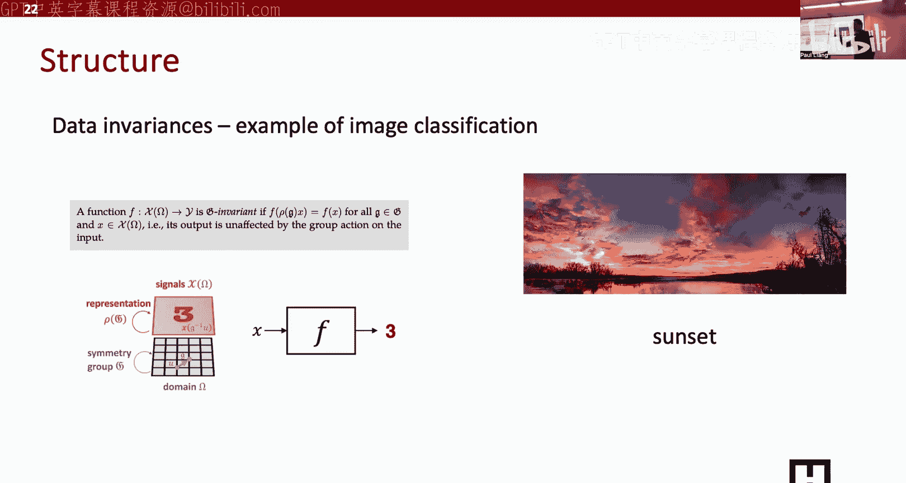

So you think about a task is very similar so again， given this image with a three on it。

 your goal is to essentially come up with a semantic map。

 semantic map telling you this is the background， this is the digit， this is the tree。

 this is the ocean， you want to do something like segmentation。

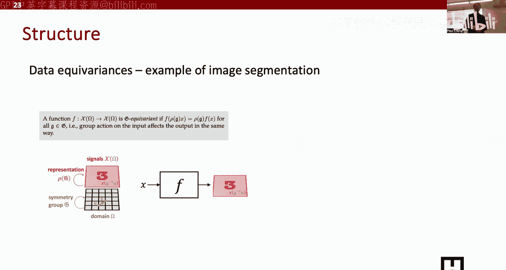

Then if I shift this image up by two pixels， my semantic map should shift upwards by two pixels。

If I rotate this image 45 degrees， my semantic map should also rotate 45 degrees right so you know shifting and rotating our equivari transformations so whatever change I make to the input data。

 I also want the model to capture that change in the output。And that's opposed to， for example。

 the color， whether this was RGB or black and white， you should still get the same semantic map。

 so RGBA and color is something it should be invariant to where shift and rotation should be something it is equivariant to。

So these are very important properties they think of。When you start getting your data。

 as you saw in the case of classifying data on sets。

 you have to respect this idea of permutation invari。

 That means you can permute your elements all you want。

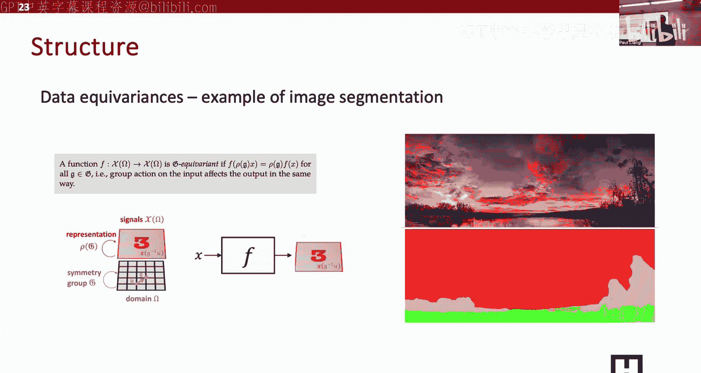

Given it ABC or CBA， give it the elements you're going to set all you want。

 that should not change ideally the output of the modeling。

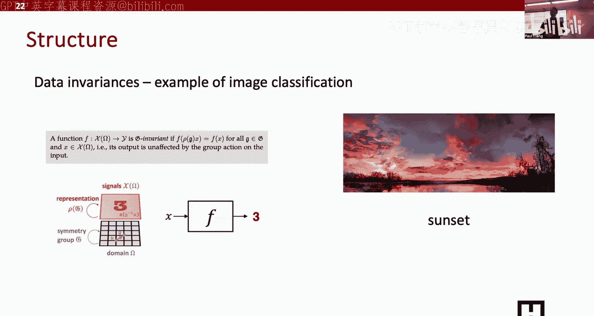

Alright。So that's kind of a unified framework in a way I like to think about， you know。

 given data and you want to design some custom architectures and using as few samples and as efficient as possible。

 these are the kind of things you might want to make in。All right。

 so moving on to some common architectures， we're again going to present these common architectures under this framework of invariances and equivaris。

 we'll see why those architectures are motivated the way they are。Question， yeah。

 is there like a collection where you map basically those operators to building blocks， I mean。

 in the case of communication addition to that but I mean。

 there are let's say the associated operators unlimited etca。

 is is there like a back book or something like that but you've seen So this it probably best yes。

L scene at all geometric team learning grids groups graphs and so on。

 this is probably one of the best references that i've seen because well first of all it formalized so all these are from this paper。

More from this book is is a very long paper， so all these formalizes what it means for invariant equivariant they formalizes you know mathematically might associatedci function in the case of permutation invariant and so on。

But usually it may not need to be that complicated。

 I think these are a simple tricks that you could think of baking in right this audition or taking an element wise maximum I just think that you could probably think of if you're working with set data。

Right， right。So yes， moving on to some common model architectures but again inspired by these phenomena so first type of models are they will cover based on temporal models so youison element。

 for example， a word and this word might constitute part of a longer sequence right so you might have a long sequence of words or it could be sequence of time steps and time series data couple of you know it could be code。

 it could be genomics data again all these are sequences。

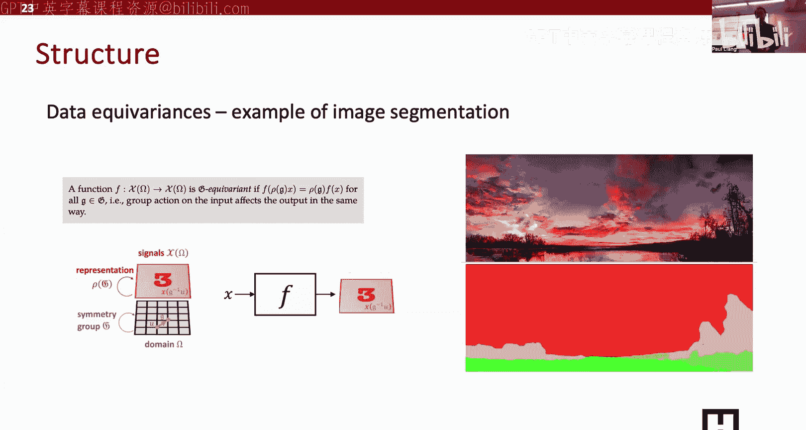

And the goal is probably to do some classification of。

Either next word or some topic or some label given a sequential data。So again。

 the key question is how do you learn representations and how do you aggregate information？Now。

 clearly for temporal data， a very key idea is the sign of locality。

If you want to predict the next word， you probably look at a word before it probably that word before is going to be the most important。

 but of course it makes sense to also take into account longer context， words four， five。

 even a long range before that， depending on how much computational resources you have。

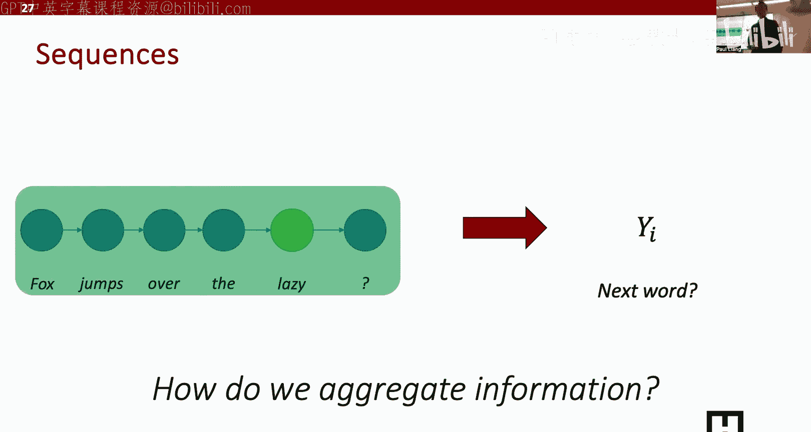

So that really motivates our first discussion of classical models on sequence classification right so these are models that essentially takes in a sequence of data like words or time series or a genomics data and make some prediction on your label。

So same thing， given such data， you want to think about again your two properties right。

 what should this data be invariant to so what changes should it not be sensitive to and what changes it should be equivariant to so it should be sensitive to。

And intuitively， models， any model you design for sequential data should be invariant to the time itself to whether you take this sequence and you shift it one step before or one step after。

 it shouldn't really make such a big impact on the model。

But it should be equiant to the order right if you say jumps over or something you change f to the dog and dog jumps over or f jumps over。

 if you change the order of the words， then that is something the model should be extremely sensitive to to really take into account that change。

So to deal with these two types of invariances and echovariances。

 almost all models for sequential data have these two properties。

 the first property is that you do parameter sharing across time steps。

The same model should with the same feature should process this word and this word and this word and this word and that work。

 even though the words themselves might be different。

 the functions they use process should be the same。

And that's critical because otherwise if you just shift the sequence left or right， back or forth。

 by of all time steps， then you'll get a very， very different output if you don't share parameters。

Second key idea is that you want to aggregate information across time so this idea of recurrence where you first extract features here is a feature extractor and then you look at the next word jumps。

 the extract features and you accumulate what you had over the previous word and the extract features where the third word and accumulate what you have for the second and first words and so on this idea of information aggregation across time。

And the second point is essentially what makes an equivari to the word order。

 because now if you change the sequence of your words and your sequence of information of humiliation would be different and you will get a different outcome。

Right， so you should be insensitive to each of the。Time steps。

 but it should be sensitive to the order in which。The words are presented to the model。Okay。

 so therefore two key ideas， we want to do parameter sharing。

 same feature extract therell be time steps and you want to run。

Ilic information across time auto aggressively。And once you've gone through the whole sentence。

 you predict the label。To see how this is typically implemented。

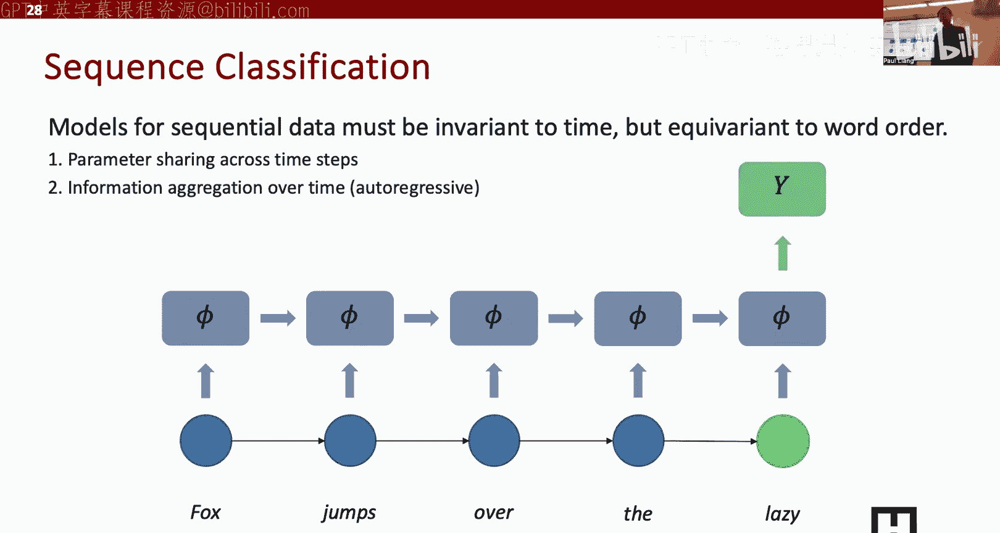

啊。Okay， just a little bit of mathematical notation。

 X is your data first layer probabilityQ to some parameters U so。

All these models are just linear transformations u times x a matrix multiplication followed by some activation function tankage。

 so this allows you to express non nonlinear functions and then you might apply a next layer to it for example。

 V is your next parameter V times the output from the previous layer and finally you would then compute the loss with respect to the real label in this case it's classification so be negative log broadly。

And essentially audit the current model is just unroll this where the same view， the same D。

 those are the same parameters that is applied to different time set in a sequence， x1， x2。

 x3 and so on。喂。And this is showing that the same parameters are applied here at every several sequence。

 the same parameters are applied and the same parameters are applied。Just just visually。

 the data that comes in is different x1 through xt。

 but every time step the same parameters are applied。

 that's key for parameter sharing and information essentially accumulates across。All right。

 so this H is where the information is being accumulated。Okay。😊。

So that sequence classification at a very high level。And， of course。

 you can also extend it to do sequence generation。 So if you have。

Instead of a sequence coming in and predicting a label。

 you can just take one thing at the input and predict multiple things at the output。

 So let's say I give you a word Fox。 and your goal is to complete a story or to generate music。

So again， you would use the same parameters at every time step。You would generate something。

 you would take what you generated previously y1 as input into the next step and generate y2。

And then take where you generate in Y2 as a next step to generate Y3。

We call this auto requested decoing。But same idea， parameter sharing and every step。

 there's one set of parameters and you will accumulateulate information across time by taking what you generated previously and feeding it in to generate the next token。

Mathematicically， what it would look like is that every。

Every feature at your T mindset is a function of why that you generated the previous mindset and also the features H at the T minus1 previous time。

U andW are the parameters that are shared across the time steps。O。😊。

What some of you might realize these are recurrent networks and you'll say these are out of fashion。

 but I actually convince you otherwise because RNANNs have evolved L STTMs。

 LTMs have evolved to temporal convolutional networks。

 and temporal convolutional networks that really inspired a lot of modern work in state space models。

Which are still quite popular nowadays if you want to process time series or continuous data as an alternative to transformers。

Great， so those are models for sequence generation。

And sequence to sequence models essentially combine both。

 so there's going to be some sequence coming in。And there's going to be some sequence that comes out。

So to see how that works， when a sequence comes in exact same ideas。

 you want to use the same parameters at every time set。

To process each of the words and you will accumulate information across timesex， right。

 you Fox jumps over， accumulate information。And as you finish reading a sequence。

 you could predict the first output。And then auto aggressivelyively take the previous one。

 get it into the next step， upper y2， take y2， fit it in upper y3。

So these are sequence to sequence models they're used in a machine translation。

 say you want to convert the sentence of three English words into a sentence of three French words。

And use a lot machine translation， use a lot of generative models today。Yes。

 so why one first monthly box， why versus chunks。多萝好了。Very good question。

 very good segue into the next part。In some languages。

We know subject or object you translate is also subject ver object。

 of course in other languages not necessarily， so a very pivotal paper and machine translation essentially shows these he maps。

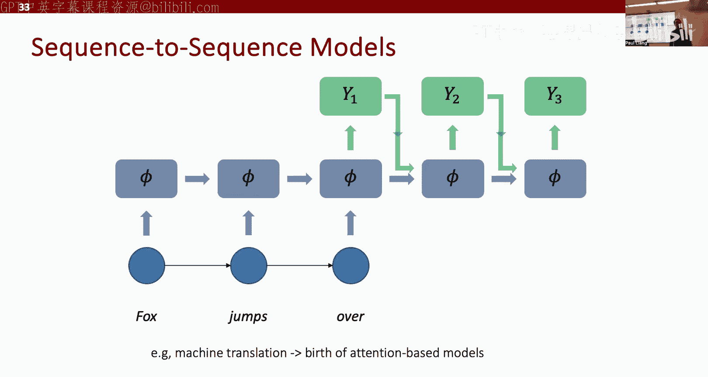

These are heat maps that are telling you given the input sequence in English and the outputqua sequence in French。

 which English words corresponded to the output French words。

 and you can see that most of them lie along a diagonal so the order is mostly preserved。

 but of course there are subtle differences right there are some that are off diagonal meaning that the word order by shifted between English and French。

Right so I say this seminal because this meization essentially was extended we call this attention maps。

 these are attention based methods that tell you when I'm generating y1 which of the first three words are the most relevant to generating y1 is it Fox and all fault and nothing else or maybe a little bit of f a little bit of jumps over and I'm generating a second word then which of the three words were most important and so that's why you get this T by T attention matrix。

Your sequence， input sequence by your output sequence。And of course， if your languages。

 they are more different。English and Chinese， English， Japanese。

 then your attention matrix would be even more of diagonal。Yeah， so it should be a square。

 it should be corresponding say words to three words where sometimes it could be。Not let swear Oh。

 it could absolutely be rectangular。 it could be T1 by T2 sorry trend will that be the same as this one。

What mean like if I'm we have three English words， but you have for example 1 Chinese words， yes。

 what's the trend website for the heat mail？Like so I don't have it here。

 I mean this paper includes a lot of examples， but yes。

 you could actually have three input words and output 10 words usually you don't control how many words are output the model would decide you basically the model will generate until that's a stop token or end of sentence token so you could go as long as it once so you could have something that three input words and three input words and three output words and you could see what the he mapap looks like usually in that case basically means that each of the input words corresponds to multiple phrases。

我や不塞。Another question， is do we discounts as sequence to sequence models？Yeah yes。

 they also counter as sequence with sequence models， there's some more advanced masking。

 I'll talk about transformers in a little bit， but to get GT to sequence sequence models you essentially have this entire sequence and it's just where a mask tokens are placed to force a model to generate the output。

Great。So yes， so that's actually a very good segue sequence sequence models were out rage and then they got augmented with these attention mechanisms and these attention mechanisms as you know really inspired all these modern transformers and for people who don't know that the first transformer paper was actually benchmarked on machine translation that was the first data of the R results that they got across the board。

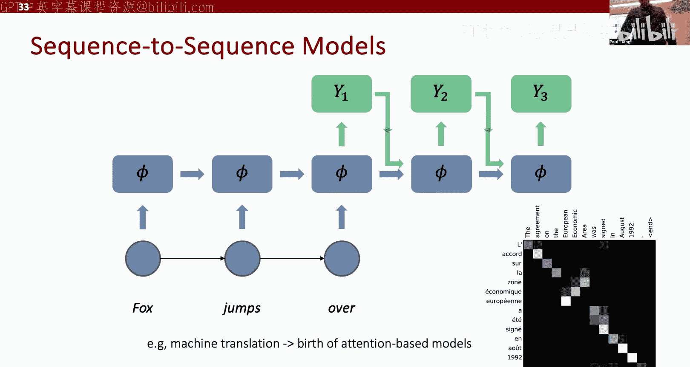

So the idea again for these attention based methods is that sometimes I might want to give dynamic weights to different elements right and I'm translating I look at the first word。

 maybe I look mostly at the first word， but I also want to look a little bit at the second and third words I look at the second word I want to look mostly at the second and maybe a little bit on the first and third。

So these attention based methods essentially compute new features by leveraging their context。

 so you I want to get a new feature for the word lazy。

 I'm going to look at the other four words before it， I'm going to compute attention scores。

 these attention scores essentially tell me how much each of the previous four words should contribute。

It this feature that I'm learning for the fifth word。All right so you can think of it like this。

 each of the context five words come in， this is the target feature that you want。

 and you want to essentially learn a set of five scores。

 a from one through five telling me the relative contributions from each of the five words towards this new feature。

These attention scores can then be used to essentially weight each of those teachers according to their contribution。

Right so you should take a1 times the value of f a2。

 the attention I give and the value of job a3 over a3 a4 times the a5 times lazy so once you get these attention scores。

 they tell you the relative contributions， you will then actually multiply it。

 with the features themselves， you get a weighted summation as weighted by those attention scores。嗯。

And just give one level of detail， one way I like to think of these attention models is an abstract way through matrix multiplications。

 and just to explain this is probably an equation that everybody has seen in transformers。

 the way I like to think about it is there's several matrices here， so X is your data。

Your data is essentially3 by D。 so in this case I'm just assuming that you have three words I didn't want to draw by so three words。

 your data is three by D That means for each of your three words， you have some dimension。Okay。

 this WQ over here is essentially just some linear transformation that you're passing your data through to turn it from token。

 one hot tokens into your lower dimensional dense vectors。So one side is3 by D。

 I'm going to take again my data and multiply my another learnable parameter。

 but this time I take the transpose so transpose of3 by D becomes D by3。

So I'm going to order dimensions first。And then order the number of words。

And essentially I'm taking what we call a weighted outer product。

 this outer product essentially helps me for every one of the three words Fox jumps over with the the same three words Fox jumps over what is a three by three attention matrix that tells me what are the pairwise attention scores that my model should be paying attention to。

Fox with each other three words jumps with each other three words over with each other three words。

Okay， so your attention scores are always sequence by sequence you're going to normalize by scly。

The reason here is because each of these entries， each of these entries in your three by three matrix was the result of a de dimensional vector dot product with a de dimensional vector。

That's how you got from three by D and D by three three by three each of the individual entries is a D dimensional vector dot product so you're not careful if D is big。

 then that magnitude Q goes up very quickly with D so I will normalize by square root of D。

So the variances goes by1 over d and the values are normalized to between0 and one。Okay。

 and then I'm going to take a softax。 this is essentially a row softm that normalizes for each row。

 each of the entries to be non negative as sum to one。

So you can actually look at these entries as maybe 0。70。3。

 non negative as sum to 1 or 100 non negative as sum to one。

 you can actually interpret them as an attention that tells you how much I should focus on as a probability distribution right 50% here。

 25%， 25%。And finally， you then actually multiply it with the real feature vectors。

 so just having the attention score isn't very useful。

 just telling you which parts should be cooccurring and attending to each other。

 you have to actually multiply it with your features to actually do the attention， okay。

So you'll apply with your features x， that's another linear transformation that's in3 by D。

 this is3 by3， this is3 by D matrix vector matrix multi gets you an output that is3 by D yes desired。

And this output vector you want to interpret it as again， a new representation of language。

 so there's three tokens， again you have a new feature for f jumps over。

 it's just that you have for each word， looked at the attention with each of the other three words and actually multipied by the vectors for the other three words scaled by that attention。

And then you can use it to make whatever predictions you want。Cool， so that was。

That was transformers in five minutes。Myhy that power plug wasn't working。O。

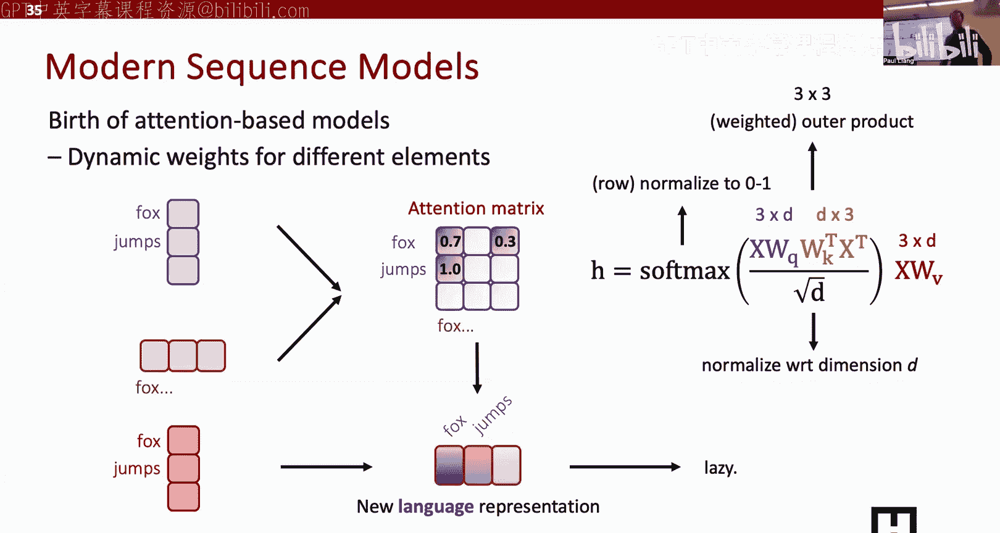

Great， and although they they seem different from recurrent models。

 they're actually not that much different Okay， going back， applying it back to a unified framework。

 you again want to remember that sequential data， any model for sequential data must respect invariance to time。

 but equivariance to word order。And in this case， you still respect those properties right first of all。

 you are still doing parameter sharing across time steps。

 each of these words that come in and get embedded through your transformer。

 they're going through the same learnable transformations right W W and W right there's three sets of weight matrices that are essentially repeated across time。

So this parameter。And this parameter sharing allows this model to be invariant to time。

 so whether you shift the sequence back and forth or you pad it by zeros or from the left or right。

 it will still give a same outcome because there's parameter sharing across different words that go in at times。

And in this case， it's still doing information aggreg。

It's just that this information aggregation is not done sequentially where you have to wait for one to get two to get three to get four to get five。

 which can be slower on GPUs， but rather this information aggregation is done in parallel using matrix multis。

 it is getting the whole five by five attention weights and doing that attention in one goal。

So it's still going to be equilibriumarian into word order because if you kind of permute an attention matrix will be different。

 and then the output will be different。Okay， so ideas are still the same models for sequential data should be invariant to time。

 but equivariant to the order avoid。

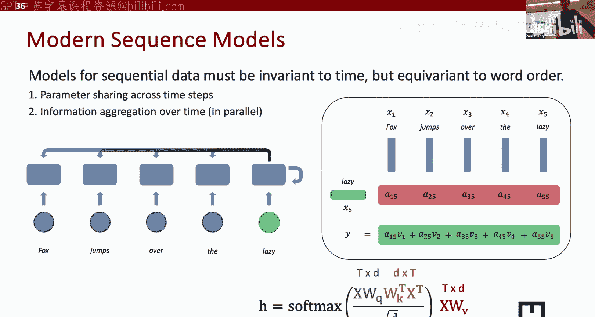

All right， and finally， for spatial data， same question remains， you know。

 how do I learn features for each part of the image and how do I aggregate features across multiple areas of the image to make a prediction？

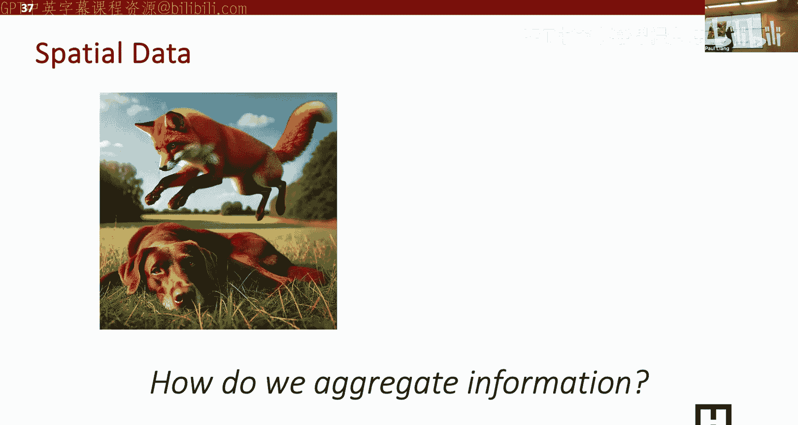

So essentially you want to ideally build a model that is able to break down the elements。

 maybe learn features for each part of the image， maybe aggregate a local part of the image。

 to essentially get more and more information from the image。And how do you do this？ Well。

 one naive way of doing it is you have a image。You just flatten it， so each of these are pixels。

 you can flatten it into a sequence of pixels and you can do a fully connected network to you next layer now。

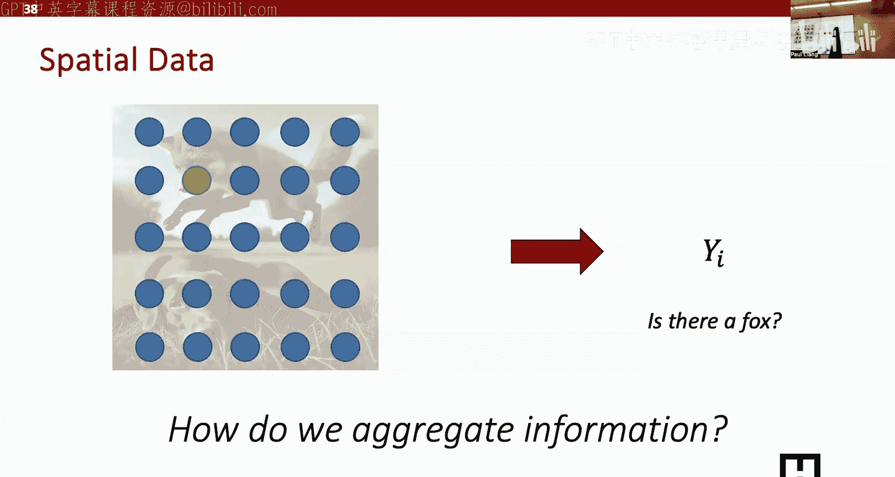

Of course， is a very bad idea， why this this a bad idea if my image is 200 by 200。

And going toオ pixel。And I want to go to my next layer with N features， this matrix will be 40。

000 by m。Which is huge， right so it's not efficient。

And the other big concern is that any model that I designed for spatial data should I give be invariant to any spatial transformations if you know shift my image up down left right a couple of pixels they rotate it a little bit five。

 10 degrees， the output I shouldn't change。If you have a model that does essentially use fully connected network from your pixels to the responses。

 then it is going to be sensitive to subtle shifts up down their height of your image， yes。

I don't understand why spatial data is in， first of all， two blocks right。

 the red one is on top of the black one， so if I flip it， then it's different。就在这里呢。Great question。

 so as I mentioned at a start for thisvari。

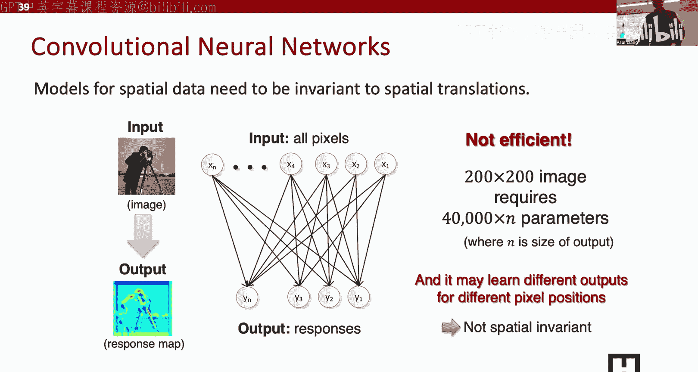

It depends on your data。 So you're trying to do classification。Aplicationcation。

 then it is probably going to be very invariant to spatial orientations if you're trying to do segmentation。

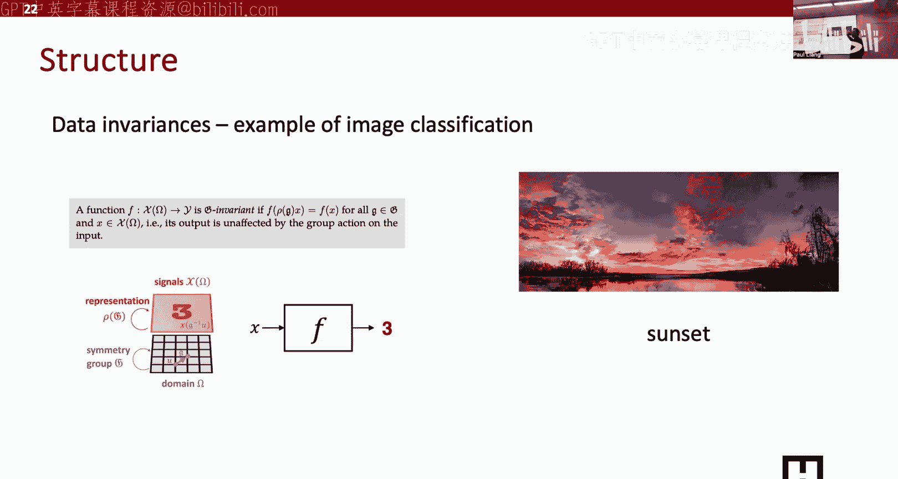

Thenhen you will be sensitive， so it should be equivariant to any shifts and rotations in the case that you describe it depends on what the task gets。

 is it to disclassify it as red and white blocks in which case you can rotate all you want if the goal is to do a semantic back then you don't want rotation and variabless。

え。But in general， most of these models for images， especially doing classification or detection。

 they're going to be veryally。

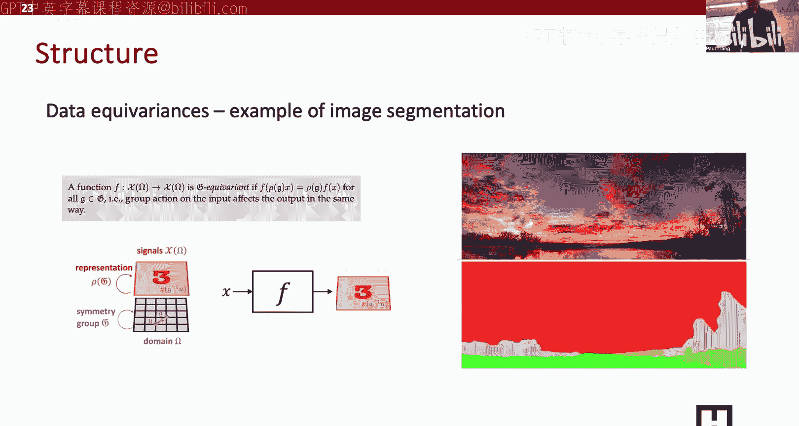

啊。So several key ideas for transformers， again， five minute introduction。

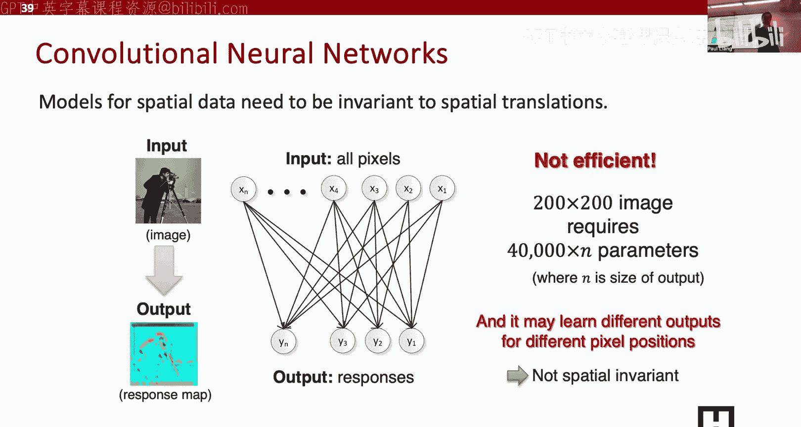

The first key idea is that I don't need to connect all input pixels to all alpha responses if I want to get alpha response。

 for example， for the top right of the image， I probably or should only look at maybe a few pixels in the top right region it should not need to be on the bottom left region of the image。

And the first key idea is that I' only is going to have a sparsely method。

Connections from the pixels to the output， where the connection is determined by some filter size in this case3。

Where every output response only depends on the three nearby pixels for the output location。Okay。

 this gives you， first of all， it saves you autonomy efficiency。And also it respects locality。

 this idea that this output only depend on the small region that it was connected to。

And then I would also make another modification where I would share providers this output depends on three nearby locations。

I'm going to share parameters so the same weights are applied from this output to these three locations。

 this output to these other three locations and these output to these three locations。

Now this idea of sharing parameters essentially gives you spatial invariance because now you can shift your pixels left and right a little bit and as long as it falls within this you know there window size of three。

 it would not change the output。

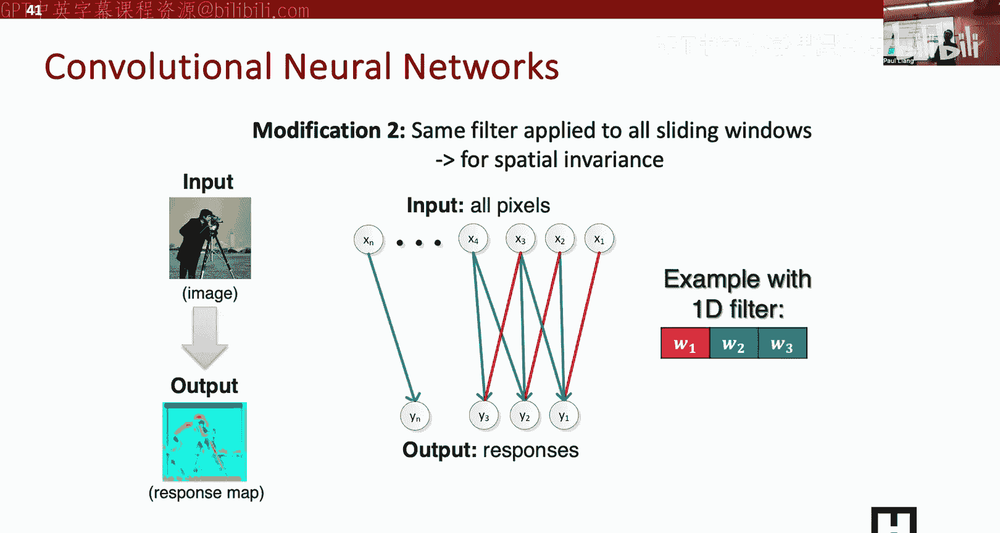

So visually look something like this， I have an image I'm going to face some window size。

 let's say three by3 a by K， and for every one of those I'm going to extract the feature。

By essentially summarizing the information in that three by three region。

I'm going to shift the filter to the next three by three extracted feature and then the next three by three extracted feature and every time I extract features I'm going to use the same weights。

So again， as you can see， its going to be invariant to any small changes within this two by3 node。

 whether you move the cut down the right within that two by3 node。

 it will still give you the same output。And I will complete that with several other layers and will also aggregate information across those two by3 regions。

 it's called a pooling operation， where essentially you have some region， say two by two。

 and you will just take the maximum。So this makes the model even more invariant to these small shifts and changes and forces the model to look at the bigger picture。

I'm just taking a maximum。So again， same building box is just evolution and taking the maximum just applied across these windows and regions。

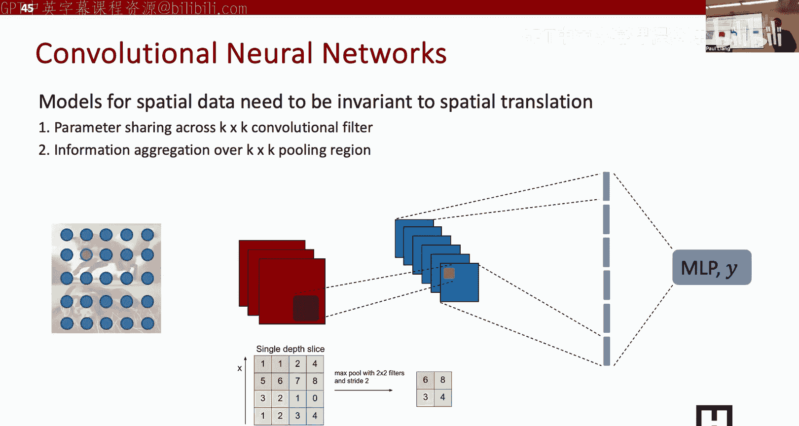

Okay， so to summarize， convolutional layers allow the model to learn these combinations of parts。

 people have shown that you take a pixels， first learns edges。

 and then once you learn a couple edges， you combine edges to learn the straight edges to learn parts and shapes。

 and you can then combine these shapes to learn more complicated things like faces。

So convolution allows a model to learn these sub partss and pooling because it's essentially forcing a model to take a max over a region。

Pouling allows the model to learn more abstract information instead of just focusing on the low level details。

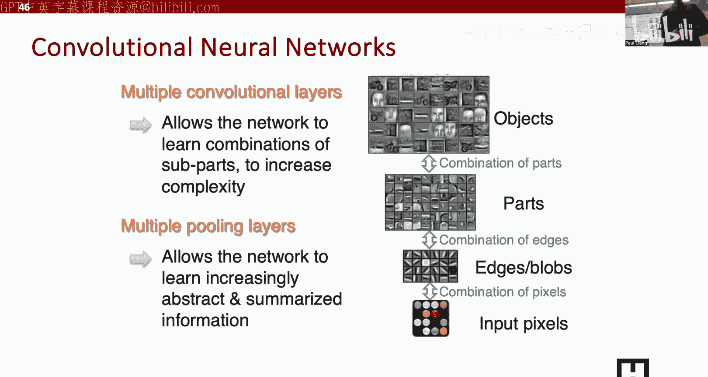

Okay， and nowadays， people have also shifted from CNNs to vision transformers。

 although not as drastic as a shift in NLP from recurrent models to transformers。

 but lot of people use vision transformers nowadays。And to be honest of saying two4ify。

 you still want to design a model that is invariant to any spatial translation。

So what these vision transformers do is that。They cut out。Again， K by three patches of the image。

 so this original image was all these four parts together。

 now theyre carrying up the image in different parts。Each part might be K by K。And youd feet。

These as a sequence of four image parts， just like how you were treat it as a sequence of four words。

 you apply your transformer to it， essentially learning features for every part by computing attention scores with respect to each of the other three parts and itself like gives four scores and extracting a feature by using these four attention scores to take a weighted sum of each of those four features。

Okay。But again the same ideas apply， first of all， you still do parameter sharing across each of these K by K regions。

 right the same parameters used process as this part and this part and this part this part。

 so you're still parameter sharing across your four regions and youre still aggregating information across of these patch。

So therefore if these patches are suitably designed。

 then again the model is not going to be very sensitive to any small shifts and movements across those patches。

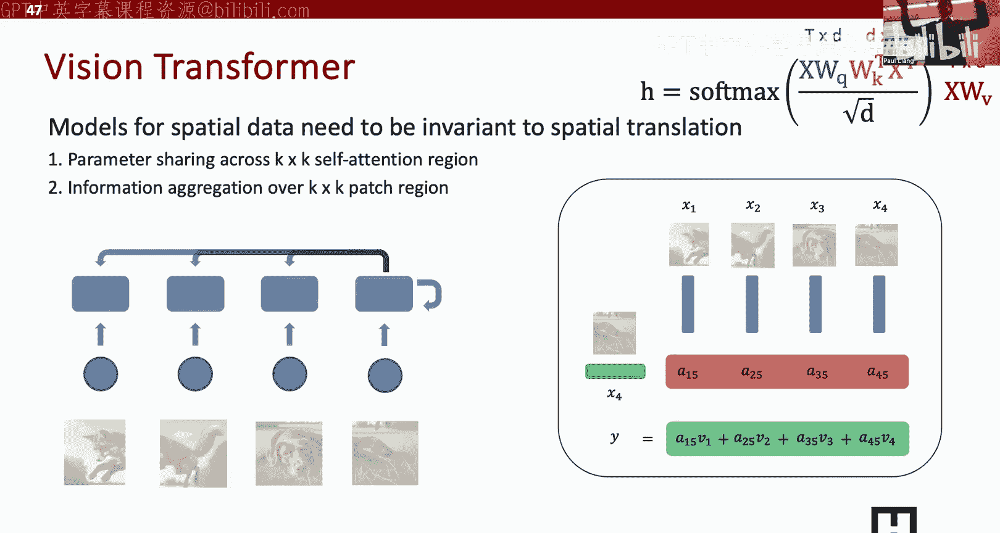

So you can think of these mis patchching as similar to these conal areas。

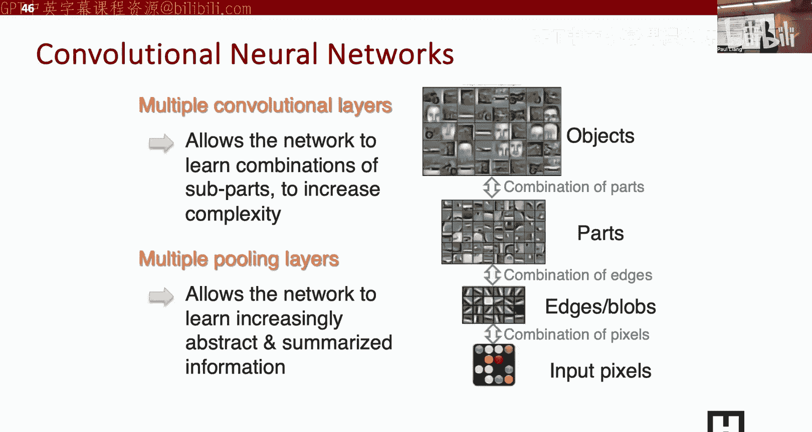

Don't have for。ok。

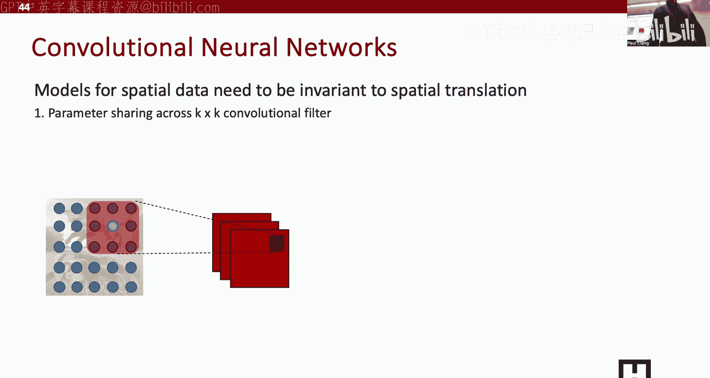

And this is just vision transformer animation， so taking an image。Ping a sequence of patches。

 applying some sequence settings and then learning a transformer to take your pairwise attention to get an overall representation for the image。

All right。Finally， graphs， okay， so graphs are again a form of data where you have some nodes and maybe there's some connections between certain nodes with each other。

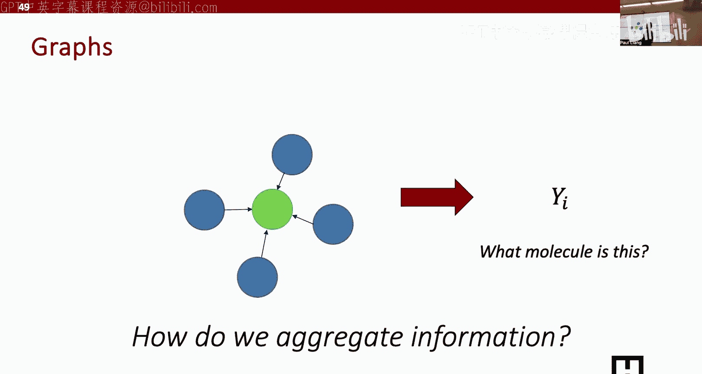

For graphraph networks， again， the same idea applies first。

 how do you learn features and how do you aggregate features？

So the key idea for graph networks is that again， you want to share parameters for each node。

Because if you don't share parameters， then you wouldn't be able to generalize to new nodes or new graphs and this idea of information a。

 you want to just look at what features are in your neighbors and extract those features from them。

So let's say you want to learn， feature a representation for node A， for example。

 A is a person in your social network。Well you want to learn a feature for it。

 we will first look at what neighbors are okay， so you might need to look at features or CBDBE。

 which are As friends in this social network。But to learn feature for C， C only depends on A。

D only depends on A， B depends on two friendss， A and E， and E depends on two friendss A and B。

Right so you essentially design a model like this okay this is the same it's just a neural network schematic where you want to learn a future by take in the embeddings。

Of the neighbors with that feature going through some non nonlinear transformation and the neighbors will then depend on their neighbors becauseively。

Right so that's again， like high level idea of graph networks。

 you want to share parameters across your nodes so all of these nodes will do the same function fine and you're agviating information based on the connectivity of node to each other。

You can see that graphs recover sets， graphs sets are essentially graphs with only nodes and no edges with each other。

So the same logic applies right you have some parameter sharing so the same feature we extract for each node and it's just at this time there is no application right so when we you learn a feature for a。

 it doesn't depend on anything else B doesn't depend on anything else so because there are no neighbors。

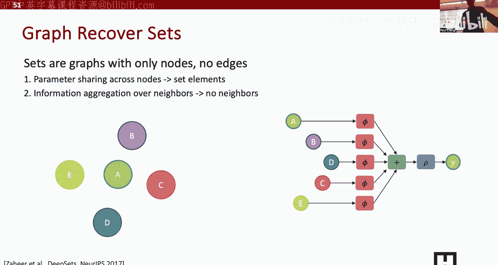

And in fact， you can apply the same logic and show that graphs recover spatial data。

 spatial data like an image is essentially parts that are connected up down left right within some region。

 so there's a one by one region just like this， maybe you'll connected the two and three if you feel that that is a region where the image should be connected to。

And likewise， you also is a generalization of sequences， so sequences are as graph， you chain。

That's why in all these models we've seen， there's always parameter sharing across the elements to the same model processes A。

 B， C， and D。And information aggreg is always across your neighbors or sequential data every information left and right or spatial data you ID information up down left。

喂。So to summarize。That was I don't know， I think that was a lot to put the slides online and hopefully some of you have seen some combinations of these models before。

 but this is just a unified framework to look at multiple deep learning architectures and knowing how to design your own。

So to summarize how to model last weeks how to data。Other model is mostly about， again， how the data。

 how to first decide how much data to collect， how much to label with is super critical cleaning and normalizing。

 removing outliers from your data。Visualizing your data to understand what the relationship between a label and the data and label is。

And finally， it's not an evaluation， as I mentioned。

 a lot of how you need to model your data is going to depend on what are the final outcomes and properties that you want your model to satisfy。

 whether it's performance or efficiency or interpretability to some extent。

And then you would want to choose some model paradigm today we look at more domain specific methods for each modality。

 it also gave you a sense of how to build custom architectures for sets and graphs and so on and the next couple lectures will also look at more general purpose models and how to adapt general purpose methods。

So one big decision you've got to make for any AI problem is if some general purpose model exists。

 you may be adapted， fine tune it， or if it doesn't。

 to what extent I want to build some domain specific model either specific in the model architecture or some training objective。

You have to figure out base elements and the representation。

It was always about as we mentioned breaking down complex data into individual elements。

 whether elements are organized in a sequence or spatially or the elements on a set or graph。

 figuring out the base elements and how to represent them。

Figguring out data invariances and equivariances invariances are what the model should not be sensitive to and equivaris are what the model should be sensitive to okay that's super important if you're not careful you can blow up how many samples your model will need to train。

And at the same time， we also figure out other parts of this modality profile that we discussed。

 including。Including what noise the model should be robust to how much information and so on。

 the mod profile。And finally， you usually iterate between data collection， model design。

 model training， hyper parametera tuning， evaluation， and so on， until you are satisfied。

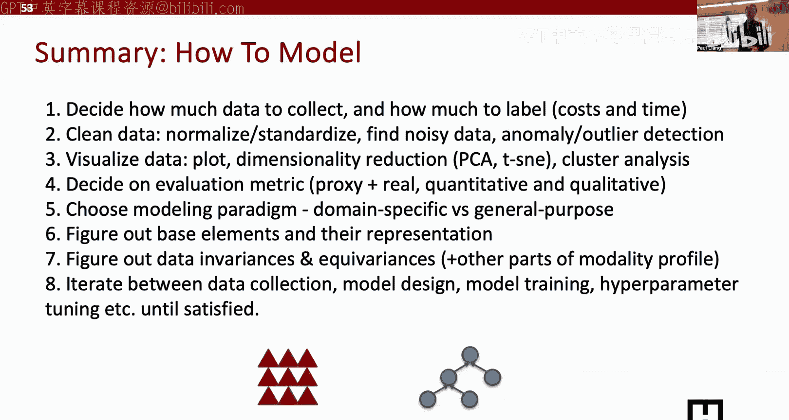

Great， so that's a summary。啊，Remember。Reading assignment due tomorrow in preparation for Thursday's discussion and please submit your project proposals tonight email later to me and I'll be available for the next hour in feedback thanks everyone。

Yes， I'd like have you。