# 《如何AI所有事情｜MAS.S60 How to AI (Almost) Anything》中英字幕（Claude-4-s翻译） p06 [06]Lecture 4 – Multimodal Alignment.zh_en [BV1UhawzQErD_p6]

， very good。All right， we' come back everyone。Hope you had a great week。

Today's lecture will be about introduction to multimodal AI， so logistics first。

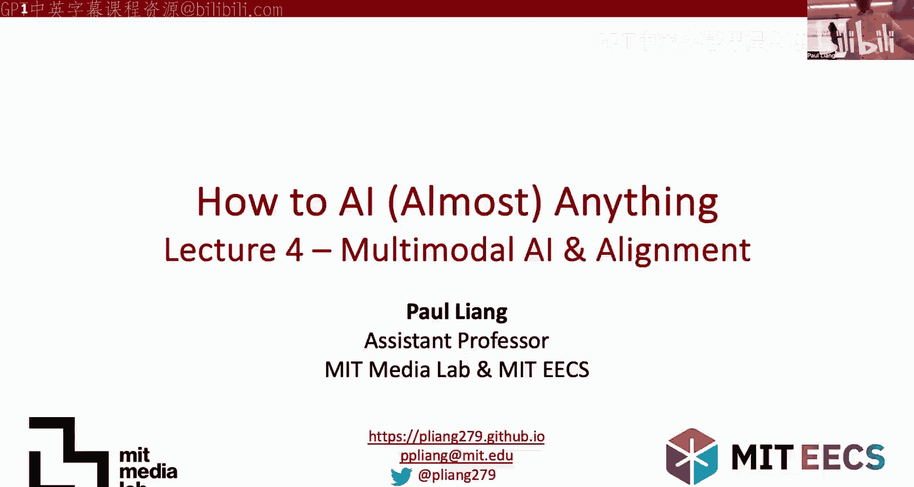

For the project， thank you everyone for submitting your proposals it was all ob pleasure to read Ive tried to give。

😊，P amount of feedback on the proposals， I've also assigned a primary E TA。

 one of David and Chnnya to your projects and I CC them in an email and the goal is to meet with myself in a primary TA out name every week so with me every other week with a primary tier every other week on average every week you get someone to take a look at your progress。

All right， and our goal is really， take these products and really turn them into state of the yard。

Really good research level work。Reading assignments， the second reading assignment is due tomorrow。

 Wednesday in preparation for this Thursday dayss reading discussion。Again。

 two papers mostly around the theme of modern AI architectures。

 one of the papers is about scaling laws of these modern autoregressive models。

 scaling law essentially meaning how what does performance scale as you put in more data and increase number of parameters in your model and surprisingly there's a pretty nice trend to these scaling laws so you could essentially predict what the performance would be as you scale up your models as the first paper。

 second paper also a very interesting insight on perhaps you don't need all tokens to do autoregressive retraining of your models some might be more important than others and what is implications of how you could perhaps more efficiently train your models。

All right， so projects start meeting with us and make progress on our projects and a reading assignment that will be due tomorrow and discussion on Thursday。

Great， so what we've seen so far， we've kind of covered basic foundations of AI。

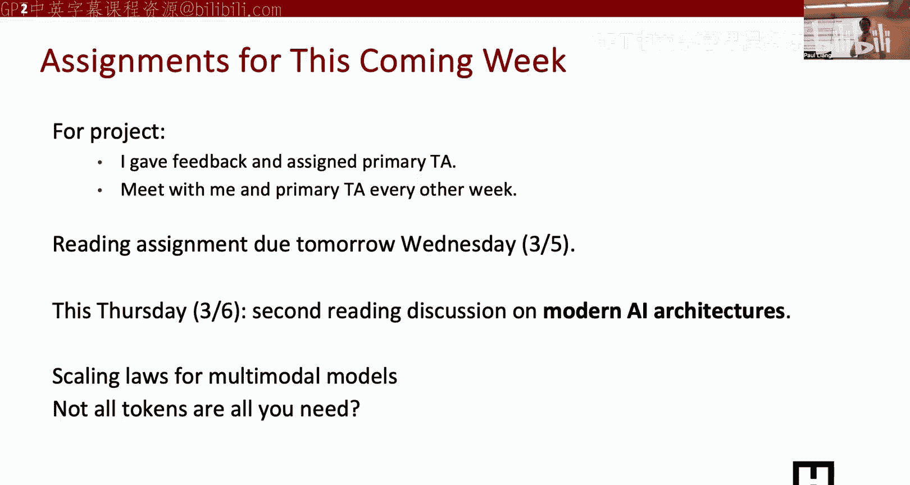

The introduction AI and EliI research， different forms of data， the structure。

 information within them， ways to learn from data and also be covered a very high level。

 a unifying paradigm of different model architectures， including sequential， convolutional。

 spatial and models for setting graphs。

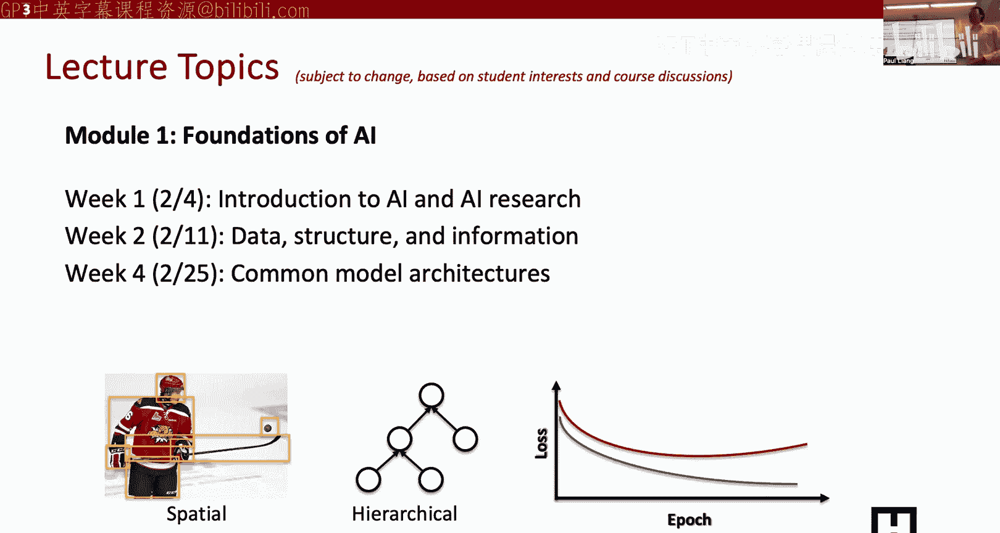

Now naturally， a lot of problems in the real world are also going to involve many different data sources。

 many different modalities， is an active area of research。

 so in the next three weeks up until spring break we'll be covering broadly a bird's eye view on different paradigms and multimodal AI。

Today with my introduction and aligning different modalities next you could be about how you betterfuse information between different modalities and finally week seven we'll look at this idea of transfer。

 you might not have a lot of data in the modality that you care about but you could use some other more common modality to supplement your information。

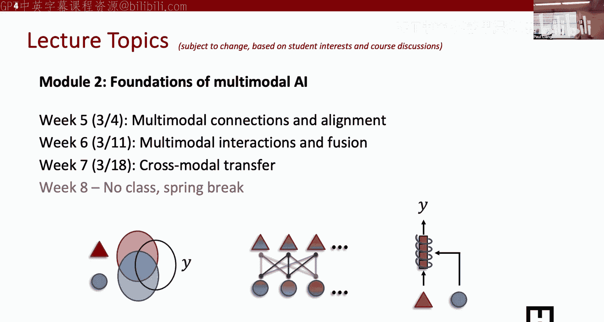

Alright。So that's an overview of today's lecture， introductiontro to multimodal AI。

 some core principles， challenges and diving deeper into this first challenge of alignment。

So before I start a little bit of behavioral history about multimodal AI。

Like many things in AI really started from people who are looking at psychology and human behavior。

And before this psychologist called David McNeill， before he did his line of research。

 most people thought that you know we primarily communicate using language and anything else such as our gestures and our voice was just secondary。

 not very useful that I would not displace language。

And David McNeo came up with this experiment it's called the MagG Eect。

 which really showed some of the predominant thinking at that time。

So I demonstrate this effect by playing two videos and I want you to just quickly tell me whats the similarities and differences between these two videos。

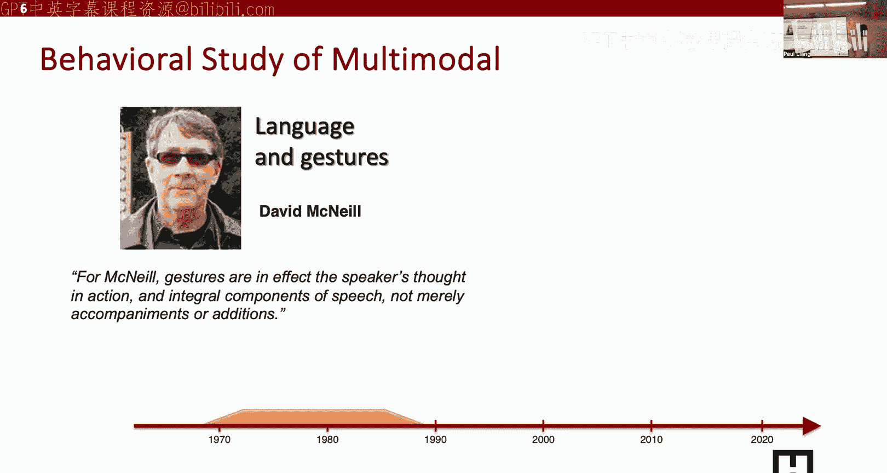

So here's the first one。把把把。把把把。Okay， first video， and here's the second one。把把把。把把把。

Who can tell me what is interesting， either similarities or differences between these two video clips？

M similarity in visual information， but in sound， first one was bought and the signal was bought。

 even though like very well masked。来我。Similar in visual information about different and sound。Yeah。

 anybody on can counterpoint yes， I'm not sure that the sounds are different I maybe just the visuals are different and since the loo lips look differently you think it's。

And Austin， you have some thoughts as well？So if I didn't have the visual information。

 I would like to follow it was the in it seeing that the rule information be delivered。Yes。

 so I thought you raised your hand that's why I called on but anyways that that is you know that that's I think most of you got got the key idea of course when I give this talk to many people have the people on the laptops so they' go oh have you even played the second clip yet because if only the laptoping when you're listening to it realize that the audio clips are exactly the same。

if you start looking at the person's lips， you can see that the first person is doing P with a B。

 second person is doing P with an F。So our perception。

Of the same audio clip can actually be very different based on how a person is a here。

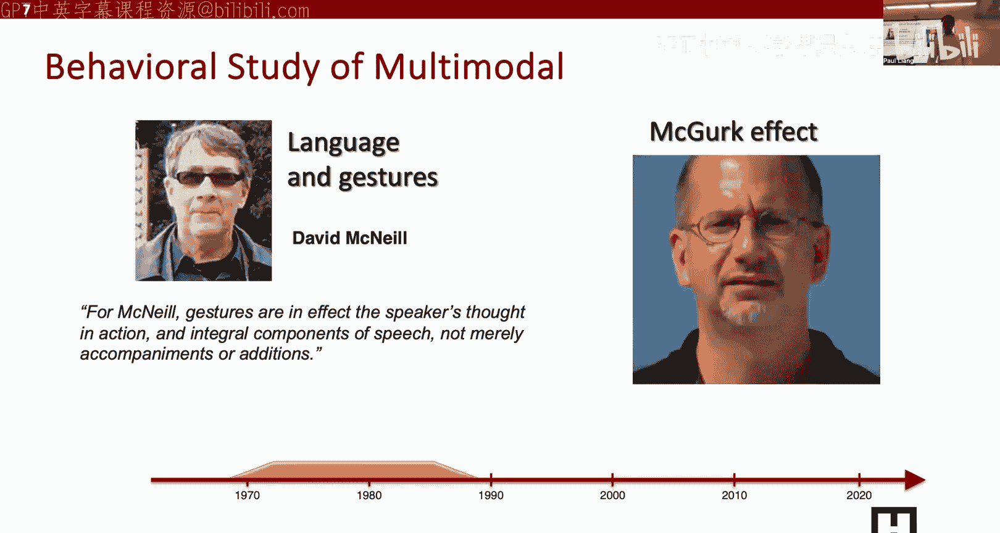

So that really kick started and kickstarted this first era of multimodal research back in 1980s。

 which is this behavioral era， realizing that people。

 when we recognize speech from others and interact with others actually use actually a good mix of different communicative modalities。

There that was more behavioral era， and then naturally there was an ambition to build AI tools。

 computational tools that could replicate this behavioral perception of different modalities in humans。

After the single computational era using AI to just replicate in this interaction era where multimodal HCI and multimodal interfaces became really popular。

 so you had AI and human interacting with different modalities。And finally， nowadays。

 we have this deep learning era， ever since the 2010 s， we've seen huge amounts of GPU。

 huge amounts of data， huge amount of large models that have really revolutionized this space of multimodal AI。

And of course， as' a suber， there's a foundation model era that really started the 2020s where we really seen the limit of scaling sorry。

 the huge potential of scaling these large transformer models for single modality and multimod tasks。

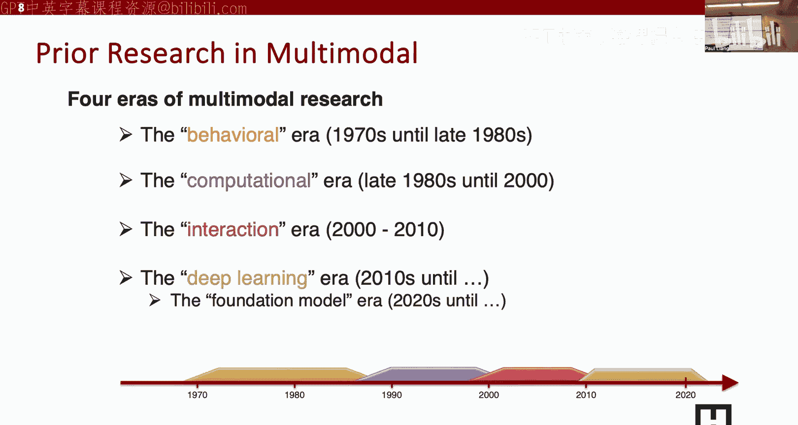

So just historically， what tasks did people care about， I gave the example of。

Audio visualual speech recognition， or your goal is recognize what the person was saying from both audio and visual so that started from this behavioral era and actually was the first kind of task that people applied computational methods to audio visualual speech recognition。

Soon after came a lot of this early boom and internet based data so there was lots of interest in building systems that could digitize multimedia data on the internet。

 so given content can you retrieve videos。And soon after that。

 there was also of interest in recognizing human affect and emotions from our multimodal behaviors。

Once you started getting into an interaction era， there was systems based on recognizing events in videos。

There's work in recognizing sentiment and emotion of multiple people interacting with each other。

And something I really kickstared some of this， you know。

Multtimodal deep learning was on image captioning， so if I give you an image。

 can you come up with the right caption for the image？啊。

And that was kind of the birth of modern language and vision research。Of course， within the past。

A coupleup of years， we've really seen a ton of applications in multimodal different。嗯。All right。

 in multimodal deep learning from。Caaptioning images to captioning videos to writing descriptions of videos to and then people found that captioning was really cool。

 but it was really hard to evaluate right how do you evaluate whether given captioning for image or video is correct it's so subjective when people convert captioning into question answering so if I give you a question about a particular video or how do you train an AI system give you the right answer。

So that was visual question answering and again people have extended that to video based question answering。

And then he went from static systems so just writing one caption and answering one question。

 AI systems need capable of holding multimodal dialogue。

 so given a particular image referencing and conversing in a dialogue with humans about those modalities。

More large scale YouTube data became a source of data to pre trained up all of these video models that could recognize and caption and retrieve different types of videos。

Soon after， we saw a lot of work in。auutonomous agents。

 so this was agents that able to navigate using vision and language。

 so you might give it some instruction like go there and then turn left at the nearest gas station So those are agents capable of navigating based on vision and language。

And of course， self driving cars also do a lot of multimodal fusion of different visual language and sensory information。

And nowadays in generative AI， we've seen a lot of applications that are taking in text to generate images and videos。

 right these generative text to image videogenrative models。And finally。

 probably the biggest application today is these interactive agents。

 interactive agents on your computer and your robots。

That can take in lots of data and are grounded in either the digital or physical world to complete difficult tasks。

And many， so that's just a brief history of various taskss saying multimodal AI that has made an impact on。

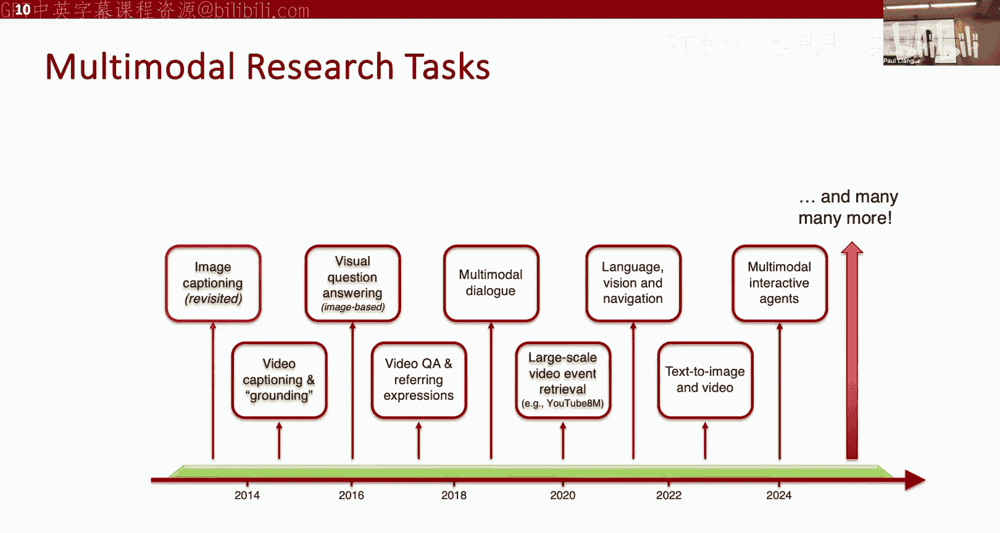

So in the first part of today's lecture， we're going to just cover an introduction of multimodal AI and then the second half will dive deep into some of these core methods。

And a lot of this will be based on the serial paper that we have on foundations and trends in multimodal AI。

 and if you're interested in longer versions， we give tutorials at international conferences。

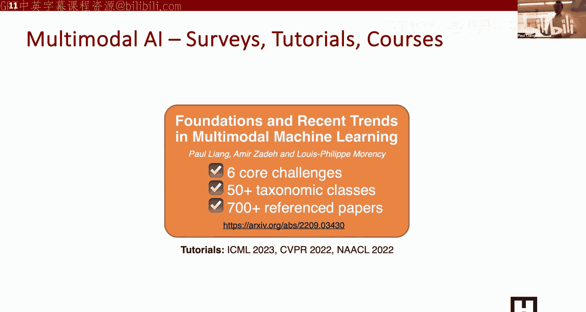

So firstly， what is a modality， a modality is some data source representing a way in which information is expressed or perceived in the world。

So like all forms of data that we've seen in AI， you think about some sensor。

 which is collecting your data， such as cameras or microphones。

 and you think of it as a spectrum for more raw modalities closer to a sensor to more abstract modalities that are further away from a sensor by doing more processing。

So you can think of a raw speech signal from a microphone or a raw image taken from a camera as raw modalities。

If you start extracting language from a huge signal， you can detect objects from images。

 you can extract sentiment from language and you can categorize the object so all this becomes more abstract information that you could even represent as words right positive sentiment or this is a table or this is a chair。

And as we've seen， you know the raw data can be very different all the data comes from different types of structure and different dimensions。

 but as you start processing these different data modalities using AI systems like these model architectures that we've seen。

 you're basically learning abstractions， you're learning abstractions and semantic information from different forms of data。

 so there's a possibility of bringing them closer together with each other。

So multimodal problems are therefore those with different modalities and when different modalities。

 multi modalities are in the picture， there's often several challenges。

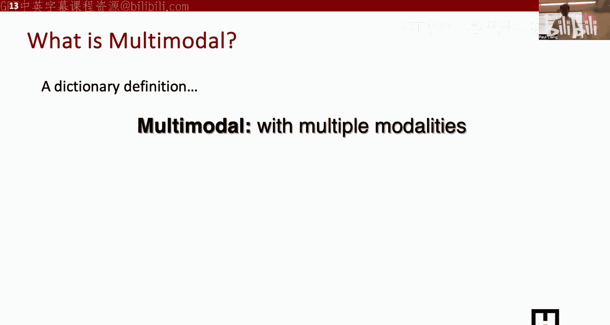

啊。These are challenges of firstly heterogeneity， the fact that different modalities are very different and processing them together will cause difficulties and the idea that there are some interconnections between your modalities。

And we break down this work is connections into first connections， so just two modalities themselves。

 having some connected and overlapping information and this idea of interactions that there is some fusion that goes on to create new information when they're brought together for some fu。

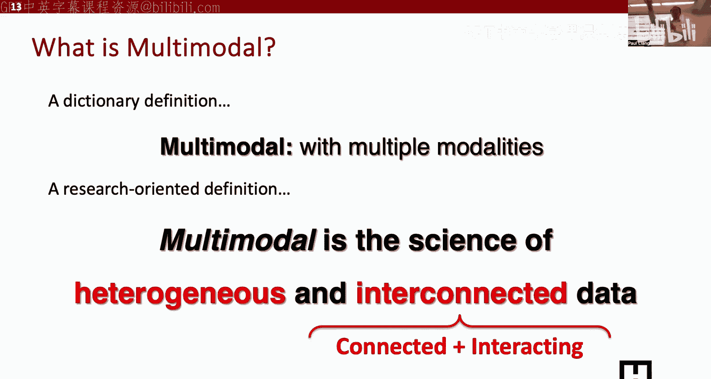

So in more detail， this idea of heterogeneity should again be seen as a spectrum。

Representing more homogeneous modalities with more similar qualities and representations。

 with more heterogeneous modalities with more diverse qualities and representations。

So you can think of images from two cameras as being more homogeneous。

 they're both visual modalities， they both have this spatial structure。

 they're both sensitive to the same type of noise from your camera blurs。

 so they're more homogeneous but again they're giving you different information right different angles。

 different viewpoints of the same object。And then you can think of something that's more different。

 for example， text from two different languages， English， French， English， Chinese。嗯。

Different language families would have different structures and different grammars and different vocabularies。

 But， you know， they're still kind of similar because you can train a model to translate between one language to another。

With sometimes perfect information and sometimes losing a little bit of information。

Then you can think of language and vision， images and text are much more different。

they start to see the differences and you can even go to something a language and sensors。

 which is more different because at least envision a language you can think about a language to describe the image。

 but is there even a language that can successfully describe sensor data so these are more different modalities yeah do mean by here。

诶。So everything in the modality profile that we've seen， so the base elements themselves。

 the distribution of elements， whether the data is。

 isto continuous what kind of information they contain。

And I just highlighted the structure and representations because so sorry。

Perhaps slightly more important qualities to consider it's not about the image quality or the language quality it's just about the mod Yes。

 the the。The yes， not， not actual quality， but just the the profile的。

Information and properties of the modalities。O。And。

Abstract modalities are more likely to be homogenous you've seen raw modalities are those that collected closer to the sensor。

 so raw image and raw sensor data， abstract modalities are the ones that undergo more processing。

 so extracting whether I'm happy or sad from my speech signal and whether I'm happy or sad from maybe my physiological sensor。

 so abstraction allows you to essentially bring heterogeneous modalities closer to each other。

All right， so that's the first principle the modalities are heterogeneous and therefore different。

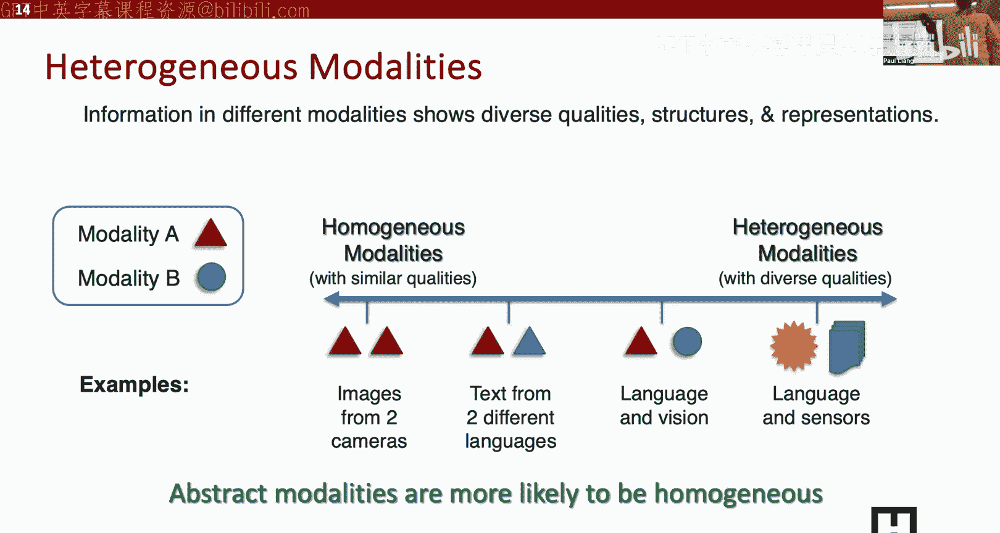

The second key principle in multimodal learning is the fact that when we just look at these modalities。

 there's often going to be some shared information that connects them together。

And again you want to think of this as a spectrum， sharing a unique information。

And cases where there's more of overlap left。Less overlap and in these settings where modalities are completely independent from each other with no overlap。

So given any any pair that for example， co occurs in the world， for example， image and text。

 you can see that there are some connections they're both describing TC and sofa。So for example。

 there's long information in the image that is not captured in the in the caption， for example。

 the color of the sofa。The size of the table， even the presence of the table。

 all these are not really captured in language。So modalities in general have some connections but not perfectly overlapping in。

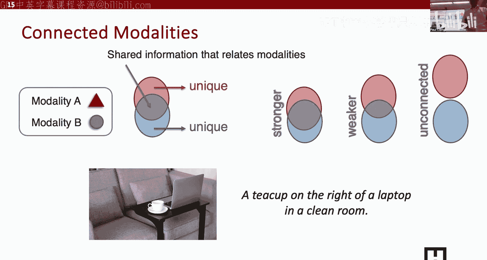

And finally， interactions so interactions describe this phenomena where when you bring them modities together and you try to combine them。

 some new information will typically emerge through your task。

And so throughout these modalities and your task， one type of common interaction that people care about is。

 this idea of redundancy where both modalities give you some common information and your goal is to really exploit this common information。

So you know I'm saying something positive like this movie is great and I'm smart at the same time。

 then this idea of redundancy， you're reinforcing the idea that the person really liked the movie。

That's in opposition to uniqueness where there's only information in one， not in the other。

For example， you're saying something slightly positive。

 like the movie does a good job developing the characters with neutral facial expression and one of these has a unique information。

So the challenge here is to identify which one has the right information and which others you should maybe throw away。

And finally is synergy， so this the idea that this information only emerges when you de use the modalities together。

 they might be saying something wow it seems positive but with some anger or frustration on your face and then you can infer that this person might actually be sarcastic about this topic。

So you have to look at both， you have to compute that there's some differences between the modalities and that indicates sarcasm。

So that's a key idea of interactions， so at a very high level multimodal problem， so I go with that。

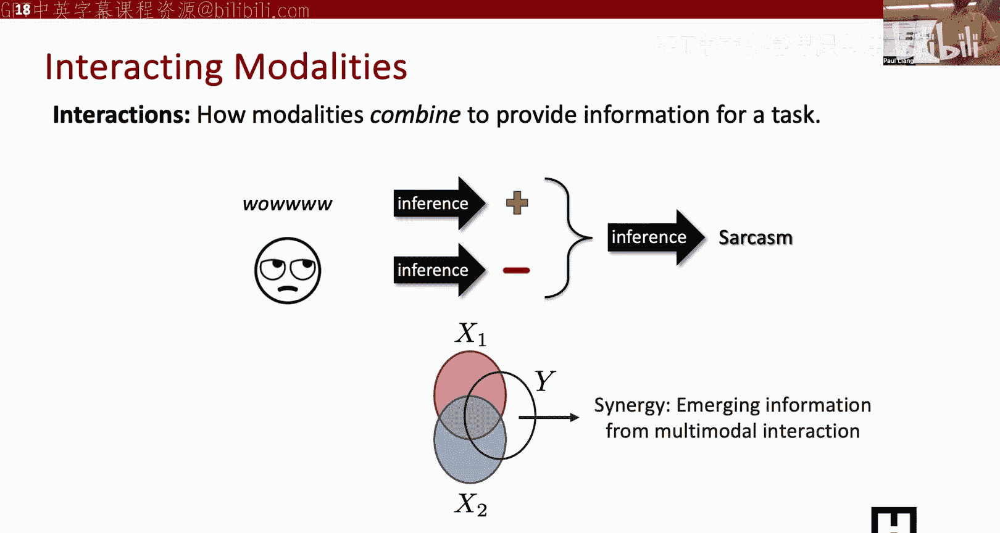

Involve heterogeneous。Connected and interacting data。

Hederogene is because inner sources are different from each other and there's difficulty in processing different sources。

 connections， because these modalities overlap in some information。

Interacting because different parts of the information are going to combine when you try to fuse them together for some task。

Right。😊，So， that's a brief。Explanation of what multimodal problems are。

So then we'll cover why is it hard what are some unique challenges in multimodal AI that are typically not seen as single modality problems like computer vision and NOP separately。

 and what are some of the state of VR methods to deal with these challenges。

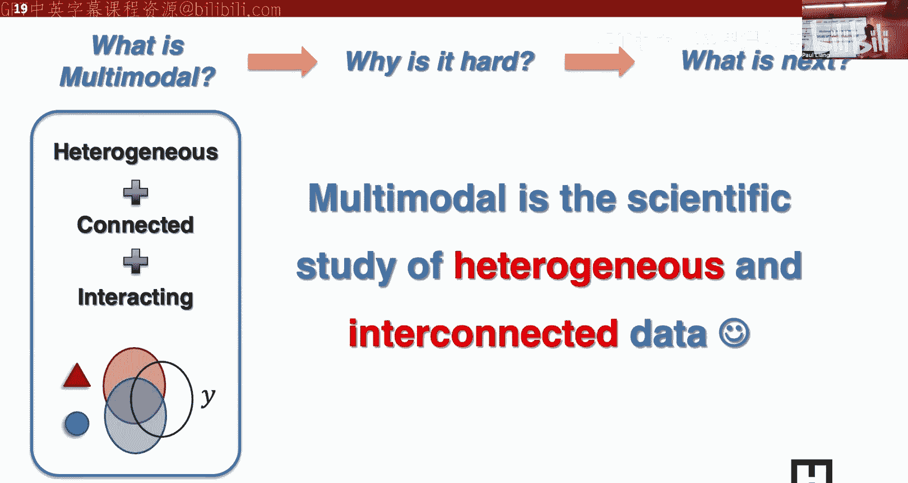

So all of these multimodal models look something like this， so multiple modalities。

Using different colors and shapes to represent them。I'm also， breaking down these data elements。

 right？These might be words in the sentence that you're saying。

 it might be image regions in some big image that you find the process。

 it might be time steps in long range sensor data that you're looking at。So just like how， you know。

 in all of our discussion about machine learning， is all about breaking things down into individual parts。

 learning representations and then aggregating information。

 we're going to use a similar schematic over here。And typically。

 you're designing some AI system that。Brings it together as input multiple of these modalities。

And I don learn a representation。Or predict a label。As the output。

So essentially what really goes in here and what are the challenges designing the components within this block。

So at high level there's going to be six challenges。That makes multimodal AI difficult than unique。

 interesting to study。

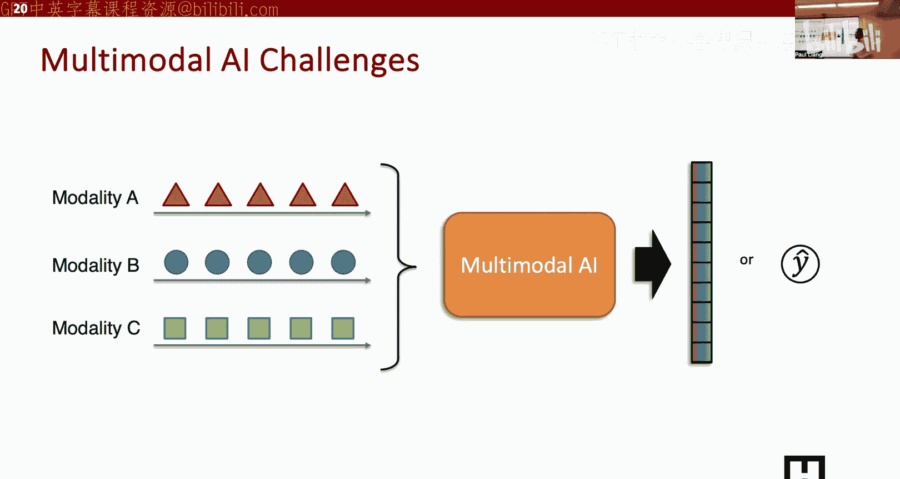

The first challenge is this idea of representation right so you have data there's different modities there's some heterogeneity between them。

 how do you learn the representations that you know can essentially bring them together and combine them in the right way。

So representation is often a core building block and almost all problems right when you start with data that's raw it's just collected the first thing you always want to think about is how to represent。

Your modalities。So for simplicity， again， this is a schemic you might have data coming in with have different elements。

 for example， multiple words that you're saying， multiple time steps and sensor of data。

We're just going to look at it more simply as just one element in each。

We just want tot care about representing one element of each and ignoring the rest。

 we'll look at the rest and the subsequent challenges。Okay。😊。

So there's three key ways of doing representation， each achieving different purposes。

One way of doing representation is what we call theater right so you take in two elements。

 you might have already some representations for them separately。

 but how do you bring them together into one common representation that best uses the information in some appropriate way。

This fusion might exploit the overlapping the information in might be one that picks the right modality depending on information or maybe it might combine them in more sophisticated ways to capture some synergy between them。

So in general， one class of methods is called fusion。

Second policy methods are what we call coordination。These methods take in your two elements。

And learn representations separately for them， you have one the first one one for the second one。

But it's not independent because they're going to align these two representations using some similarity function。

 so enforcing that there is some structure between these two representations that you learn。

all our research that goes into how， for example， you can define this alignment between them。

This is more useful when you might want to do retrieval， for example。

 you define this function as you know cosine or dot product singularity， and you can take something。

 learn a representation。Find the nearest one in the other modality and therefore retrieve the closest in the other modality。

So going from image to retrieve and your miscaption。Or vice versa。Okay， so as coordination。

Vision is this another kind of final example where you start maybe with two elements。

 and now you're trying to learn a partition space that has more representations than the number of modalities that you start with。

And this can be very useful if you want to learn more disentangled and more interpretpreable features。

 where some of them captures overlap between the two of them。

 one captures what's unique in the first。And one captures what you need in a second right so now you have three representations for two modalities and you could go even more。

So three general ways of learning representations divided by whether you're reducing and combining representations to keeping them separate you actually learning more representation that captures。

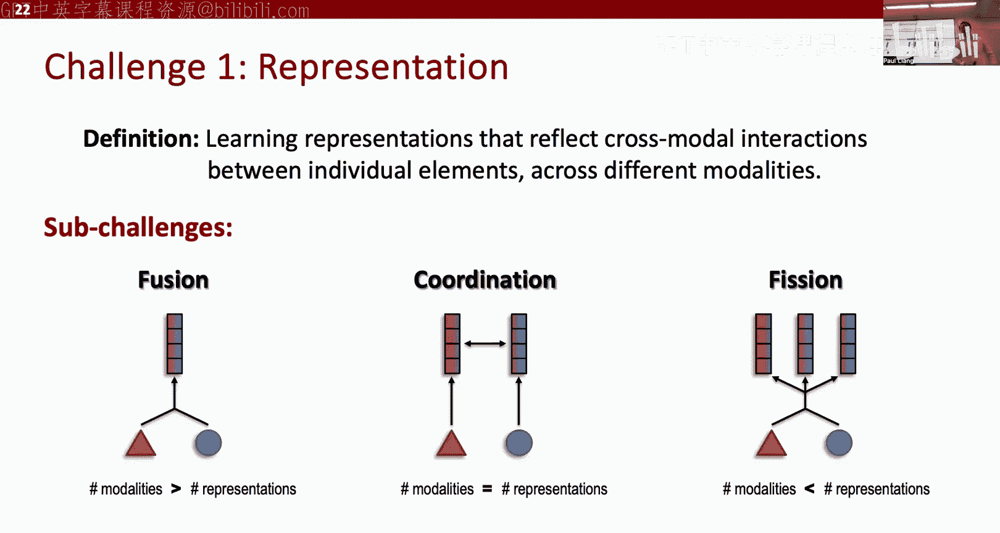

Different information。All right， so that's the first challenge of representation。

The second challenge is alignment， so as we've seen。In representation。

 we just focus on one element one and one element in the other。

 of course in most problems you have elements in some sequence。

 following in some structure right you have words that you're saying across time。

 you have image regions in some spatial image you have sensory data also across time so alignment essentially studies this problem of how do you align your modities at both element level and at a global level。

嗯。So one example is， for example， you you might saying something and trying to describe an image。

 which word that I'm describing， for example， a person actually matches the image vision showing a person right I'm saying hockey stick。

 which part actually relates to the area of the image that that says hockey stick。

So learning this mapping between your modalities that captures the parts that are similar。啊。

Semantic information。

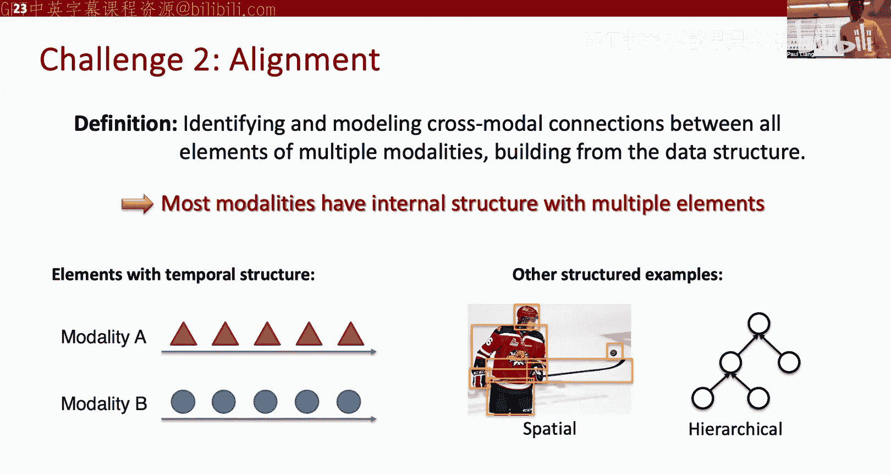

So several sub challenges here， one sub challengege is the easiest case where。

modalities are all subdivided into discrete elements。For example， words are discrete。

 image bounding boxers are discrete， and the goal is to essentially learn this language。

Which word corresponds to which region in the image。

 which other word represents some other region in the image。

 so solving this matching problem to find the alignment between your two two mods。

So that's called learning discrete connections。A second such challengege is a more difficult version where you no longer can segment your data cleanly into discrete boundaries and your data is more continuous。

So let's say you have some high frequency sensor data， medical data and so on。

 this continuous of sensor data。And at the same time I want to align it with something a doctor is writing or this part indicates that your heart is palating。

 this part indicates that a person fell down， so how do you do this segmentation while also matching it。

 aligning it to the other modalities so you have to add this step of doing this segmentation and disretization of continuous data。

And while the first two aimed to just achieve the alignment and that was the goal just to find a matching between new modalities。

 this third challenge is to use alignment to learn a better representation。

 so we call that contextualized representations。Doing better representation learning by contextualizing how it matches with other partss。

 you know a lot of work nowadays and multimodal transformers essentially falls into this because I'm trying to learn a better representation of you know some language by looking at other words in its context and perhaps also looking at parts of the image that are given as context as all of that is to learn a better representation of words by taking into account how it's aligned with other words and maybe other other images。

 other videos。So sometimes you also call these two explicit alignment because alignment is explicit and the alignment is what you're trying to do as end goal。

We sometimes call this in alignment because alignment is just some intermediate step to learn a better representation。

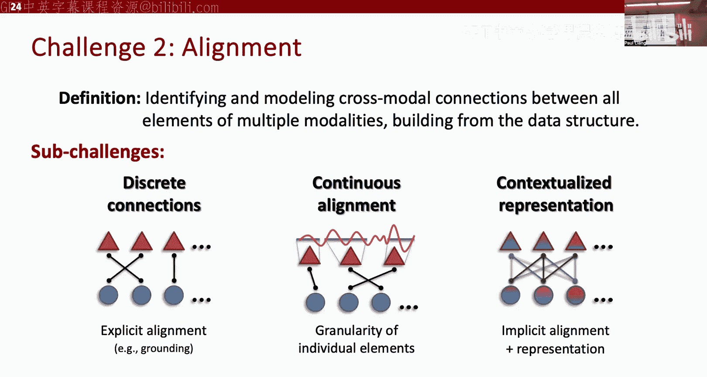

Challenge three is reasoning， so we've seen in representation how do you represent？

One element and one， and one element in the other。In alignment。

 we've looked at how you could learn the connections between multiple elements and multiple elements。

Reing essentially aims to take all this information。

And combine it through multiple infferential steps to make some prediction。

And when you think about combining information through multiple steps， you know。

 at some point people were doing it using multiple layers of neural networks each learn more and more extracted information。

That's closer and closer to what you want to predict。But nowadays， as all of you have seen。

OnSo media， there's a lot of interest in doing this reasoning more， more explicitly。

Am I combining my information in a tree structure， in a graph structure。

 do I use attention maps to say， I first look at this part of the image that a person who's behind the other one and then I look at this part of the image to show that the person fell down and so on。

Or nowadays you can even use words as an intermediate medium for reasoning。

 you have these otherlums that can not just make predictions but can really explain step by step。

I first do this then do this and look at the image and combine it with this and therefore this is what disease a patient might have。

Words can also be used as intermediate step to reason。

So a lot of work and reasoning is about first defining what the structure is the sequential one step to the next and how many steps is it some tree or graph how do you dramaize intermediate steps know there is attention maps which are more visual words which might be more language and of course you cannot do reasoning without some external knowledge need to know about the problem and know what are good reasoning sequences before you can do it for AI systems yeah do we know if like reasoning actually improves multimodal inputs like like chain of thought is typically used in just the language domain but I've seen a lot of examples where if you use chain of thought reasoning with like an image that it actually performs worse。

We're going to have a whole lecture on reasoning and state of your reasoning so only things that happened in the past year my students are helping me prepare that lecture and theyd be helping to give it the answer is。

Reasoning in language is easier reasoning with images might be harder， for example。

 visual chain of thought is harder， but if done right， there is lots of potential。

So we have some research going on that let's say you want to solve a geography problem。

I'm starting starting figure and some question， it be very intuitive if a system could do step by step the mathematical proofs。

 while also step by step drawing andnotating and looking at this angle and drawing thispendicular line。

 this makes a right angle triangle， all these are visual steps。And if've done well。

 you can improve performance and more importantly， make it more understandable for humans。

You don' to actually give it to a student who has a tuing system。

 you need this intermediate language， visual， and probably more forms of more medium of reason。

So we'll look at， we'll look at all this。 Sorry it was very clear this is an overview and we're going to。

Look at the specific models for each each challenge in the subsequent lectures， yeah。如。

To with the model filter the patterns， then on image classification to and they also came into the new structures that retain with model and they assured shown that it actually means。

So it's which is this possible skill ands。

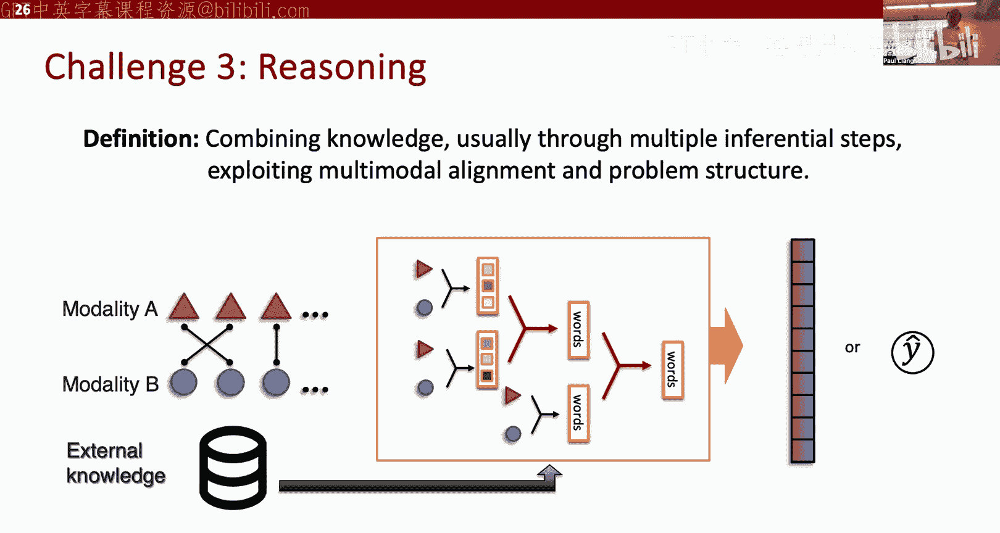

Thanks。Great。😡，All right。Challge for generation so you've seen mostly predictive systems that align and fuse and make some prediction and of course this is a lot of interest in building generative models that are able to operate positive modalities one can summarizeization so you take more data you summarize it into the most important features。

 less translation when you take one modality you try to map it exactly to the other。

 so text to image generation for example text to video and creations have a wholly grail。

 but the one's really be able to do it successfully when you start with less data。

 perhaps like a first frame and you try to generate multiple frames to make an image into a video or make even know music soundracks where video and all music are all synchronize and generate it at the same time。

So that's generation。also work in multimodal geneative models。

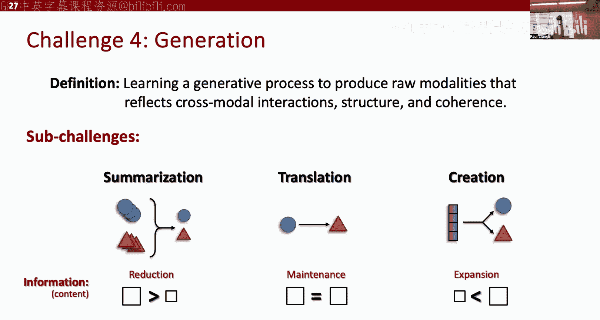

Transference is his fifth challenge where。You might be trying to make prediction in some modity that you care about。

 say medical images。But you don't have to demo much in medical。

 you have much labels and even if you do it might be noisy but many reasons why you prediction and just one that you care about might be unsuccessful。

And the goal is to use some extra results。To help you。

 to help you support your learning and to learn a better representation for the primary one that you actually care about。

So now， for example， you can use to supplement。Image classification models you could use you know back then you could pretrain on imageNe as a second modality to support you know medical image classification。

 many examples of E1 is the extra information to help the primary modality you care about。

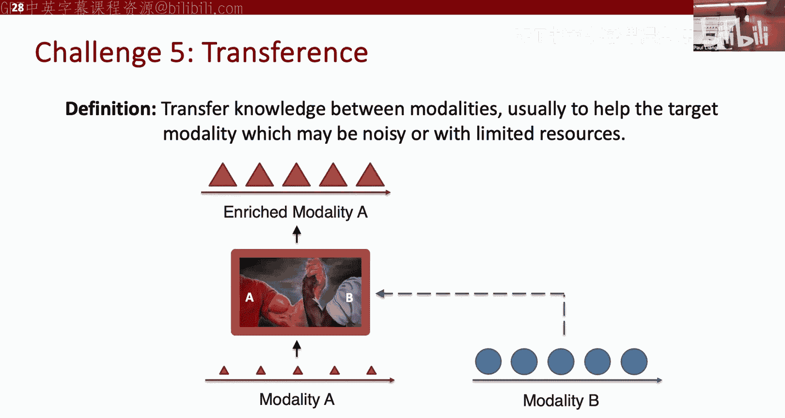

So several ways of doing that。One is to maybe pretrain and then initialize or cover lots of examples of this。

This is this is that called Co learning where you introduce。Some extra information。

 either as the input during training or as a prediction target during training。

if you introduce it as an input during training， you will just zero it out during testing。

 So during testing， you only have。That the modality that you care about using inference on and if you use as a prediction partner during training you don't need it during testing so also just operating on the one that you care about during inference so ways of supplementing more more data as important or more training objectives during training to help you get to a better model。

And finally， model induction class of methods where you keep classifier separate。

 but again you encourage them to share some information to that。Something really good classifier。

 strong classifiers can help weaker classifiers。

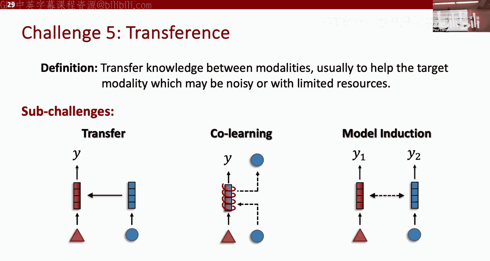

Okay， and the final challenge is quantification。 So challenges one to five are more about building。

 designing new models Cha more about。Better understanding this entire space from your data to the models that you build to the training objectives and evaluation。

So。No， a lot， I see a lot of words， I you know。Measuring how different modalities are formerly is still a challenge and understanding how it influences how the model optimized and trained is still a open question。

 but lots of heuristics， no deep understanding。We have intuition。

 some when modalities are redundant or give unique information， but again。

 none of these are formalized。Can be made formal more through actual estimators and it's not clear how it can again influence the learning process so quantification contains a lot of challenges on just under better understanding themes。

 understanding when they work and when they don't work。

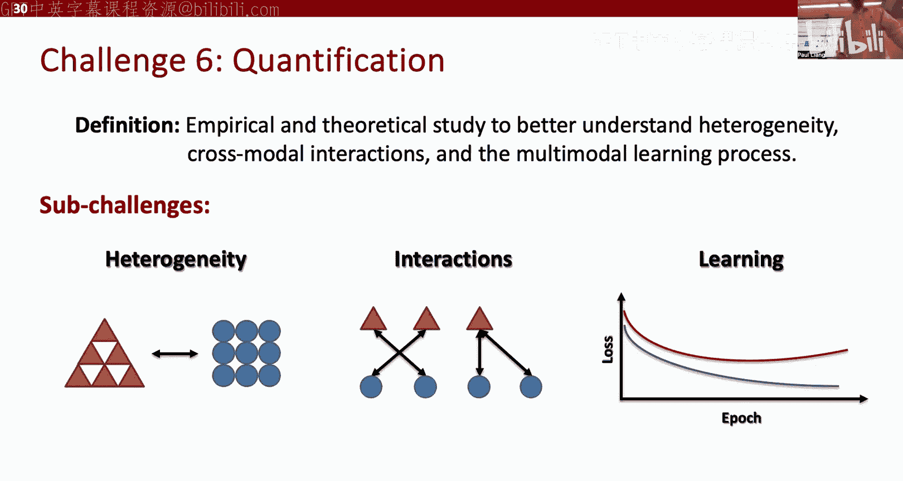

All right。For the summary of these six challenges。Representation alignment are probably the most important。

 given any any problem。You're going to break it down into different elements。

 break down these large data into individual elements。

 and you first to decide how to represent your data。

 are you looking at fusion problems so the goal is to combine， are you looking at retrieval problems。

 you might want to keep things separate and align them， are you looking at fission problems。

Alignment is this problem where now you're trying to match different parts of one side to different parts of imality on the other side。

And often you do representation and then you have to think about alignment。And once you've done that。

 it'd be great if we always did reasoning so that you could maybe break down your problem step by step。

 explain step by step what's going on in language and vision and more modalities。

 and you how to predict your label。When you don't care about predicting a label。

 sometimes you care about generating more data， generating more data。

Some you care about transferring information from one to the other。And of course。

 although it' be great we did reasoning all the time， sometimes people skip over a reasoning step。

And most things are just black box over here。And finally。

 quantification is come with magnifying glass that revisits。

These previous challenges and try to really understand when things work and when things don't in some principle manner。

All right， so this is a quick intro to multimodal challenges， any questions so far。Great。

So in the last about 15 minutes， I will cover。

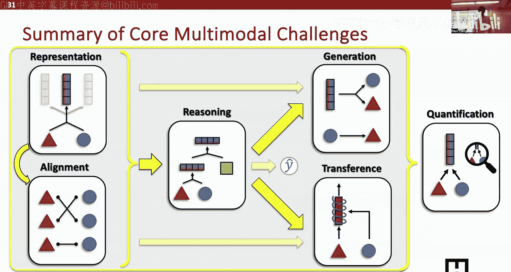

I would try to cover some parts of alignment next week we're going to cover everything about fusion but alignment is kind of shorter so I'll just cover it in maybe 15 minutes so as you call this alignment challenge is broken9 to three it's all about looking at elements and one elements and the other and trying to find out where the connections are where the matchings are。

Is the easiest when your data can be broken down into discrete elements like words then maybe bounding boxes itll be harder when your data is continuous so you've got to solve this question of taking continuous data and breaking them down into semantic boundaries before doing alignment and we'll cover later in the class this idea of learning implicit alignment so using alignment to learn better representations like in these。

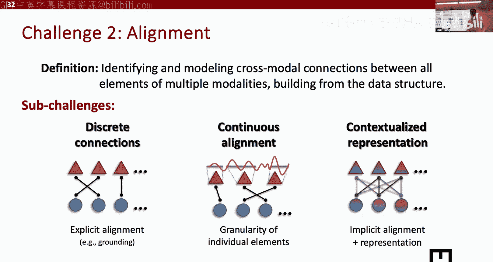

We these large， large transformer models。Right。😊，So again， in discrete alignmentignment。

 one example here is you might try a tie language， which contains words and phrases to non linguistic elements that are more visual。

So for example， a woman reading newspaper you might have data that's only given at the eye level。

 so entire sentences with entire images and maybe your goal is to first align the entire sentence with the entire image at a global level。

 but also maybe at a more fine level， whereas does the woman correspond to whereas does the newspaper correspond to and so on。

And a common class of ways of doing this is contrastive learning。And most of these settings。

 your supervision will come from some pair data， so this is maybe one image with a corresponding caption。

 another image with another caption a third image with a third caption I can get this from。Instagram。

 Wikipedia， Flr， these are all common data sets with pair data between image and text。Of course。

 if you want to do it for a sum application， that's not image text。

 so you could think about how to get the square data。

And oftentimes these representations are learned by putting。Two elements you separate encodes。

 each getting some representation and you're trying to enforce some similarity function between the two of them and this similarity function is what captures the fact that these two representations are aligned and these two representations should not be aligned to HIV be further away。

Okay， so that's usually some similarity function that you can define fine。Right。

So in contrastive learning， what you would do is you try to make this similarity function really high or really。

 really close together for these positive pairs， so images and the actual captions they corresponding to and everything in red are what we call negative pairs。

 so it might be an image and the incorrect caption， right？

There will be auto incorrect captions for that image。

 and you were trying to make the similarity function smaller， so not as similar。

Right and you can even prove that you know these kind of methods。

 they essentially can probablyably learn the common information between two modalities。

 so you formalize common information by the individual information between these two random variables then these class of contrasted method essentially keep everything in the middle and discard everything that is unique in one and not present in the other。

All， so that's a high level view of what people do and learning these connections。

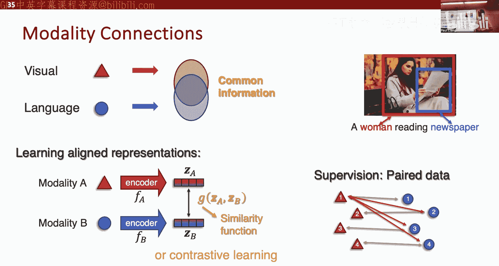

啊。So even more formally these encoders can be designed。

 you can be very specialized so we saw like this roadmap of different model architectures right yeah spatial data you might use know spatial methods like CNNs and vision transformers in you have sensor data you might use other encoders so the encoders can be very different they'll capture what's unique and allality。

And this alignment similarity function would essentially capture the connections， right。

 which representations should be connected to each other which one should not。

So several choices here， what is FAA， what is FB， what are your specialized encoders？

And also why is this gene function， this this similarity function？And once you've designed those。

 so FA on your first Fb on your second， you then compute this similarity function G between those two representations and your loss would essentially be you。

Maximizing the similarity or maybe minimizing the distance between those representations。

And the parameters that you can update are any parameters within FAA， FB， your encoding models。

 and perhaps any parameters in this defining the similarity function。

So several choices of such a similarity function， cosine similarity is a common one。

So you learn Z for the first and Z for the second， these are vectors。

 and cosine similarly essentially says， no are these vectors pointing in the same direction in the vector space？

Very simple to compute， essentially a do product normalized by the norms of those vectors。

People have also designed kernel similarity functions， so you can think of， for example。

 a dot product as basically just measuring whether these two vectors are nearby。

In in the original space， what we call that a linear space。

 there are also ways of essentially projecting those vectors into some other more expressive space and measuring how similar those embes are in that more expressive space。

 they call that kernel similarity functions。Again， not super important that you understand the details。

 but just understand that you can measure the embedding in the original space。Also' sorry。

 measure the similarity in the original space of the embeddings。

 you can also measure the similarity in some transform space that is more expressive of the embeddings。

Something that has also become quite popular are correlation based methods。

 so maybe you don't care about just two embeddings being very close to each other。

 but given a batch of embeddings you want them to be correlated with each other right so 32 images and maybe 32 captions you want them to be correlated perhaps across some axis right so things that are perhaps outdoors。

 it all be on this side， things that are more indoors maybe on this side。

So these are correlation based methods。And you can also investigate， again。

 you don't care about just one element and one matching one in the other。

 you can define these similarities based on pairwise relationships。Right， so for example， again。

 pair up images。These are very similar， and I want a pair of captions。

They describe the English to also be very similar， so these are methods that go beyond defining similarity individual data points across multiple data points。

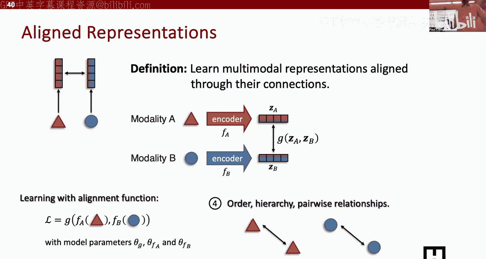

All right。So visual looks like this， you might have pair data， images on some side。

Descriptions on some other side， you will define positive pairs as those that actually correspond to each other。

We have a blue car， yellow bus that can correspond to each other。

Negative pairs are those that are incorrect captions。For your images。

And you're essentially training this function that maximizes the similarity for the positive pairs。

So maximize that value and minimize the similarity for a negative pairs。哎。

And your similarity function can be something like cosine similarity。

And although this is a very simple idea， but you know it's been around for a long time and it gives you some really really cool results。

 so now that you've learned this kind of common embedding space that brings your blue cars next to the text for it and your red cars next to the text event it。

 you can do this kind of your manipulation。

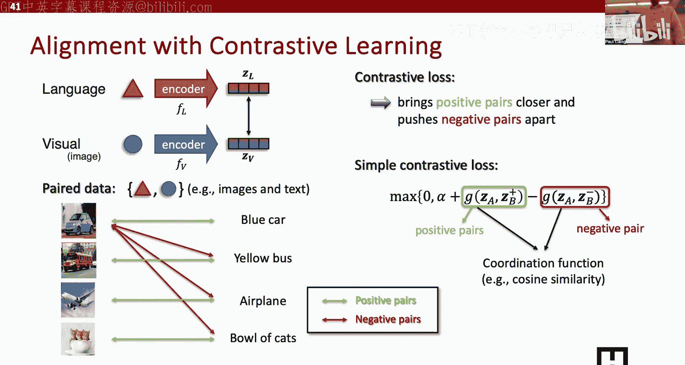

They get take a blue car。Ebed it into your embedding space。

 minus the word embedding for blue plus the word embedding for red that gives you another embedding。

 and you will try to retrieve the nearest image or its own event。And actually get red cars。系い。

You can take a。This is a for example you take on this piece。Cats in a bowl， em into a space。

 subtract the embedding for bold and add the embedding for box。

These are wordbeddings that gives you anotherbe and you find the nearest image and you actually see cats in a box。

And this is this 2014 stuff right this 2014 stuff images maybe be smaller resolution words are just you know。

 two words looking at like bygrams and of course nowadays people have really scaled these systems up。

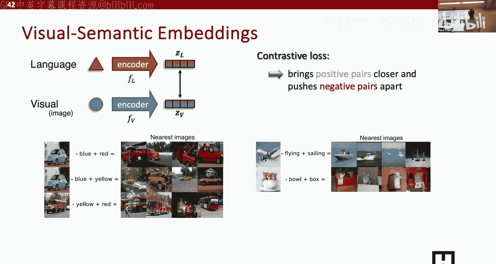

By nowadays ourll view at4 same clip， which is essentially an example of scaling up these alignment based methods。

哪一个。Millions of images， millions of images， millions of capturingtions describing these images。

 and you can again， compute this similarity matrix。

Where entries on a diagon represent those of the image corresponding with the right caption。

And those should be similarities that should be maximized。

 so bringing those together and everything that is offagonal。

Would be representing images with long captions。Everythings off that。

 so those similarities should be minimized。And all of these things here are just just a cosine similarly dot products。

 right， image embedding， dot product with a text embedding。

And that's really basically this contrastive box that you often see nowadays。So sum your data points。

 take the average， take the log to make things numerically stable by essentially maximizing the similarity of your positive points。

And you're minimizing the similarity of your negative facts and sometimes people add the positive points here as well just for computational simplicity。

 but essentially just can be dominated by all the n minus one negative pairs。All right。

 then again a similarity function this cosine similarity。

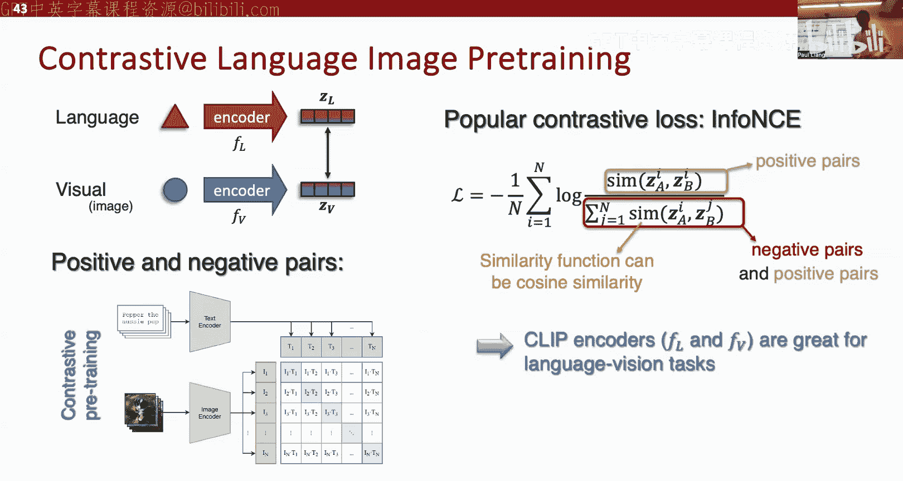

Cool， so clip is very useful because。Now you can do something like zero hot。

Zero shot in the sentence dial after we've trained this and given a new image。You know。

 this thing that looks like a television studio and previously when people you know。

 wanted to classify what's in an image， they have to train specific image classifiers that could only predict five classes or 10 classes。

 maybe pre train on imagenet。You do have a fixed， defined number of classes。

And one of the biggest benefits of clip is now you could do this idea of open set classification so any。

Any caption or any class that you want to classify your image into， you can just give it a list。

Give it as a mis model。And what the model would do is that it would embed the image into the feature space。

 it would embed each of your potential classes or captions into the feature space and take a dot part。

So maybe one of this is a higher similarity do product。

 some of the lower lower similarity do product， and it would essentially give you a normalized score so they you can classify it into any categories that you want doesn't have to be a fixed predefined set of thousand0 imagenet categories。

All right， so you can see does really well on is zero shot。

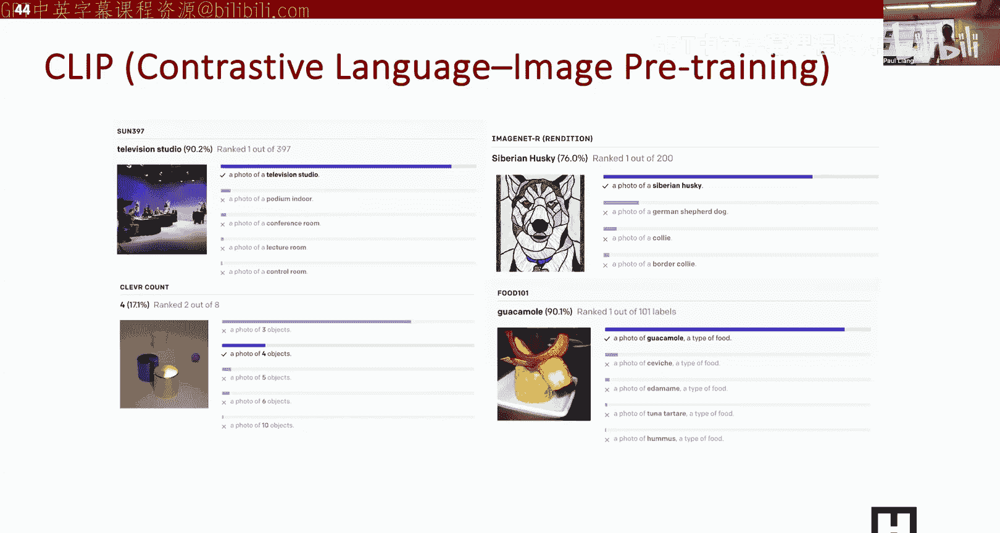

Classification tasks。As I mentioned。You can think about the relationship between what alignment does using contrast learning and what information factors。

 so we saw that mod can have connected and unique information， shared a unique information。

If you define shared information through the mutual information。

 you can prove that contrastive learning is essentially。Captures the mutual information。

 so it learns this。And they would throw everything else away。

 and that is something that that you can you actually improve。W whichch is both good and bad。

 which means that if you care about， you're caring about what is what is common。

 then these alignment based contrasted methods are really great。

You're guaranteed to keep this and throw away everything else，' a very scalable method。

 but if you care about what is here and what is here then you're in trouble because the more you do contrastive learning and the more alignment that you do the more your performance get worse and throwing away information that you actually might care about。

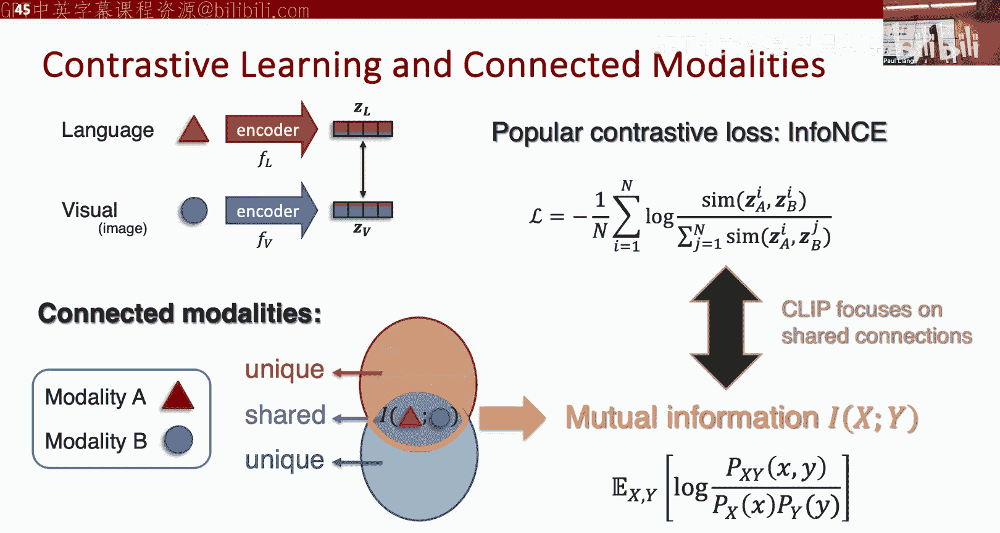

Several ways of dealing with this， we have some work， other folks have also some work。

 very easy to modification。Or you can do contrastive learning across mod。

 so you will take image and your caption and you will do your contrastive learning。

That keeps the information in the middle。If you want to keep what is unique image。

 then you would take image and you'll do in some sense， image only。Contrasted learning。

 there are ways of doing that you take the image， you kind of modify a little bit and then you do contrastive learning only in the images。

And you should intuitivetu that you also do this alignment based for trustedive learning only in text。

So you will take the caption， you will modify a little bit。

 and you will do con learning only in text。And then you can learn what is both shared and unique across your data。

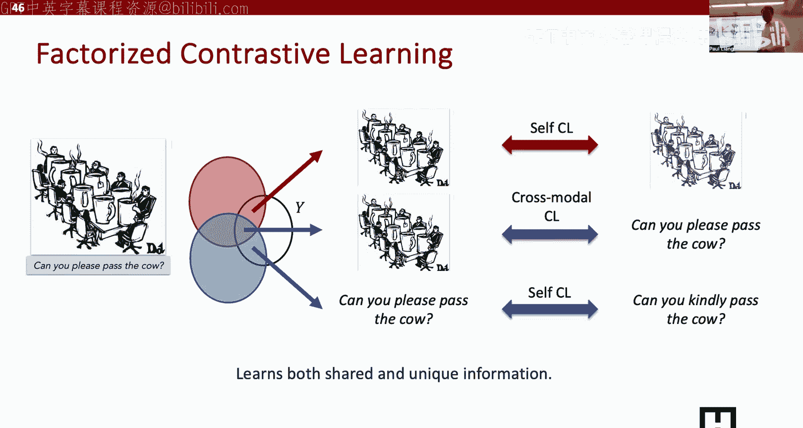

All right， I'm just going to quickly go through this continuous alignment。

 most of these are references。😊，Continuous alignment is harder because now you have continuous signals with not discrete elements。

And usually what these methods do is that they basically recover and try to break your continuous data down into discrete parts。

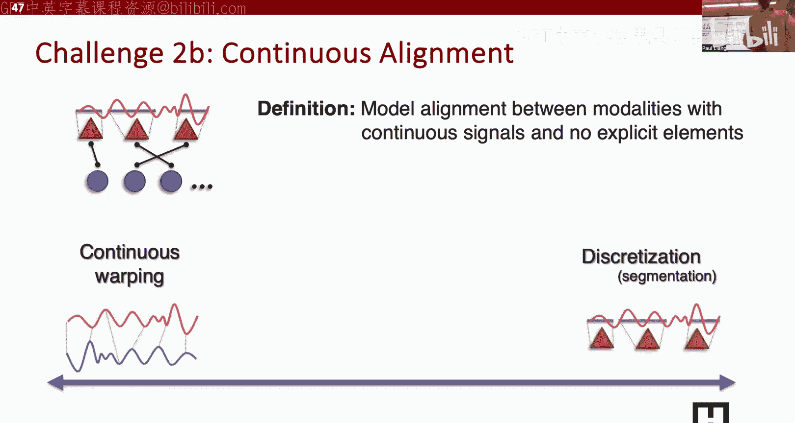

Ill leave some references for people here because I know some people are working with sensor data and videos。

 there are ways so for example。You know， taking continuous data and learning discrete boundaries between them。

So we study problem in computer vision。

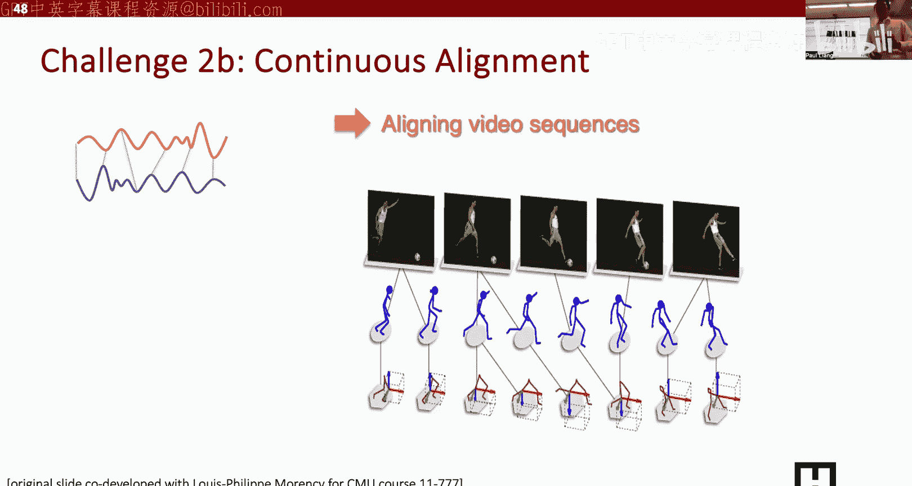

For time CV data， some of my group is looking at change point detection so they can automatically bring it apart。

Your sensor data into discrete boundaries and each of these boundaries should be semantically meaningful。

 for example this is when the person was sleeping， this is when were awake and exercising this is when they're working and so on so there are ways of automatically breaking down continuous data into discrete boundaries each of them with some semantic meaning so you could align it a text。

 for example。

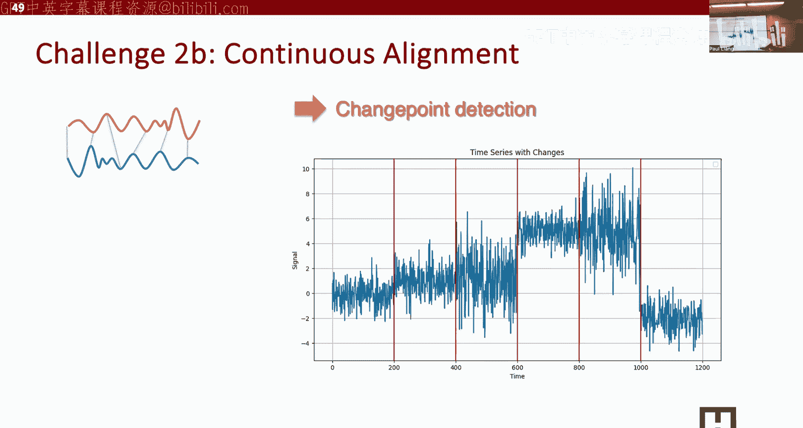

And finally， another class of methods for speech， which is very common get continuous data。

 find some boundary。Fix fixed sampling boundary。Get your continuous data and then do clustering right so clustering is one way of turning something that is continuous into discrete embedding。

So maybe just three clusters， and then you can do your self supplies learning transformers to predict discrete focus。

All， okay， so I ended here， we looked at introduction to multimodal AI。

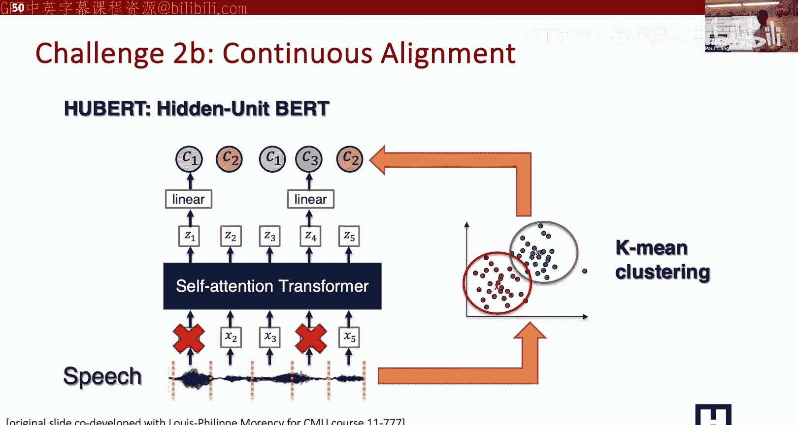

Several key challenges of data B heterogeneous， there's some connected。

 shared information between them and how they might interact tofuse and get somebody that they care about。

We look at several challenges and we also dived deep into alignment。

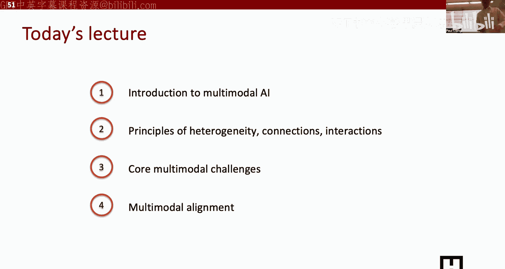

All right and just quick reminder again reading assignments due tomorrow in preparation for Thursday's discussion and make sure you make progress on your project so that you could meet with myself and the TA every week all right thanks everyone。

Oh。Yes。

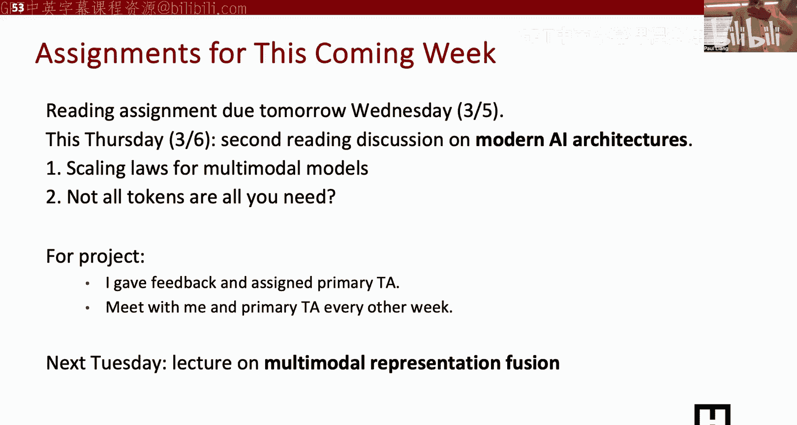