# 《如何AI所有事情｜MAS.S60 How to AI (Almost) Anything》中英字幕（Claude-4-s翻译） p07 [07]Lecture 6 – Cross-modal Learning.zh_en [BV1UhawzQErD_p7]

All right， folks， welcome back， let's get started。This is lecture six on cross model learning。

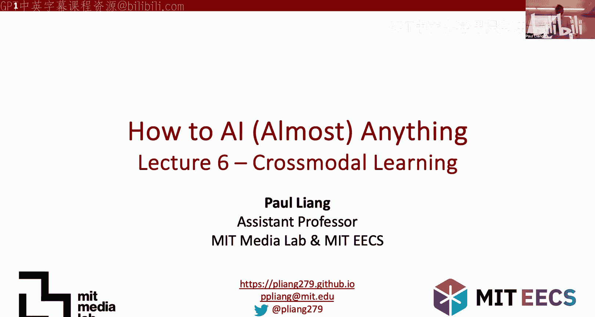

So just some assignments for the upcoming weeks so the midterm assignment is due soon I put up the instructions on Piazza the two key deadlines are after spring break April 1st Tuesday and a report is going to be due it's a six page report and on Thursday after spring break April 3rd will be the presentations。

は。So April 3r。Just because a lot of team members， of groups were going to quit class time from 1 to 3 pm are we gonna to be understanding if people have to go at two。

 that's technically when their class ends， if you have to go at two let us know so we scheduleched you over the first hour。

 if you are scheduled to present in the second half from two to three。

 we're also flexible if you want to come to class at 130，145 and so on。

 but if you can try to come to class for the41 to 3 pm even though we can mandate that。

So let us know your schedule will finalize the list on the order of presentations be sent out the requirements for the midterm is that you should have you know any of course you should have decided on the idea。

 you should decided on what data sets you're going to use what baseline models that are key things that are going to be comparing to and ideally process those data sets and baselines and some results from running those baseline models and highlighting the main errors that those baseline models think and then ideally you would have done some initial progress towards your contributions to implemented to some extent your ideas and showing that because you know address some of the key errors。

 key limitations of prior work。Do you have a question， okay。Great。

 so that is assignment for the midterm someone just make sure your door is closed， please。

And the reading assignment， this fourth reading assignment is due tomorrow Wednesday in preparation for this Thursday's discussion and this reading assignment is primarily about multimodal interactions。

 so different ways different modalities provide information how they combine with each other and how do you model that using machine learning models two very exciting paper。

 one really old and one pretty new old paper on 10 myths of multimodal interaction still very relevant today are discussing from a HCI perspective you know do user studies do people actually use auto modalities how do humans perceive different modalities that they are given and the second paper very recent using mixture of experts and foundation models for multimodal fusion。

Great， so midterm assignment due the week after spring break and reading assignment due tomorrow in discussion for Thursday。

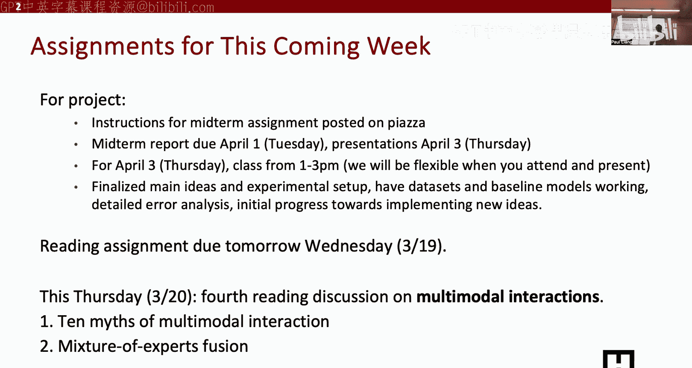

So in today's lecture， we're going to wrap up our discussion on multimodal learning with this idea of crossmodal learning。

 we're going to cover the basics and several ways that we can achieve cross modelal learning。

And crossmod learning is super relevant。 This is the idea where you are trying to transfer information between modalities right there's some task。

 some modality that you want to get your model to work on very often you might have limited data。

 for example， if you're working with medical data there's going to be some limitations if're collecting real world sensor data you can not learn have too much data。

 how do you transfer larger sources of data towards the tasks that you actually care about。

We're going to cover three paradigm firstly very quickly because sure most of you have seen some glimpse of this。

 we'm going to cover some amount of transfer learning。

 like latest ways of transferring information through pretrain and transferring to downstream tasks。

We'll then cover this the set of methods which is called cold learning so cold learning is this idea where you produce some actual modality during training either at the input or the output。

 so you introduce it during training， but once you train a model with it you discard that second modality so that during testing you only take in the modality that you care about it so we call that cold learning and we'll discuss ways of doing that。

And finally， we'll look at ways of model induction。

 this idea that you induce some behavior across your models。

 even though you only have black box access to them， it is super relevant given nowadays。

 a lot of these large models only give you black box API access。So first part。

 transfer by pretrain models。So you're saying you often have some large model with large amount of information and stored within its parameters。

 for example， BRT， LLM， and the goal is to transfer that information by adapting it in some way to the modality that you care about。

 which is probably going to be different from the pretraining distribution。

And the goal is really adapt that model， which call fine for some specific task。

So I'm not going to cover too much about LLMs yet there's a whole lecture dedicated to LLMs and large multimodal models after spring break。

 but I just want to say that。Oftentimes you are going to be doing some amount of multitask or transfer learning and the key definitions of these is you know if supervised learning does use you X data to labels y and multimodal supervised learning has x on and x2 to y then multitask learning is the idea where you use ads to predict two tasks at the same time and if they share information with each other then I the performance on both tasks。

 it improves。

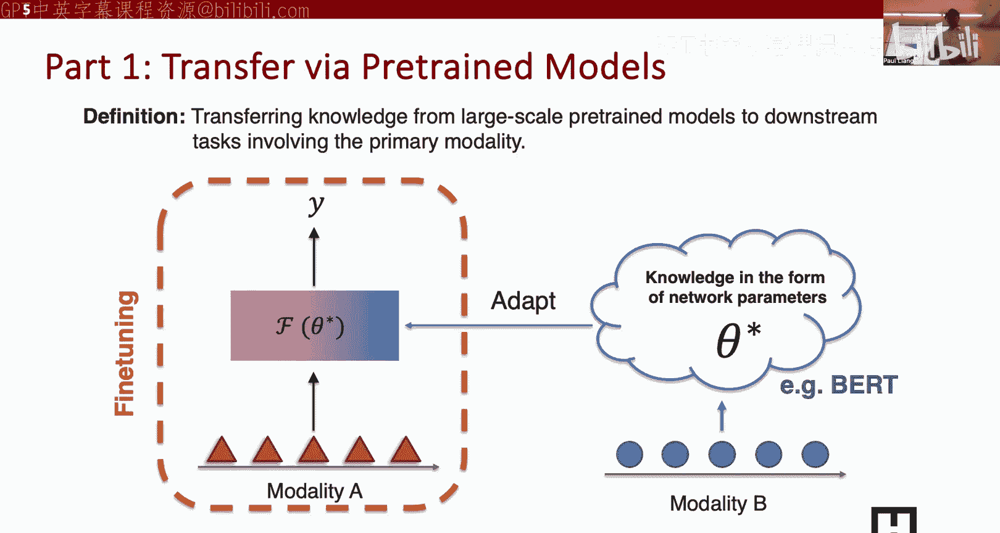

Now transfer learning is this idea where you take x and you put it y1 or maybe x prime so selfsupvised briefly me and you transfer it to some new task y2 and again。

 the goal is that this transfer is better than just supervised learning from x to y2。

You have crossmod learning， which is the extension where you might free train on one modality。

 for example， language， or some language tasks and you transfer to x2， for example， to code。

 which is similar to language but not exactly language or to genomic sequences。

 just again close to language but not exactly language。And finally。

 you have lotsns of methods that taking an x you predict x prime instead of predict a label y。

 so that' is usually called self supervised pretraining。

 and then you transfer it to some task x to Y。Okay。

 so this is just quick because I covered this in week two when I talked about different ways in which you could collect data and different training paradigms。

 and most of you have probably seen some notion of multitask score transfer for learning and hoping。

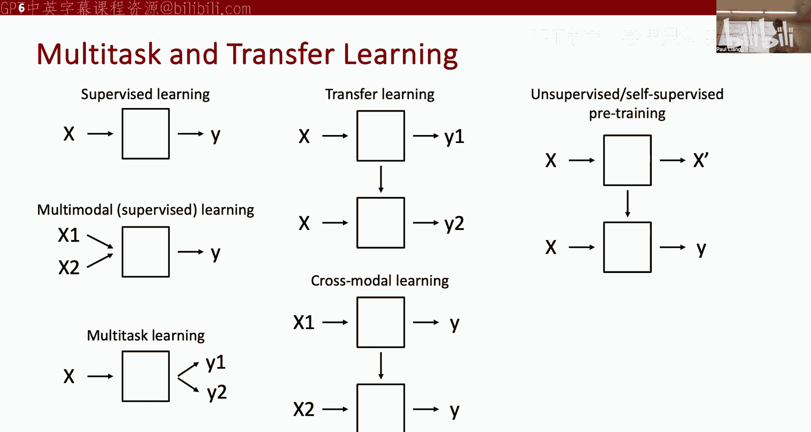

So today I'm going to cover， at least in the first part， multitask can transfer learning on steroids。

 so there's this new paradigm of methods。Where they basically done multi class transfer learning across many different modities。

This is a general setup this from some of our our earlier work。

 If you look at a lot of these multimodal data sets today， let's say for understanding humans。

 you might have language， speech and gestures and some annot or human behavior。

 but then on multimedia data， you have some partial overlap in the modalities。

 you also have image text， even though image text are not exactly image text that a person is speaking and when you go to robotics。

 you're going to have some sensor data and some of this sensor data overlaps with medical data。

 medical case， you also have some of these sensory information from ICU， for example。So nowadays。

 I've been new generational methods that doesn't just do multipart and transfer learning within a domain。

WithinThen a group modalities， now they doing multitaask and transfer learning across very。

 very different info modalities and output domains。So here are some references。

 our papers for HiMT and there's also this paper called Journalist Agent。

 which does it more for multimedia， robotics and several reinforcement learning tasks。AndYes。

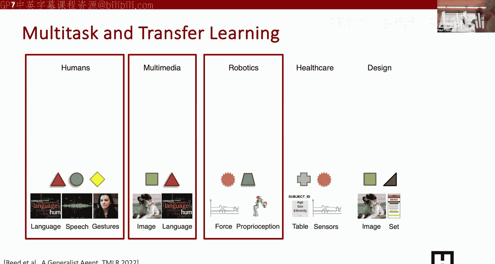

Paul ask a question in the press slide。 Oh So in the transfer learning So the second column。

 do we care about the accuracy of what one or。Or is there a relationship between the adverse levelY1 andY2 horizontal example there must to be a high adverse at11 young to achieve the adverse self2 great question。

Usually higher accuracy and y1 coordinates to better transfer performance that's why you know in most computer vision research。

You have a good model pretrinal imagenet and why one is image accuracy。

 the better it transfers to other things like medical images， same nowadays。

That's not mine people want to mute their computers nowadays other them you pretrain and you measure complexity and in general the models which are better complexity or better at this you know some set of basis tasks like it say multitask language understanding MMOU is a common way of doing Y1 they will transfer better to whatever other tasks that you think about Of course theres exceptions there are scenarios where。

Really overfit to some parts and the more you get better y1， the less it transfers。

 it's also a possibility。

Great。😊，So yes， so nowadays we have methods that really do multipa and transfer learning across very。

 very different modalities and tasks。And this would be very useful because if you're looking at for some medical tasks or design tasks。

 even within that domain you're not going to get a lot of data。

 so you really have to leverage other domains where you have more data。

So nowadays it's increasingly common to see you know these methods where even though on the surface very different input data。

 you can all serialize them as into a sequence right you can put language as sequence of words。

 speech a sequence of you sampling rate of whatever frequencies。

 a person is currently saying image can be sequence of pixels。

 sensor data can be sequence of time steps and once you serialize everything we seen that transformers are pretty much a very reliableable way to learn a first order of approximation and the relationships in that modality。

 so how words interact with other words， how one facial expression interact with other facial expressions。

 how one time step mirrorsensor data interact with other time steps， mirrorsensor data。

So these unit model transformers are increasingly general， and in fact。

 you can apply one model with the same parameters for everything。Likewise。

 multimodal transformers to learn the pairwise interactions between modalities are also becoming increasingly general。

 so they can be used to learn hairwise interactions between words that you're speaking and your facial expressions。

 they can be used to learn information about demographic information about the patient and other time series ICU information that you're recording from the patient。

So good thing about some of these models is that first of all。

 you can see there's like a massively multitask， it is one model trained on very different subsets of input modalities and for different prediction tasks。

 and they also show this phenomena of transfer so you could transfer by training a model on。

 for example three tasks。

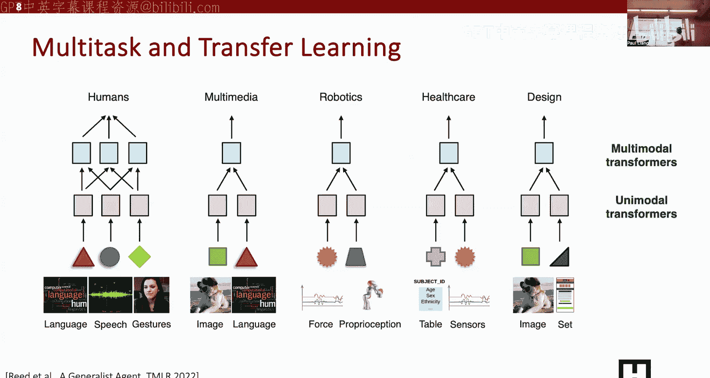

With three sets of informalities and transfer it to a fourth point。

 let let's say you transfer it to a medical case and you see that some overlap this time series that you see in robotic robotic data at the time series that you see in these medical data there's some overlap and also some new information。

In this new medical task。

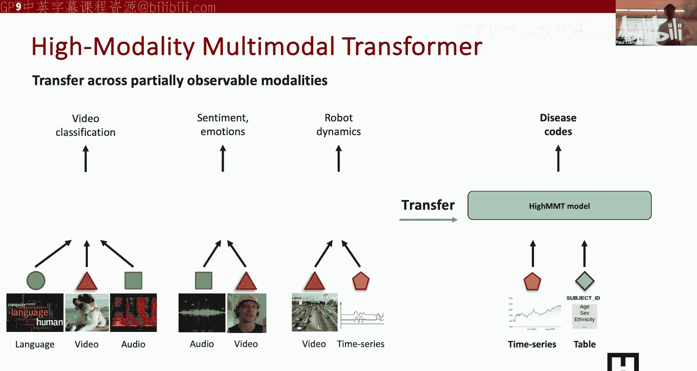

And weve shown results where your performance consistently improves。

 this is a performance where you just train on the party task， supervisor in 67%。

 and you start training on one different task， it gets better。

 you start pretraining on two tasks even better， three it gets even better and so on。And likewise。

 for some other partition of pre training and transfer。

 it gets better with the more modalities and tasks that you pretrain this model on。

So we've really seen some of these really really general multimodal multitask models。

 I mean there's some very key assumptions these models are making which may be violated in different scenarios one key assumption is that you can standardize everything as input sequenced。

Some data is more appropriate to see seen as sequences and some data might be less appropriate。

You're assuming that the only thing that identifies what modality it is is just this one hot embedding so language width would be 1000 video is 01000 it basically is using a one hot embedding to identify what modality it is and to identify that for example video appears here and also video appears there so it's not really captured a lot of specific information and maybe you could do better。

It's using one shared multimodal model for everything and of course nowadays there is work and basically doing mixture of experts as you will read in the reading assignment where maybe you have some experts that do fusion here and some experts that do fusion over here。

 but there's still some information sharing across your multiple experts。

Question the last slide you mentioned about different tasks on the medical mimic Yes。

 what were those tasks and the next question I have in the case of transfer learning or transfer of modality on different tasks when you trained on robotex data which is time series。

 how did evaluation transfer to mimic or medical domain which is numbers or something。

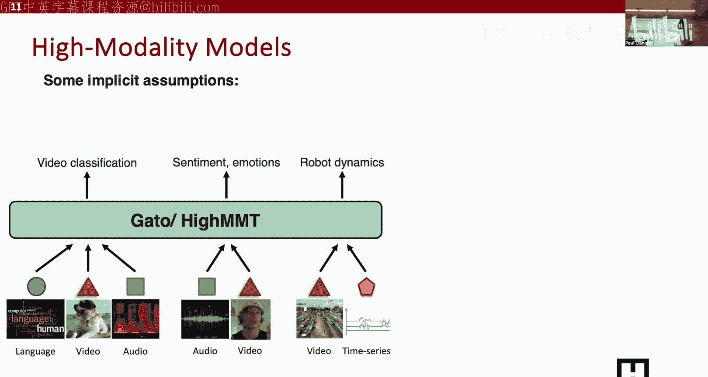

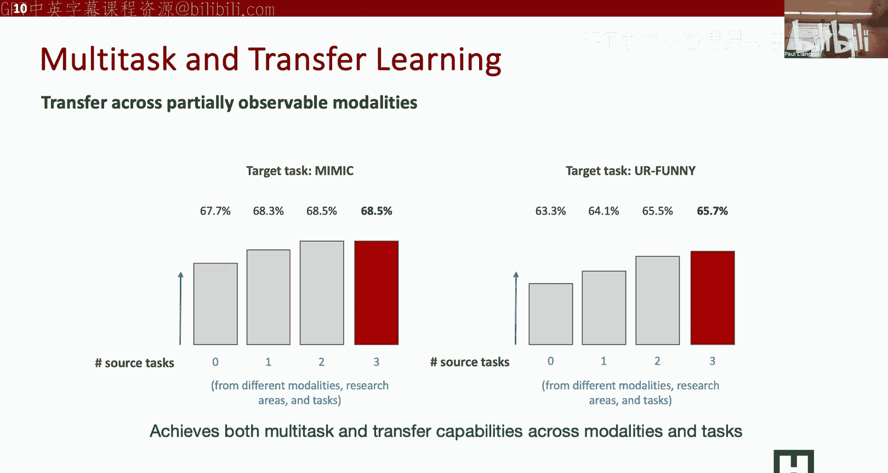

Yeah， so in this case， these were kind of the three， there were some multimedia video classification。

 there were some of human behavior， videos， there were some robots of super and sensor and you're trying to transfer to mimic and then you would did something like train on zero means to just supervisor name mymic it might train on one。

 two three increasingly more source tasks for transferring to the target task and I guess what got the other question for robotics it was also one of the tasks that it was pretrain on but then we tried other combinations so。

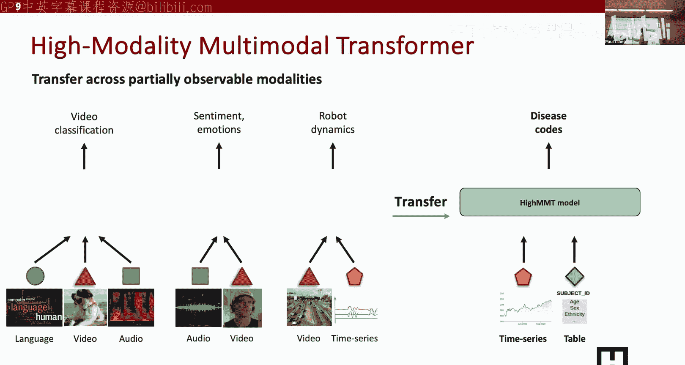

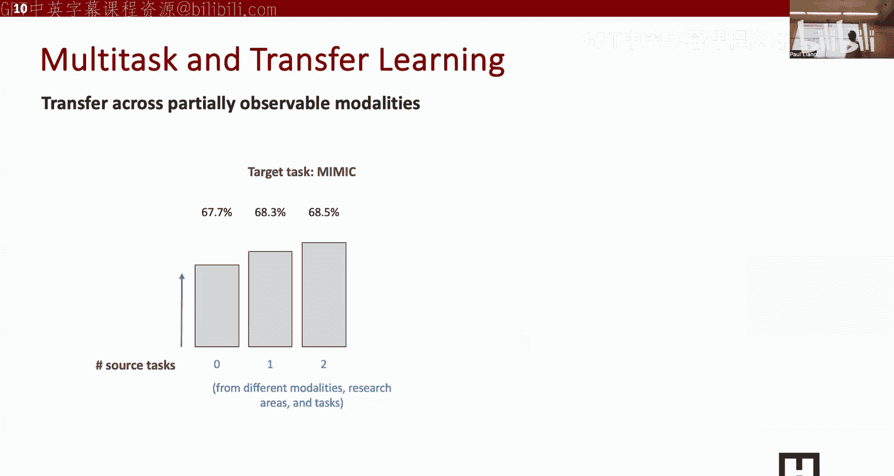

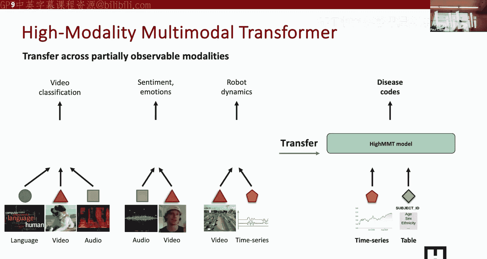

I guess this was transferring to this humor detection task。

 do you pretrain on some other videos and some other human behavior it would transfer to this humor humor task I mean you can look at the paper for some of the exact numbers。

Yes，It was like using audio text and kind image， but they would use to kind of to first do what with audio and what to do and that。

 I was wondering like why would it be excellent？I think it depends on whether you have all three data at the same time。

 you have text， video and audio all three at the same time then。I'm not sure why they will do that。

 but one reason could be that sometimes you have text and video data and separately you have text and audio data but you don't see all three at the same time。

 so text could be this thing in the middle that you use to to to。

Define a common support for those two data sets so think you made the audio and video audio and image will be vary just so maybe the。

Li little bit more similar to the image。A under。Right similar。Maybe yeah。

 I mean depends on what the intuition was was in the paper now you question using so I think in the previous。

 there's like video and different kind of data right when you trying to transfer to this mimic task。

 many is only like structural data， Yes， how these other modalities information could be translate or transferred to this to the uni multi model。

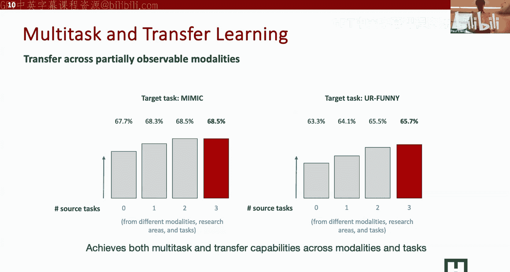

Yes， yes， yes， so so minute here is time series and tabular right but we use our two realities and you see evidence of time series and the other ones as well。

 in fact so this time series and robots and even though although with this audio video there higher dimension of it in effect they are still mostly time series。

Is it mind？In effect， it is still mostly time series。

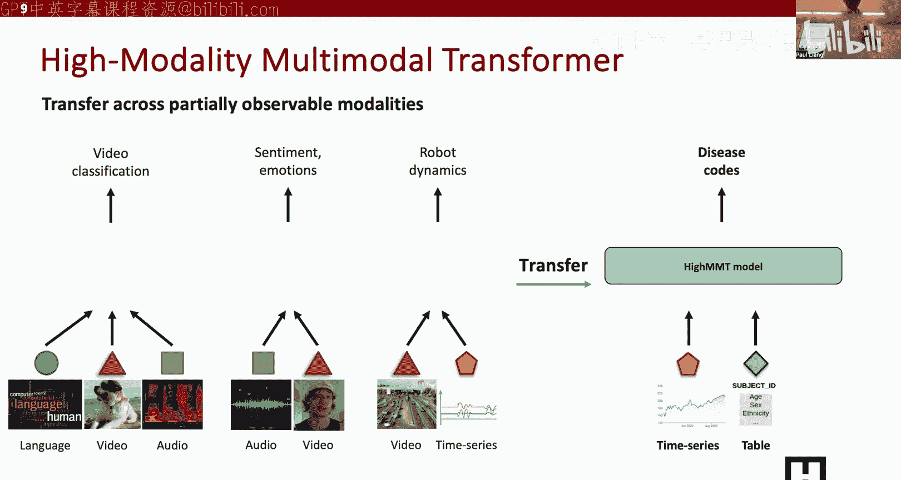

So right here to show kind of this method， we basically were able to train one transformer encoder that really works on everything iss able to process language and speech and gesture and video and time series and the only thing that is different is this identifier this one hot identifier that identifies what modality is coming from。

Howlp you identify whether the information is related to the specific tasks or not well then a model is and it has a past specific head that is going to find you so the idea is that these will learn general purpose features。

And the task specific heads will learn the task specific features。

Isn't that easy to do the domain specific lar？

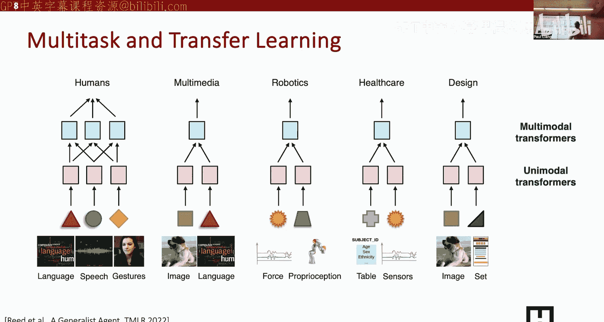

There can be challenges。Okay， folks， I have to move on。

 but I mean there's so much interest the papers there。

 and I also include a bunch of other references。

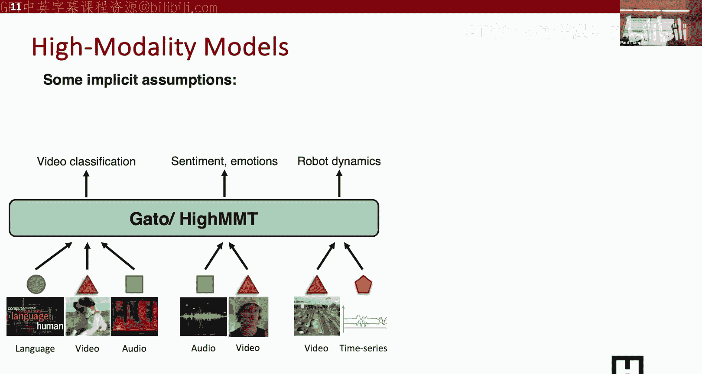

This was kind of as of 2023， we kind up the survey。

 and these were all the models that did some amount of transfer between modalities and tasks。

So this was perceiver whereas a general architecture that works for everything。

 but the colors are different so they don't actually share the same parameters you have models that try to standardize image vision audio and you have some models that try to。

 for example， your language vision vision audio transfer with each other So as of 2023 was this was the landscape of multimodal multi tasksasks and transfer learning。

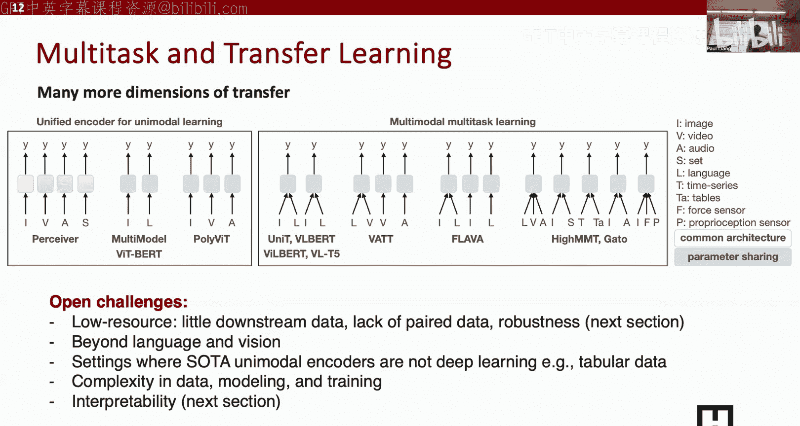

Great。Okay， so in the second part， the first part is mostly multiclass transfer learning as a way of leveraging information from different data sets。

 in the second part we're going look at this phenomena called Co learning。

 so in Co learning you have this modality that you care about。

 and we're going to introduce some extra modality B during training。

 only available during training to learn a better representation you think of it as a better coldle representation that enriches the information in A。

 the modality that you care about。General paradigm。

 the key idea is that B is only introduced student training。

As an auxiliary information and during testing， this is the only branch that is activated is still just using a to predict the label that's why it's fair to compare it with just supervised learning models using a to predict the label okay。

There's three ways of doing cold learning that I'll briefly cover。

 they all have kind of pros and cons， sometimes they work， sometimes they don't work。

Now the first way of doing it is fusion， so you have A and B， you learn a fused representation。

 if you recall from fusion， you have a this setting where you have two modalities and you learn one joint representation combining them。

You a futureion representation during test line， you put input zeros， you zero out in that T。

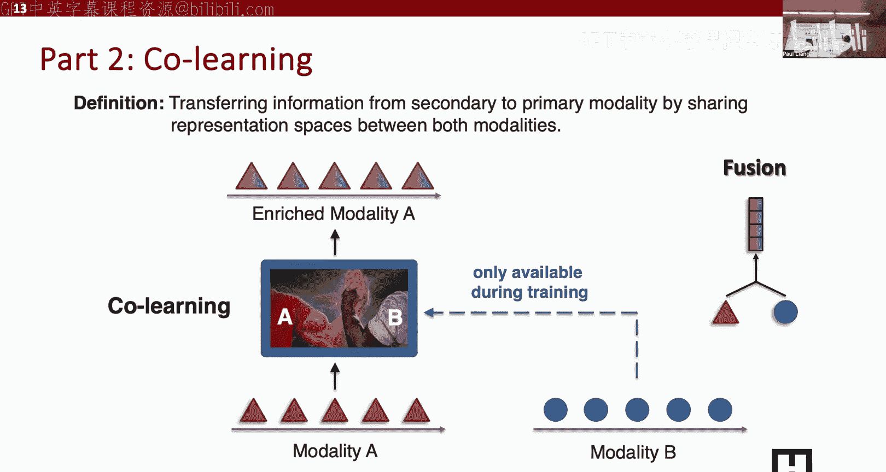

So see what that looks like whole learning via fusion。

Let's say you have two things during training your A and B， X A and XB。

 and you will define a fusion model between X A and XB to predict the label Y。During testing。

 you would zero out the input to modity， either replace replace it by zeros or replace replace it with the average。

averageage value for that modality， so now the testing is still only using a passing it through the fusion model predict one。

Okay， and what is the baseline baseline in this case is Unimodal learning。

 right you use a to predict a label you're doing training。

 you train your model weights and doing testing， you just use a to predict why。Okay。

 so it's great comparison because during're in testing when you're using the model is only just always taking with TA。

 say language， it's just a training， like train this model between generation vision when I do cold learning。

So only text is used at test time and theres the performance that has shows consistent improvements using this cold learning this paradigm as compared to directly visibleable supervis learning。

So this was our work， the context was A was language and B was nonverbal information。

 so nonverbal facial expressions and vocal expressions helps you learn about language。

 then directly learning about language in a supervised setting。

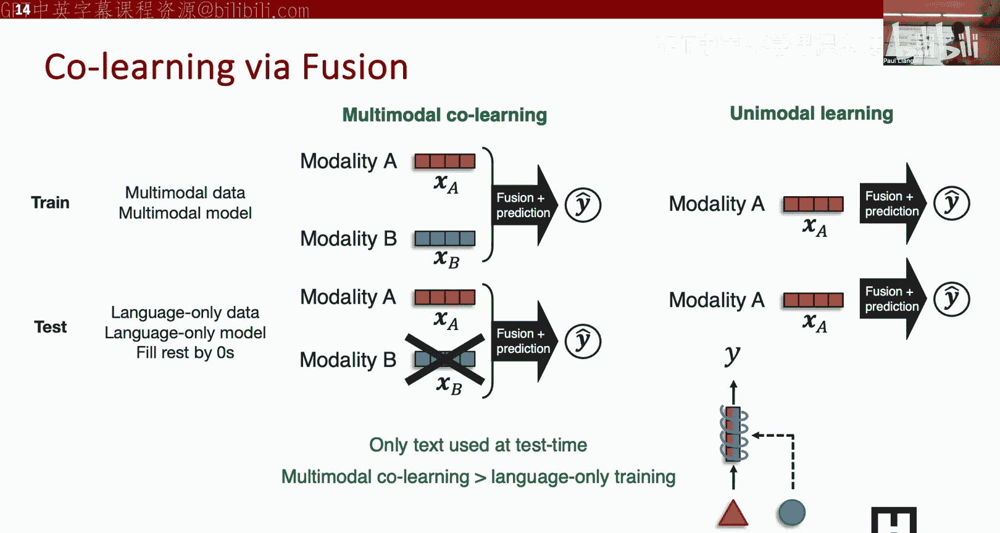

Here's some other evidence， this is actually a very similar paper called multimodal learning with deep Boma machinesch from 2014 in this setting it was also a fusion model it's just that a fusion model they used with a deep Bo machine。

Maybe all of you are too young to know what that is。

 but it's an earlier class of generative models think of it as a precursor to these variational autors。

 variational autoenrs， but the same idea remains you take A， you learn a joint refuse representation。

 joint probability distribution。And you see this multimodal DDN generated text with outperforming these image only models。

And this generator text is basically their way of saying during testing。

Only image given right so the first four image supervised learning， you could use LDA， SM。

 and these are the networks， the machines， deep believe networks， the machines。

 these are just image based supervised learning methods we got these and this is a setting where you've trained a joint multimodal model using image and text but during testing remove the text and ask the model to infer it itself right so everything's fair comparison everythings only given the image during testing。

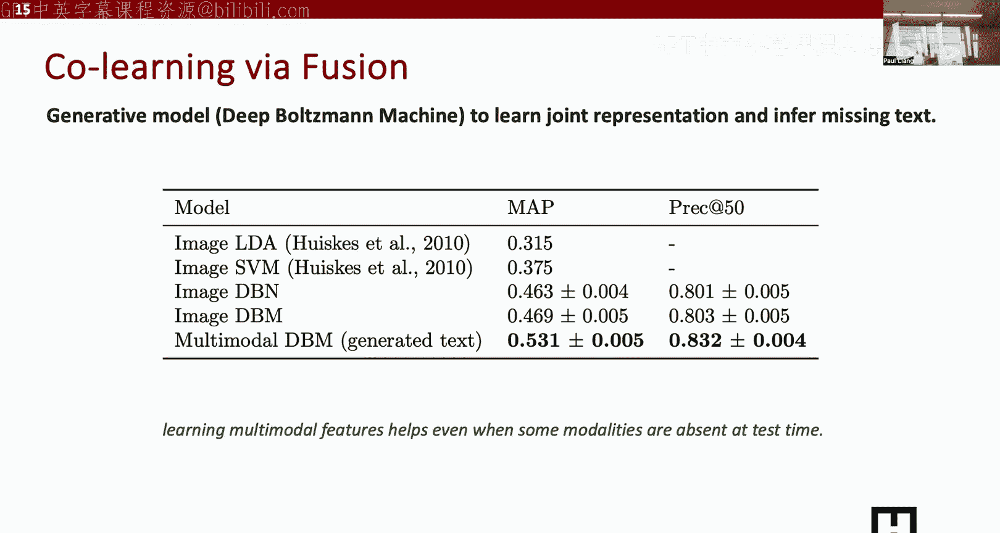

Here's another cool example， another very semi for 2021 a 2011 a multimodal deep learning in this setting。

 they also train this shared representation so again joint representation between in this case audio and video but what they would do is that they would train it using audio and then they would try to testing in video。

And they showed that this was actually competitive with。Video training and video testing。

 supervised learning。

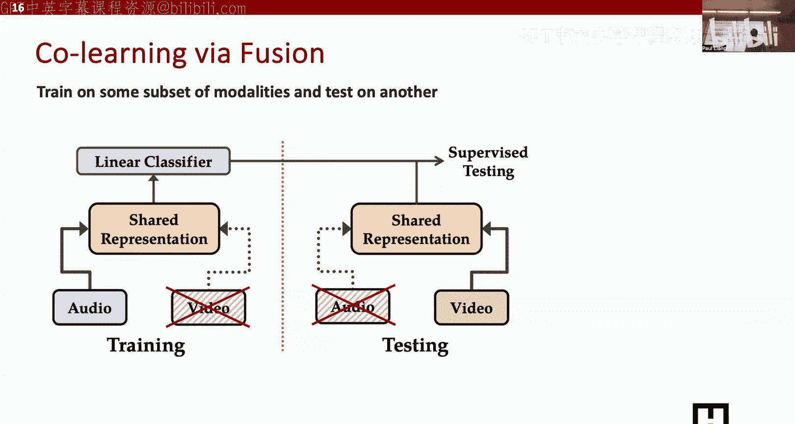

And it's super cool because you know the task they tested on was this make effect task。

 if you call the person had the sound， the bh bh， bhhh， and the lips moving。

 which is a video and the goal here is taking the audio and video to recognize what phoning the person was saying。

So this's also some cool evidence of cold learning bio fusion。都上げ。

During training you have more modalities， you learn some shared joint representations。

 and even though during testing， something might be missing filling with zeros or the average because it's missing is still outperforms doing supervised learning only with the present modality。

All right， so interesting way of this boosting performance。

 but if you know that you want to do video based prediction。

 you can always do video supervis learning， but sometimes early this joint representation with video and more things will be better。

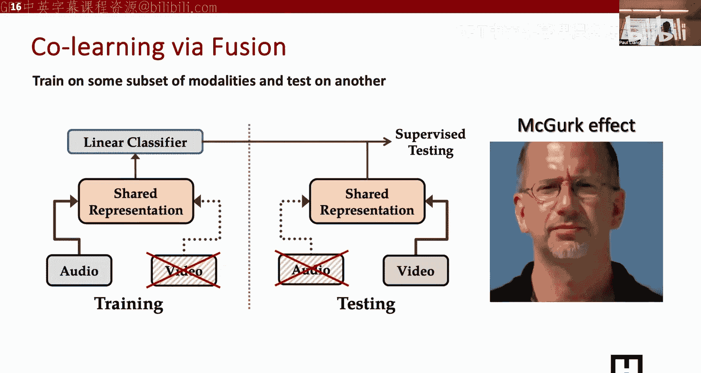

So that's call learning via fusion。A different paradigm。

 but also within this core learning space is core learning by alignment。

But the same setup remains age what you care about。Normally you might do supervisor learning using A。

 but now you have this extra B during training。And you learn a better enriched representation。

 instead of doing fusion where A and B come in and you learn one representation。

 you can do alignment where you have A and B and you're learning this representation space where A and B are separate but aligned through some similarity function right we saw a lot of a multimodal alignment two weeks ago。

So some very early evidence， again， this is a very seminal paper from 2013。

 zero shot learning through cross modelal transfer。

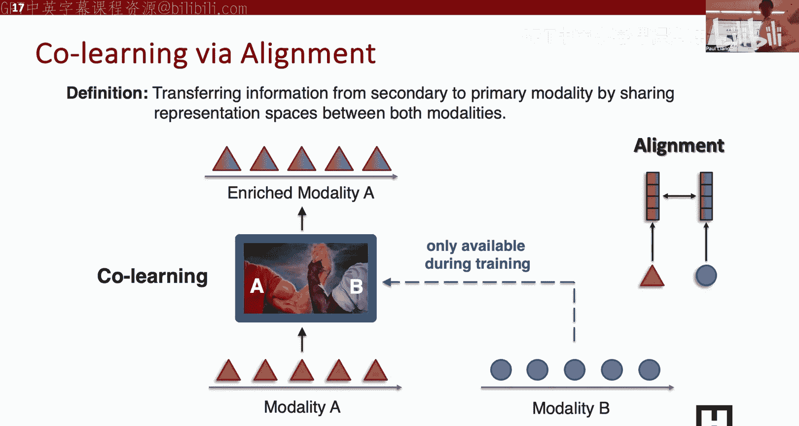

So in this case， it was kind of like early version of clip。

So you had lower resolution images from C410， some car， some dog， and you have word embeddings。

W two back word embeddings and basically you will learn this alignment representation space where maybe the word embedding for auto is over here and nearby these crosses you have the imagebeddings that were embedded into this space and the similarity function so the word embedding nearby as all image representations of of course and likewise word embedding for horse and these images of horses embedded and dog and likewise for horse so you would train a model with this alignment function。

You know， the data we discussed two weeks ago， where you had data。

 you define encoders into separate representations and define some similarity function。

 usually cosine similarity or L2 distance， and you bring these corresponding pairs together and youll push apart。

In crime caps。So then during training， you learn this aligned representation space。

And during testing， let's say you have this new image。

 this very lower resolution image of cat that comes in and normally you try to do image classification and you've never seen cat before you just will not be able to predict them right you don't have that dimension in the softm that predicts cat so you will never predict cat。

 but the good thing is of a representation space is that you can project the image into that representation space and you can find the nearest neighbor wordbe。

And this word in says as structure， no cat is very close to dog。

 but not exactly the same as dog and further away from horse。

So you can just find the nearest name a word embedding。

 and therefore you will be able to do zero shot prediction and say this image should be labeled as cat。

Okay。So again， evidence of cold earning where。During training you have words and images and you're doing this alignment in representation space。

 but during testing， you only have images。You can to just need an image and you're trying to look up the nearest warning bag。

And so that enables zero shot image classification。And nowadays of course。

 we have scaled up versions of this， we have fliplight models。

 we have all these other models where're doing testing we're doing training you have types images。

 you do this aligned representation space， but once you learn this aligned space。

 you can transfer it to many downstream tasks， including those that only use a single modality。

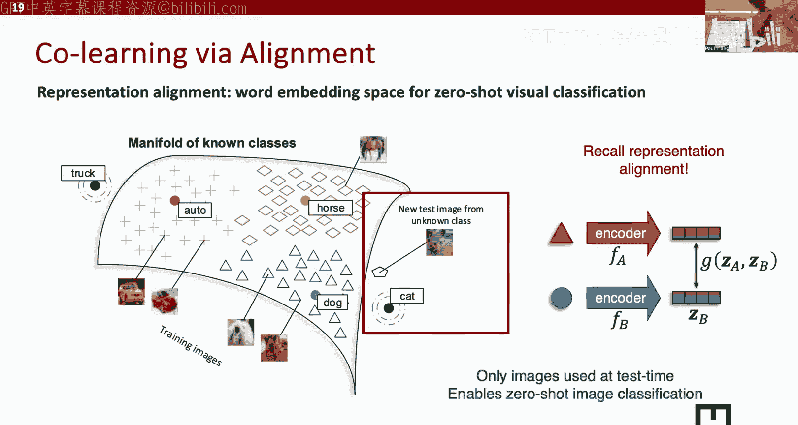

So transfer the image encoder to imagenet to no。Retrieval and to other image classification taskss。

So training using image and text dual alignment and downstream inference you only use。

Prediction tasks on one of the modalities better than supervis learning directly in the target modality。

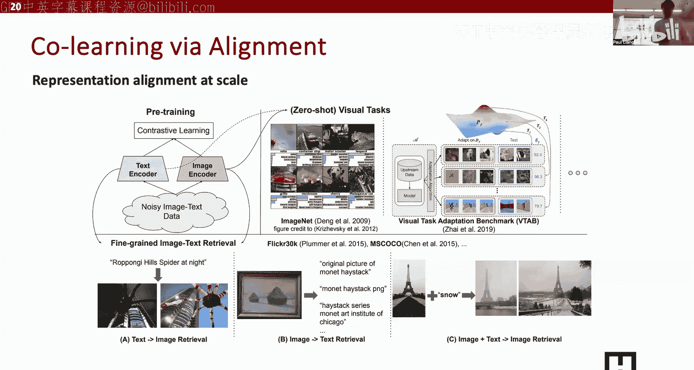

Here's some cool evidence。Some people call this cross modelal prediction。

 so this is a robotics example where you have these robot arms that was manipulating different objects and you had vision and touch so vision will be from cameras。

Like that and touch would essentially be whatever force the robot feels or manipulating that object。

And this red and green essentially shows data which was actually paired together so this vision corresponds to that touch and red shows incorrect touch patterns and this is vice versa。

 this is a touch。The force that was sensed， this shows a positive visual pair and this shows a negative incorrect visual demonstration of the robot。

And again over here， what they showed was that you portray this model using vision and touch。

And you would learn this online space that either pifies it as true as coming from the same。

Same demonstration or fake in which would be the wrong demonstration。

And that learned good representations that were then transfer to vision only force only tasks。

So again， examples of cold learning realignment， you have two modalities during training。

 you learn some aligned representation between them and this aligned representation is useful for tasks in only one of the two modalities during testing。

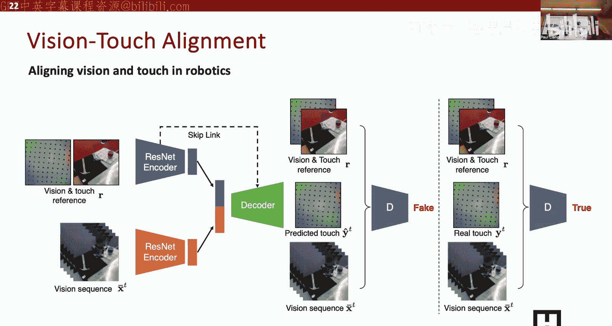

O。Last type of cold learning。So you' see color via fusion。

And alignment both of those have an extra modality TB in the input space。

 this third example uses this extra modality Tb in the output space。

 so during training you would frame an a in A you will learn some features that would predict modality TB as a prediction objective and the hope is that by predicting this additional modalityityB this auxiliary task you learn better representations that could be used for eventually just test time prediction using A。

Okay， so we call this cold learning by translation。So three ways， you know。

 when B comes in or alignment when B comes in or translating B is on the output。So some examples。

 we had done some work where， again， this was data where you had language that the person was speaking and visual expressions the person was making while they were speaking something。

 and the goal is to understand。

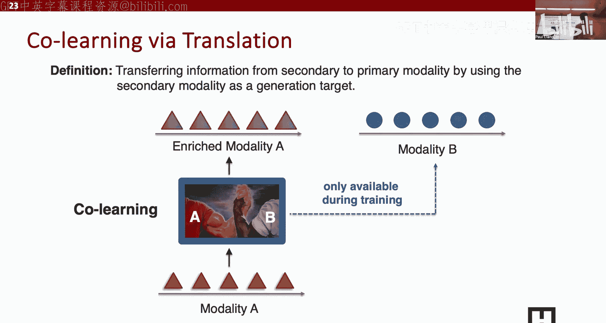

Sentiment other behaviors。So normally when you do fusion。

 you need both modities at test time right so something is missing when you're in trouble。

So one other way of doing it is to essentially do this translation where you take an language。

You predict some representation and the representation should be able to decode the person's visual expressions。

 essentially hallucinating what a person might have been expressing while saying those words。

And this representation， even though it's kind of a transld representation。

 it should still be multimodal in nature because it en encode language。

 but it kind of just keeps a part of language that is the most relevant towards predicting the visual information。

Somebody celebrating， there should still be a multimodal representation。

And therefore you can use that representation for sentiment prediction and during test time。

 what happens is you would have trade this model， you would take an language。

 you will go through the four path to encode the representation and you will just pass it through the pacifier head to predict sentiment and you will not predict the visual anymore because you don't have to predict the visual during testing。

So you do cross model translation during training， you need both language and a corresponding vision。

 but doing testing， investigating the language， predict representation， and then predict the label。

So we also showed here that these bimodal translations further improve performance so you could first use language to predict vision and go through a representation and then you will use what you predicted in the visual space to reconstruct the original language so this idea of cycle consistency right so you use language and you're terrible at predicting vision and it's all like random noise maybe even worse than reconstructing the original sentence。

Or and backward translations。But it's still coloric because once you've done this during training。

 all you need to do is take in language， predict the feature and decode the label during testing so during test time you still have language only。

And we show that this outperform just doing supervised learning only your language。

This idea of predicting the vision。

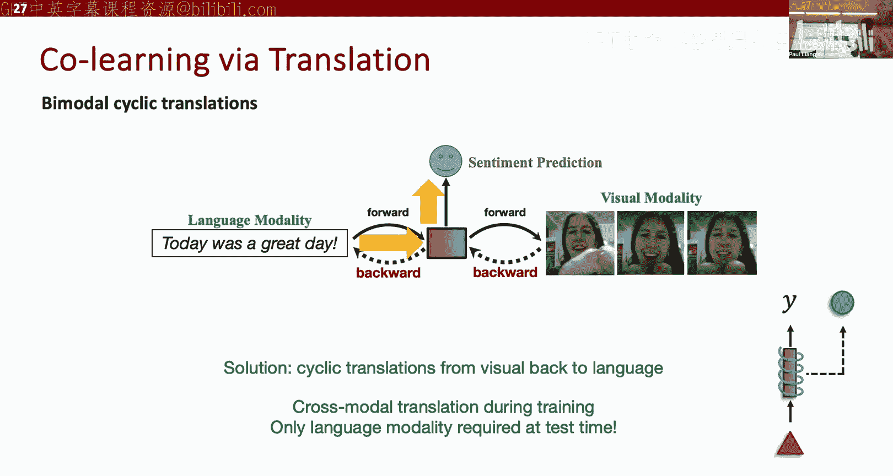

Several other examples， these multiple papers argue that call learning is useful for compositionality。

 so over here there are some computer vision tasks that require a model to be a super fine grain and predict where things are and how many things are on top or above or the same color as something else can get really really hard questions and you just superize learning on these sometimes a model might not capture those fine grain details so what these folks found is that you can do auxiliary training which you can discard that test time exactly the message of call learning where you take the vision and you predict。

The language， right， because in this case language really captures this compositional structure of what is above and behind something else。

So during training， you were taking the image， you will learn representations that can predict the descriptionure。

 very compositional sentences， and you would throw it away during testing and just predict images。

Predt the image during。During testing。

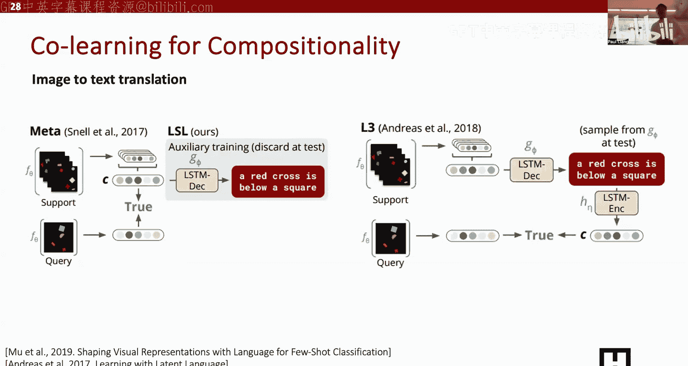

All right。More examples， this was a paper I enjoy very much on extending mass language modeling so everyone's probably seen this right you have a sentence。

 you masked out certain tokens and you train a model to reconstruct the missing tokens and this allows you to learn representations。

 they essentially take into account the context， using the neighboring words that were present as context to predict a missing tokens so you get humans learn language by listening and speaking。

And what these folks found is that in addition to doing mass language modeling。

 you could also do mass visual token classification。

 so vcan classification or Vken stands for visual tokens。So while encoding these texts。

 you will predict what humans look like， you will predict what language looks like however abstract that might be。

 predict what you know listening， speaking all look like in vision。Which is very natural。

 I think a lot of people argue that this is how humans learn because hear people speak and we imagine visually what happens。

 we see vision and we imagine the sounds， a lot of people who do AI inspired by psychology argue for this approach。

again， the evidence is that during training， you use text。

To predict the missing text token and also to predict the images， once you learn that representation。

 it just takess in text during testing。And that has been shown to improve upon just language based language modeling。

AFinal example that I want to show。

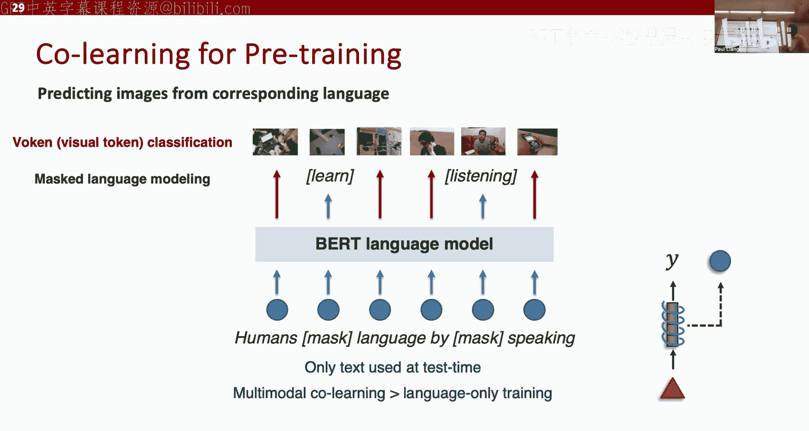

Is this idea of dense and spa supervision so over here what these folks are doing is that they're trying to use breathing data to assess Parkinson's apparently with some correlation between how you breathe and whether you might have early symptoms of Parkinson's disease so you can collect 10 hours of breathing nocturnal breathing so when the patient is sleeping and you have 10 hours of data。

 the only thing that you can predict is。The likelihood of Parkinson's。

 which is just one bit of information right one one number。

 and you can see why that will be very difficult because you have a lot of data。

 you can learn the encoder by a lot of data and just have one very small number to predict as training signal。

 is very， very sparse training signal。So all this is just so。Withinder， Parkinson's disease。

 predictor， classifier severely predictor， all this just predicts one number so one natural thing that you can do is to try to use another modality to give more supervision than just this one number of whether they have Parkinson's or not。

So one thing you can do is you could predict the EEG at the same point。啊。So EG is brain brainwa。

I think brainwa stuff so you can take this breathing which is 10 hours worth of data if the person was sleeping and while they're sleeping you also collect。

 for example， their brainwa activities and so therefore this is also 10 hours and this gives you really rich supervision because you have this hospital using 10 hours to predict 10 hours while also predicting your one number of Parkinson's or not Parkinson's。

So this， you know， they named it auxiliary task for multitask learning。

 but it's also an example of how you can do cold learning via translating from one modality to the other。

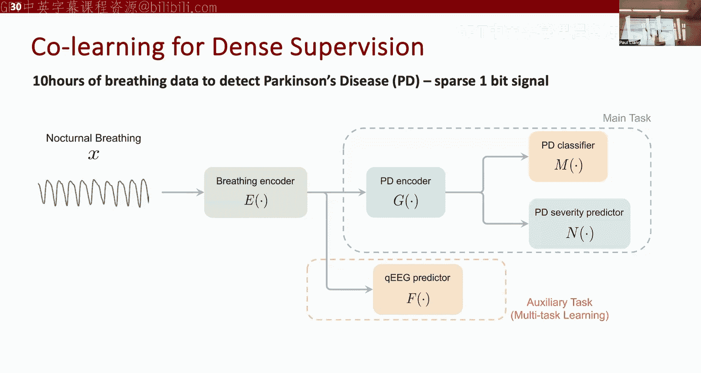

Right so that's what it looks like you take in your breathing data and you predict EG activity throughout the night and I again this show that the better you were able to predict EEG data。

 the better you could also learn representations to predict early onset of Parkinson's。Yes。

 so用 this very。Interesting， because the is the difference in data scale or size so。It is there like。

Just empirically that works， I guess or where there like also some law， you know。

 between different scales and。Rlationship of how well this kind of learning framework looks。

're talkingalking about theoretical guarantees， then it will really depend on。

The assumptions that you make， but I'm sure people have set up simple toy classification problems。

 made some assumptions about the two modalities and their mutual information。

 made some assumptions about where the task information is that you could prove some stuff。

 my in is that when you're doing translation， you're essentially learning what is common between the two modalities。

RightIf take in you know sleep data， sleep data so much information and a part of it overlap to EEG so like a Venn diagram is slowing that overlap that's what you get by translating and it also happens that Parkisson's indicators are also perfectly within that overlap。

 then you're basically you're basically good right if otherwise you might not be good I was going to discuss some of these intuitions data but I have the same intuition for these other methods based on fusion and alignment because everything that needs I'm doing is just introducing more objective to capture the information that is common between between the two modalities。

So the assumption is yes， the task should also be within that common region。Yeah。I。

I seeing the future is actually learned。Because maybe we take three day you more people express something as an auxiliary spot。

嗯。Maybe how do the funding figure out like whether not actually helps switch the prices？诶。

I mean many different factors that you hypothesize something。

 in this case they probably talk to doctors， they did many rounds of trial and error。

 so there's no really set question to that。Probably a mix of intuition and trial and error and same thing。

 you know why did they use CEG and not something else I mean there's many other things you could think about。

Bby some call an error。Sa same goes for and all of these other。Other examples that I've shown。

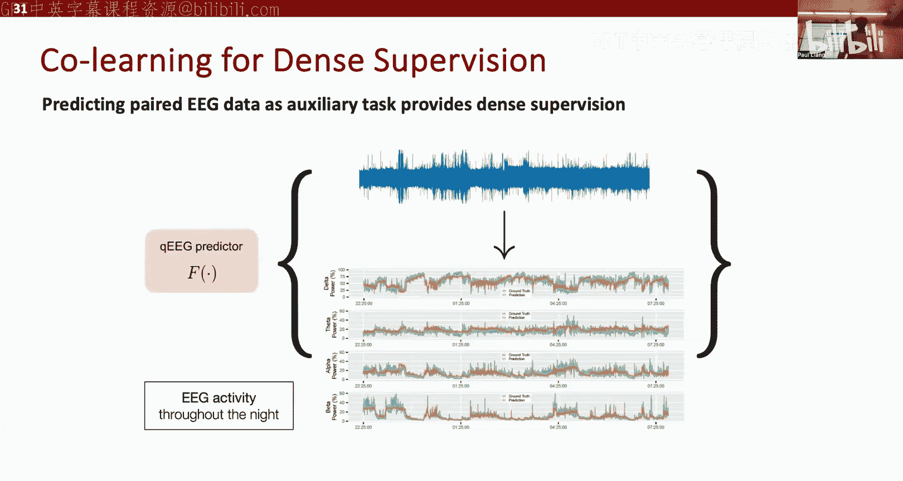

I mean， speaking of challenge error， I want to show some failure cases， so not always this works。嗯。

So， you know， there's a line of words。Basically， when you see， okay。

 press does something help question mark and probably the answer doesn't help。

 because otherwise you will say results are great。 So here。

We folks remember BRT with very early art skill language pretraining and when BRT came out across a lot of NOP tasks。

And then we had things like video bird and visual bird。

 which was learning joint representations or language and vision or video。 and in fact。

 people found that these video bird and visual bird。

Was better at NOP tasks as well right not just vision language tasks， but also NOP tasks。

 so positive evidence of cold learning and these folks show that in fact for many tasks there is negative evidence so when you start with bird you ending 90% or semantic role wling this is some word classification tasks and when you start。

Training bird to predict a video and vice versa it actually gets worse in fact in some scenarios it can become much worse over here 76 to 65 so 10% drop when you start training at with video。

Conテ。And so these are some examples of NLP tasks that they found the performance to drop and you might think you know these are NLP you don't need vision and video。

 but then they also show some examples of tasks like common sense question answering common sense reasoning where it might seem that vision is very important right I think this data that includes tasks like if I give you a question how you should remove gloss or furniture and the answer is that you could rather with a steel wool or column ball。

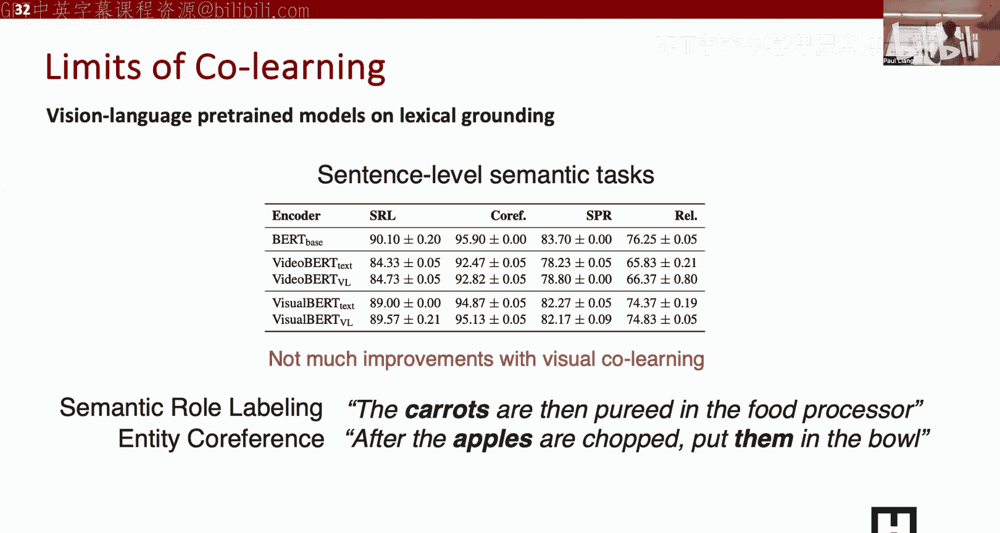

Probably makes sense that if a model has seen videos of people doing that or instructional videos that it should do better。

 but no， you can start training these。Video bird， visual bird and performance。

I it improves a little bit， but sometimes it can drop quite a bit。So there's limits to cool learning。

 not always works。嗯。Great。So in this last part， I'm going to discuss model induction。

 so again extensions of transfer and multitask learning by this case we're going to mostly keep to APIs where you might not have access to the internals of the model because as you saw in the core learning you probably usually had to train diion or alignment or translation so you needed to have internal access to the model。

 we going cover also methods that don't require internal access。

So two key algorithms I will cover in the rest of the lecture。

We're going to start with single modality case this is called self training and we'll use that as warm up to go into two modality case and discuss this algorithm called co training one of the most famous multimodal multi view algorithms that。

That has ever been been invented。So self training is an algorithm effect it's actually very relevant to these other lab nowadays right The intuition is that you might have some label data X labeled and obviously'm just using one to show the first modality so label data with Y and some unlabeled data without Y。

So in this self training setting。You will usually iterate between training a classifier on your label data。

 Okay， call it F1， and you essentially use the classifier to then go and label more unlabeled data you that you have but you have a label。

And usually there's some procedure to labeling this unlabeled data。

 often you find the most ho examples first， and you label them。

 so you call it pseudo labelbeling in some sense， and then you add it back to your label set and retrain your classifier on the union of the original label data and the new examples that you' have labeled and you repeat this multiple times until you've labeled all the unlabeled data and you subsequently change your model on all the data。

You repeat until you have no more and then during testing。

 you just output whatever your classifier predicts。So unsurprisingly。

 probably there's a lot of evidence of this working nowadays， data augmentation。

 pseudo labeling and both LLMs and other machinery models question。How do you great question， I mean。

 a lot of proxy heuristics usually you know you can try to you can learn you can make inference on a classifier or some data point。

 it will give you some softm distribution so you won't know the actual label depending know the answer。

 but you can look at whether the softmax distributions like like this。

 which very certain on the output maximum label or like this in which is less certain。

That's one way of measuring confidence。You don't have because it's unable data。

 background will just train label supervised learning。I mean visually not to see if how it works。

 let's assume this is your labeled examples and that's a classifier that you originally train and let's assume that these are all new unlabeled examples red is one class blue is the other class。

AndRight now is' getting this。This red triangle is kind of on the dockt on the fence。

 kind of incorrect， very uncertain。And so you will essentially still label your data。

 starting with the ones that are most confident， in this case。

 confidence is how far away it is from a decision boundary。So these are very confident。

 this is very confident， these who are not confident。You've labeled that using your own classifier。

 sometimes people call it pseudo labelbeling， you re add it to your label data sets and retrain your classifier。

So if you see how that will impact the shape of the classifier。

 you'll kind of move over here because it's more points over here than on this side。

 so this classifier becomes kind of shifted shifted that way and now it gets both of those correct。

The ones that it was previously uncertain about。So lets so for。Extension interviews， co training。

 this is one of the very seminal papers 1998。Still very heavily to use today。

Are basically an extension of self training to two views。Again。

 we're going to assume that you have some two views of the data， x1 and x2。

 your classic multimodal setup， you have two classifiers。And you have some label data x1 x2 and y。

 and some unlabeled data just x1 and x2， but critically it has to be paired up。Okay。😊。

And there's some key assumptions that you have to make where this idea again。

 the two modalities are redundant， so there is a common information between them is what is critical for the task。

 can't be too much unique or synergistic fu information。

And how this co training algorithm works very to， very similar to self training is that you will have some labelbeled data。

 X1 x2 Y， you have some unlabeled data， X1 x2， probably be a lot more unlabeled data。

You will train one classifier on each right you will train F1 on x1 to y and you'll train x2 F2 on x2 to y so now you have two classifiers that you start with。

So you take one of the classifiers and you will label the most confident examples in that same modality and then assign that as a label to the other modalities classifier。

Right， so in this case， F1， it labels the most confident data in the first modality。

 and it assigns that as the y。From F1 of x1 to the second modalities classifier and youll train a second modalities classifier on what the first modality at assign sign as a label。

And then vice versa， you would use F2 to label the most confident samples。

 the second modality and assign that as labeled for the first classifier。

And first classifier will train on the data that has been labeled by the opposite。

Passifier and basically iterates back and forth。And therefore you see it's important that the label data is paired because if I use the personality to label the un examples here。

 I'm essentially assigning it to the one that is corresponding。So this is called whole training。

 same as cell training， or this two view flavor。And you'll repeat until everything has been labeled and during testing。

 you would。Given some data， you could just use either classifier or you could ensemble。

 pick the majority vote between both of the classifiers。My question， here's this。

And was very strict learning。Yes， I'm sure there's been work to relax that assumption。那我说。

So pair so my data， my first classifier is labeling what is confident in x1 unlabel database and I'm going to look for the corresponding x2 and assign that label for this next2 and vice versa。

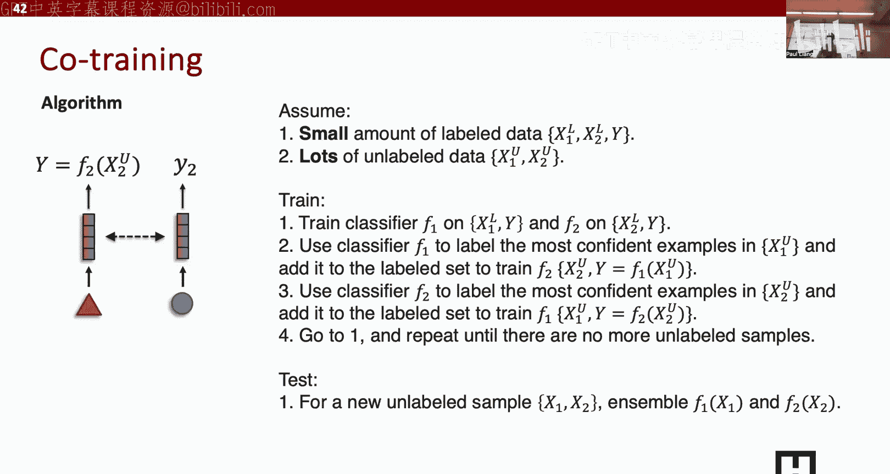

So this， even though 1998， very， very seminal work nowadays use very much。Here's an example。

Activity recognition and you have video data and video gives you RGB brain by frame images。

 and you also have these optical floats， which helps you kind of。Continuous high motion。

 the person doing those activities。And again， there's you know intuitivetu there's several examples where RGB is more important to detect the activity from static images。

 and then some other examples say golf where movement is very important。

 probably more important than with static images， so cotraining has been shown to work very well here because you can essentially train RGB classifier and they will flow data and you can train a flow classifier to help you label RGB data and they learn back and forth from each other。

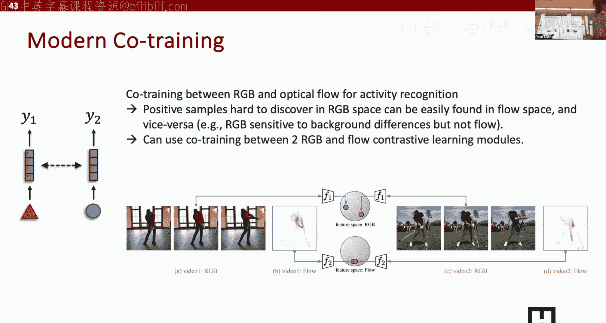

More examples in language models。So here's an example where the two views are GT3 and B。

2022 papers are probably still using B and again， these views are very much complementary G3 or bigger。

Better at completing text bird smaller and at that time better at know classifying different things using its representations。

 so again they did co training where GT3 model will label some data that you could use to train bird and bird model will label some data that you can use to train GT3。

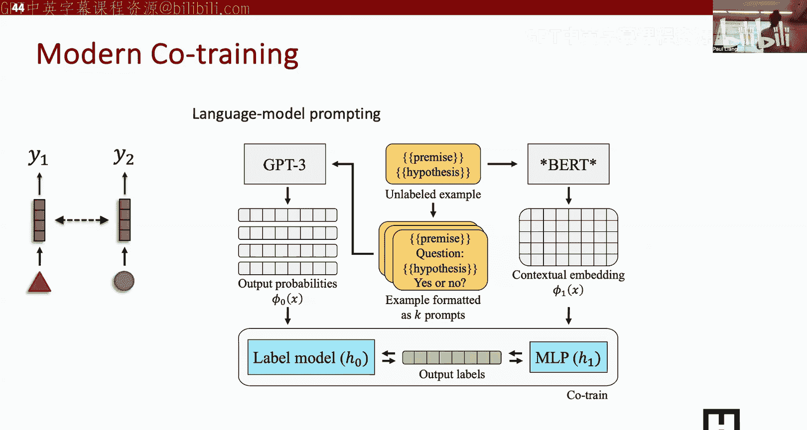

And nowadays， even more examples of basically assuming that these models are APIs。

 multiple elements or APIs， you don't want to modify the internals so much or you cannot even modify the internals。

 but still have this flavor of multiple agents debating or conveying information to each other or labeling data with each other so many examples。

 I think this cotraining work really inspired along this。All right， great。

 so to wrap up crossmod learning is this idea of transfer information between modalities。

 usually from things that are higher resource， more data to things that are low resource， less data。

 but that you actually care about。

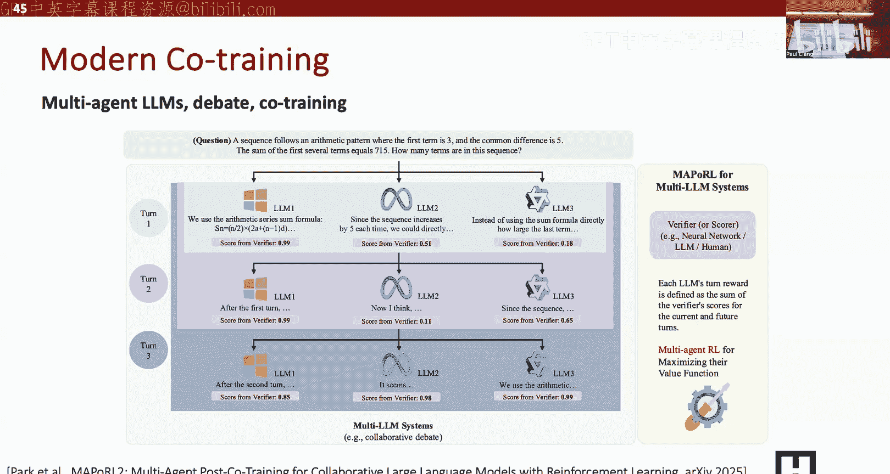

We saw three examples of transfer and multitask learning。

 we saw examples of co learning where extra data is introduced in training either as input or output。

 and also this idea of inducing behavior between models。

 but you're keeping only black box API access。And several tips， you know。

 decide on secondary modalities， decide on whether you want to do auxiliary input or output and decide on whether you are referring to modifying model internals or we have。

You knowMore black box access and。all of these methods assume that there is some redundancy。

 the transfer and you can only only keep what is common to both or is fusion。

 alignment or translation， which it just exploits the common information like a model induction。

 there's also this assumption that both views give you something similar。

I've not really seen how you can do cross motor learning with going beyond this assumption of reancy。

Great。😡。

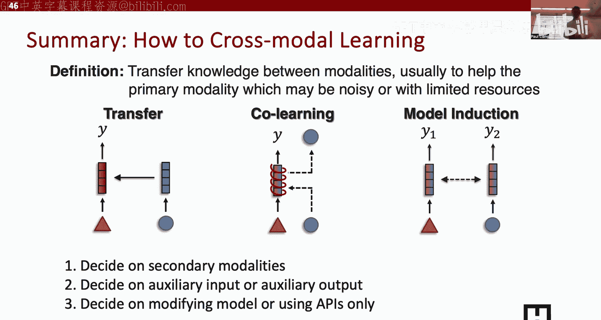

So wrap up so far in the class we've seen these foundations of AI。

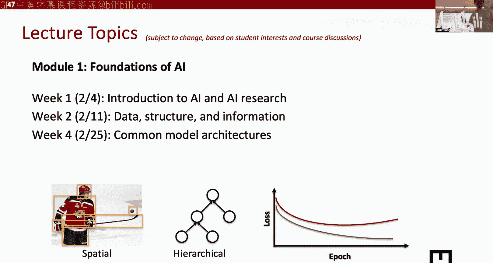

We basically wrapped up intro the multimodal multimodal connections and alignment interactions and fusion and today was cross modelal learning next week is no class for spring break and then when we come back we'll discuss。

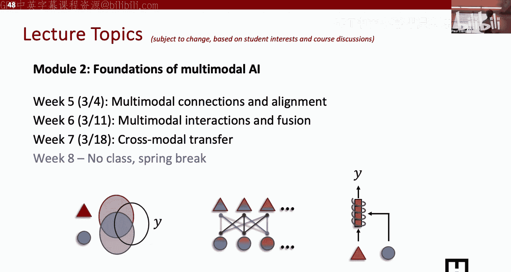

Large models， modern generative AI， reasoning， interactive agents， and all the data stuff。

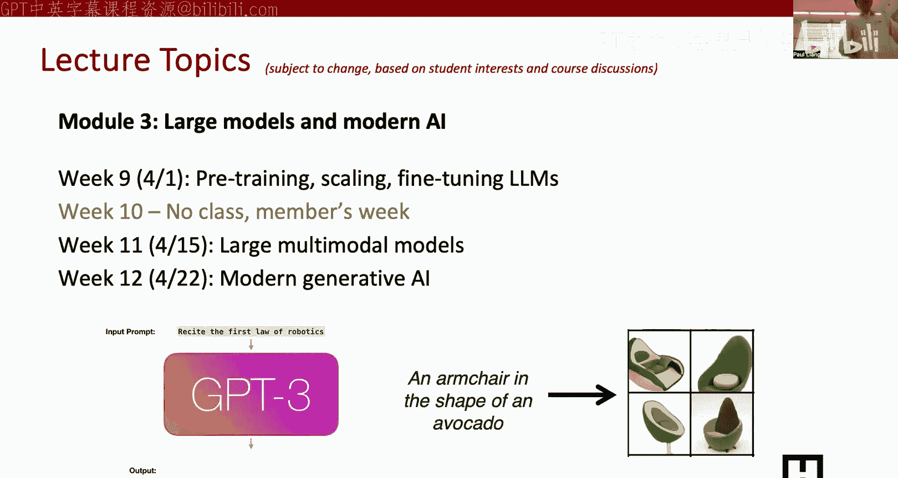

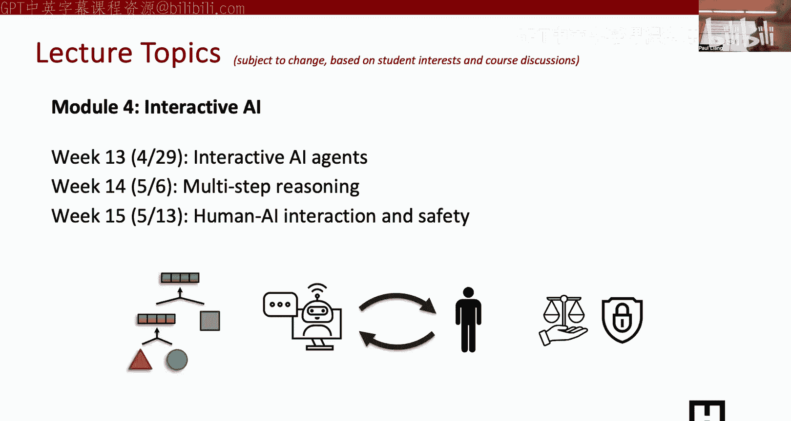

All right and just a reminder again， please make sure you're working on the midterm assignments that's going to be due the week after spring break report and presentation and reading assignments due tomorrow in discussion on Thursday all right thanks everyone。

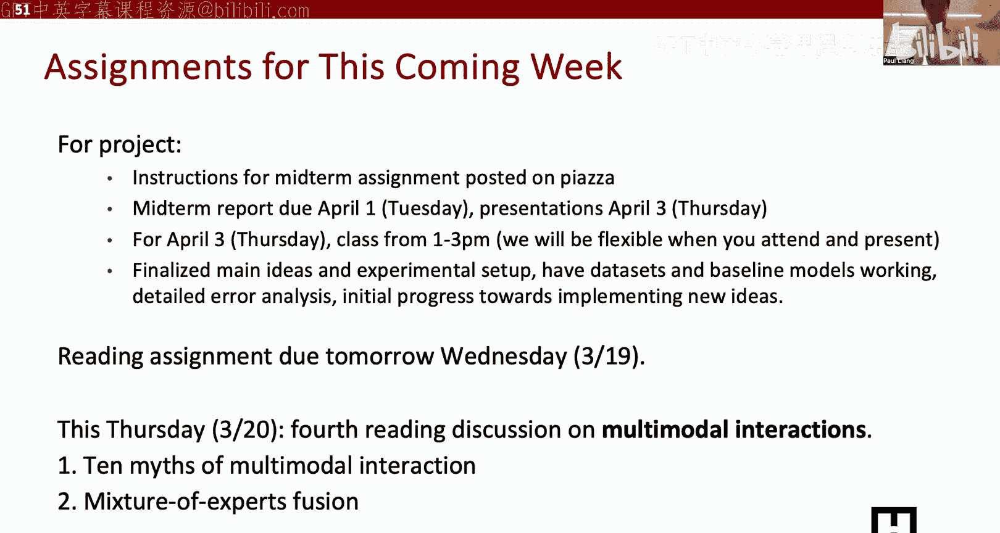