# 《如何AI所有事情｜MAS.S60 How to AI (Almost) Anything》中英字幕（Claude-4-s翻译） p08 [08]Lecture 5 – Multimodal Fusion.zh_en [BV1UhawzQErD_p8]

H folkss， welcome back。Welcome back。So quick recapb hopefully everybody's working through their projects I email folks feedback and also assign people to a primary TA so please start meeting with。

Fox。Fox。Hey。All right， so please start meeting myself in the primary T。

 maybe every other week so that every week we have someone to update and get feedback。

And hopefully by now you finalize your main ideas， you have this experimental setup。

 meaning your data set， your models， where your baselines are pretty started maybe getting some of these baseline models working and maybe some progress towards your initial ideas so next checkpoint is after spring break that week on Tuesday your midterm report will be due and on Thursday we're going to go through and folks are going to present。

During Thursday's class， the week after a spring break， all right？

We also released the reading assignment。That's reading assignment3 is going to be due tomorrow evening in preparation for this Thursday's class。

 this third reading assignment is on multimodal alignment So different ways how you can align modalities to common representation spaces that was this contrastive learning paper how you do that they show some nice analysis and also this second paper called the representations which basically this interesting phenomena that even without enforcing alignment using contrastive learning just by scaling up models and training them independently some alignment and similarity emerges they might be converging to this you know unified similar representation also a very interesting phenomena both of these questions to build these papers leave a lot of open questions and hopefully will discuss some of that this Thursday。

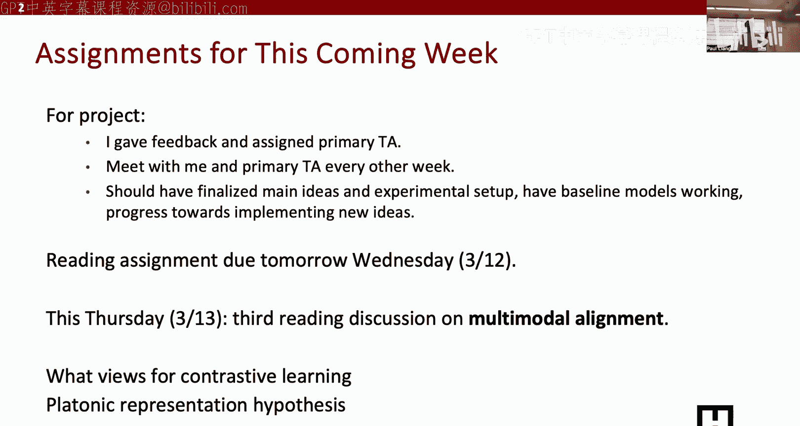

Okay， so today we looked at introduction to multimodal learning， we looked at multimodal alignment。

 and today we're going to dive deeper into multimodal fusion。

 so this challenge where different modalities and you're trying to fuse them together。

And the general definition is that you learn， given two modalities。

 some joint representation that is able to capture how these modalities interact。

 where the information is coming in from and how this information combines。And again。

 go through this whole space of multimodal fusion in one lecture。

 the goal is to get a sampling of different ideas and this whole spectrum of ideas。

 who the ones that are most relevant to your project probably dive deeper and look at those individual papers。

So again I think about fusion as a spectrum right can either take your data in its raw form。

 your raw modalities， learn some abstracted features by using pretrain models and once you start extracting these features。

 your modalities are a more abstract form and are therefore more likely to be similar in nature because you're comparing them in representation space。

So then the fusion will be these abstract modalities and the fusion has to do less less happy the day。

Thank you please。And another paradigm of fusion is when you're starting with raw data。

 so triangle circle raw data modalities， and therefore these raw data modalities can be more different from each other。

 more heterogeneous， different dimension， different discrete and continuous space。

 different elements， other reasons why we discuss that if we discuss no modalities is being different and you willfuse it earlier and let the fusion model do more habitly。

So one side is where you extract features first independently and then you do something simpler in fusion。

 diligent or paradigm is you don't extract any features。

 start with raw data and do more work in your fusion and again this is a spectrum will cover methods that really span one extreme to the other extreme。

And the whole goal infusion， again， I highlighted this term。

 is to capture the interactions between modalities。

 the fact that these modalities combine information in some way。

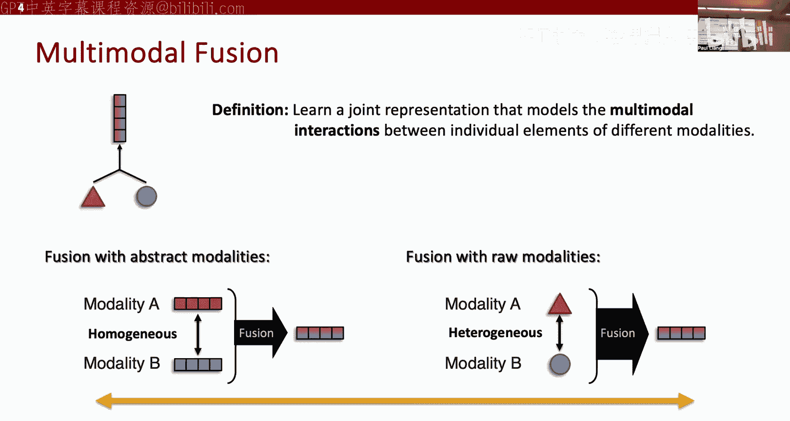

And recall， during last lecture， we introduced this idea of multimodal interactions as one of the three key principles which makes multimodal data unique。

 intuitively how these modalities combine to provide new information for us。

And we discussed several types of interactions， the first one is when there's redundancy where there's common information。

 so it might say something happy and show happy expressions and both of these really reinforce that this person loved this movie。

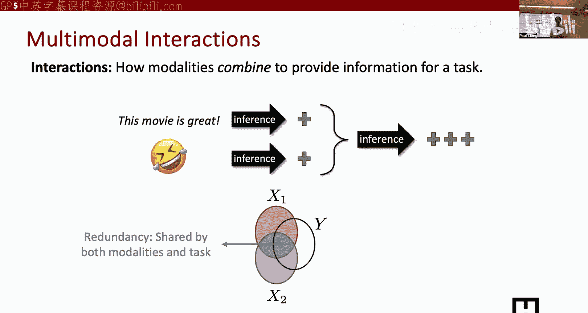

And we also looked at alignment methods and we actually showed we gave these examples showing that contrasted learning。

 they essentially learn separate representations and brings them together using some similarity function called that contrasted function。

 we actually probablyably learn the common information between them。

Right so there is this intuitive connection between alignment based methods that we saw in the last lecture and redundancy。

 so alignment based methods essentially capture the redundant shared information between modalities。

Again， these are all intuitions， there are no really formal proofs to anything。

 but if your data is mostly redundant and you're trying to capture this common information。

 alignment based contrastive learning methods are something that you can explore。

whichch therefore leaves two other interactions that we also saw。

 one is uniqueness so there's unique information and one not present in the other， for example。

 you're saying something positive， but this isn't also what you're showing in your facial expressions。

 which are neutral。

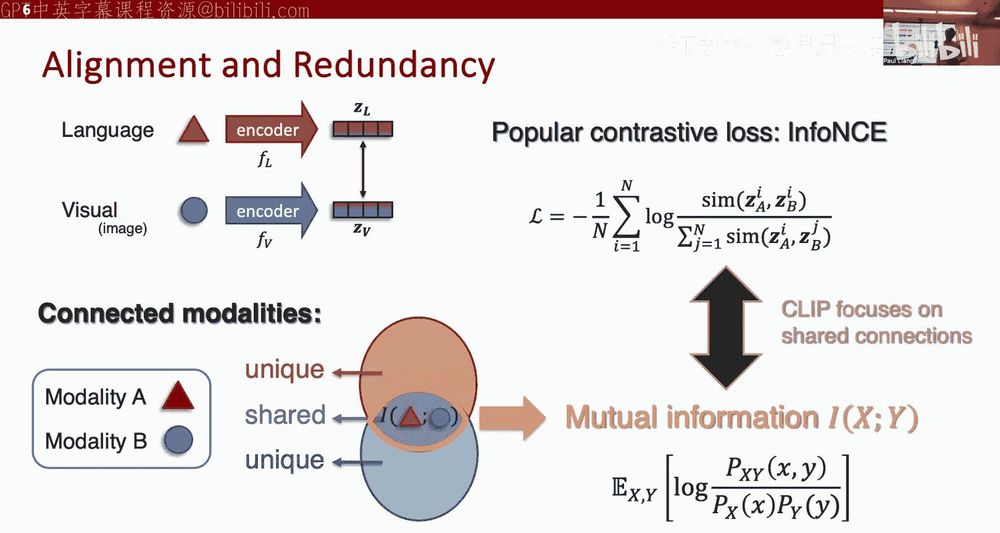

Then you can actually show that these alignment based methods based on contrasted learning we will only learn what is common and they will throw away what is unique。

 So some of the methods we look at today will look at how do you better capture this unique information。

And also this third type of information which is synergy。

 so the information isn't common in both isn't uniquely present in both。

 but only arises when you start fusing these modities together。

 so some examples that I gave was showing something positive in what you're saying with showing some anger or frustration。

 your facial expressions and together you get the idea that a person is actually being sarcastic。

So again， alignment based methods， we just really not capture this。

 itll just capture the common information， so discuss ways of doing fusion to capture synergy。

So the whole idea， you know， multimodal fusion is to capture these different types of information。

 waste information merges together when given multimodal data。

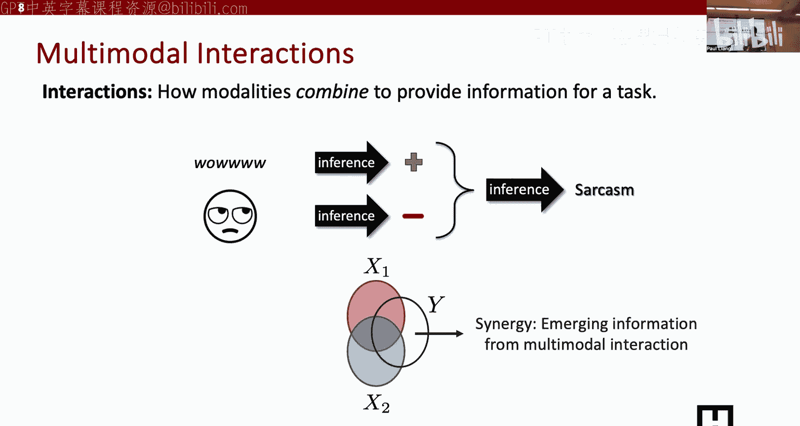

So yous on this spectrum fusion with more abstract modalities。

 so this is the case where you first extract some features using pretrain models and then do something simple in fusion。

 so for example you could extract。Image representations to image models language representations using language models so work to back for language model and so on and these encoders the main intuition is that they're taking raw data and they're extracting some more abstract features these features should have some semantic meaning so they only dog meaning over here and dog meaning over here so they're more similar。

Semantically and you can start doing less work in fu。

So this this also mirrors what some of the people call early and late fusion early fusion is this idea where you just take your data combine in some way and then。

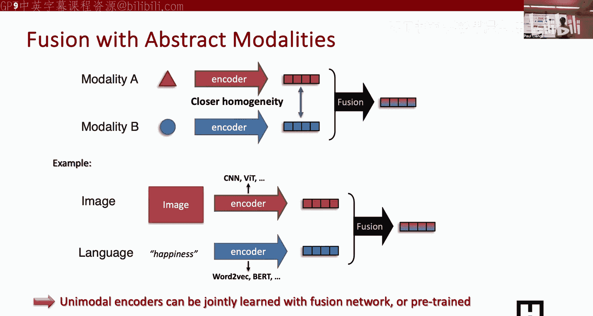

Put it through some model so you're fusing your data early on。

 so directly combining your data and letting the fusion model do more work versus the fusion。

 in which case， at one extreme， you can even extract the label So make a prediction from modality A。

 make the prediction using modalityity B and then just combine the predictive labels in some way。

To get the final work。So people have been explored， for example， ensemble methods。

 taking a majority vote， if you have few modalities， two of them say one label。

 the third one say someone the label you just take a majority vote these are all examples that fall under late fu。

Al right。😊，So these are just sampling of methods， so I'm going to start simple and just really introduce some basic concept of fusion so you're going to。

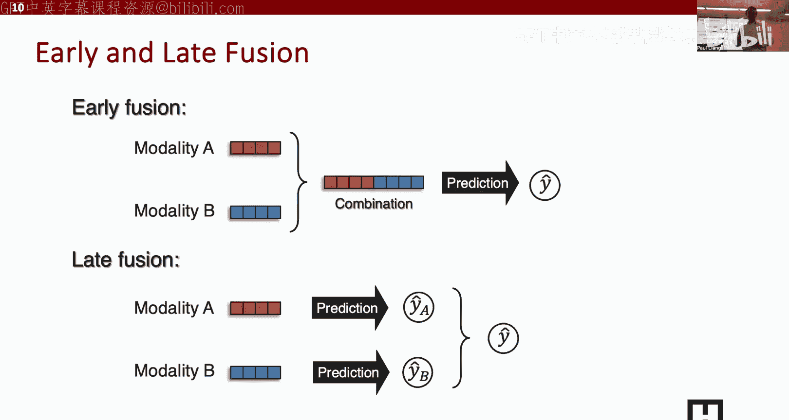

Again， the idea is to model these cross model interactions。

 the ways that these two modalities interact。 And we're going to just start simple by looking at the one dimensional case。

 So modality X1。Just one dimension， modity B， one dimension and the label one dimension。

And one very simple way to introduce the idea of fusion is to just look at the linear case where you're training linear functions and taking your data and make predictions on a label。

So I think all of you are familiar with linear regression where you have your label Y equal to some intercept w0。

 so this is your intercept where intersects the x axis， there is some way W1 xa on first modality。

 there is some way W2 and Xb， which is the second modality。And you have this interesting term。

 which is this W3 term for Xa times xd。Right so you can think of the first two terms just additive terms。

 each of the modalities contributing independently weight one times the first。

 weight two times a second， and you want to think about this additional term that introduced as this multiplicative term or we call it multiplicative interaction and first take the multiplication of the two modalities and then determine what is the weight w3 which is useful to predict a label。

Okay， so to see an example of this in practice。

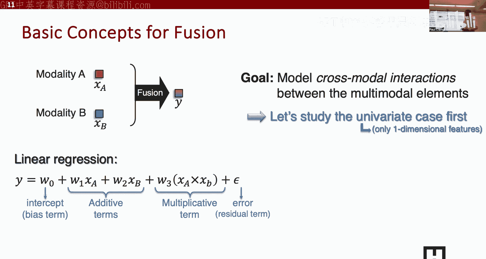

Let's just say you have this task where you're trying to make predictions on book reviews。

So there's two inputs these okay so the context is that there's some people who are saying I read this book it was very good I like this I read this book but I didn't like these characters so these people are saying some stuff and I'm extracting two modities so first modality is just the percentage of time that the people are smiling when they are speaking about this book they can be smiling all the time or they can be not smiling at all so that's a continuous value。

And then maybe the second modality is just this indicator variable that represent whether it's a professional critic of books。

 so they criticize and review books for a living and non critics， so just everyday people like us。

And label Y is what the actual score， so the ground truth score of。

Kind of like rotten tomatoes for books or was the score for those books。O， so it's a simple problem。

 X， A， X， B and some label Y。And to see really these things in action。

 you might have several things you want to predict first you might be interested in whether the percentage of the time that a person is smiling is predictive of how good or bad that book was so let's being the first hypothesis。

And that's you can tell is' very much a union modelal hypothesis right it's just looking at X XA and how that influences one and the second hypothesis is a bit more interesting。

 which is that does the effect of smiling depend on professional status so now you're asking a question about how these human modities are。

When I am not a critic， I just review books as a hobby。

 what is my smiling indicator about how good a book is versus when I'm a critic and doing this for from my occupation。

 what is the effect of smiling on how good the book is？So you can do some basic analysis。

 you can just train these regression models using one modality。

 you will start seeing that let's say X a is somewhat too small and of course they'll be positively correlated with how good a book is so's a positive so between X A and Y。

This could be your estimate with some intercept over here。

 so you can not sign where focus about average 1。6 out of10。

And then you could also imagine training linear regression with four wave times xa plus wave times X D。

And intuitively， your line that you get will be something like this where because v is an indicator variable。

 you can take in either zero or1， so these two lines would have the same slope。Weight one。

 both are positive， it's just that whether the person is a critic or not shifts this slope up down。

I not a critic。In general， they are higher， but the slope is still the same。And if they are a critic。

 the shift down to something lower， so critics might be more harsh on books， essentially。

So that's an example of linear regression without a multi。

The brance of both W1 and the second with equal introduce us a shift up and down of effort。Al right。

😊，And now see what happens if you maybe start fitting linear regression with multi take difference with w1 x。

 W2 xb times W3 on Xa times Xb。Now， naturally， you'll see that your function is more expressive and it could capture。

Pairs or functions that are no longer the same gradient， no longer just shifts of each other。

And the way you want to interpret this function is that， okay， but the person is not a critic。

 that's a baseline this is their story。And now when I introduce people who are critics。

 if the critics smile more， they like the movie even more。If the critics smile less。

 they like the movie be even less。So they are bigger extremes。Versus just a normal person。

And this could be， for example， what they would have。

So every two negative critics in general are more harsh。

 but there's every three multiative effect essentially tells you that on the extremes。

 these critics are much happier when they smile and lovely movie be much more and much angrier if they don't smell。

 they like the movie much less。So that's intuition and again your answer to your hypothesis is that yes。

 in fact， the slope of the line does change。The slope between how much small and how the movie was is different。

 whether a person is not a critic or whether a person is a critic。

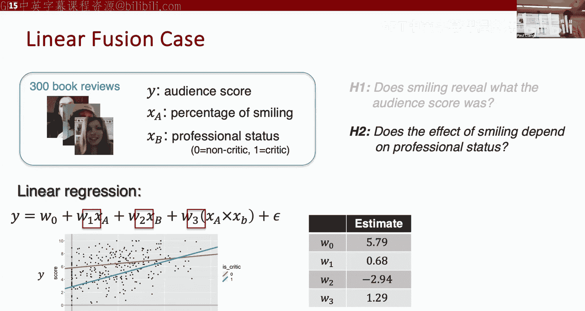

Right。😊，So that really just motivates， you know， basically why people want to take multi interactions in。

And that was a one dimensional case you can extend this to a higher dimensional case one common way of doing it is to essentially。

Sorry， one way of doing it is essentially to take your data and for example。

 capture these interactions by multiplying them element wise。So if you have four dimensional data。

 XA， four dimensional data Xb， you can learn a fuse representation Z by doing element Y product between XA and Xb。

So this will be at every dimension， a multiplicative interaction between the first and the first second and the second。

 third and third and form。Of course， you get even more expressive。

 you could take in four dimensional data x。For the National data XB and create this matrix。

 which is4 by4 and can think about these as a bi linear matrices we're taking essentially this every one of the elements in a。

Multiping every one of your elements be。That's how you get this four by four matrix。

 essentially capturing these multitude interactions in all pair of features in the first and features in a second。

はい。And if you look at this bilinear fusion might be reminded of something that we saw last week where again you had these two vectors and you took some other product to get this pairwise matrix and that was these multimodal transformers right that we saw last week so in fact all of these modern transformer architectures were inspired by these more earlier bilinear biline pooling and again the idea is to take all pairwise combinations of one set of features with all in another set of features。

So multimodal transformers does something。Quite similar， but with some subtle differences。

 as we'll see， you might have data from the first analog。

Say a couple of words that a person is speaking， and that maybe be three words by some dimension。

 you put it through some video transformation。You have data from the second majority。

 maybe the person spatial or vocal expressions， there might be another set of features。

 but again the sequence link might be different so they can wrote it as D by four。

And you're essentially taking this product to get this pairwise multi interactions。

I put every one the words of the three words by every one of your four visual or vocal expressions。

 so you're trying to learn how much to interact with each other multiplicly。

So that would your three by four weighted out the product。Same stuff normalized by dimension D。

 scroll of B to a softmax， so each of these values can be interpreted as properties and then take the multiplication with the actual features in the second value。

That allows you to learn a new set of features。These are new features for language。

 there's three of them， one for each other three words。

 but now for each of the words you looked at the probabilities with the four nonverbal expressions and actually multiplied by the four nonverbal expressions right then he use it to predict some sarcastic label or something。

So these multimod transformers that you know， the previous slide that I showed on these like bien products essentially all operate on this same idea you have multiple features youre looking at how features interact pairwises with another group of features from another modality。

Juan， can you raise it down a little bitYes。

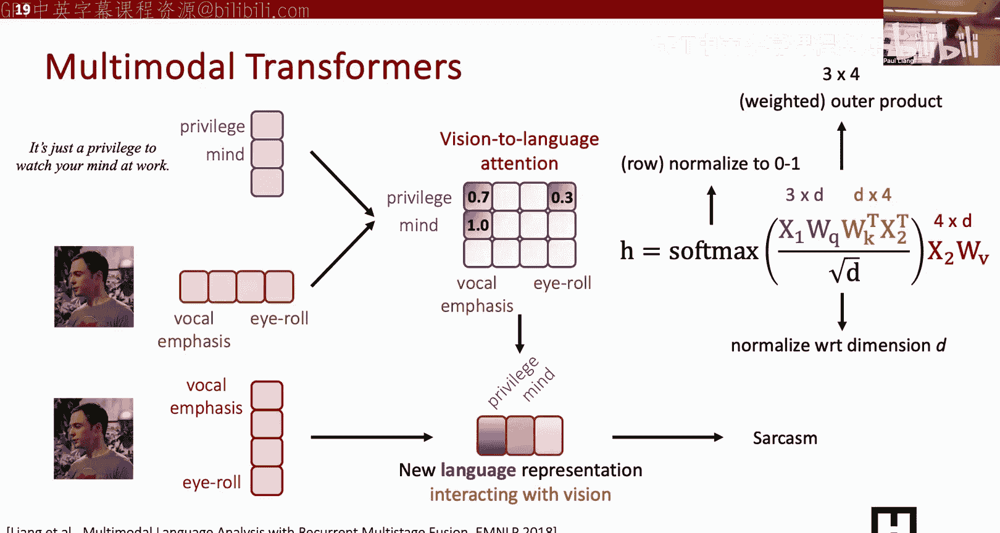

I always we don't understand what the wrong is not about。啊。So think about it matrix dimensions。

 so these are these are typically things that are one by D so maybe one just showing one data point here right so one by D one by D。

 how do you get some output so in this case this is just element wise multiplication。

So one by D1 by D the first element is multiply second going multiply to the one by D over here what we're doing is that this is one by。

 this is also one by， but you want this output to be D by D。はい。

So the first one might be to be transpose to D by one。And there is one ID。

 so essentially every one of these element wise all with each of the other ones and get dimension to divided the matrix。

咁白先。不可以。Oh so so this is just more expressive than this right because over here it depends on where the features are each of these features can only interact with the features in the same dimension here you look looking at for example what the first and third interacting together so again it depends on what the features are sometimes it's very important sometimes it's not only depends on the problem。

Yes。😊，Any all us to impact is going have。reflection given。that。催見 more than two。对对，现在我经常。

AndSo that's fairly what I think。And mean好我 still的。是大游。Very good， yes， so this is。

What this slide will be about so we saw this case or two and i'll get to that question very quickly but me just wrap up the two dimensional case so we saw from you know previous slide。

If you take XA for dimension XV for dimension and you take this outer product。

 you're only ever getting these multi factors， each of the factors is Xa times something XV and sometimes will be useful to also keep the unimmodal factors so some XA and some XV these are independent unmodal factors and one trick that you can do is to depend on one to your feature vector before taking this outer product。

So what it to look like it would now5 by5， which has a  four by four sub part which is a multiative。

 you would  four by one， which is just e， four by one。

 which is just a and a one by one which is just a intercept so that's a few way of getting the multiative terms。

 the two individual unal terms and the intercept。And then' of course see your question。啊。Yes。

 by model unit model and intercept and your question of course。

 you could go higher with many problems with three modalities four or five and you could start again doing this and now you get this tensor。

You can essentially three dimensions， you get a three by three by three or four by four by four。

 three dimensional Q， which is where three way interactions are。

 you get use spaces which are four by four， which are just the three choose two pairwise interactions。

 you get a unimmoal interactions and you get one at the end so you could go more expressive。嗯。

There are ways。 So， these are。Plug and play you can modify so for example you could say I have image。

 but maybe image is very important and maybe to speak one corner of image where you some other corner of the image。

 you could even do modity A and modity A by itself and do these interactions just really depends on what the problem requires。

good of all these are just these are basic mathematical functions they are reasonably efficient in compute。

 they're differentiable， so you could just plug them into any layer of your neural net and train everything into it。

I mean speaking efficiency， you will start to see that at least in a two dimensional case is still reasonable。

 so some of these transformers also do this pairwise， two by two two way pair wise。

 but once they name with three and four becomes very big， very inefficient。

And you these weight matrices will end up quite large。So how to make it more efficient？

There has been a new set of methods called low rank approximations to these large matrices and tensors。

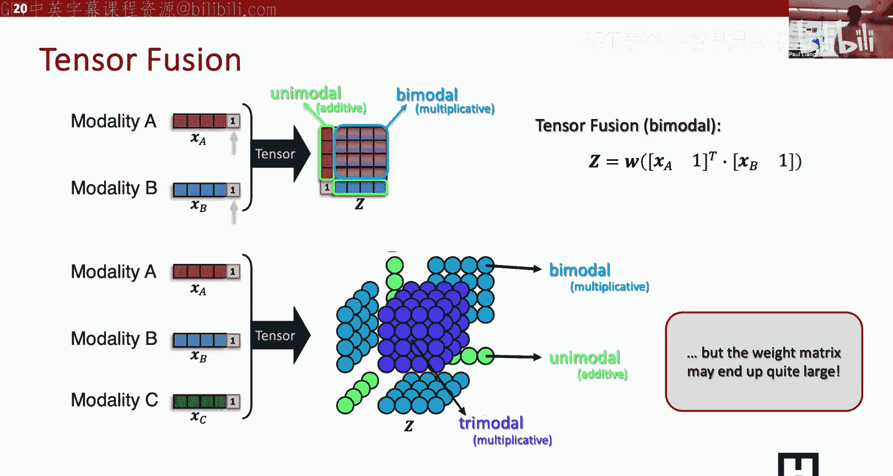

So if you look at a two dimension please。Rebecca coming in for。4 or four0 by four。

 so this matrix of four by four is the one that captures these multiplicative interactions。

So this one is still not that bad it's not too much maybe 60 the issue is that if you put this as a layer in your neural network and you want to get it to the next layer。

 maybe this next layer is 10， for example， pen wave softm。

 then you need this weight matrix and does transformation from this four by four。

Do four by four by 10。So this next weight matrix is actually the one that is and is much more computationally expensive。

And so there's ways of essentially making these more efficient by not learning a four by four by 10 matrix entirely。

 but rather assuming that this matrix has some lower rank structure。

 lower rank structure meaning approximated by maybe a combination of smaller matrices。

So several ways of doing this first， wecompose this weight value by achieving in a some lower range structure。

Instead of creating this entire format matrix， we can implicitly just be it as these four individual vectors and you can probably rearrange this computation into something like this。

They're still keeping the core by four individual vectors。

 but all these individual things are just submatrices that we have decompposed this large。

 large cube into。One intuition of thinking about this is that let's say a matrix that is 10 by 10。

This might be 100 parameters， but maybe some of these dimensions might be related and correlated with other dimensions。

 so you can approximate this 10 by 10 matrix as a bunch of 10 by 10 other products。Smed up together。

Yes do two summs is 10 plus 10 times two， so that is just 40 dimensions instead of pan。

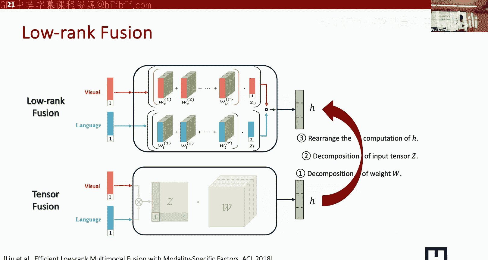

These are called lower rank approximations。So visually。

 what it looks like is you will take in this big cube and you will maybecomp it into limit sum of these outer products。

So in this case， I'm just showing two of these sumumps。If you have enough summations。Then in limit。

 it will approximate all possible cubes， but you only have two songs and then only approximate a small number of these cubes。

 but in practice is sufficient。And now you see the number of parameters reduced to。

And you will rearrange this computation by essentially not creating。

This for by or matrix and leading it as two individual vectors。

It can show that this final computation is equivalent to take in。

These two factors and multiplying it with the first matrix and these two factors I applying multiplying it to the second one。

お産 て ないん です。Just some cool visuals Okay， you all can read up some of these details。

 but these are you know if you want to do something efficient just search low rank automations they're used in multimodal learning they're used in fine tune LMs nowadays。

 so all these big otherMs have。know attention heads， which are 768 by 768 large matrices。

 you can instead updating or matrix you can just update some lower rank approximation on that matrix。

 similar ideas， I included some references。Great， so I think other now what you've seen is that you know you can start with very simple factors of your data and then compose increasingly expressive multiplications there are two by two。

 two by three multiplications you can go higher and higher one thing people also do is they might take polynomial factors so something to the power of two power of three all this could theoretically make your model more expressive。

And therefore more likely to learn。More complicated interactions between modalities。

But then you also always have this issue of MI I doing too complicated of a model and therefore overfitting into my data。

And that's a bad thing。So you've got to find some， someplace to stop and one thing people typically do is to basically just check your generalization using cross validation。

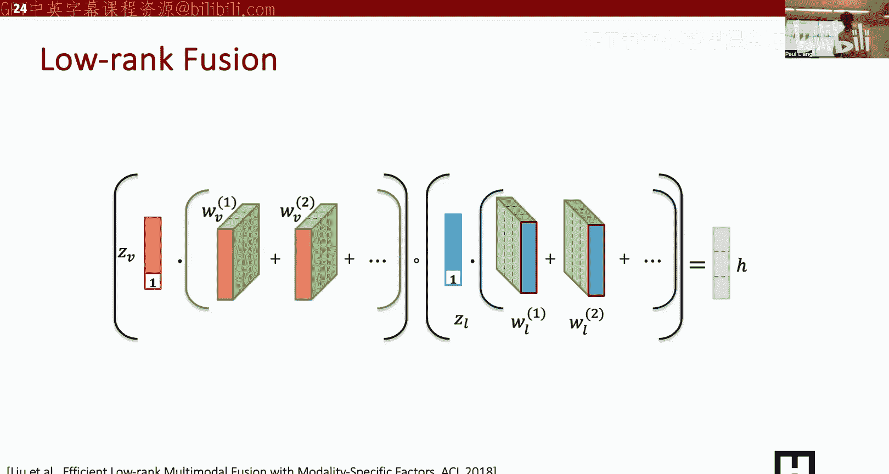

All right。And everything that we've seen so far。You know there two modalities we're essentially creating this wave matrix that is static it's always just the same across all data points and then this is new generational methods which are called gated or dynamic in which case。

The the features that you actually extract the modality would depend on the modalities themselves。

So there's this kind of eight that's going on where given the current narrative you will learn some the attention weights over yourself given the other one you will learn some attention weight over yourself and these attention weights could differ because it depends on the current data point you will differ across different data points sometimes information is very useful and these are ones and that things pass through and sometimes not very useful you will learn things like zeros and would not let things pass through again very reminiscent of these know self-attention mechanisms in transformers。

啊。So you could think of these things as previously we saw your output was just a fixed weight W1 times x a plus w2 times xd and the weight W1。

 W2 was fixed， but now these weights W1 and W2 depend on some function G of your current set of inputs instead of just having fixed W1。

 W2 weights。You can view them as attention functions。

 you can view them as gates as a lot of you know exploration or iron。What。

 how do you condition these things， Just look at the our modality， you look at both， you look at。

 you look at more things， you look at the context and so on。 All these just to better design。

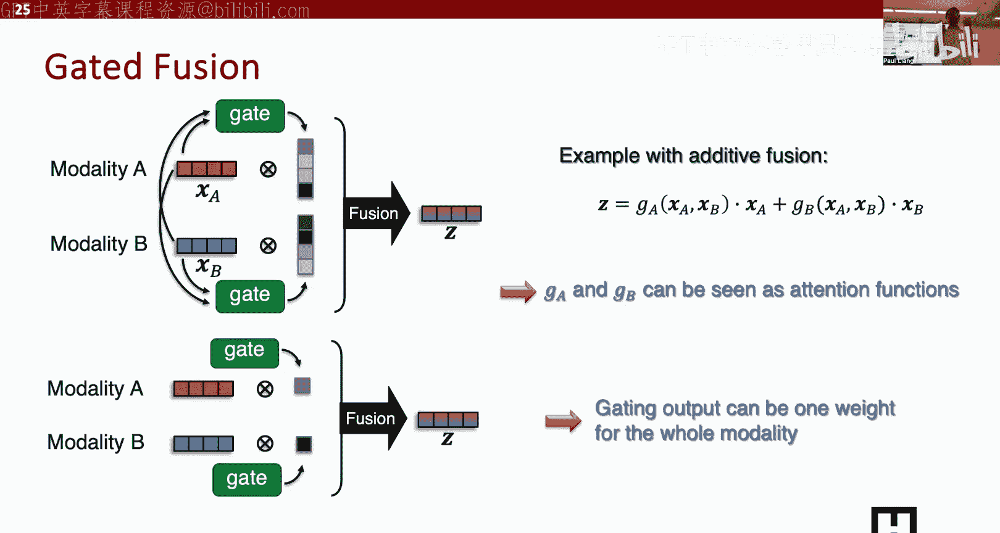

These dynamic links。Great。More stuff on gates。These gate can be done using soft attention。

 so these are， for example， a softm that tells you everything between zero and1 and it can also be done using heart attention heart attention means it literally just be one and zero discrete。

So you would just let this feature be used for theff fusion or not let this feature be used for the fusion。

 nothing like it would be used like 0。5 for the fusion so hard attention would make things more more interpretible because you're literally selecting subset or features to use but the difficulties and it might be harder to train because it's discrete。

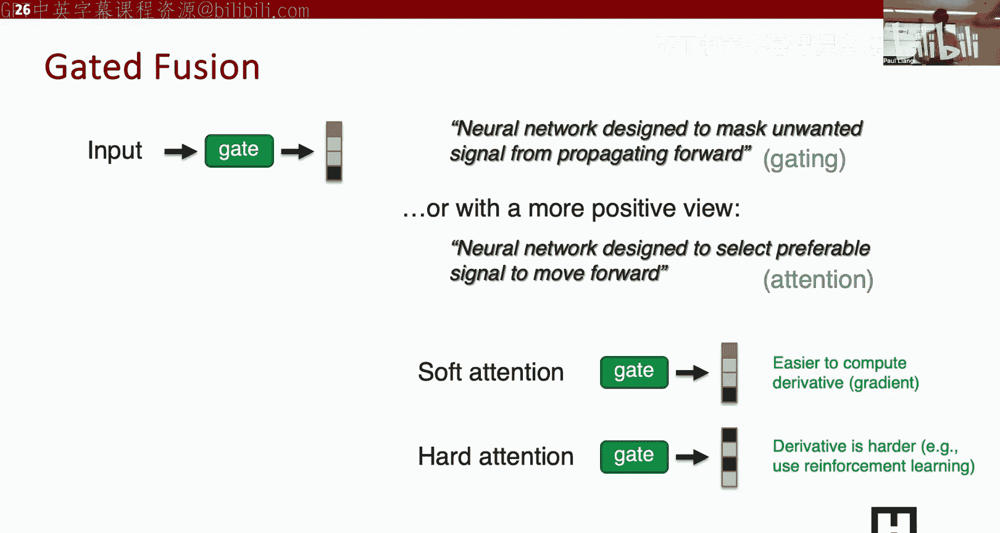

O。A little bit more complicated up to now we've seen essentially fusion where your modalities were symmetric Ro the X XE。

 some function was being operated over them。But in many cases。

 we have some prior knowledge about some that means being more useful and some being more secondary。

I mean， one example is know human communication like we know that 90% just listening to what a person is saying。

 so X in language is should primary and maybe you know the remaining 10。

 20% of the time you might look at facial expressions or voice only when it's really necessary。

So you have those kind of scenarios， you might not want to use some symmetric fusion。

 you might try to have one as a primary and only use the other secondary modalities as a way to make minor modifications。

 minor changes to the primary one。So one set of methods that have come out is secondary in this case。

Visual and audio you learn some function that tells you how useful they are。

 and that gives you some set of features， sometimes they're let pass through and sometimes they're zeroed out and then you will just use that as a way to modulate。

Modify representation from the primary re modality， which is language。And intuitively。

 you can think of it as。As a space where the centroid was your language embedding， for example。

 a word embedding or sentence embedding， and most of the times it's just there。

 but it would be shifted in small directions， depending on what the nonverbal expressions are。

So one way to account for the fact that some modalities are more dominant than the others and therefore more efficient means the fusion on the secondary modalities to be smaller。

 more efficient。Okay。

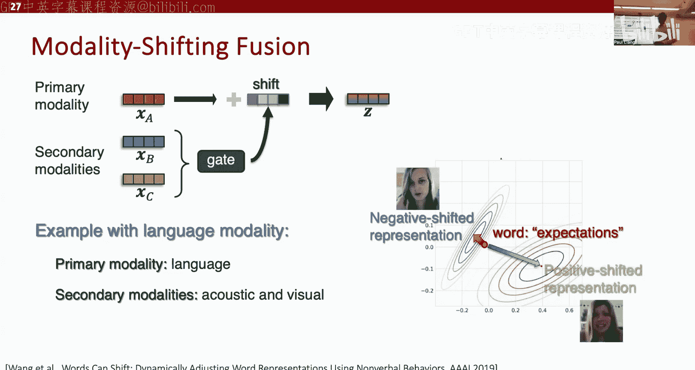

Great。😊，So we went through a journey of， you know。Data coming in various forms of fusion methods becoming increasingly complex and now on the other extreme there's really h methods that take in your data XA and XD over here。

And essentially just concatenate them as early as possible and let the fusion model figure out what theff fusion should be。

 so we call this kind of early fusion， you're fusing it as early as possible。

 so X and XD would just be， for example， concatenated as early as possible。

 and then you will just define a figure model F to let the model basically figure out without much human engineering on the features what theff fusion should be。

So this is very common nowadays， we'll run through some examples of you know how f in multimodal transformers and so on can be used for this kind of fusion。

 but before getting to that let me also cover a paper that I like really much。

 which is you could define these complicated fusion strategies。But the question is。

 will our model actually learn？What this interaction should be。

Because the hope is that your model learns something really interesting from these two modalities。

 some really interesting synergy， your interesting interaction。

 that's why you do all these duplicative stuff， your tensor stuff， your transformer stuff。

But then when more to actually learn these interesting interactions。 Yeah。

 is the underlying thing somewhat。Something that could bere as a function and the vehicles that going to show that translate like。

诶。Is it like like a squiggle kind or is it like kind of quaratic or something yes。

Anyone know get to there yes。

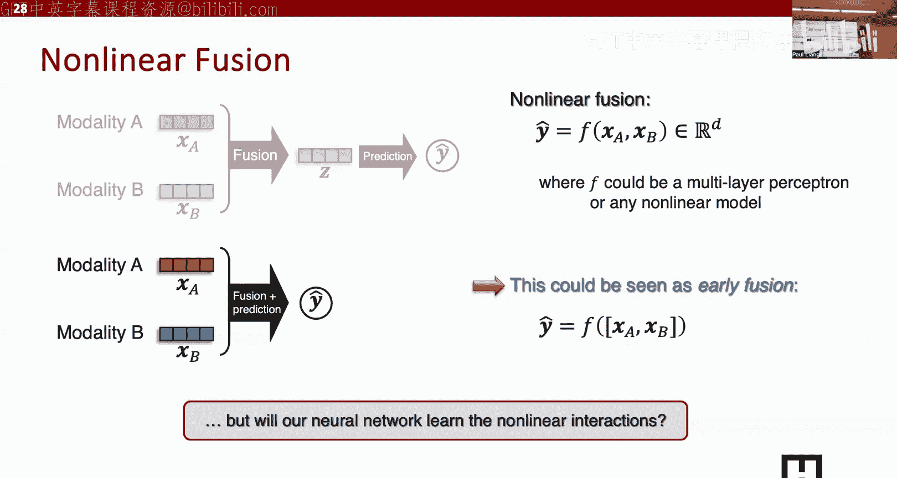

So。So linear interactions are things that are just perform F of A plus F of B。

But these are what we call linear interaction， so there's not much。

There's nothing these two modalities are actually bringing together in conjunction with each other so as you train a A and you train up B at the moment and you're done these are linear interactions so not even interactions is anything that beyond this。

If horizontal example， they have to multiply together quadraically。

 we have to condition on each other they have to feel some synergistic way。

 those nonlinear nonlinear interactions。So one way of essentially measuring whether your model learns these interactions is that。

Let's say your some function。Over your two modalities， that you claim is super， super awesome。

Then what you can do is essentially find the closest function to F that is only linear in nature with respect to F of A and F of B。

And what we do is that we do a projection're basically looking at all possible these fancy models。

 for example， neural networks。Al like S， these are key trained vision language。

 birth like representations， kernel SEs， these are all your complicated models。

 and just projecting them into this space of models which are just additive。SoF of a plusFB。Okay。

 so finding the nearest nearest nearest neighbor inside that space。

So how do you actually do this projection for these folks。Proof that。If you have， for example。

A function F， which is complicated model， you can essentially do to things first expectation over the。

In this case， expectation just means I feed in a bunch of of these into the model and I take the average over it。

 So once you've taken an expectation over XB。In the limit。

 it will only be a function of exit because you're basically marginalizing XLs。

And then what you can do on the other side is take the expectation over XA to give it a bunch of sentences。

 see what a model does， and I take an average over all of those sentences so now you're averaging the effect of X AA and it's just a function that depends on XB。

So this way you can show that this is one of the nearest projection from complicated models to the simplest additive model FOA plus5。

Okay。And these folks actually show that sometimes you have all these complicated models。

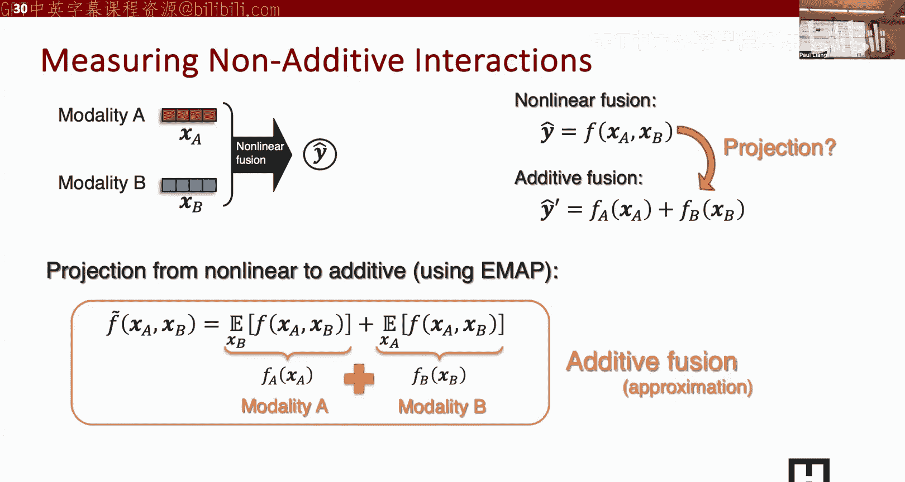

Sometimes you can find that performance for double 91% and you're project it to the simplest possible。

 these additive models， the performance only goes down to 91。1%。They dropped by 0。2%。

And some of these data sets， it was 81。5% with a complicated model。

 we found the nearest one that was just additive in nature and again it just dropped down by 0。2%。

So sometimes you know， these really complicated models are great， lots of fusion。

 lots of you new information being learned， but sometimes they might be approximating nothing else than just simple additive combinations。

 Applebe plus Applebe。So this， I like to speak a lot because found we challenged a lot of the thinking。

 including some of my work。Yesス。😊，So。best model。So over here yes。嗯。地方。Okay。た。6。

I've trained the task using several。Yes， that's a very good question so the fact that for example。

 you took a complicated model and you found the nearest neighbor additive model and only lost 。

2% doesn't actually mean you can just create additive models from scratch and get 91。1%。

And that's another subtle distinction they make because you just train linear models。

You don't really know what linear model it is， you don't know what your function space。

 and you might only get like 70%。When you take a complicated model， find a nearest linear projection。

 you may not lose that much performance。 So there is still value。

 You can think of this as an algorithm where you train something really complicated and。

Let's say you care about efficiency and you distill that model into this nearest additive combination。

 So now you're efficient。系。Your saving parameters is efficient and you're also getting some reasonable performance。

是。

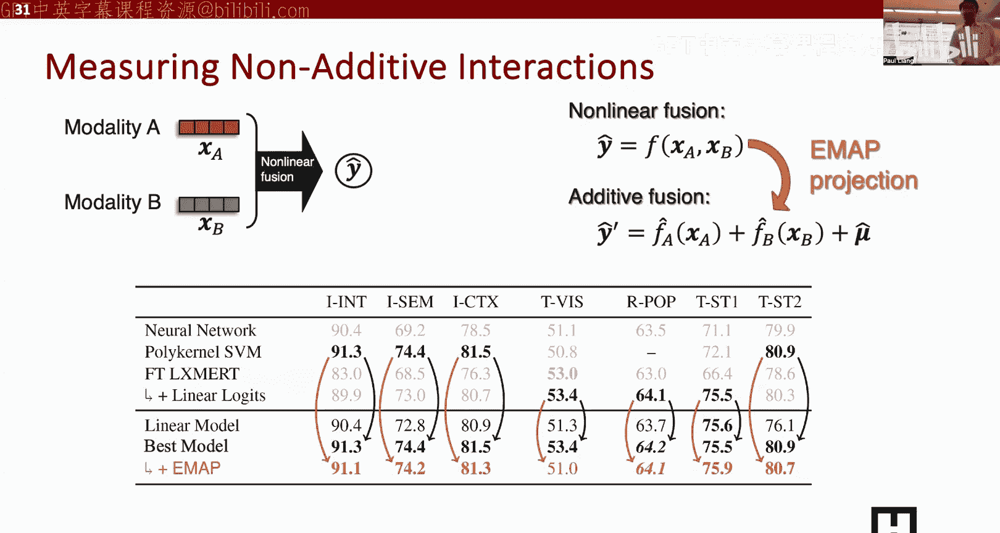

Great。😊，So that inspired。Some work that some of my friends did which is to really force this model to learn these non-aditive interactions in a stagewise manner so if you have。

 for example three modalities you can first think I'm going to start incrementally training more and more complicated models I will start with just additional minimal contribution and then I'll look at the pairwise and then I'll look at the threeway interactions instead of just doing everything all in one go。

So each of these would be called stages， unitimodal stage， bimodal stage， bimodal stage。

In the Unimodal stage， I would just take the three modalities， extract features。

 refine find ways for them and add them right so just a simple weighted combination on each of your three individual vectors and then I would make a prediction why hat Uniimmodal I will computer loss and I will optimize it。

系。To optimize the loss。And then I will see what is the remaining loss。

 so what is in my shoe label ground truth that is not captured by this simple combination of a three way unitimodal。

 and then I will consider that optimizing for the bimod and Ill then only then I would then consider optimizing for the three way。

So each time I'm optimizing at the start。Im just optimizing why。

Bround truth with just back to my prediction。And then I take the difference， the residual。

 so what I was not able to capture on this unmod and I tried to fit is bimodal model to it and then again recursively I'm going to try and see what I could not find so why minus y unmodal minus y bimod I only use a three way interaction to learn that residual。

call it residual optimization。And that is pretty cool because now you are essentially guaranteed to improve each time right you're only ever optimizing your remaining 20% error so that 20% is guaranteed to go down 15% and then the 15% error left it optimizes this 15% is guaranteed to go down to something like 10%。

So each stage， because you're optimizing the error from the previous stage。

 you're guaranteed that an error will go down。Yes， would thisqu as a boosted mixture of export mode？

There are some relationships to boosting here， yes。

Not server maybe somewhere to make of experts come to in but this whoing does give you a favor of the stagewise does give you a favor of this whoing type methods。

Yeah， well you can do aitive and non addictd in one optimization。嗯。

So we're just using edit to show that okay， so in this stage， this is just a combination of。

Three features added all together。This is now non additive because you're considering A and C。

 multiplicative interactions and any multi interactions。

Theac A B and C and now A and B so this this second order function that you learn over here is not just our additive combination of AB andC but how these models can be added up together。

Yes， you can add， I mean as long as。AndAs not the features are differentiable。And you know。

 you can implement them at pyths， you can add anything up together， right？

So you could add A E and C together， you could consider A and C interaction。

 to on A and B interaction et know， everything is still just matrix multis and non nonlinear activation functions。

So it's defable so you can optimize， for example， this loss with a gradientcent。

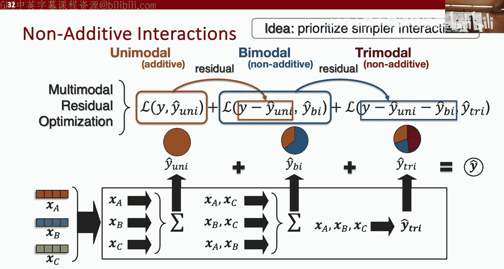

Nice。Okay， so nowadays of course we know that a lot of these ideas still remain。

 you know the backbones of some of these modern models are using transformers。

 we saw how transformers can be used for text， can be used for images by essentially getting patches of images。

 putting it into a sequence， putting these position en codinging the applying transformer to get visual representations。

So nowadays， a lot of these models essentially just use transformers for fusion。

But the similar ideas remain， if you have， for example， text as a sequence， vision as a sequence。

 and transformer encoders are basically learning these pairwise interactions。

 these pairwise multiticative interactions， and sometimes it's not uncommon to also see these residual functions。

 so you keep something that is image only and you keep something that is text only。

So that resembles this additive， additive unimodal plus some of the cur interaction in the middle。

Something else that has also emerged along of these models is that。

They always do alignment and fusion together。 So this week we're talking about fusion， right。

 Last week， we look at alignment， if you look at all of these papers， you see the this。

We're not just it was point to it。 It's always this a alignment objective。

So we're here there this work patch alignment where they try to optimize something like contrasted learning of every word。

shoul be contrastively aligned to every patch of the image so that's usually some objective that it was a trained for and think of this as really fine brain line because it's at word level and patch level and then this other alignment objective is more global this is looking at the entire image and the entire caption。

啊。So one interesting thing that has also emerged is the fact that you know you have global data。

 you know that this entire image matches higher function。

 so you have a positive pair and you have a negative pairs as you saw last week。

 so this contrasted loss is easy to define it has a positive image with cap and negative image in caption。

 the challenge is in this loss when this loss is at a fineary level。

The fact that statue represents this patch。The fact that stone represents this patch， for example。

 and you guys don't have that data， you don't have this fine fine grain data at the level of making words and patches。

 so this key is not optimal transport essentially a way of saying if I have global pairs entire image and entire caption。

 how do I essentially find alignment at the global levels， one word and one image patch？

Essentially just searching over all possible pairwise combinations and finding automatically the one that both has a good matching and has a very good similarity yes yes yes of course yes make a think about phrase level alignment and yeah this is works that。

I attack that it's very useful because。Nowadays， you just do individual alignment， for example。

 let say it's a person in front of a car or a car in front of a person。

 and you only do word level alignment。 Then you actually cannot distinguish the order of things。

 And so that's why his his modern models still kind of struggle。With these compositional examples。

 person in front of a car or car in front of a person or person sitting on a horse versus horse sitting on a person。

 it still hard to distinguish。

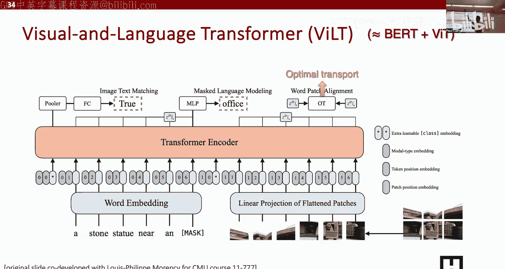

So yeah so you can train these models and you can see that is' able to do fusion so you can learn really good image text representations and it can also do alignment so you can look at the flowers and some of the patches that it was aligned to actually show the flowers the rug and the path shows the rug。

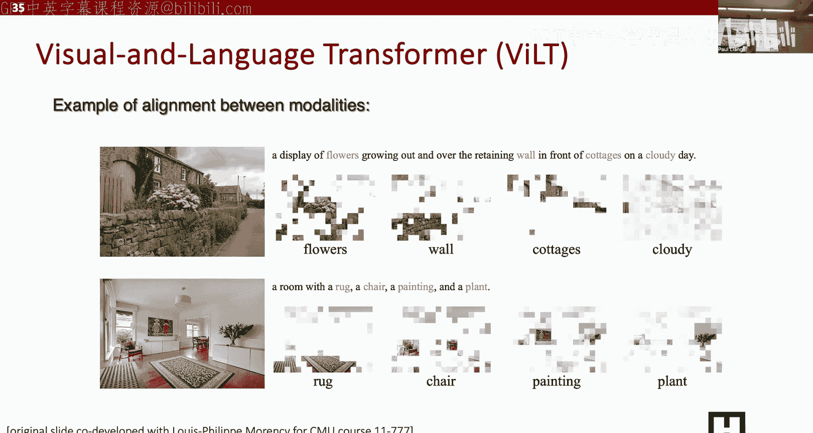

There's another example quite commonly exists on Albe a before fields。

 and this one does alignment earlier to your image features， text features。

 youll use the positive negative pairs to do image text conive learning。

 and then you do this pairwise multiplicative interaction using your transformers。

There's combinations of alignment and confusionion。

 of course we're going to recall all of these are cases where you have two modalities in image text where a lot of information overlap is between them。

A lot of redundancies between the image caption they all described the same phenomena that's why these alignment based objectives work if there's some more unique or synergistic information you are at risk of this。

Being thrown away by a contrastive。Allignment loss。

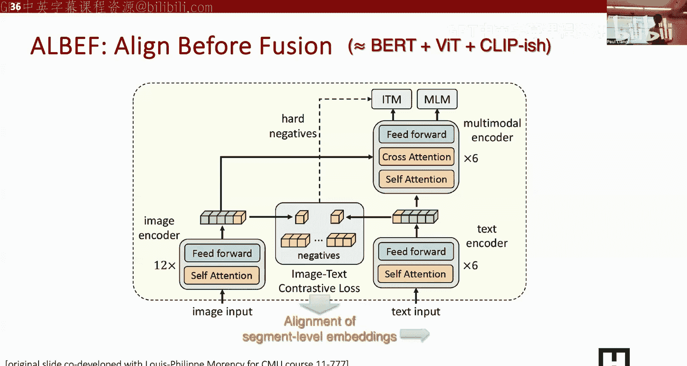

Okay。啊。

Not all is rosy， sometimes。These models don't work and in fact， you know there's many。

 many examples that you will see where people analyze the face what makes training multimodal classification networks hard and you see a bunch of examples where he these modalities so in this case it's trying to recognize activities to this video data RGB plus optical flow I think there's also audio。

And stillities kind of make sense together you want to hear what the person is doing。

 you want to see what the person is doing。Optical floor basically tracks long term motion across time。

 And so you start combining these， but。Well， some combinations are worse。

 at least they don't improve。So you might have collected a bunch of modalities。

 spent lot of time cur data， training bigger models。

 but sometimes it doesn't outperform as unmodal models。

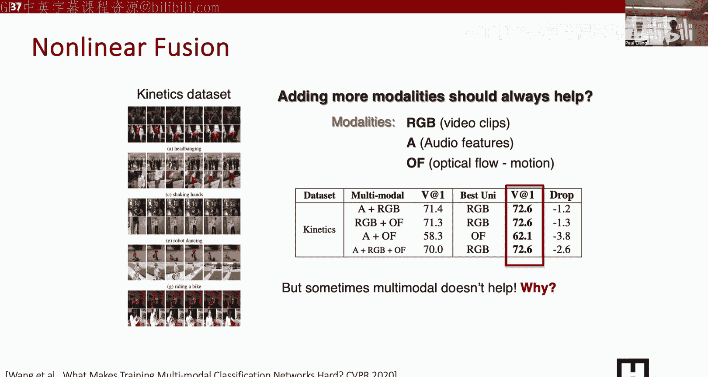

And there's several reasons for this。Most of them， one reason is because of these unmodal bias。

One other example is if you train these like visual question on serving models。

Uing images of banana and ask what color it is and because you always see yellow bananas in your your training data。

 you will just always know look at the question what color is banana and just say yellow without looking at the image so give it a green banana it will still say yellow。

And then there's also kind of fairness concerns like these image captioning models people have shown。

It will be image and you're training the model， taking the image and generator action。

So the catchtion here is a man sitting at a desk with a laptop computer， so I kind of get the。

So you say man instead of woman and then you look at why you can look at the attention map when the model was trying to generate this caption and essentially you know throughout the whole generation process of the caption the model only looked at the laptop so we just look at the laptop in the pseudo。

The computer。Okay， yes computer So， yes， yess a cat computer。

 So you always just look at a computer and then assume， for example，😊。

You the gender of the person losingient。Thank you。Yeah。

 so you'll hear same case and it just looks at a tennis racket all the time and generating the caption and it assumes know because it's doing sports you know that's a particular gender these are examples of unimmoal biases where some of that you have more information than others。

 there's some asymmetry and therefore you start training models it might be more difficult to optimize。

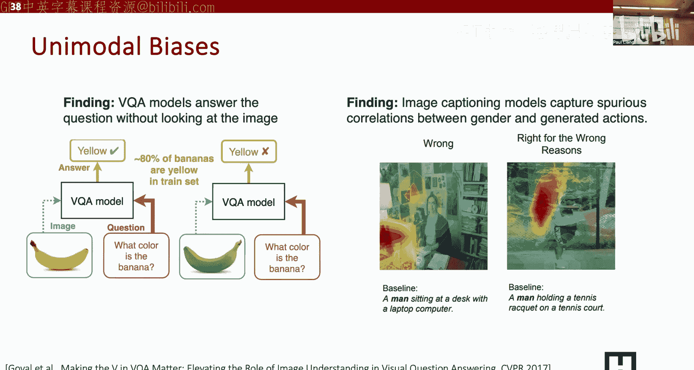

So several ways of alleviating it， natural ways to just rebalance your data set。

So VQA first version had a bunch of these asymmetries and then afterwards the VQA 2。0 was released。

They always had both the definition for every question。

 they were both possible images that could give both possible answers with this umbrella upside down。

 you always see yes and is the where is the child sitting， there's always different locations。

So that's one way of balancing。The data and also ways of balancing the training so there's additional training objectives that you can add in to make sure that the gradient flows to both the modologies。

Because this error occurs when the gradient only flows into one side。

 your language and doesn't flow to the vision side。

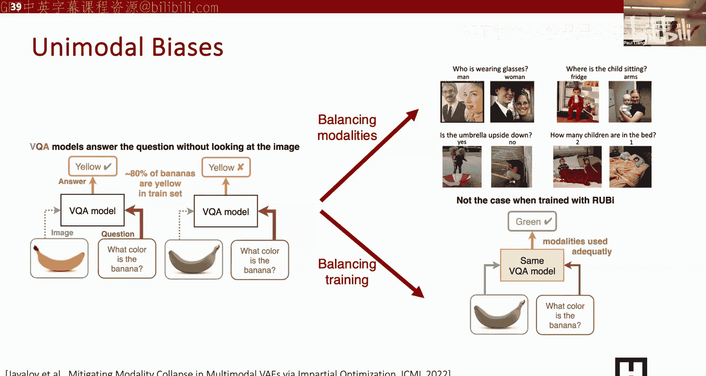

And finally， speaking of gradients。You know， another solution to this， you know。

 just last thing I cover， another solution to this。Another problem is that these models。

 because these modalities are very different， some modalities can learn more quickly。

And they you they start generalizing and overfitting before the modality has even completed learning。

 so they all generalize and overfi underfit at very different rates。

 which can make it very challenging to learn。And one way to solve this problem was to essentially create your multimod model while also keeping track these unitmod models。

Right this is a multimodal model。 and you keep track the two unmodal models。

 these two unmodal models essentially gives you gives you a baseline to compare what。

What is the generalization rate that is ideal for that mod by yourself？

So you could compare essentially the rate of learning in this multimodal model with the rate of learning and the independent unitmodal models to try find speed up or slow down the learning in the multimodal model。

It's cool， nice idea， but of course the complicated thing is that now you' got better to train three minutes。

 so not very good。Okay， so these are all open questions， so summary。

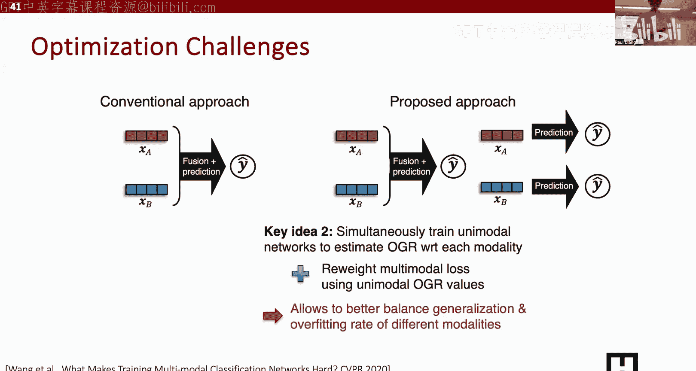

We looked at multimodal fusion， some very， very important lots of models being developed today。

 and the whole idea is to essentially take in data modalities and learn some single joint representation that captures how these modalities interact and whether there's some common information whether there's some unique information and do some ways to determine where the information is or there's some synergy and you're learning more complicated interactions to model this synergy。

He essentially you looked at a spectrum。Cases where either your data modities come in or by homogenous or you've extracted features to make them more homogenous and more sematictally comparable or data that is more heterogeneous or very different from each other。

And there's basically a lot of methods， there's a key takeaway it more homogeneous， you can just do。

 for example， late fusion， just use them a predictive label and take some ensemble。

 we saw additive fusion which are just additive functions but additive functions are not as expressive as multiplicative functions that look at pairwise multiplications between vector and that was in two modalities。

 we go to three modalities， youve got to go from matrix。

Multipplicationative interactions to these sensors， three dimensional cubes。And of course。

 you can go from just one order， just two things they multiplied to higher order polynomials。

And these are all great， but these need to be made more efficient， so we saw some low rank examples。

And then we saw methods that were where the weights actually changed according to the data box where everything here the weights were static just W1 and W2 for modalities1 and 2 and things here were more where the weight dynamically changed so data fusion。

 modality shift， fusion， multi nonlinear fusion。And finally。

 we also saw cases where you do early fusion， so concateulate your data and let the model figure things out and also challenges with that。

 how do you improve optimization process to make sure it actually looks at all modalities equally。

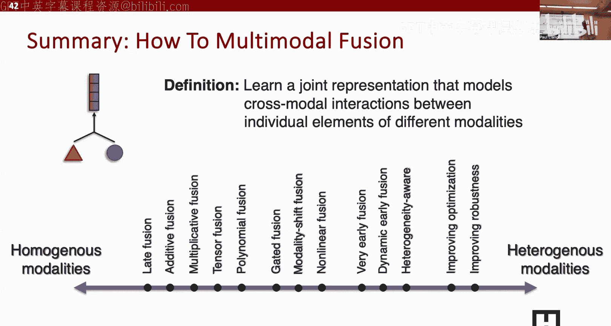

Great， okay， so to summarize we looked at several examples second this is meant to be a quick introduction。

 whatever you think is relevant to your project， there's all the papers or references attached。

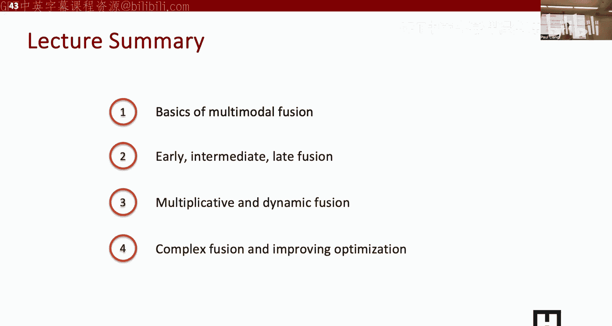

And just a reminder on making progress on the projects and reading assignment due tomorrow for the discussion on Thursday。

 All right， thanks everyone。Yes， yes， can either email me or time of the class0 just。

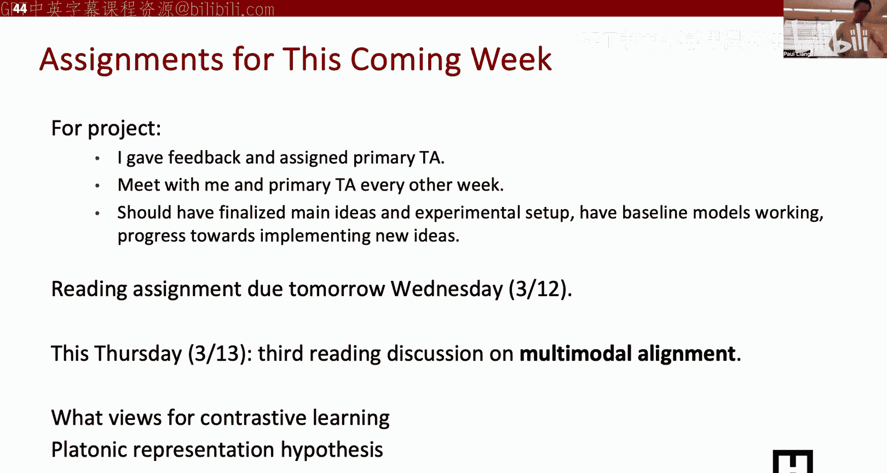