# 《如何AI所有事情｜MAS.S60 How to AI (Almost) Anything》中英字幕（Claude-4-s翻译） p09 [09]Lecture 7 – Large Foundation Models.zh_en [BV1UhawzQErD_p9]

Okay sure， yes， so today I'm just going to give a brief introduction to the archive models。

 so this is going to be a super condensed version of the LLP class you may be taking at the MIT or other schools。

But。Because it's like a super high level overview， I'm not going to go into like much into details about like the exact instrumentation algorithm that kind of stuff。

 but if you' are interested feel free to ask questions at any time or if you're like interested in a particular topic maybe you can give another lecture to give like more in depth introduction to that particular topic。

没 nice事。Yes。ok。😊，We need to the talk。对不是。😊，Yeah。Thanks。你开咩。哦，O。So before we get into the warden LM。

 I'm just going to give a brief introduction to the Re neural networks or RNs。

 so Pat it was a pretty popular model before the transformer was introduced。

 the is an idea that we have a bunch of embes associated with like each word hokens。And on each step。

 we're leading that values into the RNA network and we update the hidden space of that network。So。

Essentially youre feeling like eating were token one by one and after you feeling the whole sentence。

 you have a a final likelihood hidden date that should have like the information of all are prior word tokens。

Different， and then you use the final days。To combine with like a class buy to predict the most probable network word。

So in this example， we have like a sentence like the student opened there and the article in the whole basic。

 im the classifier would output probability building that says maybe like the books is most pro next word in this sentence。

So it has a couple of advantages first it can process any length input。

 so you have only like fixed lens hidden days， so no matter how long the input document is。

 the hidden days is of a fixed size so that'。And the second thing is that the model size doesn't increase or longer into context。

 which is essentially like。But the disadvantage here is that the recurring computation is slow。

 you have to process it word one by one， so the input processing time scales linearly as your like input sentence gets longer。

And because we are。Only compute the hidden based on the prior hiddenes。

 it's hard to access information from like many steps back so if when you like come to like this point。

 it's very easy that word model to forget about the informationmin maybe a couple of like sentence or a couple of words back。

InThe input。So that's why we introduces cash forward。Soであ。

This figure was actually from like three slides ago， I just copy here。

So the good thing about a transformer is that it has a global attention that each word can interact with any other words in the input center or input document。

So it feels like each word reputation as a query to access and incorporate information from like other world opens。

The good thing about that is that like the number of unparallyizable operation doesn't increase with sequencing。

So no matter how long your input sequence is， you can just use like one single operation to process of them。

And the sentence thing is that like the maximum interaction distance is of one。

 so it's easier for the model to capture like long distance relationship between like the word in this sentence and the word in another sentence or so。

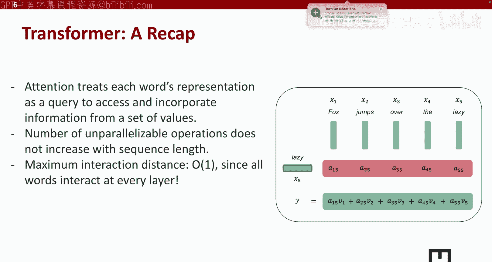

But the transformer also have a lot of like jobback and the one prominent job advice is that the time concept is pretty funny。

So as you can see here， this was also from like a couple lecture before， we had like two x here。

 which means that we're multiplying a matrix of the length of the input sentence by another matrix of the lens of the input sentence。

 so that means that the time complexity of attention held that n squared。

This is pretty large when your like input document is pretty large if you like reading the whole document or maybe a whole like Wiia article into the model。

 the compute requirement is pretty large。And that's why there's a recent trend of like you think gaining your attention。

So the basic idea of inner attention is that we split the whole like very long input document into trunks and we run attention within like each trunk so that the the sentence can interact with other words in that in the same trunk and then we aggregate the information in a RN style manner so we essentially like combines RN with transformer to reduce the computation needed。

For anything。

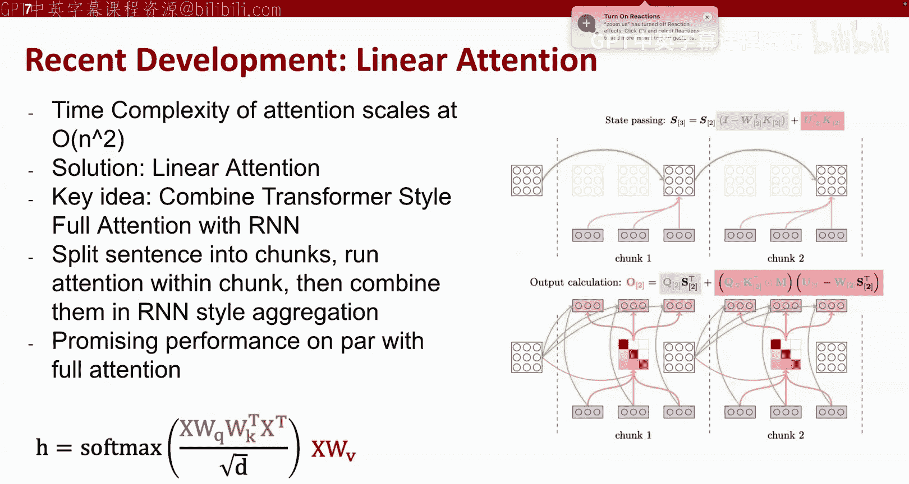

That第儿 attention。Now I'm going to briefly talk about the pre training Ls。So啊。

LM became first successful after we have a pretty large scale opportunity。And。

But how do people do the question。So it can be it's actually simple， so。

Suppose you have like an input document， you split the input document into overlapping windows and you essentially fit the whole like input into the model and ask model to output to predict the new next token。

 so' like next token prediction on the scale of like whole internet text。

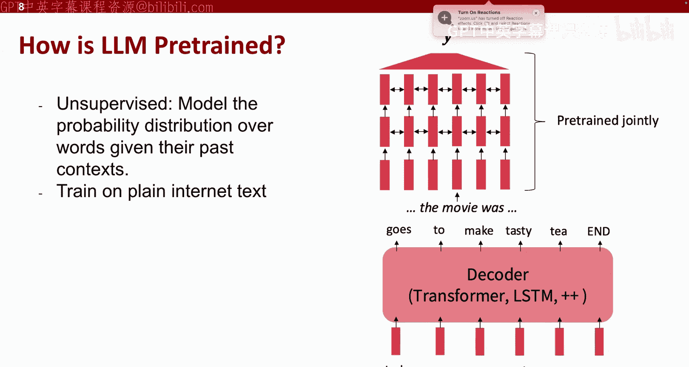

That's a pretty simple idea， right， but why is LM so successful？So well。

 it's because that because we have like the whole internet type between the diverse data。

 at like that much a larger scale is' essential for the LM so this kind of capability。

So if you think about the美的 QA data set， one of the largest QA data set， which calls Y 2。0。

 it has around like 50 million tokens。But the pretrain data set we have right now。

 which is call like data comp LM， it has 250 trillion tokens。

 which is much larger scale than the largest QA data set。

And if you count the whole like Internet type， it has around like 510 trillion tokens。

That's like a 10 million times larger than the largest QA data set we have。

So within that like internet tag essentially you have some data on almost every like test you could think of so that's why it has some good like multitask capability it also has a lot of like diversity so in the printing tag we have like web pages code and also like social media from Read and all the papers books and WikiPR articles。

David yes why why isum。3100 trillion total and only 510 billion tokens index why。

 why are not the net tokens all index。Yeah， I feel like it's because a lot of the texts are。嗯。

Not like very reachable by the certain engine。So the search engine index a certain amount of like web pages。

 but it doesn't cover the whole Internet。If there's no like other web pages。

 according links to that web page。Yeah，这我 the index internet mean the internet within the company or the government only or possible。

 those are not available by the search engine on the Internet， but those are the index internet。Yes。

😊，So how much bigger is the dark webver to dark cloud least very deep。Yeah。

 I would say one would be within the 3100 trillion total estimation。

 so that's the estimation of the entire like internet。

 which includes the information outside of like3 engine。嗯。哎。So that's for I re training。

Right now I'm just going to briefly introduce the type of like architectures we normally use for like management models。

Essentially， we have three main categories when the encoder only model and the encoder decoders model。

 and the last is the decoder only model。So not going to go into much detail about the depth difference between the architectures。

 but essentially the encoder models。Have like two way attention。

 so if you were feeling like one word， you can attend to both like half tokens and future tokens。

And on the other hand， the decoder models can only attend two cat tokens。So。If you have a like word。

In the middle of sentence， the enr can only attend this word token to the first half of the sentence。

 but the enr can attend to both sides the second half and the first half sentence。

And one famous like inency model is called BRT， it's great for text analysis if you're doing any like sentiment analysis or like emotion analysis that comes stuff。

 B is usually a pretty good model to start with。And for the GPder model。

 I think almost all nuent models right now are GPder。

And I don't think there's any modern models that use this in in design right now。喂。

I' be before using quarterly orders。嗯。I think it's really about the performance。

So I have a slide about like why peopleO use don't。Sorry。

 so so the good part about like particular only model is that it I think it models like language completion more naturally so。

If you want the model to generate like answer to a question。

The generation process essentially only it can only attend to the past tokens。

你看 it does not like it doesn't know the future token is generating。

 though the encoder architecture isn't that useful。

And the second thing is that because we don't need to attend to like future tokens。

 the equal the only model， is's for like compute efficient。

And I think that's the main concern in the LM trade right now。

So the most famous in only model is calledbert。It was introduced in like 2018。

 it has 340 medium parameters。And at that time it was considered a pretty large model， but right now。

 because the large land model is getting an increase in larger。

 it is considered a pretty small model。然后。And it was trained on books corpus and English Wikipedia。

 which mounts to around like 3000 and 300 million oceans。A you many and even。

Like right now is considered pretty much a small model pre training the entire bird on a single GPU is still pretty difficult it was actually training with like 64 TPU chips for four days。

所以 IU want to train that own来关GPU。That would take around eight months。会受到弹。

And the great training of inder only models is that we portray with math token prediction。

 so essentially like we mass a part of a sentence with a math special that math token and we ask models to predict what is math like what is under this math token。

And in the original， like training， they actually math like 80% of the total。

 which like a lot and as model to predict around like 15% of them。

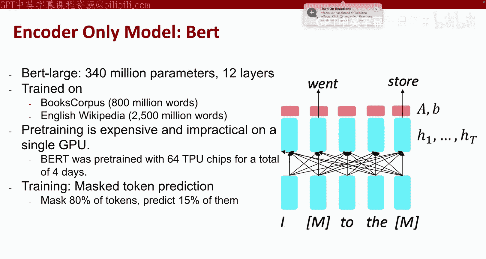

And give only models are you simply like all the As we have right now？Starting with P one。

 which is 117 million models， million per models。And。It gets larger pretty quickly。For like23。

 we have already have like 175 billion models。And。Yeah， as I said before。

 like the cool thing about the decoder only models is that in models like language generation person like naturally。

And。If you want to cr adisciplinary model， you essentially ask the model to output the next most pro net tokens based on the past context。

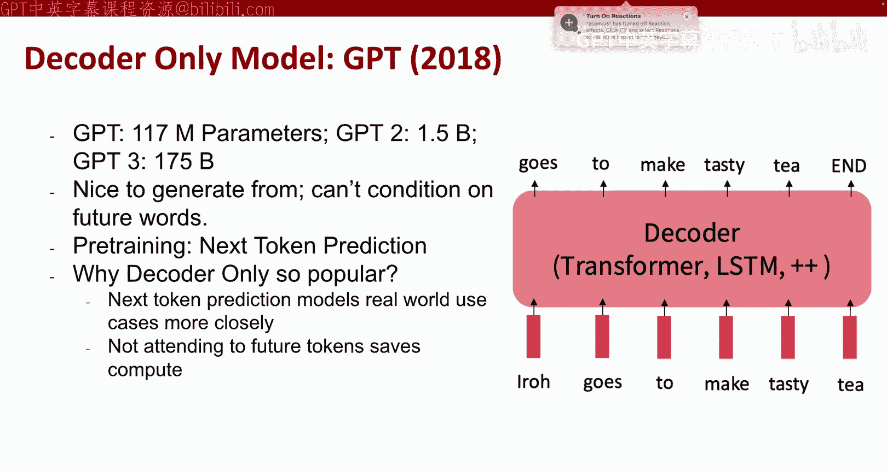

And after the introduction of the decoder like argument model。

 people find that this performance of the model scale pretty predictably。

Based on their bike size and training compute。In like 2022。The Tra trailer paper。

 they introduced a 70 billion parameter model that was taken on like 1。4 trillion tokens。

That was considered like a pretty standard and pretty popular skill law paper and a lot of people have followed that recipe of like 70 pm versus14 trading。

That that kind of like balance between model size and training training hooks。

But in the world like recent years， people have。Scall like the training tokens more quickly than scaling the model itself。

So the Lama three model， it has three billion parameters。

 but actually it was actually crtrain on 15 trillion tokens。

So this is like 10% of the size all as ailla paper。

 but 10 times larger training tokens than that paper。

So that's another also like pretty interesting trends we seeing right now。Yes。

So we only saw the size of the trinity tokens， but we don't know the overlaps。 right。

 we mean the data quality is now higher。 What's the amount of new information including the trinity。

Yeah， I just guess that's also the。嗯，oppen question。Because of the scale of the test。

 we don't really know like how much overlap are there。

And you still need to do a lot of like and replication before you can use the training data。

And I think that's why people。From which group from Stanford。

 they introduce a data set called like rap pajama， that's actually a key version of the data compilel and data set。

We include unique applications and meaning of the Internet。

So everything has been there for a long time。Like it was there in218 when the birth model was released。

But the large model is only getting popular after the tragedy was released in 2022。

So what's the problem with like creatinging to prevent it from like being useful？我要这。

Most prominent commonly that interpret were essentially like doing language modeling were predicting what's the most probable sentence that comes after the input sentence。

But that suddenly equal to like， assessing users。So in this example。

 we add model to like explain the more landing into a six layer or in a few sentences。

And if you feed that into KG3， in one like explain the serial quantity to a six year or explain the big bond zero to a six year old。

 which has nothing to do with the answer to that question。So how， how do we be safe like。

We know that in the text document， these two sentences are like often like put together。

 but that's not the answer we want。And that's why people introduce instruction financial。

In the instruction function， we collected like examples of encounter and output pairs across like many tasks and fine large interval to that many tasks together。

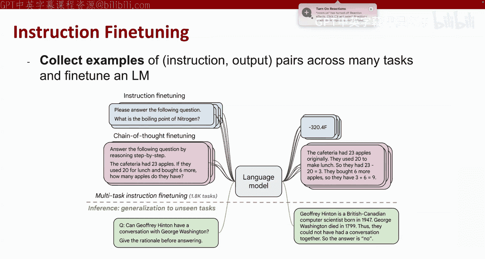

And the like impression find healing has became like very popular after we actually have a lot of data to find you。

So the supernatural instructions， data said includes over like 1。

61 than 600 tests with like three million examples。That includes like all the tasks you put。

 including like translation， question， participation， sequence tagging。

 So almost all the tasks that you can do with like capon。

And this allows model to learn across like tasks and achieve a better performance in every task in the data set。

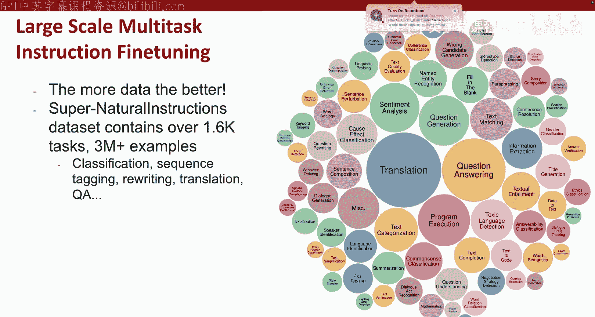

And we also in our life， we actually have another like ongoing works that。

We collected a foundational like clinical， what it has interesting to name data set。

That includes like data from 13 clinical modalities and over like  five million questions of pairs also shows that you train the model on like each。

T on every task， it's better than if you only train the model on like a single task。

And so how exactly do we optimize the model's response？

And so that the models respond is like what we want。Well。

 that's with like people introduce preference tu。So we're like optimizing the model to respond for human preferences。

 which means like exactly how we want the model to respond to a given question。So heres the example。

 So呃 this is the。嗯 article taken from theia and。With them like we want to as more to summarize passage below。

And the model will output maybe a good summarization and a bad summarization。

So what we do is that we him a reward model that gives a reward to each of the summarization。

 the model outputs。And we we designed the law so that the model is more likely to output the the answer with higher reward and less likely to output the answer with the lower reward。

And that's actually what they did when they trained GP 3。5。The originalal产是K model。

So they essentially like they have three steps first。

 they collect a bunch of like smaller scale so to provide function data questions pairs。

And train model with like standard provides final on that like smaller to data。And how about that？

They essentially have a larger set of questions and ask model to output multiple responses given the instruction during the prompt。

And they asked another set of enablers to rank the。Response from like best to worst。

And then they train out the war model that makes this like human preference。

And after they have this reward model， they can scale up the training and。啊啊。

Tin呃 the model on exactly all the topic with the reward model啊。

But one thing about like woman preference is that they are noisy and uncapborated。

 so for like one single sumization， one person may give like a high reward。

 but another person may give like a lower reward。And maybe like some people just want to give like high rewardwork to every response。

So that would make the train process become kind of like noisy and harder to train。

So that's why people were interview a relative preference children。

So that's actually the state of the art algorithm right now， like we ask model to。

Rannk the response in like。啊。Best towards。 And they optimize the model based on the ranking inside of the numerical reward。

And after turning the model with like instruction preference by。

 the model becomes much better at answering the question as compared to the original like patron model。

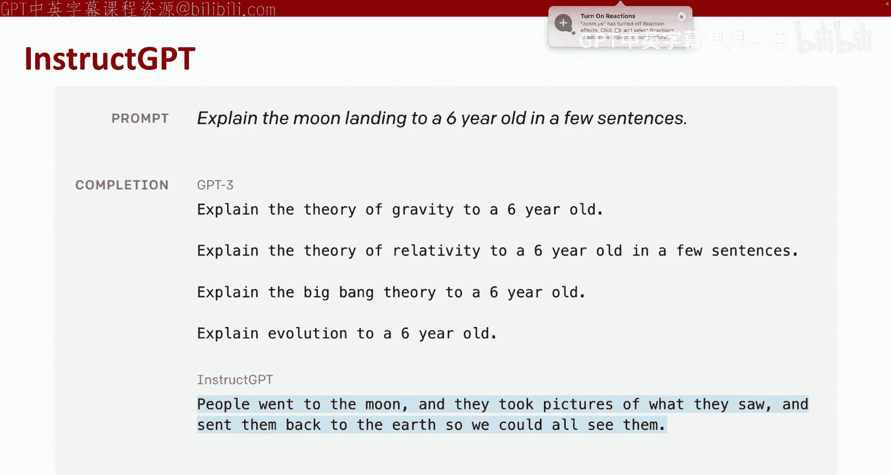

But reinforcement learning preferenced byium doesn't always work as intended。

Because like open preferences are unreliable。For example。

 like if you ask the labeler to label your phone and answer pairs。

People will not like take half an hour looking at the whole response that's not going to happen so what what do we that they they would take maybe like five seconds looking at the response if it sounds like reasonable and good yeah and they will give the model like a high reward。

But that doesn't that isn't always as correct。So sometimes like tris are rewarded to produce responses that seems like authorit and helpful。

 but not correct。And that's actually one of the big problems in the like reward modeling and RL training right now。

And this kind of results in you like making our friends and hall those nations。

Like the model will make of fact， however there can to prevent getting like a low reward。

So that's what happened。And the second thing is that reward model doesn't always reflect like human preferences。

 and it may have like uninten behaviors。For example， in the this work。

If your ads model like where are you from and the model will give like a bunch of different answers and the reward model will rank the answer higher if the model says like they are from a developed region。

 for example for the United States， Canada or Australia。

But the model will get like a lower reward or like a penalty when they say it's they're from like Africa。

But that's not what we want， right， like we want the model to be fair and like。

Tree like people from an extreme like difficult。So that's some like unintended behavior of the real model that we want to mitigate it yes。

 so so people have sort of papers that have demonstrated like a decrease in accuracy after like like RLHF or is that like a common known phenomenon that like the model performs worse after with regards to？

I guess just in terms of like like hallucinations i'm guessing there must be some metric of like capability of the model to like reproduce factss。

 I wonder if like it gets worse after reinforcement learning yeah。Yeah。

 I think it's a bit hard to compare because like before the preference is showing。

 the model doesn't answer your question。So啊呃因为 when like do他们 make our pantss。

It's not like very helpful and it's not very comparable to the present your model。

Okay I just remember hearing somewhere like when it started to become like a very common thing to do to the models that people were complaining and saying yeah you trained the models to behave more socially acceptable。

 but the models also become worse at like you know accurately representing facts about the world like that。

 so I was just curious if there was like a cost there but。Yes， I would say yes， and I think。

After've seen another like very recent work on like reason training。哎你给我听得 model头 doesn人好处啊。

Like malicious and harmful reasoning thoughts， the model will like hide their source。

 but you will not change their own behavior。 So that's another interesting thing from others work。

这意思。Pretty hard to do。Or they say like alignment in this sense to make model both helpful and factual about like the question。

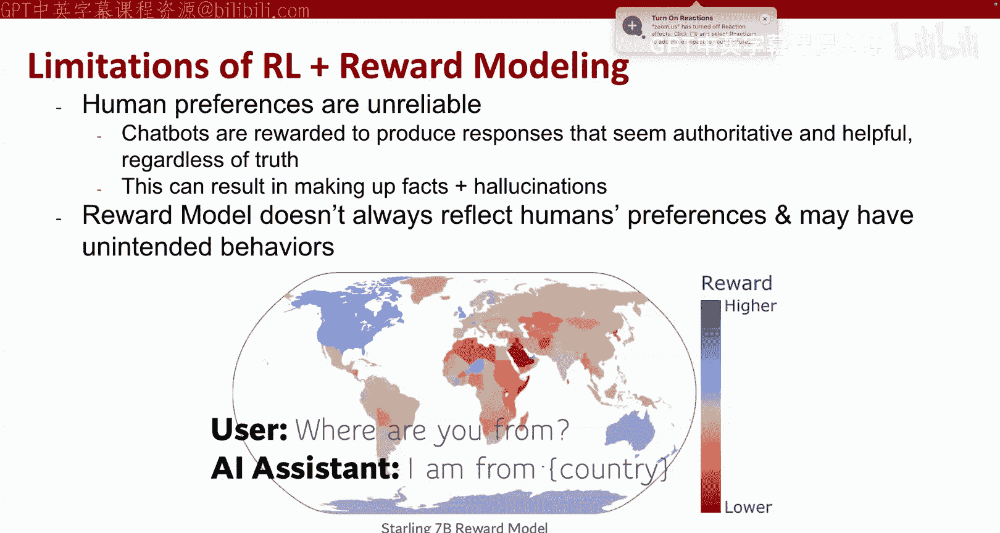

So I'm going to introduce a couple of like more recent words on LMs。

I would say like more recent works are more like focused on the efficiency of the train because like people have found dead。

 no matter how you alter the architecture。The model will behave like similarly after you'll train that on a very large scale of diverse。

So嗯。So nowadays， like people have found that the only improvement。Well， not the only improvement。

 but the most improvement you will see that like after you make the model more efficient and then you can train that on more data。

 which makes the model better with a given like fixed set of compute。

So one thing one very popular word in the efficient training is that its efficient like low rent adaptation。

Whi call like La。The motivation is that creating the whole model takes a lot a lot of compute and a lot of like GPPO memory。

So the solution they introduced is that they freeze the whole world。

And then they train a more like a adapter that updates the the the parameter in a low red manner。

So essentially， they have two like mattressrices。W is like compresses the embedding towards a smaller size and then expand that back to the original size。

So the combined parent size of these two like。Adapters are pretty small。But after you expand that。

 you can like tune the whole model with this like smaller set of parameters。

So if you don't have like a lot of like GP memory， the lower name is usually still the best choice you can do。

 given you want to train like a large financial model。

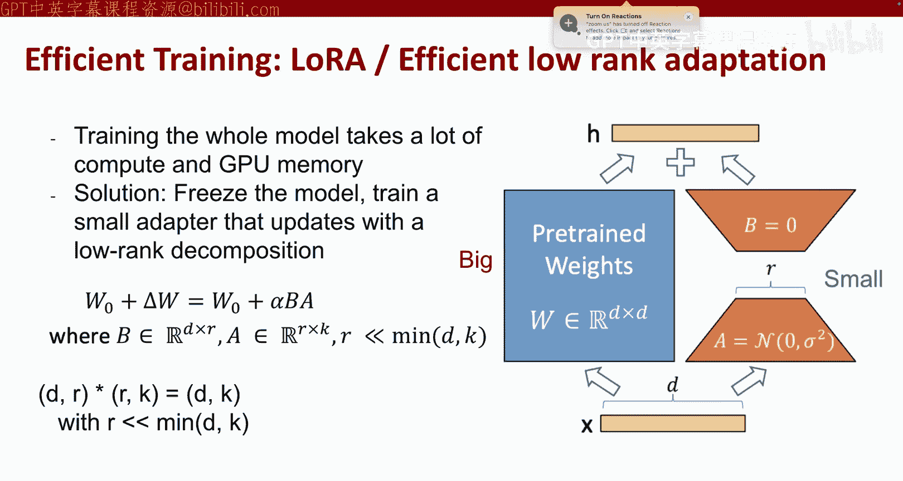

And another popular thing。It's me Carol Has。So。You might have heard of this like model before。

And essentially the motivation of this like of experts is not like you have a couple like models that。

spececialize in each domain， in fact like in both of the modern LM training LM like reserve expert models。

 the experts are not very interpretable like a given expert doesn't you cannot say like this expert is for like classification that is for translation。

 we cannot we don't observe this kind of things。But what we do observe is that with the picture of experts。

 we can train a much larger model given a much smaller compute。

The way we do is that we have like multiple parallel networks simultaneously like in like one layer。

 and during the four path of like these tokens， there's a layer that's which experts token should go to。

And because like。For each token， it's only going through like a certain subset of the。Network。

You safe post compute and keep your memory。And one very popular example is the mission like HR1 model。

 this is a mixture of X model that have like three three， I mean， 600 billion parameters in total。

 but for each token only in 37 billion parameters are activated。

 so essentially you would save like 95% of the compute with this design。

And another thing is called accommodation。So after you train the model。

 if you want to deploy the model on like a smart device， like phone。a very like good technique。

 you can do it that you can quant the model to a lower face。So before like during the training。

 the model are either trained on like 15 bits or 32 bits。But people have found that。

With a good like quant algorithm， you can compress a model into maybe like four base。

Without losing any like noticeable performance。And。Not sure if I need how to get help about this。

 but yeah， so the the say idea is that first。You do some kind of like rich play。

So given a set of like weights， you first remove the outsidelier。

 you clip the outsideer to a given like range。And then。

You scale the waste to the waste to the range of a。Given like target base， for example。

 you are compressing the 32 bits to in8 model。Then you will be like compressing the range of the ways to 19128 to 127。

But you don't have to scale like the railway to the railways in case。

So what you do is that you can actually scale and you can hear the ways to a give like。啊。

To another like century， if you have more ways the net range。

 you can move the center point to the lab， which gives you more accuracy。Even like a fixed week。

And then you convert the model to a lower base and you do some kind of calibration to remove the contentation error you attribute in the quantation process。

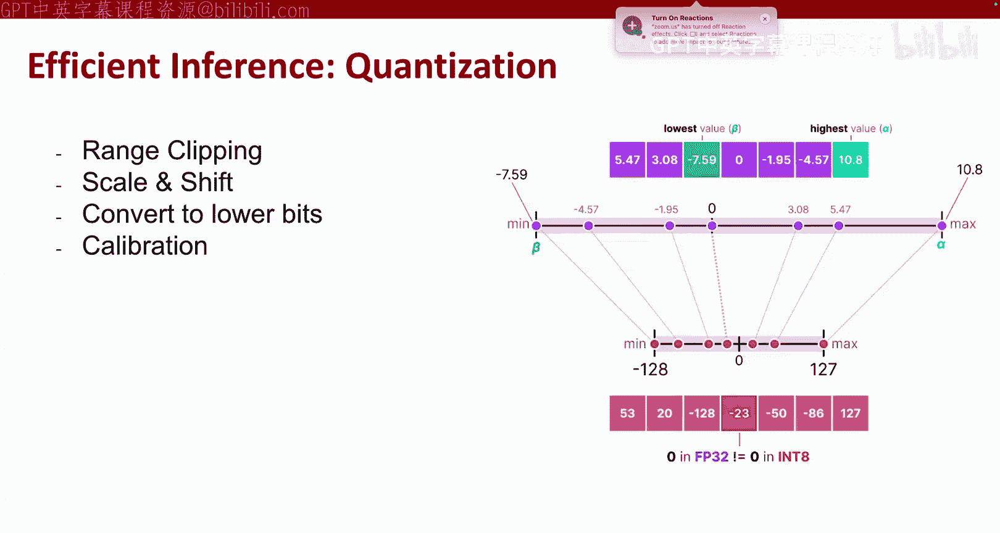

That a can be the idea， but how yes， where the quantization applied like at which stages like everywhere where。

 it's say foot different values in the I don't know the interry layers or I don't know。

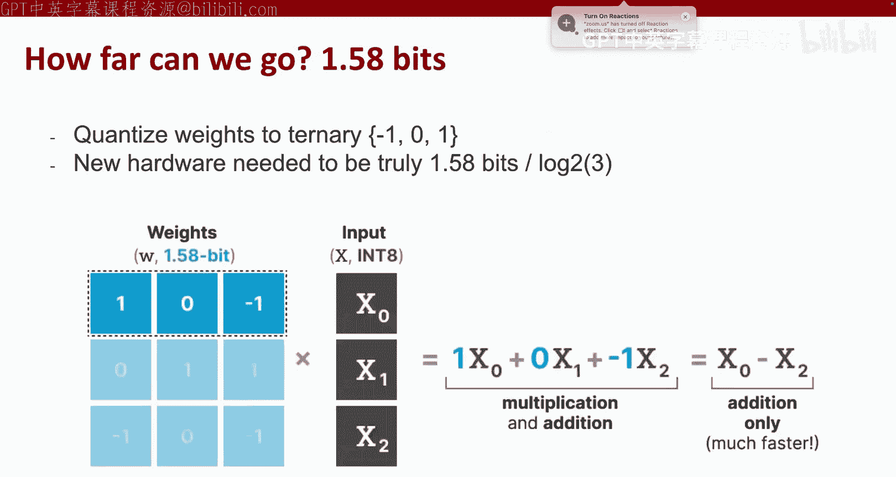

Yes， obviously the a applies to every weight in the model。

 it doesn't apply to activations and it doesn't apply to the last layer。

 which is the soft Max classifier in the model。So but because of the different。

 I guess rangers across， I guess the weights in the network。

 you will have like basically a library of those quantization。

 I guess in codebooks or something similar。Yes。😊，If you are interested you can search for GGUF。

 that's a quantation library that's really popular right now so。With that format。

 you you can actually find every the quantization， the quant variant of each like popular background models on Hu and interface right now。

对。Yeah。But how far can we go， There was a recent paper。大家可以嗯筐台 the ver the。

The weights of the model were turn weights， which are like either one，0 or one。

 and they show that the model turn right。2 has to like1。58 base。Have。

It's simply like very similar performance as the original model。But to make this more always I like。

啊。1uang way，58 base， you actually need a new hardware。

 so the current like typical hardware is not able to handle like this small quantation efficiently。

So lastly， I think I'm going to introduce some my practical tips on like how to to LMs because like。

I think state course it's more like practical oriented。So。And I think most of you are。

 maybe a lot of you are doing like LI function for the course project。

So you certainly would have like four steps。First， we want to prepare the data。

 we want to like convert the data to conversation performance。

So that it's easier to be handled by the like in framework。And second。

 we need to choose a closed starting point， and then we can like expand on the model before we send the model for evaluation and employment。

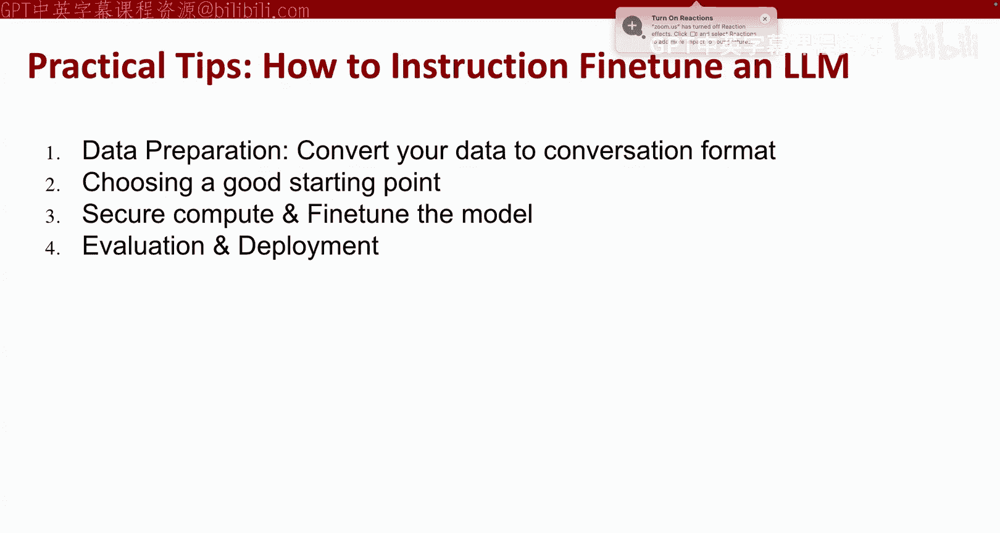

So what data。Maybe we need to convert any data you'll have to a question answer format。

So there are a lot of moments in like different data sets。

 both of the instruction function framework support a lot of like。A lot of like different formats。

 So you just need to choose one。In this example， we have a question and answer in this like different format。

 which has a problem and answer key and images。And the list of images here。

So we will release the slides here， so if you can check like this。

Think you'll see the list of formats you can use for your L and fine。

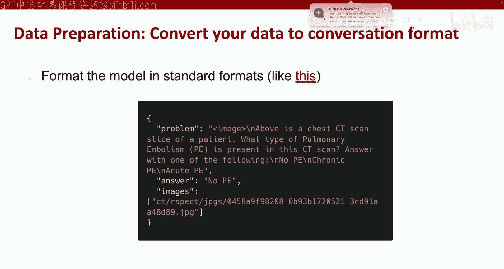

And then secondly， you want to start with a good starting point。

That essentially means you don't want to use a very old model to find him。

Especially like you don't want to use the Lama one the original Lama model。

 that was actually a pretty bad model， even when its3。

And you want to start with smaller models first， but not too small， people have found that if you go。

Anywhere like smaller than 3 pm parameters， the performance will decrease like pretty quickly and you will not notice and you will not see the performance even after like。

啊，要翻烧 the好。So start with something that as is like3 parameters。

 and here are a list of like recommended models you can use as a good like starting point。

For pure test test， you can use a DM 3 and 225。You have I like a very large cluster。

 you can also try the DPC R1。For the type foundation test can use point by VL。

 it has range from like 7 B to 72 B， which is pretty good for every like user cases。

And then you can start like trim their on they have。

Like you don't want to use the role like transformer package to train the model。

 you want to use the efficient LM training0 framework。

And we'll get like much faster as compared to because was the Royal like pe script。

And I have a few recommendations here， the Ver and Lama factory are the ones we use in our word research and if they are one in the recent report that's introduced by the same。

Group as Lama factory and I think they use B ends which is a more much more like efficient inference framework than the original like Lama factories。

And then you want to choose a method of training I don't really have a lot of like recommendations here。

 you can either do like super normal supervised fine or you can also do like RL at preferenceing with PPOPO。

com stuff。I will suggest you。To try like all them and see what performs the best。

The第二 is a very like new thing， but it also has a lot of like issues with the algorithm it。

It may not perform the best， so thats something you need cry and depending on the size of the GPUI you have。

 you want to decide if you want to use Aura or you want to train the model。

And if you are dealing with like multimodal LMs， you want to decide like if you want to pre the vision encoder or the projectctionator that connects the victim encoder and the LM。

班也也开退。And。Lastly， I just want to introduce two maybe like possible future directions in train and understanding like large science models one popular trend right now is that how we teach science model to reason。

The most recent like Gick R1 paper is a very popular work in this area。

 and I think a lot of the groups right now I know are like trying to tune the model for like reasoning。

For like fun raising in all kinds of testing。And the second very popular area is model LMs。

 we have a lot of like language models。That are like public。

 but we don't really have any like audio or time series Lms and I think that's something people can work on right now。

But that' say啊。If you have any questions， feel free to ask right now。喂，来谁。Oh。你个身。没问题嗯。All right。

 if not， make sure you all submit your。And some reports today and youre ready for our presentation as on Thursday。

 Thanks everyone。

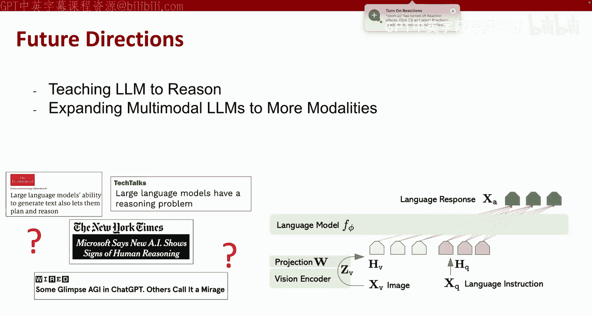