# 《如何AI所有事情｜MAS.S60 How to AI (Almost) Anything》中英字幕（Claude-4-s翻译） p10 [10]Lecture 8 – Large Multimodal Models.zh_en [BV1UhawzQErD_p10]

Okay， folks。Okay， so welcome back， so today I'll be talking about large multimodal models and。

First for assignments， yes please， today from two to three and Thursday from two to three。

 try to make time to meet with myself and some of the Ts to cover the progress on their projects。

Hopefully by now you have medium progress towards your implementing your ideas that means either promising results and there's a clear path towards running more experiments and scaling things up or the results aren't good。

 but you should have kind of done some error analysis and figured out。

Where things are going wrong and have a good idea how to fix it so you don't have those two yet then please be with us and we'll try to give。

Of you know， ways of thinking about things that could work or ways of figuring out what might be going wrong。

Reading assignment due tomorrow in preparation for the Thursday safe reading assignment it will be our large language models。

 there's two very nice papers， one is on alignment faking LLMs when LMs actually seem to be aligned by you tease it requires and see its internals and of the actually evidence of misalignment and also one of the early words every we pioneer this modern space of LM reasoning then by deep seek in the mathematical domain so ways of doing this third kind posttrain。

 reasoning， test time scaling dimension of LLMs。Great。

 so in today's lecture we'll go LLM into multimodal LLMs first part we'll talk about just basics or multimodal foundation models。

 the architectures， the pretraining， then we'll talk about adapting LLMs into multimodal LMs so whereas the first part is more about this training and looking at these architectures from the space it' also a very popular set of approaches I take frozen LLMs and try to adapt it very quickly to get multimodal capabilities。

And whereas the first two are still stuck with this case of generating text。

 additional multimodal data， how do we condition on multimodal data and now generate also multimodal data so that's going from text to multimodal generation and some later directions。

So recap you know LLMs with all these experience， use some of these models before train nowadays using three phases。

 you have pretraining phase， we take a bunch of data。

 you honor university predict next token and then you have this instruction tuning phase so you're giving at human demonstrations of example inputs and completions and you want the model to perform do human instructions and fine tuning on that and nowadays also have this posttrain test time scanning phase where you can ask a model to think and search over multiple multiple possible trajectories to get the right answers。

And you see some capabilities， QA， both retrieving knowledge from the internet and also retrieving knowledge and answers from its own weights。

 open in a dialogue。Translating different languages， retrieving news and realtime information。

 and nowadays problems in on the reasoning side So solving math problems， writing code。

 doing things that require you to break complicated problems down to step by step。

 solve those local solutions and then wrap things up and explain it to people in a reasonably interpretable way and more。

And so David helped us through all this recent progress in large language models。

And now of course we want to go from large language models to large multimod models LMs as themselves are' still just only taking in text they're not grounded to real world sensory information so biggest difference one of them is on the input side so ideally it might want to take in videos and these videos that I've shown it's just a privilege to watch your mind you more。

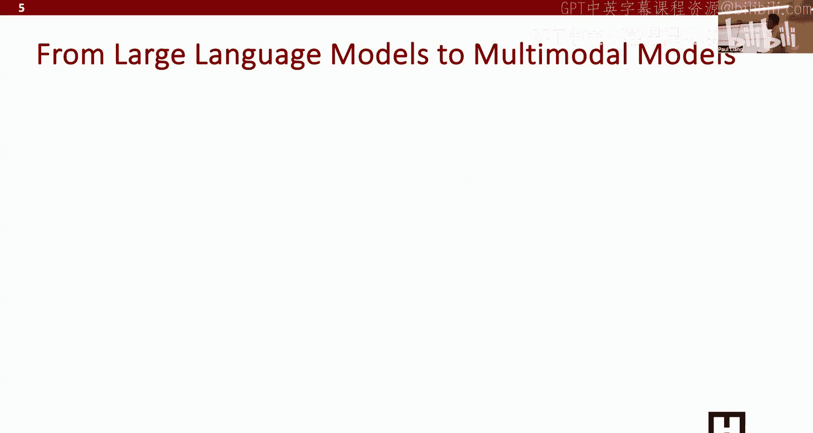

So videos， people， social understanding， social interactions， sensor data， real physical data。

 robotics data， you know getting these Ls that actually grounded and understand the real world in all of its different mediums。

So what are some challenges and what is the progress in these large multimodal models？

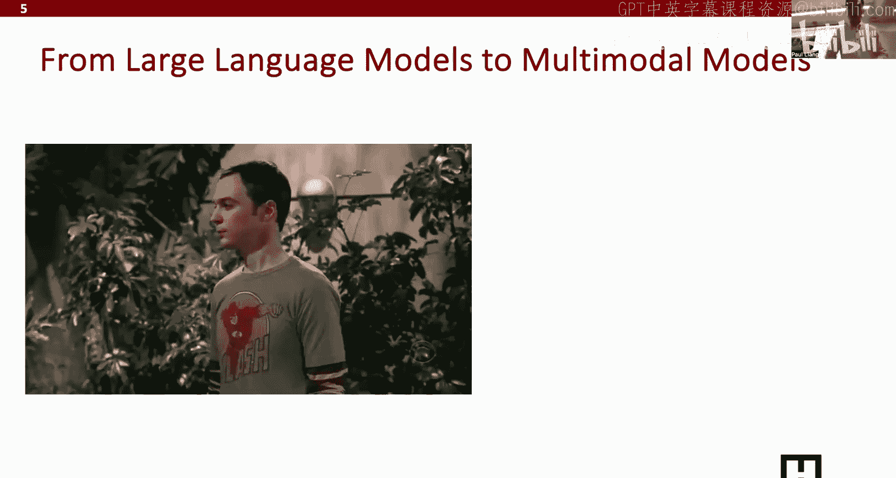

Here is you know away it's the timeline I currently see and where we currently at so we started with multimodal models that understand the world and do simple things of classification so classification into a set of things the tone and behaviors and objects and other discrete phenomena and nows of course you can still ask these models to answer classification questions you would just ask it as a question and maybe give it a list of possible answers and from classification we became more open ended so in addition to asking is it happy sets sarc casting not saastic you can ask a descriptive relationship so going beyond one word answers to open and the dialogue grounded in this case videos。

And then we have works that further extend this to explaining。

 so not just giving access but explaining them， so you might want to ask the model to explain why why are these two people sarcastic to each other and seem to hate each other even though they're clearly long-ter friends so the model might explain why language and might cite visual evidence and facial expressions and they might even retrieve previous episodes to supplement and justify their decisions。

So we are currently at this exc phase， we have gone from class patient open in the back and forth dialogue to recently ask good explanations with some step by step reasoning in grounded and multimodal data and now you have things that are important harder right can you use this short video clip as a prompt to further regenerate animate a story。

This is the starting plot， so that could be the instruction and the model might generate video。

 audio， language， animate those characters。If I even counterfactuals if？

You ask a question like what are these people or from a different society of culture with this sarcasm do be seen as humorous。

 offensive， who might offend， and can you justify that， can you even generate more data。

 video and audio to justify that？So going to more difficult cases and right now we have kind of an explanation。

 lots of interesting progress in multimodal reasoning for explanations and nowadays also multimodal inputs。

 multimodal output so that you can get towards generation and counterfeactuals。

So this is the general schematic of how I see a lot of these models will go into the future。

 it would take a language， taking in abnormalalities。

 it would learn language and multimodal representations。And from this。

 you will be able to continue generating text so the language models are grounded and it could generate other modalities and it could do this over multiple steps of dialogue and interaction with people this is general schematic of how these large multimodal models will progress。

And so today the lecture will cover each of these parts。

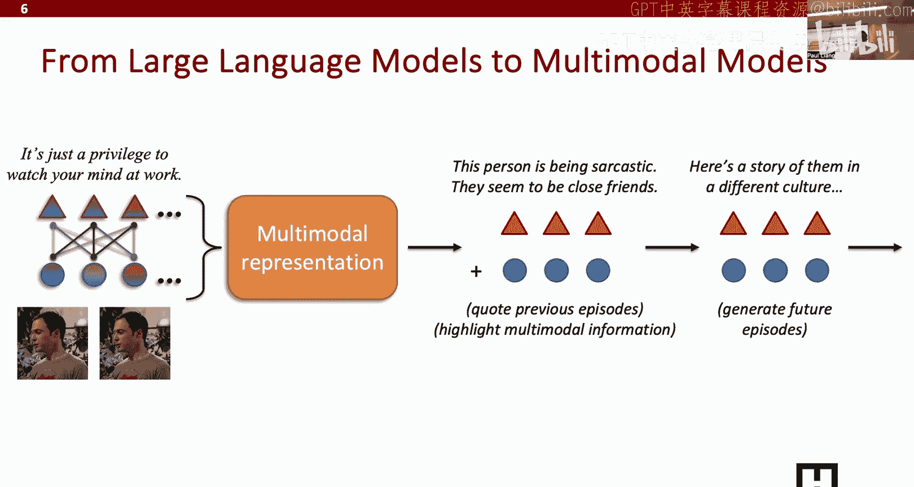

And the first part well just review， you know， we've seen some of this work before and also cover some latest work and taking in different modalities often temporal moral in nature and learning these representations using foundation models。

To get these really rich representations。Let's be part one， part two。

 we will cover how we can take these multimodal agents learn and quickly adapt them so that they just they can they don't just be used for classification。

 but it can be used for language model interaction and dialogue。And finally。

 we'll look at part three on how we can go beyond generating text to generating other modalities in the input and output。

So we've seen part one for learning multimodal representations， we've seen transformers for language。

 you recall we can also apply these transformers for vision and essentially nowadays anything can be photo tokenized into some discrete parts and thought of as a sequence so language will be token of words image will be a sequence of image patches。

 video can be a sequence of frames， sensory information can also be seen as a sequence and these transformers essentially learn your self-atten over those elements in a sequence to learn increasingly informativeative representations。

And of course， multimod transformers are a backbone for many of these models today。

The biggest difference between multimodal transformers and single modality transformers as we've seen earlier in the class is that now you have your query and keys coming from different modalities so query could be from language in this case three words that person speaking with some dimension。

Your key embeddings would be from in this case， nonverbal， So there might be some mobile features。

 it might be some visual features over four time steps。 And in this case is transpose。

 So it's D by four。 in this case， the D has to be common。 the dimension has to be common。

 So the dimension of your projected language embeddings and the dimension of your projected nonverbal embeddings。

 You have to be similar because you want to think of them as this underlying common multimodal space in which you are measuring alignment and similarity scores and that can only be possible if you have the same embedding space。

そうです。This WQ is the transformation that takes in your language and goes into that space and a WK is embedding for your own verbal and brings them into that space。

And you can recap this allows you to get your three by four。

 this is your cross attention matrix instead of just words and other words is now words with nonverbal expressions。

So it's three by four， maybe the standard normalization stuff that we seen in transformers。

 normalizing by dimension and normalizing by your softmax。Okay。

 you want to view this as a cross attention between。Your words and with nonable expressions。

 so privilege might have some alignment of 0。7 to your loud voice or he's saying privilege and a loud voice and privilege might also have some attention with your eyeolings performing an eye roll after he said that word privilege。

So this can be seen as temporal attention because it doesn't just have to be attending to the same。

me same expression at the same point in time， but it can be also very later in time or earlier in time。

Of course， this alignment is not the only thing that we hope to learn。

 the goal is to use this alignment to learn better representations right so you can then take the multiplication with the actual nonverbal features itself to get a new representational language。

So nowadays word privilege has taken attention 0。7 on the vocal emphasis in bedding plus 0。

3 times the eye rolling bedding which contextualizing itself by looking at all the four nonvo features。

 figuring out what alignment ways to assign to it and actually taking the weighted average。

 using those weights。And now this new multimod representation can be used for doing any inference such as in this case。

 predicting sarcasm。So it multimod transformerss extension of language only transformers are used in virtually all of these foundation models today。

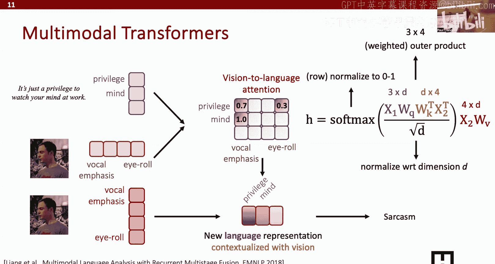

They started with just training transformers from scratch on data and then you started pretraining these transformers。

 so it was very equivalent to sequences of images and sequences of words。

 you would apply these maybe transformers within each modality and you apply these co attention transformers to the language and attend to vision and the vision can attend to language and oftentimes you do it in both directions。

And then after you do that， you might have more transformer layers to eventually get features now after multiple layers。

 language are ten to vision， vision is ten to language， you get two sets of。

Asymmetric multimodal representation， so they may not attend to each other in the same direction。

And that can be useful sometimes vision might require more dense tensions because many parts of the of the management language might have more sparse tensions because there's fewer words。

 so it's important that you're do it in both directions and you get something that may be asymmetric。

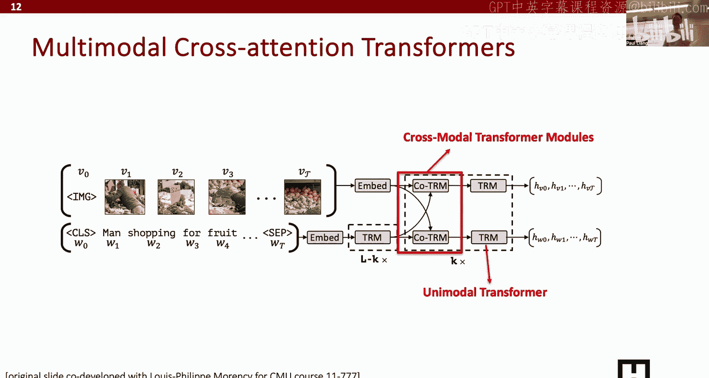

So then people started freetraining these are transformers so you could get a lot of data。

In this case， on label data， so a bunch of images and a bunch of captions。

 you could just download this as scale， you can apply the transformers that does this correspond attention。

Theyve language or vision， vision and language and then people explored all these different prediction tasks。

 so all roughly self supervised in nature。I sorry， unsupervised in nature because you didn't need humans to label them。

 so you could do mass language modeling。So you would mask out certain words and you will try to use the surrounding words and also the image regions to predict those words。

 so the more words that you mask out the more you're forcing a model to translate from visual to predict the words。

Then you be mask region modeling， so you'll mask out certain parts of the image。AMaing image。

 youll use the remaining parts of the image and the caption to predict what was masked out to this must region modeling。

And all this is done at a more fine brain level as we can see and here is a more global level。

 so you would take the entire image with all these patches and the entire text with a whole sequence of words and try to match those so this is a classic contrastive learning objective so this whole image is this caption and this image is different from this other caption。

sentence match the image。 So people explore with a lot of different。Objectives。

Some vision of language， very fine grain in a level of words， some language to vision。

 very fine grain in a level of small image regions。

 and then some more global where you have all holistic image with holistic caption。

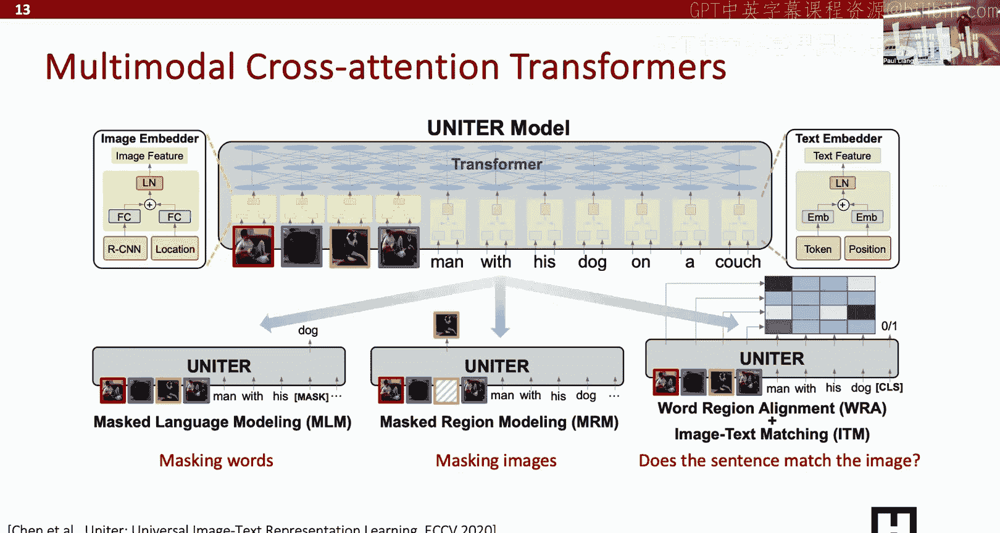

and these were examples to be show that some of these attentions and alignment scores seem reasonably interpretable。

 so you could all all these small boxes are the resolution of patches that you're cutting the image up into and you look at the attention going out on the word flowers。

 it is cross attention matrix It does highlight the region with flowers and you look at the attention wall it does highlight and keep the image patches with a wall as having high attention weights。

 polishs at the top cloudy in the background。And here' us more examples。

Right so nothing extraordinarily new， we've seen examples of language transformers。

 vision transformers， now multimodal transformers and different ways of pretraining them。

This partially is a recap。

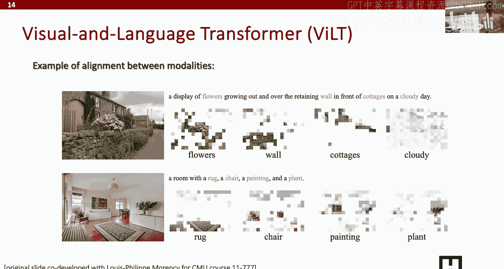

Okay， so that's this part。Also sequential data temporal nature learning these representations using cross attention models and now of course you want to adapt these representations as input into language models。

 so this allows you to have the flexibility to ask and answer any questions that you want about your multimodal context。

So how do we do that another T idea that has emerged is the idea of adapting other of thems。

 so most of the times the other of them and you've done and trained are huge so I you want to keep them frozen you want to update them too much。

You don't have the computational resources to update them and one good interesting idea is that you can essentially take in any data from any other moddality and define what you call adapters so in this case you have an image you passes image through image features and these can be pre-trained CNNs or pretrained resonance vision transformers and youll get these feature embeddings from these images and then you will define an adapter and you want to think of as very small transformation that takes as input these image features and outputs something that is on the same dimension as your language model token embeddings。

Essentially adapting image features into the input of these frozen language model token images。

So once you've done that， you can put it as a prefix。

 so before you actually start seeing the words and the openken em values of these words。

 we put it as a prefix。And essentially concatenate all those together， So image features adapted。

 followed by the rest of your words。And put that as part of a pretrain model。

So now pre model would try to understand as context at the start。

 image features that have been adapted into token space and also the token embeddings of the actual words itself。

And how would you train this model， Well first the only thing to train here is the adapter。

 so ideally this adapter is really small， people have shown that it can even be a small just linear transformation and sufficient。

The only thing that's trained， this vision model language model is usually frozen。

 the vision model you can train or you can find tune or you can keep it frozen as well。

And how you would train it is that you would paint a bunch of images， a bunch of captions。

And you will try to predict auto aggressivelyly the next words in the sequence using as context。

 the image， adapter features， and the previous words that you've already predicted。

So you will need some amount of pair data between image text to train these adapters。

So once you train it you can do many cool things， you can give it a new image， ask what color is it。

 itll give you the right answer， even though it's never really seen examples of images and questions before it's only ever seen just。

Text， maybe text questions。If zero shot isn't good enough for performance， you can give it one shot。

 so you give it one image。You give it a question， who invented this and given the answer the W brothers and you honor aggressivelyly predict these words and you give it a new image here and you ask again the same question and the same format。

 who invented this。The model gave the answer three jobs。

So this is a kind of one shot question answering。And again。

 do anything that's being trained here on adapters， the language models are frozen。

And finally you can do several other cool things this is what people call a symbol binding problem in psychology so how well can you remember names of different parts objects so here you give it an apple and you give it a cap this is a de so DX is meant to be a made up word。

And you give it another image orange， you say this a blanket， B is again meant to be a made up word。

 and then you give it a new apple looking in light shape， different orientation and color。

 and you ask what it is。So using these one two examples， you can generalize and say this is a de。

 so you can bind these new names to neural objects fairly quickly。

So you know this paper kind of kickstar to few shot learning， multimodal。

 few shot learning within using these frozen LLMs， whereas previously people are still training image and text transformers together and with still mostly supervised learning。

 now you do to say frozen LLMs， very little image data。

 very small adapter already start seeing these evidences of multimodal capabilities like image question answering and image captioning。

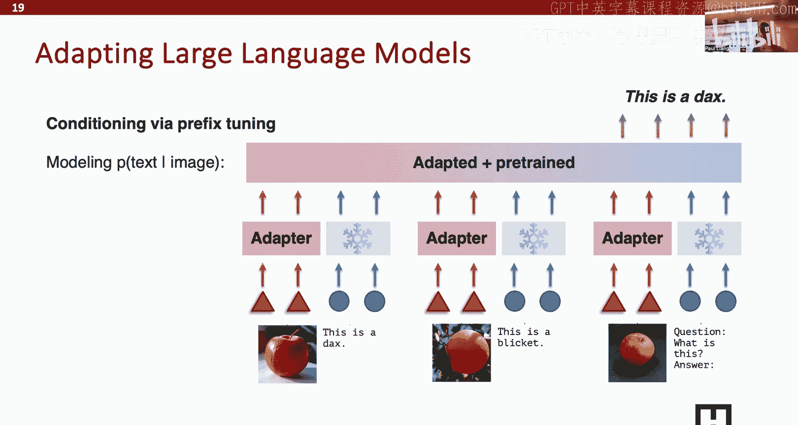

So。That was 2021 by Google Dd， and then they further scaled this up to get a flamingo model in 2022。

 so let's use this model and again this directly uses these adapter based methods from frozen LLM and adapting image information。

And whereas previously Ive mostly showed you just examples of short completions。

 when you scale it up， you can see evidences of much longer term dialogue based completions。

We give it an image， go through the image embedding， goes adapter into an language model。

 you can start having conversation with it， talking about two30 bears on the moon， talking about。

The main goes of different styles and some of you might have seen this on on social media。

 you know earlier versions of these vision models， you take this photo of Apple。

 you paste a sticker iPod on top of it and vision models are classified as an iPod。

And this fling model is able to recognize that there's actually an Apple with a sticker on it and the sticker says iPod。

Although I wouldn't take too much stock in some of these viral bugs being fixed because these tech companies people are probably on Twitter looking at all the funny failure cases and adding that as training data into the model。

That's flamingo。Nowadays， G for no one really knows how it operates。

 but some people have trying to to do small open source versions of it， they found that。

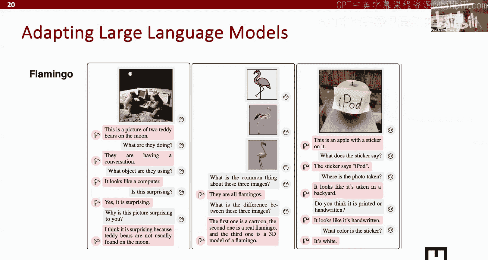

Okay， these adapter layers are pretty general， so take an image， put it through frozen model。

 so Q former vision transformer brain in large amount images， frozen behuna model。

 open source instruction following language model， and the only thing that you're training here is this linear adapter layer。

 linear transformation from whatever this dimension is to whatever the token embedding or language model input put dimension is。

And nowadays these models are usually trained in several stages， one stage is alignment。

 so you first take in a bunch of images and their desired descriptions。

So you can get some image captioning data sets， Wikipedia， Instagram or the like。

 and you basically train this linear layer to taking the image and describe the image exactly so let's go alignment with paired image text data。

But of course we don't always use these large vision language models only to caption images。

 we also try to use it to solve interesting problems so one example is given this kind of a graphic design flaminggo image。

 you might want to ask the model what do you think about this。

 imagine you're a graphic designer assistant。So the second step is to do instruction cleaning。

In this case， visual instruction to， you give it some images， you will give it some。

You ask humans annotate some instructions that they would like to see completed for those images and you have the same people write the good answers。

Good these are answers。So you do instruction2 a using image。

 text instructions and example completions from people。And but simply thing。

 when you do instruction tu， this image comes in， goes through the linear layer。

 the instruction that human penator goes in， and then we do supervise prediction of each word in the desired answer。

Not only a linear there is being trained。And afterwards。

 you basically just you know deploy this and do all your standard post training。Human feedback stuff。

 but back then in this 2023 world， they didn't do all the stage three post thing。

Amission is not speech。So this is L stage2。Yeah， so this is example for stage two because now you're giving it an instruction that is beyond just caption and describing the image so stage one will be you take a bunch of images and their captions。

And just。Describe only about descriptive describing of the image。And two。

 stage two is more open and know this what do you think about this logo is more open and the humans to basically annotate some tasks they find interesting and good answers。

 completions to those tasks。

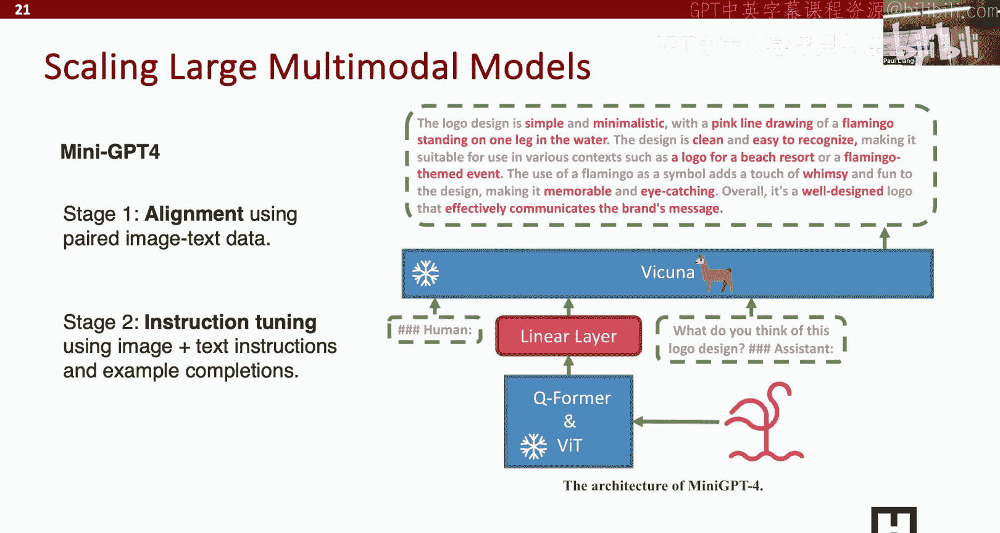

People have really scaled these adapter models up to really loss modalities。

 so Lama adapter is a good open source we need built around this based on Lama。

 the LM which is open source and it basically consists of a bunch of adapters right for different modalities so image and image representations and pretrain adapters into Lama input space here's an example of 3D point clouds and a model that this thing also supports so 3D point cloud goes through some 3D point cloud representation model and a pretrain and encoder into Lama input space now I can do things like give a 3D point cloud and give an instruction like generate image corresponding to this 3D point cloud。

So all that will go into your pretrained， frozen and adapted LLM。

 and in this case you also stay on the text image diusion model at the output so you can regenerate some cool images。

哎。Also， they support multiple languages， so different adapters for different languages。

So this is a good open source resource。

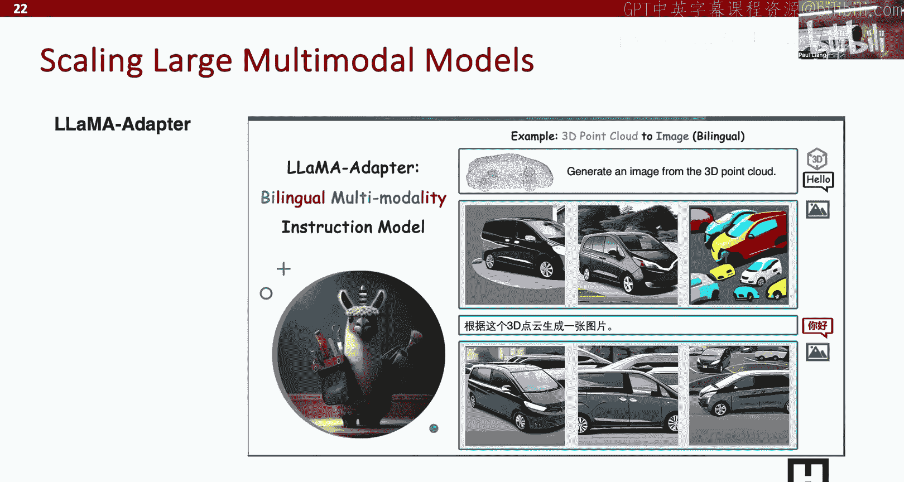

And finally， speaking about the data side， of course。

This a couple of stages preing just for you to know。

 most of you might not be downloading or preprinting these data sets but size as increasingly exponentially increasing size from YFTC。

 which was more image caption preing to rely on 400 billion became lie on 5b and data comp is this most recent addition of open source image text pretraining data of 12 billion parameters。

 that 12 billion data points in size。啊，other。Another transition transition is that previously people just took one image and one catch。

No of these were just one image in one caption。 and that's how you pretrain models。

 Increas nowadays people are looking at interlead image and text， that means you have image caption。

 image caption， image caption in a sequence that more naturally follows how you would， for example。

 draw and text your friends， so not just。One image one caption。

 the next one is independent the longer sequence of interleaved image text。

 And as I'll show you later， that's enable some cool new capabilities。

And also recent efforts have also kind of shifted to interlea， but also higher quality。

 we when of realized that some of these stains are really large and。Lots are not good and not useful。

 some also have very explicit graphic images inside of them so nowadays' another trend of filtering smaller and high quality so this objects and DCL them are some popular resources they smaller but they have higher quality and also interlea image text。

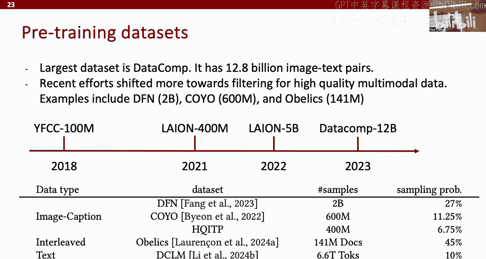

So that's pre training。Instruction tuning more scattered， smaller in nature。This table gives。

Survey of different instruction tuning datasets。 So again。

 in this stage you don't just have images and captions describing each other。

 You actually have images and people describing what they want to do and the right answers humans So these are examples mini G fors I covered it was probably one of the earliest examples in the 5K instances didn't really have any tasks people just random this stuff and it wasn't multilingual and then lava is another popular instruction tuning visual instruction tuning database。

Instruct Blips a pretty popular one and those have gone up in size。

 but their order is basically in the couple millions。

Rather than the billions in the pre training regime。

So these are some for general domain and of course there's a lot of instruction tuning that are specialized for domains。

 so David did recently his client that he showed two weeks ago which was large scale instruction tuning for medical images and medical questions that doctors might care about and then Lavamed。

 bioM， these are all other medical examples so they more focused instruction tunings。Alright。

So in this third part， we see now in the first part。Multimodel data usually sequential and temporal。

 learning multimod representations using transformers and how you can quickly adapt that into a large language model。

And of course， the next part， as we allud to in the Lama adapter part is to also be able to generate more multimodal data as you generate text。

 so generating images from descriptions， images from point clouds。

 you want to highlight relevant episodes or retrieve evidence。

 it's also a visual and audio generation problem。So we're going。

 you recent trends are going from text generation only to multimodal generation。

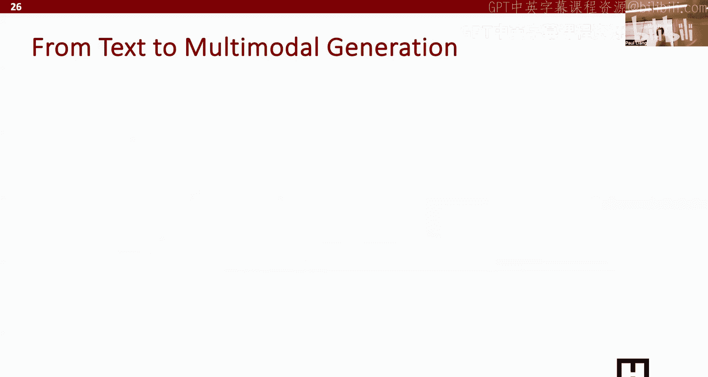

Of course， some of you have seen these examples of text to image models。

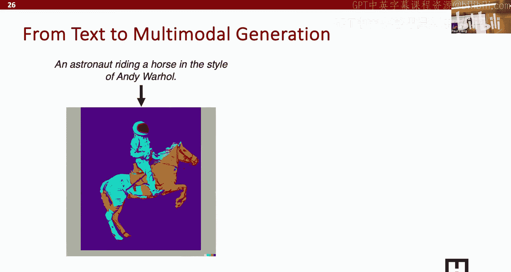

Thats a really cool fancy。Da stable toussion like models。

 we'll cover this in more detail in about two weeks。

But right now I'm just going to assume that we've seen some of this and we'll look at how we can integrate them into these multimod elementss。

So lots fancy examples。A quick recap of。just quick introduction of how they work before we go into detail in the generative model lecture。

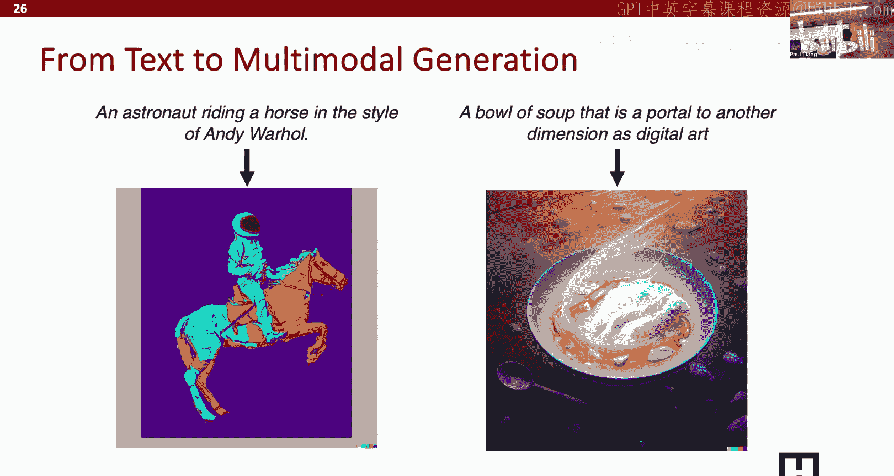

First， lots of images you can just use image only to train really good image encoders and decoders right some of the best of the art image encoders nowadays are based on clip。

Have we've seen that we talked about in a class where you take lots images and captions and you train this contrastive representation learning so that the image representations that you get from clipP are not just independently separated from language。

 but are already very closes to language representations。So that clip is not used as the encoder。

There's a model that translates text that comes in。

Through a transformer learns representations and is transformed and translated to predict the clip image embetics and this is where you know using a clip really helps because if you're using some any other pret vision model。

 then this distance will be very far away from each other。AndBut now they're using clip。

 this is really quite close to language states based on how clip was trained using contrast learning。

 so this mapping can be done much more easily。So clip to encode the image。

 language model to encode a text and to map it into your clip image beddings and finally from image bedding to the raw image itself。

 diffusion models， right fuion models that generate pixelix by pixel and nowadays increasingly flow matching models are coming as a competitor and sometimes even outperforms diffusion models。

And we'll cover this generative models more in two weeks。

So how do we use these text image models as part of this whole multimodal LM pipeline？

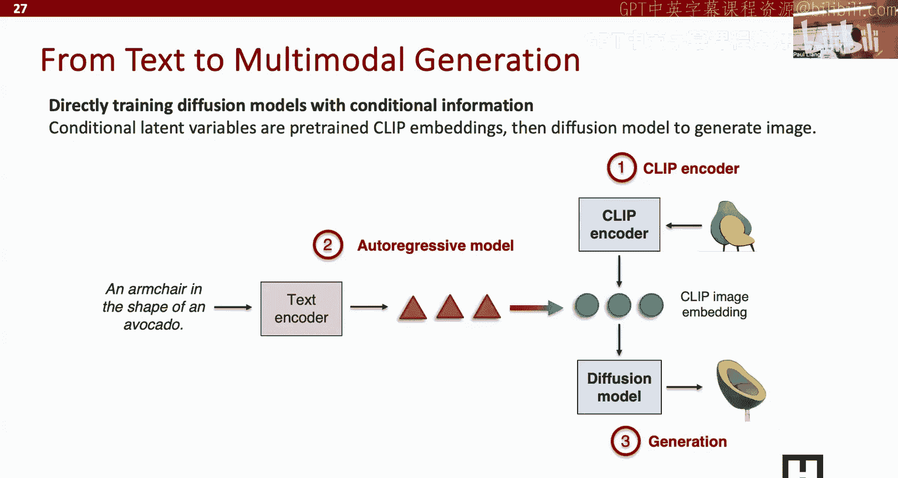

So here' are some papers that are quite recent， so again one innovation is this idea of interleaved images and captions where you want to train your model using even an image as you see the image goes into a visual encoder and you have these adapter layers that you seen and then after this image you have a caption encode so s on a plane against the sunset and then you might have more images that go through a visual encoder and the adapter and you have more captions like cat sitting on top of a scooter so have a sequence of image and text that are all either adapted through a visual encoder or a tokenized if it's already in text。

That becomes your whole input embedding， which goes to LLM。

 and LLM could generate next tokens to complete the story。

 and it could also generate embeddings that you could compute a similarity with respect to image banks so by computing the similarity in basically retrieve which images might make the most sense as a completion。

In the other space。So similar of this plane， which is the story that a model had just completed that would learn some language embedding。

 info andE， your contrastive loss to find the nearest visual embeddings and you would search over your images to find the one with the closest visual embedding。

What's the I've been traveling Indian possibilities？

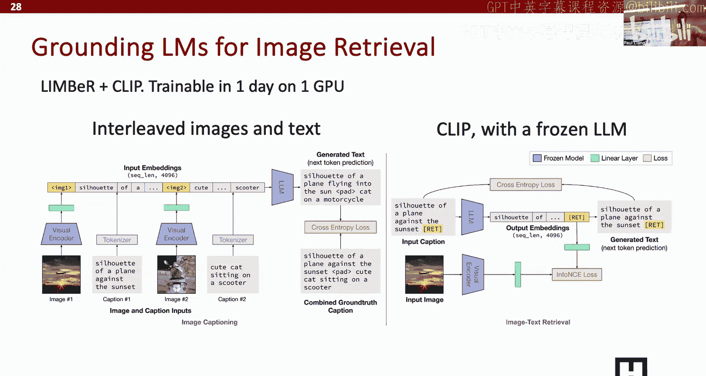

As you see in some of these examples， when you deploy this model。

 you will want to interact with it multiple times using language vision and generate language and vision and you want have this continuity right so if you only。

Give it one language image and ask you to generate one thing that you're not going to be able to have this continuity when you eventually interact with it。

So here are some examples， you can start talking， and give us some animal or try to guess what it is。

 and then show me an illustration， either show me a pencil drawing of the tree， something。

 show me another photo of it。Here start with some house with architectural design。

Talk to it and then show me more houses you can retrieve similar houses and even more and over here it's an example of cooking so you do back and forth dialogue at some point you want to see what it looks like you can retrieve the nearest cooking image。

You may continue that。So all of this several key ideas interlink image and text， using training。

 learning image and text inputs， and then on the output is generating more text and also generating an embedding which can compare to clip embedding for images to retrieve the name image。

そして thatそれもま this like which interesting。Yes， although it is not really keeping。

Image embeddings in memory， as you see in this case。

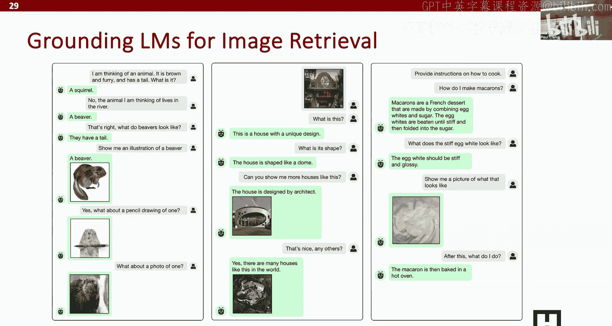

It is taking images and it's going through the adapter to language tokens right so it's kind of projecting everything into language space。

And language is a memory that a model is using and when it's trying to generate images。

 it's outputting the language embedding and it's using equipment to find the nearest image so it's not keeping both it's the bottleneck there's a language bottleneck basically。

不事，你觉得。The term has been so much of it read。What context do they use it in？

I'm not super in a few paper separate， Ive seen this idea of using a corporate。奖呢种系就将咁。Yes。

 the word codebook is used a lot nowadays， I think people just love using it to mean anything discrete or like a dictionary codebook。

 So remember this image。Encoding decoding models first came out people love using webptite one the80s so you took continuous images project them into discrete embedding space and call it a visual codebook or visual dictionary so a discrete bottleneck I'm sure maybe some people have used that term to describe stuff here because。

Everything is still the projecting of the discrete tokens。

 whether language tokens or visual adapted tokens， and the retrieval is also over a discrete codebook of image and so。

Maybe that's what they're referring to and people love to use that word and people love to have just discrete bottlenecks and stuff nowadays。

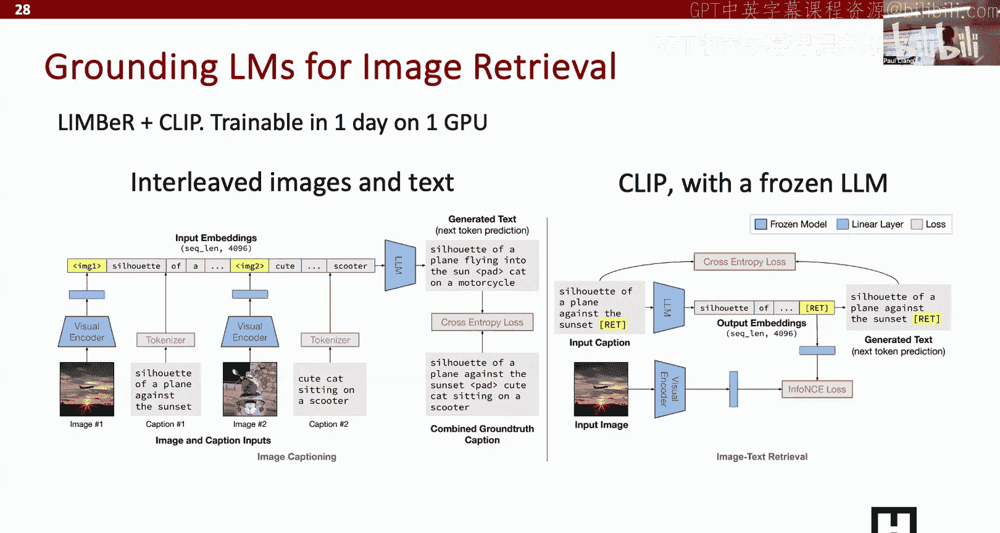

So yeah speaking of discrete you know this was retrieval so it only works over a set of discrete images。

 the good thing is that you you're guaranteed to generate a realistic image or you're guaranteed to retrieve a realistic image the downside is that you're limited to what images you're retrieving over and sometimes it can be slow。

So naturally， the extension was to go from image retrieval to image generation。

 pixel by pixel generation。But again it also very similar same authors image close to visual adapter。

 language is captioned， there's some interleading that's going on and once that sequence is going to other them to generate the outputs。

 there's some decision model to decide whether to retrieve and retreatieving。

 you using the quick similarity to retrieve images or generate which case SD is' using stable diffusion。

To generate text to image pixel by pixel。And sometimes you know。

 they found that sometimes retrieval works better， sometimes generation。Works better。

 So the example here was a of cookies。That you might have just baked and how you could best display them at the farmer's market。

 so the retrieval model which is something like this。

 which is kind of stacked up tied together generative model gives you。

Generate something which is more spaced out or of course you realize that these are not the exact cookies right when you look very different cookies。

 but they have a very different layout and maybe the final model would then aggregate these and say I think they look better when they're on a tray space out。

Give you back this generated image。

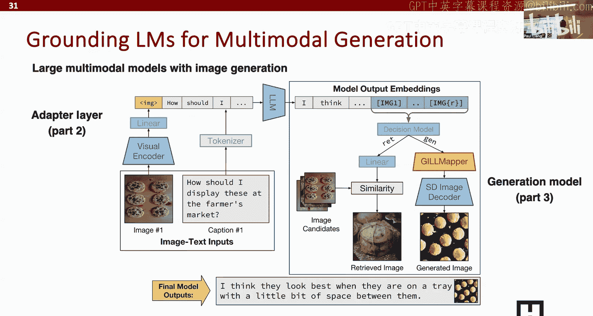

And more examples。More examples， one of the popular data sets that people use nowadays is a data set called visual storytelling。

 so it's also a big intuitive data set。Where you can add stories of text and images and more text and more images。

 which has been used to train and also evaluate these models。Alright。

So now some latest advances we've talked about。Aters a lot， you know。

Its been a trend to have frozen alarms and an adapter that just quickly adapts this alarm to look at multimodal context。

 but I'm sure some of you I seen in Lama 4 in the last week。

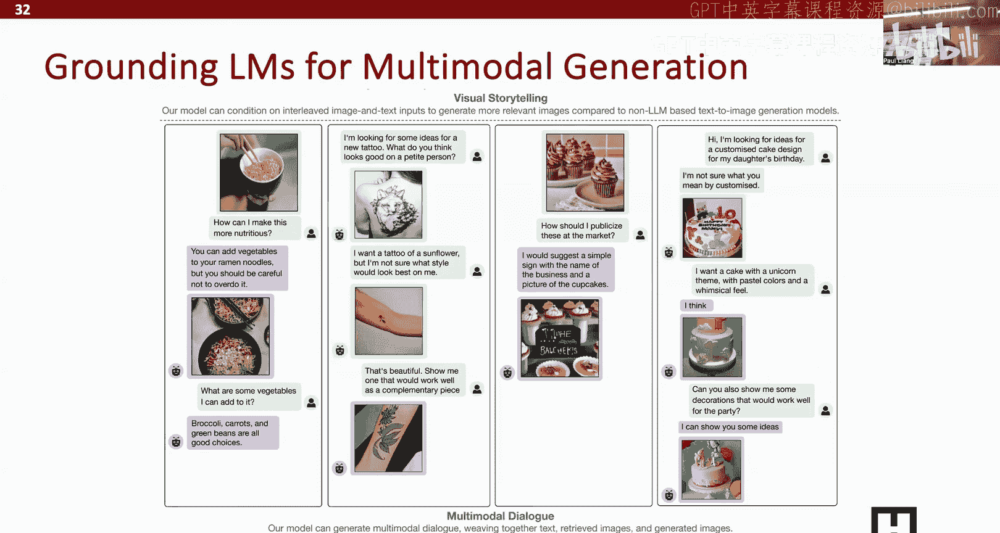

啊。And Lama4 claims to be this native multimodal model and they made a big deal out of that。

 so there's been not kind of a battle between whether pretraining language。

 freezing it and adapting multimodal information is better or whether native multimodal model so essentially these models don't start with a pretraining LM and they try to train language and images and video and more modalities together from scratch。

RightOf course， is something that only big companies can investigate nowadays at their scale。

 but Lama4 really make a big deal of how their method was natively multimodal。

This native multimodal one again context length， I think the biggest advantages are if you can' afford to then there's a lot more information to be discovered from images and videos and we're really exhausting how much text we're training these models on。

This是唔系。That means you don't start with a free train another land。

 you start with you start with nothing， basically。当。いや、続き。Yes， so you give the model， language data。

 video data， audio data， whatever more， and you're basically training from randomly initialized parameters。

Language representations and language vision representations and video representations。

So you're not training the model for like a couple of months then getting already good language model and then only adding monthly model information。

Biology and people psychology background they also love this because they feel how humans learn how children learn is that they learn about visual and audio and moving around sensory motor before learning language and that's how evolution taught people how to learn but then you know this came out and then this was very disappointing it didn't seem to be as good。

And then if you don't know how farau and Jeff and I are being trained。

 that I think know it's probably a mix of。Free training and adapting and also like some some native。

Oonents。Okay， but it is also the largest model now。

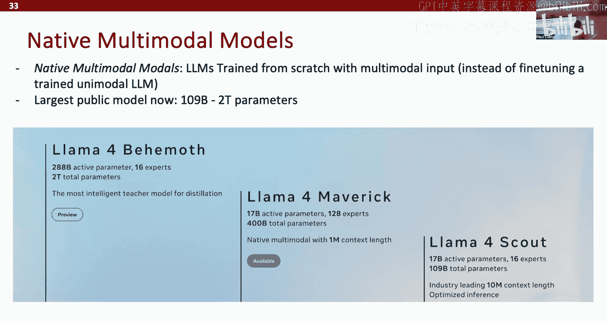

The the largest one to be2 triion parameters。And it's basically a difference right for non native ELMs。

 imaging encoders are every frozen train to the left。And the image encoder。

 some flexibility can either be trained or fine to more frozen。

 and nowadays most of them use the structure， especially the ones that you would use in your they've seen in the papers that people play around with that people try to extend to more modalities is usually the structure and it's really plug and play more module or play you can change this to a sensor model and have a sensor encoder and with some amount of sensor language data train a sensor element。

即忙嚟的。And then for native models， they train on special multimod inputs。

There's methods that do late fusion， so it goes to image coder and then。

It already has good image features and then the training text together， jumping with it。

And there's also methods that do early， so they don't even have betweentrain image quarters。

 they're kind of just taking in pixels and trying to embed pixels or image patches into L。

 So what and what level image model goes to A also is some engineering question。

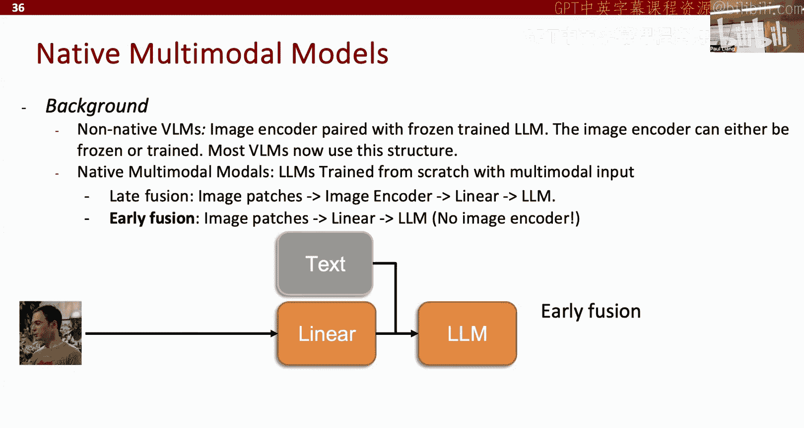

So with meta's release of their Lama4， they also released some scaling loss for these data B multimodal models this one if you recall。

 we had our reading on scaling loss for these mixed modgenative models right that was also by meta so I'm sure there was some inspiration there。

And so like that getting all paper that everyone read a couple weeks ago was also a natively trained multimodal model like via text via some speech and they were either training text from scratch or speech from scratch or text speech together from scratch and this is just you know nowadays they。

That their newest version of their scaling loss。Some key takeaways seems that early fusion models hold small advantage on small scales and on larger scales。

 both architectures perform quite similarly both early fusion。

 so you're directly operating on image patches and transformer and late fusion where you go through freetrain image codes。

 so maybe we might not need image encoders。诶。These natively multimodal models also scale similarly to unioral parallels with some different constant factors in their scaling expon。

Which are。Which may be a good thing， which means instead saying all the work and scaling on the lambs could also be translated with some constant factors to scaling these native multimod models。

啊。Of course scaling die。Free trained and adapted multimodal models and those scaling laws I don't think people already studied。

And maybe it might not really make much sense to study because it's probably going to be bottlenecked by just a scalingating out a language。

这 can language回去吧。啊，是在扣扣评分。嗯。Yeah， so several other recent eventss。

 you know Al Lama4 also had mixture of experts。GPT4 and Ge I don't think they did measure mixtureshift of experts but the Ima4 as the first to openly measure mixture of experts for these multimodal models。

 this significantly benefits these natively multimodal models at the same inference of。不好。

And also in the M structure， modality aware design。 So if you have separate image text experts。

 that's actually worse than modality agnostic design。

 So I really want to have these experts that are。Agnostic to your modalities。

 you don't want to partition your experts too much based on which modality。

And there was some finding we had， okay， this paper is pretty good。

We'd also been doing some work on these multimodal mixture of experts ourselves。

 of course not as data of a scale as meta， so one thing we found is that you could take all these videos and if we recall this RUS we looked at these different ways in which modalities interact right sometimes the information is common and redundant in both sometimes as long synergy and there different degrees of synergy so you take B2 one of these pretraining video events you see that they work video and exploiting cases where information is similar but they really struggle with lots of new synergy and new information emerges。

So one type of extract we've been designing is that you could take your data and you could essentially classify where the information comes from and based on where the information comes from。

 you could design separate expertss。One expert to look at both and capture the commonalities。

 one expert to do fusion and capture synergy and there'll be more experts to do synergy because that's harder and some experts do uniqueness。

And this's also a general mixture of expert there that can be applied on vision language models or。

They are native or LLMs that have been adapted or just LLMs themselves。Yeah。

 so we saw some tools and performance， especially for the types of data points that the model struggled at the most at the beginning。

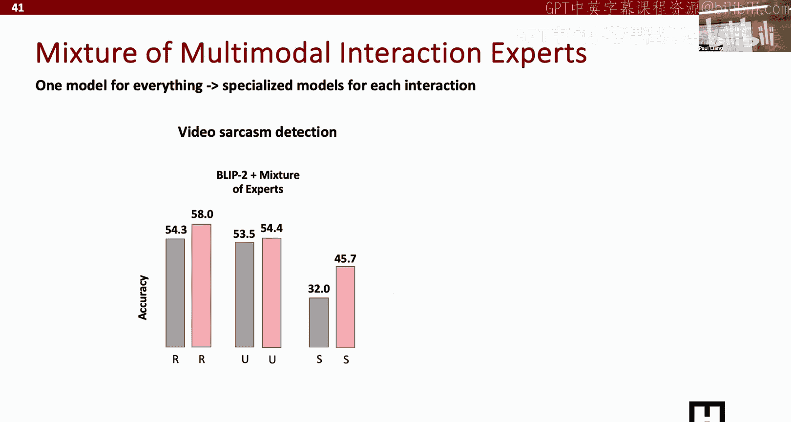

So there's multimodal mixture of experts。I thought I should also mention lots of interesting work going on at time series LLMs。

 mostly in the pretrained LLM， keep it frozen， have some time series coming in and then running some sensor encoding model and adapt it into the frozen LLM。

So time other one fits all examples of this。And what are the tasks。

 there's classification tasks on sensor， you can also literally ask the next value is。

And have with output something like 0。6 that tokenized numbers， which is pretty interesting。

But doesn't work。

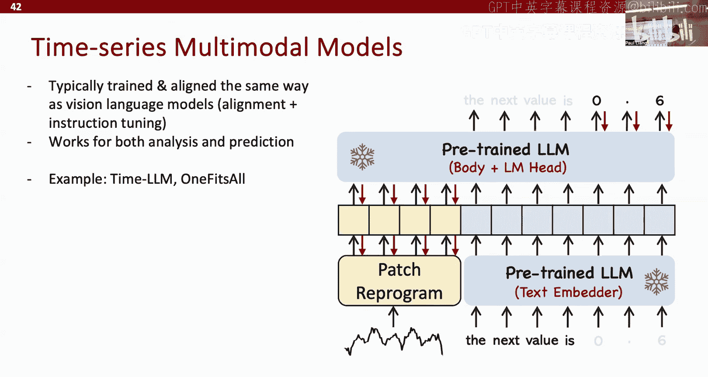

Really well yet。So people found that。Most of these current times user a lens a questionable performance。

 sometimes you can remove some of these complicated attention layers or even the frozen LLM replace place it with a simple attention layer you can still see pretty good performance so unclear where for example this with LLM and without LLM the performance doesn't really change that option 0。

003。

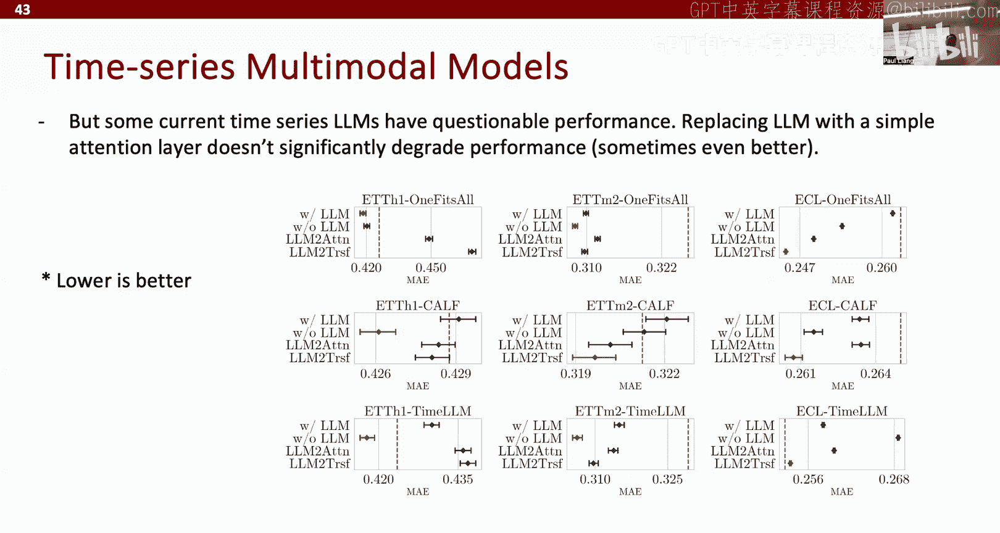

So lots of interesting stuff。 Yeah， inputing that times。什。Yeah， I've seen a couple。

 so some of these kind of learn they are designed their custom time series representation models so they train transformers for time series。

And that's one another area active area of research I've seen people like。Pt it up。

 save it as an image。Put it as an image that seems actually intuitively that that works quite well。

 surprisingly。I works quite well。And then there are people who put numbers。

 manipulate really input input numbers， and you would think that doesn't work， but。ive先生。

People claim that it works。Like like some people who do robotics nowadays。

 they literally put as as text， you know the angle of this joint is like this 45 degrees and angle of this joint is like this and the proprie section is like this I literally put it as text and numerals。

Mo seems to be able to do something with it so a couple options。Yeah，不好 sorry sorry。一个。

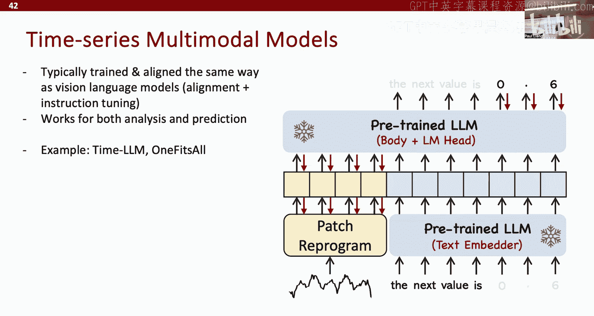

诶。And you start with this， this is a very comprehensive study and critical study and sure they tried a bunch of models。

 I don't know if they study different encoding representations。

But they probably had all the data and models set up so you could try that if they didn't。All right。

 so summarize。We saw recap and multimodal foundation models with former architectures and howgene pretrain。

 some evolutional methods over the years， nowadays a popular approach is to adapt frozen otherms into the multimodal counterparts by training these modular adapter layers。

 also a big trend on going just from text generation to having multimodal input， multimodal output。

 so namly true multimodal interaction， some data directions and natively multimodal multimodal major of experts and extend to actual real world analysess。

Okay， that a focus shows a quick reup of the assignments。

We can'll be around and David and China Pe also around， so please me with us。

 we should try to get either promising results and a path to scaling or not good results。

 but a good idea of how to fix and remember to submit a reading assignment tomorrow for this Thursday's discussion。

没识。😊，Yeah。啊。Maybeい to discussかせる。We should respond find。系咪调他嘅系我公司。

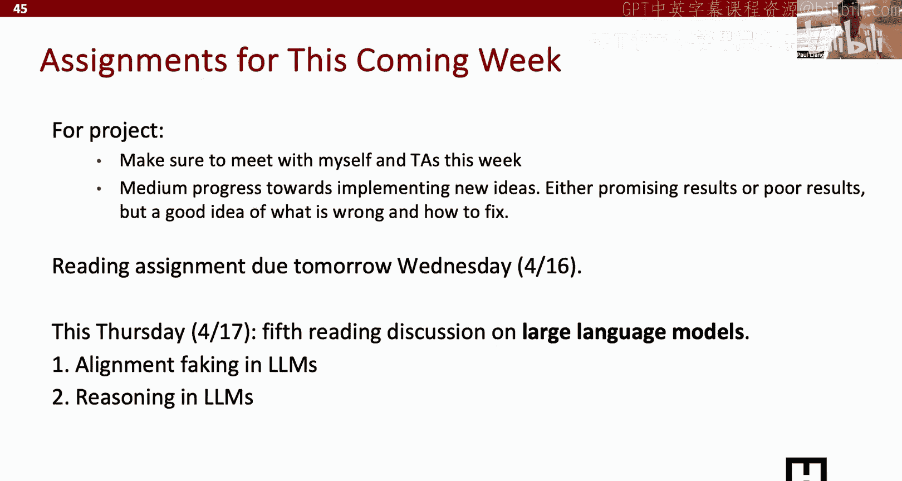