# 《如何AI所有事情｜MAS.S60 How to AI (Almost) Anything》中英字幕（Claude-4-s翻译） p11 [11]Lecture 10 – Reinforcement Learning & Interaction.zh_en [BV1UhawzQErD_p11]

Hi folks folks welcome back we have to get started because we a lot to cover today。

So first thing it's almost the end of the semester。

 so that means hopefully you have all made some awesome progress on the final projects。

 we're planning to have people present in class this Thursday brief overview of the final projects it doesn't have to be finalized you have about 12 more days between the Thursday's final presentation to the following Tuesday when your final reports are due and then we'll grade all those and then send a grades into the register。

So this Thursday will be the final project presentations let me also give you some overview instructions。

 all this was posted on Piazza， but the expectation is that you should write between eight to nine pages of content for your final report。

 eight for eight pages for two students， groups and nine pages for three to four students。

And it should cover at this point really a summary of everything that you've done throughout the semester。

So most importantly， abstract intro of motivating a problem and why it's important related work。

 which should be categorized by different sets of methods， not by individual papers。

 and also highlighting how your work differs， rigorously motivated a problem statement。

 formalizing a problem。And of course your proposed method。

 which should be about two pages would be the bulk of the report that could be proposed new benchmark。

 proposed new AI method， proposed new evaluation strategy， simulation environment and the like。

 but that should be the most important part， it should be a very nice overview figure to explain at high level everything that's going on。

Experiment methodology， experimental setup data sets， baselines。

 and of course you should have rigorous results and discussions。

 results for the baselines results for your method ideally it works better but you know we're not going to be grading on how much better it is if it's better that's great you still want to see analysis of why you think your method improves if it's not as good as the baselines also don't worry but please include some analysis of why you think that is the case and some future directions you could you could do to improve that。

And finally any conclusion and future directions。And for the report presentation。

 that would be on this Thursday。Time limit for each project of the eight minutes roughly seven to nine slides you can don't have to dive too much into the problem and related work it should really cover the key new method and the key new experiments that you have the initial results and also what you kind of plan to finish in the last 12 days before the report okay so eight minutes7 to nine slides again we'll have to extend past a little bit from one to 3 pm but again let me know if there's any constraints will try to schedule people to the appropriate time slots if you could send me the constraints by by today。

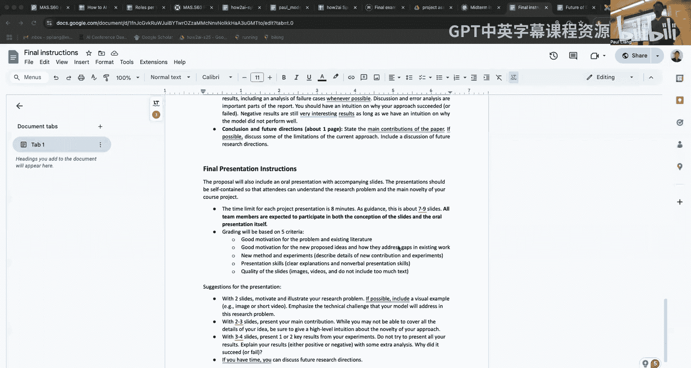

Great， any questions on the final project logistics？

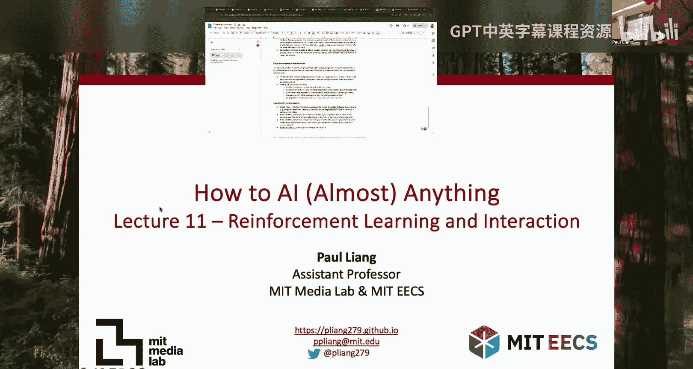

No。ok。and please yeah meet with myself and the TAs today after class。

 I think I'll be around from two all the way to you know5。

6 pm if people want feedback and things to discuss before Thursday。

 Thursday we'll also ask you some questions during the presentation and give you some feedback so you can have a solid final report by May 20th。

All right。So of， recap。almostmost the end of the semester this class has seen several modules we started with basic foundations of AI AI research data and common model architectures。

 we looked at multimodal AI aligning different modalities using them and transfer information from one to the other we then had several lectures on basics of LLMs and large multimodal models and China guest lecture on generatedative AI so today's diffusion models and flow matching models to generate more data and this week next week the last two lectures will cover AI thats more interactive so today we' cover reinforcement learning。

 reasoning and interactive AI and next week we cover more human AI interaction some AI agents and also how do you make sure these things are safe ethical when deployed in the world。

So today， basics RL。And also so foundation RL and also modern reinforcement learning and how that's been used to align and make otherMs better at reasoning and also in the final part。

 Kmsome applications in LLM agents。

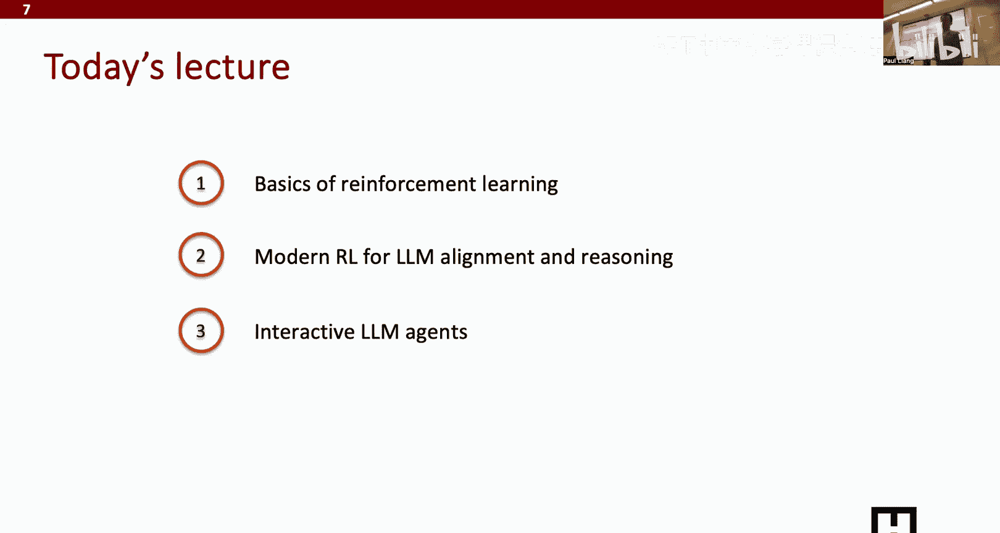

So firstly， RL basics， again， the goal is not to really cover all the depth of RL。

 but only to the extent necessary to understand all of today's RL methods and how they use for modern AI methods。

So the biggest difference between RL and non-RO methods。

 supervised learning is the fact that RL is dynamic。

 right you have agents in some environment and instead of just making one prediction like classifying one image。

 usually trying to take a sequence of actions with the environment which then gives them new states。

 new locations in the environment in which case they might take more actions and overall this pattern continues。

 taking more actions， interacting with the environment， getting into new states。

 and a goal way is to maximize the agent's longter reward in that environment。

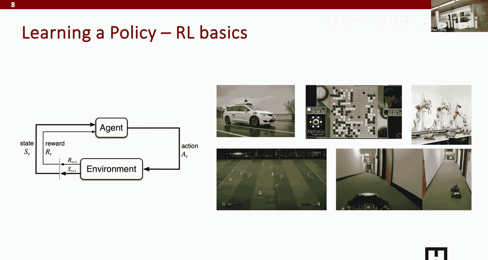

So to formalize this a little bit， usually people talk about our in the context of MDPs。

 which are Markov decision processes essentially it a way of formalizing the fact that theres some set of states。

 this could be locations， if it's a robot navigating nowadays people can also view used states as you the words the language model is generated。

 so a state is some way of looking at the data that you have currently in the world。

There' a set of actions which are actions， things that the model could do， if it's a robot。

 it could be moving up down left right， if it's a language model。

 it could be the output set of words that it could generate a nuclear set of actions。

There's usually a transition function telling you from one state， if I take an action。

 what next stage do I go to and sometimes it's deterministic if I if the robot moves right。

 it always ends up to the right， sometimes it can also be some randomness in the environment。

Very important also the reward function， so if I am in a particular state and I take some action what reward do I get and again that could be you know whether you've completed the task successfully it could be a penalty on taking too many too much time or too much resources to complete the task it could be how much a user is satisfied with the interaction all our possible reward functions。

And of course， there are other things like the state that you start in a discount factor。

 which is actually quite important to make sure these R methods converge。

 essentially telling you that a reward that you have right now is more valuable than rewards in the future。

 so you should try to maximize things that you can get and horizon age is usually the total length of how many steps the agent interacts with the environment。

And there's several key things you care about when this agent goes around different states and takes different actions and observes different rewards。

First of all is this idea of return right the idea that I don't want to just train action to get the maximum reward at this immediate state。

 I want to be able to maximize a cumulative long termm addition of all the rewards that I get to interacting so there will be reward at this immediate next time step T plus1 plus gamma of the reward at time T plus2 okay that's the discount factor basically modeling that the immediate rewards might be money that you have right now is more valuable than rewards the money that you could get in the future and youll add all the way towards the end of the interaction。

So this is the key thing， right， not just you know maximizing the media reward but maximizing the addition of all rewards into the future and of course。

 there's many cases in which the immediate reward isn't very good。

 but there's a much better reward in their future they to try to optimize for。

So that's the whole goal of RL to maximize his long term reward。

And you're trying to maximize this launching reward by learning a policy So policy。

 a fancy way of saying whatever state I'm currently in。

 what is the distribution over actions I should take So robot is here。

 it should move up or forward if the language auto in these words。

 you should output these other words so a distribution over actions you should take given the current state and I say again distribution because sometimes your policy is deterministic so you always move forward and a particular state。

 sometimes it can be also very helpful to have randomized policies like nowadays is LLMs they all have some temperature parameter So there is some randomness in the next actions or next words that they generate。

And as you mentioned， the goal is to really find the best policy to the best distribution of next actions I should take from each state that maximizes the long term cumulative reward。

 so the next reward that you get， but also other rewards into the future。

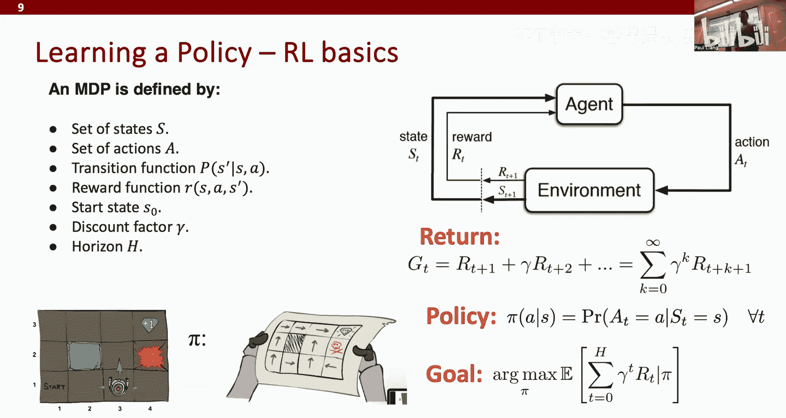

So conceptually， RL versus you know supervised learning with several key differences。

 RL involves making a sequence of decisions which can be arbitrarily long and supervised learning looks at making just one step of decisions。

In R row， you're trying to maximize a cumative reward as a result of your sequence of decisions and in supervisorvis learning。

 you just maximize the immediate reward。In RL， sometimes you also have this issue of very sparse rewards。

 you might be interacting a long sequence and you only get a reward after a thousand steps after maybe an LM and a human converses for a thousand words。

 do you only think at a rewarding and that' what makes RL inherently challenging but in supervised learning you always get dense rewards。

You know what the label is。Some in our row， the environment may be unknown。

 there's always this issue of exploration， designing robots or your cell drivingriv cars。

 you're not going be able to map out every single road the cell drivingriv car is going to go to or the robot is going to go to。

 there be some exploration of the environment which again thats a layer of difficulty and in supervisor learning typically you know what are the possible things to predict you know what are the possible inputs。

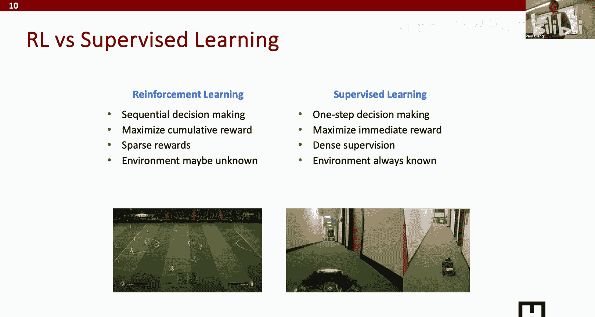

I mean that being said， there's one very trivial application of supervised learning methods to RL and that's called imitation learning so imagine as an example you want to train a policy to navigate a selfdriving car so the states are whatever you know is on the windshield what you see and the actions are just you know how you should turn the steering wheel for example。

 general simplicity input states are what you see and actions are are turning a steering wheel。

And of course， what you could do is you could get human experts to drive cars for a long time and using that data would be a sequence of states that a human saw。

 the actions that a human took and next state that a human saw the next action that a human took。

 so you could get what we call expert trajectories， someone whose expert driver performing this task。

And then you could basically just do supervising。By learning a function that takes in whatever states that were collected in this human expert data。

 that's your input S， and you just kind of recreate what the human did and predicting the actions。

So that can be a simple classification model。So that's called imitation learning。

 it's one example of reinforcement learning， but you can also see cases why it fails。

 several big reasons。First of all， the biggest problem is distribution mismatch right if you see human expert drivers。

 they're of course going to drive well， they're going to turn and stop when they're supposed to stop and follow other roads and therefore your model will only know when to take the right actions if they're on the correct path。

But in the case that your model accidentally goes onto a wrong path。

 then you will not be able to recover right because it has never seen examples of how human experts recover from accidentally not stopping at a stop sign or accidentally going off the road。

So this distribution mismatch is going to be very difficult to tackle if you start accidentally going into some suboptimal states and it's also again' going to be very difficult for the model to recover because in these expert demonstrations you never see any suboptimal states。

And of course， you also have logistical issues where sometimes expert trajectories are not always available。

 and even if they are always available， it requires lots of humans doing things。

 which can be very extensive。But you know， sometimes if there is possibility of collecting human expert demonstrations。

 that imitation learning is a way of kind of initializing a good policy。

 but then you also have to tackle ways of letting the policy explore some suboptimal trajectories and also learning how to recover from those suboptimal trajectories。

So diving deeper into RL， there's two general paradigms of RL。

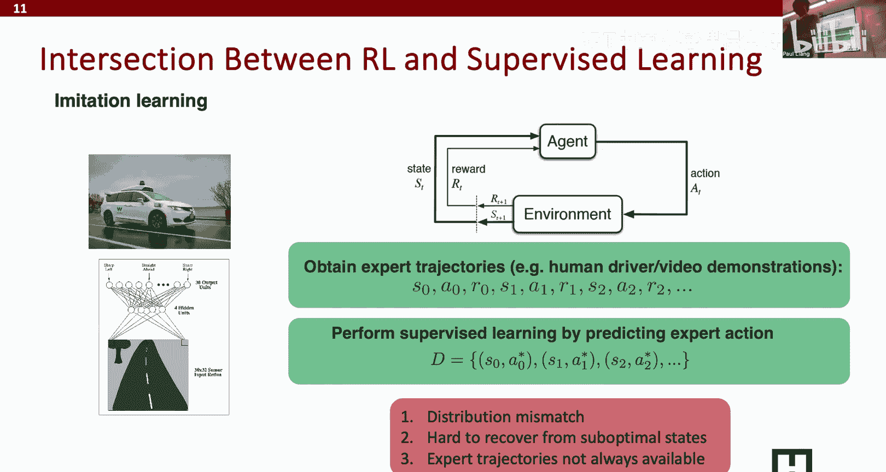

So one general paradigm is what is called model based RL methods。In model based methods。

 you often see these kind of like tree light things that are drawn。 So these trees essentially say。

 I'm going to start from the state。And maybe from this state， there's two possible actions。

And given those two possible actions， there's two possibilities for the next states and maybe each of them has you know plus one reward for the top and minus one reward for the bottom and then again there's two more possible actions to take this case you two more states so this exponentially growing tree of notes being the states。

Edges being the actions and rewards that you observe when you go from one state to the next。

So model based RO at a high level is really just about constructing industry tree and assigning the right values to the nodes industry that represent the long term reward that you will get from each of these nodes。

And in this case， in blue I'm highlighting a policy。

 so this blue basically means on this state here's the action of I mean this state here's the action of so a policy is basically a traversal of this tree。

So again， just quickly in just five minutes， there are several things that you need to learn if you're doing model based RO。

 one is called a state value function。So given each of the states。

 what is the value of it the value means what is the expected long termm reward that I will get if I'm at that state again。

 long term reward is a key not just the immediate reward over here you don't want to just save the state as negative one you want to assign a value to the state accounting for the fact that you could get plus100 in the future。

That's what we call state value functions， We usually annotate that as V of S。And again。

 there's two ways of writing it， one is the value of the state。

As you follow your current policy in this case， the value of this state S1 is that you follow the policy that you currently have from S1。

 you will get minus1 and you get plus10 and so on， so value is 99 So it's accounted for not just the immediate minus1 but also the fact that your policy will get you plus 100 in the future so plus 99 question you mentioned random reward Yes。

 reward defined。So just what I said right so if I'm looking at trying to find a good value for this current state。

 I don't want to just say I'm going to get negative one if I take one action。

 I want to account for the fact that once say go here。

 there's going to be a possibility of plus 100 in the future。So in this case。

 I'm not using any discount factor， so the total value is minus1 plus 100 is。

So it doesn't I will a number of steps， but it needs to be。What is of99で。我只本上还是写。

It doesn't matter the number of steps the modelt is taking， but it needs to be some big number。

I mean， it could be minus 10 minus 20 and then plus 115 Sure， yeah。Yes， so so normally there'll be。

 I mean， there'd be more things that are not drawing and normally there might be a discount sort of show that you know。

Things that are in the future may be less valuable but in this case， if this blue pig is a policy。

Then it's going to get negative one now， you'll get a hundred index next step and you get more。

 So you will say that the total long term value is 99。Okay。

Do are there decay functions that exist like I could imagine， for instance。

 let's say you're making an RL system for a doctor who's doing surgery or you know there are many situations where you might not want。

 even if the outcome is better by waiting a long time or like doing a lot of computation you might want to introduce a decay functions or like reduce even of computation。

Yes， so that's exactly this not factor。So that's everybody is your total return is the reward at the immediate next time step plus gamma times the reward the one step the future and then you kind of gamma squared times the future you can set that usually gamma is something that's like less than 1 like 。

9 or something。So yes， sometimes a discount factor is actually very necessary to make sure some of these methods converge。

Otherwise you just keep going and it's a small reward， you'll keep you trying to search for it。Great。

O。😊，So that's the value of the state following your policy。

 And another key definition is the optimal value of a state over all possible policies that you can take。

And if you were to compute it for again this S1， youll realize that resemble this is already your optimal policy。

 So yes for V star S1 is also 99。Just is a quickly also a very subtle point。

 sometimes people define not just the value of a state， but a value of a state action pair。

 so if I'm in a particular state and I take a particular action。

 then what is the longter value of that state action？So again， some examples。

 if and people label that as Q， so youll see Q S a and you see B of S。 So in this case。

 Q following a policy I starting from S1 and going up is that you see plus one and then you see plus two right So that's plus3。

诶。啊 so。If you go from S1 then you go down， then you see， you know this， this is， you see 99。So。

 that's。That's basically a way of estimating values of states and also actions that you take from that state and likewise you can basically say what is the optimal optimal state action function so in this case you look at this your Q star in in1 and you go up you actually realize that this policy is subopmal。

In fact， you should have gone here and gone there instead。So then that's why your best。

State value function over the best policy is four instead of three。

So a lot of modelb RL is exactly about deriving these QSA and V ofS you know back in the days people use dynamic programming when exploring a tree nowadays people of course use neural networks to approximate Q ofFSA and V ofS but once you derive it。

 the optimal policy can essentially be done by looking at as a tree search problem you're basically going to try to traverse your tree and each time you're going to find the action that maximizes either your VS or maximizes your QSA。

So basically有re search from。Also another point is that these Qs and Vs are interchangeable。

 you have one， you can also derive the other。Great。😡，So， that's。Briefly， model based R， so。

People have seen alphaphago and some of being know chess playing， gameplay。

 they're mostly all modelist， so they have states which are states of the game。

 there's possible actions that you can take and your goal is really to estimate for each of the potential states of the pieces。

 what is the long term reward。RightSo not just， you know。

 did I just take somebody's keys in the immediate step。

 but long term was the likelihood that I will win Alphago essentially just trains no CNNs on these game boards by viewing them as images and training them in a way such as the CNN outputs。

V， the value of the state in the long term。And then once you have， you each of these Vs。

 you can essentially take Arcm locally because your VFS already accounts for a long term reward。

 so now you can take your local arcm， which is just trend troubing your tree。Sa model based on了。

Another paradigm is policy based RL， so policy based RL。

 we're not going to build a tree and we're not going to worry about estimating values of each state each action in policy based RL all I'm going to do is just directly learn a policy and I'm going to view that as essentially some function that it takes in states。

And outputs actions so in this case， this p game， you're stated as image of the game and your action is whether I should move upward or down。

And most of modern， when you think about， we hear R real and others。

 they all go with these like policy based methods。 So we'll cover policy based methods in primarily detail in the lecture。

By before covering policy based methods。I want to highlight look at and this is a big debate。

 where model based methods are better or where the policy based methods are better。

 and here I've listed a long set of pros and cons for each approach。So in model based R。

 you're actually learning a model of the environment。

 you're learning this tree and each possible state action transition。And policy based model。

 you only learn the policy， but you don't care about learning a model of the environment。

And as a result， because auto based RLs learn a model。

 they are much better for planning so you can simulate other potential actions by traversing this tree。

 theyre much more sample efficient。But they come at a cost of being more complex。On the other hand。

 policy based methods， they don't allow you to do planning。

 they don't allow you to they have much higher sample efficiency。

 but the training algorithms are typically much easier to implement。

And there's a lot more strengths and weaknesses， this also covers some example。

 some famous algorithms or model baseRL， and this covers some famous algorithms for policy based RL。

Al right。😊。

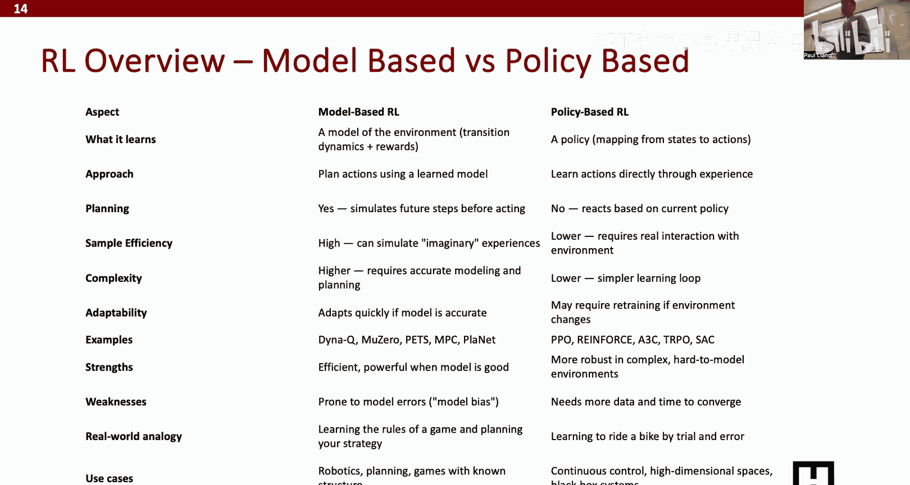

So policy based R So again I'm going to use this motivating example。

 this is like a game of paw so you know you're controlling you're going to control one of these battles against your opponent and your two options is to move up or down to bounce the ping pong ball back towards your opponents side you win a point if you manage get across you lose a point if you manage to。

You you let the ball in on your own side。

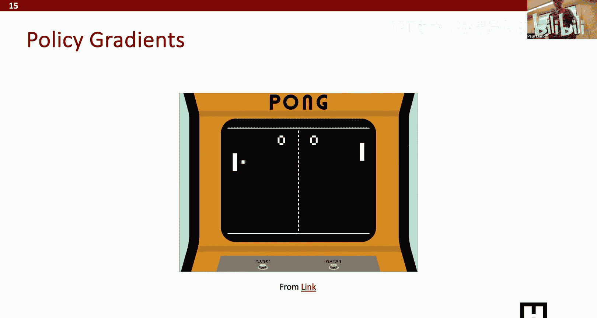

So now the goal is to just train a model that takes in this state。

 which is the screenshot of a game and output just two things， whether you move up or down。

 so it's a binary classification problem。And your goal is to essentially train this model。

 So how do you train this model？

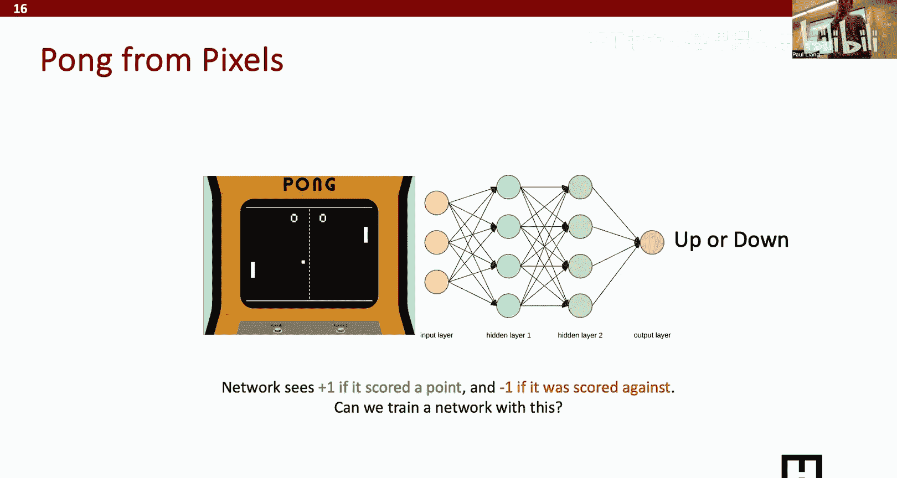

So first suppose you have labels， so let's say somebody for example。

 follow human experts and these human experts showed you at every stage when the human did did they move up or down so this is expert labels expert trajectories。

And then what you will do is your typically just classes a supervised learning problem right as comes in and your labels either up or down and you maximize your log properties so log probability moving up when you actually moved up and maximize log value moving down when the label was down。

 so that's basically your cost entrytropys。That's what you would do if there were stables。

Well of course， you don't have labels or labels are expensive。

So what policy based methods will do is that you will first。

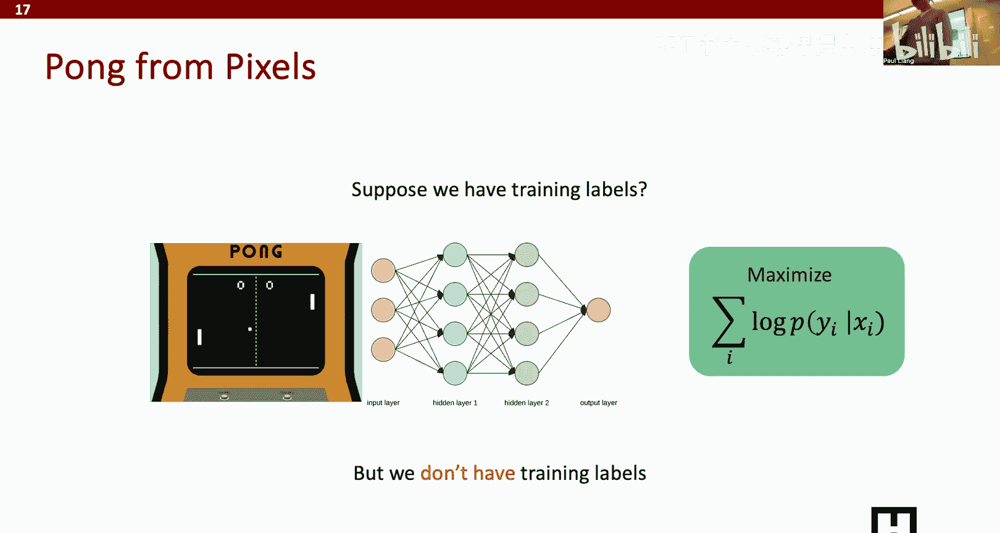

Have a policy。 So policy is just a way of saying， I have some states and I take some actions。

 and I'm going to just。P this policy up， so maybe in the first run， your policy set up， up， down。

 down and your second run， you had sample something else and your third run。

 you again sample something else。 So these are just ways of your model acting based on your current policy。

And let's say you run this in your game and you realize that in your first sequence of action。

 so your first。

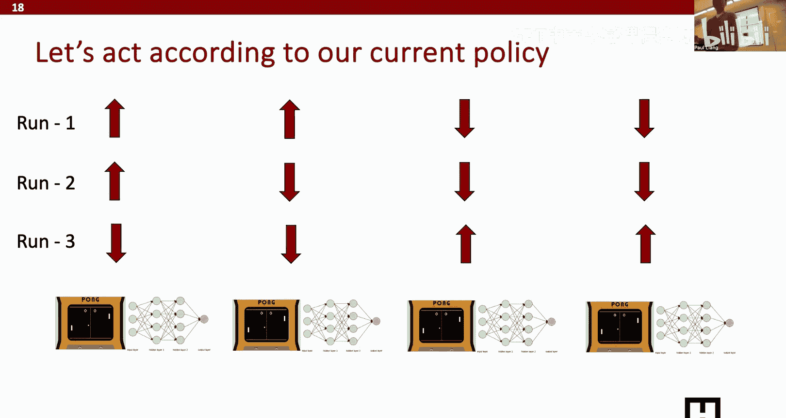

For example from your policy you want， so you're very lucky that you want。

 and then in your second and third runs， you weren't lucky and you lost。Okay， so you can。

 you can basically observe whether you want a loss by whether a point went to you or the point when against you。

So what you would then do is that you will basically treat the sequences in which you won。

 I know it was five by luck probably you won， but treat that as you know good examples。

 so I would want to maximize each of the actions in the sequence that let you with。

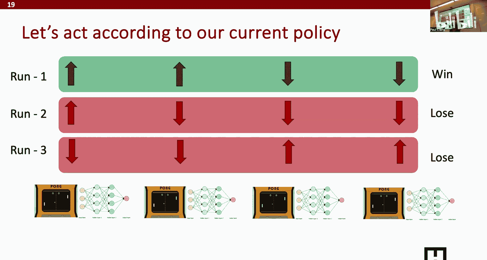

And you will also treat the sequence of actions that let you losing。

 you were unlucky and therefore as bad examples， So I'm going to penalize each of the actions in the sequences that led to you losing。

So what does that look like basically maximize lot probabilities of each of the actions when you want and maximize negative one？

Times each of the log propertiesbabil of the four actions in which you lost。So in general。

 you can think of as a general objective function that maximizes some over each of the actions。

 the reward RI， whether that is plus one or negative one in this case。

 and a lot of properties of each of the actions in that sequence。

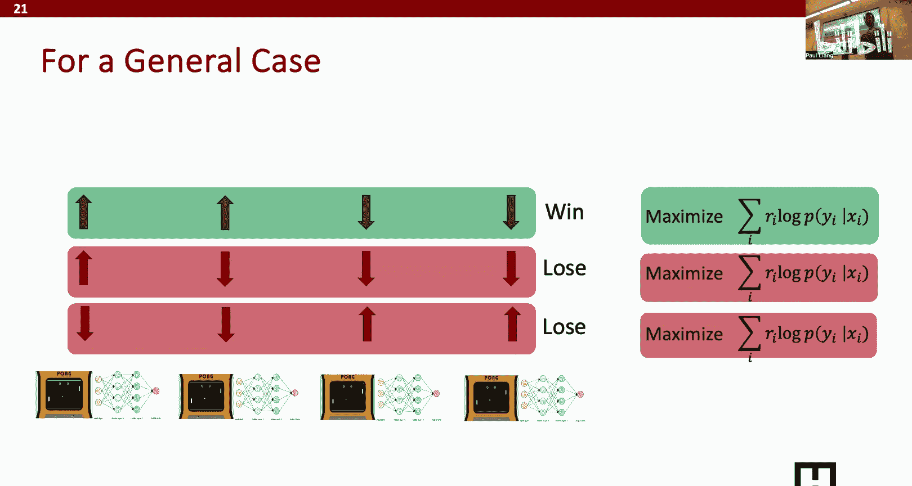

So in fact， that explains policy based R， it's as simple as that。

This very first algorithm that came out back in the days， so it's called reinforce algorithm。

You will basically， you know， start with some policy pi of a given S， you know。

 assume it's defable so it can be a neural network。You will initialized the parameters randomly。

And you just loop forever， use that policy to generate episode， So take actions from your state。

 So in Pg， it was you know moving up and down， there was one episode and you saw some rewards and you move up and down again。

 you saw some other rewards and so on。啊fo your policy。And then for each type of the episode。

 I'm just going to maximize this function， So again。

 this function was just G is your reward in that sequence so add up each of the rewards as given by this equation。

 and then this is your gradient of your log properties of the action given those sequences。

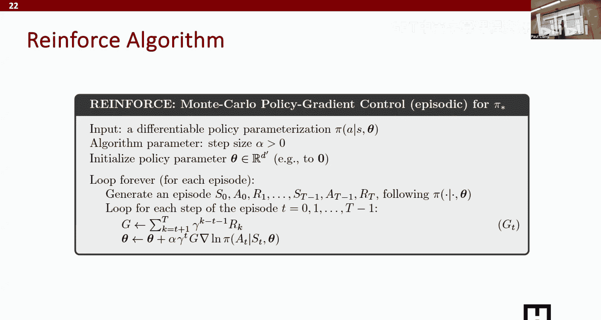

So exactly exactly this equation， except now your reward is just。

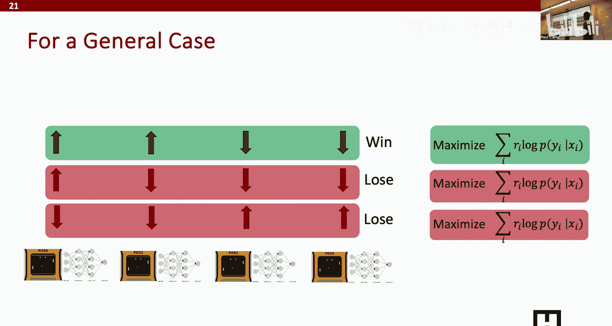

Add it over each of the sets。And you also realize that you know that the dima here is a discounting factor that you mentioned。

 so you should kind of penalize good rewards in the future and prefer to have them now。

But' that's all policy gradient in this， so sampling different actions your policy。

 seeing what the rewards are and either pushing up or pushing down the actions based on whether rewards are positive or negative。

This point over here， following your policy， I should also note that epsilon really is something that is super important。

 so what does epsilon3 mean。Basically， when you start when you initialize your policy。

 your policy is going to be very bad or it's basically going to give you random actions。

So that means you shouldn't always follow your policy to take actions。

 and instead you should sometimes just take random actions， so you call that exploration。

Take random actions regardless of your policy。So usually with epsilon probability。

 you will just take some random action。And then as you slowly start training your model you push up the probabilities of good actions and you push down the probabil of bad actions now your policy gets better right so once your policy gets better。

 you will slowly start to prefer something from your policy and not sample too much from random policies so basically this epsilon will start not really high and your epsilon will slowly get smaller。

So you call that the exploration， so sampling random things and exploitation。

 So following what your policy tells you。Okay， so that's basically policy agreements。Okay。

 maximizing reward scaled by the lot of probabilities， the law of probability is scaled by rewards。

 so your reward is positive， increase the probabilities of the actions， reward is negative。

 decrease the probabilities of your actions。This is the vanilla policy gradient。

 there's been a lot of improvements over the years because these are several issues。

 one is that it has very high variance。Why is I say a very high variance is that usually the raw reward itself might not be very meaningful right sometimes I have games where you always get positive reward。

 you just want to get more positive and less positive sometimes you have games that are an always negative reward and you just want to stay closer to zero so sometimes the raw reward is not very meaningful。

And what is important thenice how the reward changes over time as compared to the rolling average of the rewards。

So a big big innovation or a big trick to improve performance is to compare the rewards to a baseline。

And use a relative improvement。 So now that's a new function biggest inference is that is reward。

Of your trajectory sequence of action， you subtract the baseline。

And baseline can be something like exponential moving average of the rewards。Okay。

 so subtracting baseline substantially improves the stability of policy based methods。No。Of course。

 E also explored much better baselines and therefore this ac method was developed。

A better baseline basically combines your policy based methods with your model based methods。

Imagine recall that we find Q and B right so V was a VOS so how good a status is measured by the long term rewards from that state and Q was QSA so how good the state of action pair by looking at the long term rewards from that state in action。

So in fact， the difference between QSA and B ofS， we usually call that A of SA where a stands for the advantage function。

 an advantage basically means what is the advantage of taking a particular action from that state。

 and again， this advantage is measured in terms of not just the immediate reward but in terms on the long term expected rewards。

So。If this AFSA is very big， that means we are very happy with this action because it gives us much better long term reward。

 if AFSA is small or negative， we're very unhappy with the action because it gives us negative long term reward。

So。That gives to this new estimator by essentially again。

 maximizing log probabilities of the actions in your sequence but now scaled by disadvantage function。

 so how much better Q of SA is as compared to the baseline DO。So we call those a critic methods。

 this was know extremely popular I it kicksstar a lot of deep reinforce learning research 2016 to 202020 and in this case you have to learn two models because as you mentioned here。

 first you get a model to learn a policy so what actions I you take from a sequence。

 but I also need models learn these Q and D functions like this is the model based RL and the tree that I was showing。

So these actic models exactly maintain two models。One is the actor model。

 the after model learns of policy， so state comes in。

 the actor learns a distribution of actions over given regular your state so that's your policy or your actor and at the same time the other model is what we call a critic so the critic essentially learns in this case Q of aA it learns to criticize and evaluate the value of state and actions that the model see。

So when these two functions are basically trained together using different objectives。

 the critic evaluates how good a baseline action is。I'm not going to cover too much of it this。

 you know， if people have seen Q learning before or DQN before。

 that's basically how these model based methods were you know approximated with deep learning。

And the actor， which decides what the policy is， is it again your policy gradient function。

 do lot of probabilities scale by your advantage function。还在去发些创试。All right。😊。

I know this might be more content than usual lectures， but any questions so far？ok。

So almost there are the exciting parts， which is about how these Ral methods have intersected with LLMs。

But before that， several other small improvements， one of them is called proximal policy optimization。

 so everything before was kind of policy gradients， policy optimization。

 and then this came this new method called proximal policy optimization。

And there were several new methods within this space。

 one of them is called trust region policy optimization and the biggest difference is that you were still going to do policy gradients。

 youre still going to maximize a lot of probabilities。

 but now the biggest difference is that you are trying to make sure that your policy doesn't change too much over time and measuring that you know you shouldn't change too much by limiting a KL divergence you create the new policy after the gradient update and the old policy before the gradient update。

So if there's a current point， you want to make sure your proposed point is very close inside and similarly this visually thiss your actions and your policy you don't want to like go too different from what it previously was。

So that's trust region policy optimization in 2015。

 and then proximal policy optimization was a further approximation of that by saying you don't actually need to formally measure the k divergence between your two policy distributions old and new but now I'm just going to clip it clip the gradient。

 so whatever the policy gradient was the log probabilities is clipped within a certain range。

So this is the equation in your in， this is the ratio between your new policy by your ANS and the old policy pi old A givenS。

 and you're going to kind of clip this region between one minus epsilon and one plus epsilon so click that ratio so you're within kind of an epsilon ball each time you update your model。

And PPO essentially is the RO method that people use in RO for human feedback that is kind of used to align these otherMs today。

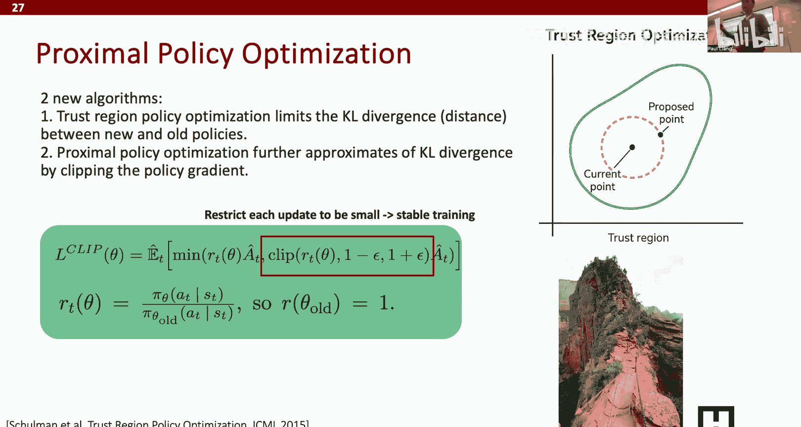

And briefly how these methods work is that。step zero。

 you will first pretrain your and then you will do supervised fine tuning So whatever you on pre training just not taking on your internet text。

 predicting one word after the other and supervised fine tuning sometimes we also a call instruction tuning collects human written demonstrations of questions and answers and does next token prediction on those questions and answers。

 So you all have seen this。And then step one， now this is when the the RL based alignment comes in。

So for each point， you're going to treat other of them as a policy。

 so policy is outputting actions given states， which I say now it's outputting sequences of words。

 given states which are your prompts and the previous words that you've generated so you can view other of them as a policy。

And you will sample multiple responses from the model。 So this could be one response。

 another response， another response， same as what we saw for the ping pong game。And in step two。

 you had humans rank these outputs by quality， so that was where the human feedback came in。

But of course you cannot rely always on humans labeling the responses right that will not generalize outside of the lab。

 so now you will then train a reward model which basically predicts and tries to mimic human preferences。

So now you can label any other response that even though it's not labeled by a human could be labeled by the reward model。

 so youll get some rewards same thing as the ping pong game he says now it's a bit more complex than just plus one and minus one。

One sort of thing is that these reward models create human preferences， given full model responses。

 given full completions of the dialogue with a human。And then step four。

 you're using RL and we started with PPO， the first algorithm they use was exactly PPO。

 this proximal policy optimization to find tune need other lenss to maximize these reward。And again。

 maximizing this reward basically means taking the reward。

 multiplying by the law probilities of the actions in that sequence。

So a bit more detail first human ranking and reward model。

 so that would be your prompts come in you have a language model that generate some text and humans will score each of the sentences whether they liked it or not and then once these humans scored。

 you will train on the inputs and what humans scored as reward and you train that using supervisorvis earn to get a reward model do you recover what the human rewards are given ground truth human labels。

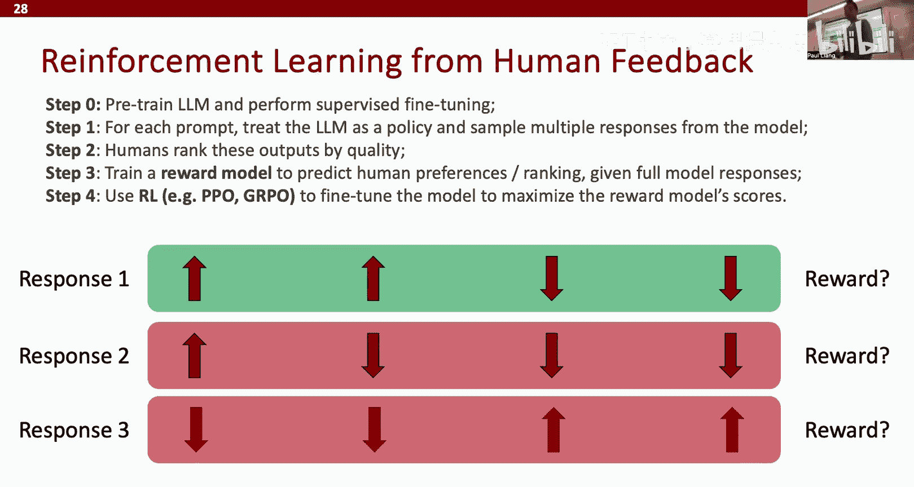

And of course， know David mentioned this in the lens。

 it's harder to assign objective rewards like8 or 1。

2 to just a dialogue it's usually easier to compare one versus the other like that humans prefer this over this。

And therefore you see some of these papers， you often have this kind of thing。

 which is basically a way of measuring the likelihood that one output was preferred over the other as a function of the actual rewards for each of the the two sites。

 so basically a way of relating comparative rewards with absolute rewards。But yes。

 all of this is just ways of having getting humans to rank and learning a reward model。

And then in PPO what happens is that so what you have so far， you have your actor model。

 which is your policy， that's your large language model。

 states are the prompt and what that model is generated so far。

 actions are next words they will generate。It would have this reward model that we just saw so that has been already trained and frozen from humans rating these responses and now it will just recreate and re predict these human preferences as a scalar reward again these are on top of your full model responses sort of full dialogue。

And a third component is this value model， so this value model is the same as the credit model that we saw so this is also going to be trained is going to be a critic model that essentially takes in the estimates view ofs the value of states。

 so states in this case are just model responses， both partial and full model responses sequence of words and your predictor scaleary。

So this almost this exactly the same as your active critic model right there is some actor model that is generating actions。

 in this case words， and there is a critic model that is assessing the values of words that you generate from each state。

So how do you then apply RL with they say， so you will start by well first generating responses。

 the other lamb will produce multiple responses for each prompt。

You will run your reward model to assign rewards to each of the output responses。

And you will compute your advantage。Exactly like in a credit。

 you will compute your advantage function over here， your policy， your language model。

 given the prompt and the policy you generate some outputs。

The outputs will be going through a reward model to your are and also give you a value model which gets kind of the baseline。

His advantage is basically how much your reward is better than the baseline。That you would expect。

So that's exactly the advantage function and you want to interpret that as you know how we're generating a specific word outperform does seal。

The average word that you were generate， given that standard of previous words。

So this gives you your a function and this a function would be the term that you use in your policy gradient to update your policy model。

 which is your other one。And another sort of thing is that you would also after optimizing your policy。

 you also update your value function。 So you were trying to train a better value model。

 and you want to think of this value model as again， assessing。Goodness of an average work。

So it seems complicated， right， seems pretty complicated and that was。

Perhaps the biggest advantage of GBO， it simplifies this by a lot。

So you see previously you had policy model you have reference model reward model and again。

 blue blue is frozen I forgot to mention blue is frozen， yellow is trained， so it had policy model。

 which is LLM， it had your value model， which estimates the average。How good the average word was。

 you had the reward model， which was how good this new word is and you will compare the reward new word with the average value of a word value of a reference model so that's LM at the previous end and you have this KL penalty to make sure it didn't change too much right remember in promal policy optimization your KL has to make sure your policy doesn't change too much So it's very complicated and then GRPO came by and said a couple of things well first we're going to remove the value model。

We're not going to have a value model that tracks the goodness of an average word and we're not going to try to learn that and instead I'm just going to sample for my policy a group of responses。

Each of them I score reward， and my advantage is basically just estimated by the how good this reward was compared to the other rewards in the group。

Okay， so you don't need a value model to to， you know。

 as a baseline to measure the average or the of a word， if you sample enough groups of responses。

 then just the rewards within those group already allows you to compute what the average was and therefore how much your reward was better than that average。

So yes， getting rid of that value model， something that you don't have to train。

 get rid of it makes things and makes life a lot easier。

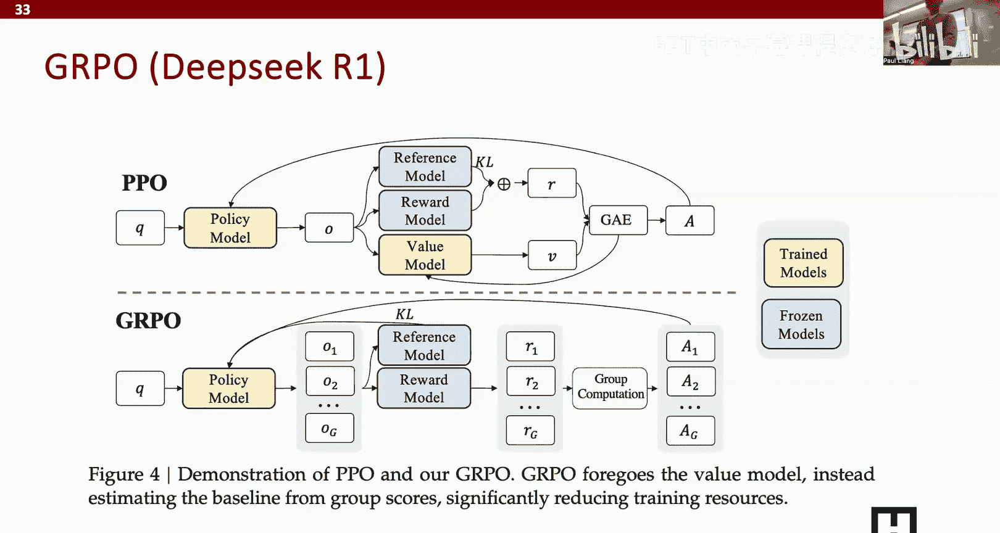

And you can see here， this is basically how your're。

Very that's the big thing just the DRT PPO objective with your KL。

 but a simple thing here is just this advantage function。

 the advantage is just the reward minus the mean of the G rewards in the group divided by the standard deviation of the G rewards in the group。

啊。So yes， he differences group of responses used to compute the advantage and integrated updates。

 you are getting rid of the learn value function and just making it much simpler as a statistic of the rewards over a without learning it to basic statistics and mean and then some further further innovations came by with a even abandon the reward model so you don't have to train a complex reward model。

You know， copying human preferences and just use some simple group based verifiers like binary checks if your code runs or how many test cases does your code pass or how long your response was or whether your response follows a certain format。

So as can see a lot of。Innovations are as a result of simplification。

Rather than much more complicated or advanced algorithms。

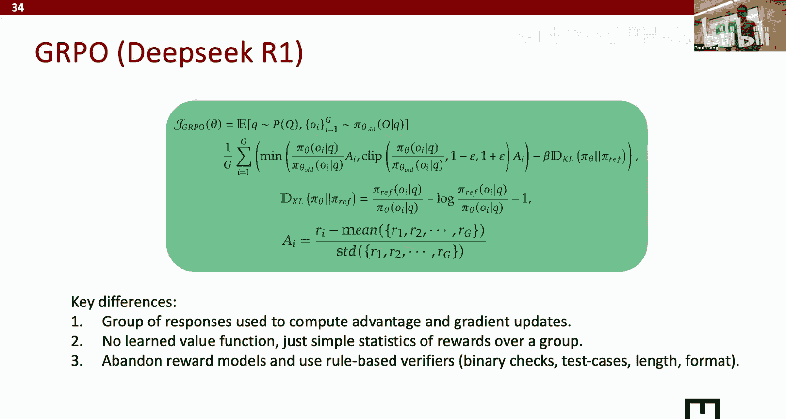

啊。Great。And， and here was just， you know， some。I look at some blog posts。

And I think a lot of people went a lot of RL people。

 so right now a lot of people who use it to RL for robotics and DRL are now all investigating RL for E and a lot of people in RL community are thinking GRPO simplified PPO so much and it's surprising that people have never tried this。

So this is a treat that somebody said the reason why no one has tried to your RPO before this。

 well we have it reinforced remember reinforce is the very first algorithm we talked about right and reinforce you update a policy by subtracting the baseline which is typically an average reward from several trajectories right your your exponential moving average of the reward that you've seen so far。

And this helps to reduce variability in fact theory shows that the ideal baseline is a total expected future reward from your state often called the value so your V ofS。

Totler expected reward for a state and using a value function as a baseline is known as active critic approach。

 so you have the actor which learns a policy and the critic which learns V ofS and uses that as a baseline and PPO is a stable version of that。

Now， in traditional reinforce， the baseline can be any function of the current state and traditionally it's just the reward of the trajectories。

 the average of that in a single batch。And of course。

 in GRPO it based on its computer over a thousand samples generated for each prompt， which is。

Novel so very much going， you know， even before active predict， you know。

 before the learn value function to just a simple rolling average statistic of rewards for multiple prompts that you sampled。

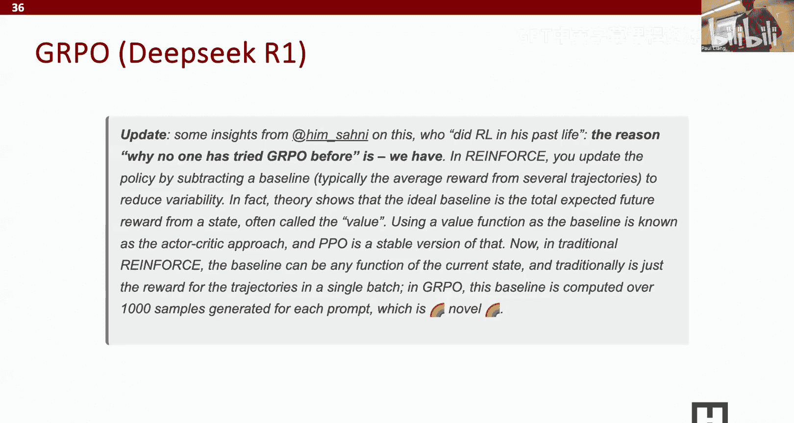

Great。Well， last two things。DPO is also something that people might have seen。Again。

 a variant on PPO which is your policy optimization。

 so this box here is PPO right remember you have preference data。

 you have prompts X and you had rankings， whether you know human thought one thing was better than the other。

 you would train a reward model to reflect your human ratings and once you have reward model you will use that using your policy gradient to obtain and update your policy model so that's PPO。

DPO is this line over here， which basically starts again with the same preference data skips training a reward model and skip PPO are literally just us kind of。

Training on the preference data using supervisorying。

 like supervise prediction on top of the preference data。Well。

 probably it's not right to say that it was supervised。

 they kind of doing reinforcement learning on top of this preference item。

I won't get into too much details， but there are some key differences。

So DPO is much more efficient on the compute because it doesn't have to train a separate reward model and do R using the reward model。

So it's much more efficient in terms of compute， speed and less engineering。

It doesn't have your kind reward model。And during training， have to decode online responses。

 which is usually what is slow。And PPO instead has to train on online data。

 so it's always training on the responses that you just collected and while DO trains on this pregen offline data So point being this is still kind of argument between the communities。

TPO can be seen as online reinforce and DPO can be seen as offline reinforce。

And there's kind of two differences in what's happening。

 I think a simple analogy you look at it is that let's say you want to train a policy on a self-driving car okay so you're going to deploy it on your car and as you drive your car you're going collect more data。

 you're going to see the rewards of how good you're driving and you're going update your model based on what you're actually experiencing online in the world。

So that's online RL and offline RL is more about you know you've seen kind of videos of other people driving cars and different scenarios not the one that you're actually driving in your life but trying to learn from offline data。

And people kind of argue between whether online is better or offline is better。

 but the biggest difference between PPO and DO is that one is doing online R and one is doing offline R。

But a big appeal again of DPO is that it's much more simple and it skips a lot of additional steps。

That will previously needed it。

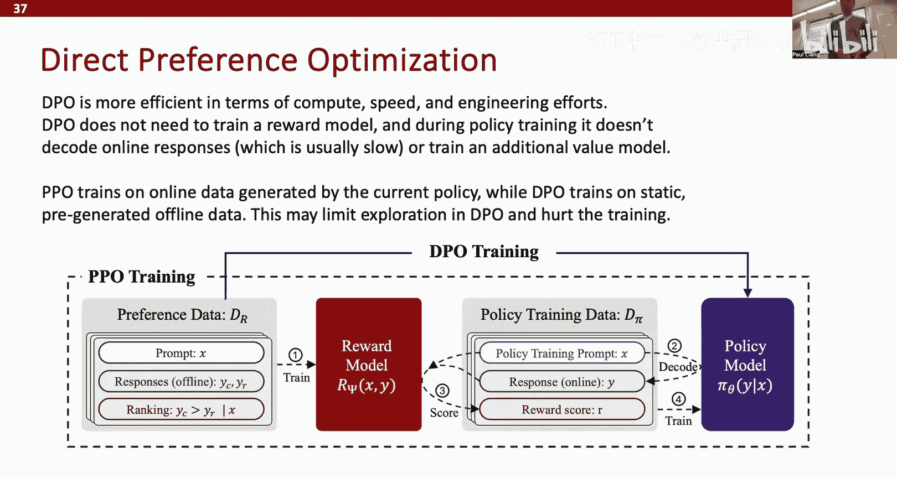

All right， we're almost out of time， so let me wrap up several tips and training tricks for reinforcement learning。

Oftentimes it is always good to sanity check with。Fixed policies。

 so randomly initialize policies or policies that you have initialized from human expert demonstrations。

Because one of the biggest challenges in our world is the fact that you are learning policies while the rewards themselves and the environments themselves are also changing。

Usually it's good to monitor pay divergence， especially in algorithms where you're trying to enforce that your pay doesn't change too much and policies doesn't change too much。

 so making sure that that is smooth。Starting entropy over time entropy is just how high variance your actions are。

 so you want your actions to start off as high variance because you want to explore and eventually you want your actions to be much more close to just taking one action so the exploration at the beginning by exploiting good actions afterwards。

Use greedy rollouts for evaluation or debug value function separately。

Usually in a critic like approaches it's difficult because you're training two models your actor is your policy and your critic learns the value and you're training them kind of in opposition with each other so just that you know gangs were hard to train these after critic models are also quite hard to train so sometimes it's useful to kind of train one and freeze the other and vice versa。

Nowadays， gradient norm clipping is also crucial。Check advantage distribution so if your advantage functions are learned well。

 they should almost always be like mean zero and variance one right because you're essentially subtracting a baseline。

The mean， the rolling mean and dividing by the variance。

 so it should always follow a non scarce distribution that helps training。T on frozen replay buffer。

 use curriculum learning and wash for remote collapse。Chna wrote these 10 things great Okay。

 that's all for the lecture so please you know come by and chat with myself in the Ts later after class and let us know how the final projects are going I will see everybody in class is Thursday for the presentations and willll put up the schedule tonight thanks everyone。

interested， why don't we have like what are the limitations of going to online learning for support let say platforms like had。

 why don't we enrich learning？

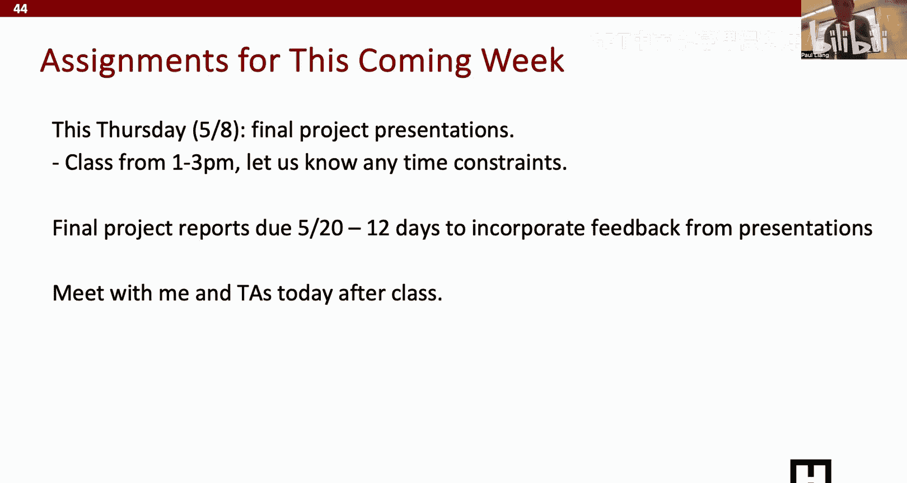