# 《如何AI所有事情｜MAS.S60 How to AI (Almost) Anything》中英字幕（Claude-4-s翻译） p12 [12]Lecture 11 – Human-AI Interaction.zh_en [BV1UhawzQErD_p12]

嗯。嗯。All right， folks。播放吧。Last lecture of the semester。

So today I'll probably be talking about some recent directions that I think are becoming increasingly important。

 I think will pose a lot more open questions and answers but before that we might to submit you a final projects by next Tuesday myself and the Ts will be at our office space today after class and also in Thursday during class and after class there's no class this Thursday but you know during that time period will be over there so let us know if you need any feedback on your final reports or if folks some folks are submit to Europe saying you want some feedback Step just come by and I'd be happy to give any feedback would also love all feedback on the course it's the first time we're starting this course are a lot of great things thats definitely rooms for improvement so please be candid about the feedback and give us feedback through the course evaluations or you can just tell me in person as well。

Let us also know if you'd like to be a TA in the future and shape future versions of this course I'm hoping for this to be a earlier occurrence maybe every fall or every spring there's definitely lot more things that we could do got some feedback that you know like how to make has periodic weekly assignments that are much more smaller much more focused how can we do the same to teach somebody about AI having some small deliverable every week is that something the Ts could perhaps shape and guide the students through so please let me know feedback on the course and let me know if you want to be a TA and incorporate that feedback in the future versions。

For today's lecture。Last week， we talked about reasoning。

Specificallyific reinforcement learning gave introduction to all these policy gradient optimization methods went to PPO。

 DPO GRPO and that's been a lot of foundations for modern reasoning and of course most of that was in just language only space I'll cover some recent interesting directions and multimodal reasoning over language and more modalities will use reasoning as a segue to discuss some interesting directions in AI agents。

Systems that use reasoning and do step by step actions and solve increasingly complex tasks we talked about agents performing autonomously and interacting with the world。

 how do you also get them to interact with humans in the loop so covering some some new directions of human eye interaction and finally you'll cover some work and understanding ethics and safety of all these like modern advanced systems that we're looking at。

So firstly multimodal reasoning I personally think the next generation of AI models will be very capable and we have to all work towards making it more capable of doing multimodal reasoning so what does that entail it will be models that take in increasingly more inform modalities from language to video audio sensory medical data you name it learning multimodal representations from very different inputs。

Of a lot of ways in the class offer different ways of usinging and combining these representations to learn multi model representations。

And then you should also be able to reason， reason by decomposing difficult problems into multiple steps。

 some of which involve language step by step reasoning。

 some might involve highlighting visual evidence， auditory evidence。

 and maybe evidence in other modalities and doing this over multiple times until it solves your problem。

And of course， there's to be also humans in loop， humans have to be able to understand every step they might be able to intervene and ask follow up questions。

 Some of these are actions that might also affect humans， but anyway that must be humans in a loop。

So I think this is a general schematic for I don't even call this AGI， right。

 this is multimodal inputs being able to break things down into multiple steps。

 multimodal outputs and interaction with humans。So what do I think are the main challenges in terms of modeling architecture？

We cover you know isolated topics in multimodal fusion and multimodal generation right fusion is a problem of making different data modalities and learning their correspondences and how these really represented as features and generations because with multimodal inputs we want the model to be able to do multimodal step by step reasoning so that might involve generating more tests。

 generating more video generating more audio and Chinaika gave a lecture on know generative models that are increasingly being scaled to more and more modalities。

So on the modeling side us we work in multicommodal， fusion and generation。

On the data side we increasingly harder challenges for reasoning。

 especially those involving multimodal reasoning， and ideally these benchmarks also come with human reasoning steps humans who break these problems down and solve them step by step sore our group build a lot of these benchmarks and challenges。

On a training side， if you have， for example， good human reasoning traces then we've seen in the class you could do supervised fine tuning on these reasoning steps as a good way to initialize the model to do reasoning。

But of course that is not sufficient because it's very hard to get a lot of large scale data human reasoning and we saw last week in reinforcement learning how you could just train for your final objective and have the reasoning emerge。

 have the individual actions emerge using things like your policy gradients and your PPO methods。

And finally， on the human side， of course， because we want these systems to be interacting with people。

 so people might give inputs， they have these inputs that will be a way of controlling the model。

 and likewise when these models are giving outputs。

 they must be outputting something that is robust and trustworthy and safe if it's affecting human lives。

Well these are， in my opinion， the main challenges for the next couple years of AI research。

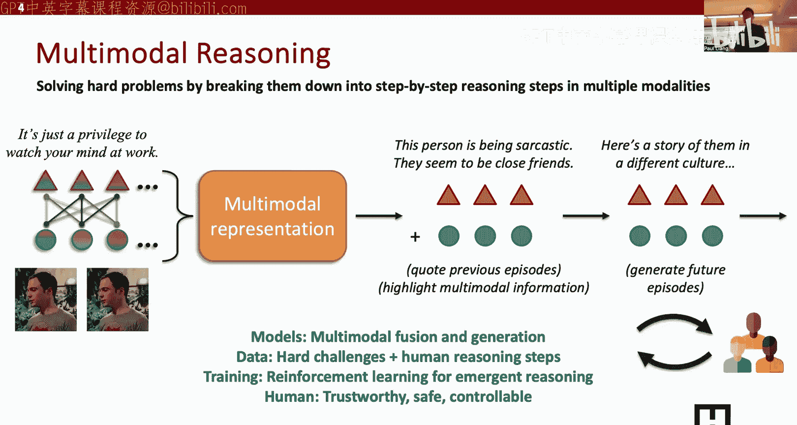

So of course， in this class， as's also a review of what we've seen so far。

 we've seen ways of using foundation models to learn these multimodal representations， transformers。

 large scale pretrain， and also supervise instruction fine tuning。

So that was what we saw a lot and then we also saw ways of how you can adapt。

These multimodal representations into pretraining L lamps so that these other lamps can generate text while conditioned or understanding these multimodal representations。

 So that was all the work that we saw on adapting other lamps for multimodal generation。

We also saw examples of enabling text and image generation。

 so you might want to generate some reasoning while also generating the visual explanations or highlight parts of the image or other forms of data that a model use when making that prediction so that's enabling text and image generation。

And in terms of the power we interacting with humans。

That's what I'll be covering primarily today on some working in human AI interaction。

So the first start， let me give just a shameless plug on one of our recent works that I feel embody some of this multimodal input。

 reasoning， multimodal output and interacting with humans。

 so this is work done by some of my students。The modalities here are bridge and language and the context is reasoning for education so if you look at many math problems。

 for example， you try to solve a geometry problem， you have these shapes and it's often useful to draw extra lines or annotations on these images to help students understand what's going on if you have this circle for example you want to annotate that some lines are of the same distance some of these are right angles 45 degree angles pretty natural students you kind of annotate a sketch。

So the hope is that visual reasoning。In both language and vision can help students understand abstract subjects like geometry。

And then the goal was to use this idea to try to build some intelligent tutoring system which is able to help students learn about these abstract topics。

 but of course most tutoring systems are textbased it might prompt something that HGBT is give you mostly textbased explanations of topics。

 sometimes they even just reveal the answer without even actually guiding you through the thinking process。

 so the goal was to kind of integrate these AI driven multimodal interactive methods to improve learning not just to give students the answer。

 but to help students figure the answer out by themselves。

So this method that we develop is called interactive sketchketpad interactive because it's not reviewing the answer。

 but it's guiding the students along and through multiple steps of interaction。

 the students should figure out how to solve the problem and sketchketpad describes this long history of methods which involve some common platform in which different people or people and intelligent systems are drawing and sketching and iterating on ideas。

 so we instead call it interactive sketcht padd。

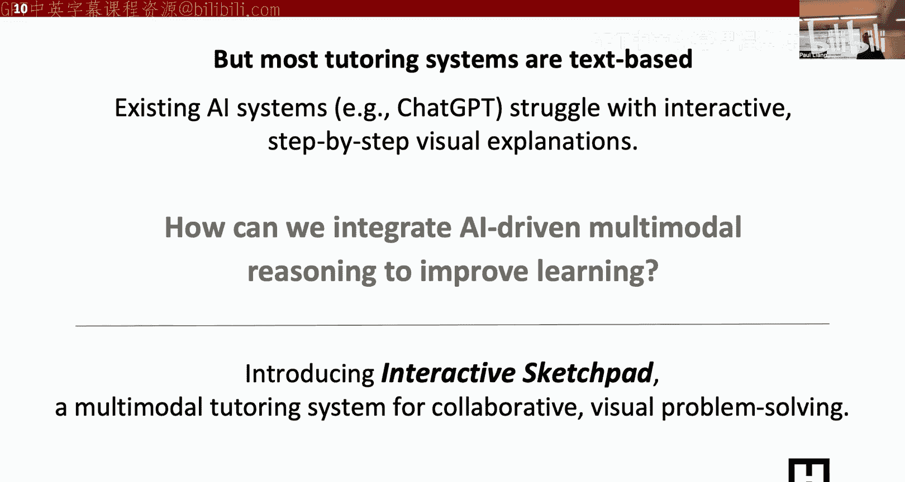

So as a short video demo。This is some maybe some problem that a student is given。

 so some geometry problem and you have to find some angles and maybe distances and the students maybe they don't know how to solve this problem。

 so they're stuck。So this is the AI chatbot that's outputting things for the students。

 and this is the iterative whiteboard， interactive whiteboard that students will be playing along with these systems。

So it might be stuck at the beginning， so these models will first try to think about providing some hint。

I's not going to get the final answer， but okay give some hint， for example。

 you might say that drawing something pretty particular lines is important。

 kind of hit some points on the circle is important and let's visualizes using a diagram so then it's going to start writing code in this case map followed code which actually allows this diagram to be drawn pretty accurately because this is map solid code and it knows auto the coordinates。

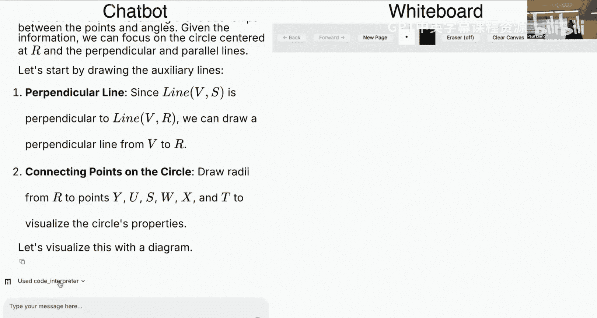

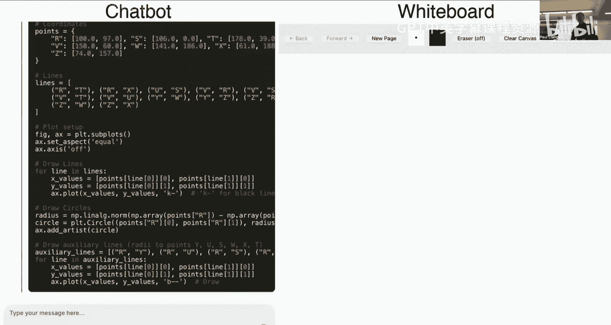

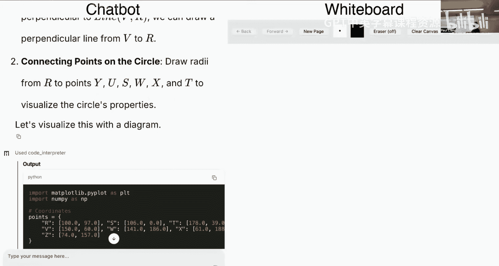

So theres a diagram that is generated with some of these extra lines and annotations that is meant to help the student and now a student turn student taking that feedback it starts now the student starts drawing and figuring things out and maybe at some point the student gets stuck again so then it send this figure with the annotations again back to the model。

And then a model would further provide some hints， for example， some theorems。

 some triangle properties， and those are languages and at some point your student is able to use that to solve the problem。

嗯。Yes， so exactly how this system worked。It's not particularly novel from an AI perspective but it's about mostly putting some of these things together so you have some problem you first have some model to determine whether a drawing is helpful so things like geometry calculus。

 some of this integral physics these are force math diagrams these are examples where figures are helpful so some component figures out where the drawings are helpful。

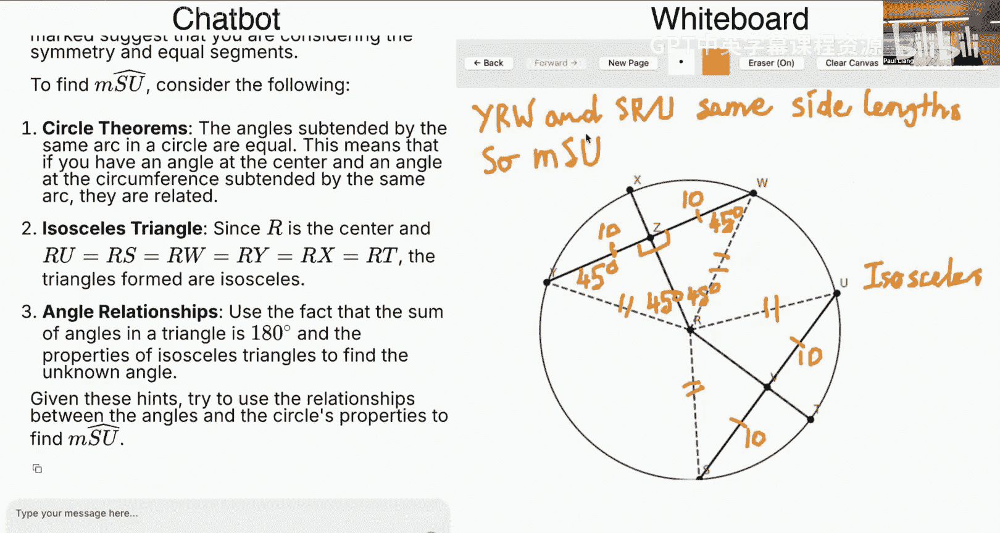

When it does figure out the drawings are helpful it's going to generate code as a medium to generate these drawings。

 we doing a couple of times between whether you should generate code and the code is executed to get the drawings or whether you should just use you know。

cur degenative model like a text to image diffusion model。

 we generate these drawings pixel by pixel and of course you get a trade off code is much more restrictive but you guarantee that it's going to draw things in the right place with the right distances the right angles and then using a purely geneative model is much more flexible but you no longer have guarantees that it is's going to draw the things in the right place。

So in this case， we're using code， which goes into an interpreter。At the same time。

 you also provide textual hint to this instant language and its envision。

And together these are visualized on this whiteboard。

 drawing things and explaining things to students， and then a user might further annotate more of their stuff。

 you know， do their workings and theyll be used as context to the next iteration of this model。

Some cool results， so first you have to check whether this model itself is able to solve these math problems and there's been some recent interesting work on visual sketchpad visual channel thought these are again AI only models there's no students involved so it's AI only models that's breaking things down into language and vision and claiming that helps solve difficult problems。

So our method improves upon some of those， particularly because some of these previous visual chain thought methods。

 a lot of things were hard coded。And therefore， our was more general and it was able to solve some of the limitations from hard coding。

 some of these visuals。And of course， the other cool thing was that you know why she deployed this with students in this case study somebody your feedback so the graphs are good sanity check to my workings。

It was nice that it didn't give me the final answer right away。

 but instead gave hint and prompts to try， which is a big advantage over existing AI methods to solve the problem for you and also other people who really enjoyed the learning experience showing that the graphs and diagrams were super intuitive for their workings。

Okay so just as a quick case study but you know I feel like a lot of future work in AI and HI will be on this form where there's increasingly complex ways of dealing with different modalities。

 there's increasingly new ways of breaking things down step by step there's multimodal outputs and language and vision which are very intuitive forms for human understanding and of course the goal here is to help students learn better so there's going to be some humans in a loop。

嗯。Another case study of things that we've been recently very interested in are these interactive agents。

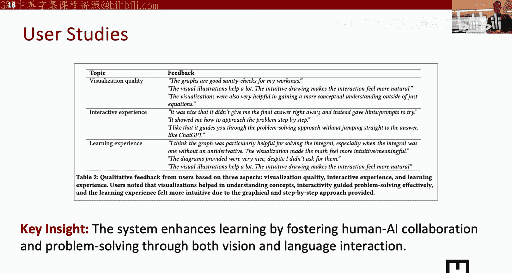

And these are agents that help us in our productivity， help us do things。

 so your task might be for example。Purchase a set of earphones with some amount stars。

 amount ratings and this kind of like an offline version of Amazon。 So nowadays， of course。

 we have increasingly powerful AI agents that are able to take in these complex instructions。

Break them down into step by step， so you first go to the search bar， type earphone。

 and then you will sort by your ratings， and then you maybe sort by your previous preferences。

 check out， enter your shipping information and ship it to you。

And it's probably going to be a case that these agents are going to be on websites or databases。

 PowerPoint， spreadsheets。Phone operating systems， other database operating systems in the future。

 and you'll be able to automate almost any task that you give in actual language。啊。

Of course these cannot operate purely autonomously， they should understand instructions。

 you should be able to figure out when they get stuck。

 ask clarification questions and humans should give feedback intervene when these models get stuck so of course。

 a group with humans is super important。Yeah。😊，So I looked into this area a little bit further。

 So there are different levels of control， right， So the arena or browser or sort of what the browser use they are controlling the browsers。

 there's the O level。 So I think there are some companies that are trying to control the whole。

 So what do you think about the challenges or the directions of the future of the research in this area。

Great question。So I don't know what's necessarily the best platform I think there' a lot of things that you have to balance so webbrina and video webbrina stuff that we did it was mostly about just imagining like how a human doesn't like all the access that it has it just like what humans have so you have to tell the agent to maybe click this or to scroll or to type into the search bar these are like how humans would interact with with this frontend website and then yes you're saying that there's other approaches which are more operating system so they have access to the HTML tree or if even an X in your backend and they're not seeing things like how humans would see it which is another way of doing it。

So I think this is a general question that applies to all of AI in fact。

 do you want AI to see things interact with things the way that humans do it or do they have some other way of seeing things and doing things that maybe humans don't get。

 but it's more intuitive for machines。小一声。I don't know。 so the trade off is。

 of course the tradeoff is of course if the model is doing something that is more intuitive for machines。

 it could be faster to be more efficient， but it's less interprettable to people but in this case。

 this was the agents and it is kind of like the cursor is scrolling and is doing these humans are it might be more understandable to people So it' a tradeoff but of course if it might not be that's natural or AI system another actually good question here is that I'm recently involving some grants on detecting the difference between human behavior and AI behavior because you know that AI agents are going be increasingly present on like all your database and websites right so people I'm companies you want to build agents which want to integrate advertising into agents you' going try to make agents mimic human behaviors So that might telltail scrolling slower than how fast AI agents can actually scroll or taking more time to type than how AI agents can actually type So it's not adversarary detecting AI agents and also trying to make AI agents undetectable。

By making them perform similarly to humans。Yeah there's also a bunch of research happening with people trying to figure out how to trick these agents into buying things simply by listing things or phrasing things in a particular manner so yes。

 I' know so so there's also you know if they were just using an API call。

 maybe it' it's harder to trick and agent into buying a certain product。

 but if we put them out on these human platform and maybe you know there's more noise and so they may be easier to manipulate。

 So that's big problem interesting， I mean， that's a very cool result。

 although I don't agree that if they only have know access to a backend or HTML or API is going be harder to trick because there's I mean probably equally easy ways of injecting a serial attacks in that medium as compared to。

特别是我毕定。嗯。Yeah， just quick point。 so the brand invention is super interesting because basically。

 you can create a recapture for。Right， possibly cut those。For humans have to human the behavioravs。

 well now it mimic any the behavior spins and we can encourage you to cut the ball， for gold。Well。

 I mean， that's the question， actually， I feel like recapture should be trivial for AI systems do people not think so。

Based on like you if we' just like detecting like motorcycles and like buses。

 this is this should be trivial for AI， I feel like modern AI can definitely solve it。

 but why do captures still exist to people know。So the response time， right。

 so human takes longer time and more errors to get it right and yeah are just。So AI is better。

 but now captures are just checking whether they is humans。

 the pattern of movement in their mouse or the time is the same。

I feel like yeah I should be able mimic that very easily nowadays as well。Yeah。

 that's what we name chapter for once that maybe done。've seen stuff， which was staying a lot of。啊。

Ethical concerns。Okay， so of course you know it's not going to be trivial to get all these agents scale everywhere so here are some of the main challenges and directions I think are most important。

So one of course is reasoning leveraging， for example some of the ideas that we saw in last week on using RL breaking difficult problems down into step by step parts is going to be very important one thing that also found very important is to disentangle what we think call high level reasoning versus your lowle actions so high level reasoning might be you know go to the search bar and and search for some days so it's high level natural language but in fact is high level reasoning actually involves multiple lowle actions and actually moving the cursor to the search bar and typing these characters and then typing enter So first how you taking these difficult problems。

Break down the objective into high level plans， combine a high level plans with it observed in the visual web page。

 which might be the form of image， visual image， or it could be your HTMLMl。

 and then generate possibly multiple low level actions。

 And these low level actions are the level of type of character or click on the button or hover around or scroll somewhere and keep repeating until you solve solve the task。

And this idea of know breaking things into like high level reasoning plans and low level actions again not new is you know big thing in robotics a lot of work great Lms and robotics also high level goals and then you actually put the high level goals to individual for example robot actions that's gonna be very important yeah for sketch paper you you just share but so yeah basically run the code and the static image and then it's human I those images so also you did the about arena so having we talk about combining those to maybe give the。

Let me a control the browser and then draw on， right。long beers。Interesting， yes， yes。

 so maybe it could be a cooperative thing， right？아 mean？Nowadays。

 these models are already getting very corporateoperative， like some of these say startups。

 I think I make this is that these models will live on the phone and you can of course do quick game as you want。

 but then any time you could delegate to some assistant or agent。

But think it'd be great if these agents could kind of show us what they're doing。

 right is's going to show us that is show us their thinking process。

 show us where they're looking at， show us what their decisions are。

 show us what kind of current reward functions are， so this is cooperation is going to be important。

嗯。Yeah， but yes for question。So one big direction is first breaking difficult problem solving of high level planning and reasoning and then also breaking down high level reasoning from low level actions。

 which multiple low level actions might be executed for each high level reason。So here's an example。

 this was some of our you know， some of our experiments。

 you might want to buy the highest rate of product from this NS switchitch pouch。

 like Nintendo switchitch pouch category within a budget under 60。啊。

So you could imagine directly searching and entering your price。

 but the model gets confused and it's not able to deal with both the item and the price at the same time。

Whereas subs would first search for this pouch， so it just does one thing it search for the pouch and just hide one thing and then you would go in and further you know maybe put a price range from0 to 60 so at least this very simple case just breaking things down into two steps help the model substantially instead of having a model trying to figure out everything immediately。

Those are the two sets of a global options。我第思是还要关。So search for is high level actions。

 but especially goal level actions is that you first have to navigate to the search for。

 you have to click on an native type。So one level level controlling is in the high level instruction。

It。Well both are LLMs， it's just how you can orchestra these LLms so you first orchestra LLM to break down the task into some high level actions and then。

Then you would ask the model to kind of break down these high level actions into more low level actions right given that the low level actions can only be maybe one click or one type or one hover or one scrolling action so it's much more so you think what this is natural language。

And this has to be just like five most basic web actions that you can do on your computer。

Breaking these things down， bringing these difficult tasks down step by step also helps humans intervene。

So human in the loop so here's one example so here this cost if bit harder is what is the price range of wireless earphones in this one stock market so again this is not something that you can directly search for you got to do quite a few things right you got to search for it you got sort by the lowest price sort by the highest price find the range and then return the answer。

So if you just ask the model to do plan， it will first do the searching which is correct。

 and then you will try to find a price range， but of course this price range isn't directly annotated on the website so the model gets stuck。

And then you give it some examples， it does a little bit better。

 so it searches for the wireless earphone to finds the price of the first earphone。

 but it's really assuming that it's sorted， which may not be the case so even you give more examples of how the model ship then doesn't get much better。

So one thing you can do then is to get humans to interject so。

We call it S shot high level planning with human clarification。

They might search that search was correct and then once it's searches the model basically signals that it's not it doesn't know how to proceed And again。

 that in itself is an open question， how do you get models signal to people when they're confused but one way of doing it is you know when a model is generating action you let it repeat repeatedly generate the same action like five times right if it generates always the same next action and it's very confident if it generates five actionss that are very different then it's not confident and therefore it's you can in some sense you can say it's kind of confused。

So let's have the uncertainty when the method of using uncertainty to measure how confident the model is。

 Yeah， so five times in action， have you explored using one step。

 but with the confidence for how is the confidence for。

What issue there is that most APIs don't have confidence score。

source just you we never tried that it could be interesting in seeing doing then like also I know there's research install the general to check that just。

Its。めにあるです。不谢。Yet there's a whole field of machine learning。

 which is called uncertainty quantification， which basically says to what extent can you resample from a model k times and have that k different outputs be a good measurement of the actual distribution of the model and then if models are reasonably calibrated。

Which nowadays， these models are。To some extent， then they actually are pretty reflective of whether you know they very sharp。

K samples are very evenly distributed case samples and that's a proxy for uncertainty so how by yes the big assumption is how how calibrated。

 how consistent these models are。And if people are looking at how to improve that consistency。

t multiple times none of them sorted or local college。Yeah， so for these。

It just will never really get it correct， of course no there is the off chance that you will get it correct。

 but you cannot rely on that off chance。So we basically found you know models are pretty pretty consistently when they get things wrong they are uncondent。

 which means that you sample a few more times and might do something okay quite different which is good。

 which means that you know you can use the sampling strategy as a way of。

Caibrating it I'll tell you how good your model is calibrated or how confident your model is。

In this case， at some point， we had really high entropy， it was confused。

And what you would do is these are ground truth plants that are human annotated。

So humans would just write these were the things that they did。 So if model is stuck。

 just imagine the human give the next step to the model right， maybe so in this case。

 a human gives the next step， which is。You should sort， you should sort the prices from low to high。

Right， and this interject tell model， this is the next writer。T to do。

 and then a model would be able to continue。After this correction without having to refer back to many units so we then find a lowest priced yearphone。

 which is the first entry but you sorted from low to high then you will re from high to low and then you will find the first entry once it's been reed from high to low So in this case you just given one。

piecee of human planning， one piece of human human health， human demonstration。

 and it start solving the rest of the plants more accurately。We very good。Yeah。

 are all the plans very generated before they execute each in plan or well I mean each in step or a like off of right we we do one step and then we figure out the next step after I execute the current step。

It's it's auto aggressive right， so it's generating。

This plan is taking those actions and then in general， the next plan is those actions。

O yeah so what that at the time okay，问 all all all steps I don't time。

What was that so generate all the steps by that time right so I'm going to search first and then on the store find the sort I'm going to finish all the plans first and then execute on that。

我不关。Oh not confused so so yes it is taking this's generating all the plans first and then it's executing each one at a time。

He is that in terms of low level actions each one at one。

And these human ones were just and these are just like small case studies so we don't have like big tables of results。

 but these are also humans just annotating like maybe 10。

 20 examples and then we try to give one or two or three human intervention and see how much a performance starts improving。

Yeah howjected in the planning phase or phase in the planning phase when the model the first search and then you the model and then based on what you what the first the right so this generation auto regression it is going to one the other in this case you generates one。

 we see this high uncertainty， you can of just copy this over and the model is the second plan is given is correct and then you just see whether you can generate three。

4 and5 correctly and which step so in this case it was by this uncertainty measure so youre prompting a models and then every time you prompt you prompt like k times and then you see what is the distribution over the K next plan that it generates whether the next K are exactly the same in which case you can。

Conly say yes， the model is just always going to do that and it's a good thing。

 but then at some point it's going to generate k and their k are going to be very different。

And when it's very different using that as a proxy or the model be uncertain about what next to do。

 right。talkingalking about， you know the alphapha go。

 of course I think another big direction is interactive agents with search right everything we've been looking at so far these are at a planning level。

 so planning with humans in a loop planning with step by step。嗯。Now。

 low level actions is not easy to deal with， you can have like perfect plans。

I feel like planning is probably the easier part， but then how do you convert these plans to individual low level actions low level actions are again beside individual clicks and scrolling and typing and it generalizes to other problems as well。

So one thing we are also interested in and I think the community is broadly interested in is how to integrate search as。

As a tool in these like large models today。So in this case， for example， you might have a question。

 how many times did I purchase this product and then again it's quite a difficult problem so you have to go into like my account。

 you have to click on several things like my orders my downloadable products and increase with things that you can click on and you can go to my orders you might have a ton of orders。

Maybe you have to open out each order and check which ones are similar to the current product or different and maybe these product names evolve over time so you still have to kind of keep keep track on that。

So this is a very difficult search problem。You cannot， of course， search to everything。

 So one thing that。It's quite interesting is searching but also pruning where you shouldn't search。

How do you prune well last week in A we talked about this value function right value function essentially you can view this as a big tree each of these are states so the current problem the current web page that you see and the current mix to and from the web page and then you can try to estimate what is the value what is the how valuable that state is should I be in that state when I'm trying to solve that problem so if you're。

At a page where everything is blank you've not purchased anything then that's probably a best state to be in if you go somewhere where there's a HTML driver or there's so much information there's probably going best data to be in and then if you're in some of these order pages because these products maybe match the task you might be good states to be in so how do you do this search。

Recursively， while pruning。Branches that may not be useful so that you can still stay efficient it's a big problem。

嗯。Yeah， and you know， ways of integrating reinforcement learning， integrating， you know。

 tree with LLMs are also big damage。Great。😊，And of course。

 from these virtual digital agents to also embodied agents。

 there's a growing community of people who are building we call these vision， language action models。

 so be all day。

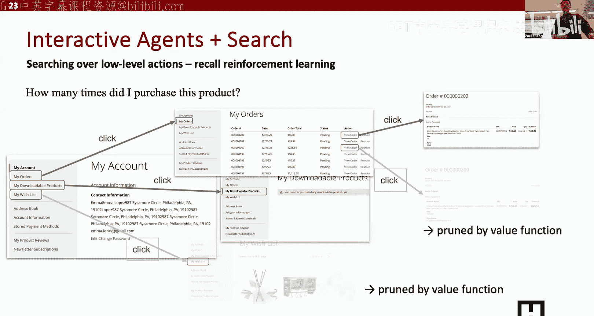

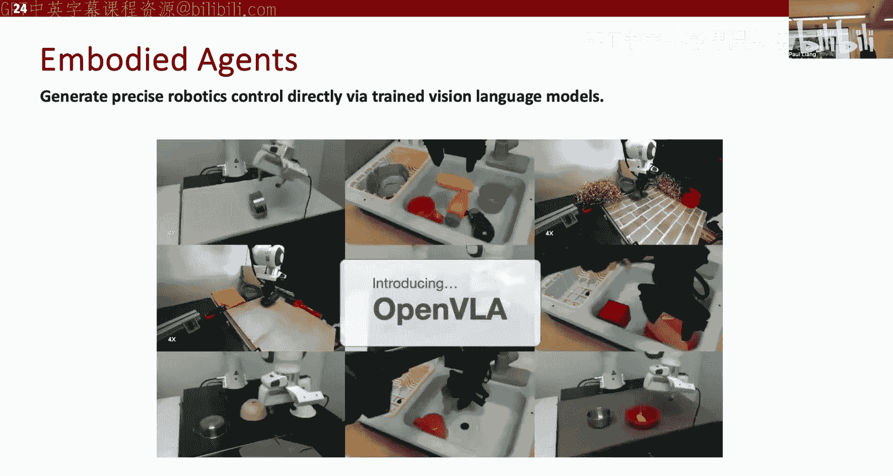

Are maybe video language action。 So these are models that take in a vision， sort of robot。

 or in this case， the simulator robots are seeing something is' taking in language instructions and is generating actions。

 So ways of a。

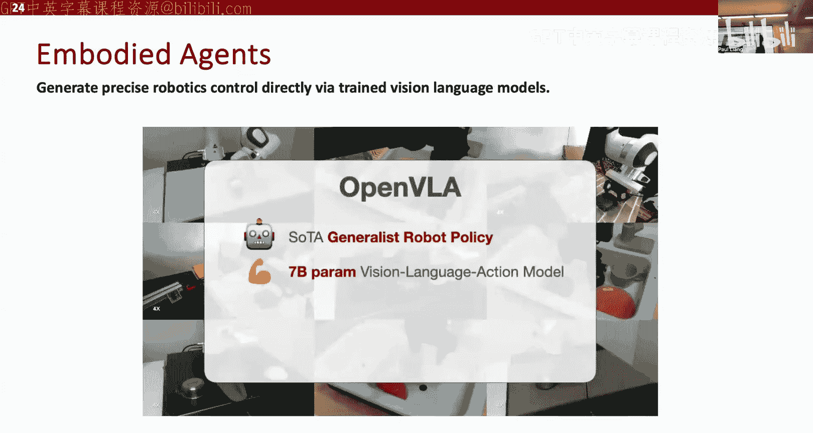

Of you controlling these robots and taking actions to solve these tasks。Yeah。

 so language part is Lama two， vision part is vision transformer， again。

 this is the adapter that we saw。And as a prefix of the vector prompt and as decoding actions in this case changes in your positions and angular velocities and grips of this robot。

Yeah。Another the cool stuff， lots of big applications in these robotics and body agents。

北景。Any final questions on agents robotics interaction？Yeah just a comment on the purchasing agent。

 I mean it seems like it would be an environment that's very easy to just kind of fully automate like at readdevelopcover foot learning matter is that how they're trained because I feel like that it's kind of like a playground right at this type of environment so I feel like that I don't know if you could even overcome the whole planning step procedure of it but。

I dont know。Is that work doing that？Yeah， I think again。

 two broad strategies that some people believe in kind of the model exploring and searching and doing RL。

 some people believe in using as much， you know， language knowledge to break things down procedurally and then maybe using RL just for fine。

嗯。嗯。So I don't think there's a consensus。 I would say these purchasing platforms are not as。

Are not as small as some of these games like for Pong and Atari where you know these R things first started。

 yes the action space is actually very small and then the state space is also quite small while these purchasing things can quickly get very big with amount of images and number of links and the complexity of the potential actions so I don't think you could be able to do pure R from scratch it probably is going to be very good initialized。

vision language models， planning， and then maybe you do R for fine tuning some of the local actions。

And purchasing is also just like one of us。Maybe smaller applications。

 right I mean the bigger ones are you know coding or resolving GithHub issues or manipulating entire databases。

So again RL might not be too feasible with the size of the state and action space。See。Yes。

 paper developed about controlling different robots to the same model and both to specific training on new models。

 but always the same number of degrees of freedom。Same when I make conclusion with can you that。

it's not actually according to a difference。A of degrees of freedom and a different kind of effective。

Yeah， its still the same kind of like grip or robot。

But I wouldn't see any reason why with future scale。

 it wouldn't generalize across robotic form factors。We know that or something with epimatics a。Most。

 they used to drive like the export robots， drones and that I mean I wonder home to the country apply to。

When we change order decreased field of rules。Yeah there'll be a good question to study I think I mean you're asking two questions here one is know how much you integrate kinematics I'm you using that model as any the kinematics model and this has no kinematics right this is just purelyity from language so of course studying the hybrid we very interesting and then of course separately studying whether these actions generalize I mean multitask learning has existed for a while and you could very conceivably think that just like there's input adapters so adapting the different input scenarios and the only thing that you train is this small thing over here they could be also output adapters in each task might be different and I think people are we doing that。

So I think in future is you know， of course， big general knowledge。

 but input should be very modular and the output could be also very modular reasoning should also be very modular。

Yeah， so I know that the both three was recently released by Open AI and one of the things that they did was train it on a lot of tool use so。

I mean not agenda in the sense that it was interacting with an environment。

 but I'm just kind of curious in terms of like。If there's will be part of this lecture that is going into that better tool use。

Or like， what's your opinion on that？Yeah I I didnt。Anything on tour use？I mean， I'm a big fan of it。

I think I again it really fits in this paradigm right so so yeah you have big base model and it's really about making the input super modular and the output super modular so so tools are exactly a good way of doing I also you like tools as a different modality that you might want to align the capabilities of the tools with the language model。

I think the biggest question is what is the。What is the bottom end。

 so right now everything is not going through language。

Whether it's tools you're describing how to use tools and calling those APIs using language or code vision is gonna adapt into language outputs。

 these robots are being parameterized and you know language angles and rotations so use language right bottleneck right now that's what we have is the best base model so perhaps is fine of course with more progress in multimod elementss you may not need a language only bottleneck you can maybe we just have things that are being done visually right that did a large concept model Yeah recently which again was based upon a large language model and trying to model concepts within the the neural own model right now I just say。

Yeah， yeah。 and tools yeah， tools use are going very interesting。 and of course。

 people are integrating tools with all these these agents right so tools with are you need calculator agent if you want to do you know your spreadsheets。

 you might have a。

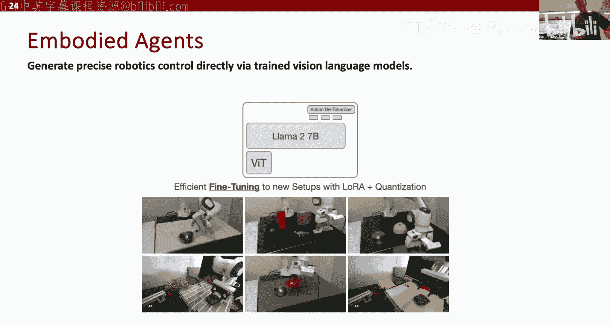

Web browsing agent， you might have other agents， that' are very commonly used in the other tools very commonly used agents。

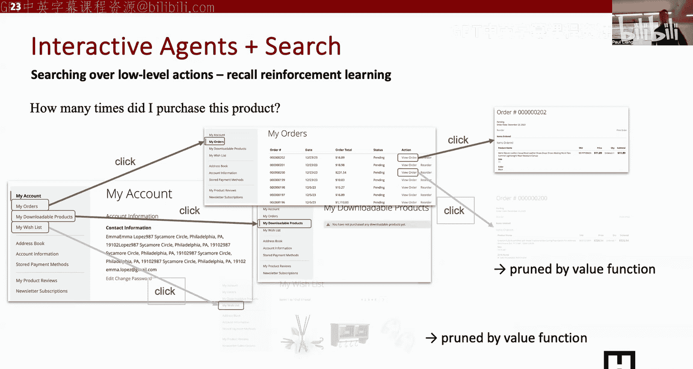

嗯。Yeah I'm also testinging the tools I think general of the tool also you information it like different modelss can person together to the based model of different images if there were the multimod based model multimod foundation models for the output how will output might change。

 for example， because right right now those actions or like different toolss still like parts password and see how the multimod will improve an input site like it directly process images or using hows the output like in these agency actions。

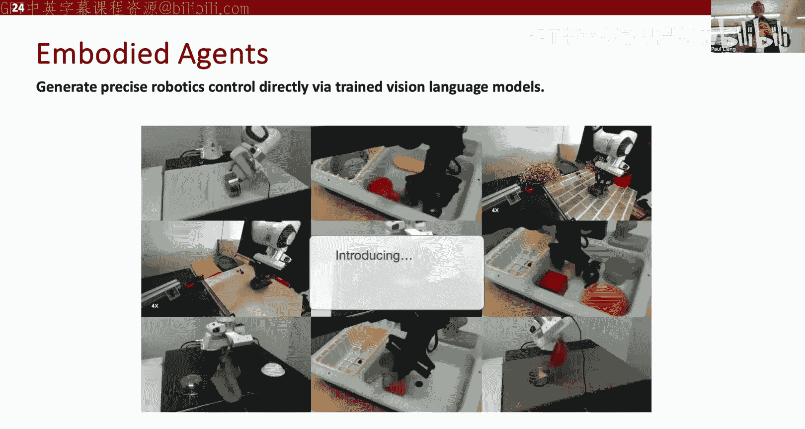

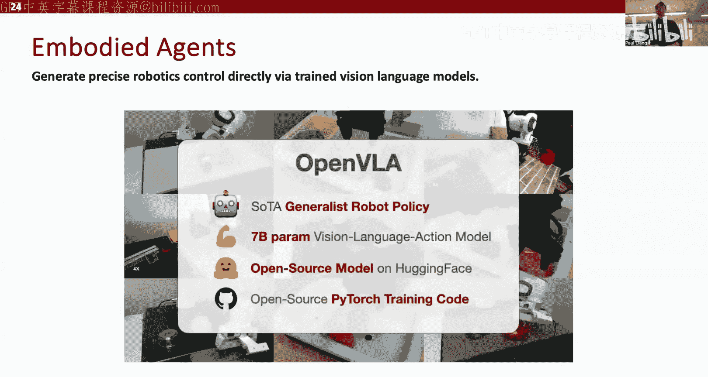

Like so how the earth reaction is very developing in language for。

Yeah， so that's a fair point so of first well two things first of all。

 multimodal algorithms are better than Ls that just reasoning about the world if there is some visual phenomena or there's some physical phenomena especially important for robots just replacing this with you know increasingly better visual language or audio language models will become increasingly better and representing the world so then of course your tool use could also be much better then your other point is well how do these but these models interface with tools is it always just going to be language is a fair point I think code is maybe language and code are two biggest ways of interfacing with some of these tools nowadays but。

I mean one other example of a tool that I mean there's sort of like visual tools right like like Open eyes all four is has this cool thing where you could like zoom in zoom out then you go crop things from different patches so it's very much a tool that is of course going to be instructed by language but it's very much requires you visual understanding and a future you know some of these tools that example speech definition or text of speech almost could also evolve。

Again， the orchestrating modality could very well be language。

 but it has to have the understanding somewhere in the model。sorry。

 I know we're asking you about but I think one thing that's very interesting too。

 it's just funny because the open AI model is like the way you get exposed to these concepts beyond the papers and it's fun started trying recently and one thing that these systems do is that they use the tools also as sort of like environment where things can be evaluated。

 which is very useful for training that the tools can be you can have this kind of reapment learning situation come out of the tool use but that was at a coding problem and it ended up using an IDE in order to recreate the code that it thought that I had and then it looked into the packages that was in this coding IDE in order to debug so it would do the debugging itself instead of interacting with me and letting me do the debubugging in mine and I thought it was so weird to have sort of like interact with this IDE way that you describe it here and just like go into the packages that were move into the environment。

Yeah， it seems like a very promising area but forward to have this kind of these environments that are interacted with good tools in some simulator environment more to pop like having model things and debugs。

Yes， yes。Well， I mean， but also it's probably a case that these models were priority in that environment right whenever we like find you some of those models in these debugging environments that's why it has this capability and I would say probably a lot of the models that in the future would be know trained on。

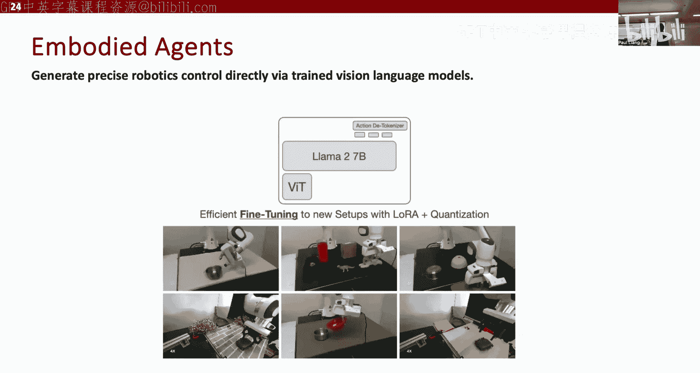

Like you know websites and web navigation already before release to the public point right but it's kind of it's just kind of interesting this whole way that helps you is it does all the work without including the human it just like just trying to help you do something in your browser it' like oh let me just like do it in my own browser first and debug the text and then get back to you once I run all the simulations it's interesting。

Yeah。I mean， good segue to this very last part， which i'll cover some of my thoughts on you your interaction。

 of course you know you're leading to this big big topic。

 a lot of people approach it from different perspectives。Here's what I think。

 so three big questions we need to answer。Of course。

 I'm very interested in what mediums are the most intuitive。For human AI interaction。

 especially beyond language prompting， whether that's a more code based or visual based or even physiological based ways of maintaining the fidelity that you get with language。

 but significantly reducing， for example cognitive overhead or a burden would be very interesting。

And of course， all this about building from a technical perspective。

 all about building multimodal interfaces for human AI interaction and exploring the switching between and fusion of different mediums。

Another you know big set of questions I have is you know what new technical challenges in AI have to be solved to enable human AI interaction so from an AI perspective AI researcher personally as AI researcher what new AI problems have to be solved and I would say a big one is quantification。

And I'll give you one occasion in a second I'll give a formal definition but at a high level it's really about providing better understanding and control over these models and of course you have these more human centric questions like what new opportunities arise from integrating with human experience。

 how they can help productivity， creativityly wellbeing and these are good patient centric questions from my main。

In concern with some of these it just very vague， not very well technically defined。

 but application wise is very interesting。So I mean one we talked a lot based in the class。

 let me jump in on two and gives us some final thoughts in 10 minutes and three of it are mostly applications。

 I think everyone has their thoughts on how AI could be integrated to help people。

But quant is probably the most important thing that we' not。

Talked about in the class a lot and that's because most of the classes have focus on building new algorithms。

 new techniques， applying them different things quantification can be formally defined as empirical and theoretical study to better understand model shortcomings and predict and control model behavior right so it's not too much about building new models in itself on building new understanding of science and techniques and theories to understand and control model behavior。

So three things I highlighted one is shortcuting when do models fail and why do they fail and predict they fail。

 moral behavior， some of it is about interpreting the internal behavior。

 but also understanding their behavior as a whole on different types of inputs and also learning how you predict predictably understand how models learn and get final performance and how they scale with more parameters。

And again， here's just a quick crash course over several big eventss in this space。

 I mean everyone has seen safety right LLMs are very easy to capture biases we did not already work in this gender bias would affect how language models complete their outputs based on different occupations and how they describe different ways that people perform these occupations of course this is all you know old news now everyone knows that there's language gender racial bias。

 all that in LLMs， not going to cover too much。A lot of ways in kind of improving the safety， but。

Impossibly number ways to Jobri， we can never， I don't think there's ever going to be a way of not having models susceptible to jawbris。

I's a paper I love very much。You prompt how to build a bomb in language models nowadays say， sorry。

 I can do that and then you just prompt it in S。As and a model would say something give it the right answer so increasingly you know this infinite space of Joe breaks I don't think you can ever rely on models being safe 100% of the time so still be challenge。

啊。I what's interesting to me is also when you start building these like multimod algorithms。

 is it easier to make the models safe or do these models become even more unsafe so？

Of course most of the times they become more unsafe with more inputs and more understanding。

 there's more likely chance of capturing biases， so a lot of these models when they started。

 they kind of just only looked at the image and ignored sorry only looked at the question and ignored the image because 90% of bananas are yellow they don't actually predict green bananas。

So lots of ways of kind of rebalancing your data and rebalancing your training so that models are actually learning from different modalities equally。

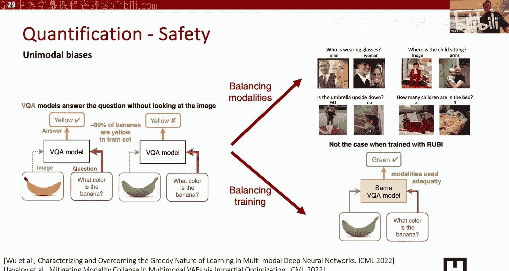

Social biases。 So people who started looking at mis。

They were very confused why you know they kind of got the description of the people incorrect but aity in a desk with a laptop computer and then the people soon realize that oftentimes the model just looks at some object in the image。

 for example， detect texts a laptop and it just infers， for example。

 the type of demographic of people who be using computers and oftentimes that would reflect biases。

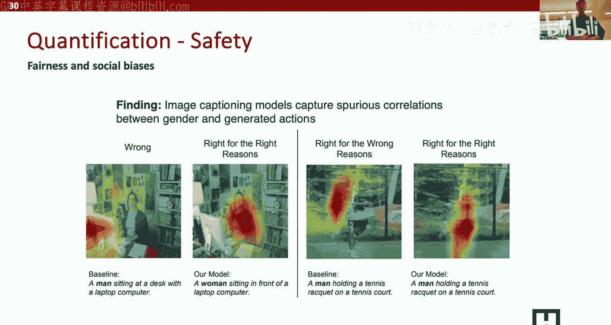

Here's another example， this was studying vision language models and their basic conclusion is that there's worst of both worlds。

 your biases compound when you start putting vision models with language models together。

So I tested for number of models like or birth。And they gave in different pictures of different people holding different things and how would they be you know what their demographics and race and gender was。

 and they basically found like models became more confident at reinforcing biases when they saw both image and language。

Which is not good， of course。嗯。Let me skip over some parts。

So another big area is robustness right we've seen a lot of cases where models just perform well on the settings that they were traineded for。

 but they don't become robust in the real world when they see different types of noise in your sensors。

 new images in your text different types of noise and videos， for example。

And here we did a very large scale study about two years ago where we saw performance of different。

Large models and their robustness。 So how how much their performance dropped when you introduced different types of noise and basically found。

A negative correlation roughly where models that performed really good were also not really robust so they could see much worse performance drops is by starting off as higher accuracy。

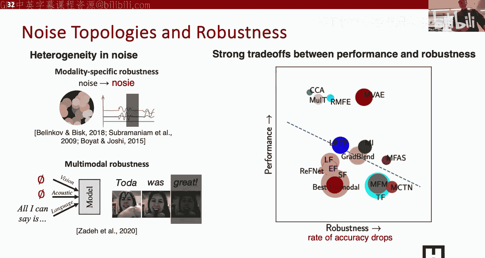

And lots of ways of dealing with this noise dropout or introducing what you expect the model to be sensitive to during training is a way of doing it。

 also translating from one to the other to try to infer the similar modalities is an interesting way。

嗯。Okay， I think we are out of time and the next folks have to come in。

But I also at some sites we apply studies online about understanding model behavior。

 so there are increasingly better ways of you know doing interpretability， visualizing neurons。

 visualizing radiance with respect to the input so highlighting parts vision which are responsible for dealing with different predictions and one thing I also want to highlight is how to evaluate quantification on the patient is a big topic is about coming up with understandings of these models but what accuracy is easy to measure you're building a better model is more accurate and you're happy。

 how do you measure a success of some property they are trying to study in this model because I no one has studied this property before so there is no ground truth which you can say I'm understanding this property 80% correct。

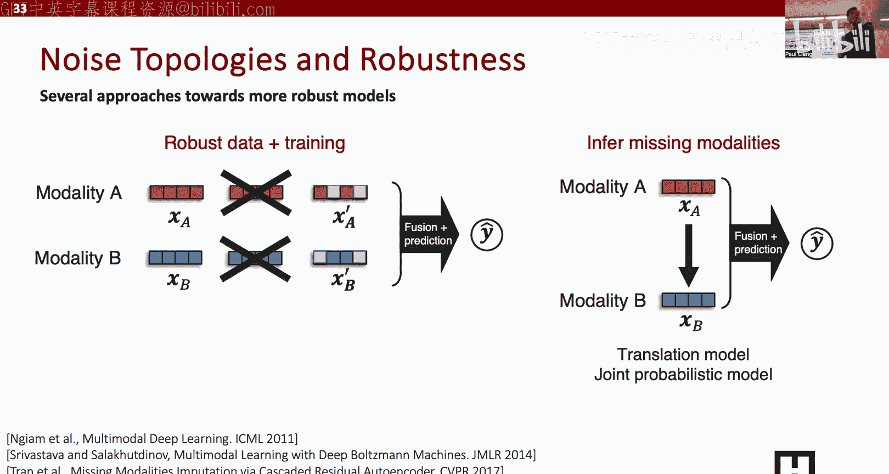

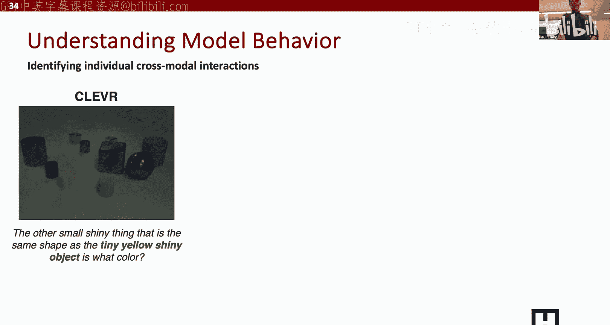

So evaluating quantitation is still a very big challenge。

One of the things that you've been proposing are indirect ways of evaluatingu quant， so if you。

 for example， if you claim to other a certain property。In the model， for example。

 that model focuses on color more than this other color can use similar the model。

 which basically means if I give you a new data point。And I give you a model。

 Can a human simulate what the model would predict both in the case when the model gets correct and the case when the model gets incorrect。

 So having people simulate these models。 So if you have purely black box models。

 then what humans cannot simulate it or if your models are more understandable。

 that humans should be able to simulate it。Another。

Cool thing you've been doing is using humans to debug these models again， if I have some quality。

 some magnifying glass， some property of these models and I'm claiming makes sense that humans should be able to look at these and I really find different bugs in the model and improve the performance of these models So that's again some directly measurable quantity right if there is a bug that you found proofs and that means your understanding is correct。

Okay I'll put some more examples online but yes we have to go thanks everyone for a great semester it's been my pleasure teaching this class please get your final projects in and please leave us feedback for the course and fill those course evaluations and please let me know if you want to be a T and shape future versions of this class all right thanks everyone。

😊。

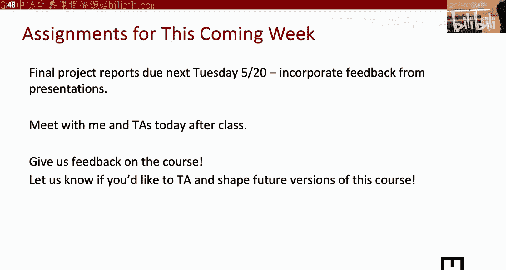