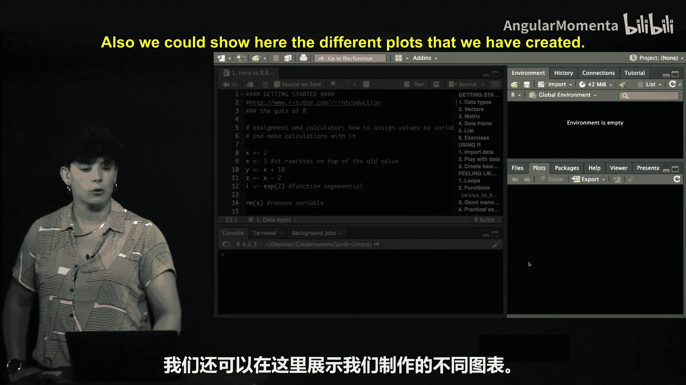
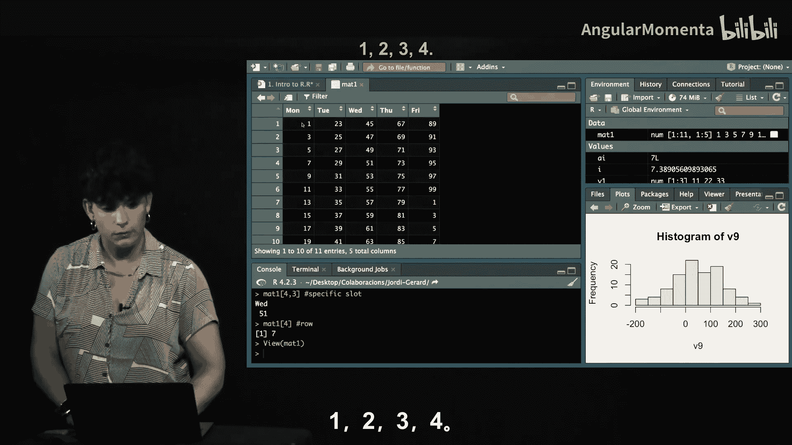

# 001：界面与数据结构 🚀


## 概述
在本节课中，我们将要学习R语言的基础知识，包括其优势、用户界面以及核心的数据结构。我们将从最简单的变量赋值开始，逐步深入到向量、矩阵、数据框和列表等复杂数据结构。

---

## R语言的优势 💪


R是一种广泛应用于科学领域（如生态学、气候科学）的编程语言。使用R有以下几个主要优势：

*   **免费开源**：任何人都可以免费下载和使用R，无需任何订阅费用。
*   **协作性强**：用户可以通过R平台或其他渠道轻松分享代码，无需从零开始。
*   **可重复性高**：代码脚本可以随研究一同发布，确保研究过程的可重复性。
*   **功能全面**：R可以覆盖从数据清洗、统计分析到地理信息系统（GIS）制图的整个研究流程。
*   **可视化出色**：R能够生成高质量的图表，有效传达研究成果。

---



## RStudio界面介绍 🖥️

安装R和RStudio后，你将看到如下界面。界面背景和字体颜色可以自定义。

以下是RStudio的主要面板：

*   **脚本编辑器**：在此处编写你的代码脚本。
*   **控制台**：执行代码后，结果会显示在此处。
*   **环境/历史**：顶部显示已创建的数据对象，底部可浏览文件、查看图表、管理扩展包或获取函数帮助。

---

## 基础操作与数据类型 🔢

上一节我们介绍了RStudio的界面，本节中我们来看看如何在R中进行基础运算和存储数据。

R可以作为一个强大的计算器使用。我们通过赋值符号 `<-` 将数值赋给变量。

```r
x <- 2
y <- x + 10
```

执行代码有两种方式：
1.  将光标放在代码行，按 `Command + Return` (Mac) 或 `Ctrl + Enter` (Windows)。
2.  选中代码，点击“Run”按钮。

以 `#` 开头的文本是注释，不会被R执行。注释用于解释代码。

我们可以对变量进行重新赋值，新值会覆盖旧值。也可以使用变量进行数学运算。

```r
x <- 3
y <- x + 10
exp(y) # 计算y的指数函数值
```

如果对函数（如 `exp`）不熟悉，可以将光标放在函数名上，按 `Fn + F1` 键在帮助面板查看其说明和用法。

要删除一个变量，使用 `rm()` 函数。

```r
rm(x)
```

---

## 逻辑判断 ❓

现在我们已经知道如何赋值，接下来学习如何向R提出逻辑问题。


我们可以使用比较运算符来询问逻辑问题。

```r
x <- 3
y <- 13
x > y  # 判断x是否大于y，返回 FALSE
x < y  # 判断x是否小于y，返回 TRUE
x == y # 判断x是否等于y，使用两个等号，返回 FALSE
x != y # 判断x是否不等于y，返回 TRUE
```

---

## 数据类型 📊

R中的数据有不同的类型。我们可以使用 `class()` 函数查看对象的类型。

*   **数值型**：包含整数和小数。
    ```r
    class(y) # 返回 "numeric"
    is.integer(y) # 判断y是否为整数，返回 FALSE
    as.integer(y) # 将y强制转换为整数
    ```

*   **字符型**：文本数据。在赋值时，文本需要用引号包围，并使用 `c()` 函数。
    ```r
    z <- c("lobster")
    class(z) # 返回 "character"
    ```

---

## 向量 ➡️

之前我们为一个变量赋一个值。向量则可以存储多个值，它是R中最基本的一维数据结构。

使用 `c()` 函数创建向量，元素间用逗号分隔。

```r
v1 <- c(1, 2) # 数值向量
v2 <- c("Monday", "Tuesday", "Wednesday", "Thursday", "Friday") # 字符向量
```

以下是创建向量的其他实用方法：

*   **重复元素**：使用 `rep()` 函数。
    ```r
    rep(22, times = 20) # 将数字22重复20次
    ```
*   **生成序列**：使用冒号 `:` 或 `seq()` 函数。
    ```r
    v4 <- 1:100 # 生成1到100的整数序列
    v5 <- seq(from = 1, to = 100, by = 2) # 生成1到100的奇数序列
    ```

要访问向量中的特定元素，使用方括号 `[]` 和索引位置。

```r
v4[20] # 访问v4的第20个元素
v5[c(10, 12)] # 同时访问v5的第10和第12个元素
```

要从向量中移除元素，在索引前使用负号 `-`。

```r
v6 <- v2[-3] # 创建新向量v6，它包含v2中除第3个元素（Wednesday）外的所有元素
```

R还可以生成随机数据向量。

```r
v8 <- runif(n = 10, min = 10, max = 50) # 生成10个在10到50之间的均匀分布随机数
v9 <- rnorm(n = 100, mean = 0, sd = 1) # 生成100个服从标准正态分布的随机数
hist(v9) # 为v9绘制直方图
```

我们可以对向量进行统计摘要。

```r
length(v4) # 向量的长度
summary(v4) # 向量的摘要（最小值、四分位数、中位数、均值、最大值）
sum(v1) # 向量所有元素的和
min(v4) # 最小值
max(v4) # 最大值
mean(v4) # 平均值
```

---

## 矩阵 🧮

矩阵是二维数据结构，由行和列组成，但其所有元素必须是同一类型（通常是数值型）。你可以将矩阵看作多个向量的组合。

使用 `matrix()` 函数创建矩阵。

```r
mat1 <- matrix(data = v5, nrow = 10, ncol = 5, byrow = TRUE)
View(mat1) # 在数据查看器中打开矩阵
```

可以为矩阵的列命名。

```r
colnames(mat1) <- v2[1:5] # 使用v2的前5个元素作为列名
```

访问矩阵元素时，使用 `[行索引, 列索引]` 的格式。

```r
mat1[4, 3] # 访问第4行第3列的元素
mat1[4, ]  # 访问第4整行
mat1[, 3]  # 访问第3整列
xx <- mat1[, 3] # 将第3列赋值给新变量xx
mat1[, c(1, 3)] # 同时选择第1列和第3列
```

---

## 数据框 📑

数据框是矩阵的扩展，是R中最常用的数据结构。与矩阵不同，数据框的每一列可以是不同的数据类型（数值、字符、因子等）。

R自带了许多示例数据集。例如，`mtcars` 数据集包含了不同汽车的性能数据。

```r
data(mtcars) # 加载内置数据集
cars <- mtcars # 赋值给新变量方便使用
View(cars) # 查看数据框
```



我们可以获取数据框的基本信息。

```r
length(cars) # 列数
ncol(cars)   # 列数
nrow(cars)   # 行数
colnames(cars) # 列名
```

访问数据框元素的方式与矩阵类似，也可以通过列名配合 `$` 符号来访问特定列。


```r
cars[4, ] # 第4行所有数据
cars$hp   # 名为“hp”的列
cars$     # 输入`$`后，RStudio会提示可用的列名
```

---

## 列表 📦

列表是R中最灵活的数据结构，它可以包含任何类型的对象：向量、矩阵、数据框，甚至其他列表。

使用 `list()` 函数创建列表。

```r
my_list <- list(v1, v2, v4, as.integer(v4), cars, mat1)
```
点击环境面板中 `my_list` 旁边的蓝色箭头，可以查看其内部结构。

访问列表元素使用双重方括号 `[[]]`。

```r
my_list[[6]] # 访问列表中的第6个元素（即矩阵mat1）
```

---

## 练习与总结 🎯

现在你已经接触了R中大量的数据结构，是时候通过练习来巩固所学知识了。请尝试完成以下问题来测试你的理解：

1.  创建一个包含你一周运动时长的数值向量。
2.  创建一个2x3的矩阵，并为其行和列命名。
3.  探索 `mtcars` 数据框，计算 `mpg`（每加仑英里数）列的平均值。
4.  创建一个列表，包含一个数值向量、一个字符向量和 `mtcars` 数据框。

如果你渴望学习更多，互联网上有丰富的R语言学习资源可供利用。


**总结**：本节课中我们一起学习了R语言的核心优势、RStudio的基本界面，并深入探讨了从简单变量到列表的各种数据结构。掌握这些基础是后续进行数据分析和地理信息系统操作的关键第一步。