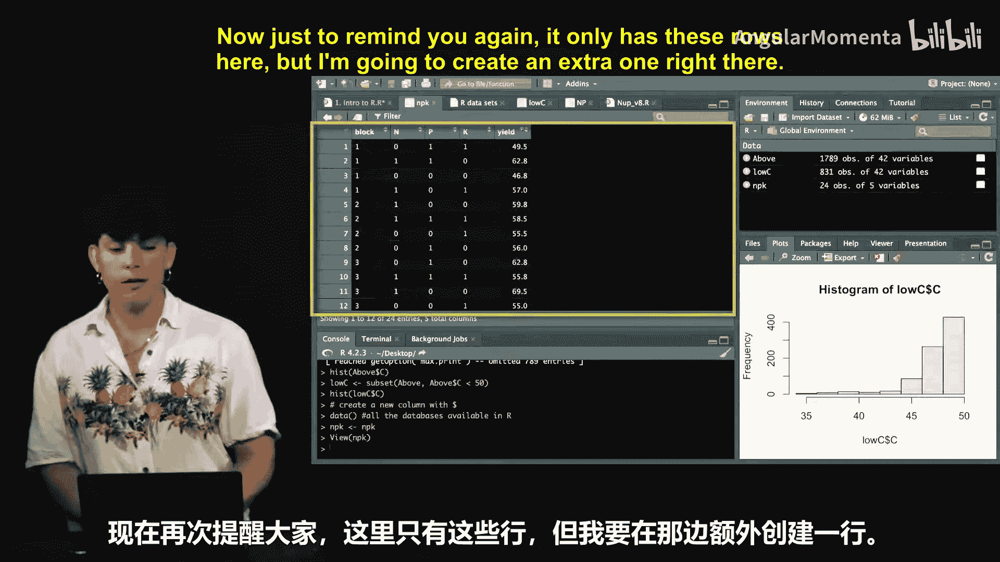

# 002：数据操作实践


在本节课中，我们将学习如何在R中导入和处理数据。我们将从导入不同格式的数据文件开始，然后学习如何查看、总结数据，以及如何创建数据子集和添加新列。这些是进行数据分析前必须掌握的基础操作。

## 导入数据

上一节我们介绍了如何在R脚本中直接创建数据，本节中我们来看看如何从外部文件导入数据。首先，我们需要知道数据文件的位置。

使用 `getwd()` 命令可以查看当前的工作目录。

```r
getwd()
```

要更改工作目录，可以使用 `setwd()` 命令，并在括号内指定新的路径。

```r
setwd("/你的/新/路径")
```


R默认支持导入CSV格式的文件。使用 `read.csv()` 函数，并在括号内指定文件路径。

```r
data_from_csv <- read.csv("/你的/路径/文件名.csv")
```

如果文件路径正确，数据将被导入并存储为一个数据框。

## 导入其他格式的数据

如果需要导入Excel格式（.xlsx）的文件，我们需要先安装并加载一个专门的包。包是他人编写并上传到R社区的函数集合，可以扩展R的功能。

以下是安装和加载包的两种方法：


1.  通过菜单：`Tools` -> `Install Packages`，输入包名（例如 `openxlsx`）。
2.  通过代码：使用 `install.packages()` 函数。

```r
install.packages("openxlsx")
```

安装后，需要使用 `library()` 函数将包加载到当前会话中才能使用其功能。

```r
library(openxlsx)
```

加载 `openxlsx` 包后，就可以使用 `read.xlsx()` 函数来导入Excel文件了。

```r
data_from_excel <- read.xlsx("/你的/路径/文件名.xlsx")
```

R也有自己的数据格式 `.RData`，这是一种非常紧凑的存储方式。使用 `load()` 函数可以加载这种文件。

```r
load("/你的/路径/文件名.RData")
```

## 查看与总结数据

成功导入数据后，我们需要了解数据的基本情况。`summary()` 函数可以提供数据的概览。

```r
summary(above)
```

对于数值型变量，`summary()` 会显示最小值、四分位数、均值、最大值以及缺失值（NA）的数量。对于字符型变量，则会显示其类别。

另一种查看数据的方式是使用 `head()` 函数，它可以显示数据框的前几行。

```r
head(above)
```

要查看数据框的列名，可以使用 `names()` 函数。

```r
names(above)
```

`unique()` 函数可以查看某一列中所有不重复的值，这对于了解分类变量的类别非常有用。

```r
unique(above$topography)
```

## 数据子集与操作

我们经常需要根据特定条件筛选数据。`subset()` 函数可以用于创建数据子集。


例如，要筛选出 `carbon` 列值小于50的所有行：

```r
low_carbon <- subset(above, carbon < 50)
```

创建新列是数据整理中的常见操作。可以直接使用 `$` 符号和赋值操作符 `<-` 来添加新列。


例如，在 `npk` 数据集中，我们想创建一个新列，将氮、磷、钾的施肥情况合并显示：

```r
npk$all_fert <- paste(npk$N, npk$P, npk$K, sep = "-")
```

`paste()` 函数用于连接多个字符串，`sep` 参数指定了连接符。

我们也可以使用 `cbind()` 函数将一个新的向量作为列合并到现有数据框中。这要求新向量的长度与数据框的行数一致。

```r
new_column <- c("value1", "value2", "value3") # 示例向量
new_dataframe <- cbind(old_dataframe, new_column)
```



## 使用R内置数据集

R自带了许多用于练习的数据集。使用 `data()` 命令可以查看所有可用的内置数据集。


```r
data()
```

我们可以直接加载并使用这些数据集，例如 `npk` 数据集。

```r
data(npk)
```

## 实用工具与小技巧

在编写代码时，有一些工具可以提高效率：
*   **查找与替换**：在脚本编辑器中使用放大镜图标，可以快速查找或替换代码中的特定字符。
*   **代码折叠与导航**：在代码段前后输入四个或更多 `#` 号（如 `####`），可以在编辑器右侧生成可折叠的导航标题，方便管理长脚本。
*   **调整字体大小**：使用 `Cmd` + `+`（Mac）或 `Ctrl` + `+`（Windows）可以放大编辑器字体，使用 `Cmd` + `-` 或 `Ctrl` + `-` 可以缩小。

## 总结


本节课中我们一起学习了R语言数据操作的核心技能。我们掌握了如何从CSV、Excel等外部文件导入数据，如何使用 `summary()`、`head()`、`names()` 等函数快速了解数据结构，以及如何利用 `subset()` 筛选数据和通过 `$` 或 `cbind()` 添加新列。此外，我们还介绍了一些提高编码效率的实用工具。这些是进行后续数据分析和可视化的坚实基础。