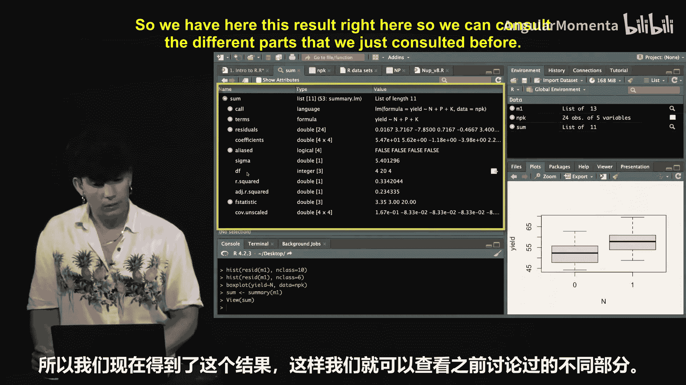
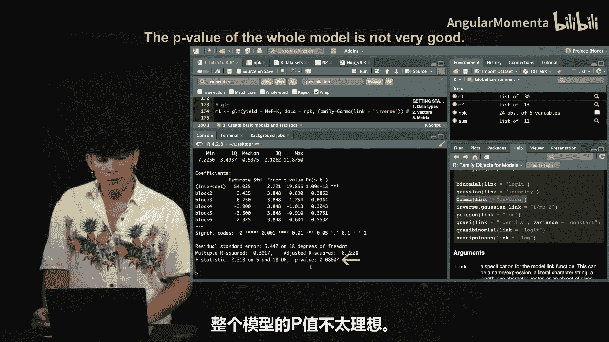
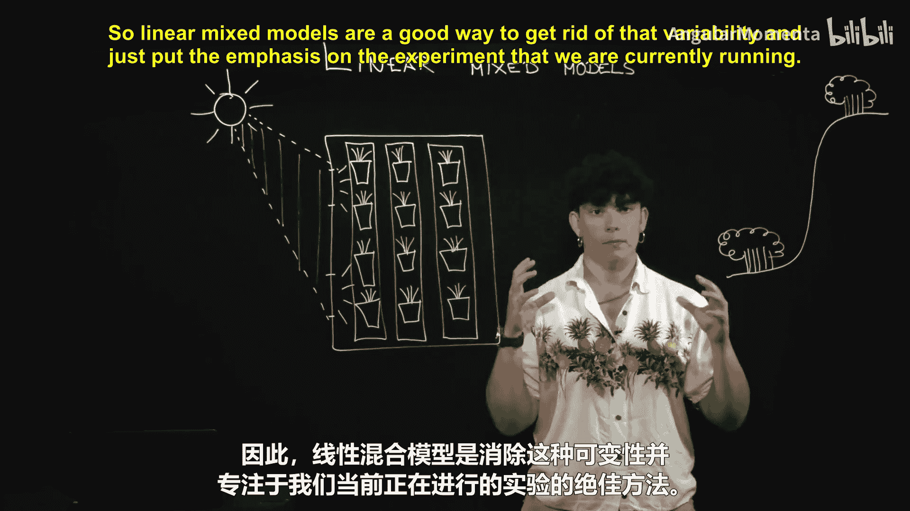
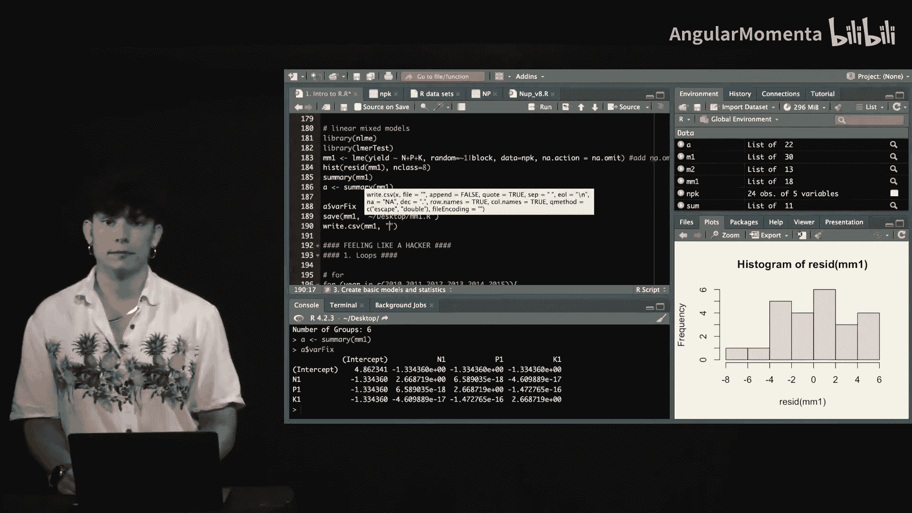

# 003：R中的线性与混合效应模型 📊


在本节课中，我们将学习如何在R语言中应用线性模型、广义线性模型以及混合效应模型来分析数据。我们将通过具体的代码示例，展示如何构建模型、解读结果，并理解不同模型的应用场景。

## 概述

我们将使用一个关于氮、磷、钾施肥对产量影响的实验数据集。本节将指导你如何用R代码拟合统计模型，而不深入探讨其背后的数学原理。我们将从线性模型开始，逐步过渡到更复杂的模型。

---

## 线性模型 (Linear Model)

首先，我们加载并清理工作环境，然后导入我们将要使用的数据集。

```r
# 加载数据集
NPK <- read.csv("your_dataset.csv") # 请替换为实际文件路径
# 查看数据结构
str(NPK)
```

数据集包含了不同施肥处理（氮、磷、钾）和不同实验区块（block）下的产量（yield）数据。

### 构建线性模型

线性模型用于探究一个或多个自变量（X）如何影响一个因变量（Y）。在R中，我们使用 `lm()` 函数。

以下是构建线性模型的代码结构：

```r
# 创建线性模型
model_1 <- lm(yield ~ nitrogen + phosphorus + potassium, data = NPK)
```

*   `model_1` 是我们为模型对象起的名字。
*   `lm()` 是线性模型函数。
*   `yield ~ nitrogen + phosphorus + potassium` 是模型公式，表示我们想探究产量如何随氮、磷、钾施肥情况变化。
*   `data = NPK` 指定了使用的数据框。

### 解读模型结果

直接打印 `model_1` 对象信息有限。我们需要使用 `summary()` 函数来获取详细分析报告。

```r
# 查看模型摘要
summary_m1 <- summary(model_1)
print(summary_m1)
```

模型摘要会显示以下关键信息：
1.  **模型公式**：确认你提出的问题。
2.  **残差分布**：残差是观测值与模型预测值之间的差异。
3.  **系数 (Coefficients)**：
    *   `(Intercept)`：基线值（当所有自变量为0时的预测产量）。
    *   `nitrogen1`, `phosphorus1`, `potassium1`：分别表示施用氮、磷、钾肥的效应值。正值为增加，负值为减少。
    *   `Pr(>|t|)` 列是P值，用于判断效应是否显著（通常以0.05为阈值）。旁边的星号 `*` 表示显著性水平。
4.  **模型整体评估**：
    *   `Adjusted R-squared`：调整后的R方，表示模型能解释的数据变异比例，介于0到1之间。
    *   `F-statistic` 和 `p-value`：模型整体的显著性检验。

### 模型诊断：检查残差

检查残差是否近似服从正态分布是模型诊断的重要一步。我们可以绘制直方图。

```r
# 绘制模型残差的直方图
hist(residuals(model_1), breaks = 10, main = "Model 1 Residuals")
```
`breaks` 参数可以控制直方图的柱子数量。



我们也可以可视化施肥处理与产量的关系，例如使用箱线图查看氮肥的影响。


```r
# 绘制产量与氮肥处理的箱线图
boxplot(yield ~ nitrogen, data = NPK, main = "Yield by Nitrogen Treatment")
```

### 提取和保存结果

`summary()` 对象包含了所有重要信息，我们可以单独提取需要的部分，例如系数。

```r
# 提取系数表
coefficients_table <- summary_m1$coefficients
print(coefficients_table)
```

你也可以将整个摘要或其他结果保存到文件中。

```r
# 保存摘要对象为R数据格式
save(summary_m1, file = "model1_summary.RData")
# 或保存系数表为CSV文件
write.csv(coefficients_table, file = "model1_coefficients.csv")
```

---

## 广义线性模型 (Generalized Linear Model, GLM)

上一节我们介绍了基础的线性模型。本节中我们来看看广义线性模型。GLM在线性模型的基础上进行了扩展，允许因变量服从非正态分布（如二项分布、泊松分布、伽马分布等）。

### 构建GLM模型

在R中，我们使用 `glm()` 函数。其基本结构与 `lm()` 相似，但可以指定 `family` 参数来定义误差分布和链接函数。

```r
# 创建广义线性模型（默认使用高斯分布，等同于线性模型）
model_glm <- glm(yield ~ nitrogen + phosphorus + potassium, data = NPK)
summary(model_glm)
```

如果要使用其他分布，例如伽马分布，可以按如下方式指定：

```r
# 创建使用伽马分布的GLM
model_glm_gamma <- glm(yield ~ nitrogen + phosphorus + potassium,
                       family = Gamma(link = "log"), # 指定分布和链接函数
                       data = NPK)
summary(model_glm_gamma)
```



你可以通过 `?family` 查看R中支持的所有分布族。


---

## 练习：探究区块效应

在深入混合模型之前，我们先做一个练习。请使用线性模型或广义线性模型回答以下问题：**产量是否因实验区块（block）的不同而有差异？**

以下是参考解答：

```r
# 使用线性模型分析区块对产量的影响
model_block <- lm(yield ~ block, data = NPK)
summary_block <- summary(model_block)
print(summary_block)
```

根据模型摘要中的P值，我们可以判断不同区块间的产量差异是否具有统计学意义。

---

## 混合效应模型 (Linear Mixed-Effects Model)

之前我们处理的模型都只包含了固定效应。但在实际实验中，经常存在一些我们不想研究但其变异会影响结果的因子，例如：
*   实验室内靠近窗户和远离窗户的位置（光照不同）。
*   田野中山顶和山脚的位置（土壤、水分条件不同）。
*   不同城市附近的河流采样点。

这些因子通常被称为“随机效应”。**混合效应模型** 允许我们在模型中同时包含固定效应（我们真正关心的处理，如施肥）和随机效应（需要控制其变异的背景因子，如区块）。

### 理解混合模型的应用场景

假设我们的实验在实验室进行，实验台一侧有窗户。我们预计靠近窗户的植物可能因为光照更多而长得更好，但这并非本实验的研究重点。为了控制这种由位置带来的变异，我们将实验单元划分为不同的“区块”（block），并在分析时将“区块”作为随机效应纳入模型，从而更准确地估计施肥处理（固定效应）的真实效果。




### 构建混合效应模型

在R中，混合模型需要额外的包。我们将使用 `nlme` 包中的 `lme()` 函数。

```r
# 安装并加载必要的包（如果尚未安装）
# install.packages("nlme")
# install.packages("lmtest")
library(nlme)
library(lmtest)

# 创建线性混合效应模型
model_mixed <- lme(yield ~ nitrogen + phosphorus + potassium, # 固定效应部分
                   random = ~ 1 | block, # 随机效应部分：将区块作为随机截距
                   data = NPK,
                   na.action = na.omit) # 处理缺失值：忽略
```

*   `random = ~ 1 | block`：表示我们假设每个区块（block）有自己的基线（截距），但这个基线是围绕总体基线随机波动的。
*   `na.action = na.omit`：告诉模型在遇到缺失值（NA）时跳过该条记录。其他选项包括 `na.fail`（遇到NA则报错）。

### 解读混合模型结果

查看模型摘要：

```r
summary(model_mixed)
```

结果输出会分别展示固定效应和随机效应的信息。通过控制区块间的随机变异，固定效应（施肥处理）的估计可能会变得更精确，P值也可能发生变化。例如，原本不显著的效应在考虑了随机效应后可能变得显著。

我们同样可以检查残差分布，并提取和保存结果。

```r
# 检查残差分布
hist(residuals(model_mixed), breaks=10, main="Mixed Model Residuals")

# 提取固定效应系数
fixed_effects <- summary(model_mixed)$coefficients$fixed
print(fixed_effects)

# 保存结果
save(model_mixed, file = "mixed_model_results.RData")
```

---

## 总结

本节课中我们一起学习了在R中应用三种核心统计模型：
1.  **线性模型 (LM)**：用于因变量与自变量呈线性关系且残差服从正态分布的数据。
2.  **广义线性模型 (GLM)**：扩展了LM，允许因变量服从多种分布，适用于更广泛的数据类型。
3.  **线性混合效应模型 (LMM)**：在模型中同时纳入固定效应和随机效应，能更合理地处理具有分层结构或重复测量的数据，控制无关变异，提高对固定效应估计的准确性。




通过具体的代码示例，你学会了如何构建这些模型、使用 `summary()` 解读结果、进行简单的模型诊断（如检查残差），以及如何提取和保存关键信息。这些技能是进行数据分析的基础。