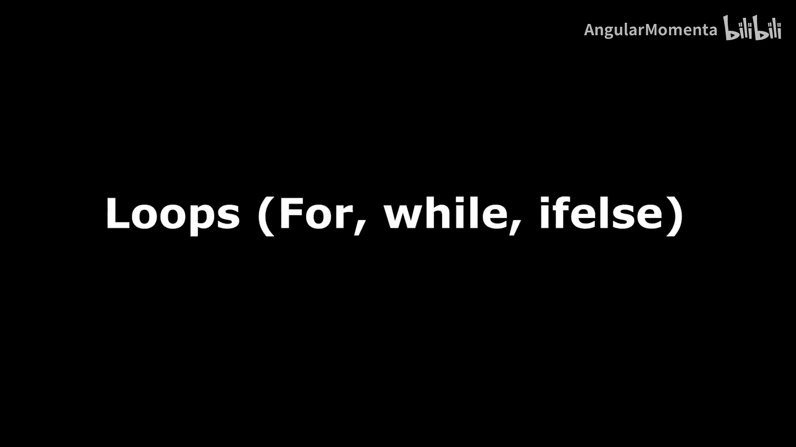
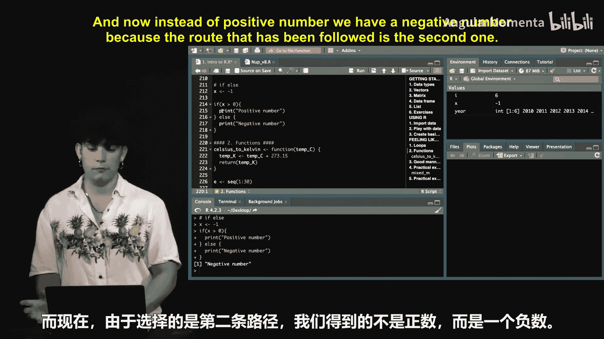
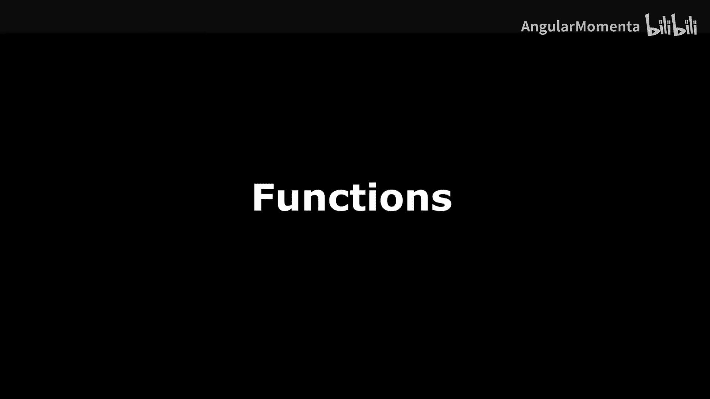
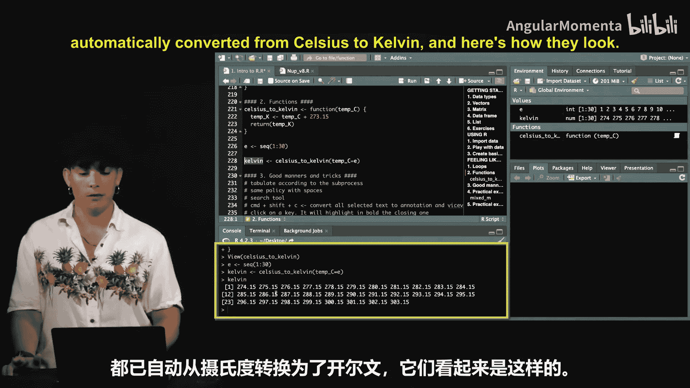
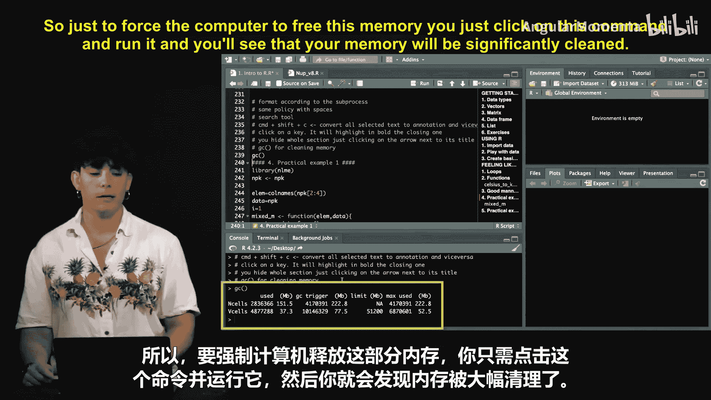
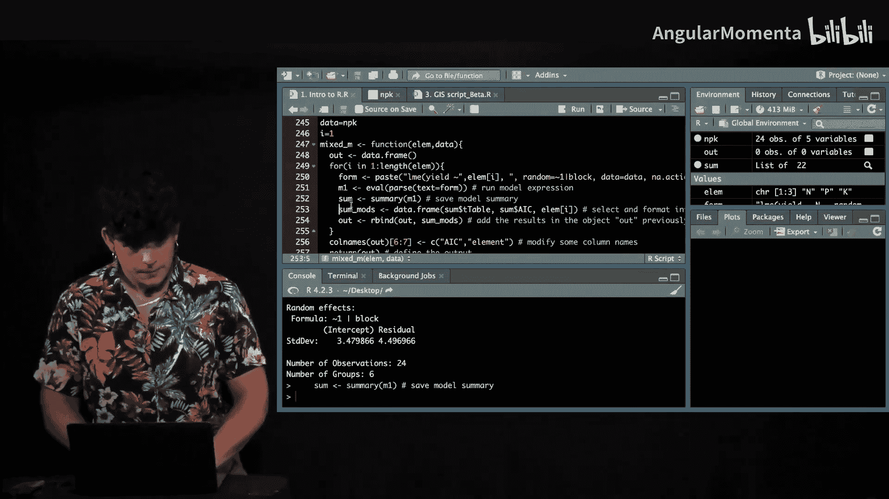

# 004：循环与函数 🚀




在本节课中，我们将学习R语言中两个强大的编程概念：循环与函数。循环能帮助我们自动化重复性任务，而函数则允许我们封装代码逻辑，以便重复使用。掌握这些工具将使你的数据分析工作更加高效。

## 循环：自动化重复任务 🔄

上一节我们介绍了数据结构，本节中我们来看看如何让计算机自动执行重复操作。R语言主要有两种循环：`for`循环和`while`循环。`for`循环会按照预先设定的次数重复执行，而`while`循环则会在满足某个条件时持续执行，直到条件不再满足为止。

### For循环

`for`循环有一个固定的结构。首先，我们创建一个向量作为循环的基础。

```r
year <- c(2010, 2011, 2012, 2013, 2014, 2015)
```

以下是`for`循环的基本语法：

```r
for (y in year) {
  print(paste("The year is", y))
}
```

在这个循环中，`y`是一个迭代变量。在第一次迭代时，`y`的值是2010，第二次是2011，依此类推，直到遍历完整个`year`向量。循环体（花括号 `{}` 内的代码）会为每个`y`值执行一次。





### While循环

现在，让我们转向`while`循环。与`for`循环不同，`while`循环依赖于一个条件。

首先，我们设置一个初始值：
```r
iteration <- 1
```

然后，我们构建`while`循环：
```r
while (iteration < 6) {
  print(paste("Iteration number:", iteration))
  iteration <- iteration + 1
}
```




这个循环会一直打印当前的迭代次数，并在每次迭代后将`iteration`的值加1。当`iteration`的值达到6时，条件 `iteration < 6` 不再为真，循环便会停止。

### If-Else条件语句

虽然不是循环，但`if-else`条件语句在控制程序流程时非常有用，也常与循环结合使用。

```r
x <- 2
if (x > 0) {
  print("Positive number")
} else {
  print("Negative number")
}
```

这段代码检查`x`是否大于0。如果是，则执行第一个代码块；否则，执行`else`后面的代码块。你可以通过改变`x`的值来观察不同的输出路径。

## 函数：创建你自己的工具 🛠️

到目前为止，我们使用的都是R语言内置或扩展包中预定义的函数。但我们也可以创建自己的函数，以满足特定的分析需求。

### 定义函数

假设我们需要一个将摄氏温度转换为开尔文温度的函数。以下是创建该函数的步骤：

```r
celsius_to_kelvin <- function(celsius) {
  kelvin <- celsius + 273.15
  return(kelvin)
}
```




1.  **命名函数**：`celsius_to_kelvin`。
2.  **定义参数**：在括号内指定函数所需的输入变量，这里是`celsius`。
3.  **编写函数体**：在花括号 `{}` 内，编写要执行的计算（`kelvin <- celsius + 273.15`）。
4.  **返回值**：使用`return()`语句指定函数的输出结果。

创建后，你可以在环境面板的“Functions”部分找到它。

### 使用函数

定义好函数后，我们就可以像使用内置函数一样调用它。

```r
# 创建一个摄氏温度向量
celsius_temps <- seq(1, 30)
# 应用我们的函数进行转换
kelvin_temps <- celsius_to_kelvin(celsius_temps)
# 查看结果
print(kelvin_temps)
```

通过这行代码，向量`celsius_temps`中的所有温度值都被自动转换成了开尔文温度。

## 高效编程：良好习惯与实用技巧 💡

在长期使用R语言的过程中，我总结出一些能让编码更轻松的良好习惯和技巧。希望你在入门时就能采纳它们，避免走我曾走过的弯路。

以下是几个关键建议：

*   **代码格式化**：根据代码结构进行缩进。例如，函数体内部的代码应比函数定义缩进一层，循环内部的代码应再缩进一层。这有助于视觉上保持代码整洁，并清晰地区分不同代码块。
*   **空格使用一致性**：在运算符（如`<-`, `+`）前后保持统一的空间使用习惯。这不仅能提高可读性，还能让你在使用搜索工具时更准确地定位变量。
*   **快速注释/取消注释**：在实验性编写代码时，你可能不确定哪段代码最终会被采用。可以使用快捷键（在Mac上通常是 `Cmd + Shift + C`）快速将选中的文本在注释和代码之间切换，而不是删除它们。
*   **匹配括号/花括号**：将光标放在一个括号或花括号上，RStudio会高亮显示与之匹配的另一个。这对于在复杂嵌套结构中定位代码块范围非常有用。
*   **折叠代码段**：在RStudio中，你可以通过点击代码区块左侧的小箭头来折叠或展开它。这不会删除代码，只是暂时隐藏，让脚本视图更简洁，便于在不同部分间导航。
*   **清理内存**：处理大型数据集（如地图或巨型数据框）时，即使清除了环境变量，内存也可能未被完全释放。你可以通过运行 `gc()` 命令来强制进行垃圾回收，清理内存。

## 实战演练：综合应用所学知识 📊



最后，为了巩固本节关于R语言入门的所有知识，我将展示一个实际案例。这个例子结合了加载包、使用内置数据集、创建包含循环的函数，以及对结果进行整理和保存。

我们的目标是分析一个名为`NPK`的内置数据集，该数据集记录了不同肥料处理（氮N、磷P、钾K）对作物产量的影响，并考虑了区块差异。我们将创建一个函数，为每种肥料分别建立产量响应的线性混合模型。

首先，加载必要的包和数据：
```r
# 如果未安装，请先运行：install.packages("lme4")
library(lme4)
data(npk)
```

接下来，我们创建核心函数：
```r
mixed_models <- function(elements, data) {
  # 创建一个空数据框来存储结果
  out <- data.frame()

  # 使用for循环遍历每种肥料元素
  for (i in elements) {
    # 构建模型公式，响应变量是yield，解释变量随循环改变
    form <- paste("yield ~", i, "+ (1|block)")
    # 运行混合效应模型
    mod <- lmer(as.formula(form), data = data)
    # 获取模型摘要
    sum_mod <- summary(mod)
    # 提取我们感兴趣的统计量（如t值、p值、估计值）
    coeff_table <- coef(sum_mod)
    aic_val <- AIC(mod)
    # 将本次迭代的结果整理成一行数据
    result_row <- data.frame(Element = i,
                             Estimate = coeff_table[2, "Estimate"],
                             Std_Error = coeff_table[2, "Std. Error"],
                             t_value = coeff_table[2, "t value"],
                             AIC = aic_val)
    # 将结果行添加到输出数据框
    out <- rbind(out, result_row)
  }
  # 为输出数据框设置更易懂的列名
  colnames(out) <- c("Treatment", "Estimate", "Std.Error", "t.value", "AIC")
  # 函数返回最终的结果数据框
  return(out)
}
```

现在，运行这个函数来分析NPK数据：
```r
# 指定要分析的元素（对应数据框的列名）和数据
treatment_results <- mixed_models(elements = c("N", "P", "K"), data = npk)
# 查看结果
print(treatment_results)
```

最后，我们可以将结果保存到本地文件，并调整数字显示格式：
```r
# 避免科学计数法显示
options(scipen = 999)
# 将结果保存为CSV文件
write.csv(treatment_results, "fertilizer_treatment_results.csv", row.names = FALSE)
```

运行上述代码后，你将得到一个整洁的数据框，其中包含了氮、磷、钾三种肥料处理对产量影响的模型估计值、标准误、t值和AIC。这个表格可以直接用于报告或论文中。

---


本节课中我们一起学习了R语言中循环与函数的核心概念。我们了解了如何使用`for`循环和`while`循环自动化重复任务，以及如何通过`if-else`语句控制程序流程。更重要的是，我们掌握了如何创建自定义函数来封装特定逻辑，这极大地提升了代码的复用性和可读性。最后，通过一个综合性的实战案例，我们将加载数据包、数据处理、循环、函数和结果输出等技能串联起来，完成了一个接近真实科研场景的分析流程。熟练掌握这些工具，是你迈向高效数据分析的重要一步。