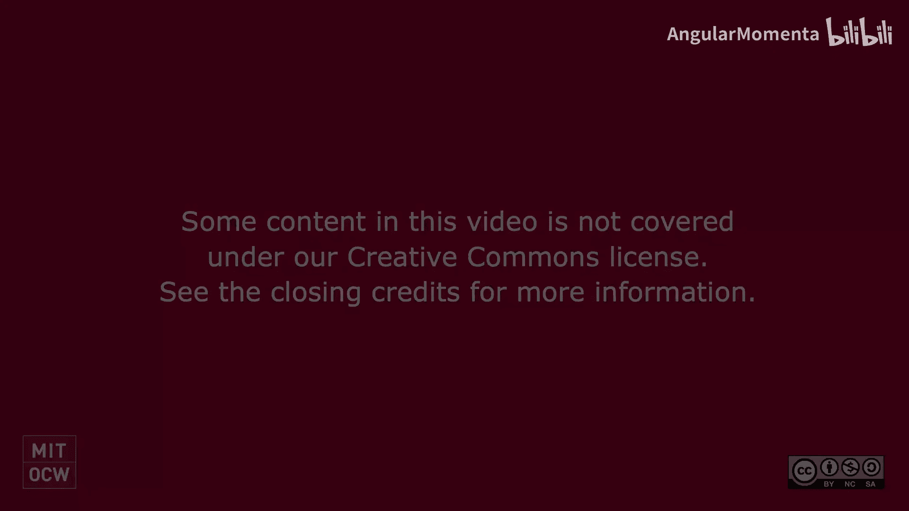
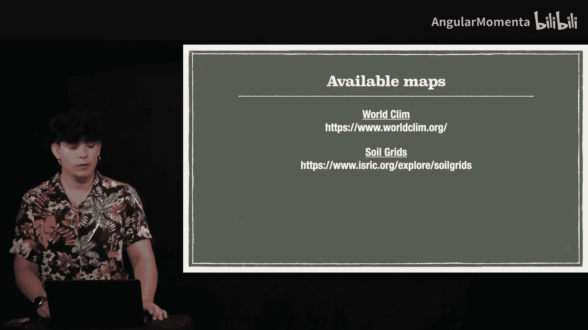

# 005：核心概念 🗺️

在本节课程中，我们将直接进入地理信息系统（GIS）的学习。在开始编写代码之前，我们需要确保大家对一些核心概念有共同的理解。因此，本节将重点澄清这些概念。

在本视频中，你将学习并熟悉以下概念：什么是矢量地图和栅格地图，它们之间的区别是什么，以及我们应在何种情况下选择使用哪一种。我们还将探讨地图投影的概念，为什么需要不同的投影方式，以及分辨率的概念及其在地图工作中的重要性。最后，我们将了解创建地图的两种主要方法：自上而下的卫星地图和自下而上的上尺度地图。

我的目标是，学完本节后，你将能够在R代码中应用和管理所有这些概念。

## 矢量地图与栅格地图 🧩

上一节我们介绍了GIS的基本范畴，本节中我们来看看地图的两种基本数据模型。

这里有两张图，它们描绘了同一幅图像，但使用了不同的地图数据模型：第一张使用的是**矢量地图**，第二张使用的是**栅格地图**。

它们的主要区别在于：
*   在矢量地图中，我们可以有不规则的多边形。
*   在栅格地图中，我们有一个网格，其中所有单元格大小相同、排列均匀。

这种差异会影响不同形状的呈现方式。如果我们关注物体的**形状**，可能会选择矢量地图；如果我们关注地图的**内容**（如地表覆盖类型），则可能选择栅格表示。

## 地图投影 🌍

我们知道，地球表面并非平面。为了将这个球体形状转换为平面进行表示，我们遇到了许多问题。因此，根据我们想要重点关注的区域，发展出了不同的**投影**方法。

每种表示方法都有其优缺点。例如，如果我们更关注极地地区的形状，会使用一种投影；如果我们想相对准确地观察整个地球，可能会选择另一种投影。

但这会影响到形状的呈现。例如，这是同一张脸，但根据我们选择的投影方式，其形状会发生变形。这是我们必须考虑的因素，因为如果我们想从不同地图中合并或提取信息，它们可能使用了不同的投影。

以下是南美洲在不同投影下的形状变化示例。在进行地图操作之前，我们必须确保所使用的投影方式适合我们想要表示或研究的地球区域，考虑工作的尺度（是区域性的还是全球性的），并确保所有地图使用相同的投影，以避免出现图中所示的问题。

## 分辨率 📐

这是一张图片，它可以很好地类比栅格地图，因为它们的构建原理相同。这里有两张相同的图像，主要区别在于正方形（像素）的大小完全不同：左边那张细节较少，右边那张则非常精细。

人们可能认为总是使用更高分辨率更好，但这也有一些缺点，即数据量会大得多。根据你计算机的处理能力或网络连接质量，你可能需要选择其一。需要提醒的是，有时即使提高分辨率，也可能无法获得更精确的计算结果，仅仅因为地图本身最初的质量就不高，是以较粗糙的分辨率创建的。因此，将粗糙分辨率转换为更精细的尺度，并不会创造出新的信息。

## 创建地图的方法：自上而下与自下而上 🛰️

上一节我们讨论了地图的表示方式，本节我们来看看地图是如何创建的。

以下是创建地图的两种主要方法。

### 自上而下方法（卫星地图）

我们知道有卫星在我们头顶环绕。它们就像一个大相机，拥有不同的传感器和镜头。它们对地球表面进行“拍照”或记录，发射不同波长的信号，接收反射回来的信号，然后解读这些信号，有时会应用一些校正，最终生成卫星图像。

### 自下而上方法（上尺度地图）

另一种创建地图的方法是在没有卫星信号时使用的**上尺度**方法。在第一张地图中，我们有许多点（以Doi等人2020年的论文为例）。这是一张上尺度地图的示例，其中包含了真实的实地测量数据点。

基于这些真实信息，利用一些环境驱动因子（如气候、地形等）建立一个模型。然后，利用这个模型，我们可以根据上尺度方法，填充不同数据点之间的空白区域，从而生成完整的地图。

## 数据资源 💾

最后，这里提供一些可以找到栅格地图数据的资源。

*   **WorldClim**：你可以在这里找到与环境相关的变量，例如与气候、降水、温度等相关的数据。
*   **SoilGrids**：如果你对获取土壤信息感兴趣，可以访问这里，他们提供了大量关于不同土壤的物理和化学属性数据。

## 总结 📝

本节课中，我们一起学习了地理信息系统的几个核心概念。我们区分了**矢量地图**（基于不规则多边形）和**栅格地图**（基于规则网格）及其适用场景。我们探讨了**地图投影**的必要性，理解了将三维球面转换为二维平面时产生的形状变形，并强调了在地图分析中统一投影的重要性。我们还了解了**分辨率**的概念，认识到高分辨率并非总是最佳选择，需权衡数据量与计算需求。最后，我们介绍了创建地图的两种途径：**自上而下**的卫星遥感方法和**自下而上**的基于实地数据的上尺度建模方法。掌握这些概念是后续在R语言中有效处理和分析空间数据的基础。