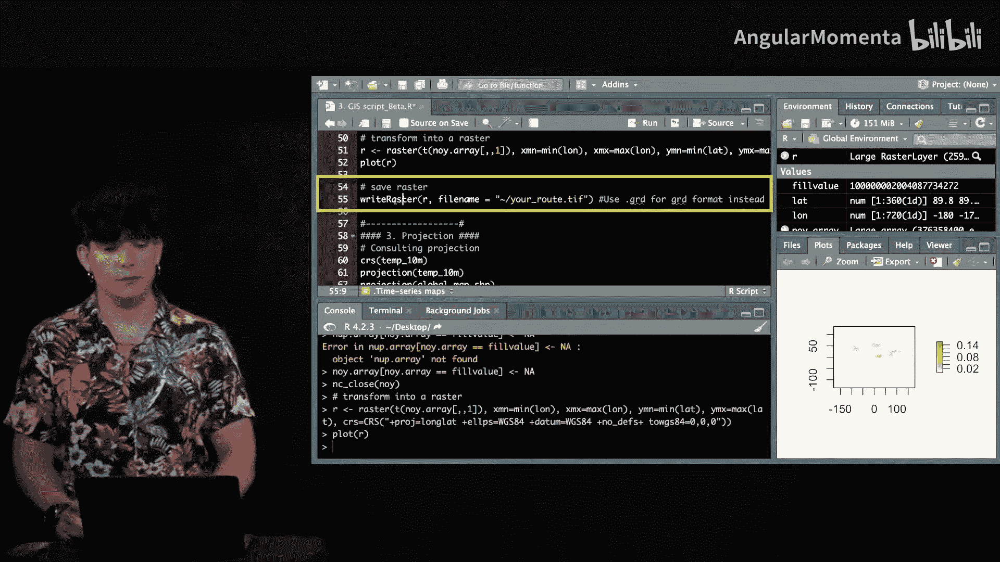
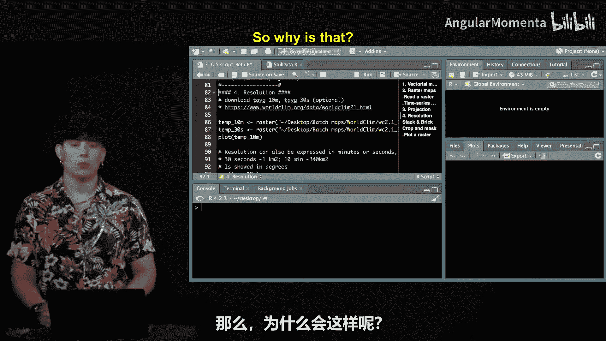
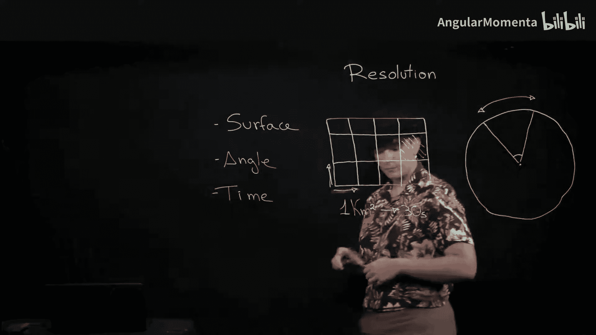
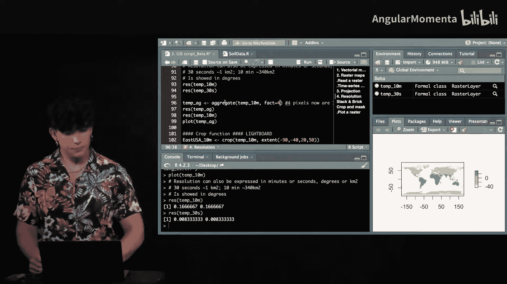

# 006：矢量地图、栅格地图与时间序列


在本节课中，我们将学习如何在R中读取和处理三种常见的地理空间数据：矢量地图、栅格地图以及时间序列格式的栅格数据。我们将通过具体的代码示例，演示如何加载、查看和操作这些数据，并理解地图分辨率的概念。

---

## 读取矢量地图 🗺️

上一节我们介绍了地理信息系统的基本概念，本节中我们来看看如何在R中读取矢量地图。矢量地图由点、线和多边形组成，常用于表示边界、道路等地理特征。

以下是读取矢量地图的三种方法：

1.  **使用 `readOGR` 函数**：此方法需要预先指定投影。
    ```r
    # 指定投影为WGS 84（经纬度）
    projection <- "+proj=longlat +datum=WGS84"
    # 读取地图文件
    vector_map <- readOGR(dsn = "你的文件路径", layer = "图层名", p4s = projection)
    ```

2.  **使用 `st_read` 函数（推荐）**：此方法更简洁，通常能自动识别投影。
    ```r
    vector_map <- st_read("你的文件路径/文件名.shp")
    ```

3.  **使用 `vect` 函数**：这是另一个可用的方法。
    ```r
    vector_map <- vect("你的文件路径/文件名.shp")
    ```

读取地图后，可以使用 `plot` 函数进行可视化。
```r
plot(vector_map)
```

---

## 处理栅格地图 🗾

接下来，我们转向栅格地图。栅格数据由像素矩阵构成，每个像素包含一个值（如温度、海拔），非常适合表示连续表面。

处理栅格数据最常用的包是 `raster`。

以下是读取和查看栅格地图的步骤：

1.  加载 `raster` 包。
    ```r
    library(raster)
    ```

2.  使用 `raster` 函数读取地图文件。
    ```r
    temperature_map <- raster("你的文件路径/温度地图.tif")
    ```

3.  使用 `plot` 函数查看地图。在RStudio中，可以点击绘图窗口的“Zoom”按钮放大查看。
    ```r
    plot(temperature_map)
    ```

---

## 处理时间序列栅格数据 ⏳

有时我们会遇到时间序列格式的栅格数据（例如，每年一张的全球氮沉降地图）。这类数据通常以NetCDF等高效格式存储，但处理起来略有不同。

以下是处理时间序列NetCDF格式栅格数据的步骤：

1.  加载必要的包。
    ```r
    library(ncdf4)
    library(raster)
    ```

2.  打开NetCDF文件并探索其结构。我们需要知道经度、纬度和时间维度的名称。
    ```r
    nc_data <- nc_open("你的文件路径/时间序列数据.nc")
    # 查看维度名称
    names(nc_data$dim)
    # 提取经度、纬度、时间信息
    lon <- ncvar_get(nc_data, "lon")
    lat <- ncvar_get(nc_data, "lat")
    time <- ncvar_get(nc_data, "time")
    # 提取栅格数据值
    data_array <- ncvar_get(nc_data, "你的变量名")
    ```



3.  处理缺失值。数据中的缺失值可能用特定数字（如9999）表示，需要将其替换为R的标准缺失值 `NA`。
    ```r
    # 假设-9999代表缺失值
    data_array[data_array == -9999] <- NA
    ```


4.  关闭NetCDF文件以释放内存。
    ```r
    nc_close(nc_data)
    ```

5.  将提取的数组转换为R的栅格对象以便分析和可视化。这里以提取时间序列中的第一张图为例。
    ```r
    # 提取第一个时间点的数据，并进行转置以使方向正确
    single_layer <- t(data_array[, , 1])
    # 创建栅格对象
    rst <- raster(single_layer,
                  xmn = min(lon), xmx = max(lon),
                  ymn = min(lat), ymx = max(lat),
                  crs = "+proj=longlat +datum=WGS84")
    plot(rst)
    ```



6.  将处理好的栅格数据写入本地文件。
    ```r
    writeRaster(rst, filename = "输出路径/文件名.tif", format = "GTiff")
    ```

---

## 理解地图分辨率 📐

最后，我们来探讨地图分辨率。分辨率决定了地图的细节程度。在下载数据（如WorldClim数据）时，常会遇到用时间单位（如10分钟、30秒）表示的分辨率选项。



地图分辨率主要有两种理解方式：

*   **基于面积**：例如“1平方公里”。这种方法在网格地图中直观，但由于地球是球体，越靠近两极，网格的实际面积变形越大，因此不够精确。
*   **基于角度/时间**：例如“30角秒”。这种方法将地球视为球面，用经度或纬度上的角度间隔（或地球自转相应角度所需的时间）来表示分辨率，更为准确。例如，1平方公里大致相当于30角秒的分辨率。

在R中，我们可以检查和更改栅格地图的分辨率。

1.  **检查分辨率**：`raster` 对象的分辨率以“度”为单位显示。
    ```r
    res(temperature_map)
    ```

2.  **降低分辨率（聚合）**：使用 `aggregate` 函数合并多个像元。`fact` 参数指定聚合因子。
    ```r
    # 将每4x4个像元聚合为1个像元，新像元的值取这16个像元的平均值
    low_res_map <- aggregate(temperature_map, fact = 4, fun = mean)
    res(low_res_map) # 查看新分辨率，度数变大了
    plot(low_res_map) # 图像会变得更粗糙
    ```

3.  **提高分辨率（插值）**：使用小于1的因子理论上可以细分像元，但这并不会增加真实数据的精度，只是通过插值创造了新数据，需谨慎使用。



---


本节课中我们一起学习了在R中处理矢量地图、栅格地图和时间序列栅格数据的基本方法，包括数据的读取、可视化、转换和分辨率调整。掌握这些操作是进行空间分析和制图的重要基础。