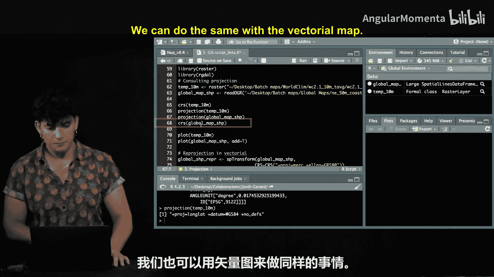

# 007：投影


## 概述

在本节课中，我们将要学习地理信息系统（GIS）中一个至关重要的概念：地图投影。我们将了解如何检查地图的投影信息，以及当两张地图投影不一致时，如何进行转换以确保它们可以一起使用。

## 检查地图投影信息

正如在其他视频中提到的，为了处理地图数据，我们需要确保它们使用相同的投影，以避免数据不匹配。为此，我将教你如何检查投影信息，以及如何提取相关信息。首先，我将上传一张栅格地图和一张矢量地图。第一张是基于WorldClim数据的1月气温图，第二张是我们之前使用过的矢量地图，它描绘了地球表面的形状。

检查投影信息的一种方法是使用`crs()`函数。点击这里，我们可以看到与此地图相关的大量信息，但有时我们只需要这一部分代码。这部分代码是R语言理解我们正在使用的投影所必需的。

如果我们想直接检查这部分信息，只需输入`projection()`函数和想要查询的地图名称。这样，我们就能得到仅与该投影相关的代码片段。我们可以对矢量地图进行同样的操作。

```r
# 检查栅格地图的投影
projection(temperature_raster)

# 检查矢量地图的投影
projection(world_vector)
```



## 验证投影一致性

在这个例子中，我们看到两张地图使用了相同的投影，因此我们可以毫无问题地处理它们。作为额外的检查，我将把它们叠加在一起绘制，以确认它们确实匹配。

我在这里绘制地图，为了将矢量地图叠加在上面，我只需要在代码中添加这一部分。这意味着它将在之前的绘图基础上进行叠加。

```r
# 绘制栅格地图
plot(temperature_raster)
# 叠加矢量地图
plot(world_vector, add = TRUE)
```

在这里，我们看到两张地图是匹配的，因此我们可以毫无问题地处理它们。但是，如果它们不在同一个投影中，我们需要将其中一个转换为另一个。

## 转换地图投影

有一个名为`spTransform()`的函数，它包含在我们一直使用的`sp`包中，可以用于转换矢量地图的投影。

例如，如果我想将当前使用的投影转换为墨卡托投影，并立即绘制它，你会看到地图的形状完全不同。

```r
# 将矢量地图转换为墨卡托投影
world_vector_mercator <- spTransform(world_vector, CRS("+proj=merc"))
plot(world_vector_mercator)
```

然而，如果我们想转换栅格地图的投影，就必须使用另一个函数，因为`spTransform()`对栅格地图无效。现在，我将上传从SoilGrids获取的土壤信息数据。SoilGrids数据使用的投影与WorldClim数据不同，因此我需要转换其中一个，以便同时处理它们。

## 处理不同投影的数据

首先，展示一下这些数据的样子。在这个例子中，它是土壤的阳离子交换容量图。你可以看到其形状与另一张地图略有不同。为了再次确认它使用了不同的投影，我们只需检查地图的信息。

我们在这里使用`crs()`函数，可以看到投影是不同的。因此，我将把气温图重新投影到土壤数据的投影系统中。为此，我将使用`projectRaster()`函数。

```r
# 将气温图重新投影到土壤数据的投影
temperature_reprojected <- projectRaster(temperature_raster, crs = crs(soil_data))
```

这个过程可能需要一些时间，因为当我们处理栅格地图时，数据量非常大，它是一个非常密集的网格，这使得处理这些地图的时间可能比处理矢量地图要长一些。

几分钟后，处理过程（希望）完成了。我将绘制结果图，看看我们得到了什么。

```r
plot(temperature_reprojected)
```

这里是我们得到的结果，气温图已经被转换到了土壤数据的投影中。为了再次确认，我们总是可以检查投影信息，看看它是否从原来的投影转换到了这个新的投影。

```r
projection(temperature_reprojected)
```

## 总结


本节课中，我们一起学习了GIS中地图投影的核心概念。我们掌握了如何使用`projection()`和`crs()`函数检查地图的投影信息，以及如何通过`spTransform()`和`projectRaster()`函数分别转换矢量地图和栅格地图的投影。确保所有地图数据使用统一的投影，是进行准确空间分析和制图的基础。