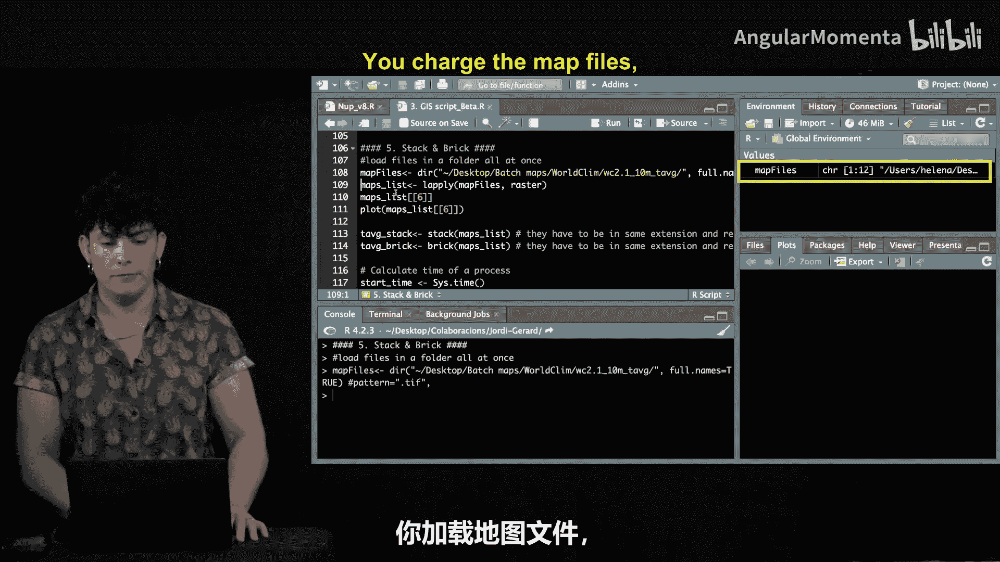
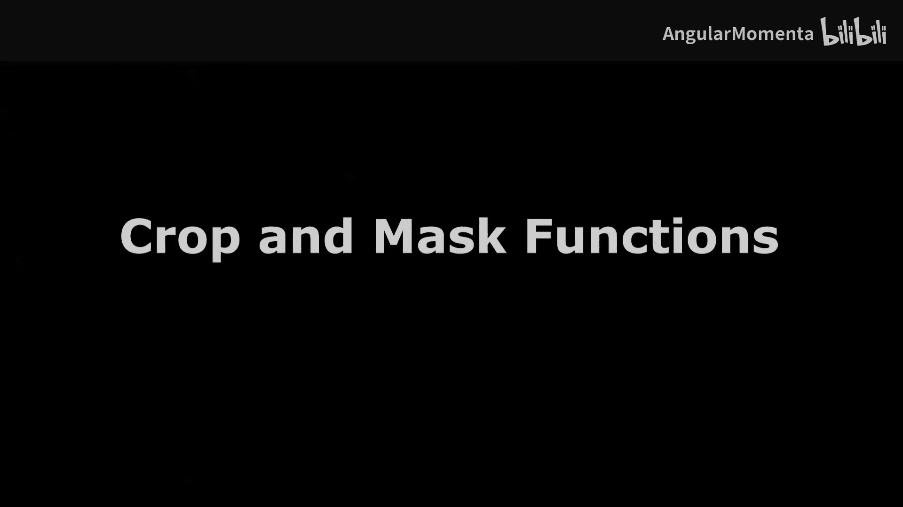

# 008：堆叠、砖块、裁剪与掩膜 📚✂️🎭


在本节课中，我们将要学习R语言中处理栅格数据的几个核心操作：创建堆叠（Stack）与砖块（Brick）、裁剪（Crop）以及掩膜（Mask）。这些功能对于高效地管理和分析多图层地理空间数据至关重要。

## 堆叠与砖块：地图的“书本”

上一节我们介绍了基础的栅格数据操作，本节中我们来看看如何将多个栅格图层组合起来。堆叠（Stack）和砖块（Brick）可以被理解为地图的“书本”。想象一下，每一张地图就像一页纸，而堆叠和砖块的功能就是将这些纸装订成一本书。

这种组合方式非常有用，因为它允许我们对一组地图执行标准化的处理流程。例如，我们可以将它们裁剪成相同的形状、转换为相同的分辨率，或者基于这组地图进行计算。同时，我们也可以将组合后的堆叠或砖块对象存储在计算机中。

以下是创建堆叠或砖块的具体步骤：

1.  **指定文件路径**：首先，我们需要指定包含所有地图文件的目录路径。在本例中，我们使用之前下载的“worldC”数据，该文件夹包含12张代表各月平均温度的地图。
2.  **批量读取文件**：我们可以使用一种便捷的方法一次性读取所有文件，而无需每次都键入完整路径。如果文件夹中还有其他类型的文件，我们可以在代码中添加模式（如`pattern = “.tif”`）来只读取TIF格式的文件。本例中所有文件都是TIF格式，因此无需此步骤。
3.  **转换为栅格列表**：读取文件路径后，我们使用`lapply`函数将所有路径对应的文件转换为栅格（Raster）对象。这样我们就得到了一个包含12张地图的列表。
4.  **创建堆叠或砖块**：最后，我们使用`stack()`或`brick()`函数将这个栅格列表组合成一个堆叠或砖块对象。两者在大多数工作目的下基本相同，但内部数据组织方式略有不同。有时某些处理过程可能需要特定的类型。关键前提是，所有栅格必须具有相同的空间范围（extent）和分辨率（resolution），否则无法组合。



```r
# 示例代码：创建栅格砖块并计算标准差
library(raster)

# 1. 指定包含TIF文件的目录路径
file_directory <- “你的/文件/路径/worldC_data”

# 2. 获取所有TIF文件路径
map_files <- list.files(path = file_directory, pattern = “\\.tif$”, full.names = TRUE)

# 3. 将所有文件读取为栅格列表
raster_list <- lapply(map_files, raster)

# 4. 将列表转换为栅格砖块
temperature_brick <- brick(raster_list)

# 5. 基于砖块进行计算，例如计算所有月份温度的标准差
temp_sd <- calc(temperature_brick, fun = sd)

# 查看结果
plot(temp_sd)
```

## 裁剪功能：聚焦研究区域

接下来，我们介绍裁剪（Crop）功能。这个功能可用于裁剪单张地图，也可以用于裁剪整个砖块或堆叠对象，将它们切割成更小的部分。

例如，我们可以基于美国东海岸的经纬度坐标，裁剪一张全球温度地图。这个工具非常实用，尤其是在测试代码时。处理大型地图可能非常耗时，你可以先裁剪出一小块区域作为样本，在此样本上运行并验证你的代码逻辑。确认一切运行无误后，再对整个地图执行处理过程，这样可以节省大量时间。

```r
# 示例代码：裁剪地图
# 假设 `global_temp` 是一个已加载的全球温度栅格对象

# 定义裁剪范围（例如，美国东海岸的大致范围）
eastern_us_extent <- extent(-85, -65, 25, 45) # 格式：xmin, xmax, ymin, ymax

# 执行裁剪
cropped_temp <- crop(global_temp, eastern_us_extent)

# 查看裁剪结果
plot(cropped_temp)
```

## 掩膜功能：提取特定区域数据



最后，我们探讨一个特别有用的功能：掩膜（Mask）。掩膜操作允许我们根据另一个栅格（掩膜层）的形状来提取或隐藏当前栅格的数据。

举个例子，假设我们有一张1901年的全球氮沉降地图，它覆盖了整个地球表面，包括海洋。如果我们只想获取陆地上的氮沉降数据，该怎么办？

我们可以使用一张仅包含陆地（或排除水体）的地图（例如一张温度图，其数据在海洋区域为`NA`）作为掩膜。通过`mask()`函数，原氮沉降地图中与掩膜层`NA`区域对应的部分也会被设置为`NA`，从而实现只保留陆地数据的效果。

但在执行掩膜前，必须确保两个栅格图层的空间范围、投影和分辨率完全一致。如果遇到范围不匹配的错误，可以使用`resample()`函数将一个图层的这些属性调整到与另一个图层相同。

```r
# 示例代码：掩膜操作
# 假设 `nitrogen_map` 是氮沉降栅格，`land_mask` 是陆地掩膜栅格（海洋处为NA）

# 检查并调整属性一致（如果需要）
if (!compareRaster(nitrogen_map, land_mask)) {
  nitrogen_map_resampled <- resample(nitrogen_map, land_mask, method = ‘bilinear’)
} else {
  nitrogen_map_resampled <- nitrogen_map
}

# 执行掩膜：只保留陆地部分的数据
nitrogen_land_only <- mask(nitrogen_map_resampled, land_mask)

# 查看掩膜后的结果
plot(nitrogen_land_only)
```

## 保存处理结果

处理后的栅格数据可以保存到本地。对于单个栅格，可以使用`writeRaster()`函数保存为TIF等格式。对于堆叠或砖块，若想保存为R原生格式，可使用`.grd`和`.gri`扩展名，但需注意这两个文件必须始终在同一目录下，否则数据可能无法正确读取。

此外，在运行如`calc()`这类栅格处理函数时，可以直接在参数中指定`filename`，这样R会在计算的同时将结果写入磁盘，一举两得。

---


本节课中我们一起学习了R语言GIS中的四个强大工具：**堆叠（Stack）与砖块（Brick）** 用于整合多图层数据；**裁剪（Crop）** 用于聚焦特定地理区域；**掩膜（Mask）** 用于根据模板提取数据。掌握这些操作能极大地提升我们处理和分析空间数据的效率和灵活性。