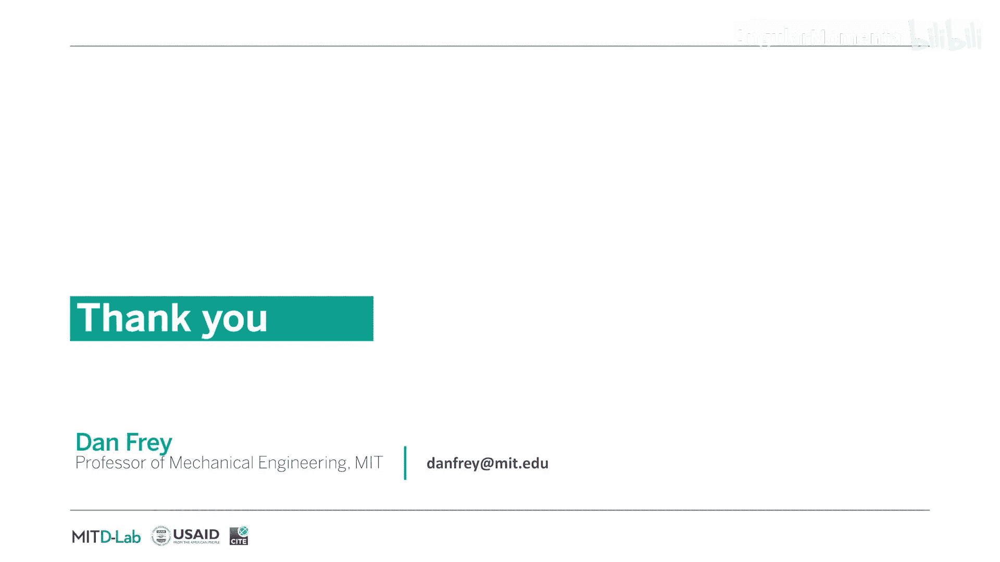

**机器学习公平性探索：P01-01：机器学习伦理导论** 👨‍🏫

在本节课中，我们将初步了解机器学习伦理的重要性，特别是公平性问题。我们将认识课程的主讲人，并了解本课程旨在解决的核心挑战。

大家好，我是丹·弗莱，麻省理工学院数字学习实验室的研究主任。同时，我也是“技术评估综合倡议”的首席研究员，我们通常用其缩写 **SITE** 来指代这个项目。

SITE 项目旨在评估各种技术和产品，以便我们更好地理解哪些表现最佳，以及在特定情境下哪些能提供最佳价值。关于产品和技术的更优信息，也有助于我们在国际发展背景下更好地实施这些技术。

现在，这个议题在机器学习领域尤为重要。我们知道，这些令人兴奋的新技术有时可能引发或传播某些不平等或偏见。目前，研究界正在涌现一系列技术，可以通过调整算法或修改数据集来帮助我们缓解这些问题，从而提供更好、更公平、更公正的结果。

我们希望您能深入参与本课程，我们将提供相关知识，帮助您在自己的专业实践中更好地应用这些技术。

感谢您加入本课程。

---

本节课中，我们一起认识了课程的主讲人丹·弗莱及其背景，并初步了解了机器学习中存在的公平性挑战以及本课程的目标。下一节，我们将开始深入探讨机器学习中偏见的具体来源和表现形式。