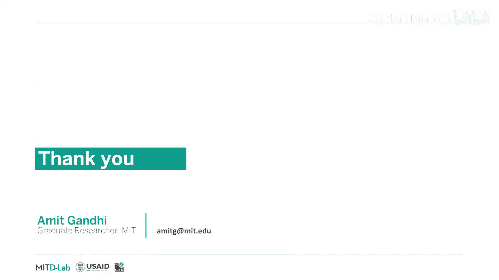
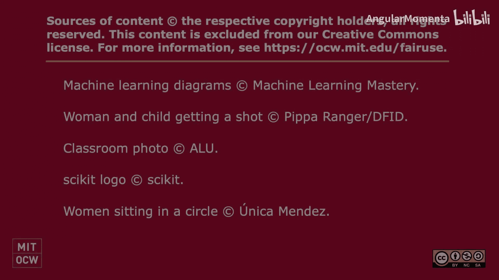

# 002：课程介绍与动机

大家好，我是Aid Gandhi，麻省理工学院的一名研究生研究员。欢迎来到这门关于探索机器学习公平性及其在国际发展领域应用的课程。我将介绍开设这门课程的动机，解释为何关注伦理和技术的恰当使用至关重要，并概述我们将要涵盖的主题。

## 课程概述

在本节课中，我们将学习机器学习在国际发展领域的应用概况，理解关注其伦理问题的必要性，并预览整个课程的结构安排。

## 机器学习在国际发展中的应用

让我们从介绍机器学习如何应用于国际发展领域开始。作为简要回顾，**机器学习是人工智能的一个分支，其软件基于经验学习如何执行任务，而非通过明确的编程指令**。

因此，这项新兴技术可广泛应用于许多领域，并能以前所未有的方式利用数据的力量。机器学习的一些应用领域包括医疗保健、劳动力发展和金融普惠。

在接下来的内容中，我将介绍机器学习的一些使用方式。我们将在后续模块中更深入地探讨机器学习的伦理使用问题。

以下是机器学习在几个关键领域的具体应用：

*   **医疗保健**：机器学习的显著进步使得对医疗状况的快速诊断成为可能。一些组织正在开发从传感器到智能手机应用等一系列工具，供社区卫生工作者收集患者数据，获取关于疾病传播和发生模式的新见解，并在医院和诊所之外进行诊断。这极大地提高了偏远地区个人可获得医疗服务的可及性和质量。
*   **劳动力发展**：机器学习可以通过将具备技能的个体与合适的工作岗位匹配来降低失业率。例如，在印度，招聘经理更关注学历和技能，这使得没有正式学历的人难以被雇用或晋升。印度公司Aspiring Minds开发了一项计算机测试，用于评估申请人的能力，并将他们与薪酬更高的工作联系起来。
*   **金融普惠**：一些组织正在使用机器学习来确定个人的信用价值，尤其是在其他正规信贷系统可能不存在或难以获得的地区。这些公司部署了“即用即付”服务，范围涵盖太阳能照明系统到农业投入品，并正在生成和收集关于用户资产和还款情况的非传统数据。这些数据可用于通过机器学习确定信用价值，使个人能够获得原本无法获得的贷款或融资。

## 技术的普及与潜在风险

机器学习技术已存在数十年，但近年来的使用率有所增加。在过去十年中，这项技术变得更加易于获取。机器学习正在全球许多大学中教授，一些数据分析平台也发布了机器学习库和工具箱。例如，借助开源Python库**Scikit-learn**，熟悉编程的人可以在几天内开始训练机器学习模型。

尽管机器学习的应用前景广阔，但承认其局限性同样重要。机器学习对社会的影响尚未被充分理解。若不仔细关注这些问题，我们可能会应用一些不仅无效，还可能通过强化现有的社会不平等和排斥模式而对人们造成伤害的系统。

在发达国家，如FAT或AI Now等研究团体，已有一个庞大的研究社区关注此领域。一个众所周知的例子是关于性别差异化的信用评分。发展中国家的低收入女性通常缺乏信用记录和正式收入，尽管有证据表明这些女性违约贷款的比例低于男性。数据的缺乏使得贷款机构难以为这些女性提供贷款。因此，从非正规贷款机构获取掠夺性贷款成为一种普遍做法。

## 课程结构预览

虽然许多关于机器学习伦理的概念具有普适性，但专门针对国际发展相关问题的机器学习公平性研究仍处于早期阶段。下一节视频将讨论为确保这项技术的伦理使用所做的持续努力，内容将基于美国国际开发署数字发展中心制定的“恰当使用框架”。

在第二组模块中，我们将介绍目前在国际发展中使用机器学习的组织的案例研究，并讨论这些例子中可能出现的潜在伦理问题。从高层次上，我们将介绍如何解决这些问题的方法以及可能的结果意味着什么。

在第三组模块中，我们将提出一个应对伦理挑战的框架。内容包括受保护属性、通过“无视”实现的公平性、选择与公平性标准，以及减轻偏见的技术。

在第四组模块中，我们将介绍来自组织的案例研究，展示如何恰当地实施机器学习。

## 总结

本节课中，我们一起学习了机器学习在国际发展中的广泛应用及其带来的巨大潜力，同时也认识到不加审视地应用该技术可能加剧社会不公的风险。我们概述了本课程的整体结构，后续将深入探讨伦理框架、案例分析和具体实践方法。

感谢您花时间观看这些视频，我们希望您能继续观看本系列的其他内容。

