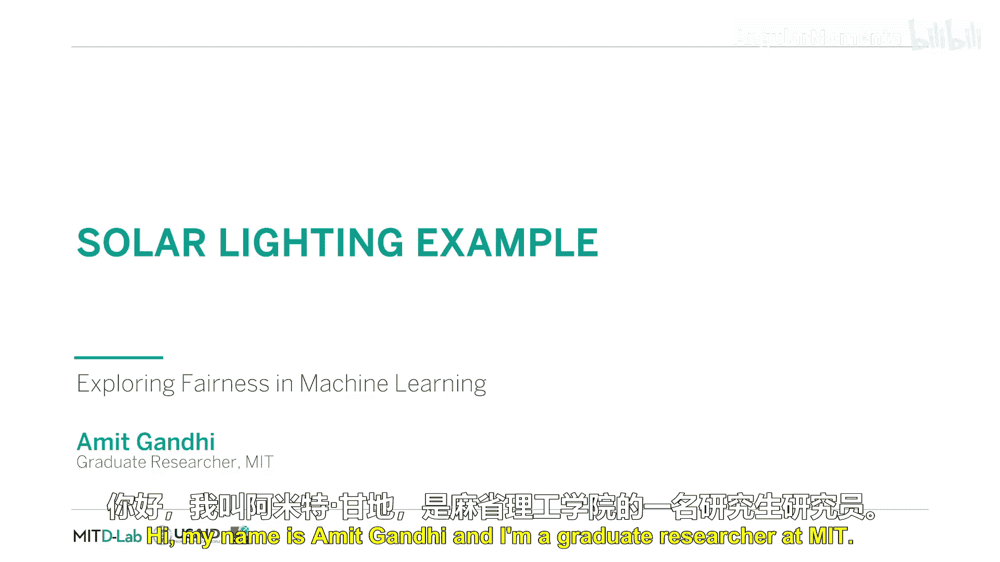

# 004：太阳能照明示例

在本节课中，我们将通过一个社会企业的案例，探讨在机器学习项目实施过程中可能遇到的伦理挑战与公平性问题。我们将扮演一家在东非提供太阳能照明产品的公司的首席技术官，了解从数据收集、模型构建到规模化部署的完整流程中需要考虑的关键决策。

## 案例背景

上一节我们介绍了机器学习公平性的基本概念，本节中我们来看看一个具体的应用场景。

我名叫阿米特·甘地，是麻省理工学院的一名研究生研究员。欢迎来到这个关于国际发展中机器学习公平性探索的系列课程。在本模块中，我们将通过一个示例，了解一个组织如何实施机器学习，以及可能产生的一些伦理挑战。

本模块主要关注组织层面做出的决策，但对于组织决策者和机器学习实施者而言，考虑这些互动都很重要。

在这个案例研究中，我们将扮演一家在东非提供太阳能照明产品的社会企业的首席技术官。公司的使命是为生活贫困的人们提供负担得起的照明解决方案。公司最初提供高质量、低成本的太阳能灯，以替代煤油灯。

随着时间的推移，公司不断发展，增加了产品种类，包括大型太阳能家用系统，并在此过程中实施了“随用随付”模式，以便家庭能够负担得起购买这些更大的系统。

“随用随付”模式的工作原理是：公司将太阳能照明基础设施作为贷款资产提供给个人，用户通过移动支付在一段时间内偿还，直到收回资产的全部价值。

公司一直细致地保存用户交易记录，因此可以获取所有客户的**人口统计信息**和**支付历史**。

从用户那里获得的信息包括**年龄**、**性别**、**职业**、**地理位置**和**家庭收入**。在寻求扩大企业社会影响力的过程中，你意识到可以分析这些数据，为客户确定一个**信用评分指标**。

此外，你可以将这些信息提供给银行或小额信贷机构，以便他们可以向你的客户群发放贷款。

## 实施决策与挑战

机器学习是实施这一信用评分指标的有力工具。然而，你的团队内部没有数据科学家或机器学习专家来实施这个解决方案。

你也不知道开发的算法能有多准确或多强大，因此你不想投入资源组建一个完整的团队，而是选择在乌干达的部分用户中运行一个小型试点项目。

作为一家拥有工程人员的资源丰富的公司，你可以选择让一些工程师使用现成的产品实施机器学习解决方案，或者与第三方公司合作实施信用评分解决方案。

让我们暂停一下这个案例研究，审视需要做出的决策的利弊。从机器学习实施者和组织双方的角度来考虑问题非常重要，以便理解开发解决方案过程中的想法和复杂性。

在没有训练有素的数据科学家的情况下内部实施，很可能涉及一个“黑箱”解决方案的实现。

虽然一个没有机器学习背景的人可以相当快地让解决方案运行起来，但设计中的一些细微差别可能会被忽视。

让第三方顾问实施你的解决方案可以解决许多这些问题，尽管你可能缺乏内部能力来理解模型的实施方式并进行后续维护。

## 公平性问题

让我们假设，无论如何，信用评分算法在构建时没有关注公平性设置，可能会出现几个问题。

首先，在分析历史数据时，你可能会发现某些人群的违约率与其他人群不同。

例如，女性的违约率可能低于男性。作为一家组织，你可能决定在贷款决策中希望保持公平和性别中立。

幻灯片展示了男性和女性不同贷款率的一个例子。

为了实现公平，一个天真的实施者可能会首先尝试使用“**公平无意识**”方法，这意味着在构建模型时简单地隐藏性别信息。

根据数据内部的相关性以及性别与违约率的相关程度，你的模型仍然可能在模型中预测出性别。

其次，由于你的数据显示了违约率的差异，你必须主动决定如何纠正这一点。在贷款案例中，实现公平的不同方法可能会与算法的准确性产生权衡。

第三，实施者使用的算法类型也可能存在权衡。有些算法可能速度更快，但牺牲了准确性；另一些算法可能更准确，但牺牲了可解释性或可理解性。

我不会更深入地讨论这些主题，因为我们将在未来的模块中进一步讨论。然而，我想强调几个重要概念。

第一，实施机器学习算法不是一个客观的过程。在你的实施中，你既在设计一项技术，也在做出决策，这两者都将你的偏见引入了系统。认为计算机产生的结果是客观的，这只是一种幻想。

第二，你与实施者之间就你作为组织的价值观以及他们正在做出的决策进行公开沟通至关重要。

第三，如果你想要一个公平的系统，你需要一种方法来审计你的数据和算法。

## 规模化部署

让我们继续，假设你能够与顾问合作，为你的算法构建一个令人满意的解决方案，并且你在乌干达西部的试点项目中取得了显著成功。

你现在希望将你的模型推广到乌干达其他地区和东非。在这一点上，关注数据的代表性非常重要。

你在乌干达西部和东部的用户类型是否存在巨大差异？乌干达和坦桑尼亚的用户又如何？你需要确保在扩展解决方案时收集具有代表性的数据，这涉及大量的测试和审计。

此外，你需要确保人群内部的变化不会突然影响你的结果。例如，如果政府征收一项新的税收，你的模型是否就不再准确？你如何在组织内部建立支持，以确保能够应对变化？

感谢你花时间学习本课程。我们希望你能继续观看本系列的其他模块。

## 总结

本节课中，我们一起学习了如何通过一个太阳能照明公司的具体案例，审视机器学习项目从构思到规模化部署的全过程。我们看到了数据收集、模型构建方式选择（内部开发 vs. 第三方合作）、算法公平性挑战（如“公平无意识”的局限性），以及规模化时数据代表性的重要性。关键要点在于，机器学习决策并非完全客观，它融合了技术设计和组织价值观，因此持续的沟通、审计和对公平性的主动考量至关重要。