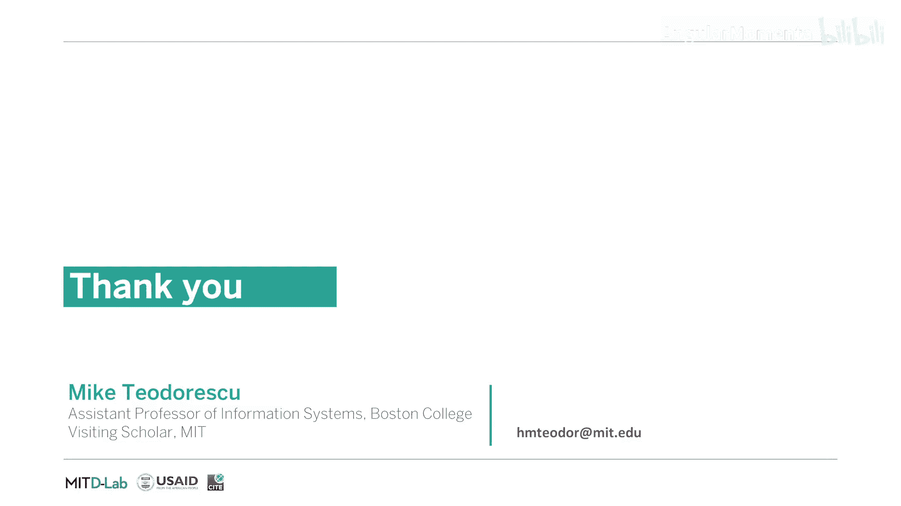

**机器学习公平性探索：P05-05：公平性标准**

在本节课中，我们将学习机器学习中的公平性标准。我们将介绍混淆矩阵的概念，并探讨三种流行的公平性标准：人口统计均等、机会均等和均等几率。

---

一些国家的法律保护特定人群免受基于某些属性的歧视。正如我们在之前的视频中讨论过的，这些属性被称为**受保护属性**。幻灯片上列出了一些例子。无论法律环境如何，机器学习都有可能对特定人群产生不公平的结果。作为算法设计者，应该对公平性标准做出明确选择。接下来的几张幻灯片将回顾一些标准。

上一节我们讨论了**公平无视**，即从模型中排除受保护属性。我们也解释了为什么这不是一个好的选择。具体来说，你可能会引入其他与受保护属性相关的属性，从而仍然可能无意中造成歧视。

为了深入探讨其他公平性标准，我们需要讨论一些额外的概念。

---

**混淆矩阵**

考虑一个二元分类器。例如，你正在处理是否雇佣或是否批准贷款的决定。如果我们查看一个二元分类模型的预测结果，我们可以将预测值分为四类：

*   **真阳性**：被正确分类为阳性的值。
*   **真阴性**：被正确分类为阴性的值。
*   **假阳性**：被算法错误分类为阳性的值。
*   **假阴性**：被算法错误分类为阴性的值。

如果我们把真阳性和真阴性相加，然后除以所有四类之和，就会得到模型的**准确率**。在这个例子中，准确率的公式是：

`准确率 = (真阳性 + 真阴性) / (真阳性 + 真阴性 + 假阳性 + 假阴性)`

准确率为0.5等同于随机分类。

现在我们需要仔细审视准确率，它并没有告诉我们关于阴性预测的任何信息。如果两个类别不平衡，它可能会误导我们。例如，如果样本中90%是阳性，10%是阴性。为此，我们有其他更深入的评估标准，如MCC分数和AUC分数。

真阳性、真阴性、假阳性、假阴性通常以2x2矩阵的形式呈现，称为**混淆矩阵**。这为我们观察分类器的行为提供了一种更简便的展示方式。

---

**人口统计均等**

第一个著名的公平性标准称为**人口统计均等**。这是一个**群体层面公平**的标准。该标准规定，结果（此处记为 `Y_hat`）应与受保护属性 `A` 独立。例如，被雇佣的概率应与性别无关。

人口统计均等存在多个问题。首先，如果我们有同时属于多个受保护群体的个体，我们刚刚讨论的定义可能不成立。通过强制一个属性的群体层面公平，我们可能仍然会违反其他属性或属性组合（如人口子群）的群体公平。

此外，在强制群体层面公平时，例如，为女性和男性设定相同的雇佣比例，这对个体而言可能仍然不公平。它可能迫使算法放弃原本合格的个体，仅仅是为了实现结果与属性的独立性。

群体层面的公平可能在个体层面不公平。例如，如果我们有很高的假阳性率，我们可能会有很低的假阴性率。这仍然可能对个体不公平，因为我们可能雇佣了不合格的人，而损害了其他本应被雇佣的合格个体的利益。

理想的情况是低假阴性和低假阳性，这可能对个体和群体层面都公平。我们也可能陷入最坏的情况，即低准确率、对个体不公平，但可能对群体公平，此时假阴性和假阳性都很高。

---

**机会均等与均等几率**

更严格的标准是**均等几率**，这意味着对于受保护属性的不同取值，需要匹配其**真阳性率**和**假阳性率**。这比人口统计均等更难实现，但属于算法公平性的更高层次。在这种情况下，与人口统计均等要求在受保护社会属性的子群中预测相同的平均风险不同，均等几率更严格，它只强制在达到相似结果的个体之间实现平等。

在我们之前视频讨论的雇佣例子中，这意味着合格申请人被雇佣的概率，以及不合格申请人被错误雇佣的概率，应在不同性别间相同。

均等几率的一个较温和版本是**机会均等**，我们只关心公平对待那些被确定为值得接受（即因变量 `Y` 等于1）的个体，例如值得被雇佣、值得被录取的人等。机会均等不关心在不同受保护群体中公平地拒绝人。

可以说，假阳性率和真阳性率不需要在受保护类别间都相等；我们只需要真阳性率在受保护类别间相等。在某种程度上，机会均等比均等几率干预性更小，根据你的具体情况和实施挑战，可能更容易实现。

在雇佣的例子中，我们只关心那些值得被雇佣的个体，即实际合格的申请人。而在被拒绝的申请人中，我们有时可能不公平地拒绝了人。

---

**回顾与总结**

以下是关于最后两个视频的一些思考问题：
*   什么是人口统计均等？
*   什么是公平无视？
*   群体层面的公平总是最好的吗？
*   什么是混淆矩阵？
*   什么是均等几率标准？你何时可能想使用它？

本节课由美国国际开发署通过MIT数字学习实验室资助。这是与我的教师同事——波士顿学院的Lily Mor和Gerald Kane，以及MIT数字学习实验室的研究助理Yaziita Wat——合作完成的。

如果你想了解更多，请查阅以下参考文献。

非常感谢观看本视频，希望你觉得它有用，并继续观看本课程的其他部分。

---

**图表说明**

*   **图1：混淆矩阵**：展示了二元分类中真阳性、假阳性、真阴性、假阴性的分布。
*   **图2：公平性权衡空间**：一个二维坐标图，横轴是“对个体公平”，纵轴是“对群体公平”。图中标注了四个象限可能对应的公平性情况，例如“高个体公平，高群体公平”（理想情况）、“低个体公平，高群体公平”（可能由强制群体配额导致）等，直观展示了不同公平性标准可能带来的权衡。