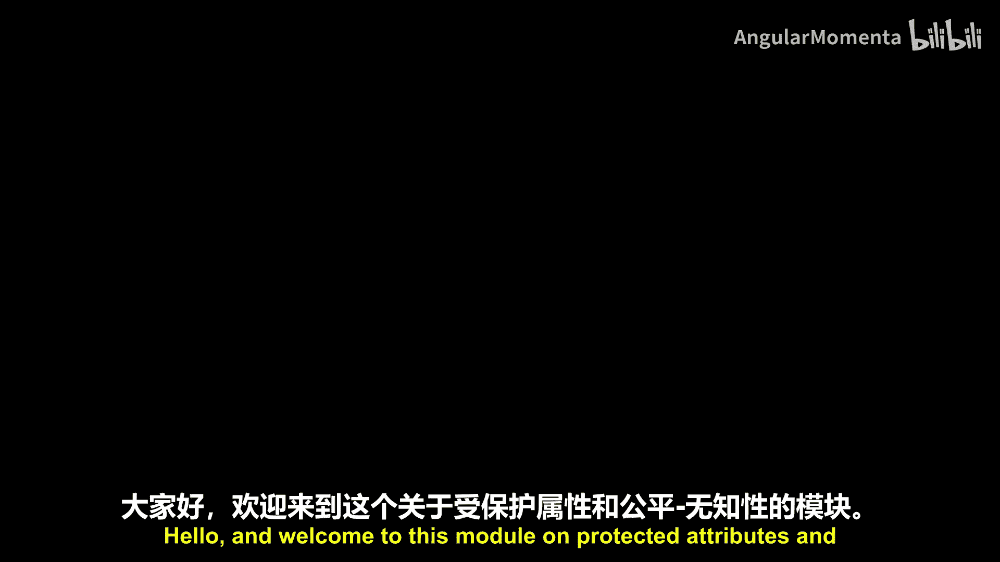
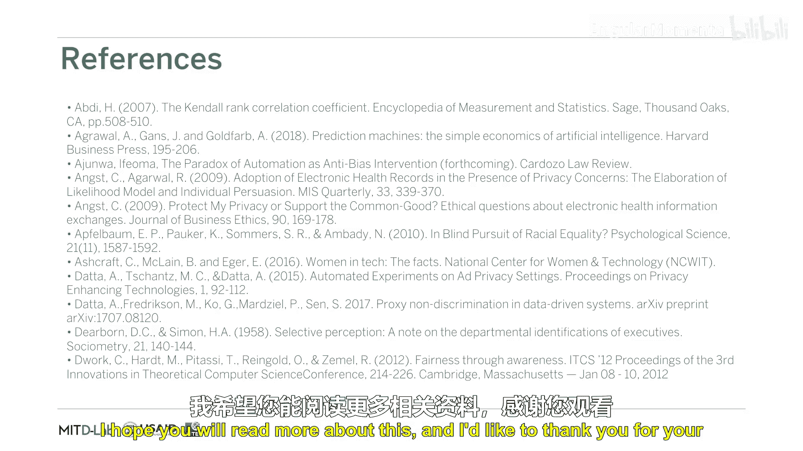
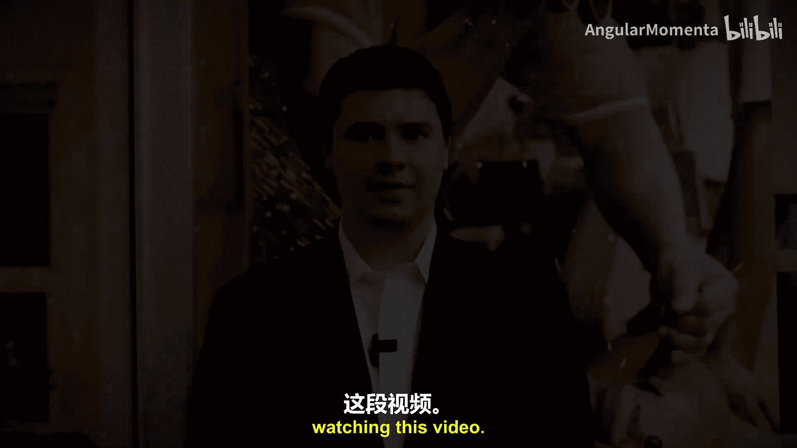
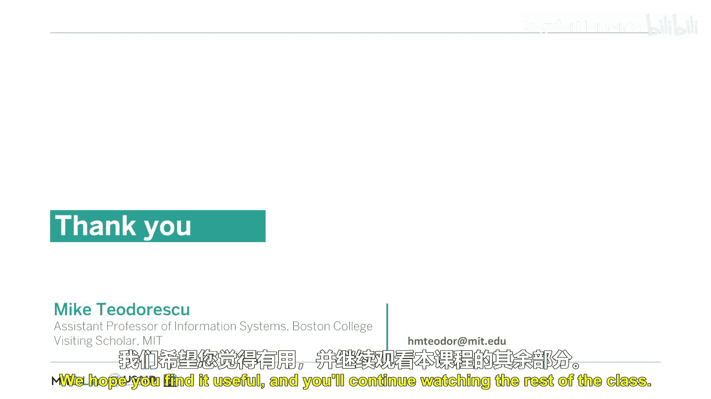

# 006：受保护属性与“通过无意识实现公平”

在本节课中，我们将要学习机器学习中的受保护属性概念，以及一种基础的公平性处理方法——“通过无意识实现公平”。我们将探讨法律如何定义受保护属性，并通过实例了解机器学习模型如何无意中引入偏见。

机器学习既带来机遇，也带来风险。它可以自动化重复性任务以降低成本，但也可能引入偏见。某些个人属性通常被标记为**受保护属性**，因为它们可能是社会偏见的来源。这些属性包括种族、宗教、国籍、性别、婚姻状况、年龄和社会经济地位。

在美国，基于这些受保护属性在住房、贷款和就业方面的歧视是非法的。以下是一些相关法律供参考：
*   《民权法案》第七章
*   《公平住房法案》
*   《平等信贷机会法案》
*   《就业年龄歧视法案》

然而，无论法律框架如何，机器学习仍有可能无意中引入偏见。本节课我们将看几个例子。下一讲将探讨一些减轻这种无意偏见的方法。

即使是大公司也可能存在歧视。例如，亚马逊曾使用机器学习算法筛选简历，后来发现该算法歧视女性申请人。在另一个来自刑事司法系统的例子中，机器学习被用于评估再犯风险。该系统在多项研究中受到质疑，特别是关于种族和性别这两个受保护属性。还有一个例子涉及大型组织使用机器学习展示广告，Facebook曾因涉嫌违反《公平住房法案》而被起诉。

因此，即使是亚马逊和Facebook这样的大型组织，也发现机器学习公平性具有挑战性。我们希望本课程能帮助软件工程师更好地应对机器学习公平性问题。

一般来说，在实现机器学习算法之前，你需要收集数据来训练算法。这个数据集包含结果变量 `y`（例如，决定雇佣或不雇佣）以及所有预测变量（例如，从简历中收集的特征）。这个完整的数据集随后需要被分割为**训练集**（模型在此学习）和**测试集**（我们在此评估模型性能）。还有其他细节如交叉验证，此处不展开，但鼓励你进一步学习。

高质量的训练集是良好预测的基础。低质量数据通常会导致糟糕的预测。为数据打标签的个体（例如，将简历标记为“雇佣”或“不雇佣”的经理）可能带有偏见，这些偏见随后会被机器学习算法习得。训练数据可能对某些群体不具有代表性，这可能导致偏见。此外，输入数据中可能存在隐藏的相关性，例如一个受保护属性与另一个预测变量相关，这也可能导致偏见。为数据打标签的个体可能做出有偏见的判断，这种现象被称为选择性感知，其本身也可能成为偏见的来源。

机器学习中默认的公平性方法是“**通过无意识实现公平**”。它指的是在模型训练中排除受保护属性，如性别、种族和其他被视为敏感的特征。

人们曾认为这种方法可以消除不平等，但实际上发现它可能延续不平等。它可能通过以下方式做到这一点：数据中可能存在其他与受保护属性高度相关的属性，当我们忽略受保护属性时，这些相关属性仍会被包含在模型中。这实际上可能延续不平等。当种族、性别和其他敏感变量被保护时，其他变量如毕业院校、家乡或其他简历指标（这些可能不受保护）仍可能与这些受保护属性高度相关。因此，完全忽略受保护属性可能无法揭示数据中这些隐藏的相关性。这被称为**代理编码**。

在一个例子中，卡内基梅隆大学的研究发现，性别在谷歌的广告系统中引发了无意的变化，例如高收入工作的广告展示给男性的频率几乎是展示给女性的六倍。这可能是“通过无意识实现公平”的一个例子。

以下是关于本材料的一些思考问题：
*   在你工作的环境中，哪些是敏感属性？
*   你认为当前的受保护属性列表是详尽无遗的吗？
*   什么是“通过无意识实现公平”？
*   在你所在的国家，哪些变量可能导致机器学习招聘系统产生有偏见的预测？
*   一个组织选择“通过无意识实现公平”方法会面临哪些风险？

我要感谢我的合著者Li Morrisris、Gerald Kane和Yazida Wad，他们的一项研究帮助我整理了所有这些幻灯片。同时感谢USAID关于在发展中国家适当使用机器学习的资助，以及卡尔管理学院的研究经费。我还要感谢所有为这些视频及配套手稿提供反馈的人。

我想与你分享一些我在准备这些材料时发现有用的参考文献，希望你能进一步阅读。感谢你观看本视频的专注。非常感谢你观看本视频，希望你觉得它有用，并继续观看本课程的其他部分。

🎼好的。

---

**本节课总结**

本节课我们一起学习了机器学习公平性的核心概念。我们首先了解了**受保护属性**（如种族、性别）的法律定义及其作为偏见来源的重要性。接着，我们探讨了机器学习模型无意中引入偏见的风险，并通过亚马逊、刑事司法系统和Facebook的实例进行了说明。然后，我们详细介绍了基础的公平性处理方法——**“通过无意识实现公平”**，即从模型中排除受保护属性。然而，我们也认识到这种方法可能因**代理编码**（即其他变量与受保护属性高度相关）而失效，从而无意中延续不平等。最后，我们提出了一系列问题，引导大家思考如何在实际工作中识别和应对这些公平性挑战。