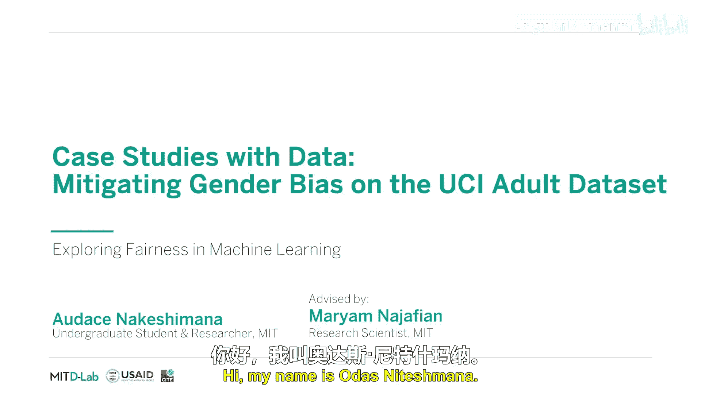
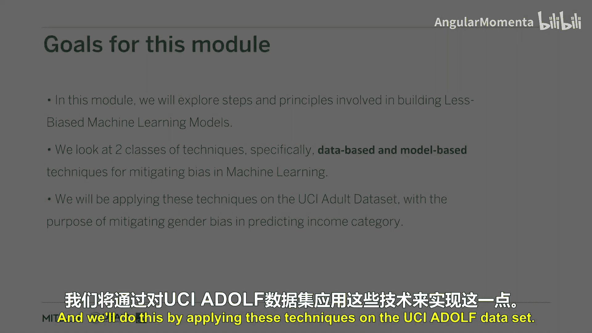
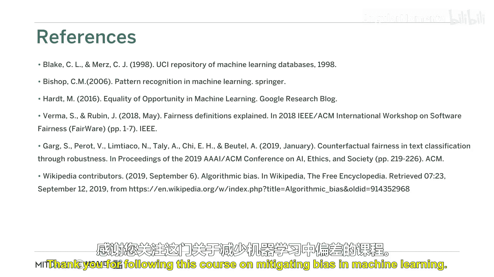

# 007：缓解 UCI 成人数据集中的性别偏见





## 概述

在本节课中，我们将通过一个具体案例，学习如何识别和缓解机器学习模型中的偏见。我们将以 UCI 成人数据集为例，重点探讨如何减轻模型在预测收入类别时存在的性别偏见。课程将涵盖从理解算法偏见到应用多种数据及模型层面的去偏技术的完整流程。



## 第一部分：算法偏见概述

在本节中，我们将理解算法偏见的定义、来源及其影响。

算法偏见（或模型偏见）指的是算法或模型中存在的系统性错误，这些错误可能导致不公平的结果。我们将通过查看模型在不同性别群体上的错误差异，来定性和定量地识别偏见。请注意，本课程中使用的“性别”一词指代出生时的生理性别。

算法偏见的潜在来源主要有两个：
1.  **数据收集阶段**：收集的数据本身可能包含对某些群体的系统性偏见或刻板印象。当数据集中不同群体的代表性不均衡时，也会产生偏见。
2.  **模型训练过程**：当我们的模型在训练过程中没有因存在偏见而受到惩罚时。

算法偏见之所以成为问题，是因为它会导致对某些个体或群体的不公平结果，并可能进一步传播偏见，形成偏见的恶性循环。

## 第二部分：探索 UCI 成人数据集

上一节我们介绍了算法偏见的概念，本节中我们来看看我们将要使用的数据集。

UCI 成人数据集是最流行的机器学习数据集之一，可从 UCI 机器学习资源库获取。该数据集包含超过 48，000 个数据点，提取自 1994 年美国人口普查数据库。每个数据点包含 15 个特征，包括年龄、工作类别、教育程度、关系、种族、性别、薪资等。

以下是数据集中的一些关键分布：
*   **性别分布**：约 16，000 人标识为女性，约 32，000 人标识为男性。
*   **种族分布**：略多于 40，000 人标识为白人，约 4，000 至 5，000 人标识为黑人，其余为其他少数族裔。
*   **收入分布**：约 37，000 人年收入小于或等于 50，000 美元，仅约 12，000 至 13，000 人年收入大于 50，000 美元。

观察不同性别群体的收入水平分布可以发现，男性中高收入（> $50K）者的比例约为三分之一，而在女性群体中，这一比例降至约 20%。一个重要的观察是，在高收入类别中，男性数据点的数量显著超过女性数据点，超出三倍多。因此，思考这种代表性差异如何影响基于此数据训练的模型的预测至关重要。

## 第三部分：数据预处理

在了解了数据集的基本情况后，我们需要将原始数据转换为适合机器学习任务的数值或分类表示。

以下是主要的转换步骤：
*   **二值化**：对于只有两个可能值的属性，如“性别”（sex）和“薪资”（salary），我们将其转换为二进制标签（例如，0 和 1）。对于“原籍国”（native-country），我们决定将其转换为是否来自美国的二值标签。
*   **独热编码**：对于具有两个以上可能值的分类属性，如“关系”（relationship），我们使用独热编码。独热编码比二值编码更强大，因为它可以编码任意大小的类别集合。

我们将相同的转换应用于所有其他分类属性。在大多数情况下，为了简单起见，我们选择了二值编码，但这通常需要根据具体应用情况逐案决定。需要注意的是，将“工作类别”（work-class）等特征转换为二值可能存在问题，因为如果来自不同类别的人收入水平存在系统性差异，信息会丢失。另一方面，如果不这样做，当某个类别数据点极少时，模型可能难以从中学习。

## 第四部分：识别性别偏见

数据准备就绪后，本节我们将应用标准的机器学习方法，并在预测收入类别的任务中评估模型存在的性别偏见。

我们首先将数据集拆分为训练集和测试集，然后在训练数据上拟合一个多层感知器分类器，并使用该模型在测试数据上进行预测。

在评估模型之前，我们先建立一些术语：
*   **正类**：指年收入大于 50，000 美元的群体（高收入类别）。
*   **负类**：指年收入小于或等于 50，000 美元的群体（低收入类别）。

现在，让我们查看之前训练的模型在不同性别群体上的各种误差指标：
*   **准确率**：男性群体的准确率约为 0.8，女性群体的准确率约为 0.9。
*   **正类预测率与真正率**：这两项指标在男性群体中均高于女性群体。
*   **负类预测率与真负率**：这两项指标在女性群体中均高于男性群体。

我们刚刚看到的指标表明，男性和女性群体之间的误差率存在一致的差异。这就是我们定义的性别偏见。在这种情况下，减轻性别偏见等同于使用不同的技术来最小化这种差异，这将是本课程剩余部分的重点。

## 第五部分：基于数据的去偏技术

我们已经识别出模型存在性别偏见，本节中我们将探索基于数据的去偏技术。具体来说，我们将研究如何重新校准或增强数据集，以使预测的偏见更小。

其背后的动机源于一个假设：性别偏见可能源于数据集中男性和女性群体代表性不均衡。因此，我们尝试重新校准或增强数据集，旨在平衡训练数据中的性别代表性。

以下是几种基于数据的去偏技术：

**1. 通过无意识化去偏**
在这种技术中，我们通过从训练属性中移除“性别”特征来减轻性别偏见。
```python
# 示例代码：从特征中删除‘sex’列
X_train_debiased = X_train.drop(columns=[‘sex’])
X_test_debiased = X_test.drop(columns=[‘sex’])
```
观察结果：虽然准确率差距没有显著改善，但我们能够减少正类预测率、负类预测率、真正率和真负率等指标的差距。这说明了去偏技术可能无法在所有指标上都取得改进，但可能对我们关心的某个指标带来显著改善。

通过无意识化去偏可以在一定程度上减轻性别偏见，但研究表明，如果数据集中存在与我们所删除的受保护属性（如性别）相关的其他特征（称为**代理变量**），这种方法可能无效。

**2. 均衡数据点数量**
在这种方法中，我们将尝试通过使用每个性别类别中数据点的数量或比例来均衡代表性。

*   **均衡每个性别类别的数据点数量**：我们从数据中抽取一个样本，使得男性和女性群体的数据点数量相等。
*   **均衡每个性别类别内各收入水平的数据点数量**：这意味着在用于训练的样本中，男性和女性群体中高收入和低收入者的数量相同。

这种方法的缺点是，所得数据集的大小取决于最小群体的大小。如果最小群体的数据点非常少，最终得到的训练集将非常小。

**3. 均衡数据点比例**
在这种方法中，我们均衡每个性别类别内高收入与低收入数据点的比例。这通常会产生比均衡数量更大的样本量。

**4. 反事实数据增强**
在这种方法中，对于每个具有给定性别的数据点 Xi，我们生成一个新的数据点 Yi，Yi 仅在性别属性上与 Xi 不同，然后将 Yi 添加到我们的训练数据集中。
```python
# 示例代码：反事实数据增强
# 假设 df 是原始 DataFrame，‘sex’ 是性别列
df_counterfactual = df.copy()
df_counterfactual[‘sex’] = 1 - df_counterfactual[‘sex’] # 翻转性别
augmented_df = pd.concat([df， df_counterfactual])
```
观察结果：通过反事实数据增强，男性和女性群体在所有观察指标上的差距几乎消失，这正是我们对一个公平的机器学习模型的期望。

**技术对比**
比较迄今为止所有方法的关键指标可以发现：
*   **整体准确率**：像“均衡每个性别数据点数量”或“反事实增强”这样的技术能带来更高的准确率，而像“无意识化”这样的技术并不总能保证更高的准确率。
*   **跨性别准确率**：“反事实增强”技术的男女准确率差距最小。
*   **其他指标**：“反事实增强”在正/负类预测率、真正/真负率上的跨性别差距也最小或接近最小。

## 第六部分：基于模型的去偏技术

除了处理数据，我们还可以从模型本身入手。本节我们将探索基于模型的去偏技术，具体来说，我们将查看不同的模型类型和架构，并检查它们在男性和女性群体上的表现。

我们首先检查**单一模型架构**，例如逻辑回归、支持向量机、随机森林、高斯朴素贝叶斯等。对于每个模型族，我们选择一个模型并在数据上进行训练。

接着，我们检查**多模型集成架构**。在这种方法中，我们在相同数据上训练一组不同的模型，然后基于共识做出最终预测。我们比较了两种共识类型：
*   **硬投票**：最终预测是所有模型中占多数的预测。
*   **软投票**：最终预测是所有模型预测的平均值。

**评估与比较**
现在，让我们评估和比较迄今为止训练的所有模型类型和架构的指标。

*   **整体准确率**：随机森林分类器的准确率最高（约94%），高斯朴素贝叶斯模型准确率较低（约72%）。
*   **跨性别准确率**：根据模型类型的不同，男性和女性群体之间的准确率差距存在不同水平，这表明不同模型天生具有不同水平的偏见。
*   **正/负类预测率**：对于所有观察的模型，男性群体的正类预测率始终高于女性群体。这在现实世界中部署模型时可能存在问题，因为会导致模型系统性地为男性群体预测更多的正类结果。
*   **真正/真负率**：男性个体的真正率始终高于女性个体，而女性个体的真负率始终高于男性个体。这尤其成问题，因为它表明模型学会了更好地分类高收入男性而非高收入女性，以及更好地分类低收入女性而非低收入男性，这可能扩大男女之间的差距。

为了考虑随机性，我们进行了多次实验以获取平均模型行为。通过比较多个训练阶段的指标，我们发现：
*   **准确率差异**：逻辑回归、硬投票或SVC等模型的准确率差异显著低于高斯朴素贝叶斯或随机森林。
*   **正/负类预测率差异**：逻辑回归、SVC或硬投票等模型的差异显著低于高斯朴素贝叶斯。
*   **真正/真负率差异**：逻辑回归或SVC等模型在真正率上表现出较高的差异和变异性，但在真负率上则表现出较低的差异和变异性。

因此，非常重要的是要看到这些模型在偏见方面具有不同的内在行为。

## 第七部分：总结与后续步骤

在本节课中，我们一起学习了如何通过UCI成人数据集的案例，识别和缓解机器学习中的性别偏见。我们探讨了算法偏见的来源，并实践了基于数据（如无意识化、均衡采样、反事实增强）和基于模型（选择不同算法和集成方法）的多种去偏技术。

为了深化理解和应用机器学习伦理，建议采取以下后续步骤：
1.  **查阅代码**：访问本课程相关的GitHub仓库，以加深对实际工作的理解。
2.  **探索高级技术**：鼓励探索更先进的去偏技术。
3.  **分享与讨论**：在团队、组织或社区内分享和讨论这些发现。
4.  **付诸实践**：最重要的是，将所学知识应用到日常工作中，积极构建偏见更少的机器学习应用。




通过持续学习和实践，我们可以共同努力，推动机器学习技术向更加公平、负责任的方向发展。