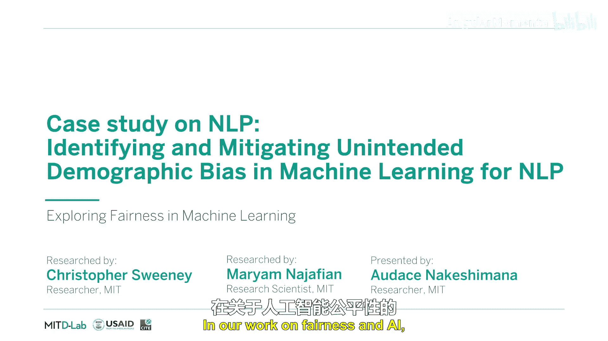

# 009：识别并缓解自然语言处理中的非预期人口统计偏见

在本节课中，我们将学习一个关于自然语言处理（NLP）中公平性的具体案例研究。我们将探讨什么是非预期的人口统计偏见，它如何潜入机器学习流程，以及研究人员如何测量并尝试缓解这种偏见。

## 概述：人工智能、公平性与自然语言处理

人工智能有以多种方式影响社会的巨大潜力。例如，在银行业，许多公司试图利用机器学习，根据个人数据来预测其是否会贷款违约。由于机器学习被用于此类高风险应用，导致不公平的错误可能会引发歧视，阻止某些人口统计群体获得公平的贷款。这个问题在发展中国家尤为重要，那里可能没有成熟的信用体系，将越来越多地依赖机器学习模型（如替代性信用评分机制）来做这些高风险决策。

本项研究聚焦于机器学习在自然语言处理中的应用。研究NLP中的公平性很重要，因为它被广泛应用于从教育到营销等多个领域。此外，在标准的NLP流程中存在许多非预期人口统计偏见的来源。我们将NLP流程定义为从收集自然语言数据到基于NLP模型对结果数据的预测做出决策的一系列步骤组合。最后，NLP系统的数据比银行或医疗等领域的表格数据更容易获取。公司可能因隐私问题不愿分享数据，但NLP数据，尤其是英语、法语等广泛使用的语言数据，可以从社交媒体、正式或非正式出版物等多种来源获得，这使得研究如何使NLP系统更公平更为可行。

## 理解非预期人口统计偏见

现在我们来分解“非预期人口统计偏见”的含义。
*   **“非预期”** 意味着这种偏见是机器学习模型学习过程中产生的不良副作用。
*   **“人口统计”** 意味着这种偏见转化为人口统计群体间的某种不平等，可能导致下游机器学习模型产生歧视。
*   **“偏见”** 是NLP流程中导致这种不公平的人工产物。“偏见”是一个宽泛的术语，因此我们聚焦于导致典型机器学习应用不公平的特定形式偏见，例如基于性别的偏见。一个机器学习模型可能仅仅因为训练数据中的关联，就将特定类型的工作与特定性别联系起来。

在非预期人口统计偏见中，我们将重点关注NLP应用中的两种偏见类型：
1.  **情感分析偏见**：分析词语或短语相关积极或消极情感的系统中的偏见。
2.  **毒性分析偏见**：检测词语或短语中贬损或冒犯性术语的系统中的偏见。

情感偏见是导致情感分析系统不公平的机器学习流程人工产物。毒性偏见是导致从文本预测毒性的系统不公平的流程人工产物。在这两种情况下，重要的是我们的机器学习模型不应使用描述某人人口统计特征的敏感属性（如种族、国籍）来判定一个句子应具有积极/消极情感或毒性高低。

毒性分类用于多种应用，例如筛选过于有毒或冒犯的在线评论。不幸的是，这些算法可能非常不公平。例如，一个句子是否有毒的决定可能仅仅取决于句子中出现的人口身份术语（如“美国人”或“墨西哥人”）。这种不公平可能由NLP流程中的许多不同人工产物引起。例如，某些国籍和族裔群体在历史上更频繁地被边缘化，这反映在与他们相关的语言中。因此，在此类数据集上训练NLP算法可能导致某种形式的非预期人口统计偏见。

我们需要厘清非预期人口统计偏见与不公平之间的关系。非预期人口统计偏见可以从多种来源进入典型的机器学习流程，从**语料库**到**词嵌入**，再到**数据集**、**算法**，最后到用于决策的**阈值**。而可能的不公平或歧视发生在机器学习模型与社会接触并实际造成伤害的时刻。本项工作旨在NLP流程的每个阶段（从语料库到决策层面）识别和缓解非预期人口统计偏见。

我们的主要目标是找到方法来缓解文本语料库或用于构建NLP应用的数据表示类型中可能固有的偏见。在本模块中，我们将介绍测量词嵌入中的非预期人口统计偏见，以及使用对抗性学习来缓解词嵌入偏见。对应的论文走得更远，涵盖了在NLP流程其他阶段识别和缓解偏见的技术。

## 测量词嵌入偏见

上一节我们介绍了偏见可能潜入NLP流程的各个阶段。本节中，我们来看看如何具体测量词嵌入中的偏见。

词嵌入将文本编码到向量空间中，词之间的距离描述了某种语义含义。这使得我们可以完成类比，例如“男人”之于“女人”如同“国王”之于“王后”。不幸的是，研究人员发现，即使对于从谷歌新闻文章训练的词嵌入，词嵌入空间中也存在偏见，类比变成了“男人”之于“女人”如同“计算机程序员”之于“家庭主妇”（另一个词是“家庭妇女”）。考虑到词嵌入可能被用于实际预测某人是否应获得某份工作的NLP应用中，这令人担忧。然而，仅基于向量空间类比难以量化偏见。

在这项工作中，研究人员Sweeney和Najafian开发了一个系统，将词嵌入中的情感偏见测量为一个具体数字。他们的做法是：取有偏见的词嵌入，并用它们来初始化一个无偏见的词级情感数据集。他们在此数据集上训练一个逻辑回归分类器，并预测一组身份术语（例如，描述不同国籍的人口统计术语）的消极情感。他们分析每个身份术语的消极情感，并预测一个描述词嵌入偏见的分数。

这个分数是**国籍身份术语的消极情感概率集合与均匀分布之间的差异**。均匀分布描述了一个完全公平的情况，即每个人口统计群体在词嵌入模型中接收到相等的情感量。

## 缓解词嵌入偏见：对抗性学习

现在我们已经掌握了词嵌入偏见的概念，可以开始探索如何缓解这种偏见。在论文中，Sweeney和Najafian描述了如何使用对抗性学习来消除词嵌入中的偏见。

不同的身份术语可能与积极或消极情感子空间有或多或少的关联。例如，“美国人”、“墨西哥人”、“德国人”等词可能与消极情感子空间或积极情感子空间有更多关联，因为在所使用的数据集中，它们可能更频繁地与消极或积极情感同时出现。如果下游机器学习模型捕捉到这些关联，将令人担忧。理想情况下，我们希望这些身份术语在向量空间中的含义不被扭曲的前提下，在消极和积极情感子空间之间达到一个中立点，这样词嵌入模型仍然有用。

他们使用一种对抗性学习算法来实现这一目标。该算法的更多细节在对应的论文中描述。

## 评估缓解效果：公平性指标

现在我将展示他们评估对抗性学习算法如何消除词嵌入偏见，并使最终的NLP系统更公平的部分工作。

我们关注情感分析和毒性预测这两个现实系统。针对每个应用，Sweeney和Najafian定义了公平性指标，以告知我们有偏见的词嵌入是否真正起到了帮助作用。

这些公平性指标通常以模板化数据集的形式出现。研究人员创建这些数据集有时是为了揭示针对不同人口统计群体的不同偏见。例如，一个数据集旨在通过在相同句子中替换名字，来揭示非洲裔美国人名字与欧裔美国人名字之间的偏见。

类似的模板数据集也被创建用于毒性分类算法，在句子中替换不同的人口身份术语，并比较整体毒性预测的差异。

Sweeney和Najafian使用这些模板数据集来计算一个真实毒性分类器的公平性。下图展示了一个在毒性分类数据集上训练的卷积神经网络（CNN）的每术语AUC（曲线下面积）分布。X轴代表模板数据集中包含该身份术语的每个人口统计群体。每个点代表CNN的一次特定训练运行。Y轴描述了该模板数据集的AUC准确率。可以看到，不同人口统计群体之间的准确率存在很大差异。

理想情况下，我们希望不同训练运行间的变异被压缩，同时不同人口统计群体间AUC分数的差异更小。Sweeney和Najafian表明，使用他们消除偏见的词嵌入的毒性分类算法能产生更好的结果。

本幻灯片展示了CNN在不同去偏见处理下的每术语AUC分布结果。Sweeney和Najafian测量了他们的词嵌入去偏见方法与其他先进技术的比较。对这些图的进一步讨论和评估在对应的论文中呈现。

## 总结与关键要点

本节课中，我们一起学习了识别和缓解NLP中非预期人口统计偏见的案例。最后，我们来总结一下该项目的几个关键要点。

首先，**没有万能的解决方案**。在试图使NLP系统更公平时，存在许多不同类型的应用和各种需要纠正的偏见。

其次，**偏见可能源自机器学习流程的任何阶段**。因此，拥有在机器学习流程所有阶段识别和缓解偏见的工具至关重要。

最后，我们聚焦于在学术背景下解决NLP流程中的这个问题，但这**不能完全在学术界解决**。例如，数据集中（如文本语料库）的许多非预期偏见可能来自上游数据收集过程中的决策。此外，非预期偏见可能来自将模型部署到社会时的决策，当模型的使用方式与最初数据收集的初衷不符时，可能导致歧视。一个例子是，当从特定人口群体收集的数据被用于预测影响其他在数据收集中未被考虑的人口群体时。最后，为这些机器学习模型建立有效的反馈渠道非常重要。

本模块介绍的工作凸显了公平性为何是一个非常重要的概念。因此，对于数据科学家和工程师来说，不仅通过准确性，也通过公平性来衡量和理解他们的模型性能，是至关重要的。