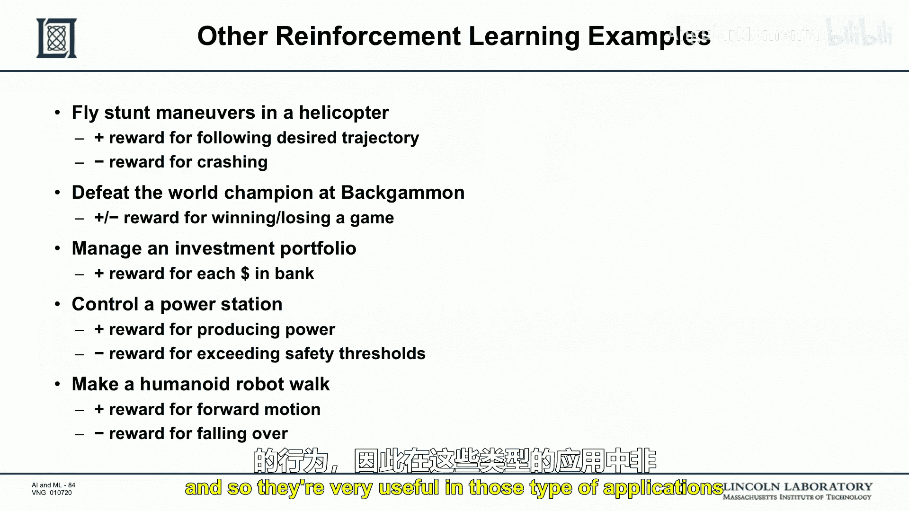

# 【麻省理工】大数据与机器学习数学-｜-MIT-RES.LL-005-D4M-Signal-Processing-on-Databases,-Fall-2012-p01-01-1.-人工智能与机器学习--BV1eEtTzhE4F_p1-

All right， welcome， it's great to see everyone here。We're really excited about this opportunity。

 as you know。Our AI accelerator has officially kicked off。All of your teams are。

Ready go and we wanted this to be an opportunity to sort of as a team come together and develop some common foundations。

 some common technological foundations， some common language for talking about these。

Very challenging AI problems。 And so with that I'll hand it over to BJ。

 All right we will kick off with the first lecture which basically provides some overview AI context for this know again。

 welcome to the class we're really looking forward to this what we're going to present this morning is really a lot of overview material right many of you here are you know a lot in AI and machine learning。

 This is really meant to just start a level set before we start the program before we start these classes。

 so you can see this generic title artificial intelligence and machine learning and we're going to try and cover all of that in about an hour。

 So some details might be skipped but we'll try and hit some of the salient features all of these slides are available for you to use。

 So if you're presenting back to your own teams Please feel free to pull from these slides。

 know we've actually gone through over some time putting a good set of survey and overview slides。

So if any of these are useful to you， just email us or we'll make them available to you。

 you're more than welcome to use any and all of these slides if you're trying to kind of present this back to other people。

So with that let's begin so we're going to do a quick overview of artificial intelligence again。

 a lot of level setting going on here， we're going to do a quick deep dive。

 these aren't the deepest of dives again given the amount of time that we have but just talk very quickly about supervised unsupervised and reinforcement learning and then summarize and we can certainly stop for questions。

 philosophical debates et cea， towards the end， we'll try not to get a lot of the philosophical debates on camera if we can。

All right， so first question， what is artificial intelligence and this is a question that probably a lot of you get and I certainly have received this from a number of people and that actually takes a lot of it took us a lot of time to come up with this and so we are very fortunate to have Professor Winston spend some time with us out at Lincoln Labor and we actually brainstorm for you know hour or two really trying to come up with what is a good definition for what we call artificial intelligence and what we sort of came up with is that there are two aspects to artificial intelligence first that that we should not confuse with each other。

 one is a concept of narrow AI and another is a concept of general AI and sometimes in conversation we tend to conflate or mix the two。

So narrow AI， according to our definition， is the theory and development of computer systems that perform tasks that augment for human intelligence such as perceiving。

 classifying， learning， abstracting， reasoning， and or acting。

 certainly in a lot of the programs that we work in were very focused on narrow AI and not necessarily the more general AI。

 which we define as full autonomy。So that's a very high level definition of what we mean by AI。 Now。

 many of you in the crowd of probably saying， well， Ay I has been around for a while。

 people have been talking about this for 50， 60 plus years。Why now？

 what is so special about it now why why is this conversation piece now？ Well， from what we've seen。

 it really is the convergence of three different communities that have come together。

 The first is a community on big data。 The second is a community on computing。

 and a lot of computing technologies。 And finally a lot of research and results in machine learning algorithms。

 The other  one I forgot to put is dollar signs down here。

 people have basically figured out how to make money off of selling advertisements。

 labeling cat pictures etca。 So that's maybe the hidden why now in particular。

 but these are the three large technical areas that have evolved over the past decade or so to really make AI something we discuss a lot today。

So when we talk about AI。There are a number of different pieces which make up an AI system。 and。

 you know we love the algorithms people， but there's a lot more going on outside of that。

 So we've spent a significant amount of effort just trying to figure out what goes into an AI system。

 And this is what we call a canonical architecture。

 very much in line with Lincoln laboratory thinking， we like to think of an end to end pipeline。

 What are the various components and what are the interconnections between these various components。

 So within our AI canonical architecture shown here， We go all the way from sensors。😊。

To the end user or missions and a lot of the projects that you all are working on are going to go all the way from here to there。

 a lot of our class， however， for the next few weeks is going to focus on sort of step one where a lot of people get stuck。

So we take data that comes in through either structured or unstructured sources。

These are typically passed into some sort of a data conditioning or data curation step。

 This data is through that process， typically converted into some form of information。

that information is then passed into a series of algorithms， maybe one or many algorithms。

 there are lots of them， there is life beyond neural networks。

 once we pass them through the algorithms typically form this information is converted into knowledge is typically then passed into some sort of a module that interacts with the end user or a human or the mission。

 and that's what we call a human machine teaming step。

 and that finally that knowledge with the human complement becomes insight that can then be used to execute the mission that the AI system was created for。

All of these components sit on the bedrock of modern computing。

 many different technologies that make up modern computing and the system that we're using today has combination of some of these computing hardware elements。

 and certainly within the context of a lot of the projects that we are interested in。

 all of this also needs to be wrapped in the layer that we call robust AI。

Which consists of explainable artificial intelligence， metrics and bias assessment。

 verification validation， security， policy， ethics， safety and training。

 We'll talk very briefly about each of these pieces in detail in a little bit。

As I mentioned AI has an extremely rich history。 This is just a very Lincoln and MIT specific view of the history of artificial intelligence。

 but certainly there's been great work since the folks of Minsky， Clark Denen， Oliver Selfridge。

 etcter since the 50s we've seen a lot of work in the 80s and 90s and certainly recently there's been again a resurgence of AI in our parlance in our thinking of the way AI works。

 So without going into too much detail about each of these eras and why the winters came about。

 et cetera， I think John Lachbury at DARPpa actually put it very well when he talked about different waves of AI technology that have come about and when he talks about it he talks about the three waves of AI or the four waves of AI and the first wave which you can kind of think of as the first decade of AI technology resulted in a lot of。

😊，Reasoning based systems， which were based on handcrafted knowledge。

 So an example of an output of this would be an expert system。 right， So a lot of work in that。

 So these， if we kind of take the four dimensions that John Lachberry suggests of the ability of the system to perceive。

 learn abstract and reason， these are typically pretty good at reasoning because they encoded human knowledge。

 right， So human experts SAT down and said。SAT down and said what's going on in the system and tried to write a series of rules so tax software for example。

 does a pretty reasonable job of that where a chartered accountant or a tax expert sits down encodes a series of rules we have a question in the back I just wanted an example of an expert system from like the 50s to nowep。

So the question is you are there examples of expert systems so certainly one would be tax software。

 my graduate research was actually an autonomous vehicle。

 some of the early autonomous vehicles used a form of expert systems where the states on a finite state machine were maybe handcrafted and the transitions between them were sort of designed that way。

 there were some machine learning wrapper around， but expert systems you know certainly played a large part in some of the early even autonomous vehicle research that went on。

All right， so over time， we were able to use these expert systems and don't get me wrong。

 these systems are still extremely valid in cases where you have limited data availability。

 limited compute power， a lot of expert systems still being used or in cases where expertability is a very important factor。

 you still see expert systems because they do have the ability to explain why they came up。

 they can typically point to a set of rules that somebody wrote which is usually quite interpretable by a human。

However， as we were able to collect more data， we were maybe able to understand a little bit more about what was the underlying process。

 we were able to apply statistical learning and this sort of led to the next era or next wave of AI technologies which is often called the learning wave and this was really enabled by lots of data enabled non-expert systems so what we mean by that is we were able to kind of dial back the amount of expert knowledge that we encoded into the algorithm。

 maybe put a higher level of expert knowledge into that but usually and then use data to learn what some of these rules could be an example of that in case someone wants to ask would be in speech processing for example so we were able to say well I kind of realize that speech follows this sort of a Gaussian mixture model so I can encode that level of statistical knowledge but I'm going to let the system sort。

fiigure out the details of how all that actually works out and there are many other cases again coming back to some of the research I did in autonomous vehicles。

 we were able to maybe use some high levelvel expert rules that there here are a set of states that a a car may be in。

 but I'm going to let the algorithm actually figure out when these transitions occur and what constitutes a transition between different states。

So looking at the four vectors that you could think about it。

 these systems had a little bit more on perception， obviously were doing a lot more learning。

 but their ability to abstract and reason was still pretty low and by reasoning we mean can you explain can you tell us what's going on when you give me an output to the result？

😡，The next wave which we're maybe at the beginning stages of is what we call contextual learning or contextual adaptation。

 This is where an AI system can actually add context into what it's doing I'm not sure I have too many examples of people doing this very well。

 I think what most of most of the work today probably falls into sort of the end stage of the learning wave of AI but we're able to sort of combine a bunch of these learning things to make it look like it's contextual in nature but but the key concept over here is being able to have the system automatically abstract and reason so the way that we think about things right so if I see a chair over here and I put a chair somewhere else。

 I still know it's a chair because I'm using other context maybe it's next to a table or stuff like that。

Some early research going on in that area and certainly the next wave of this is what we call abstraction and there is very little work on this。

 but if we sort of have to think out in the future。

 but this is really the system of ability the ability of an AI system to actually abstract information that it's learning so instead of learning that a chair is or a table is something with a leg at the bottom。

 it learns that a table is something you put things on and is able to abstract that information or that knowledge to any other domain or any other field。

Do we have any questions before I continue from here？Okay， great。😊。

So that's a little bit on the evolution of AI。 The reason we like to go through this is because you know there is great work going on in each of these waves and nothing that people are doing in any of these waves is any lesser or more。

 it's typically a dependent on what you have at your disposal。

 what I like to tell people sometimes is the way to think about all of this is you have a couple of dials at your disposal turning dials。

 the first dial is how much compute， just how much ability do you have to crunch data。

The second piece is how much data do you actually have available and this can be label data in many cases。

 and the third dial is how much knowledge are you able to embed into an algorithm？

In certain cases where maybe you have very little computing， very little data。

 label data availability， but a lot of expert knowledge or a lot of ability to encode information into an algorithm。

 you might be able to use an expert system that's a very good use case for that an example maybe on another dimension where you want to encode very little human knowledge but you have a lot of computing and data available would be where neural networks fall in where there are essentially learning what the human knowledge。

 you know what that encoded information should be， a lot of statistical techniques also fall into that camp where maybe you encode a little bit of information as to like what the background distribution of the process is but it learns the detail of exactly how that distribution is modeled based on the data that it sees。

 so you have a lot of different settings that you can use and there are a number of different techniques within the broader AI context that you can use to achieve your mission and I'm sure。

Of you are going to be doing different types of algorithms and a lot of that decision will be dependent on well。

 how much data was I given right how good is this data that I'm using。

 is there an ability to learn anything from this and if not you might have to encode some knowledge of your own into it saying well。

 I kind of know that this process looks like that So let me tell the algorithm to not waste too much time crunching the data to learn the underlying distribution。

 which I can tell you， why don't you learn the parameters of the distribution instead。

That makes sense？Right， and as you know， there's just a lot going on in AI and machine learning。

 you can't walk two steps without running into somebody who's either starting something up。

 working for one of these organizations， so it really is an exciting time to be in the field。

All right， so that's a little bit on the overview， but let's talk now in a little bit of detail on what some of the critical components are within this AI architecture。

So one thing that we like to note and there's a reason that as we've been reaching out to a number of you。

 we've been talking about getting data， work with stakeholders to get your data in place。

 and the reason we talk about that is data is critical to breakthroughs in AI。😡。

A lot of the press may be on the algorithms and the algorithms that have been designed。

 but really when we've looked back in history， we've seen that while the availability of a good canonical data set actually is equally。

 if not more critical to a breakthrough in AI， so what we've done here is we've just picked a select number of breakthroughs in AI。

 our definition of a breakthrough in this particular example is something that made a lot of press or something that we thought was really cool。

😡，So here are some examples of that in different years， and we've talked about the data sets。

 sort of the canonical data that maybe led to that breakthrough or that was cited in that breakthrough。

 as well as the algorithms that were used in that breakthrough and when they were first proposed。

This is notional in nature clearly you could adjust these dates a few years here or there。

 but what we really want to get across is that the average numbers。

 number of years to a breakthrough from the availability of a cool data or very important。

 well structured， welllabeled data set is much smaller than from the algorithm's first proposal or when the algorithm first comes out so as you're developing your challenge problems as you're developing your interactions with stakeholders certainly something to keep in mind that there's clearly a lot of algorithmic research that's going to go on。

 but having a good， strong， welllabeled and documented data can be equally important and making that available to the wider AI community。

 the wider AI ecosystem can be very， very valuable to your work and the work of many other people。

All right， so back to the AI architecture， we're going to just go through very briefly different pieces of this architecture。

 so the first piece we're going to talk about is data conditioning。

 which is converting unstructured and structured data。Within the structured and unstructured data。

 you might have structured sources coming from sensors， network logs for some of you。

 metadata associated with sensors， maybe speech or other such signals there's also a lot of unstructured data。

 think of things that you might collect from the internet that you might download from say a social media site maybe reports。

 other types of sensors that maybe don't have well that don't have strong structure within the data itself and typically this first step consists of what we call the data conditioning step consists of a number of different elements。

 you might want to first figure out where to put this data that can often take a lot of time and there have been religious wars fought on this topic。

We're here to tell you that you're probably okay picking most technologies。

 but if you have any questions， feel free to reach out to me or to others on the team。

 we have a lot of opinions on what's the right infrastructure to solve the problem。😡。

Typically these infrastructure databases might provide capabilities such as indexing organization and structure。

 very important in unstructured data right to convert it into some format that you can do things with。

 they may allow you to connect to them using domainspec languages so it's sort of converting it into a language that maybe you're used to talking。

 they can provide high performance data access and in many cases a declarative interface because maybe you don't really care about how the data is being access you want to just say select the data。

 give it to me and then move forward from there。Another important part of the data conditioning step is data curation。

This， unfortunately will probably take you a very long time。

 and this is it requires a lot of knowledge of the data itself。

What you want to do with the data and how you receive the data。

 but what you might do in the data curation step is you know perform some sort of unsupervised learning。

 maybe reduce the dimensionality of your problem， you might do some clustering or pattern recognition to maybe remove certain pieces of your data or to highlight certain pieces of the data that look important。

 you might do some outlier detection， you might highlight missing values。

 you might there's just dot dot dot， et cetera， et cetera。

 et cetera a lot goes on in the data curation step。

 we could certainly spend hours just talking about that。And the final thing。

 especially within the context of supervised machine learning。

 but even in the world of unsupervised learning would be spending some time on data labeling right so this is taking data that you've received。

 typically doing an initial data exploration could be as simple as opening it up in Excel to see what the different columns and row look like if that's a suitable place to open it up。

 you might look for highlight missing or incomplete data just from your initial data exploration。

 you might be able to go back to the data provider or to the sensor and say can you reorient the sensors or recapture the data。

 I notice that every time you've measured this particular quantity it always shows up as three。

 I can't imagine that that's correct， can you go back and tell me if that sensor is actually working or is it actually three in which case you might want to know that。

And you might look for errors， biases， and collection， of course。

 on top of the actual labeling process that you're doing to highlight phenomenology within the data that you'd like to then look for through your machine learning algorithms。

I'll pause for a second。 Yes， I have a quick question。 Yeah。

 what's the ratio that you see between structure data and non structure data。

So the question is what's the ratio we see between structured and unstructured data。

 That's a great question。 So the ratio in terms of the volume or the ratio in terms of what you can do with it。

Because those are actually almost the opposite so again I'm talking about a few dataset sets that I'm very familiar with the unstructured data can often be 90% of the volume and maybe the 10% is the metadata associated with the unstructured data most of the value however comes from the structured data where people really analyze their crap out of the structured data because they know how to there is certainly a lot a lot of potential within the unstructured data so that when we talk to people that's why we talk a lot about infrastructure and databases as being an important first step because if you can just take the unstructured data and put it into a structured or semistructured form that itself can provide a lot of value because there's very often in problems that we see sort of the 90% volume of data is largely untapped because people don't know how to get into it or don't know what to do with it or it's not。

For that you can really deal with So when I think next class we're going to be talking to you about how to organize your data。

 right strategies for organizing data that can get you a lot more value out of the unstructured data Does that answer your question。

Yes。Currently， many applying A estimatess to data， use it typically applied to single data source or。

こするていう。あ持ってこです。all the own has effort together。てください。

So the question is when you apply AI or machine learning techniques to a problem domain。

 is it typically a single modality or a multiple modalities， I'd say the answer is both。

 certainly there's a lot of research and back there we have Matthew who's actually doing research on that right now on how to fuse multiple modalities of data。

 I know a lot of projects that are being discussed here are certainly looking at multiple modalities。

If I had to say as of today。A lot of the work that's out there， right。

 the sort of published work may be focused on a single modality， but that's not to say， I mean。

 I think there is a lot of value on multiple modalities。

 but the challenge still comes up on how do you integrate this data。

 especially if they're collected from different systems。Yep。

Just on the structure versus unstructured， so it's not really my area but I'm kind of surprised to see speech in the structured category and I wonder is that just because。

Technologies that。Can parse the waveform and all of this data conditioning are mature enough that you can basically treat it as being structured So the question is why would speech or something else like that fall into structured versus unstructured and you're absolutely right。

 I think when we pick speech and I'm sure there are others in the room that might disagree with that and might stick it over here。

When we look at the type of acquisition processes that are used， the software that's used。

 they typically come out with some known metadata， they follow a certain pattern that we can then use right there is a clear range to where theres the frequency to which the data is collected。

 and that's why we stuck it in the structured data type。Of course。

 if you're collecting data out in the field without that。

 you could probably stick it into the unstructured world as well。

 but that's probably a good example of something that can fall in between the two places。Okay。

Right now for the part everyone's really interested in machine learning right so all right。

 you got through the boring data conditioning stuff which will take you a couple of years or something like that。

 you know nothing serious and now you're ready to do the machine learning and now you're given a choice Well。

 which algorithm do you use neural networks you might say right there's a lot more though beyond the neural network world。

😊，So there's numerous taxonomies I'm going to give you two of them today for how you describe machine learning algorithms。

 One that's really kind of an interesting way is from Pedro domins at the University of Washington。

 in which he sort of says that there are five tribes of machine learning so there are the symbolists which an example of that would be expert systems。

 there are the Bayesian tribes， which an example of an algorithm within that may be naive Bayes。

 there are the analogizers which an example of that would be a support vector machine and the connectionists。

 an example of which would be deep neural networks and evolutionaries。

 an example of that which might be genetic programming what really you know I'm trying to get across I'm sure the authors trying to get across here is that lots and lots of different algorithms。

 each have their relative merits and relative strengths。

 apply the right one for your application apply the right one for again given these dials that I talked about earlier the。

of computing that you have available， the amount of data that you have available and the amount of expert knowledge that you're able to encode into your algorithm that you think is generalizable enough。

If we actually talk about this is a very useful chart I found in describing to folks that are not familiar with AI that might say well isn' AI just neural networks and neural networks are a part of AI。

 but not necessarily all of it so if we kind of think of the big circle is the broad field of artificial intelligence within that is the world of machine learning within machine learning or connectionists or neural networks is sort of fall into a small camp within that and deep neural networks is sort of a part of neural networks。

 so can anyone maybe give me an example， although I've said at numerous times so something that might fall out of machine learning but into artificial intelligence from an algorithmic point of view。

Yes。Graph search could be an example， I would maybe stick that into some of the connectionists。

 however， Yes exactly so expert systems is sort of the one that comes to my mind or knowledge based systems are an example of maybe something that falls outside of the realm of machine learning。

 again in the very strict sense， but maybe within the realm of artificial intelligence from an algorithmic point of view。

O， so that's a little bit on the algorithms。 Next， let's talk about some of the modern computing engines that are out there。

 I mentioned that data， compute， as well as algorithms have been key drivers to the resurgence of AI over the past few years。

 what are some of these computing technologies， for example。Clearly， CPUs and GPUs。

 they're very popular computing platforms， lots of software written to work with these computing platforms。

But what we're seeing now is that with the end of Moore's law and a lot more performance engineering going on。

 we're seeing a lot more work， research and hardware architectures that are custom in nature and custom architectures are almost like the new commercial off the shelf solutions that are out there。

 So an example of a custom architecture could be Google's Tensor processing unit or TPU。

 there's some very exciting research going on in the world of neuromorphic computing。

 I'm happy to chat with you all later if you're interested to know what's going on in that area and maybe our role in some of that work。

And there's just some stuff that we would still call custom。

 these are still people deciding designing， basically looking at an algorithm， saying， okay。

 here's the data layout， here's the movement of data or information within this algorithm。

 let's create a custom processor that does that， an example of that could be the graph processor which is being developed at Lincoln Labor。

And obviously no slide on computing architectures or computing technologies would be complete without mentioning the word quantum in it。

 there's some early results on solving linear system of equations， but I think applied to AI。

 it's still unsure or unknown or unproven where quantum may play a part。

 but certainly a technology that all of us I'm sure have heard of are continue to track and are just interested in seeing where that goes to。

😡，So within the first few however， these are all products that you can buy today。

 you can go out to your favorite your computing store and just purchase these off thes shelf solutions。

 a lot of software has been written to work with these different technologies and it's a really nice time to be involved can you give a brief。

Just concept of what I should attach to the term neuromorphic， I see it around。

 but I don't really have a。A high level concept of what I should associate。 Okay。

 so the the question is what， you know， can I think about neuromorphic， know。

 what should I think about when I'm thinking about neuromorphic， So there's a few features。

 which I say fall into the camp of what people are calling neuromorphic computing。

 One is what they're calling a brain inspired architecture。

 which often means it's clockless So you typically have some sort of a So a lot of these technologies have of clocked。

 movement of information， These might be clockless in nature。

 They typically sit on top of different types of memory architectures， and the。You know。

Trying to think of what would be another parameter that would be very useful。

 let me you I can probably send you a couple things that help highlight that I certainly wouldn't call myself an expert in this area。

But yeah， I think the term that's used is it's supposed to mimic the brain in the way that the computing architecture actually performs or functions。

So lots of research as well。 And this is work that we've done here at the lab on actually trying to map the performance of these different processors and。

How they perform for different types of functions。 So what we're doing here is basically looking at the power on the X axis and the y axis is the peak performance in gigga operations per second。

  different types of precision are noted over there by the different shapes of the boxes and then different form factors And the idea here is basically to say there's so much going on in the world of computing。

 how can we compare them。 they all have their own individual areas where they're strong。

 So one can't come up and say well， the GP is better than the CPU。 Well。

 it depends on what you're trying to do and what your goals of the operation are。

 So some of the key lines to kind of note here is that there seems to be a lot of existing systems on this 00 gigga operations per watt on this line over here。

 this dashed line。Some of the newer offerings maybe fit into the oneterra per watt and some of the research chips like IBM's true North or area or Intel's area falling into sort of just a bit under the 10 Terra operations per watt。

Sort of line that we see there， but you know depending on the type of application。

 you may be okay with a certain amount of peak power so if you're looking at embedded applications。

 you're probably somewhere over here if you're trying to get something that's you on a little drone or something like that you might want to go here and if you have a data center you're probably okay with that type of power utilization or peak power utilization but you do need the performance that goes along with that。

 So I'd say the most important parts to look at are essentially these different lines。

 those are the different those are sort of the trajectories for maybe some of the existing systems all the way up to some of the more research oriented processors out there。

Okay。All right， so we talked about modern computing。

 let's talk a little bit about the robust AI side of things and the basic idea between robust AI is that it's extremely important and the reason that it's important is that the consequence of actions on certain applications of AI can be quite high。

So what we've done here is kind of think about， you know。

 where are the places that maybe humans and machines have their relative strength。 So on the X axis。

 we're talking about the consequence of action。 So this could be。

 does somebody get hurt if the system doesn't do the right thing。

All the way down to no worries if the system doesn't do the right thing。

 which could be maybe some of the labeling of images that we see online might fall into this category。

 I'm sure people disagree with me on that。But maybe a lot of national security applications。

 health applications certainly fall into the area of high consequence of action if you give someone the wrong treatment。

 that's kind of a deal。And then on the Y axis， we're talking about the confidence level in the machine making the decision。

 So how much confidence do we have in the system that's actually making the decision In certain cases。

 we might have very high confidence in the system that's making a decision。 And obviously。

 in certain cases， we do not have much confidence in the system making the decision。

 So in areas where you have a low consequence of action。

 may be high confidence level in the machine making the decision。

 We might say those are best matched to machines。 Those are good candidates for automation。

On the contrary， there might be areas where the consequence of action is very high。

 and we have very little confidence in the system that's making the decision。

 probably an area we want humans to be intricately， if not solely or involved or responsible。

And the area in between is where machines might be augmenting humans is anybody want to venture a couple of you know maybe a couple of examples help come up with a couple of examples here that we might put into each of these categories。

 so maybe what's a good problem that you can think of that might be best matched to machines beyond labeling images for advertisements。

😊，Assembly lines。 Yep， that's a good good example thinking within like spam filtering could be another example where there is。

 I mean， it there is some machine augmenting human。 It does send you an email saying， this is spam。

 Are you sure， But for the most part， it's largely automated。

I'd say a lot of the work that many of us are probably doing falls into this category。

 maybe on different sides of the spectrum， but of where machines are augmenting humans。

 so the system can be providing data back to a human that can then select。

 it might filter information out for humans， that then the humans can then go ahead and say， okay。

 well， instead of looking at 100 documents， I could only look at 10， which is much better。

And then there's obviously certain probably we want humans to be heavily involved with any kinetic you know anything that involves life or death we probably want and they're probably legal reasons also that we want humans involved with things like that。

 one of the examples that you know we often get which is you know autonomous vehicless and it's always a little confusing where autonomous vehicles fall into this。

 certainly the consequence of action of a mistake and autonomous vehicle can be pretty high and as of today the confidence in the decision making is medium at best but people still seem to somehow be okay with fully automating that just shows how terrible Boston roads or driving in general is that we're like I'm not really sure if this thing will kill me or not。

 but totally worth trying it out。Do you think the trend in this chart is to sort of slowly expand the yellow Yes。

 I'd say the question is， you know is the yellow expanding？I think so。

 you one could make the argument that is it shifting that direction are wefining areas where。

 and I think that's maybe the direction where we are probably looking at automating certain things a little bit more as confidence and decision making goes up。

So you might think about this frontier sort of moving down so that maybe the green expanding slightly in the yellow kind of taking over a little bit of the red。

 there might be some places where over time we're more open to the machine making a decision and the human having largely supervisory having a largely supervisory role。

 which I would put right at this frontier between the yellow and the red I guess it depends on what augmenting means。

 but I guess a' hard pressed to think of an example that is truly red without any。

I can think of some examples， but maybe I'll share with them， share it with you later。

So certainly robust artificial intelligence plays a very important part in the development and deployment of AI systems。

 I won't go through the details of each of these， I'm sure many of you are very familiar with it。

 and I know a few of you are far more knowledgeable about this maybe than I am but some of the key features would be explainable AI。

 which is a system being able to describe what it's doing in an interpretable fashion metrics so being able to provide the right metric if you want to go beyond accuracy or performance validation verification。

 there might be cases where you're not really concerned about the explainability。

 but you just want to know that when I pass an input。

 I get a known output out of it and is there a way to confirm that I'm able to do that another could be on security so an example of this or not having security be counterAI so when we talk about security within the context of robust AI it's almost like。

Cryptographic way of thinking about it， which is can I protect the confidentiality。

 integrity and availability of my algorithm， the data sets， the outputs。The the weights， the biases。

 et cetera。And finally， of a lot of significant importance is policy， ethics， safety and training。

 this is actually very important in some of those applications where in the previous slide we had the yellow and the red。

 where humans and machines augmenting humans where that falls。

 a lot of that might be governed by policy ethic safety and training。

 which is some of the examples that I can think of where there are policy reasons that make it that only a human can be involved with this。

 maybe with minimal input from a system。😊，And the final sort of component of our AI architecture。

 we've gone through conditioning， algorithms， computing， robust AI is human machine teaming。

think what we want to get across with human machine teaming that is it really depends on the application and what you're trying to do。

 but it is important to think about the human and the machine working together。

 and there's a spectrum of where the machine will play a large part and the human。

 largely supervisory or to where the human plays a large part and the machine is very targeted in what you do with the machine or the AI of the system。

😡，But a couple of ways to think about it would be of course。

 we talked about the confidence level versus consequence of actions。

 but also the scale versus application complexity， so on the top chart over there we have on the X axis is the application complexity so how complex is this application and on the Y axis is sort of the scale。

 know how many times do you need to keep doing this thing？

Places that machines might be more effective than humans are where we have low application complexity。

 but very， very high scale。 So again， spam filtering falls into this。

The complexity of spam filtering has gone up over time。

 but is something that is reasonable within systems。

 but the scale is very high that we just don't want a human being involved with that process and on the other end of the spectrum is where you have very high application complexity that'll only happen a couple of times。

 so this could be say reviewing a situation。Maybe a companys trying to make an acquisition。

 it's not going to happen over and over， so you might have a human involved with that that kind of goes through a lot of that。

 maybe they target the system to go look for specific pieces of information。

 but really it's the human that might be more effective in that。

 especially given that the situation would change over and over。All right， so with that。

 we're going to take a quick tour of the world of machine learning， I'll stop there for a second。

 any questions。Okay。All right， so what is machine learning always a good place to start。

 it's the study of algorithms to improve their performance at some tasks。

 at some task with experience in this context experience as data。

And they typically do this by optimizing based on some performance criteria that uses example data or past experience。

 so in the world of supervised learning that could be the example data or past experience could be the correct label given an input data or input data point。

Machine learning is a combination of techniques from statistics。

 computer and computer science communities and it's the idea of getting computers to sort of program themselves common tasks within the world of machine learning could be things like classification。

 regression， prediction， clustering， etc。For those who are maybe kind of making the shift to machine learning from traditional programming。

 I found this again for Pedro Domingos to be a very useful way of sort of describing it to people。

 so in traditional programming you have a data set。

 you write a program which would be if you see this， do that when you see this。

 do that for this many instances do the following thing on it and then write an output out。

Right so you input a data into the program into a computer and the computer produces an output where it says okay I've applied this program on that data and this gives me the output Machine learning is sort of a very different way of thinking about it in which you're almost inputting the data as well as the output so in this case the data could be unlabeled images。

 the output could be the labels associated with those images and you tell the computer figure out what the program would look like。

And that's just a slightly different way of thinking about machine learning versus traditional programming。

What are some of these programs or algorithms that the computer might use to figure it out so within the large realm of machine learning we have supervised unsupervised reinforcement learning。

 what we have in the brackets is essentially what you're providing in the world in the case of supervised learning you're providing labels which is the correct label associated with an input feature or with an input data data point in unsupervised learning you typically have no labels but also are limited by what the algorithm itself can do and in the world of reinforcement learning you're providing instead of a label per data point you're providing reward information to the system that says if you're doing more if you're doing the right thing I'm going to give you some points if you're doing the wrong thing I'm going to take away some points。

 very useful and very complex applications where you can't really figure out the labels associated with each data point。

Within the world of supervised learning， the typical tasks that people have。

 and I should note before I go through this there's a lot of overlap between all of these different pieces。

 so this is a high level view but we can certainly argue about the specific positioning of everything I'm sure we can so within supervised learning you can fall into classification regression。

 unsupervised learnings typically clustering dimensionality reduction and within these there are different algorithms that fall into place so examples could be things like neural nets which sort of cover all of these spaces。

 got logistic regression， PCA which might fall into dimensionality reduction。

Lots and lots of different techniques and also some in the reinforcement learning world。

 and there's just more and more and more， if you open up a survey of machine learning。

 it'll give you even more than all of these techniques over here。

And the thing to remember when you're using machine learning is that there are some common pitfalls that you can fall into。

 an example of that would be overfitting versus underfitting where you come up with this awesome model that does really。

 really well on your training data， you apply it to your test data and you get terrible results。

You might not have you might have done a really good job learning the training data。

 but not necessarily learning， being able to generalize beyond that。

 Sometimes it could be just the algorithm itself is unable to correctly。

Model the behavior that's exhibited by the training and test data。

I won't go through each of these again， but there might just be bad。

 noisy missing data that certainly happens where you end up with an algorithm with terrible results and you look at it and you're like。

 well why is that and you actually look at the data that you did and it was incorrect。

 that there was just missing features or it was noisy in nature such that the actual phenomenology that you were trying to look for was hidden within the noise。

You might have picked the wrong model。You might have used a linear model in a nonlinear case where the phenomenology you're trying to describe as nonlinear nature。

 but maybe you've used a linear model， you've not done a good job of separating training versus testing data。

 et cetera， et cetera。So we'll just take a quick view into each of these different learning paradigms。

 so the first is on supervised learning。You basically start with label data or what we call is often referred to as ground truth and you build a model that predicts labels given new pieces of data and you have two general goals。

 one is in regression which is to predict some sort of a continuous variable or in classification which is to predict a class or labeled。

 so if we kind of look at the diagram on the right。

 we have training data that we provide which is data in labels。

That goes into a trained model that's typically an iterative process where we find out well。

 did we do a good job， that is now called the supervised learning model that we then apply new data or test data or unseen data to and look at the predicted labels。

 typicallyy when you were designing an algorithm like this， you'd separate out。

 you take your training data， you'd remove a small portion of it that you do know the labels for。

 that's your test data over here， and then you kind of run that and you can see well is it working well or not。

And most of these algorithms have a training step that forms the model。

 so when we talk about machine learning in both the supervised and unsupervised sense。

 we'll often talk about training the model， which is this process and then inference。

 which is the second step， which is where you apply unseen data。

 so this is the trained model in deployment or in the field， it's performing inference at that point。

😡，Of course， no class these days on machine learning and AI could go without talking about neural networks and as I mentioned neural networks do form a very important part of machine learning and they certainly are an algorithm that many of you I'm sure are familiar with and they fall well within the supervised and unsupervised and they've been used for so many different applications at this point。

 so what's a neural network， a computing system inspired by biological networks and the system essentially learns by repetitive training to do tasks based on examples。

 much of the work that we've seen is typically it being applied to supervised learning。

 though I'll mention some that we are doing some research and actually applying it for unsupervised learning as well and they're quite powerful。

The components of a neural network include inputs， layers， outputs and weights。

 so these are often the terms that someone will use。

 and a deep neural network has lots of hidden layers Does anyone here have a better definition for what deep in neural network means beyond lots I've heard definitions anywhere three and above yes。

 a deep neural。At any recur。As well， because that has。More than one layer。

 but not necessarily more than one layer out you actually。Okay， so one definition here for deep is。

 and this is anyone have a better- that's the one to beat right now is sort of a feature of a deep neural network could be recurrence within the network architecture。

 which implies that there is some sort of depth to the overall network。

So above three with recurrence， deep， all right。Lots of variants within the supervised world of neural networks such as convolutional neural networks。

 recursive neural networks， deep belief networks， I think in my opinion， again。

 since you've all asked me to opine here， no you've not。

 but I think a reason that these are so popular these days is there's so many tools out there that are very easy to use。

 you can just go online and within about five minutes write your first neural network。

 try writing a hidden Markov model that quickly， maybe there are people who can， but in general。

 in general。So what are the features of a deep neural network so you have some sort of input features you have weights which are essentially associated with each line over here as well as biases for each of the layers that sort of govern the interaction between the layers and then an output layer so these input features can often be combined to each other so these feature vectors that are coming in can often be combined。

 I think Jeremy will talk a little bit about how the matrix view of all of this but you can kind of think of it as ifre an example could be if you have an image。

 it could be the pixel the RGB pixel values of each of each pixel in that image could be the input features so you can have large numbers of input features if you have a time series signal it could be the amplitude or the magnitude at a particular frequency or at a particular step there's often a combination of features that you might do so in addition to the pixel intensities for an image you might also then combined。

The spatial distance between two pixels or its position within the image may also be another input feature and you can really go hog wildild over here just trying to come up with new features and there's a lot of research just in that area which is I take a data that everyone knows and I'm just going to spend a lot of time doing feature engineering which is coming up with well what is the right way to do the features so coming back to an earlier question。

 this is an area where people are often looking at supplementing maybe a given data with additional data and then fusing those two pieces together for example。

 could be audio and text together as input features to a network that you can then learn that might do a better job。

But all of this is sort of governed by this really， really simple but powerful equation。

 which is that the output at the i plus1 layer is given by some nonlinear function of the weights。😊。

Multiplied by the inputs from the previous step plus some sort of a bias term then and when you're learning。

 when you're training a machine learning model， you're essentially trying to figure out what the Ws are and what the B's are。

 that's really what a model is defined as。 So if we kind of zoom into one of these pieces。

 it's actually pretty straightforward。 what's going on over here。

 So you have your inputs that are coming from the previous layer。

 So this could be your Y subi here are the different weights。 So W1， W2 W3。

 these are the connections are the weights going into a neuron or a node。

And you're performing some function on these inputs and that function is referred to as an activation function。

So let's just take an example where we have some actual numbers， maybe I've gone through。

 I've trained my models， I figured out that in this just for this one dot in that big network that we saw earlier。

 that my weights are 2。7，8。6 and 0。002 my inputs from the previous layer would is maybe negative 0。

062。51。4 and all I'm doing is coming up with this x which is。😡，Negative 0。06 multiplied by 2。

7 plus 2。5 times 8。6 plus 1。4 times that that gives me some number 21。

34 I apply my nonlinearar function which in this case is a sigmoid governed by that equation at the top right and I say f of 21。

34 so somewhere way over there is approximately one so this probably a little less than one but approximately one for the purpose of this。

And you just do that over and over， so really a neural network I think the power of a neural network is it allows you to encode a lot less information than many of the other machine learning algorithms out there at the cost typically of a lot more data being used and a lot more computing being used。

 but for many people that's perfectly fine， and but it does take it's just over and over back and forth back and forth back and forth to come up with what's the right Ws in order for this to give me a result that looks reasonable。

😡，you know lots of work going on and just deciding the right activation function I showed you a sigmoid over there。

 we do a lot of work with Relu units， you know the choices， you know there are certain applications。

 certain， I should say domains or applications where people have found that a particular activation function tends to work well。

But that choice is something I'll kind of leave to domain experts to maybe look at their problem and figure out what are the relative advantages each of these kind of have their own advantages。

 I know like for example， one of the big advantages of the rectified linear unit is that since you're not limiting yourself between a negative zero and one range。

 you don't have to you don't run into a problem of vanish ingredientss that doesn't mean much for people that's okay。

 we're not going to spend too much time talking about that anyhow。general教的。Yeah。これうん。

A right number of filmers。Obviously given players is that mostly trial in error？

So the question is picking the activation functions， picking the number of layers。

 we'll talk about that in a couple of slides， but there is a lot of art， trial and error， yes。

 but also we'll call it art as well that's involved with coming up with that a lot of what happens in practice however。

 is you find an application area which looks very similar to the problem that you're trying to solve and you might borrow the architecture from there and kind of use that as a starting point in coming up with。

Coming up with where you start。Yep，Are you aware of any research of somehow parameterizing？

Acivation function and then trying to learn。Defination function。I'm not。

 I'm sure people are doing it。 I'm personally not familiar with that research。

 I don't know if anyone else in the room has。Yep， sharing a little bit under the DARPA D3M program。

 okay， so data driven machine learning， you're trying to learn both the architecture and networking。

The activation function of that world all together。

It's because you're trying to just go from data to machine learning system。now。

So the question was is there any research into parametricizing the activation functions and I guess the model as a whole so yeah there is and one of the responses was that there is a program run by DARPA which is the D3M program which is really looking at you know can you go from data to result with no or almost no human intervention so that would be there's certainly I'm not familiar with activation function parameterization but certainly network model parameterization absolutely there so people who are running optimization models to basically look for I have this particular set of resources。

 what is the best model architecture that fits into that maybe I want to deploy this on a really tiny processor that only gives me 16 megabytes of memory。

 I want make sure that my model and data can fit on that can you find what would be the ideal ideal model for that so that's absolutely something that people are doing right now。

But I'm not sure if people are trying to come up with， I guess， brand new activation functions。

All right， so lots of stuff in the neural network landscape and as I mentioned earlier。

 neural network training is essentially adjusting weights until the function represented by the neural network essentially does what you would like it to do and the key idea here is to iterative adjust weights to reduce the error So what you do is you take some random instantiation of your neural network or maybe based on another domain or another problem you might borrow that and you kind of start there and then you pass a data set in you look at the output and you say that's not right what went wrong over here and you kind of adjust kind of go back and adjust things and do that again and again and again and again and again over and over until you get something that looks reasonable that's really what's going on over there。

And so real neural networks can have thousands of input data points， hundreds of layers。

 and millions to billions of weight changes per iteration， yes。So。

What you're talking about is generally a serial adjustment of the weights。

 Do you know many work that？Yes， there's a lot of work being done to paralyze this and by default so the question is is you know when as I just described it right now。

 it's a serial process where I pass one data point in goes all the way to the end it says oh this is the output goes back and adjust are there techniques that people are doing to do this in a distributed fashion and the answer to that is a strong yes。

 it's a very active area in especially high performance computing and machine learning we might talk about this in are we talking about this on day3。

 we might talk a little bit about it but there is model parallelism。

 which is I have the model itself's self distributeded across multiple pieces and I want to adjust different pieces of the model at the same time there's research and lots of results I think we might even have some examples that people are doing with that。

Yeah， you've got some examples。你要大咯。Mo kind approach。A little bit earlier。

So there are many different ways to parallelize it， one would be data parallelism。

 which is I take my big data set or big data point and I distribute that across my different nodes and each one kind of independently learns a model that works well and then I do some sort of synchronization across these different pieces there are also techniques where you have the model itself maybe too big to sit on a single node or a single processing element。

 you might have to distribute that， so yes， a lot of very interesting research going on in that area and by default。

 when you do run things， they are running in parallel just even on your GPU。

 they're using multiple cores at once， so there is some level of sort of within the node itselfparism that runs by default on most machine learning software。

So inference as I mentioned is just using the train model again and the power of neural networks really falls within their nonlinearity so you have thatlinear F function that you're applying over and over and over across your layers and this crudely drawn diagram on my iPad This is not clear at all it if you had x's and O's reminds me of a song and you have features over here and you're trying to basically classify which is an x and which is an O a linear classifier could do a pretty good job in this type of situation and you could apply a neural network to this。

 but maybe it's overkill in that type of situation but in some sort of a feature space。

 if this is how your x's and O's are divided amongst each other and you're trying to come up with the right label one thing I might suggest is maybe find another feature space that you could maybe get a better separation between the two or a technique like a neural network might do a very good job or any of these- nonlinearar machine learning techniques might do a very good job for looking for these really complex。

Deission boundaries that are out there。All right， so you mentioned earlier when you're designing a neural network what do you have to do like what are the different choices。

 etc ce， theres a lot going on here so you have to pick the depth， the number of layers。

 the inputs and what the inputs are the type of network that you're using the types of layers。

 the training algorithm and metrics that you're using to assess the performance of this neural network the good thing however is it is so expensive to train a neural network that you largely are not making these decisions in many cases you just pick up what somebody else has done and you start from there and then you start that that might be I don't know if that's a good or a bad thing but that's often a way in practice that people end up doing this but there is some there is some theory on like the general approach I think in this short amount of time which I'm already over we won't be able to get into it but I'm happy to actually these slides have backups on them so when I share them with you that do have a lot more detail on each of these different pieces All right very quickly we'll talk about unsupervised。

Learning and the basic idea is the task of describing a hidden structure from unlabeled data。

 So in contrast to supervised learning， we are not providing labels。

 we're just giving the algorithm a data set and saying。

 tell me something cool that's going on over here。Now clearly you can't label the data if you do that。

 but what you can do is maybe look for clusters or look for dimensions or pieces of the data that are unimportant or extraneous。

So if we observe certain features， we would like to observe the patterns amongst these features and the typical task that one would do in unsupervised learning is clustering and data projection or data preprocessing or dimensionality reduction。

 and the goal is to discover interesting things about the data such as subgroups， patterns， clusters。

 etc。In unsupervised learning， one of the difficulties in supervised learning。

 we know right we have an input， we have a label and we're like， okay， if that input。

 if my algorithm doesn't give me the label bad， go retrain or I know what I can kind of go back。

 use that as my performance metric on unsupervised learning。

 there is no simple goal such as maximizing a certain probability for the algorithm Some of that is going to be something that you have to work on。

 is it the interclass or intra class distance that I'm most kind of having that separation。

 Is that going to be my performance metric， I it the number of clusters that I'm creating。

 is that the number is that the metric that I'm using。

But it is very popular because it works on unlabeled data and I'm sure many of us work on datasets which are just too large or too difficult to sit and label an example that comes to my mind certainly is in the world of cybersecurity where you're collecting billions and billions of network packets and you're trying to look for anomalous behavior。

 you're not going to go through and look at each pack and like bad， good， what it is。

 but you might use an unsupervised technique to maybe extract out some of the relevant pieces。

 then use a supervised then go through the trouble of labeling that data and then pass that on a supervised learning technique and I'm happy to share some research that we've been doing on that front。

Some common techniques are within clustering and data projection。

Cluing is the basic idea that we want to group objects or sets of features such that objects in the same cluster are more similar to those of another cluster and what you typically do for that is you put your data in some feature space and you try to maximize some sort of an intra cluster measure。

 which is basically saying I want the points within my cluster to be closer than anything outside of my cluster so that's a metric and you sort of iteratively move the membership from each you set a number of clusters saying I need five clusters。

 it'll randomly assigned things and it'll keep adjusting the membership of a particular data point within a cluster based on a metric such as the square error。

So in this example， we might say that， okay， these are three clusters that I get out of it。

Dimenssality reduction is the idea of reducing the number of random variables under consideration。

 very often you'll collect a data that has hundreds to thousands of different features。

 maybe some of these features are not that important。

 maybe they're unchanging or even if they are changing it's not by much and so maybe you want to remove them from consideration that's when you use a technique like dimensionality reduction and this is really really important when you're doing feature selection and feature extraction in your real dataset sets。

And you might also use it for other techniques such as compression or visualization。

 so if you want to show things on Excel showing a thousand dimensional object may be difficult。

 you might try to project it down to the two or three dimensions that are easiest to visualize。

And of course you can use neural networks for unsupervised learning as well。

 surprise surprise so as much as a lot of the press you've seen has been on things like image classification using nice label data。

 there's a lot of work where you can apply it in an unsupervised case and these are largely used to find better representations for data such as clustering and dimensionary reduction and they're really powerful because of their nonlinear capabilities so one example I won't spend way too much time on this is an autoencoder and the basic idea behind an autoencoders。

 you're trying to find some sort of a compressed representation for data and the way we do this is by changing the metric that we use to say that the system has done a good job and the metric is basically if I have a set of input features that I'm passing in。

 I would like to do the best job in reconstructing that input at my output and what I do is I squeeze it through a smaller number of layers which forms this compressed representation for my data。

😊，And so the idea here is how can I pass my inputs through this sort of narrow waste to come up with a reconstructed input that's very similar to my original input。

 and so my metric in this particular case is essentially the difference between the input。

 the reconstructed input or the output and the input and the compressed representation you can kind of think of as the reduced dimensionality version of my problem。

We've also done some work on replicator networks which are also really really cool happy to chat about that as well and finally。

 we have to talk very briefly on reinforcement learning and the basic again at a very high level the reason reinforcement learning is sort of fundamentally different than supervised unsupervised learning is that you're not passing in sort of a label associated with an input feature so there is no super or a person that can label it but just a reward signal and the feedback is often delayed and time is important。

 so it kind of steps through a process and the agent's actions often change the input data that it receives so just to maybe in the interest of time just to give you examples of where reinforcement learning could work and why you would use a technique like reinforcement learning so flying stunt maneuvers in a helicopter so if your helicopter is straight。

 you say keep doing more of whatever you're doing to keep。ThereIf the helicopter tips over， you say。

 stop doing whatever you just did to do that。Could you create a supervised learning algorithm for doing this。

 Sure， right， you would basically look for all the configurations of your entire system every time the helicopter was upright。

And you would look for all the examples where your helicopter was tipping over or falling。

 and you would basically say， okay， you know my engine speed was this much。

 my rotor speed was this much， and there are probably people here who fly helicopters so pardon me if I'm。

Completely oversimplifying this problem here， however。

 you could certainly label it that way and say all these configurations of the helicopter meant the helicopter was upright。

 all these configurations of the helicopter meant the helicopter was not upright that would be a pretty expensive and difficult data collect to do I'm not sure how many people want to volunteer for let's do all the ones are at fault and lots of other applications beyond that so these are really useful especially in cases where what you're trying to model is just extremely complex and the other really powerful thing is this tends to mimic sort of human behavior and so they're very useful in those type of applications。

😊。

Can you explain shortly why I read more？So a reward would just be it would be very similar to you get points。

 so you have your algorithm that's basically trying to maximize the number of points that it receives。

 for example， and as you do it's very similar to what you or I would consider a reward playing a video game every time I get points I do more of the activities that make me get points and's essentially the same concept over here。

All right， so with that I will conclude only 20 minutes behind schedule。

 so I guess the long story short is there's lots of exciting research into AI and machine learning techniques out here。

 we did a one hour view of this broad field that research has dedicated about six to seven decades of worked towards。

My apologies to anyone who's watching this or in the room who's worked I just like jumped over the key ingredients。

 however， and I think this is most important to this group is you know when I kind of look at what are the problems where AI has done really well。

 these are some of the key ingredients， sort of data availability。

 computing infrastructure and the domain expertise and algorithms and I think it's very exciting to see this group over here because we do have all of these pieces sort of coming together so great things are bound to happen。

There are， you know I think large challenges in data availability in readiness for AI。

 which is what we're going to sort of scrape the edge off during this class and some of the computing infrastructure is something that we'll be talking to you about in a couple of minutes。

 And if you're interested in some of the more detailed look at any of these things。

 a number of us actually wrote know maybe a biased， I think it's great great great write up。

 but no I think it's useful。 it has its place。 there's obviously a lot of material in here。

 but we try to do our best job to at least cite some of this really。

 really interesting work that's going on in the field。

 So with that I'll pause for any additional questions， but thank you very much for your attention。😊。

