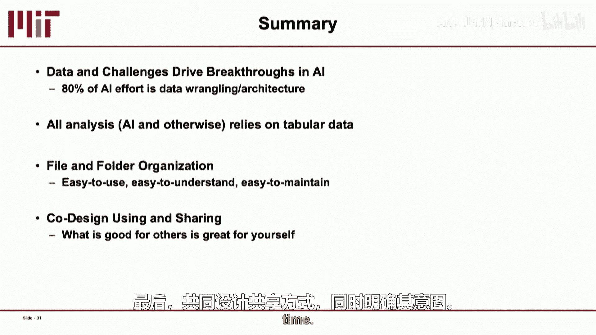
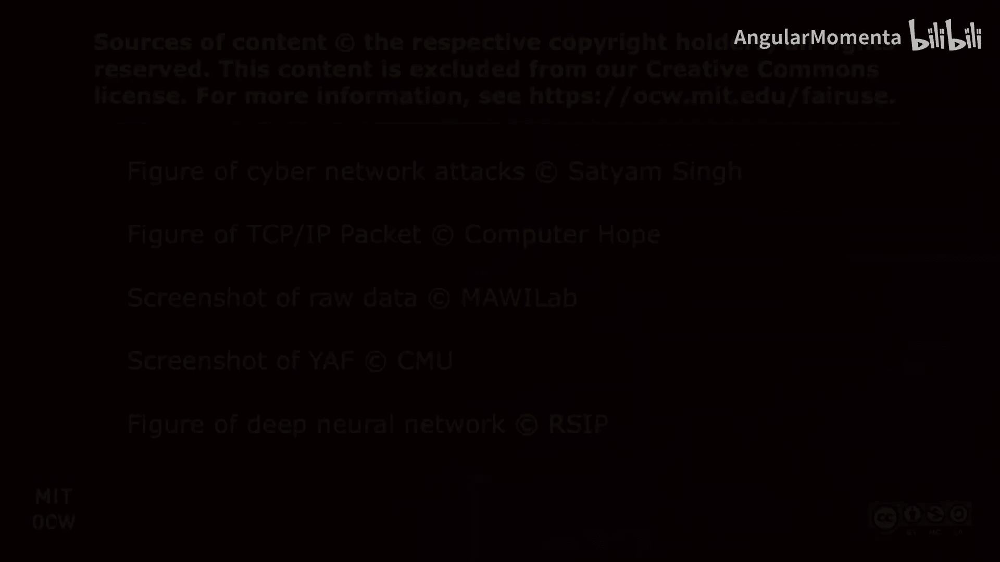

# 【麻省理工】大数据与机器学习数学-｜-MIT-RES.LL-005-D4M-Signal-Processing-on-Databases,-Fall-2012-p02-02-2.-网络数据处理；人工智能数据架构--BV1eEtTzhE4F_p2-

Hope you all are enjoying the class so far， it's always interesting we have people with a variety of backgrounds here。

 so it's just great to kind of hear the questions as we're going along。

So I'm going to give a quick example to begin the class right now that kind of drive in some of the concepts that we talked about on the first class。

 but this is kind of real rather than sort of cartoon neural networks。

 but sort of a real research result that we have before I begin I'd like to thank Emily Doe who was one of my graduate students who actually did all the work I just put some of the slides together。

 not even all of just a few so really the credit for this work goes to Emily。

 anything I misrepresent is my fault if not hers， she graduated so I'll take the link for anything that's not interesting。

With that we'll begin so all right so the overall goal of this project was really to detect and classify network attacks from real internet traffic and in order to do this as many of you can imagine we had to find a data that was of interest so this is probably a problem many of you are currently thinking about which is what data should I get my hands on right so we have a variety of data sets some are sensitive in nature so think of internal network traffic that we're trying to collect one's going to let us hand this end this over to graduate students to kind of work on and then more importantly published so the first thing that we wanted to do was look for a data that was kind of open and out there and we're fortunate that there is a group in Japan called the Maui working group which stands for the measurement and use my cool tool measurement and analysis of wide area internet traffic working group that actually has a 10 gig link that they've tapped using a network cap and they actually make this data available it's actually continuously updated。

Even to today so that's really cool and this is within that it's a thing called the day and the life of the Internet and so this has been going on for multiple years。

 the data sets reasonably large when you convert it into what we call an analyst friendly form which is something that you or I could read and make some sense out of it's about 20 terabytes inside size so reasonably large data not going to fit on a single computer or a single node so certainly a good use case for using high performance computing or supercomputing and one additional piece that we should note this is something that as you're starting off your projects you may also think about IP addresses are often seen as reasonably sensitive so you can see where traffic is coming and going from So in this particular data they've actually deterministically anonymized each of the IP addresses and as you're downloading the data you have to essentially sign a user agreement saying that you will not attempt to。

Kin of go back and figure out what the original IP addresses were so as you're coming up with data sets and I think Jeremy's going to talk a lot more about this in the next part。

 you might think about are there certain fields in the data that I'm collecting that might be deemed sensitive either today or in the future and if so are there just simple techniques that I could use to anonymize the data and then with a decent end user agreement you might be able to enforce some level of people not trying to break it and trying to go back it's not impossible to do it but any legitimate researcher who's using data really shouldn't care about what the original IP addresses in this particular case are or maybe other such data within whatever you're collecting。

All right so just a quick definition of anomaly detection I really love this definition of what an outlier is from a paper by Hawkins。

 so an outlier is an observation that deviates so much from other observations as to arouse suspicion that it was generated by different mechanism so when we're looking at network traffic that's what we're looking for we're looking for these mechanisms that are present in network traffic that deviates so much from normal behavior that it arouses suspicion and for a variety of reasons it could be somebody uploaded this cool video of somebody falling flat in their face。

Or it could be a bo net or a DdoOS attack or something like that。

So outlier can be sometimes referred to as an anomaly， surprise or exception。

 and within the context of cyber networks， these mechanisms can be botnets。

 CNC or command and conquer servers， insider threats。

 or any other network attacks such as distributed denial of service or For scan attacks。😡。

There are a number of general techniques to deal with outlier detection。

 so the first one is to look for changes is to essentially use statistics you look at the you what's going on in your mechanism and you look for statistical anomalies from that and you'll highlight those anomalies and then you'll kind of drive deep into that you could do clustering so if you're looking at unsupervised learning you could cluster your data and things that are really far away from existing clusters or known clusters something that you want to take a look at。

 you could similar to that is also distancebased techniques so these are kind of closely related that you look for observations that vary significantly from other observations in some sort of a feature space。

And finally you could use a model based technique where you attempt to model the behavior of normal use air quotes for the word normal and you look for things that deviate from this background model。

 so all of these four techniques or approaches to anomaly detection kind of related with each other it's not a hard and fast rule about how they deviate from each other。

 but for the popularity and the complexity of network traffic we decided to go with a model based technique because we found that any other means of trying to represent the data would be difficult。

 but this is sort of a top-down approach of how we kind of thought about well let's look at network traffic。

 let's think about anomalies and network traffic and let's come up with what's a good approach to address that。

😡，So when we talk about network attacks， not to go into detail。😡。

There is a wide variety of network attacks out there， every day we see news articles about new ones。

 the focus of this work was to look at just a couple of these。

 one was in this section that we call probing and scanning and another was in this resource usage or resource utilization area and specifically we looked at port scanning in distributed denial of service attacks。

😡，As a quick example of what happens in one of these network attacks so this is an attack often within the bucket of probing and scanning。

 so essentially what happens is you have an attacker that attempts to find out what ports are open on a victim or a target system it does this by sending requests similar to pings to a victim or a target system。

 if the target system acknowledges one of these things， you can say oh。

 this particular port is open and then one may go and look at what software typically runs on those ports and attempt to use some of the known vulnerabilities of that software so a lot of software packages have specific ports that they tend to use so you can say oh you port making up a number your port 10000 is open and I know that's used by by Microsoft SQL server or any other piece of software and then you can say well here's。

known vulnerability that I could use and then I'll try attacking that so this is just a simple technique that a lot of attackers use very low bar。

 very easy to do， you could write one by mistake， but just to find out what ports are open and then try to use known vulnerabilities on ports。

Now the least common deno， the easiest piece of data to collect is what's called the network packet。

 I'm sure many of you are familiar with the concept of a network packet。

 it's for those that are not think of if you're sending a letter。

 it's all the material on the envelope so it's the address。

 where it's coming from who it's going to plus a little bit of information of sort of what's in the package as well。

😡，The reason that we often use network packets and I'll kind of open this up to the class。

 a lot of the cyber research actually focuses on network packets。

 but those often form a very small percentage of the actual data of payloads where actually a lot of the data actually is can anyone guess why we tend to use network packets rather than payloads not Alberter oh sorry the network header yep sorry the network header。

 not the packet yep？😡，这也是。Anyone guess why we tend to use the header rather than the payload of the packet encrypt Yeah encrypt it exactly so very often especially these days the payload of the packet is typically encrypted so there's not too much that you can do with it so using the header information the header is not right it's the outside of the envelope the inside of the envelope is something that you cannot see by putting it up to the light So that's what we tend to use the header of the packet So the headers so this is what a packet looks like on the left on the left side that's what a packet looks like and if you kind of convert that into a human readable form just the header information this is the type of data that you get out of it so it gives you。

Things that you would expect， what was the IP address that I started from。

 what was a port that I started from， what was the destination IP address。

 what was the destination port， plus a bunch of other information about certain flags that were said。

 whether it's direction what direction the traffic is moving in and stuff like that。

 and then any flags associated with it， type of packet it is。

 so what type of protocol is the packet using， eta。All right。

 so just as a reminder the data we're using is from the Maui working group。

 but there's a lot of other data out there that you might be able to get your hands on so one of the challenges how many people here have worked in cybersecurity or done some research in cybersecurity？

A handful of people so one of the huge challenges and this is something that you may run into in your data sets is ground truth is understanding when so if you're trying to find out when there was an attack in your data someone needs to have there needs to be some ground truth associated with that as much as we'd all love to sit and write Ddos attacks and port scan attacks on ourselves sometimes getting that at scale can be very difficult so for the purpose of this work we used a synthetic data generator in which we took real internet traffic data but an injected synthetic attacks into it that would and that was sort of our way of looking of establishing ground truth so the Mai working group actually does publish ground truth based on a number of detectors that they have a lot of these are heuristicsbased detectors in our in our looking at that ground truth it was really difficult to actually understand when an attack was occurring is sort of like。

whereIn this hour an attack occurred， which if you're trying to train a machine learning classifier on that or an anomaly detector。

 that's kind of vague right because there's a lot happening in an hour of internet traffic and so if it's somewhere in that hour an attack occurred。

 that can be very difficult to find so that's sort of a reason that we focus on using a synthetic attack generator。

Can you say a little bit more about what kind of？其一个镜钱格咧，就。You，Is just additive where you're。

Showing some new compromised host that is in Jing data to some destination。

Is there also like return flows that are in there yeah so the question that was asked is you know I guess how sophisticated is this tool and how details can you do it so the exact details of that I would probably forward you to Emily but from looking at what was being done。

 these are reasonably sophisticated so it's not as simple as you have to give it a text file of all the IP addresses source and so but you do have to set some parameters so what you can do for example。

 if it's a DdoOS attack that's maybe the easiest one to describe is you would give it in maybe a range of IP addresses and ports that you'd like to see injected。

 you would give it a flow rate and then you could tell it what type of packages you'd like introduce and it allows you to do a number of these different this particular tool at least allows you to pick a number of these different features that it then injects into the original PAP file if you're looking for some of the other attacks so this is just a list of the attacks that。

that they currently support as of a few months ago they might be adding to this， you know。

 we focused on a few of these that were also easy for us to reason and kind of go back into the actual data that we collected to see if the actual injection made sense to us or not。

 but they do have a number of different parameters that you could pick。when you're doing that。

So that's just a little bit you know as we talked about in the data conditioning phase labeling data is often a pretty difficult process in of cyber anoma in the world of network packets and network security。

 going back and trying to label is an extremely timeconum task and very difficult and up to a lot of interpretation as to what one calls an attack。

 so what we did manually inspect a few of these， that's certainly not scalable。

 so we decided to go with a synthetic attack generator and I'm sure some of your projects you may also kind of think about is that a route that you need to take at least to start off with。

Okay so this is the overall pipeline of the system， so as I mentioned the first time we chatted。

 we spent a majority of our time in sort of step the first step here which is data conditioning。😡。

Which is data conditioning so within data conditioning we did you know taking the raw data which is downloading this from the internet。

 this comes to you in a binary format， which is a dot PCAP for those who are familiar with packetet capture outputs that's that binary format that comes from like PCD dump for example。

 we then convert that PCAP file into flows， parse that into human readable form， feature engineer。

 train machine learning classifier， do the same thing with the synthetic data。

 and then get good results。We hope that you get good results。

So step one of data conditioning was to download the actual raw data。

 the data was downloaded in a compressed binary format。

 which is probably what a lot of you will get your hands on。

 typical size of a single zip file or typical compressed files， about 2。

2 and a half gig when you decompress that and goes to about 10 gigs， about 4X。

 and a single PCAP file corresponds to so it's about 10 gig for about 15 minutes worth of traffic。

So if you're trying to do multiple days， you can imagine how this starts to explode in terms of volume and about 15 minutes on average is about 150000 corresponds to about 150。

000 packets per second， so this is a reasonable amount of network traffic that we're getting our hands on。

 but not even close to the types of volume that large scale providers have to deal on a regular basis。

Once we actualOnce we have the PCAP file downloaded。

 just the network packets don't really tell us much it's stuff to do things with。

 so what we want to do is convert this into a representation that's useful to do analysis and so a lot of work has been done using network flow and a network flow is essentially a sequence of packets from a single source to destination so as you can imagine when you're streaming a YouTube video for example。

 it's not one big packet that comes to you but it's a series of packets and so a flow essentially tries to detect that and say okay all of these things was a person watching this video right from this source to this destination within some time window is defined as a network flow。

And so we convert each of these 15 minute PCCAP files into network flow representation using a tool called YF which stands for yet another flow meter。

 and so that helps us do some of this flow establishing these network flows and so the size of about 15 minutes worth of flows goes to about two gigabytes。

We set a time out of flow to be about five minutes。😡，Okay once we have the flows。

 they're still in this binary format we need to now convert them into a representation that we can look at。

 so flow comes with an ASI converter called YaFI sorry YaF comes with a ASI converter called YaFI and that essentially converts the data from this flow representation into a tabular form and if there's one lesson that I think Jeremy will talk to you a lot about next these table tables tables。

 people love looking at tabular data， it's very easy to understand。

 I wouldn't recommend it but you could open this up in Excel。

 be huge but it would open up but it's very easy to kind of look at。

 especially when we're trying to establish truth in the data can go back and take a look at so for our pipeline we take the YaF files convert it into text file each of these ASI tables so get about 15 minutes worth of data is about 8 gigytes in size。

And we record a number of different data pieces per flow， we won't go into the details。

 but if you're interested you can kind of look at what are the various entities or features that come up in a network flow。

😡，All right， so now that we have network flows， that's sort of like sort of part one of data conditioning right we've converted into some representation that makes sense we have in the human readable form。

 sort of step1 data conditioning done now the next thing is to convert it into something that actually makes sense for our machine learning algorithm and so this is sort of bucket it into the area of feature engineering when we kind of think back at it and so feature engineering is really。

 really important you'll spend a lot of time doing this on new data sets and so each of these flows contains about 21 different features and one of the and we need to look for essentially which of these features makes sense for us to pass into a machine learning model。

 others we're just going to end up training a noisy so we have to use some domain knowledge right where we talk to experts in cybersecurity and say well IP address this kind of an important thing but maybe this other flag not as important and then we use a lot of trial and error and luck as well to help pick some of these features。

Once we kind of pick a set of features that we're interested in when we look back at the anomaly detection literature。

 a lot of work has been done with this concept of know you have these flows。

 but you need to convert them into some other format that makes sense to look for anomalies so just converting into a feature space in which anomalies make sense and so we looked at using entropy and the basic intuition behind this is that if if we're looking at various flows between different fields and that the entropy of these flows should be roughly equal be roughly should be about the same。

 not equal， but should be unchanging when there's no big mechanism defined by an outlier detection mechanism that's involved in changing the entropy。

 so for example just to make this more clear if you're having a DdoOS attack this is typically a number of different source IP addresses attempting to talk to a single destiinny。

ISo you would expect to see an increase in the entropy of the source IP field。😡。

In that particular example and in port scan attacks you would probably see something on the destination port entropy would go up right that's a little bit of intuition a little bit more complicated than that but that's a very high level view of what's going on and for entropy we just use the standard know I'm sure many of you who are familiar with information theory are very familiar with Shannon entropy and we compute the flow associated with each of the features that we picked from the network flow before so from the feature engineering we picked a subset of features associated with that。

😡，We all remember what neural networks are， this is just there for completeness。

 so we take these now network floats， these entroies associated with the network flow。

 we use those as input features for a neural network model now you'll recall from the neural network talk that we had last week。

 we have inputs and outputs， we have weights associated with them and then we had this nonlinearar equation that sort of represents inputs and outputs at inputs and outputs at each of the layers there was the equation。

 I can see Barry giving me the cu that I'm walking towards the slides。So features。

 the features that we have over here correspond to the various entroies that we've computed in the previous step and the outputs of this network correspond to a class of attack so in particular we focused on obviously no attack。

 DDoOS attacks， port scans， network scans， and P2P network scans。

The model itself had three hidden layers with 130 and 100 nodes respectively and an output layer and we used Ro activation。

 I'm happy to talk in more depth about why we selected these but I'll save that for another time。

And kind of going through this process we actually had very good results so that's a sort of the short form of the research work but what I wanted to really emphasize is the amount of effort that went into the data conditioning。

 the importance of collecting data， anonymizing data。

 making it human readable converting into a format that people understand and then kind of walking through this sort of it was certainly an iterative process as much as this is a very short form of what we did。

 this took a long time to get to these results and what we're presenting over here is the attack type and intensity so this is the ground truth from the synthetic data generator and then this is sort of the prediction that our model has across the side and this is a confusion matrix so a higher number or a darker blue indicates that we did a really good job and we've also used varying intensities of these attacks。

 so certainly if we have strong which means we've injected about 20，000 packets in the 15 minutes。

We can detect those really really well as you have weaker， weaker attacks。

 our system doesn't do as well， it's probably reasonable but certainly an area of ongoing research。

So with that I just wanted to I'll hand it over to Jeremy but these are some initial work and results on detecting possiblyify network attacks。

 the keynotes was know data conditioning was where we ended up spending a majority of the time cleaning up the collected data coming up with we spent a lot of time trying to figure out how to label this data because we were just unable to really do it and finally we ended up going the synthetic generator path but we actually did spend a significant amount of time trying to figure that out。

 and then we spent a lot of time on feature and engineering which did consist a lot of trial and error。

okay， thank you。Okay， thank you very much。啊。I'm Jeremy Kapenner from the Lincoln Laboratory Supercomputing Center。

Did you know me already？Just really introducing myself for a video。And。

beenThis topic has been teed up really well by SiI and VJ， I think they've illustrated。Sort of。

Going from if we think about our pipeline going from。Weft。To write。

So they've talked about kind of the end state of what you're trying to do in building these models。

 VJ talked about the data that feeds into them， I'm going to talk about the data architecture that you go through to kind of build up to that。

And the reason we've done it in this order， which is the reverse order。That。You do it in real life。

Is because it's difficult to appreciate the data architecture piece without an understanding of where you're going。

And so if you see from SiID's talk， I think it became very clear that having lots of data is really important for creating these models without the data。

 you can't do anything。😡，And likewise， you didn't see it。

 but all that data was created in a very precise form that made it easy to do that kind of work。😡。

And then VJ talked a little about some of the things given a data set。

 what did he have to do to get into form such that？It would work for his AI training application。

And what VJ is doing and did in that application is very much a sort of microcosm of which many of you will be doing in your own projects。

 you will try to identify data sets， you will try and do feature engineering。

Then go through this sort of trial and error process of coming up with AI models that suit some purpose and a key part of that is what we call AI data architecture。

 So I'm going to talk about。Some of the things that we've learned over the last 10 years in data architecture as head of a supercomputing center。

 I have the privilege of working with really everyone at MIT on all their data analysis problems and over the years we've learned some techniques。

 some really simple techniques that can dramatically make data architecture for your applications a lot simpler there's a lot of people out there selling very fancy software to solve data architecture problems。

We have found that we can use very simple techniques to solve most of those problems using software that's built into every single computer that is made today。

 that is don't need to go and download some new tool to do any of the things I'm going to talk about right now。

😔，So with that introduction， I'm going to just go over， there's the outline of my talk。

 I'm going to add some introduction and motivation which I'll go through quickly because I think Siid VJ did a fantastic job of motivating what we're doing。

 and then I'm going to talk about our sort of three big ideas and how to make AI data architecture simple and effective across a wide range of applications。

 one is and as VJ talked about we're going to really hit this concept of tabular data there's a reason why tabular data is so good and why it is such a preferred format and so if you want to try and get your data into these tabular formats and the nice thing is that if that sounds really simple。

 it's because it is really simple。Lots of people though want you to buy tools that make this process complicated because that's how they inject themselves in the process and we've discovered actually you can do world class MIT quality AI work with really。

 really simple tools， getting things in a tabular form is a great starting point。

And then how to organize the data， how to organize the data in the pipeline that VJ showed。

 which is pretty standard across a lot of applications Again。

 there's lots of applications and tools that will try to do that for you。

 We've just found that simple folder naming and file naming schemes get you a long way。

They require no tools and they make it really easy for other people to join your project because they can just look at the data and it's pretty clear what's going on and it also makes the data easy to share so that's another simple thing and then finally I want to talk about every single application we've demoed here involved data sets that were designed for sharing。

😡，Designing your data such that you can give it to others actually addresses a lot of the data architecture problems that you will encounter yourself。

😡，By thinking about， okay how do I make this data such that I can give it to someone else you're really making a much better product for yourself。

 you're making it so that other people can join your team much more quickly and be much more effective and so thinking about sharing of data is really an important thing and which you'll discover is that generalized sharing of data is very hard just pointing to a data set and saying I want to share it is very challenging there's a lot of barriers to do that but if you have some idea what the end purpose is but the particular application that you want to share this data for then it becomes a lot easier both technically and administratively and we will talk a little bit about some of the administrative burdens that you need to go through to share data and this is where knowing the purpose in this case。

We want to do particular AI application， which dramatically simplifies the process of doing data sharing。

So just some motivation， this is a slide that VJ presented earlier。

 and the big thing to emphasize here is we have a bunch of breakthroughs and the key is the bottom row。

 which says that，The time from algorithm to breakthrough is like two decades。

 but the time from getting data set that is a shareable well architected data set to break through was much。

 much shorter was only three years。😡，That's kind of motivation for the fact that why。

Data is so important to making progress in AI the data is actually writing the program。

 as VJ mentioned in the first lecture and so having data is really important and it has been often observed that 80% of the effort associated with building an AI system is data wrangling or data architecture as we call it and one of the benefits of these。

Challenge problems that are these open and charitable data sets is that they have done a lot of that data architecture and data wrangling for the community。

 which is why they're able to have a lot of people work on it and make progress on it。😡。

If you're doing a new application， you have to do this data architecture or data wrangling yourself。

 and we're going to share with you the techniques for doing that effectively。

 and I would say in most situations， this 80% of the effort actually is going to discover the methods that we are going to cover in a few minutes。

 that is it takes people a long time to figure out， oh。😡，Simple tables are good。

 we can organize our data that way， and just having a good set of folder names and file names really solves most of the problems。

 right？😔，That's the beauty of the solution， it sounds so phenomenally simple。

 how could it possibly work？😡，That's actually， you know。

 if there's one thing we've figured out here at MIT is that simple can be very good and very powerful。

So as was mentioned before， sort of these neural networks as depicted here。

 drive this space of applications， most of the innovations we've seen in the past few years have been using these neural networks。

😡，This one slide sort of covers all of neural networks and one slide you have the picture。

 you have the input features which are shown in gray dots。

 you have the output classifications that are shown in blue dots。

 and then you have their neural network and all their various weight matrices or weight tables in between。

😡，If you had one goal in terms of understanding AI。

 making a commitment to understanding this one slide。

 and you pretty much understand a good fraction of the entire field。😡，And while you are here at MIT。

 please feel free to talk to any of us about this slide or these concepts。

 and we will work with you to help you understand it。

 because anyone who's ever coming to you and offering an AI solution that uses neural networks。

 which is a significant fraction of them， they're just doing this。😡，This is all they're doing。

 it's all on this one slide， many of them， by the way， do not know the math。😡。

That the one equation here that's in this， they have software， they play with Knobs。

 but they don't even understand the underlying mathematics and just understanding this math。

 taking the time to do it， you will know more than anyone who is actually trying to sell you AI solutions。

😔，Now， as SiD said， he talked about batch size， I just added batches to this figure to emphasizeOt size the fact that all of these letters are mostly。

Uppercase and if you want to know one thing about matrix math is the easiest way to go from a vector equation to a matrix equation is take all the lowercase letters and make them uppercase and most of the time that actually just works in fact typically what we do if you're a linear algebraic person is we do that and see if it breaks anything and if it doesn't break anything well we assume it's right and all these matrix sheets our tabular a matrix is just a big table it's a big spreadsheet so basically all of neural networks in AI is just about taking spreadsheets and transforming them。

😡，And so this is just motivation for why these tables are so important。Here's the standard pipeline。

 VJ talked about it briefly and again what we've discovered is that in most data analysis which includes AI。

 this pipeline represents pretty much what most applications are doing it's not that any application does all of them but most the steps in an application fall into this pipeline。

 basically you have raw data， you parse it usually into some tabular format。

 you may ingest it into a database， you then query that database for a subset to do analysis。

 or you might scan the whole。😡，Database if you're doing all the files。

 if you want to do some application that involves all the data and then you analyze it and then you visualize it and so this is sort of the big steps in a pipeline that we see and again most applications we'll see they'll use three of these steps are not using all of them but it's a great framework for looking at any data analysis pipeline。

 it's easy to use it's easy to understand and it's easy to maintain and those are you know we like all of those features。

And I'll get into those more in more detail and then finally I've already talked significantly about data sharing。

 those's just some examples of data that we've put up for sharing the moments in time challenge。

 the graph challenge and again creating sharing quality data really。

It's not just a service to the community， it's principally a service to yourself。😡，And in fact。

 we've worked with a number of。Applications and sponsors where we help them do this and they find the data that they made shareable is instantly the most valuable data in their organization because it's shareable within their organization too。

 the same things that make it shareable to the broader community。

 make it shareable within your organization to other partners， and so that's really important。😡。

And again， as I said before， codesigning the sharing and the purpose of the data is quite you need to do that in order to do effective sharing。

 you can't just sort of share data arbitrarily， that can be very difficult to do。

 but if you have a particular application in mind sharing the data is quite simple and I'll get into that later。

😡，So I'm just going to then sort of hammer home some of these points here。

 so nothing really new here just sort of repeating what I've already said about these things but with adding a little bit more texture to them so why do we like tables。

 well we've been using tables to analyze data for thousands of years。😡。

So on the right is a 12th century manuscript， it's actually a table of Pis。

 and if you could read Latin and Roman numerals， you already can tell that it's probably all there's some columns and there's some rows and those Roman numerals or numbers even。

800 years later we can still see that this is a data table and it goes back further。

 you can find kaform tablets that are thousands of years old that are clearly written in a tabular form。

 so humans have been looking at data in a tabular form for thousands of years。

 part of that is to how our brain is actually wired。😡，1。

The 2D projection since we live at 3D space is the only projection that will show you all the data without occlusion。

 so if you want to look at all the data it kind of has to be presented in 2D form。

 we have a 2D optical system。In addition， we have special hardwired parts of our eyes that detect vertical and horizontal lines。

😡，For presumably detecting the horizon or trees or who knows what。

 and that makes it very easy for our eyes to look at tabular data。😡，And because of this。

 Tr data is compatible with almost every data analysis software on earth。

 If I make data analysis software and they can't read tables or write out tables。

 it's going to have a very small market share。 And this is just an example of some of the。😡。

Software out there that is designed to use tables， so whether it be spreadsheets or databases or the neural network packages that we've already looked at。

 various languages and libraries， and even things that you wouldn't think are tabular like hierarchical file formats like JSON and XML can actually be made compatible with a tabular format。

 so I'm just going to walk through these a little more detail。😡。

So of course our favorite is spreadsheets， here' is an example of a spreadsheet on the left and what's great about it is that I have。

Four different types of data that are very， very different。

 and you can all look at them and sort of get a sense of what they are。😡。

And that just shows how flexible this Tr spreadsheet form is is that we can really it can handle really。

 really diverse types of data in a way that's intuitive to us。

 some of the biggest pieces of software are that implement this are Microsoft Excel， Google Sheets。

 Apple numbers， it's used by about 100 million people every day。😡。

And so this is the most popular tool for using data analysis and there's a good reason for it and thinking of things in a tabular format so that they can be pulled into this really makes communication a lot easier and so again just sort of hammering home this element of tables within that there's specific formats that we have found to be very popular。

 so CSV and TSV are just，😡，nonnproprietary plain text ways of organizing data。

 we highly encourage people to use them because then it can be used by any tool CSV just stands for comma separated values。

 it's usually file name CSV in lowercase or file name CSV and uppercase and all it means is that the columns so each row is terminated by a new line and within each row the columns are separated by a comma。

 that's all that means。😡，We tend to encourage people to use TSP。

 which stands for T separated values because we replace the comma with a tab。

 and that allows us to write higher performance readers and writers because it is not uncommon to have a comma within a value and so it makes it very difficult to sort of write parsers that can do that fast。

But it's okay to say to a person generating data， if you put a tab inside a value。

 that's a follow on you， you should do that， and so that means I can write a program that can read this data really fast and it can write this data really fast and that's why in sort of the big data。

 AI space people often tend to use TSV。😡，And again。

 it's easily readable and writeriable by all those spreadsheet programs that I have said before。

Databases play a very important role as well， there's several different of types of databases that are called SQL。

 No SQL and New SQL， they're good for different things， I won't dwell on that here。

 but there are different types of databases， all of them operate on tables。😡，In fact。

 the central object in a database is literally called a database table and so database play an important role。

 I won't go into detail here， but I just wanted to mention this Likewise you've already had some demonstrations of different languages and libraries。

 I think everything you saw was in Python there's other languages， Julia， MALb，octave R。

 many other languages that play important roles in data analysis we've talked about Jupyter notebooks which is a universal interface to these different languages and libraries to allow you to do data analysis in addition to the various machine learning tools we've talked a lot about Tensorflow but there's others theo cafe and Vdia digits。

 all our examples of different tools for doing AI and again they love to ingest tabular data and they're very good at writing out tabular data completely consistent with here and then finally I want to mention XML and JSON which。

Very popular in object oriented languages like C++ Java and Python。

Those languages rely on data structures。which are basically just a set of fields and then those fields can also be data structures and this can continue on。

 these are called hierarchical data structures through the way these languages are organized and so it's very natural for them to have formats that they can just say write out this whole blob of data and it' will write it out into a hierarchical form called XML or JSON。

 however， it's not very human readable。And I just told you that all the data analysis tools want tables。

 which means that these formats aren't necessarily very good for doing data analysis on them Fortunatelyly we've discovered some ways that we can basically convert。

😔，These hierarchicalical formats into a giant what we call sparse table。

AndSrse just means a table where lots of the values are entry， or I'm sorry are empty。

 a lot of the entries are empty， and so we can just use that space to represent this hierarchy and all of the tools we've just talked about can ingest this data pretty easily。

😡，Because tables are so popular。😡，Every single。Different approach or software package。

 and we have a bunch of them listed in the first column here。😡。

Assign different names to the standard ways we refer to the elements of a table and there aren't that many。

 so when you think about a table， there's certain standard terms for dealing with what do we call the table in Excel it's called a sheet。

😡，How do we refer to a particular row， what do we call a whole row。

 how do we refer to a particular column， what do we call a whole column。

 what do we call an entry and what kind of math can we do on it and so whatever you're encountering a new piece of software and we deal with it all the time a lot of times it gets software and maybe it's related to data analysis seems really。

 really confusing。It's probably working on tables and so all you have to need to learn is what are they calling these things？

😡，And different software gives it different names just for arbitrary historical reasons。

 and so if you can figure out what it's calling these things。

 then you'll discover the software is a lot easier to understand。

 so we definitely encourage you to just map whatever software into these concepts and all of a sudden life becomes a lot easier。

😡，And because tabular data is used so commonly， whether it be in spreadsheets or analyzing graphs or databases or matrices。

 it's a natural interchange format so by reading in tabular data and writing out tabular data。

 you're preserving your ability to have that soft that data go into any application again。

 you have to be careful about people who want to write proprietary formats because they're basically sort of preventing you from basically working with other tools in other communities and this is another reason why tabular data is so great。

😡，All right so moving on here I want to just talk about basic files and folders so hopefully you become tables are good that's sort of lesson one and we're gonna to talk about how files and folder names well chosen is also good right again this sounds so obvious but it is really the thing that we've discovered and working with thousands of MIT researchers over the past decade that these are the sort of fundamentals that help you out I've already mentioned this pipeline that we talk about it's the way we organize the data it's easy to build it has built in tools in every single computer you have to support this to just create folders and files that means it has no technical be that as you never have to worry about if you have folders and files and in 10 years oh my God folders and files are going go away they've been around for 50 years and pretty much their present form we don't anticipate them changing they're easier to understand。

Alread talked about tabular file formats and how useful they are。

 and we will talk about a simple naming scheme for your data files。AI requires a lot of data。

 which means often thousands or millions of files， having good schemes for naming them really helps you and helps share the data amongst people in your team they can just look at the folders and files and sort of understand what's going on and again this folder structure is very easy to maintain。

 doesn't require any special technology and anyone can look at it。😡。

Getting into some more details about those table formats， some sort of real sort of。

In the weeds types of things that are really important I've always talked about you want to avoid proprietary formats if you can。

😡，Using CSV and TSV are great， they might be a little bulkkiier， you can compress them。

 no problem with doing that。😡，Then you get pretty much all the benefits of a proprietary format。

 but in a way that's generally usable。😡，Within a TSV or CSV file。

 it's good practice to make sure that each column label is unique so that that's actually a big help you don't want to have essentially the same column label or column name occur over and over again and likewise is' helpful if the first column are the row labels and those are each unique as well and just those two practices make it a lot easier to read and organize the data。

 otherwise you end up having do various transformations。If a lot of the entries are empty， i。e。

 the table is very sparse， there's another format we use which is column sometimes called triples format。

 basically every single entry in a table can be referred to by its row label。

 its column label and its value that forms a triple。

 so you can just write another file can be a TSV file that has three columns。

 the first column is the row label， the first column is the next column is a column label and the next column is the value label。

 and most software can read this in pretty nicely it's a very convenient way of dealing with very。

 very sparse data without losing any benefits， and so that's a very good thing。😡。

In terms of actual file naming， as I said before， you want to avoid having lots of tiny files。

 most file systems， most data systems do not work with small files really well。😡。

You do want to compress that decompression doesn't take much time， it's usually quite beneficial。

 and so it's better to have fewer larger files。😡，A sweet spot for a long time has been filed sort the one megabyte to 100 megabyte range。

This one mega8te is big enough so that you can read it in and get high bandwidth。

 get the data into your program quickly。😡，And up to 100 megabyte， once you start going beyond that。

 you maybe can start exhausting the memory of your computer or your processor。

 and so this one megabyte to 100 megabyte range has been a sweet spot for quite a while。😔。

You want to keep directories to less than10 files， that's pretty common nowadays。

 creating directories with really large number of files， files most systems don't really like that。

 you'll find it's also hard to work with。And so that's something you want to keep your directories less than 1。

000， and so you do that by using hierarchical directories。

 and so when it comes to naming files two things that tend to be pretty universal is source and time of data when where you collected it and when you collected it are pretty fundamental aspects that you can rely on being a part of almost all data sets。

And so this is a simple na scheme that we use that we find is very accessible。

 we just create a hierarchical directory here， begins with source and then we have the years。

 the months， the days， the hours and then it's however far you need to go to kind of hit your sort of thousand files per folder window and then we repeat all that name within the file name itself so that the file ever gets separated from its directory structure。

 you still have that information and that's really important because it's easy for files and get separated and then it's like a kid wandering around without its parents but if it's got a little label on it it says this is my address then you can get the kid back home and likewise sometimes it'll do the ty first and then source it really depends on the application。

 they're both fine but again this sounds really simple but it solves a lot of problems。

If you give data to people in this form， they're going to know what it means。

 right it doesn't require a lot of explanations like dates are pretty obvious。

 source names are pretty obvious， and then they can basically work through it pretty nicely。😡。

Daabases and files can work together you'll have some people like we do everything with files or we do everything with databases。

 they do different things， they serve different purposes so databases are good for quickly finding a small amount of data in a big data set so if I want to look up a little bit of data in a big data that's what databases do well likewise if I want to read a ton of data like all of the data and I want to analyze that's what file systems do well so you a lot of times keep them both around you have databases for looking up little elements quickly and you have files in file system if I want to read a lot of data so they work together very harmoniously they serve different purposes and again different databases are good for different things I won't be later these you can read them yourself but there are a variety of database technologies out there and they serve different purposes so let me talk about the folder structure a little bit more detail。

This is getting really like it is really just this simple when we talk about our standard pipeline。

 it's just a bunch of folders that we name like we show on the right。So every we have an overall。

Folder that we usually call pipeline。And then we basically label each step with step zero。

 step one so people know which is the beginning and which is the end and what's happening in there。

 so we have step zero raw， step one， parse， step two inje， step three query， step four analysis。

 step five is five is biiz if you're doing that。😡，And then within each one of those。

Within each one of these， we'll have a folder， we'll have a readMe which basically tells people something about okay。

 what's going on there， those readems are really good。

 even if you never share this data with anybody else。😡。

As you get on in life you will often be asked to revisit things and just having this information so that two years later you can go back and look at it is really really helpful because otherwise you'll discover that you don't remember what it is you were doing so you write little reads that give you some information about what's going on and then within each step there's usually read that touchs you about what the instructions in here and then we have a folder called code and the folder called data and basically the code describes how you put data。

Into this folder， so in the step zero raw， this is often the code maybe for downloading the data from the internet or how you collected the data。

 that's the code that basically puts the data into that folder and then with the next folder here。

 parse， this is the code that takes this raw data and parsees it and puts it into this folder。😡。

And then for ingest， you this will be the code that takes the data from the parsse form。

 sticks in a database and these might be the log files of the database entry。

 so a lot of times when you ingest data into a database you'll have log files that keep track of what that happened and likewise this continues on and down so very simple and I would offer to you if someone gave you this and you looked at it without any documentation you probably have a pretty good idea of what's going on。

 oh this is some kind of pipeline， I wonder where it begins to probably step zero。

 I wonder what that is it's probably raw data。😡，It's that simple and this just makes it so easy and more you can give stuff to people and they can just understand it without any additional explanation that's incredibly valuable。

😔，And again， allows your teams to contribute quickly to projects。

 and then finally we'll add a little thing here which is a data file list。

 this is a list of the full names of all the data files because，Especially on our systems。

 people are often processing lots of data which contain millions of files if you're going to be using many processors to do that it really punishes the file system。

 if you ask1 thousand processors to all traverse a data directory and build up the file names so they can figure out which files they should use process that really that's actually a great way to get kicked off a computer is to have1 thousand processes all doing LSL on all the folders in a directory with millions of files it will bring the file system to its needs so if you just have this one file that you generate once to list all the names of the files then every single process can just read in that file。

 pick which files they want to read and then do their work and then even know what the names to write the files are。

 and that's really a very efficient way dramatically speeds up your process。

And keeps the pressure on the file system at a minimum In addition。

 if you just want to look at what you have， you don't have to type LS to list the directory which might take a while。

 you could just look at this file and see what do I have right it's very convenient to be able to know what the data sets are and then you can go in there and you see oh。

 I see all these timestamps and sources I know what I have right it makes it really easy for people to get through this。

😡，So finally， I want to talk about using a chairman。😡，And so again， co design。

 using and sharing together， most data that you will deal with starts out unusable and unsharable。

 that is the data is not suited for the purpose that you wanted to use it for and you do not have permission to share it with anybody。

😡，And so if you understand the data and its purpose， you can get through both of those problems。😡。

So really practical。Aspects here of data sharing， we're going to talk about a few different roles that are very common in data sharing。

 the first is the keeper of the data。😡，This is the actual person who has the ability to make a copy of the data you can talk to lots of people but until you find the keeper of the data you haven't really gotten anywhere right because Lo said。

 oh yes we have data and we can share it or we can give it to you et cea。

 and there's someone who can eventually type a copy command。😡。

To the data you want to find that person， that's the person you really need to work with。

 they're the one person who can really， really help you because they actually have hands on access to the data so you want to find that。

😡，Then you want to get a sample or a copy of the data to your team to assess。😡，It is。

Always good to do good op， which is good operational security， which means fewer accounts。

 fewer people having access is better a lot of times people say oh here's the data。

 give me a list of names that you want to have access to it。😡，If you provide them one name。

 that's often pretty easy to get approved。😡，If you provide 10 names now questions will happen why are we giving 10 people access to this data。

 you don't really need 10 people to have access to the data。

 you can just have one person get the data on behalf of the team that's relatively easy to prove。

 you start giving a list of 20 names to have access data now there's all kinds of questions and that may just end the exercise right there。

😡，And once the question starts happening， you'll discover well。

 maybe we've lost that and we need to move on to someone else so and guess what that keeper do they like you now that they've raised all kinds of questions because something they thought was okay well now we're no you may no longer have a friend right so you've lost a friend you've lost a sorts of data so minimizing the access to the data getting just the people access to who need you to make your next step really good practice I have been that keeper I have been the person who has to approve things and nothing makes me sort of shut something down quicker than someone says well I want 20 people to have assets is I'm like well。

No zero works for me， that's a number in 20。いいです。that's one of the numbers there how about zero that works for me so then once you get a copy of the data you then convert a sample of it to a tabular form。

 you can identify the useful columns or features in that and then you can get rid of the rest。

That's a huge service to your community is if you have a volume of data and you know like all of this stuff is not going to be useful。

 now you're just giving people useful data that's really。

 really valuable that's sort of and since you're talking to keep rid of the data they may have the most information about what these different columns or features mean that's not a conversation that a lot of people are going to get to have and so if you get to help your whole team by saying oh。

 we know these columns mean this， they're not relevant， let's get rid of them。

 that's a huge service to your community it's less data， it makes it easier to release。😡。

You then maybe will if there is data columns or features that are sensitive in some way。

 there's a variety of techniques you can use to minimize， anonymize。

 possibly simulate or use surrogate information to make it so that you can share that data and there's lots of techniques but when those are only applicable when you know your application So if I look at this data and I see this one column that might be sensitive but valuable for my application I can often come up with a minimization scheme that will work for that because all the data analysis based on tables。

 which is mathematically just matrices， one of the most fundamental properties of matrices that we really。

 really like is that reoring the rows of the columns doesn't change any of the math。

 that's kind of like the big deal of matrices and tables you can move the row reorder the rows。

 reor the columns and everything should still just work which means if you relabel the columns or relabel the rows。

😡，Things should still just work and you'll get be able to do the science you need so a lot of times when you share data with researchers information that normally you would delete that you would think would be valuable for someone else。

 the research's like I don't care right it doesn't change as long as it doesn't change something fundamental about the structure of the data I can work with that and again that's something you would never know unless you have an end purpose in mind。

So then you want to obtain a preliminary approval to say can I have the data set。

 I've worked with the keeper is's okay for me to share this。

 the broader set of people to make sure that they like it too。

 that's usually easy to do if it's just a small sample and then you can test with your AI users you repeat this process until you basically have data like yep。

 this is what we want， this is we want to share and then you can sort of go through the process of how do we really get an agreement in place to do that。

 you also then create the folder naming structure for scaling out to more data files and then finally what's great is if you can then automate this process at the data owner's site。

It's tremendously valuable them you have just gifted them a data architecture that makes their data AI ready and then moving forward they can now share it with you within their own organization or with others right so this is incredibly valuable right we said data architecture and wrangling is often 80% of the effort you do this you've now eliminated potentially 80% of the effort of anyone else who ever wants to do data analysisrs of AI in this data right this is a phenomenally huge win for anyone that you partner with is to gift them a very simple data architecture they can maintain going forward it's a huge potential savings to them。

😡，All right， so another role we want to talk about is the data owner subject matter expert or SM。😡。

So we've talked about the keeper of the data， there's often a subject matter expert associated with the data that is an advocate。

 the keeper is often like hey， I maintain the data。

 I do what these subject matter experts tell' me to do。😡。

But there's someone out there who wants to help you get the data because they see it's going to be valuable to you。

😡，And。All these AI data products are generally best made by people with AI knowledge。

 so were highly motivated to engage with these subject matter experts。

 pull them into the AI community so they can see the best practices。

 that will allow them to understand which data they have。

 how it might be useful to AI and how to prepare it so that's better so whenever we get engaged with subject matter experts at other communities at data owners。

 we really want to pull them into the community， have them come to our environment so they can see what's going on and help us identify new data sets and help make those data sets appropriate for our consumption。

😡，So one of the big things you'll run into is that there are concerns with sharing data。

That is there's a lot of confusion about the liability of sharing data with researchers。😡。

And data owners often have to think about the lowest common denominator， if it's a company。

 they have to think about US and EU and other requirements。

 all kinds of different frameworks for thinking about that。😡。

The good news is there are standard practices that meet these requirements。😡。

And I'm going to list what these standard practices are。

 we have worked with many folks who've tried to share data successfully。😡。

And these are the properties of successful data sharing activities and the activities that don't do these things often are unsuccessful。

 we didn't invent any of this， this is just our observations from working with many people whove tried to share data。

 one you want data available in curated repositories。

 just taking data and posting it somewhere without proper curation really does no good for anyone。😡。

You want to use standard anonymization methods where needed， hashling， sampling simulation。

 I've already talked about those， but those do work。😡。

Particularly when they are coupled with access requires registration with a repository and legitimate need。

 so there's a data agreement。😡，Associated with getting the data in some way。

 shape or form and those two together really， really work well。

And you also want to focus on getting the data to the people who are actually going to add value to it。

 so one of the misnomer is we'll just take data and we'll make it available to all 10 billion souls on the planet Earth。

😡，When really less than 100 could ever actually add value to us so why are we going through all the trouble in the issues associated with making data available to anyone when really we only want to get that data to people with the skills and legitimate research needs to make use of it and so by setting up curated repositories people then apply。

 I want to get access to the data， they talk about what their need is that sets sort of a swim lane。

 you can't just do anything you want with the data when you say I'm going to use it for this purpose。

 you have to stick to those guidelines if you want to change them。

 you have to go back and say look I want to do something different if you're a legitimate researcher with legitimate research needs。

 that's usually pretty easy to approve。😡，And then recipients agree not to repost the whole data set or to deanonymize it。

 this is what makes anonymization work， not that the anonymization or the encryption is so strong。

 it's unbreakable， it's that people agree not to reverse it and the good thing about working with legitimate researchers is they're highly motivated not to break their agreements。

😡，If you're at MIT or any of these universities and you break your data sharing agreements。

 that is professionally very detrimental to you because it is very detrimental to the organization。

 no research organization ever wants to have a reputation that it does not respect its data usage agreements that will put that research organization out of business so there's a lot of incentive for legitimate research to honor these agreements。

 which may not be the same for just general people who are working in other types of environments。😡。

So they can publish their analysis and data examples as necessary。

 they agree to cite the repository and provide their publications back and the repository can curate enriched products。

 so if a researcher discover some derivative product， oh， I can apply this to all the data。

 you know I'd like to have that be posted somewhere they can often use the original repositor to do that。

 and again we encourage everyone to encourage people to follow these guidelines that are very beneficial。

😡，So。I've talked about the data。Keeper， I've talked about the subject matter expert。

 now I'm going to talk about a final critical role， which is the ISO。

 which is the information security officer。😡，In almost every single organization that has data。

 there is an information security officer that needs to sign off on making the data available to anyone else。

😡，They're the person whose neck is on the line and is saying that。😡。

It's okay to share this data that the benefits outweigh the potential risks。😡。

And subject matter experts need to communicate with the information security officer。

 they're often the ones advocating for this data and be released。😡。

But they don't know the language of information security officers。

 and this causes huge problems and I would say 90% of data sharing efforts die。😡。

Because of miscommunication between subject matter experts and written information security officers。

ca the information security officer fundamentally needs to believe that the subject matter expert understands the risk。

 understands basic security concepts in order for them to trust them with their signature to get it released。

 and so typically what hands happens is that an ISO needs a very basic information from the subject matter expert in order to approve the release of information。

😡，What's the project， what's the need， where is the data going to be。

 who's going to be using it for how long？They are expecting one sentence answers to each of these。😡。

A subject matter expert typically replies with an entire research proposal。😡，And so if I'm an ISO。

And I'm trying to assess whether a subject matter expert knows anything about security。

 and I gave them really easy softball questions and they come back with something that clearly took them way more time and effort that answers none of my questions。

 what's my opinion going to be of that subject matter expert and how much I should trust them？😡。

It's going to be zero and from that moment onward， I'll be polite， but you know how about zero data。

 that works for me。😡，Right that's a good number right so this is really important and so if there's one thing we can do because very few of you have ISOs and something that my team gets involved on a lot is to intercept this conversation before it goes bad is we can help you work with IOs。

 work with people who have to release with data and help answer these questions in a proper way and so I'm going to go through a few examples to you。

So a really common question is whats the data you're seeking to share。

 so this is a very common question to get back from a IISSO， describe the data to be shared。

 focusing on its risk to the organization if it were to be accidentally released to the public or otherwise misused。

😡，Very common question。And so here's an example answer。

Very short answer the data was collected on these dates at this location in accordance with our mission。

 the risk has been assessed and addressed by an appropriate combination of excision。

 anonymization and or agreements， the release to appropriate legitimate researchers will further our mission and is endorsed by leadership。

😡，Very， very， very short answer but we've covered a lot of ground in that short answer and I'll explain sentence one establishes the identity finite scope in proper collection of the data in one sentence sentence two establishes that risk was assessed in the mitigations were taken sentence three establishes the finite scope of the recipients an appropriate reason for release and mission approval we've covered we've answered nine questions in three sentences at the level of detail and ISO wants and ISO can always ask you more questions for more detail and they're usually looking for another one sentence answer and you build these up to be three4 five sentence things that cover broadly what you're wanting to do and you see here you don't want to do anything that requires the ISO to have detailed technical knowledge of what you're doing they're looking for overall scope overall limiters on what you're doing so that it is somehow contained to a reasonable risk。

Another question here that's very common is where to whom is the data going so please describe the intended recipients so an example answers the data will be shared with researchers at a specific set of institutions that will be processed on those institution' own systems meeting their institution security policies which include password controlled access。

 regular application of system updates， encryption and mobile devices such as laptops。

 author access to the data will be limited to personnel working as part of this effort again we've covered a lot of ground very simply。

 we didn't really go into too many details that are specific to this particular case。

And then a final one is what controls are there on further release either policy or legal so an example is an acceptable use guidelines that prohibit attempting to deanaonymize the data we provided to all personnel working on the data publication guidelines have been agreed to that allow for highleve statistical findings to be published but prohibit including any individual data records a set of notional records has been provided that can be published an example of the data format but it's not part of the actual data set。

 the research agreement requires that all data be deleted the end of the engagement except those items retained for publication I'm not saying you have to use but again this is another example of what ISOs are expecting you give them language like this。

 their confidence swell to like oh I'm dealing with someone that understands the risks I'm taking on their behalf and we can move forward in a very productive way and if you ever have questions about how to do is feel free to talk to my team or other people or other ISOs we've had to deal with this we've actually are working with a lot of people on this language。

A lot of people in the government to sort of get these best practices out there。

 we have socialized this with a fair number of experts in this field and there's general consensus as are very good methods for helping you get data out so that brings me data of the talk so as I said before data wrangling。

 very important， significant part of the effort， analysis really relies and tap your data so that's a really good format you can do it in very simple non-propriet formats taking you're going to have to name your folders and file something。

Yma as will name something that's really generally usable and then finally codesing the sharing and what the intent is at the same time。

 that's doable， generalized release of data， very， very hard tailored release for specific applications very。

 very doable if you have good communication from all the stakeholders involved so these are just really practical things。

 This isn't sort of fancy AI， This is sort of bread and butter。

 how do you actually get data analysis done and with that I'm happy to take any questions。

