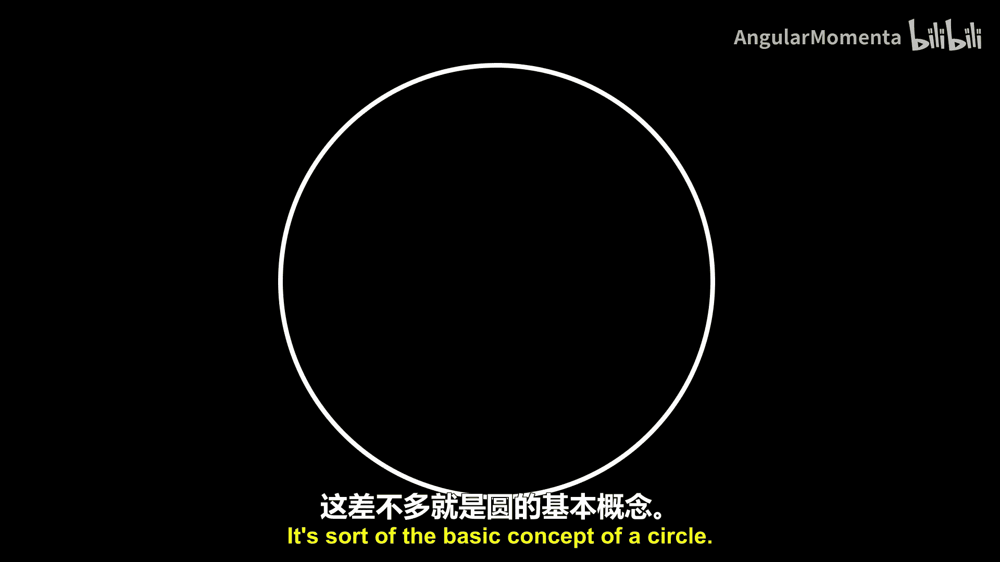
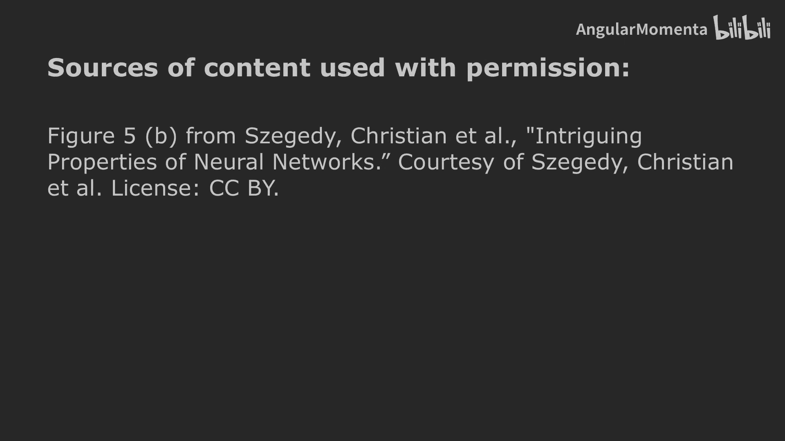

# 【麻省理工】大数据与机器学习数学-｜-MIT-RES.LL-005-D4M-Signal-Processing-on-Databases,-Fall-2012-p03-03-讲座：大数据与机器学习数学--BV1eEtTzhE4F_p3-

The following content is provided under a Cative Commons license。

 Your support will help Mi T OpenCourseware continue to offer high quality educational resources for free to make a donation or to view additional materials from hundreds of Mitcourses。

 Visit Mit Opencourseseware at Ocw。mt Eduu。

All right， welcome， thank you so much。For coming， I'm Jeremy Keplner。

 I'm a fellow at Lincoln Laboratory， I lead the Supercomputing Center there。

 which means I have the privilege of working every day with pretty much everyone at MIT。

I think I have the best job at MIT because I get to help you all pursue your research research dreams and as a result of that。

 I get an opportunity to sort of see what a really wide range of folks are doing and observe patterns between what different folks are doing so with that I'll get started。

 this is meant to be some initial motivational material。

 why you should be interested in learning about this mathematics。

 this mathematics of big data and how it relates to machine learning and other really exciting topics it is a math course we will be going over a fair amount of math。

 but we really work hard to make it very accessible to people so we start out with a really elementary mathematical concept here probably one that hopefully most。

Most of you are familiar with， it's sort of the basic concept of a circle right and I bring that up because many of us know many ways to state this mathematically right it's all the points that are equal distance from a particular point there's other ways to describe it。

 but this is sort of a basic mathematical concept of a circle that many of us have grown up with。

 but of course the other thing we know is that right and this is sort of kind of the big idea is that although I can write down an equation for a circle。

 which is the equation for a perfect ideal circle， we know that such things don't actually exist in nature。

There is no true perfect circle in nature， even this circle that we've drawn here， it has pixels。

 if I've zoomed in on it， if I zoomed in on enough， it wouldn't look like a circle at all。

 it would look like a series of blocks， it would look and so that approximation process right where we have a mathematical concept of an ideal circle but we know that there are not really they don't really exist in nature。

 but we understand that it is worthwhile to think about these mathematical ideals。

Manipulate them and then take the results of those manipulation back into the real world that that's a really productive way to think about things and really the basis for a lot of what we do here at MIT。

 this concept you know is essentially the basis of sort of modern or not you know ancient Western thought on mathematics。

 if you've remember your history courses， this concept of ideal shapes and ideal circles is sort of the foundation of platonic mathematics some 2500 years ago。

 and at the time though， that they were developing that concept this idea that there are ideal shapes out there and that thinking about them and manipulate them was a more effective way to reason about the real world。

You know， there was a lot of skepticism。You could imagine 2，500 years ago。

 someone's walking around saying， I believe there's these things called ideal circles in ideal squares and ideal shapes。

 but they don't actually exist in nature。That would probably not be well received。 In fact。

 it was not well received。 many of。Those philosophers who were thinking about this were very negatively received。

 and in fact， if you want to learn about how negative the response was to this。

 I encourage you to go and read the allegory of the cave。

 which is essentially the story of these philosophers talking about how they're trying to bring the light of this knowledge to the broader world and how they essentially get killed because of it because people don't want want to see it。

 So that struggle that we they experience 2500 years ago， it exists today。

 you as people at MIT will try and bring mathematical concepts into environments where people like I don't see why that's relevant and you will experience you negative inputs。

 but you should rest assured that this is a good bet。

 it's worked well for thousands of years you knows what I base my career on people ask well what's the basis of well I'm just sort of betting on math here。

 that's been a good it's been a good tool and so this is why。

We're beginning to think of this way when we talk about big data and machine learning。

 sort of really looking at the fundamentals， what are the ideals that we need in order to effectively reason about the problems that we're facing today in the virtual world and the fact that this mathematical concepts describe the natural world so well and also describe in the virtual world is sometimes called the unreasonable effectiveness of mathematics。

 you can look that up， but people talk about why does ado do such a good job of describing so many of things。

People say， well， they don't really know， but it seems to be a good bit of luck that it happens that way。

This is circles and that gets us a certain way， but in most of the fields that we work with。

 and I would say that in almost any introductory course that you take in college。

 whatever the discipline is， whether it be chemistry。

 or mechanical engineering or electrical engineering， or physics or biology。

 the basic fundamental theoretical ideas that they will introduce to you will be the concept of a linear model。

So。There we have a linear model right and why do we like linear models and again it can be physics。

 it can be simple as F equals MA or in chemistry， it can be some kind of chemical rate equation or in mechanical engineering。

 there's it can be basic concepts of friction， the reason we like these basic linear models is because we can project。

I know that if that solid line represents what I believe I have evidence to support that that is correct。

 then I feel pretty good about projecting maybe where I don't have data or into a new domain。

 so linear models allow us to do this reasoning and that's why in almost every in the first few weeks of almost any introductory course they begin with these linear models because they have proven to be so effective。

😡，Now there are many nonlinear phenomena that are tremendously important。

Okay and as a person who deals with large scale computation。

 you those are a staple of what people do， but in order to do nonlinear calculations。

 or reason about things nonlinearly， it usually requires much more complicated analysis and much more computation。

 much more data， and so our ability to extrapolate is very limited。Okay， it's very。

 it's very limited。 So here I am talking about the benefits of。Ideal of thinking mathematically。

 talking about， you know， linearity。 What does this have to do with big data。

 Well and machine learning， So we would like to be able to do the same things。

That we've been able to do in other fields in this sort of new emerging field of big data。

 And this often deals with data that doesn't look like the traditional。

 measurements we see in science。 This can be data that has to do with words or images pictures of people。

 other types of things that don't feel like the kinds of data that we traditionally deal with in science and engineering。

But we know we want to use linear models， so how are we going to do that。

 how can we take this concept of linearity， which has been so powerful across so many disciplines and bring them to this field that just feels completely different in times of times of data that we have。

So。To begin with， I need to refresh for you what it really means to be linear。

Before I showed you a line and hence line linear， but mathematically linearity means something much deeper and so here's an equation that you may have first seen in elementary school。

 we basically have two times three plus4 is equal to two times3 plus two times four that is called the distributive property。

 it basically says multiplication distributes over edition。

 and this is the fundamental reason why I would say mathematics works in our world right if this wasn't true very early on in the earliest days of inventing mathematics。

 it would not have been very useful right you know say that I have two three plus four of something okay and then I can sort of change it and do in this other way。

 that's really what makes mathematical mathematics useful。😡，From a deeper perspective。

 the distributive property is basically what makes math linear。

 this is the property that if this property holds， then we can reason about a system linearly。😡。

Now you're very familiar with this type of mathematics， but there's other types of mathematics。

 so if you allow me， hopefully you will let me just replace those multiplication symbols and addition symbols with this sort of funny circle times and circle plus and we'll get to why I'm going to do that because it turns out that while you have been done most of your careers with traditional arithmetic multiplication and addition。

 the kind you would do on your calculator of done in elementary school。

 it turns out there's other pairs。Of operations that also obey this property。

 this distributor property， and therefore allow us to potentially build linear models of very different types of data using this property。

So as I mentioned， sort of the classic two are you know circle plus is just equal to regular arithmetic edition as we show on the first line and circle times is equal to regular arithmetic multiplication。

 so those are sort of the standard ones and by far this pair。

 you know this is the most common pair that we use you know across the world today。

 but there are others。So for instance。I can replace the plus operation with Max。😡。

And the multiplication operation with addition。Okay and the above distributive equation will still hold right that's very little confusing and I often get confused that you know addition know the multiplications is no addition。

 but this this pair sometimes referred to as max plus you'll sometimes hear about as max plus algebra is actually very important in a machine learning and neural networks。

 this is actually sort of the back end of the rectified linear unit is essentially this operation if you didn't understand what that meant that's okay。

 we'll get to that later， it's very important in finance。

 there's certain finance operations that rely on this type of mathematics。There are other pairs。Also。

So here's one， I can replace addition with union and multiplication with intersection。Right。Now this。

That also obeys that linear property。This is essentially the pair of operations that you know anytime you make a transaction and work with what's called a relational database。

 that's the mathematical operation， a pair that's sitting inside it。

 it's why those databases work it allows us to reason about queries which are just a series of intersections and using unions and reorder them in such a way in databases is called query planning and if that property wasn't true we wouldn't be able to do that so this is a deep property of that。

 so these we can put all different types of pairs in here and reason about them linearly and this is why many of the systems we use today work and so this class is about sort of really exposing that that really the mathematics that allows us to think linearly about data that we haven't really thought of as maybe obeying some kind of linear。

This is essentially the critical point of this class。So it goes beyond that though。

 so hopefully you'll allow me to replace those numbers。With letters， right。

 So that's sort of basic algebra there。 just for refresher， the previous equation， you know。

 we had a equals 2， B equals 3， C equals 4。But we're not limited to these。Variables or these。

 these letters to being just simple scalar numbers。 In this case。

 real numbers or integers or something like that。 They can be other things， too。So for instance， A。

 B， and C could be spreadsheets。And that's something we'll go over with extensively in a class so that I can basically have A。

 B and C， B whole spreadsheets of data， and the linear equation will still hold。In fact。

 that's probably the key concept in big data is the necessity to reason about data as whole collections and transforming whole collections。

Going and looking at things one element at a time is essentially the thing that is extremely difficult to do when you have large amounts of data。

A， B and C can be database tables， right， Those don't differ too much from spreadsheets。

 And as I talked to you， you know， in the previous slide， you know。

 that Union intersection pair naturally lines up and we can do reason about whole tables in a database using linear properties。

They can be matrices， I think for those of you who have had linear algebra and matrix to mathematics。

 that would have been the first example right when I substituted the A。

 B and C and had these linear equations often in many of the sciences we think about matrix operations and linearity as sort of being coupled together。

And through the duality between matrices and graphs and networks。

 we can represent graphs and networks through matrices。 anytime you work with a neural network。

 you're representing that network as a matrix and of course。

 all these equations apply there as well and couldn reason about those systems linearly。

 So that provides a little motivation there。As we like to say enough about me。

 let me tell you about my book， so this will be the text that will use in the class。

 we are not going to go through the full text， but we have printed out copies of the first sort of seven chapters that we will go through and we will hand those out later when you do the class。

So let me now switch gears a little bit and talk about how this relates to。

 I think one of the most wonderful breakthroughs that we have seen where I've seen in my career and many of my colleagues here at MIT have seen。

 which is what's been going on in machine learning， which is which is it's sort of it's not hype。

 there's a real， real there there， and it's tremendously exciting。

 so let me give you a little history， basic history of this field。😡，So in a certain sense。

 before 2010。Machine learning。Look like this。And then sort of after 2015。It kind of looks like this。

 So when people talk about the hype in machine learning or AI。

 really deep neural networks are the elephant inside the machine learning snake they have it has stormed onto the scene in the last five years and basically allowed us to do things that you we had almost taken for granted were impossible。

 just the fact that you're able to talk to computers and they can understand you that we can have computers that can see in the way you or at least in a way that approximate the way humans do these are really almost technological miracles that for those of us who've been working on this field for 50 years。

 we had almost literally given up on and then all of a sudden it became possible。

 So let me give you a little sense of a appreciation for this field and and its roots。

 So machine learning like any field。Defined as a set of techniques and problems when you ask what defines a field。

 you ask well， what are the problems that they work on。

 that other fields don't really work on and what are the techniques they employ that really are not really be employed by others so the core techniques you as I' mentioned earlier are these neural networks these are meant to crudely approximate。

 maybe the way humans think about problems， we have these circles， which are neurons。

 they have connections to other neurons you know those connections have different weights associated with them as information comes in。

 they get multiplied by those weights， they get some together and if they pass certain thresholds or criteria。

 then they send a signal on to another neuron and this is to a certain degree how we believe the human the brain works and is a sort of natural starting point for how do we think about how could we make computers do similar things So of the big you。

Problems that people have worked on that are sort of kind of these sort of classic problems in machine learning our language。

 how do we make computers understand human language， vision。

 How do we make computer see pictures or explain pictures back to us the way we would like and strategy and games and other types of things like that。

 of how do we get them to solve problems。This is not new。

These core concepts trace back to the earliest days of the field， in fact， these four figures here。

 each one is taken from a paper that was presented at the very first machine learning conference in the mid-1950s。

So there was a machine learning conference in the mid-1950s， it was in Los Angeles。

 it had four papers presented。These were the four papers and I will say that three of them were done by folks at MIT Lincoln Laboratory。

 which is where I work。And so that was basically the neural networks the language and vision。

 and we didn't play games。 So， you know， that was that was it。 So this， this was and you might say。

 well， why， why is it， Why was there so much work going on in Lincoln laboratory in the mid 1950s that they would。

 they would want to sort of pioneer， in these directions。Lincoln at that time。

 people were first building computers and computers were very special purpose。

So different organizations around the world were building computers to do different things。

 some were doing them to simulate， you know you know。Complex fluid dynamic systems。

 you know think about designing ships or other types of things like that， others or airplanes。

 others were doing them to say like what Alan Tring was doing to break codes and our task was to help people who were watching radar scopes make decisions。

How could we watch how could humans could computers enable humans to watch more sensors and see what they're going。

 How could we do that。At Lincoln Laboratory， we were building special purpose computers to do this。

 and we built the first large computer with reliable， fast memory。

This system had 4096 bytes of memory。😡，Which at the time， people thought was too much。

What could you possibly do with 4096 numbers？😡，The human brain， of course， right， That's enough。

 right， Most of us can remember 5，6，7 digits， right。

 So a computer that can remember 4096 numbers should be able to do things like language and vision and strategy。

 So why not？ So they went out， And they started working on these problems， okay。😊。

And but Lincoln laboratory being an applied research laboratory， it is。

 we are required to get answers to our sponsors in you a few years timeframe if problems are going to take longer than that。

 then they really are or the purview of the basic research community universities and it became apparent pretty early on that this problem was going to be more difficult it was not going to be solved you know in a few right away so we did what we often do is we partnered。

 we found some bright young people at MIT， people just like yourselves in this case we found young professor named Marvin Minsky and we said why don't you go and get some of your friends together and create a meeting where you can lay out what the fundamental challenges are this field and then we will figure out how to get that funded so that you can go and do that research。

And that was the famous Dartmouth AI conference which kicked off the field and the person leading this group。

 Oliver Selfridge at Lincoln Labor basically arranged for that conference to happen and then subsequently arranged for what would became the MIT AI lab that was founded by Professor Minsky and likewise Professor Selfridge also realized that we would need more Comp power。

 so he left Lincoln laboratory informed what was called Project Mac。

 which became the laboratory for Comp science， and then those two entities later merged 30 years later to become CAil。

 so that was sort of the initial thing。 Now it was pretty clear that when this problem was handed off to the basic research community。

 that there was a feeling that these problems would be solved in about a decade。

So we were really thinking by the mid-1960s is when these problems would be really solved。

So it's kind of like giving someone an assignment， right。

 You all are given assignments by professors， and they give you。A week to do it。But。

It took a little longer， in this case， it took five weeks。We're in this case。

 five decades to solve this problem， but we have。We've now really using those techniques。

 we've made tremendous progress on those problems。By。😡，We don't know why it works。

 So let me show you a little bit what we have learned。

And then this course will explore the deeper mathematics to help us gain insight。

We still don't know why it works， at least we can lay the foundations。

 and maybe you can figure it out。So here I am，50 years later， a person from Lincoln Labor saying。

All right。😊，Question one has been answered。Here's question2。

 why does this work and hopefully you can begin be the generation figured out Hopefully it'll take less than 50 years。

 Hisically， this type， once we know how it works。It usually takes about 20 years to figure out why。

 so in past， but maybe some people are smarter and they'll figure it out faster。

So this is what a neural network looks like。On the left。You have your input， in this case a vector。

 y0， it's just these dots that are called features。You know what is a feature？

Anything can be a feature。That is the power of neural networks is they don't require you to sort of a priori state what the inputs can be。

 they can be anything if people have said well you know neural networks to machine learning is just curvefi。

 yeah， but it's confer fitting without domain knowledge because the domain knowledge is so costly and expensive to create that having a general system that can do this is really what's so powerful。

😡，So the inputs， you know， so we have an input feature， it could be a vector which we call y sub0ro。

 and that can just be an image， the canonical thing being an image of a cat right。

 and that can just be the pixels values just sort of rolled out into a vector and there will be the inputs。

And then we have a series of layers， these are called hidden layers。

 the circles are often referred to as neurons， okay。

 and each line connecting each dot has a value associated with it a weight。

And the strength of connection between any two neurons is given by that weight。

And then ultimately output in this case。The output classification。

 the series of blue dots there are the different possible categories， so if I put in a cat picture。

 one of those dots would be cat， maybe one would be dog， maybe one would be apple orange。

 whatever I desired。And the whole idea is that if I put in a picture of a cat。

 and I set all these values correctly， then the dot as corresponding to cat will end up with the highest score。

😡，RightAnd then I mentioned earlier that know each one of these neurons collects inputs。

 and if it's above a certain threshold， it then chooses to pass on information to the next。

 and that's where these B values， which are vectors。

 those are just the thresholds associated with each one of those。 It's a vector。

 one value associated each one of those that does those。

This entire system can be represented relatively simply with one equation， which is that。Yi plus 1。

 which is the next vector in the layer， can be computed by the previous vector， Yi。

Matrix multiplied by the weights W。 So whenever you see sort of transformations from one set of。

Neurons to the next layer， you should think， oh， I have a matrix that represent all those weights and I'm going to multiply it by the vector to get the next one。

 Then we apply these thresholds all right， and then so we add the Bs and then we have a function that we pass it through typically this H function has been given the name。

 rectified linear unit， it really just it's much simpler than that it's just if the value is greater than that comes out of this matrix multiply if the value is greater than zero。

 don't touch it， just let it pass through if it's less than zero， make it zero。

It's pretty complicated name for a very simple function。That's actually critical。

 If you didn't have that H function， this nonlinear function there。

 then we could roll up all of these together。 and we just have one big matrix equation， right。

 So that's really considered a pretty important part of it。 So that's pretty much what's going on。

 when you want to know what the big deal is of neural networks。 That's all that's going on。

It's just that equation。The challenge is。We don't know what the W's and the B's are。

And we don't know how many layers there should be， and we don't know how many neurons there should be in each layer。

And although the features can be arbitrary， picking the right ones do matter and picking the right categories do matter。

 So when people talk about I do machine learning or I'm off you know working on。

 they're basically playing with all of these parameters to try and find the ones that will work best for their problem and there's a lot of trial error and you'll hear about there's now systems that try and use machine learning to do that process automatically。

 you know， this is sort of how do you make machines that learn how to do machine learning。

 the basic approach is a trial error approach。 I take a whole bunch of pictures of cats。

That I know have cats in them。 Okay， other and other things， right。

 And I randomly set all those weights and thresholds。

And I put in the vector and I see what the system， I guess what I think the number of layers and neurons and knowledge should be。

 and I run it through the system， and I get an estimate for what I think or a calculation for what I think these final value should be。

 and I compare it with the truth that is I just basically subtract it and then I use those corrections to very carefully adjust the weights basically with the last weights first。

 what's called back propagate these little changes to try and make a better guess on what these weights should be。

 so if you hear the term back propagation， that's that process of taking those differences and using them to adjust these weights by about 0。

01% at a time。😡，And then we just do this over and over again。

Untiltel eventually we get a set of weights that we think does the problem well enough for our purpose。

 So that's called back propagation， right Once we have the set of weights and we have a new picture that we want to know what it is。

 We drop it in there。 and we get it tells us it's a cat or dog or whatever。

 That forward step is called inference。 These are two words you'll hear you know。

 frequently in machine learning， back propagation and inference。 And that's all there is to it。

 There's really no what nothing else to that。 If you can understand this equation。

 you'll be way ahead of most people in machine learning。You know， that's。

 you know there's lots of people who understand about all the software and the packages and the data。

 All of them are just doing that。 And I' say this is one of the most powerful ways to be ahead in your field is to actually understand the mathematical principles because then the software and what it's doing is is much clear。

 And other people who don't understand these mathematical principles。

 They're really kind of guessing。 They're like， oh， well， I do this。

 And I throw this module in they're like， they don't really know that all it's doing is making adjustments to these various equations。

 you know， how many different layers they are and stuff like that。Now。

 why is this important to be like， well， what does it matter， As I said before， We have the system。

 It works， but we don't know why， But， why is it important to know why？ Well， there's two reasons。

 One is that。If we want to be able to apply this incredible innovation to other domains。

 so many of you probably want to do that， many of you want to say how can I apply machine learning to something else other than language or vision or some of these other sort of standard problems。

 I kind of need some theory to know like okay， if I have a problem that's kind of like this one over here and I change it in this way you know there's a good chance it'll work。

 there's some basis for for why I'm going to try something right now there's a lot of trial and error。

 It's like well， it's an idea but if you can have some math that says you know I think that will probably work。

 that really is a great way to guide your reasoning to guide your efforts。😡，Another reason is that。

So here's a picture of a very cute poodle， right， and the machine learning system correctly identifies it。

As poodle。One thing we realize is that the way you and I see that picture is actually very。

 very different than the way the neural network sees that picture。 Alright， And in fact。

 I can make changes to that picture that are imperceptible to you or me。

 but will completely change how the neural network that is given a neural network。

 I can basically make。😊，It think anything right？ And so for instance。

 this is a famous paper and they got the system to think that that was an ostrich right。

 And you can basically show this for anything right？ So what's called robust AI。

 a robust machine learning， machine learning that can't be you know tricked is going to become more and more important。

 And again， having a deeper understanding of the theory is very， very critical with that。

So how are we going to do this？What's the main concept that we are going to go through in this class？

 This has mostly been motivational， but how are we going to understand the data at a deeper level。

 what's the big idea。And the big idea is sort of captured， you know， now in this sort of one。

 I apologize this I chart slide， which is what we call a declarative， mathematically rigorous data。

 So we have this mathematical concept called an associative array and its corresponding on bonding algebra that basically encompasses。

The data you would put in databases， the data you would put in graphs。

 the data you would put in matrices and it makes it all a linear system。

 and the key operations are outlined there at the bottom。

 if you recall we have our basic little addition or multiplication and then what's going to be very important probably the real sort of workhor for this and I didn't show it before。

 which is called essentially a ray multiplication or matrix multiplication。

 and that's the far one on the right there， which we often abbreviate just with no symbol just AB。

 but if we really want to explicitly call out that it's matrix multiplication is a combination of both multiplication edition we put in what we call the punchd emoji which is a plus dot times。

You're probably all。Young enough that you don't even remember emojis when they had to type them out with just little characters and we didn't have icons。

 right？That meant you went to the bar and lost to the fight but anyway。

 that's really going to be the workhor of what we're doing here。

