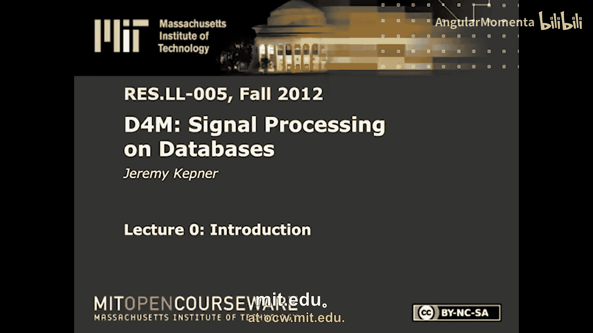
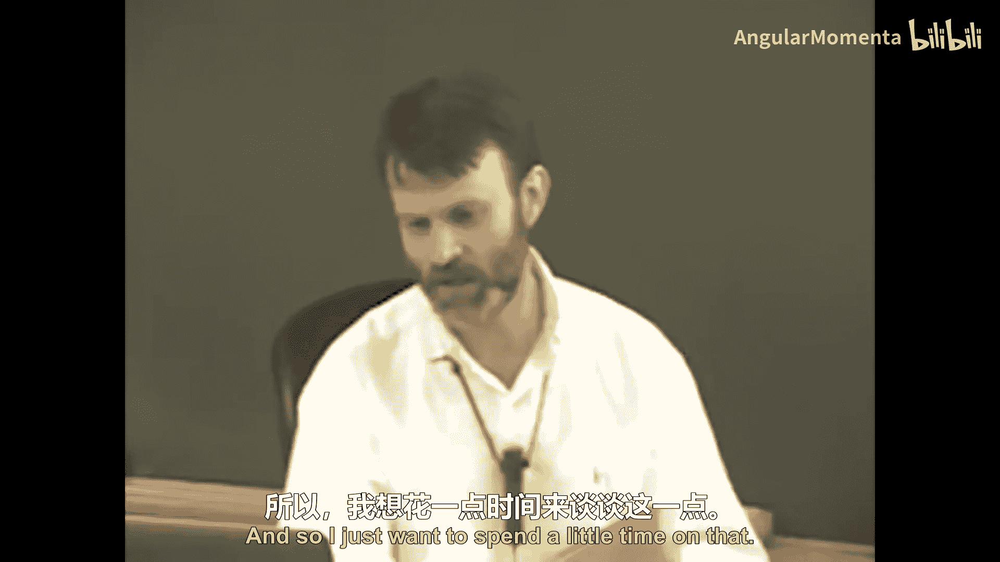
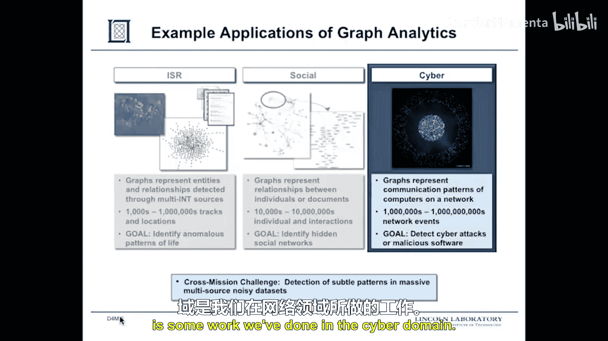
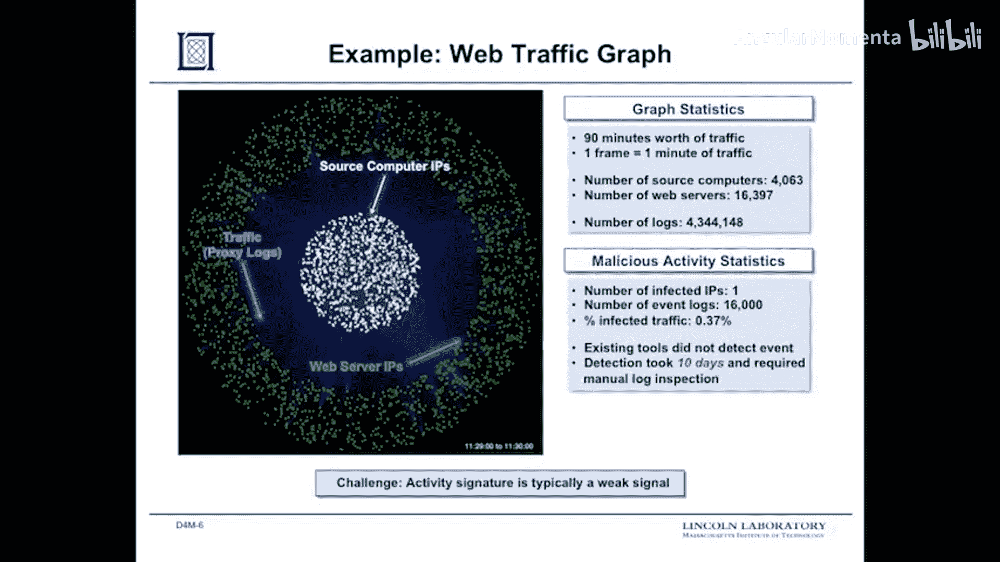
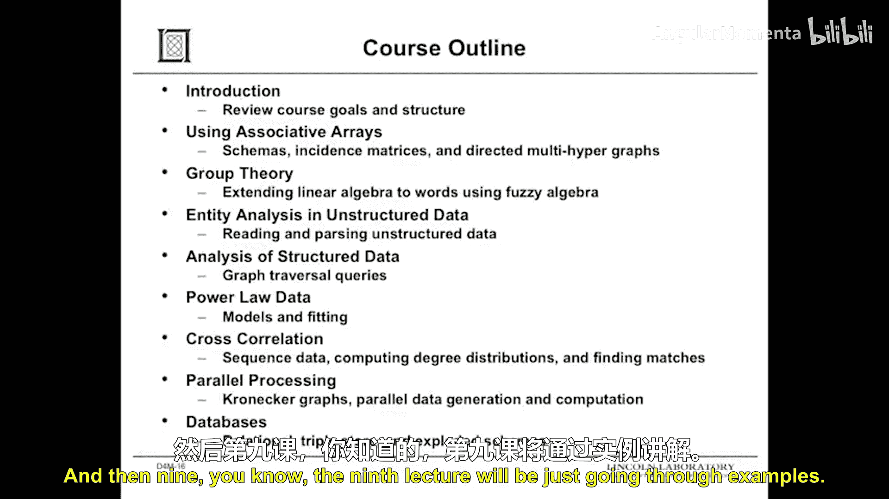
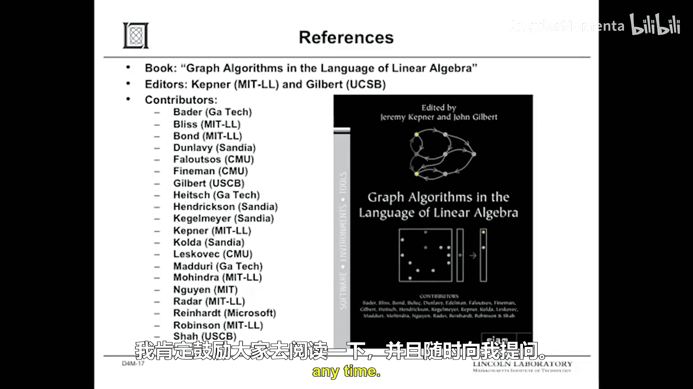
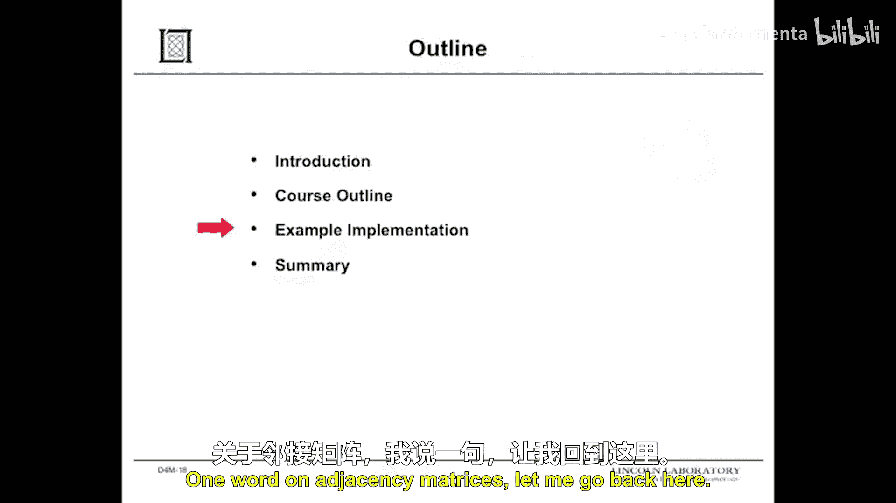
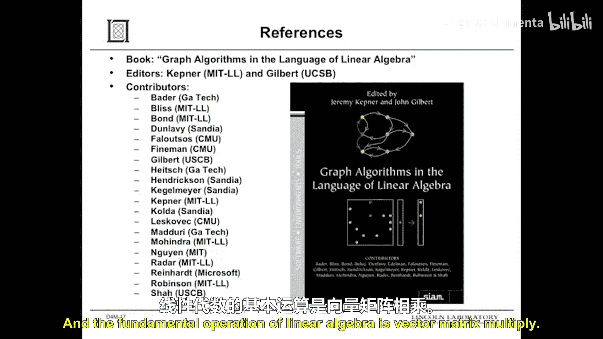
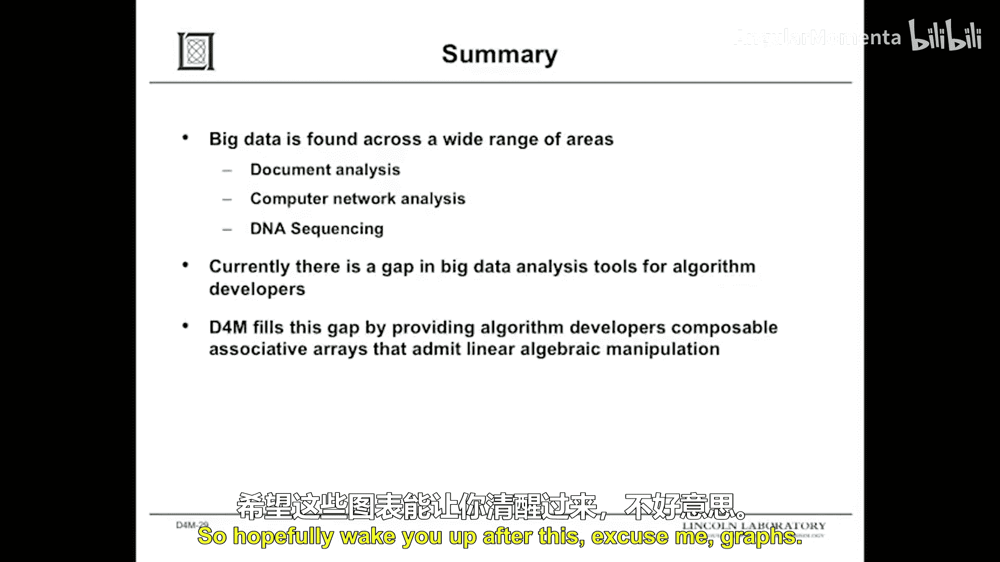

# 【麻省理工】大数据与机器学习数学-｜-MIT-RES.LL-005-D4M-Signal-Processing-on-Databases,-Fall-2012-p04-04-0.-绪论--BV1eEtTzhE4F_p4-

The following content is provided under a Creative Commons license。

 Your support will help MIT OpenCoursewareare continue to offer high quality educational resources for free to make a donation or to view additional materials from hundreds of mit courses。

 Visit mitopcourseourseware@ Ow。mt。edu。

All right， welcome， everybody。Really pleased to see you all here today for will be the first of a nine lecture course。

ICa signal Pro on databases。And this is a really。Special day for me because this sort of。

Represents a big step in a set of technology。That I've been working on for a couple of decades and you know。

 really。Been working intensely on for the last three or four years。And。

This is the first course on what we hope will be a technology that will become。Very widely used。嗯。

It is a completely unique course on a completely unique technology。So I want to thank you for being。

The guinea pigs of this course。It's hard enough just doing a new course on an existing topic。

 doing a new course on a novel topic is quite a challenge。

 so we're going to be trying a few different things here youre going to be certain topics。

Covered from more than one angle and we'll see which ones sort of make the most sense。For you。

The first thing I'd like to do is talk a little bit about the title of the course。

 which is a little bit different。Title is signal Pro on databases。

Which is not two phrases signal processing and databases that are usually。

Connected together very often。And so signal processing， as we all know is。Here at Lincoln Labs。

 one of the most core。Things that we do in terms of the technology。It's almost。

Difficult to imagine a technology that's more core to what we do。

 The only thing I could think of was。Systems engineering， maybe。

 but signal processing is really at the heart of what we do。Mathematically signal processing。

 really the heart of that is detection theory。How do you find things， given sets of data。

 how do you you know eliminate things you're not looking for and find the things that you are looking for？

And then。Mathematically， the heart of detection theory is linear algebra。

And so just to show of hands how many people have had a linear algebra course in there。See。

 that's really awesome。See at Lincoln， that's probably this is one of the few places in the world where I was pretty unanimous。

 you know， there's not too many places where that's the case。

 and so this technology is really designed for you because it really assumes a foundation in linear algebra。

And that's not as common as you might think， and so people who haven't had linear algebra。

 it's much harder for them to take advantage of the ideas that we're going。So signal processing。

 detection theory。Linear algebra， that's sort of kind of the root of that first phrase。

The second phrase databases。When we think of databases， we think of。Typically， you know。

Maybe things that you do searching on the web。Text， you know， maybe other things like like that。

 which is。Not necessarily consistent with the mathematics that we think about when we think about signal processing。

 detection theory and linear algebra， we naturally go on to。Like real numbers， matrices。

 those types of things。 So what we're really doing here is we're connecting。

That mathematics with sort of a whole new branch of data。Words and strings and relationships。

 And so that's kind of the really novel piece of it。

 And it's really the core idea that we're bringing here is we're going to bring all that machinery that we know so well and we're going to try and apply it to this new area which is becoming increasingly important for us so that's the explanation of the title that's how we pick the title we could have there's other titles and so so I just want to spend a little time on that。

An enormous number of people have contributed to this work。

 this is a list of the people that I could。Remember at the time that I typed the slide。

 but no doubt I have forgotten somebody important， and so I apologize for that。

 but certainly these people and the whole team have been very instrumental in allowing this technology to move forward here。

So this is going to be the outline for this particular。

Lecture and there's going to be a rhythm to most of these lectures which is there's going to be a lecture which is going to be PowerPoint。

 I apologize， we all see plenty of PowerPoint mainly to introduce ideas and then there will be sort of a demo which will go through code that is actually available in your Lgrid accounts now and some of that code will even be part of homework assignments if you so choose to do the homework assignments and so that's going to be the flavor we'll do the slides we'll take a short break and then we'll do the examples and talk about them。

So let me talk about some of the kinds of and I stole this slide。

 let me talk about some of the kinds of data that the technology that we're going to be talking about today。

Really， really enables。It allows us to deal with data that has to deal with relationships。

Relationships， you can particularly as those represented by graphs。So， for example。

 you might have vehicle tracks， those represent relationships between。Locationations， you know。

 a car goes from one place to another， that's a relationship between those locations。

Another is social networks。You know， everyone wants to know who their friends are。

 how many friends they are， who their friends or friends are， those types of things。

 so that's another type of set of relationship again。Very textual and oriented。

 very much oriented towards words and not numbers。Another area is cyber networks。

 very opera pro topic that people are， you know， at least everyone is impacted by and many people are doing work on。

 which is you know， relationships between computers， communication between web servers。

 those types of things。And again。That is a very important area for us。

Just to give you sort of a big picture here like， well， why am I even here， why do I care about this。

 What are the things that we can do， I'm going to kind of walk through an example of some of the things that weve used this technology for that have been very exciting for us and so。

😡，Trying and we'll have examples like that throughout the course。You know。

 how you can actually use is how this has had really a real impact and so the first one we want to talk about is some work we've done in the cyber domain。

So here's an example of a data set， which is a graph that is web traffic。And so if we see here。

 this is the source Is， so you can imagine these are the computers that are on the inside of some domain and then these are the destination Is。

 all the web servers that they hit are the green ones around here this is sometimes referred to in graph theory is a bipartite graph it's basically two separate sets of vertices that talk to each other but have no。

At least in this data set， we are not recording any connections within the sets。

And then hopefully you can see here these faint blue lines here that are the actual connections that show you which of these computers are connecting to which of these computers。

There's obviously a lot of data， web traffic data， there's enormous amount of it。

This shows 90 minutes of data。And you know， in this particular case。

 there was actually a malicious activity that we were looking to detect in this data set。

So one of the biggest challenges。That you have in any data set like this is data representation。

And sometimes in database parlance， this is called the schema。

So how you represent your data is usually if you can figure that out， you're almost halfway。

To solving the problem。And so given that in this case， we wanted to use graph techniques。

 we discovered that our data almost always doesn't come to us in a nicely form。

For graph and so we have to go through a lot of steps here and so one thing you'll see is with this technology is that it's almost always part of a pipeline from raw data to conditioning the raw data to inserting it into a database。

 to doing analytics to doing queries and other types of things you're always really going to be using a pipeline and you're going to be wanting to use different technology tools for different stages in the pipeline we're not in any way trying to suggest that the technologies we're talking about they are the only pieces it's an important piece。

 the technologies we're talking about， but they're not the only pieces and you're always really functioning in the context of a pipeline。

So this just shows kind of the technology stack that we will be leveraging that we typically leverage in those types of things。

Ultimately， our goal is to get up here to these graph analytics。

One of the things we'll talking about most in these course is the high levell languages that allow you to essentially do graph analytics very easily and bridge between the databases themselves and a high performance computing that you will need so again。

 not only do you have a pipeline of software and data you have a pipeline or a stack of technology。

 so when you're addressing problems like this usually you're starting at one place but you will almost always when you build a system work out and deal with these other types of things。

All right， so that's sort of just a quick overview and example， and I don't expect anybody to be。

 you know， it's probably just kind of。The purchase example is probably to raise more questions， well。

 how do you really do this？So now I'm going to sort of take a bit of a right turn here and really talk about what what the course is about okay and I'm going to actually talk about the course a little bit of big picture and I always felt that every course should should tell you why。

That course is the most important course you will ever take in your career。😡。

I think every single course you can come up with an argument for that。

 but people don't say this so I'm going to tell you why you know this course is the most important course you will ever take of course every course is the most important course you will ever take。

 but I'm going to tell you why this one is so stepping way back we're all part of MIT here and MIT has a formula for success。

MIT is the number one science and engineering university on Earth。

We can actually by any reasonable measure， that is true。😡，And in fact， by the people who track this。

 it's true by a lot。You know， and so， you know， it's a real honor to be associated with this organization。

 to be at an organization that's at its Zenith。And MIT has had this incredible run of success over the last 60 years because fundamentally。

 they recognize the formula for making discoveries is a combination of theory and experiment。

Bringing those two together and as an organization， we've actually organized ourselves。

 MIT is organized around this formula in that we have theory and experiment and theory is the academic part of the。

The mission that's run out of departments。Typically it involves mathematics， this is a place。

 I mean everyone here raised their hands to linear algebra and I can go to any part of MIT and that will be true we probably have the highest mathematical literacy of any organization on Earth。

And that's a very powerful。Powerful capability。The mathematics that we use。

 they become manifest or real， typically in the forms of algorithms and our algorithms become real in the form of software。

😡，Likewise， on the experimental side， that's the research that we conduct。MitT is actually。Has。

lararge laboratories， laboratories that are fully peered with the departments。

 that is actually quite a unique thing for an academic institution to have laboratories and labor heads that are you know right up there and with the department heads and how they're positioned Lincoln being the largest of them CSL。

 the media lab there's a number of them so we have this thing and the focus of research of course is measurement。

😡，Which is data。Which often gets reduced to bites。And so often implementing this MIT formula。😡。

Comes down to marrying software and bytes together in a computer。 That's。

 that's sort of where we bring these two ideas together。

 And so we're going to be talking a lot about that， implementing software。Bringing bites together。

 analyzing them together， that's where these two things come together and I think that's really。

 really important。Now what's the tool we use， what's the machine that we use to bring these together to computer？

All right， and nowadays， computers have gotten a little bit more complicated than the way we used to think about them。

 we used to think about them typically as a von Neuman machine。

 which means you got data and operations。You know， bytes and software and。

The bytes go into a part of the computer， They get operate on。 they come out。

 And that model is still true at a high level。 But but the computers we tend to deal with now are much。

Much， much more complicated。 So on the left is a standard。Parallel computer。

 almost every computer you use today looks like this。 You have processors， you have memory。

 you have some kind of persistent storage。You have a network connecting them together and these form a very complicated what we call memory hierarchy that begins with registers here at the top。

Cashs， local memory， remote memory， and then storage， and these are the units that go between them。

And there's a lot of implications of this hierarchy。In terms of what things are。

 you know bandwidth goes up as you go this way， latency goes down。Programability generally goes up。

 the closer you are， you don't have to worry about things。

 and likewise the capacity of data goes down as you go traverse this way in the hierarchy。

So all modern computers that you use are these von Neyan architectures with the multilevel memory hierarchy。

 and fundamentally the thing you have to know is that this architecture selects the algorithms you use。

If algorithms are not going to run well in this architecture， you probably don't implement them。

So one has to be very much aware of one's algorithms respect to this architecture because you pick algorithms。

bed。Aren't going to run well in this architecture， it's going to be very， very difficult。

Goal of this course。Is to teach you techniques that will allow you to get your work done faster。

And so this is a rather complicated drawing here。 But this shows。

Given a problem that you want to solve。If you implement it in software using a variety of techniques。

You how what the performance of those techniques is， so in a certain sense。

 you could view this as the volume of code that you have right to write to solve a problem and you have implementing the program and C as a reference point。

So as you move over here and you do things like in assembly。Or Java map produced。

 you end up writing more code。If you move over here and do things like in C+ plus or Java or MATlab。

 you write less code， and this shows you the relative performance。Again。

 as you do things in lower level environments like assembly。

 you can get more performance and as you do things in higher level environments like MATAB。

 you get less performance and this is a fairly general trade off space here。

We add parallel programming models here of which there's many， we have direct memory access。

 we have message passing。We have a manager worker style or Mareuce style。

 we have a whole different styles of programming here。We're going to want to try and be here。

 We're going to want to do things that take less effort and deliver you more performance。

 and so we are going to be mostly focusing on MATLb in this class and a technology we call D4M。

 I'll describe that more later。But this is a software combination that allows you to get。

Relatively good performance at significantly reduced effort and that's really the only thing we're doing in this course we're just saying if you're doing these types of problems。

 there's a right tool for the job or there are right tools for the job and if you use the right tool for the job。

 it will take you less time to get the job done and we're going to try and teach you about these tools and how they actually work。

Now a little bit of bait and switch here we call of course signal processing databases。

 but we're going to get to databases at the very end。Unfortunately。To disappoint you， all。

And the reason is because。Databases are good for one type of problem。

 but it's often at the very end of the game where you really need to work with databases。😡。

So to understand， we have a variety of different ways we can solve problems with algorithms。Okay。

 we can solve our problems just using a single computer's memory， we can solve our problems using a。

The memory on multiple computers， we can solve our problems using disk or storage or even with many disks。

 okay and as we go this way we can do more and more and more data。

But one of the things that really matters and it kind of goes back to that other chart there is。Well。

 when I'm working with this data， what is the chunk size。

 what are the blocks that I need to get the data？And。If I need to get the data in very。

 very small chunks， well， then obviously having the data in memory is going to be the most efficient thing I can do if I want to just get one record out of many records。

Then that's the most efficient having the data in memory。Likewise。So。

 that's where we typically start， right， if our problem is small。

 when we almost always try and start with our problems with small。We're going to be working here。

 we're going to be writing what we call serial programs on one computer。

And then the great thing about serial memory is that it。Even as our request size gets larger。

 they're really not going to do anything better than just having the data in memory。

 so we'll be able to grow that model up to data sets that are fairly small， maybe gigabytes。😡。

And we can continue to use that model just fine。And then。If we decide， well。

 we're really moving beyond that， we need to do more data。

we can go to a parallel program to get more memory or we can use data in files。

We can write our data to files， we can read them in， process them and read them out。

 and that model works very， very well。And in fact， particularly if we're going to be accessing the data in large chunks if I have a lot of data and look。

 I want to do some processing on the whole。Whole bit， whole piece of it。Likewise。

 if we go to very large data sets， we find that we can even do parallel programs。

 writing files and parallel if we want to do extremely large problems。

That we want to traverse all the data。But finally， we're going to come back to this case。

Where we need a database。And a database is when we have very large amounts of data。

 but we want to access you know database data that won't fit in our memory。

 but we want to access in little bits。 we want to look up something。

 and that's really the only time we really need a database unless of course。

Someone says this is your data， it is available to you on a database。

 that's the only way you're going to access it but if you have control。

 so you always want to follow this path， you want to start with your serial program memory。

 maybe go to parallel program using files， maybe parallel files and then the database is almost the tool of last resort because it adds a great deal of complexity and while it can look up things much quicker。

😡，If you actually end up doing something where you're going to be traversing a significant fraction of the data。

 you will find this actually significantly slower than if you had the data on files。

 so we're going to show you techniques， we're going to follow this path and then hopefully by the end you'll be like oh well yes now I know I would use a database for these instances but I realize that I can get most of my work done using these other techniques that work just fine。

So hopefully you're going to be learning what we call the fast path。So。

Do you want to get a certain level of performance。Okay， if you have no training。Or minimal training。

 this is the path that you follow， you begin using a technology。

 your program gets slower for a while， you beat your head against the wall and the web for a while。

 maybe eventually after days you get back to where you were。

 and then slowly you climb up here to get it to some level of performance weeks later this is something that we observe。

😡，Time and time again， and typically what happens is that right around here。

 people just give up with the technology and they say the technology didn't work for them。

Sore the point of this class is to give you the techniques that an expert would have。

 an expert could use the technology， know exactly how to use it and then can go on。

This path where basically within hours they're getting good performance and if they really want to take it to the next level。

 they can spend days doing that， and so that's kind of our whole philosophy here。

So we're going to actually have some new concepts in this course。

 I think they're talked about in the。In the。And of course， outline a little bit some of the really。

New ideas that you probably wouldn't have run across in other courses。

So we're going to be talking about graphs a lot in this course。

The standard graph that how many people have have taken a？

AGraph theory course or a computer science course that talked about graphs most most。

 I'm glad to see linear algebras。Still the stronger one here。

 that's in more importance we don't between the two having the linear algebra background is the more important。

But and I can， if you know linear algebra， I can teach you graph theory pretty easily the traditional definitions of graphs。

 though that are taught in most computer science courses， they tend to focus on。What we call。

Undirected， unweighted graphs。So these are a graph is a set of vertices and edges。

 And so what we're saying when we say it's an undirected unweighted graph is that。

All the edges are the same between any two vertices。

 there's no real difference between them either and an edge exists or it doesn't。

 it's kind of like a 0 world01 and then it doesn't really when we say you know two vertices connected。

 there's no directionality of that。And so that's the majority of graph theory and what's taught in class sort of is based on that。

Excuse me， unfortunately， when we get into the real world。Yeah。Unfortunately。

 when we get into the real world， we find it。I've never run into that kind of graph in the real world。

And the years I've been doing this I've never actually， you know， run into that kind of graph。

 In fact， another part of that is they'll talk about the distribution。 In fact。

 you'll often hear something called an airdish rei graph， which is just。

A random connection that is any two vertices are randomly connected with maybe some probability。

 you know， and and again， I've never run into that either in the real world。

 so the focus of graph theory that we have now that we have all this data and compare the theory in the data。

 compare the theory of the experiment， we see that the theory is wanting。

The theory is not a good stepping stone into the data and so what we see is that the real data is it's not random。

 it's often what we call a power law distribution that is certain vertices are very popular and many most vertices are don't have a lot of connections to them。

Usually the edges are directed， that is there's meaning， you know， I send I if I friend you。

 it's not the same as you friendending me on Facebook or Twitter or，😡。

You T face or whatever the technology is of the future。

Usually the edge itself has meaning has weight， that weight could be a value， it could be words。

 it could be other types of things。😡，The you can have typically you have multiple edges。

 I could send you many friend requests， you know that's not the same thing as me sending you one friend request。

 maybe I can't send you friend requests multiple one friend requests I don't know but but you can have multiple edges between vertices and probably most importantly is edges are often what we call hyper and this is very important concept that is not there's almost never touched on in graph theory which is that an edge can connect multiple vertices。

At the same time， a classic example would be an email that you send to multiple people。 In fact。

 most emails these days have more than one recipient。

And so there is me sending an email to everyone in the class。

 one email to everyone in the class is a hyper edge， that edge。

 the email connects and it has direction， you know， me with all the recipients。😡。

That's very different than me individually sending an email to every single one of you。

 which would be a standard edge， so this is an important concept not typically discussed a lot in standard graph theory that's very important。

😡，So we're going to move beyond the sort of standard definition of graphs in this class。

 and that's going to be hard。We're going to deal with a bigger definition of linear algebra。😡。

Traditionally linear algebra is dealing with matrices that have indices for the rows and the columns and the values are real numbers。

 maybe integers， maybe complex numbers， we deal with complex numbers here a lot。

 but we're going to be dealing with things like strings。

 we're going to be taking linear algebra and applying into things like words。

And so that's going to be different in fact's actually one of my favorite it might be the part of the course that puts you all sleep。

 but it's actually one of my favorite parts of the course。And then bigger definition of processing。

 one of the dominant things you'll hear about in this space， there's a lot of technologies out there。

 popular technology is called Hadoop， and it's mapRduce parallel programming paradigm。

 which is a great technology to kind of get people started。

But but for people with the mathematical sophistication that we have。

 we can use programming models that are that are simply better if you understand mathematics to the level that we do。

 we can give you tools for programming parallel computers that are just。

More efficient in terms of you write less code and you get better performance than using techniques that really are designed for people that don't have the mathematical。

 the linear algebraic background that you have。So this is really going to be the foundation of the course。

So let me continue here with the course outline， so this is going to be essentially the nine lectures of the course。

 I think this is still pretty accurate。So we're in the introductory course here going we review the course and goals。

The next course is really going to be dealing with this concept of Associative arrays。

 which is the core technology that sort of brings all this together。

When I talk about extending linear algebra to words。

Using funny using sorry funny using fuzzy algebra that really gets into mathematical abstract algebra concepts called group theory。

 it's not nearly as scary as it may sound， we'll get into that it's actually I think quite elegant and really good to know。

 good to know that when you work with the technology and you work with associative race that we've actually thought about the mathematics of how these things work together。

And when we add a feature， it's usually because it fits mathematically and when we don't add a feature。

 it's usually because someone has made a request like， yeah。

 that's really going to take people into a bad place。

Then we're going to get into really sort of the sort of the center part of the class where we're going to show you how we do analysis of anys on unstructured data and then doing analysis unstructured datare I've talked about power laws we're gonna to have a whole class on power law data modeling and that deal with them we have another class in crosscorlation and then we're really going to get into parallel processing and databases in the last two classes aren't even going to really be lectures they're going to be really just the demos and really because that's where we're gonna to be really bringing a lot of things together and we're going to walk you through code examples but we're going to need to take some time to really walk you through them because you're going to see wow there's all these ideas that we've talked about coming together in these code examples so there is we have lectures if you see in the software that's available in your Lgrid accounts all the lectures are there already and I think we have lectures one through seven so seven is the eighth lecture or I'm sorry zero through seven。

So seven is the eighth lecture and then。And that will be kind of a short lecture and then nine you know the ninth lecture will be just going through examples。

So we believe in this whole philosophy philosophy of。Taking a linear algebraic point of view。

From with graph so much that we even wrote a book about it。

 so and you have all been given copies of this book。

This really gives you kind of the philosophy and the power of if you think about graphs using the techniques I highly encourage you to flip through it。

 there's certain parts of this certain sections here that are really almost taken directly out of this book and but a lot of it is supplementary material and what you'll discover is that this course is really the bridge to these techniques this course allows you to go from kind of this mess of unstructured words and other types of things and then。

Put them into this nice linear algebraic format so that now you can do。

These techniques that are describing in the book， so this is almost a bridge to that and I certainly encourage you to look at that and ask me questions about it at any time。

So now I'm going to come back。To our original example。Which was this cyber thing。

 And kind of walk through that a little bit more detail and maybe highlight a few of the things that I've talked about already。

So here's a very standard。😡，Data processing pipeline。So what we want to do is we have raw data。

 in this case， our raw cyber data。Which is a series of records。

 and we need to convert that into a set of vertices and edges。

From which we can then do get graphs and graphs analysis。And as you'll see。Typically。

 what you do is you write parsers。that convert this data from some raw format to some format that is sort of the next step in your processing change。

 and then we convert these edge lists into adjacency matrices， which is how we we view our graph。

 one word on adjacency matrices， let me go back here。

This is a graph for those of you who don't know。A set of vertices and edges。Okay。

 and this is an adjacency matrix of that graph， basically every single row is a vertex。

 every single column is a vertex， and if an edge exists。We put a dot here。

There's a formal duality between graph theory， the fundamental operation of graph theory is what's called bread for search。

 which is shown here， giving a starting vertex。You know。

 traverse its edges to its neighbors and we have the same thing going on here。

Given a starting vertex in a vector， we do a matrix multiply to identify the neighbors。

 And so at the deepest， most fundamental level。Graph theory and linear algebra are linked because the fundamental operation of graph theory is Btford's search and the fundamental operation of linear algebra。

Is vector matrix multiply？

So we are wish to form these adjacency matrices so we can take advantage of that。

Here's a little bit more detail how we're going to use this technology D4M to do that。

To have a raw data， we convert the raw data into CSV file， stands for comma separated value files。

 it's called of the default format of spreadsheets and tables it's become very popular over the years。

 Remember first came out 20 or 30 years ago， it wasn't that popular you know it's like people did。

 but now it's become extraordinarily popular file format it really is ideally suited for this kind of data。

So we convert that into CSV files。We then take those CSV files。

 read them in using our D4M technology to insert them into a distributed database。

We can then query that distributed database to get these associative arrays。

And then we can from the As array now， we have the full power to do our graph algorithms。

So D4M really helps you in going。You know， these few steps in setting the table so that you can then do graph algorithms and you can even then do the graph algorithms without even using Dform at all。

You can just use regular linear algebraic operations in MATLab just fine。

 but this is that bridge that connector， in fact I highly recommend people do that I highly recommend you use Dformm for the only the parts of your problem that it is good for and use other technologies。

 you know like MATLAab ordinary matrices and other types of things。😡，That's good for you。

 You'll get better performance。 It's good for me， because。If you have problems。

 you'll bother somebody else and not us， so that's good， it's good for everybody。

Sos an example of kind of what this looks like。Here's a proxy log that we got from the data that shows a web。

 essentially a web log。The first thing we do is essentially convert this into a CSV。Whileile。

So basically each。Essentially entry here gets a column， we have an ID for the actual entry。

 in this case it's a source IP， a server IP， a timestamp。

 and then the actual line of text that's associated with it。And this can go on and on and on。

 we can have many different types here。And and if you were。Doing standard database person。

Put your SQL hack， which is sort of the standard database on。

 you would just take that data and you would make a table。

They would have these columns and you would insert them in a way you would go。Okay。

 but what we discover is that。The challenge becomes when you want to look up data quickly or you want to insert data。

 let's say an enormous volume of data that you want to insert and you want to be able to look up any。

 say IP address or any timestamp or something like that。

What you discover is that SQL might give you good performance。

 but there are databases out there and technologies that will give you better performance。

And these databases are called。Triple stores because they store all the data as。Anyone？Tris， yes。

 they store all the data as triples， so which means we'll have a row。

And a column and a value associated with everything。 So what we do is we take our dense data。

And we do what we call create an exploded table。So essentially， we have the log IDd。

 we append that and we take the the column name and we append its。Value to it。And the server IP。

 this we call an exploded table。Now， if you're an old SQL person like me。

 this schema will immediately give you hives and other type of allergic reactions and you won't want to go to the hospital because you're creating an enormous number of columns。

And in SQL， you can dynamically create columns， but at your apparel。basically。

 you can create columns dynamically， but the database reserves the right to recoppy the entire table and reformat the entire table if it so requires。

Well triple stores don't have this requirement， triple stores only store the nonb entries。

 and so they're perfectly happy with as many columns as you want， you have a billion rows。

 10 billion columns， completely fine with that。So that's a powerful thing。

So I think we talked that about that， so we use the indices as rows and we create unique。

Type value pairs for every single。Colum。Now。By itself。This schema。Does you absolutely know good？

Youve basically just made your life harder。Because。By itself， all most database tables。

 database systems， including triple stores。Are going to have an orientation。

 they're going to be row oriented or column oriented， and in this case。

 the databases we will be talking about are almost always row oriented。

Which means they can get a row in constant time， give it a row key。

Like this and know when you can look it up very quickly and we'll give it back to you very quickly that's what the design to do and you can insert enormous volumes of data and they will they will they will preserve that contract you can be inserting millions of entries per second and you can still look up stuff in milliseconds so very powerful technology but all we've done so far is made it so that the format of。

Of my data is in this funny format coming out the other side。 I've just made myself harder。

 the harder。Well， there is a payoff。Which is。We also store。The transpose。

Of the table so to anybody who is used to Sprse linear algebra， this is an old and ancient technique。

 we almost always store A and a transpose because in Sprse linear algebra we'll either have a row oriented or column-based store and then we just want to keep one around because certain operations are going to be faster with the transpose and certain operations are going to be faster with the matrix we do the exact same thing here and combined with our exploded schema now every single one of those columns is a row。

And now we have indexed every single string in the entire database once。

With one simple schema of two tables and not to say that， you know。

 all your databases will only have two tables。But they might。

The three tables or four tables is typically what we see， which is a huge。

Reduction compared to the standard database schemas that one uses。

 where it's easy to have dozens and dozens of tables。

 even hundreds of tables in a sort of well thought out schema here， essentially。

 it's one schema to rule them all one table and its pair and you've indexed every single thing。

 And the cost is you've doubled your storage and every single database person that you talked to。

 if I said in an exchange for doubling your storage。

 I will give you fast index access to every single string in your database。

 They'll usually take that deal。100 times out of 100。

So that's the power here of this technology is you can reference enormous data sets and we'll come back to this schema over and over again。

 but that's sort of the madness will be。As we move forward with associatedci arrays。

 we always view things in this way， and I want you to know at the end。

 there's a really good reason why we do that。So now。We've ingested our data。Into the database。

 and we can doqueries， so if I have a binding to a table。

And one of the things in the deformed technology that we do that's very nice for you is if you're using a table and it's transpoposedse。

 we hide that for you completely if you do an insert into the table。

 it will automatically insert as transpose and if you do a lookup on rows。

 it will know to use one table， and if it does a lookup on columns。

 it will know to use the other table。So here we're doing essentially a range query， this just says。

 give me all the data。From this range。You know， timestamp， may。

 whatever to this just looks like about a three hour time window。

 so that's a query into the database and it returns an associative array of keys。

And here's what that looks like， it looks like a bunch of triples。

I'm going to then take the rows of those keys， so basically I found every single。

Row within a particular timetamp， I now want to get the whole row so I can get the row。

Of that and pass that back in the table to get the actual data。Now you see I get the whole row。

 so I get the server IP and all that stuff， to complete list。

Now I'm going to do a little algebra here， I want to create the graph that's all source Is and server Is。

So I get to do this with this basically correlation here。

 which is essentially a matrix matrix multiply。 That's it。 I've just constructed the entire。

Source IP and server IP graph from all the data in this time window。

 that is the power of D4M is it allows you to do correlations on this kind of data the same way we do correlations and using traditional techniques in linear algebra。

😡，And you can be like， well， wow， well this is motivational at this point。

 we'll get into exactly how you do this and exactly how this works in the example。

 but this is really what people use D4M for。Is to get to this point where they can do these types of manipulations and the key to detection theory is doing correlations。

 correlations allow us to determine what the backgrounds of our data are what the clutter of our data are。

 and then we can we're on our way with traditional detection theory and signal processing techniques and all the things that we know we love so this is kind of that connection made manifest。

And Si here you can see we now have an Associative array or an adjacency matrix that's eventually essentially of source IPs and their server Is。

We can actually plot that and that's how we got。If I get the adjacency matrix of this graph， G。

 this is what it is， that's how we constructed， this is the code we actually use to construct that graph。

So moving on here， so this just shows the kind of the whole thing here。

 we had a whole week's worth of proxy data。This just shows you the timing that it took about two hours to ingest it。

And about three hours to do this processing。you know， 100 million proxy logs， 44。5 billion triples。

This is big data。You know， this is really， this is big data。

 this is the kind of thing that you can do， you know， whatever anybody else is doing。

 you should be able to do it on larger scales than other people using this technology。

So that brings us to the end of the lecture。So just to summarize。You know， big data。

 this type is found in a wide range of areas， you know doal， computer networks， DNA sequencing。

There's a kind of a gap between the tools that people traditionally use to do this problem in D4M this technology。

Fills this gap。So with that， are there any questions before we get on to the examples？Slide， yes。就。

企業を作て伝たる。that generalizes naturally。Yes。so。The data so we。Oh yes， the question was。

 does it generalize to multidimens， I guess？And so。There may be kind of two questions there。

If you had。If I just correlated all the data。tookook that table out and just fully correlated with I would end up with a giant matrix of blocks。

 each one representing different correlations， so the source IP server IP correlation。

 the source IP source IP correlation which would be empty because it's a bipartite graph and then all the other correlations would form different blocks in that type of thing so in that sense we support multidimenions。

 whether we support but supporting multidimensions in terms of tensors okay well。

 generally in sparse linear algebra， there's very minimal support。For higher dimensions。

I'll put a little shout out to my friend Tammy Kda who has a technology called the Sprse Tensor toolbox。

 she's a scientist at Sandia， and so I encourage you to do that。

 but all of our stuff is in two dimensions from a linear algebraic perspective。

 also linear algebraically the math there is a little bit more common。

Then when you get into the tensor and then you have these kind of weird。

Products that you're starting， which you can define， but are just not commonly。

Taught so I mean might be like， well， you're really losing something there I'd really like to have multiple multiple dimensions well。

 when we've looked at it。The fact of the matter is the sparsity always increases as you go to higher dimensions。

And the sparsity is sparse enough， so typically the kinds of data that we will have。

 if you have n vertices， you'll have maybe 10 times n edges。

 so the sparsity is you know is extremely low if we added a dimension。

 the sort of internal data structure cost associated with adding that dimension would not。

Rereap the benefits because now your sparse use even lower。

 and so that's generally not something that is as commonly used。

 but if you're interested in exploring that I certainly encourage people to download that toolbox very well written software and people can can people。

Explorere that。Other questions， that was an outstanding question， any other questions at this time？

Very good。 All right， well， why don't we stop the recording right now and then we will。

Switch take when we take like a five minute break， I think there's some water out there and stuff for people and then we'll get back to the examples which probably will be a lot more fun。

 so hopefully wake you up after this these view graphs。

