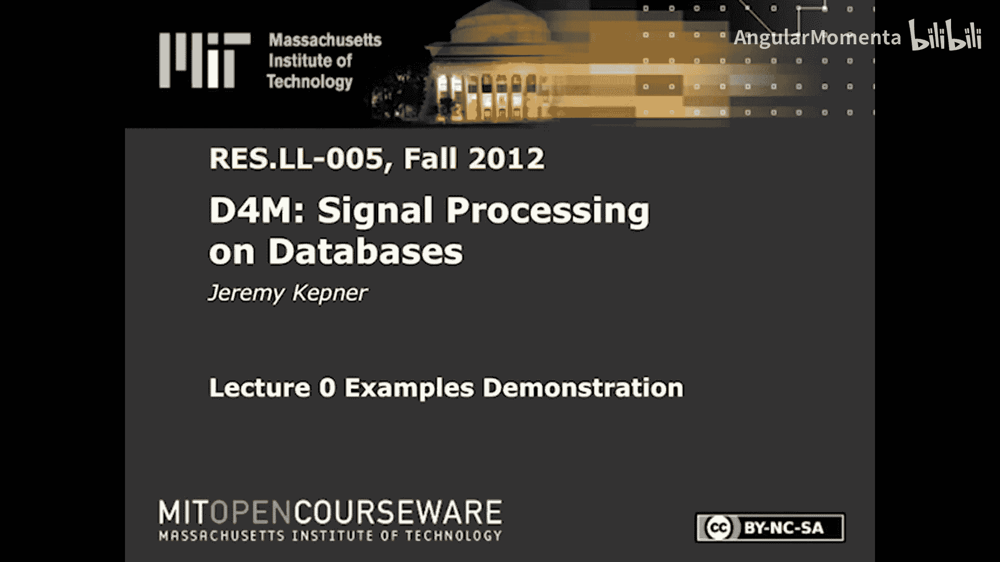
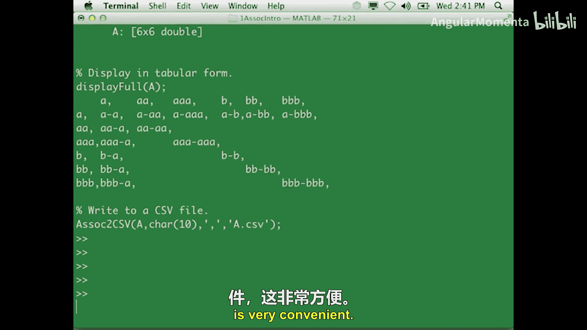
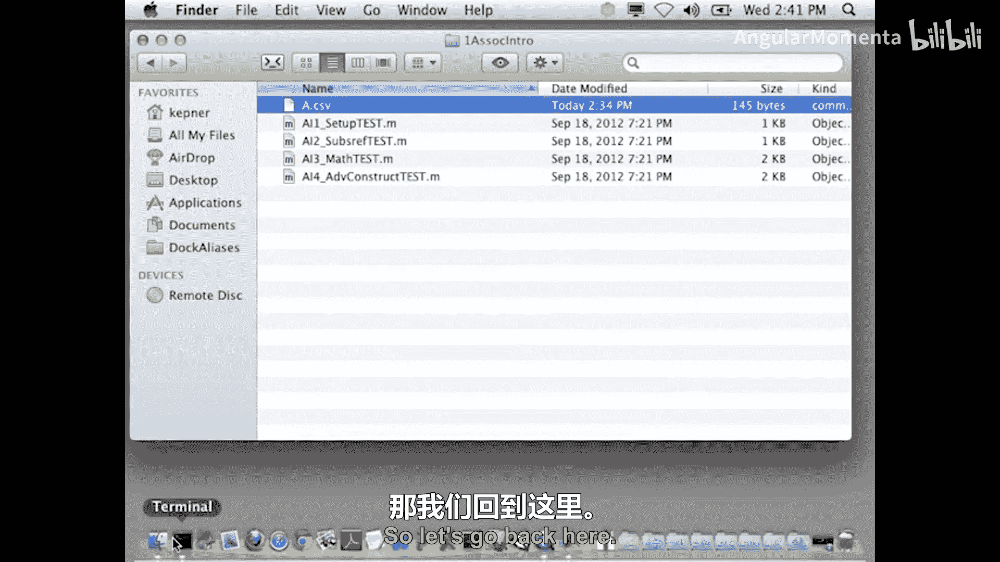
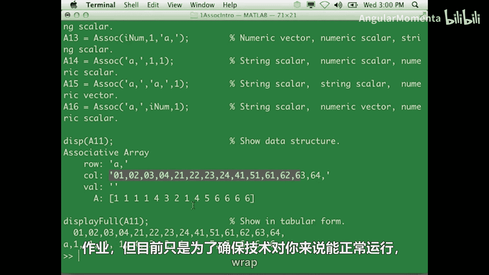
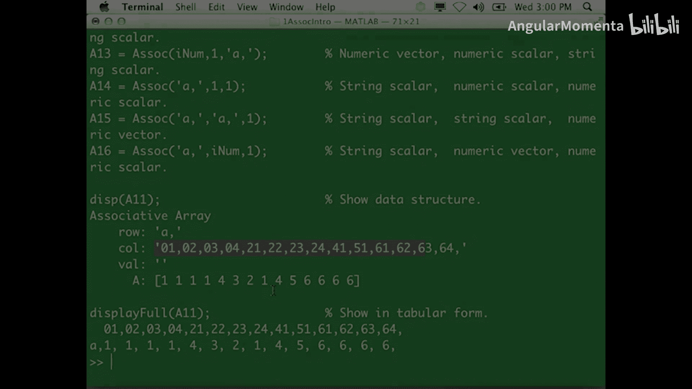
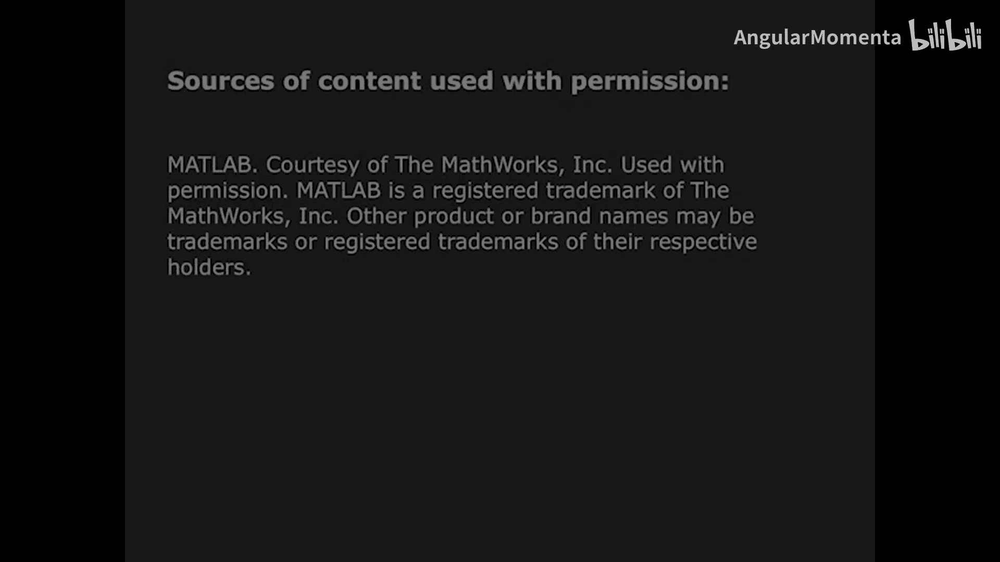

# 【麻省理工】大数据与机器学习数学-｜-MIT-RES.LL-005-D4M-Signal-Processing-on-Databases,-Fall-2012-p05-05-0.-示例演示--BV1eEtTzhE4F_p5-

The following content is provided under a Cative Commons license。

 Your support will help Mi T OpenCourseware continue to offer high quality educational resources for free to make a donation or to view additional materials from hundreds of Mit courses。

 Visit Mitopcourseseware at Ocw。 Mt Eduu。

All right， so now I'm going to walk you through some examples and just so you know where this stuff is。

 so you all have your Lgrid accounts。And in your Eleggrid accounts and I'm looking over here because these people are going to check to make sure I don't say anything wrong so this is by the way。

 this is Ch at B over here and Julie Mullen， they are our expert consultants。

 PhDs and computational science that help you all and we are all externally grateful to them for helping us get all this technology to work so if you go to your Eleggrid account。

There should be a link in there called toolsol。This is where all the software is that we provide as part of Elgrid exists and there'll be one called D4M API in there。

 so there'll be a folder just like this okay， and just so you know so all the video。

 all the lectures are there for you。And I am putting them all in for public release and all the software we're going to post on the internet too。

 and so you know just make it easy for you to use， use with your government， use with your sponsors。

 using your projects， all that kind of stuff we try and do that so that people aren't constantly asking us well what can I share it's like we're going to put on the internet so there you go。

啊。We want to focus on the examples directory here。The order of the examples is numerical order。

We're going to go through examples in the folder called one and then two and then three。

 and this really corresponds to kind of the first three lectures， then the next three lectures。

 then the next three lectures。Okay。😊，And so， today。

We're going to go in here to this first one and then here it's kind of like the first three of those three。

 we're going to go and we're going to review this set here。Okay。So。

These are the the examples all have this sort of， they basically take the first two letters of the folder。

 in this case， As Sos Intro， AI，1，2，3，4。Those are the actual examples， if you see other。

Filees in there。 those are supporting files。 You don't run those directly。

So I'm not going to start my amount。I always run MAlab from the shell， other people run from the IDE。

Create a shell here。诶。I' seen the fold， and I'm going to start my mountlab up。

This will take a minute， because we're using。2012， B。Which is a little bit slower on this computer。

All right， there we go。And you'll be pleased to know I develop all the deform software on this little。

Computer。And people were like， well， why don't you get a big giant workstation to develop your？

Your program sounds like， well， because it's if it feels okay for me on this computer。

 I know that most of you have much better computers and it will feel should feel very。

 very very good for you。 All right， so we're in the folder and I'm just going to run the first program II1 setup do test。

嗯。Actually， before we even get into that。The first thing you want to do is check。

Before you run this that your D4M code has been properly set up。

 The simplest way to do that is when you start Matla， you type help D4M。

And you get a list of all the functions in D4M。 And that means that your path is set up properly。

 And this is just a list of all the different functions。 we break them down in different types。

 and a little sort of like how to set up here。 although a lot of this stuff isn't。

Is written for more people on the outside world and we go through all the functions and we categorize the functions。

 you know， summer functions that we really expect to use you to use all the time。

 summer functions that you might use， you know once in kind of rare instances and then we also have functions like look。

You really they're there， they're in the library， these are really not meant for you to use。

 though they're really internal supporting functions， but they're there in the library right。

That's the first thing you want to check is to make sure that's set up if you have any issues。

 send email to gridhelp at Ldonmt。u and the people will help you and check it out。

Don't be surprised if some of you do have an issue。

 This is the first time we've really rolled it out to such a large audience。

 and so we absolutely expect people to have little little things that will pop up。All right。

So I'm going to run the first example here。I should say we also have tested all this stuff。

For those of you who。嗯。Utterly averse to commercial software。

 depending on your religious preferences， we also run with Gooctave。

 which is the GPL version for those of you who refuse to run。Non free software。 And so so this。

 all the stuff should also work with that as well， just for those people who prefer to use that type of environment。

 But generally， Matlab。You know it's。Pretty available here。

 and so we certainly encourage you to use that。So we're going to run the first test here。

AI1 set up our test。Go。Yeahay， it worked。Embarrassing when you're recording and these don't work。Um。

 so I'm going to walk you through some really rudimentary stuff here。In this example。

So one of the things in D4M that you're dealing with a lot is lists of strings。Long lists of strings。

 millions of distinct strings。 Now， Matlab has data structures that do support lists of strings。

 cells being one of them。 And there's other data structures that you can use to do that。

 They naturally support these， but they tend to be。Very memory intensive and very slow。

And so given our whole thing here is we have a real focus on performance me giving you a great tool that's a thousand times slower than other techniques is not very helpful。

 so we are going to be dealing with lists of strings all the time and so in D4M a list of strings is a row vector of characters。

Okay， I've highlighted here， and the last character in the row vector is the delimiter。 In this case。

 it's the comma here at the end。That is the delimiter。 It can be whatever you want it to be。

It can be a semico and it can be dash， it can be a space， I tend to recommend new line。

 which is ASII character 10， very safe delimiter， but whatever that last character is。

 that's the delimiter and you can have different lists。

 different strings with different delimiters it should handle those situations just fine。

 but within a list of strings， it needs to be that that last character will be the delimiter。

So I'm actually creating here a。A list。I'm going to be creating a set of triples here， R。

 which is the rows， C， which is the columns v， which is the values， and so I have an R。

 which is this， I have a set of C here， which is this。

or here and then a list of values and the values in this case are just appending the row and the column together with the dash。

 and all three of these use the comma as it's the last character as the delimiter All。

 and now I'm going to create an associative array， which is the fundamental data structure in D4M。

 It's what allows us to bridge linear algebra and strings together。

So this is the constructor command for an associative array， it a sos， and then we give it a list of。

Row keys， these are called you often call them keys， list them column keys and list of string values。

 and this constructs the Associ array A and in MAlab since I haven't terminated this with a semicolon it now will print out the list of triples so now you can see the list of triples we can construct here was A you know row a column A value A dash A row Aa column A value AA dash A and I won't read the whole list Yes。

 Darll。Your deiters is included in。That is an artifact of this printing out display。

 It will show you the delimiter that you actually used here just and it's。

 it's good to know that you it's not really there。 yeah， I mean， it's there and it's not there。

 But it's showing you the delimiter。 And after a while， you just kind of learn to ignore that。

 The only time this does become a little bit of an issue is if that。

 if that is the new line character。Then the formatting gets a little bit and we've actually built in routines allow you to take an associate array。

 replace the deluar with something nicer， you know in one command so that you can print it out and it doesn't look so so crazy if you're using a new line。

 typically though you tend to be doing this printout command on small things， so it's fine。

So that's the whole list you see there of all the different entries。If you use the DP command。

It will actually display the internal structure。Of the Associ of array。

And an associative array object in Dform has four fields， total， that's it。

 We do everything with just four fields。The four fields are a set of row keys This is a。

Lexxiographically sorted list of the unique row keys。And it's stored as a stringless。

 So in this case， we had six unique row keys， and we have six。Entries in this row string list。

Likewise the column is the same thing， we have these six unique entries and you see they inherit the delimiter that was passed into them。

 if I'd used different ones， you would see different delimiters。And then the value。

Which is a another list that shows all the different。Strings。Okay， and then a matrix which shows。

Which is a 6 by6 matrix， so this is a 6 by6。Associative array， and this is the pointer。

 basically the value stored in this6 by6 sparse matrix points to the index of the value。

 so you can view that as a pointer to the values and this is how we can have values that are actually strings。

I may not be quite clear there's an easier way to do this。

 so we have a little root function here called display full。

Which produces a nice tabular view of the data。 So here's the row keys。

 the column keys and the values。 And you see this was a the matrix I constructed， you know。

 had a full。First column and a full first row and then values along the。The diagonal。

And then what we're going to do is we want to。Save this， we want to write it out。

 so we're going to write it out to we have a function cur to L So to a CSV so I pass an associative array。

 I give it the row terminator and the column separator and a file name and we'll write that data out to a CSV file。

Which is very convenient。

actually hide that， you can see here is。The CSV file。And so you can look at it， there's the CSV file。

Zoom in on that for you and you see there we go， those are our six rows。

six columns are against first row， or against first column and our diagonal。Okay。Right。Back here。

 now let's go on to the next example。

Which is going to be AI2。And now we're going to talk about how we've sort of described how we put data into an associate rate。

 we're not going to talk about how we query or get data out of the associate rate。

And one things that's very nice about the queries that I will show you as we get to the later parts of course we do databases。

 whether you're querying an associative array that's in me memory or a binding to a table。

It's the same。 We try and make it so that almost everything you would do on an Asocciative array。

 you could also do on a table so you can write your programs on Asciative arrays and then switch a couple things and now should also work on tables in a database the same way。

 And so we try and preserve that concept。 The only difference is that a table。

And a databases just can be much much bigger than a table than in an associated array you would have in your memory space。

All right， so we're going to run that， that's the next example。

So the first thing we did is what we wrote out the associate array， we're going to read it back in。

 so we have a nice functioning here called Read CSV。That reads CSV files。嗯。😊，Just so you know。

 Microsoft Excel。Does write out a non standard CSV file。

Microsoft Excel almost the common that is if you have。A row。That is empty after a certain point。

 it won't write out those commas。Which is。Technically。

 probably not conformant with the official CSV format。

 although I don't know there is a officiallyly written down CSV format， right。

 you can describe it in one line。 So you just have to be careful about that。 if you。

 we see this issue， people write out of CSV from Excel。 And if there is an empty last。It's last。

Re is not fully dense。knowOur last column is not a dense column。

 you can get this issue and it will screw this stuff up。We also don't support quoted strings。

 the way to do that though is to create a TSV file， so put tabs in there and we support tabab。

If you just call this a TSV file， when you write it out。

 you could have your separator be a tab instead of comm， a comma， and then you're all good。

 and so that's how we support that。So we're going to now， so that's how we read it in。

And now we're going to do a whole bunch of different queries。

 These are all what are relatively complicated queries。 So the first one here。Is get me Rose。A and B。

 so if I pass in a string list， just like the oops， you want to do that。

Let's see here we pass in a string list。Of the same type that I had before。 and I just say this。

Zack same type of indexing that we normally have in MatTlab where you're like I want to get a set of rows。

 I give it a set of rows， and so this says get me rows A and B and get me the whole row colon use the standard matTlab syntax that colon means whole row。

Likewise， if a was a binding to a table， it would deliver the exact same query to the database and return the exact same thing in Associ way。

Here's another more complicated query that says， get me all rows。😡，Containing a。

So our wild card character is a little liberal here。 will'll just give you anything containing an A。

 It doesn't really respect beginnings or endings or anything like that。

It's kind of a regular expression and then and this says get。

Any row containing a and columns one through three， so we can use。Nummerical indexes。

 sometimes you just like， I don't care what the ros or just give me the first 10 columns or the first 10 rows。

 and that will。That will return this， okay？This is one feature that does not work。On all databases。

Some databases have a concept of a numerical index of a column and some databases do not。

 so it's dependent on the actual database。Here's another one。 This is a range query。

 So if you remember in Matlab， if you do colon and two values。

 it gives you a range so we can do a range query here so a。Give me all columns A through B。

If you really wanted to just get do we have something called the starts with。

 which is something like a lot of times people like I want to just get the rows or the columns that begin with a certain string so we have a little shorthand routine here that constructs that for you so this says get me all rows starting with A and C。

 likewise I can do the same thing with columns I can say get me columns A and B。

 I can say get me the give me all columns that contain a with columns with rows one through3。

 like I said I can do column ranges here， can say give me all columns A to B。

 likewise I can do the starts with command as well， says give me all columns starting with A or C。

And then finally， I think this is kind of fun， we can actually query the values。Again。

 this is a feature that's not in supported with the database。

 but is supported with the Associative array， which is， if I say， get me all。

 return an associative array where all the values are greater than。Then be。

I'm sorry less than B Okay， so let me just show you what that one looks like。

 so this was that query and this is what it looks like so I to display a and you see now we don't have any values。

That are beginning with a B， all the values， okay。Another thing that we should notice here is that this is now a three by three matrix。

Not a6 by6 matrix。Associated arrays never store an empty row or an empty column。

 That is a big difference between traditional spars linear algebra。

And associative arrays in Sprse linear algebra， you can have a row of all0 of empty an empty row or an empty column。

 not an associative arrays， associative arrays。You either have。You know， there's going to be。

 if you have a row or a column， it's going to have an entry unit it， yes。So basically， all it does。

 So it's leigret。 So it's basically。So if we had a value that began with C that would also not be included。

 so it's basically lexographically we compare the value AA with B and we say is it legraphally before B。

 if so， it satisfies the condition equivalents into a diction。😡，Yes， yes。

 so that's the policy that we may so strictly the algebra of associatedsociative array doesn't require lexographical ordering。

 that's an implementation fact， it's a very important implementation fact we are constantly maintaining leographical order inside the data structure yeah Dar。

Any of this heard it returns at a 3 by6。On this right， yeah， three by six and sorry， three by6。Yes。

 yes， because these are full here， right， But you see that the ones， you know， there's not。

 it's not none of the ones with B in it。Happ to because they didn't satisfy the criteria。

 so therefore they're empty and so therefore。So this's a very important thing to know。All right。

 moving on here to the next。You define other orings。

 the mathematics would no doubt admit that it's really baked in though， into the implementation。

I mean， because we rely on the MATlab sort command。And as far as I know。

 that does not allow you to have other orderings。Now you could obviously do rehash。

 you could hash your rows and keys to some other thing。

And then have an associative array that maps those back and forth and back people who do that all the time and just have。

 you know， and you could do that。 But that's how you if you really， really want the ordering。

 the main thing though is to kind of think of it， though， is that the ordering doesn't really matter。

 It's really a device allows me to do fast lookups。And you know。

 you shouldn't really care about the ordering。All right， so let's move on to the next example。

 so actually it's for a new AI。3。😊，So now we're going to do some math on this stuff， okay？

So here we go。All right， so once again， I read in my data that I constructed in the first example。

你ah。The values of that data were strings。But if I want to do math。

 sometimes I don't do want to do math on string。 Sometimes I want to do math on numbers。 So in D4M。

 the associated race can also be numbers， which can be very convenient for doing。

Mathematical operations。And so what we have here is we have this command called double loggi。

 which is just shorthand for and's kind of cut off here applying logical to the associative array which takes all the values and converts them just to a zero one。

 basically throws away the strings or if it was a numeric value just being are you there。

 you're a one， if you're not there， you're a0 or you're empty and then since we can't do arithmetic on logicals in matTlab。

 we have to bump them back into double so we do this so often we've actually made a little little shorthand here where we call double loggi and you'll see that all the time in the class because I just don't like to type all the characters of writing double logical it gets very redundant。

Now if we go and look at that data again， we see when you do display full。

 that instead of where before we had values of these various strings， we just now have numbers。

Just once。 So that's convenient。 Now I can do arithmetic on them so。Let me do the first thing here。

 one of the things I might want to do is some。All the row。

 So the malab some command basically you're giving it the essentially the。

 the dimension to eliminate the first。Dimenssion we want to eliminate or some over is the row dimensions。

 So that means it's summing up。All these rows， it's basically squishing the matrix and summing them up。

 And now we have a new Associative array， which is essentially a  one by6。So so as de array。

 you see now that the row key is empty because when we sum。

 the definitions of the rows sort of kind of go away。So we don't。

 you don't have to have strings to be your roies you can have。

Nummeric row keys just leave the row entry empty。诶。But there are some cautions with that as well。

 So when we sum that and you see down we have all the columns。The values。

 because they're not strings are just stored in this a matrix itself。

 and you see that we had six and two and  two and two and two and2， so when we sum these up。

 that's exactly what you would expect。Moving along， we can do the columns。

So here I'm going to sum and then I'm going to do display full。

 which is the same as just kind of listing it and we see here we now sum the sum sum compressed all the columns。

 so we have a column vector and this shows the row labels of that column vector we now have a new column label which is just one and then you see the actual values there again a very useful thing。

 people who do this all the time， summing of their rows and columns。Let's do a simple join。

So I'm going to say give me a column vector。A。Get me another column vector B。

 and I'm going to join these two together。Now I could just do AA and A B。

 but I'd get an empty matrix。The reason is because it would attempt to do the joins。

 and they would have different column labels。 And so when we do joins。

 we're intersecting the two sets of row and column keys together。

And if they have those are just separate columns， they hand them together， they have no intersection。

 however， if we have this function called no cough。

 which essentially blows away the columns and basically gives them all a in this case。

 a column value one， we can now hand them together and we you can actually find where these two things have a common value。

So that's a fairly simple way to do a join。This is something called a facet search。

 which basically says， all right， I'm going to join these things together so I'm going to create a。

Colum a column vector， but then I'm going to transpose that over here。

 so I transpose it and then I'm going to multiply it back with the original matrix。

 and this gives me a count essentially of all， you know given all columns or all rows that contained add an entry in column A and B。

 can you now sum up there rows。😡，And this is a fairly。

 this is actually the mathematical basis of if you ever do in Google search and does auto find。

It's essentially trying to do this type of operations。

 trying to guess what the next most popular topic would be。

And this essentially this mathematic operation does that kind of thing。

 we actually have a bunch of applications in the lab that use this quite heavily。

And I can display the transpose of that so to make it a column vector and as you see here。

We have a bunch of columns here and then values， and then we can actually now do things like some and normalize so we can divide。

 so I'm going to normalize them， you can display that。

 you see now you get the probabilities associated with these things just you know basically you can just kind of go on your way doing math。

This shows essentially the correlation of the columns A and B。

 but why not just do all the correlations at once？😡，So I'll focus on here。

So we have this function square n， which is the same as a transpose a。

 but a little bit faster if you're just squaring something with itself。

I'm going to get the diagonal of that， So if I use this function ADJ。Stands for adjacency。

 It will just pop out that a matrix by itself。 Whenever use ADJ， you're getting a straight。

Spare Matlab matrix and you can do any operation on that that you want that Matlab support。

 So it's really we kindly recommend that if if you can't figure how to do with the associatedsoci Ra。

 just pop out that adjacency matrix， do whatever you want and then you can just as long you didn't change the size you can just stuff it right back in at essentially no cost。

 So this just basically copies that field out and we're gonna to get the diagonal you want to get the diagonals when we do correlations。

 we always get this dense diagonal。 I want to eliminate that So I'm going to then now take。😡。

The adjacency matrix of the original correlation matrix subtract the diagonal。

 and then we have this function put ADJ， which is kind of the inverse of ADJ， which just says。

I have an associative array， replace that A with this。No checking， instantaneous copy very fast。

But make sure it's the right size。 If it's the wrong size。

Or you reoriented the columns in some way or the rows in some way then it won't make any sense。

 so it's a little bit of an advanced feature， but it's a very powerful one you can pop stuff in and out of these structures very quickly and that way if you ever need to do math that we don't support。

 you can just do that directly。And so if we look at that， we see what you would expect a nice。

Correlation matrix here， symmetric with no diagonal in the counts of each one。All right here。

 so let me move on to the next example here。Which is AI。

F and this just shows you different ways to construct associative arrays。

 some of the various kind of more degenerate cases。

So I have a creating a string here and a bunch of numeric values。

 The point here is when you construct an associative array， one。

 we have full support for all these degenerate empty conditions。

 you give me anything with any kind of empty。 we're going return an empty associative array。

 Matlab has outstanding support for empty objects， you can just keep on passing。

 you don't have to we basically what I'm saying is we do a lot of checking if the thing is empty short circuit。

 return an empty type of thing。 So you're not having to constantly check if if something is empty or not in order to proceed。

 so that's what we do there。 that's just showing all these supported。 In addition。

 you can do mixed types。 So when you construct an associative array。

 If one of the values is a scalar。Like for instance， you can have that you don't， you know， normally。

As in the matla sparse constructor， when you give it a set of triples。

 they all have to be the same length or any one of them or any of them can be scalrs。

 So this just says， I have a bunch of column strings， a bunch of。Nummeric values。 oh， and by the way。

 they all have the same row。 So this is a very quick way to construct a row vector。

 I don't have to go and replicate this a that many times to make this work。 Likewise here。

 I could have a numeric value for the actual。Rs， string value for the columns。

 and I want everyone to have the same value。 They're all going to have a value of a。

 and you can do variations on that theme， so you do these are fast ways to create row columns。

 row vectors or column vectors or values with all a constant numeric value and other types of things like that。

And then we can just display one of these， and you see here。

 I think it was which one we display this first one， which is a row。

 and you can see when you display that。It just has one value for the row。

 these are the different columns， these are the different values。 and again， if we display full。

 you see in the tabular form， that's what you have。So that brings us to the end of the first lecture。

 I'm happy to stay for questions that people might have。 Please go and check out your grid account。

 copy the examples。 Don't try and work out of the。😊。

You'll get like permission denied errors and stuff like a copy of the examples to your home directory。

 try and get your D forum working， try and run just this first example。

 make sure it behaved the same way that we had here and then。

Send email to Grash helpp and then as we get into the next week we'll do homeworks that are a little bit more substantive。

 but this is just to make sure the technology is working for you and we'll wrap it up there。

Thank you。

