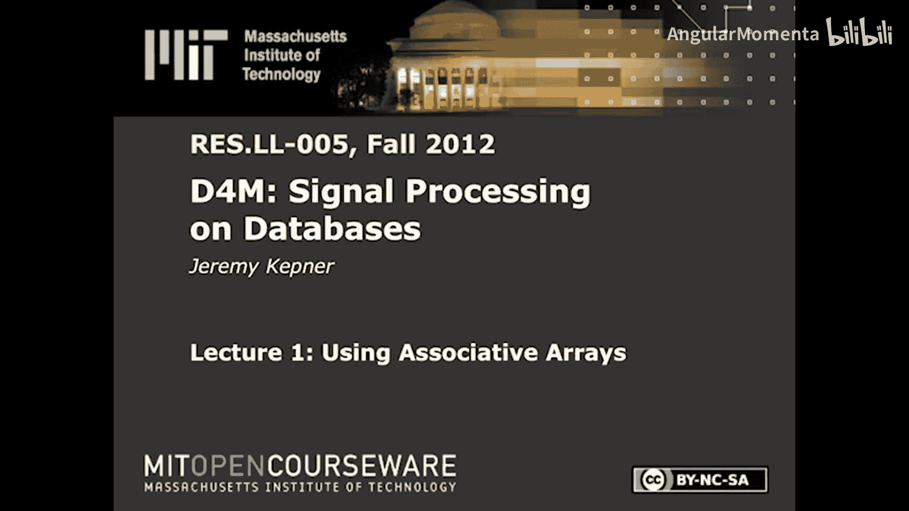
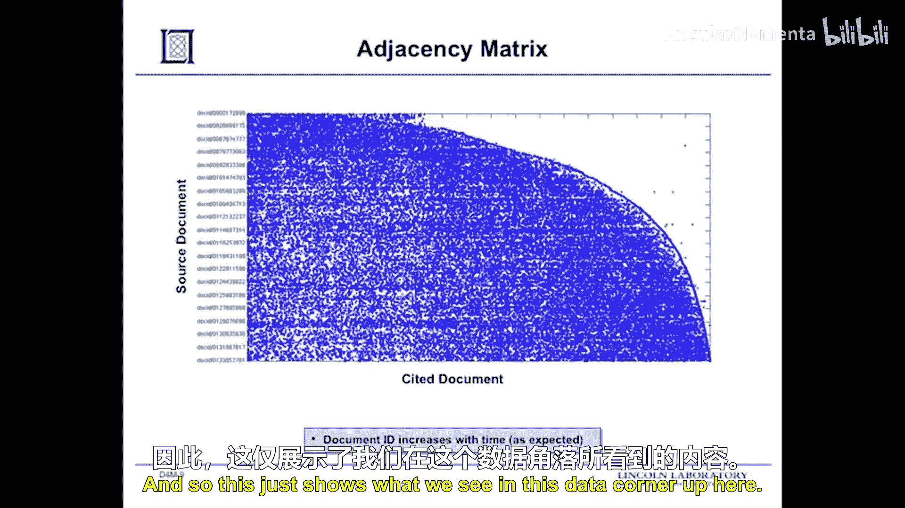
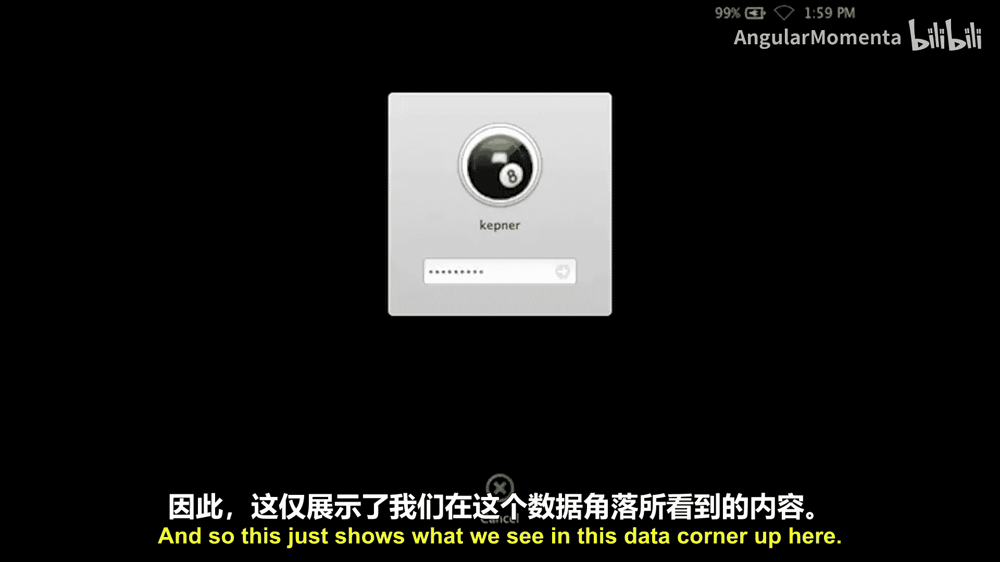
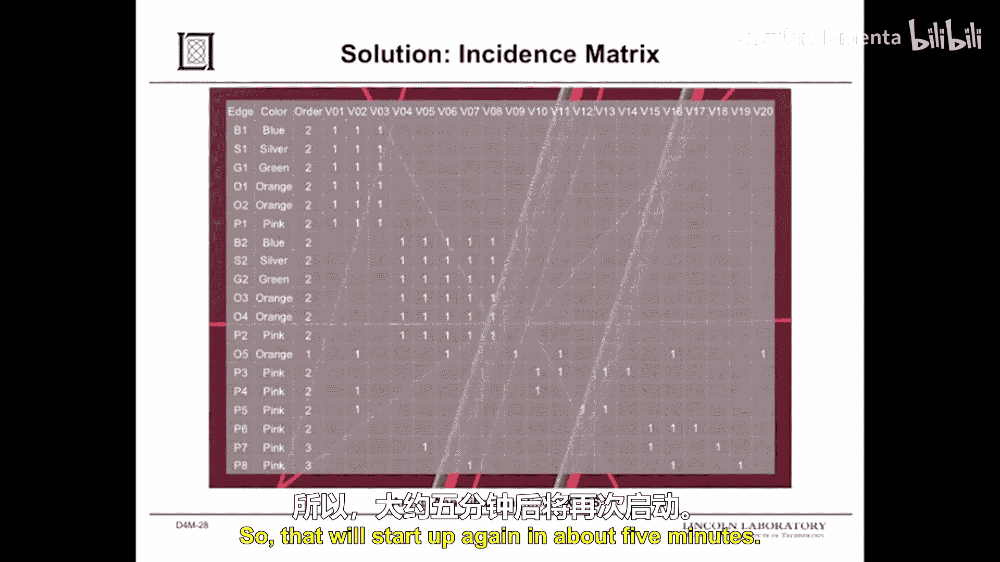
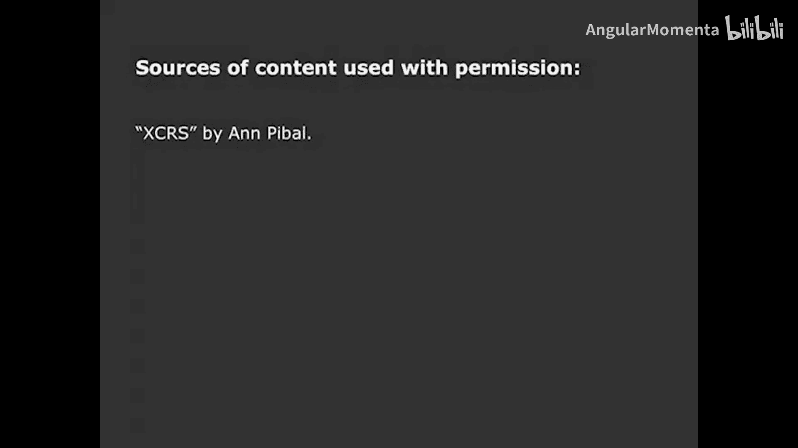

# 【麻省理工】大数据与机器学习数学-｜-MIT-RES.LL-005-D4M-Signal-Processing-on-Databases,-Fall-2012-p06-06-1.-使用关联数组--BV1eEtTzhE4F_p6-

The following content is provided under a Cative Commons license。

 Your support will help Mi T OpenCourseware continue to offer high quality educational resources for free to make a donation or to view additional materials from hundreds of Mit courses。

 Visit Mitopcourseseware at Ocw。 Mt Eduu。

그。Thank you all for coming。I'm glad to see that our attendance after the first lecture is not dropped。

Dramatically。A little bit that's to be expected。But so far I haven't managed to scare you all off。

So this is the second lecture of the signal processing on database。Of course。啊。

The format of the lecture will be the same as the last one we'll have some slide material that will cover you know the first half of the course and then we'll take a short break and then there'll be some example。

Demo programs。And so with that， we'll get into it and all this material is available in your Lgrid accounts in the tools directory。

 you get a directory like this and the documents and the slides are right here。

So we'll go to lecture01。For those of you who weren't there or to recap for those who will be viewing this on the web later。

 title the course is Sign Proing on Datas， Two terms that we often don't see together。

 the signal processing element is really alluding to detection theory and the deeper sort of linear algebraic basis of detection theory。

 the databases is really alluding to unstructured data。

 data that we often represent with strings and words and those and sort of sparse relationships and so this course is really bringing these sort of two normally quite separate ideas and bringing them together in a way because there's a lot of need to do so。

So。Again， this is the first course ever taught on this topic there really isn't a prior model for how to teach this so the approach that we're taking is we're going to have a lot of examples that show how people use this technology and hopefully see that and then。

We'll also have some theory and as well as a lot of examples。

 And so hopefully through some combination of those， those different types of。Teaching vehicles。

 each of you will be able to find something that is helpful。

So the outline of today's lecture is I'm going to go through an example where we analyzed some citation data。

So citation data is one of the most common examples used in the field because it's so readily available and so easy to get。

And so there's no issues associated with it。You have lots of academics analyzing。Themselves。Which is。

 of course。Very symmetric right And so there's a lot of work on citation data we take we are going to be looking at citation some citation data here。

 but。Doing it， using the technology， the D4M technology that you all have access to。

 doing it in the way that will work well there， which we think is more efficient。

 both in terms of the。Performance you'll receive it on your analytics and just in terms of the total time it will take you。

 of course， it does require a certain level of comfort with linear algebra。

 that's sort of the mathematical foundation of the class。So we're going to get right into it。

And I talked about this in the previous lecture， these special schemas that we set up。

For processing this kind of data。That allow us to essentially take any kind of data and sort of pull it into。

Should one basic。Architecture。That is really a good starting point for analysis。

So here's a very classic type of data that you might get in citation data here。

You in this particular data set， we have a universal identifier for each citation。

 so every single citation is just given some index in this data set。And we'll have an author。

A doc ID and then a reference doc ID， so this basically is the document ID of the the document that's being referenced and and the one that the reference is coming from that may seem a little opposite。

 but that's sort of what it means and you can have absences of both you can have。

References where there is it's referring to another document for which they have not constructed some kind of document I。

 You can also have references that are within a document that just for some reason other doesn't have a document I as well。

 so I think the important thing to understand here is that this kind of。Incompleteness， you know。

 on a， on a data set。Which might be as clean a data set as you would expect。

 which is the scientific citation data set。 This kind of incompleteness is very normal。We always。

 you never get data sets that are remotely perfect if you get data sets that feel even like about 80%。

Solid， that's you're doing very well。 And it's very。

 very common to have data sets that are incomplete， to have mistakes， no values。Mislabeled fields。

 et cetera， et cea。 It is just a natural part of the process。

 I think even though more and more of these data sets are created by machines and we were hoping that would eliminate some of those issues。

 well the machines have the same problems and they can make mistakes on much larger scale more quickly than than humans can So so incompleteness definitely exists。

嗯。😊，We pull this data。Into。This data is a sort of a standard。You know。

 SQL or tabular format here in which you have records and columns and then values。

 And what we tendt generally do is pull it into what we call this exploded schema where we have we still use the records。

 those are the row keys， we create column keys， which are essentially the the column label and the column value appended together。

 So every single unique value will have its own column， and then we sort of build it out that way。

 And this creates this very， very large sparse structure， which。

Once we store the transpose of that in our database as well。

 we get essentially constant access to any string， constant time access to any string in the database。

 so we can now look up any author very quickly， any document， very quickly， any record very quickly。

 and so it's a very natural schema for handling this kind of data。Typically。

 we just hold the value one in the actual value of the database we can put。Other numbers in there。

But。It generally should be a number that you would never want to search on。

Because in many of the data sets that we have or the databases they're working with。

 they can look up a row key or with the schema， you a column key very quickly。

 but to look up a value requires a complete traversal of the table。

 which is by definition very expensive。There's definitely information you can put in there。

 but just generally information you would never want to really look up。In addition。

For this particular data set。We have some fields。That are quite long。嗯。And so。

We might have the fully formatted reference， which in a journal article can be quite long。 you know。

 if it's got the full name and the journal volume and maybe all the authors and all that stuff that can be quite long。

 It's very unstructured。We might have the title， we might have the abstract。

 these are long longer blobs of data that we maybe our other data set essentially has extracted all the key information from that。

 but often we still want to have access to this information。

As a complete sort of uninterrupted piece of data。 So if you actually find a record， you're like。

 well I'd like to see the abstract as it was actually。In the journal。

 formatted as it was in the journal， because a lot of times when you pull this stuff out and do keywords。

 you might lose punctuation， capitalization， other types of things that just make it generally easier to read。

 but don't really help you with indexing。So we actually recommend that kind of information be stored in a completely separate table。

 traditional。Table， which would just be some kind of row key and then the actual reference with the values there。

 you're never going to search the contents of this。

 but this allows you to at least have access to to the data so。

This is sort of a small addition to our standard schema where we have the exploded schema with all the sort of information that we would ever want to search on with its transpose。

 which gives us very fast search。You may have an additional table which just stores the data in a raw format separately。

 you can look it up quickly， but it won't get in the way of any of your searches。

 the problem can be if you're doing searches and you have very large fields mixed in with very small fields。

 it can become a performance bottleneck to be handling these at the exact same time。

Another table that we used in this data set。😡，Which was to essentially index all the words in the title and the abstract。

And theirre ngrams。 and so you you know the one gram would just be the individual words in a title if a word appeared in a title。

 you would create a new column for that word with respect to that reference an ngram would be word pairs。

A trigram would be all words that occur together in threes and on and on and on。

And so often for text analytics， you want to store all of these。

 and essentially you might have here an input data set with various identifiers。

 a title that consists of a set of words an abstract that consists of a set of words。

And then we create typically what we would do is we would say for the word， the1 gram of the title A。

 we might format it like this。 And then here we might hold。Where that appeared in the document。

 So this allows you to essentially come back and reconstruct the original documents。

 So that's not something we。That's a perfectly good example of something that we don't tend to need to search on。

 which is the exact position of a word in a document。

 we don't tend to really care that the word was in the eighth position or the tenth position or whatever。

So we can just create a list of all these these values in that way。

 if you want to then later reconstruct the original text。

 you can do that between a column and its positions， you have enough information to do that。

 So that's an example of another type of schema that we admit and how we handle this type of data for doing these types of searches。

 and now it makes it very easy to say show me if I wanted to look up。

 please give me all documents that had the word D this word D in the abstract。

 I would simply go over here， find look up the row key get get these two。Columns。

And then I could take those two column labels and then look them up here and I would get all the ngrams or I could then take those row keys and look them up in any of the previous tables and get that information。

 So that's kind of what you can do there again going over this kind of quickly the examples go through this in very specific detail。

 but this is kind of just showing you how we tend to think about these data sets in a way that's very flexible but showing you some of the nuances。

 it's not just the one table it ends up being two or three tables。

 but still that really covers what you're looking for。Again。When you're processing data like this。

 you're always thinking about a pipeline。And D4M， the technologies we talk about only one piece of that pipeline。

 we're not saying that the technologies we're talking about are。

Cover every single step of that pipeline。 So in this particular data set that we had。

 which I think was 150 GB。Data set。嗯。So step one was getting a hard disk drive sent to us。

And copying it， it came as a giant Xml zip file。 Obviously， we had to uncompress it。

 So we had the zip file。 we uncompressed it。And then from there， we had to write a parser of the XML。

That then spat that out into just a series of triples that then could be。

Inserted into our database the way we want。嗯。Well D4M is very good for sort of developing how you're going to want to parse those triples。

Initially， if you're going to do a high volume parsing of data。

I would really recommend using like a low level language， like C。

ItGally C as an outstanding language for doing this very sort of repetitive monotonous parsing and has excellent support for things like XML and other types of things and it will run as fast as as you can and it's generally。

 yeah， you end up writing more code to do that but it tends to be kind of a do once type of thing you actually do it more than once usually to get it right。

 but it's nice when I think our parser that we wrote in C++ could take this。

Several hundred gigabytes of XML data and converted in triples，Under an hour。

And so that's that's a nice thing in other environments。

 if you try and do this insane say in Python or other types of thing or even in DformM at high volume。

 it's going to take a lot longer。 So the right tool for the job。

It will take you more lines of code to do it， but we have found that it's usually a worthwhile investment because it can take a long time。

Once we have the triples， typically what we then do is read them in to Dformum and construct associative arrays out of them。

 talked a little bit about associative arrays last time I'll get to that again。

 but these are essentially a MATlab data structure and then we generally save them to files。

We always recommend right before you do an insert into a database often。

Even when you write eye performance parsers or if you're not writing in a harbor。

 the parsing can be a significant。Activity， and if you write the data out in some sort of efficients file form and right before you insert it。

 if you ever need to go back and reinsert the data， it's now a very， very fast thing to do。

 you'll often have databases that you get。Especially during development they can get corrupted。

 you try and recover them， but they don't recover and again just knowing that you have the parsed files laying around someplace and you can just process them whenever you want is a very useful technique and usually is not such a large expensive from a data perspective and can allow you to sort of essentially reinsert the data at the full rate the database can handle it as opposed to having to redo your parsing which sometimes can take 10 times as long。

 we've definitely seen many folks who they do full parsing text parsing and Java or a Python that often is 10 times slower than the actual insert part of the database so it's nice to be able to sort of checkpoint that that data。

And then from there。Wei。Read the files in and then insert them into our three two database pairs。

 the keys and the transpose， the Ngrams and the transpose and then the actual raw text itself。

I should also say keeping these associative arrays around is files。iss also very useful。Because。

The database， as we talked about before。It's very good If you have a large volume of data and you want to look up a small piece of it quickly。

If you want to re traverse the entire data set， do some kind of analysis in the entire data set。

That's going to take about the same time as it took to insert the data。

So you're going to be having to pull all the data out if you're going to be wanting to analyze all of it。

 there's no sort of magic there。So the database is very useful for looking at small pieces。

 but if you want to traverse the whole thing。In which case。

 having those files around is a very convenient thing。 If you're like。

 I'm going to traverse all the data， I might as well just。Begin with the files and traverse them。

 And that's a very easy。 The file system will read it in much faster than the database。

 the bandwidth of the file systems are much higher than databases。

 and it's also very easy to handle in a parallel way。 you just send separate you different processes。

 parse and in read in in different files。 So if you're going to be doing something that traverses an entire set of data。

 we really recommend that you。You know， might do that in files。 And In fact， we even see folks。

 It's like， well， I I might have a query that requires 3 or 4% of the data。 Well。

 then we would recommend oftentimes， if you know， you're going to be working on that same data set over and over again。

Queering it out of the database， saving to a set of files。

 and then just working with those files over and over again。 Now。

 you never have to deal with the latencies or other issues associated with the database。

 You've completely isolated yourself from that。 So databases are great you need to use them the right thing。

 But the file system is also great。 And often in the kind of work that we do that algorithm development people do。

Testing and developing on the files is often better than than using the database as you are sort of。

Fine grain， rudimentary access type of type of thing so。cover that。

So this particular data set had 42 million records。And just to kind of show you。诶。

How long it took using the pipeline， we uncompressed the XML file in one hour， So it's just running。

Gee zipip。Our parser that converted the XML binary structure into triples using C this was written in C sharpp was two hours。

 so that's you know very， very nice we could as we debug the parser。

 you know we could rerun it and not have to worry about oh my goodness。

 this is going to be days and days。The constructing of the D4M associated ray from the triples took about a day。

So it just kind of shows you there。And then inserting the triples into a cumullo。

 this was a single node database。P。Very。Not a powerful computer。 It was a dual core。

Circa 2006 server， but we sustained an insert rate of about 10，000 to 100，000 entries per second。

 which is extremely good for this particular database， which was a cumullo。

So inserting the keys took about two days， inserting the text took about one day。

 inserting the ngrams took about 10 days in this particular data set。

 we ended up not using the ngrams very much in this particular set。

 mostly the keys and so there you that gives you an idea if the database itself is running in parallel you can increase those insert rates significantly。

 but these are the basic sort of single node insert performance that we tend to see Yes question over here。

听到了。Yes， so I talked about that a little bit in the first class。

 So acumullo is a type of database called a triple store or sometimes called a no SQL database。

 It's a new class of database that's。Based on the architecture published in the Google Big table paper。

 which is about five or six years old， there's a number of databases that have been built with this technology。

 It sits on top of a file system infrastructure called Hadoop。Ands a very。

 very high performance database for what it does and that's the database that we use here and it's open source a part of the Apache project you know you can download it and at the end of the class we'll actually be doing examples working with databases we are developing an infrastructure part of LOgrid to host these databases so that you don't really have to kind of mess around with the details of them and our hope is to have that infrastructure ready by the last two classes so that you guys can actually。

Try it out， so。So the next thing we want to do here is after we built these databases。

 I want to show you how we construct graphs from this exploded schema， formally。

 this exploded schema。Is what you would call an incidence matrix。So in graph theory。

 graphs generally can be represented as two different types of matrix。An adjacency matrix。

 which is a matrix where each row and column is a vertex。

 and then if there's an edge between two vertices， there'll be a value associated with that。

Genentally very sparse in the types of data sets that we work with。

That is great for covering certain types of graphs。It handles directed graphs very well。

 it does not handle graphs with multiple edges very well， it does not handle graphs with hyper edges。

 these are edges that connect multiple vertices at the same time。

And the data that we have here is very much in that latter category， a citation。

Or is essentially is a hyper edge or this type it basically one of these things it connects a document with sets of people with sets of titles with sets of all different types of things so it's a very。

 very rich edge that's connecting a lot of vertices and so a traditional adjacency matrix doesn't really capture it。

 so that's why we store the data as an incidence matrix。

 which is essentially one row for each edge and then and then you know and then the columns are vertices then you basically have information that shows which vertices are connected by that edge。

So that's how we store the data in sort of a lossless fashion。

 and we have a mechanism for storing it and indexing it fairly， fairly efficiently that said。

 the types of analyses we want to do tend to very quickly get us。To adjacency matrices。

 I almost sort of for those of you who are。Familiar with radar。

 this is probably the only place where I could say that。

 I almost think of one as kind of the voltage domain and the other， the power domain。

 You do lose information when you go to the power domain。

 but often to make progress on your analytics， you need to， that's just， you have to do that。

 And so the adjacency matrix is a formal projection of the incidence matrix。 you essentially by。

Multiplying the incidences matrix by itself or squaring it can get， can get the the adjacency matrix。

 So let's look at that。 So here's。An adjacency matrix of this data that shows the source document and the cited document。

And so this just shows what we see in this data。

Corner up here if you see my mouse going up here， scream so we'll stay stay in the safe area。

 So this is the source document and this is the cited document。

 This is a significant subset of this data set。 I think it's only 1000 records It a random sample。

 I showed you the real full data that obviously it would just be solid blue。

嗯。Da。The the。The source document ID tends to is decreasing in basically newer documents are at the bottom。

 older documents at the top。I assume everyone can know why we have this sharp。Edgeged。Boundary。Here。

You can't cite future documents right， this is the Einstein event cone of this data set right you can't cite documents into the future。

 so that's why we have that boundary there and you can almost see it here。You see。

 and I don't think that's just an optical lose， you see how it's getting it denser here。

And Sprser here， which just shows as documents get published over time。

 they get cited less and less going into the future。

I think one statistic is that if you eliminated self citations。

 most published journal articles are never cited。So。So thank God for self citation。嗯。

This shows the degree distribution of this data will get into this in much greater detail。

But this just shows。Here on this small。Subset of data， basically for each document。

 we count how many times it was cited。So。These are documents that are cited more。

And then we count how many documents have that number of citations。

 So these are the document this is 10 to the 0。 is basically documents that are cited once。

 And this shows the number of documents in this set here， which was。You know， it was a 20，30。

40000 that have one citation and then going on down here to the one that is cited the most。

 This is what is called a power log distribution。 Basically。

 it just says most things are not cited very often and some things are cited a long time。 You see。

 there's out approximately linear negative slope in a log log plot。 This is something that we see。

All the time。I should say， in what we call subampled。Data。

Where essentially the space of citations has not been fully sampled， if people stopped publishing。

All right， and we created new documents and all citations only were of older things than over time you would probably see this thing。

Begin to take on a bit more of a bell shaped curve。Okay， but as long as you're an expanding。World。

 then you will get this type of power law and a great many of the data sets that we tend to work with。

Ball in this category。 And in fact， it's， it's if you see， if you work with data。

 that is a byproduct of。Artificial human induced phenomena。 this is what you should expect。

 and if you don't see it， then then you you kind of want to question what's going on there。

Usually something going on there， so。So those are some overall statistics。

 those are two things that we the adjacency matrix and theistion are two things that we often look at。

 I'm going to sort of move things forward here and talk about the different types of adjacency matrix we might construct from the incidence matrix。

 so in general， the adjacency matrix is often denoted by the letter A。An incidence matrices。

You'd think we might use the word the letter I， but I has obviously been taken in matrix theory。

 so we tend to use the letter E sometimes we it says you know for the edge matrix， so I used。

E is the sort of this is the associative array representation of my edge matrix here。

 and if I want to find the author correlation。Matrix。

 I just basically can do E starts with author transpose times E starts with author。

 so basically this gets the starts with author gets the part of the incidence matrix that has just the authors I now have an Associative array of just authors。

 and then I square it with itself， and you get obviously a square symmetric matrix that is dense along the diagonal。

Because every single document， the author appears with itself。

And then this just shows you which authors appear with which other authors。

 So if if two authors appeared on the same。Article together they would get a dot。

 and so that's a very classic type of graph， the co-author graph it's well studied。

 you know has a variety of phenomena associated with it。

 and here it's constructed very simply from this matrix matrix multiply。I'm going to call this。

 sort of the。Inner square。So we actually have a shortcut for this in the form called square n。

 so square n means。The matrix transpose times itself， it sort of has an inner productly feel to it。

No one has their name associated with this product。

Seems like someone missed an opportunity there to to。

You know all the special matrices are named after Germans and so someone some German missed an opportunity there back in the early days。

maybe we can call it the inner capner product would sufficiently obscure like the Haammar product。

 which I always have to look up。And here's the outer product。

 So this shows you the distribution of the documents that share。Common authors。So it's the same。

 so that's that's it just sort of show what I'm trying to show you is。

These adjacency matrices are formerly projections of the incidence matrix onto a subspace。

 and whether you do the inner。Squaing or the outer squaring product。

 those are both have valuable information。 One of them showed us which authors have have have published together。

 The other one shows us which documents have common authors， both very legitimate pieces to analyze。

 And in each case， we've lost some information by constructing it。 But probably out of necessity。

 We have to do this to make to make progress on the analysis of what we're doing。And continue it。

 we can look at the institutions， so here's the inner institution。A squaring a product。

And so this shows you which institutions you know， are on the same paper， and then likewise。

 this shows us which documents share the same institution。You mean the same thing with keywords。

 okay， which keywords are shared， you know which pairs of keywords occur in the same document。

Which documents share the same keywords， et cetera， et cetera， et cetera。 typicallypically。

 when we do this matrix multiply， if we have the value B a1。

 then actually the the value of the result will be the count。

 So this would show you how many keywords are shared。By the document or in the previous one。

 how many times a pair of keywords？Appear in the same document together again。

 valuable information for constructing analytics and so these inner and outer capner products or whatever we want to call them are very useful in that regard。

So。TheNow we're going to turn a little bit。Take a little bit of a turn here。

 this is really going to lead you up into the examples。

So we're going to get back into this point I made and kind of revisit it again， which is the。

The issues associated with adjacency Mates， hypergraphs， multied graphs and those types of things。

 I think I already talked about this just to remind people。Here's a graph， a directed graph。Okay。

 we've numbered all the vertices。This is the adjacency matrix of that。Of that graph。

 so basically if two vertices have an edge， they get a dot。

The fundamental operation of graph theory is what we call breadth first search。

 so you start a vertex and then go to its neighbors following the edges。

The fundamental operation of linear algebra is vector matrix multiply。

 so if I construct a vector with a value in in a particular vertex。

 and I do the matrix multiply I find the edges and I result in the the neighbors。

 And so you have this formal duvality between the fundamental operation of graph theory here。

 which is breadford search and linear algebra。 And so this is philosophically how we will think about that。

 and I think we've already shown a little bit of that when we talk about these projections from incidence matrices to to。

To。Adjacency matrices。And again， why why so to get into that a little bit further and bring that point home。

You know， the traditional graph theory that we are taught in graph theory courses tends to focus on what we call directed。

I mean， sorry undirected， unweighted。Graphs， so these are graphs with with vertices and you just say whether there's a connection between vertices and you may not have any information about。

 you know there's multiple connections between a vertices and you certainly can't do hyper edges and sort of this gives you this very black and white picture of the world here。

 which is not really。What， what the world really looks like， and in fact。

There's a painting courtesy of a friend of mine who's an artist who does this type of painting。

 I tend to like it， and this is the same painting。You know。

 what I show before Vodo really looks like， okay and what you see is that this is really more representative of the true world。

 just drawing some straight edge lines with colors on a canvas。

 we already have gone well beyond what we could easily represent with undirected unweighted graphs。

First of all， our edges in this case have color。 We have five distinct colors。

 which is information that would not be captured in the traditional unweighted undirected graph representation。

We have 20 distinct vertices here， so I've labeled every intersection or ending of a line as a vertex。

 so we have five colors and 20 distinct vertices。We have 12 things that we really should consider to be multi edges。

Okay， these are essentially multiple edges that connect the same vertices。

 and I've labeled them by their color here。We have 19 hyper edges。 These are edges that。

Fundamentally， connect more than one vertex。So if we look at this example here。

 P3 connects this vertex， this vertex， this vertex， and this vertex with one edge。We could。

 of course， topologically say， well， this is the same， you know。

 the same as just having an edge from here to here or here to here to here。

 but that's not what's really going on。 We are throwing away information if we decompose that。

Finally， we often have a concept of edge ordering。The order that the lines are drawn here。

Is is actually。嗯。The order that the line is drawn here。

 you can infer just from the layering of the lines that certain edges occur before others。

 and ordering is also very important。And。Anyone a guess？What color。

Was the first color of this painting。When the artist started， they painted one color first。

 Anyone want to guess what that color was。What。Thank you。It was orange。It was orange。

 and I would have never guessed that， except by talking to the artist， which is。

which is I found interesting and it shows you， and when she was telling me how she did it。

 it was so counterintuitive to sort of kind of maybe the perception of the work。

 which I think is very， very interesting。So if you were to represent this in a standard graph。

You would create 53。Standard edges， right， you would you would say this， this hyper edge here。

 we would you break up into three separate edges， this hyper edge。

 you would break up into two separate edges， et cetera， et cetera。 So you have 53 standard edges。

 So one of the basic observations is。That。You know， the standard edge representation。

 the fragments or hyper edges， a lot of information is lost。

 the digraph representation compresses the multi edges， and a lot of information is lost。

 The matrix representation drops the edge labels， and a lot of information is lost。

 And so and the standard graph representation drops is the edge order and again。

 more information loss。 So we really need something better than the traditional way to do that。

 And so the solution to this problem is to use the incidences matrix formulation where。

We assign every single edge， a label， a color， an order that it was laid down。

 and then for every single vertex。Okay， we can just so this is this， this edge B1 is blue。

 it's the it's in the second order group and it connects these three vertices and you see various structures here appearing for the different types of things。

 So this is how we would represent this data。As an incidence matrix in a way that preserves。

All the information and so that's really kind of the power of the incidence matrix。啊。

Approach to this。All right， so that actually brings us to the end of the first oh so we have the question here。

This was great。What kind of analysis can you actually do？

So the analysis you typically do is you take projections into adjacency matrices。 Y， yeah。

 so this way， you can， you're preserving the ability to do all those projections， you know。

 and it's not to say sometimes the right thing to do isn't be like。Sometimes you make progress。

 if your data sets are large， you're just forced you have to just make some projections to get started。

You know， sometimes， you know， I mean， theoretically。

 one could argue that the right way to proceed is you。You have the incidence matrix。

 you derive the analytics you want。You know， maybe use adjacency matrices as an analytic intermediate step。

 But then once you've figured out the analysis， you then go back and make sure that the analytic runs just on the raw incidence matrix itself and save yourself the time of actually constructing the adjacency matrix。

 Sometimes this space is so large， though， it can be difficult for us to get our mind around it。

 And sometimes it can be useful just like， you know what。

 I really think that these projections are going to be useful ones to get started rather than trying to just sort of get lost in this force。

 Sometimes it's better just like I'm going start by projecting， you know。

 I'm going to create a few of these adjacency matrices to get started， make progress。

 do my analytics。And then figure out if I need to fix it from there。

 because working in this space directly can be a little bit tricky every single。Analysis。

 it's like working in the voltage domain。 You're constantly having to keep sort of extra theoretical machinery around。

 and sometimes to make progress， you're better off just。Going to the power domain。

 making progress and maybe discover later if you can fix it up， doing other types of things。

Are there other questions before we come to the end of this？Part of the lecture。Great， okay。

 thank you， so we'll take a short break here。And then we'll proceed to the demo。

 there is a sign up sheet here， if you haven't signed up， please write it down。

 apparently this is extremely important for the accounting purposes of the laboratory。

 so I would encourage you to do that。That will start up again in about five minutes。

