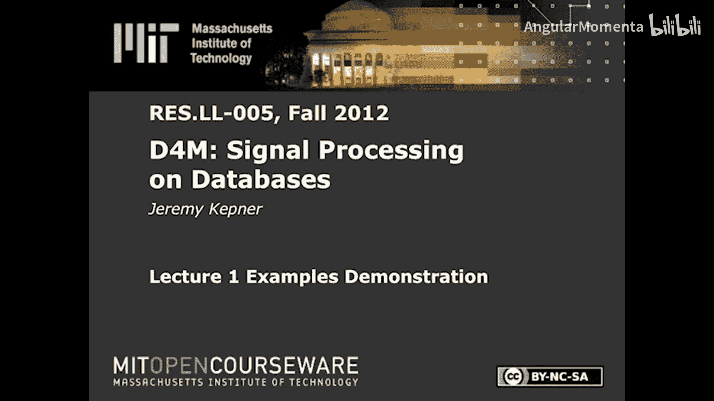
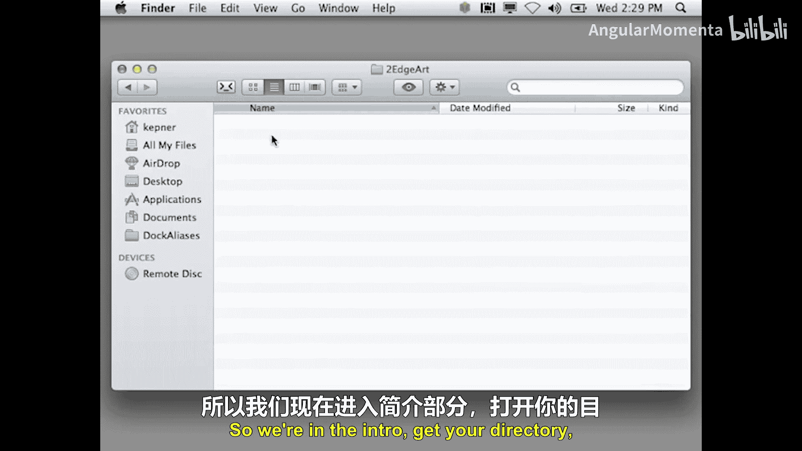
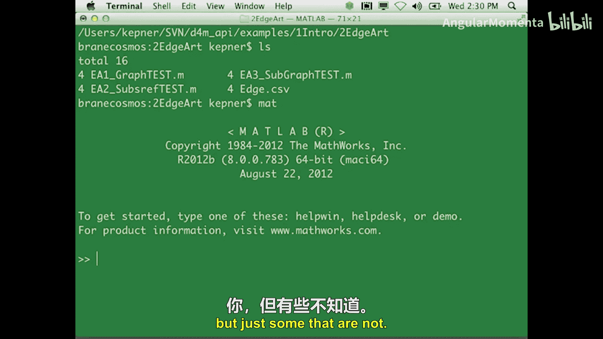
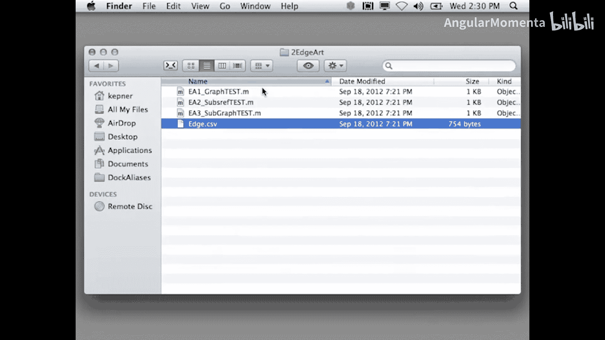
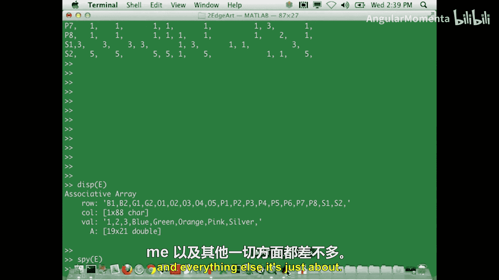
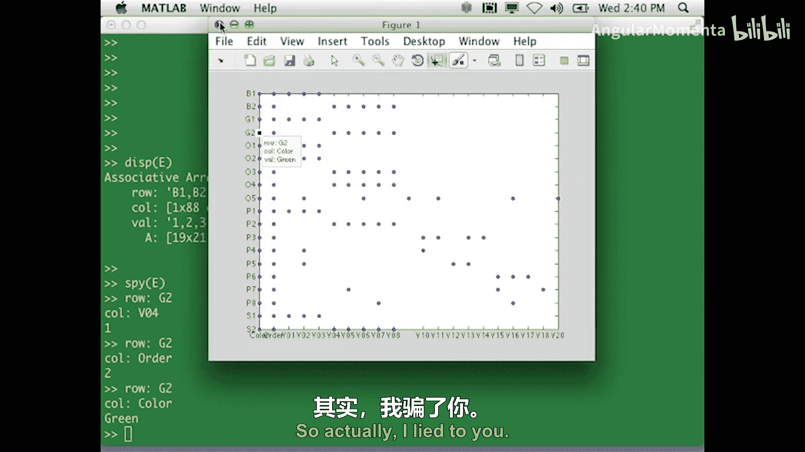
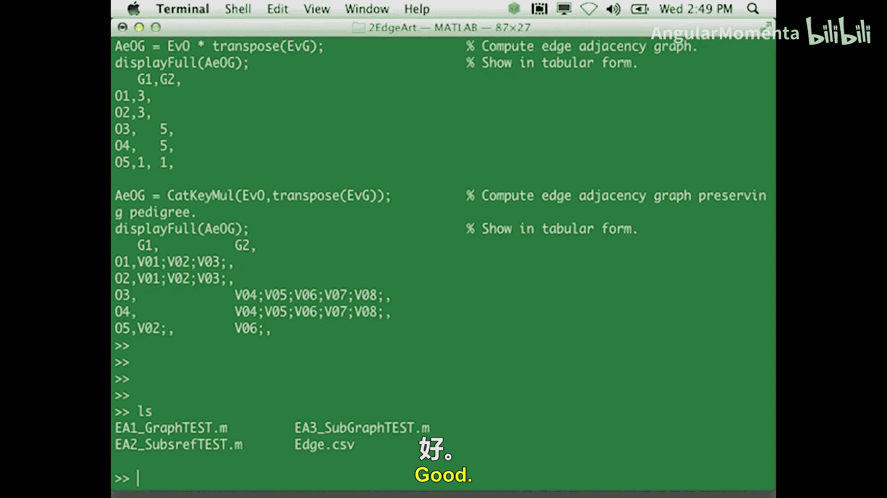
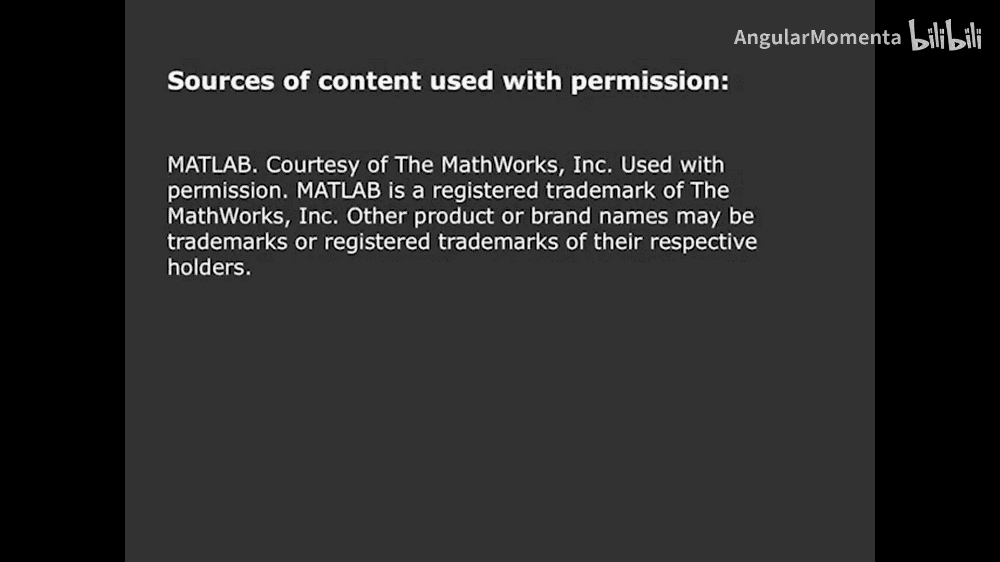

# 【麻省理工】大数据与机器学习数学-｜-MIT-RES.LL-005-D4M-Signal-Processing-on-Databases,-Fall-2012-p07-07-1.-示例演示--BV1eEtTzhE4F_p7-

The following content is provided under a Cative Commons license。

 Your support will help Mi T OpenCourseware continue to offer high quality educational resources for free to make a donation or to view additional materials from hundreds of Mit courses。

 Visit Mitopcourseseware at Ocw。 Mt Eduu。

All right。All right， so we're going to continue now and kind of get into the examples part of the。

Of the course。And again， this is really the part that people should really。

 I strongly encourage people doing the examples。How many people got a chance to try the examples in the？

Very good and we got a couple of questions for people and most of the time we got another email from them right away that said oops nope got it to work so we're very pleased about that very you know the great thing about working at Lincoln Labs is people are pretty good at figuring。

Stuff out。We have some experienced this before， obviously our parallel MatLb technology。

 we've released that out。Many， many people use it， and for the most part。

 we're proud to say that whenever we get a question from the outside world and it's not working。

 it's usually the person has taken severely active steps to ignore the documentation。You know， and。

 and。But if they follow it at all， they're generally pretty， pretty safe。

So I'm going to get into the example code here。So the example code， this is。Oh。

 that's not the For user share， that's incorrect。Tools。Lowercase examples。

 I should correct these slides。Oh， nice， right go。Great。It is an X， right？Oh yes， thank you。Great。

All right， so this is where the example code is， we're going to go over here。

 your assignment should you choose to undertake it。Is to。Pick a picture。

Hopefully someone that's interesting to you doesn't have to be straight lines。

 it could be anything where you could create， draw edges or something you take some photo and put it through one of those。

Photoshoppy effects and turn it into a line drawing or something that then start labeling vertices。嗯。

😊，You do want to limit the number of lines though I would recommend 20 would be the most number of lines you do because this can get fairly involved。

 you might start with something fairly small so select a picture， label the edges in vertices。

 create an incidence matrix。Okay， and then just compute the adjacency matrix from the incidence matrix using this formula。

 you can certainly use D4M if you want to do that， but it's fine to do it by hand。

It's fine to do it by hand， just in which case you would want to do a very small one just， you know。

 doing it once by hand is is useful， you know。Twice marginally and then third time， not useful。

 but just like in high school right， they make you do matrix multiply by hand。Actually a lot。

 you know， a lot。呵。😊，How。So that's the example in the assignment。If you。

Do this on a piece of paper and scan and email to me before the next lecture。

 I will give you some feedback on it before the following lecture。You know。

You you saying to give it to me after that？Too bad。

Right I just won't give you feedback you know so there's no credit。

 but you know this gives you some incentive to get it done if you want feedback from me about you know what you did make sense or if you encountered like I picked this picture and now I don't understand you know if I did my best but I have questions about how I did this you know does it make sense I'd be happy to do that so just scan it email it to me or if it is electronic format you know you can do that as well so。

就。Lecture portion。 and now。Go back here。And。Let's see here we go to examples。Alright。

 so we're in the intro。It's art directory。

Startirt my。At lab show。Right in right place。About 15 seconds for to do this。

This particular thing always cds me to the location of the directory。

 you need to do that in order to see the examples。嗯。I think most MAlab users。

But just some that are not。

that， here is the actual adjacency matrix。Of that。Painting。So。There it is。Same thing we just saw。

 so this is the data set that we're going to work with here。嗯。

All right， so I'm going to do EA1 again。The numbered one， you know， the courses。

 the all the examples are numbered in order， kind of that you're supposed to proceed through them。

 And if you see kind of a file in a directory that's like capital couple capital lever。

 which are the first two letters of the。The directory or the abbreviation of the directory and a test that is。

The examples， the other files are just supporting files you aren't expected to run those。

Dry running them， but they'll probably cause you problems if we run them by themselves。All right。

 here we go， so we just ran that example。Let's see what we got。And let me。

Make this a little bit smaller。Ber。All right， I think that worked。All right。

First thing we did here is we read in our。Data， so we have this read CSV。Very useful function。诶。

Not necessarily the fastest in some of the later examples。We have a sort of a super fast。Reader。

Which does almost no formatting for you。 So just reads in the triples as raw triples。

Because a lot of times if you're reading a very large CSV file。

You may not want to construct the full Associative array out of the way we would just sort of do it by default and you can just read in the triples very quickly and then do some manipulations or a lot of times the first thing you'll do is create an associative array and then get the triples out of it because you want to work on the triples directly and so so we do have ways for doing that So this is the we now created the incidence。

Matrix into an associative array。And。And go down here。 Let me just it。Show you that if I go dis。嗯。😊。

So that shows you the incidence matrix。These are its internal structures here。These are the row keys。

 so those are I call the labels of the edges。They have been converted to lexographically sorted。

Order。We have the column keys， but there's so many that Matlab chooses not to print out the full list here。

 but it's again a lexographically sorted list of the unique column labels。

 These are the different values that we have。So this is you remember we had an order column。

 which is one， two， three。Blue， green， orange， pink， silver， et cetera。And here， you know。

 and then the overall adjacency matrix， which connects the row keys to their value keys is 19 by 21。

1919 rows by 21 columns。 This actually shows a mixed use。Right。

Some of these are essentially exploded right the fact that we have each edge。

 but some of the values are actually storing real stuff here， bluegreen， orange， et ce。

 so you don't have to go all the way with one you can mix them to around you can create dense matrices that look more like traditional tables and there's sometimes that you want to do that and other times you can sort of completely explode it out and do things like that as well so。

Should we go back。We just want to work with the vertices。Okay。

 so we're going to ignore this color and order column。

 So we're going to create our first projection is to just work with the vertices。

 So we have this little shorthand here called starts with if you give it a。

A character and it will create a little query that will get just things that start with that and very useful thing is very efficient too that actually formally creates the two boundary it figures out what the maximum range is for that and then just needs to look up。

you know， the beginning and the end it consume leographical order and then it can just grab the middle so much we have a regular expression approach to。

 which works fine on small associative arrays， but this is much more efficient because it just basically two look ups and go。

It also works if this。E was actually a binding to a table in a database。

 You can use the same syntax while the regular expression syntax doesn't really work， yes。

So that's the delimiter of the string。So it's a string list with one entry in it。

So this is a string list， all our strings are list here。Well， because this also allows me。

ItCould have been anything that was unique to that。Okay。

 and it didn't have to be the same delimiter that was the one inside。Could have been a new line。

 could have been a tab， could move whatever I just picked comma because it was convenient。

 but could have been a space because you can have multiple arguments to the starts with you want to say I want starts with this and starts with this and starts with this。

 you just give it a whole list and it will go and do that all for you。

 And so that's why we do it that way wherever possible we try and accept a list of strings and then do kind of the right thing。

 So basically this saying get me all columns that starts with V。

 So that will be all the vertices and this is the colon which says you know and I want the full row of that。

These had these values of which were the order group that they were in。

And and so we don't care about those， we want to convert them back to regular numeric numbers。

 and so we have this shorthand here called double Logi。

 which basically just takes the logical and then does the double。

I think mathematically formally you would use call this the infinity norm on strings if that even makes sense。

 but it basically just says if there's a value there converted to a double precision one。

 if there's not a value there， it's just a sparse0 and we do this all the time because a lot of times we want to you math on these things。

 it's like regular math。We want to compute the vertex adjacency graph。

 so we do that with our square in。Function here， our inner square product。

 So that basically takes our matrix and use the edge as the common key to join them together。

 And we use our display full function to actually show。What we got。 And so now you see。The vertex。

Rtex adjacency matrix here。And then the number is the number of times those vertices are on the same edge。

So it's obviously symmetric and you see here you know these vertices here which are part of this common hyper edge you know we have this sort of 696 structure here。

 various other types of symmetric structures going on here showing you the counts how many times those vertices appear on the same edge these are obviously cliques because they are all vertices that are on the same hyperedge line。

 so if you have the same hyperedge line whenever you do the squaring operation you create you see it as this cleeique in this operation here。

Right。We can also do the square out。Function。😊，Okay， which computes the edge adjacency matrix。

 so now we want to ask which edges share common vertices。And so， that's this。Structure here。

And shows you the。These are the various edges and again it's symmetric and you can see all kinds of structures in here about which vertices share。

 I mean which edges share common common vertices so and that is pretty much it for this example very simple example hopefully gets you to the point where you can begin to try out the homework assignment and if there's any questions。

 the people have you know you know let's try this here one thing that's fun to do。白衣。Works。Whats。

Can good。I think between PowerPoint， Quick time and everything else it's just about。

There it is， wow， that took a long time。So this shows that adjacency matrix。So spy works。

 I think we I don't know if we showed that in the first example。

 but the spy function of the standard MatTLb sparse plotting function。

 very useful way to just sort of look at the stuff。

 all those previous charts I showed you on the examples where we done this thing and a little feature that sometimes causes MATLb to crash because it doesn't really like doing things too aggressively。

 but if you click on it。It shows you the row and the column and the value associated with that and also print it out here。

Likewise here， so you see row column that gives you the order。And this tells you， you know。

 the row is G2， its column is color， its value is green。So actually， I lied to you。

 that was just the first example。

Something。Senior moment there， we have two more to go。A lot more fun。

 so you all you're all excited to class ended early。So all right， here's the other examples。So again。

 what we do is we're reading in the data set， we're displaying the full thing。

 so you can see there's the full beast I just showed you with the spy plot。

Now I'm going to do some analytics on this。 So one thing I want to do is just get the orange edges。

So I can say get me the column color。And because orange is held in the value。

 I can actually compare it with the string。 So I say， return me the matrix。

 the associative array of the row color。And everything equal to orange。

 So that returns to me another associative array。 The result of this whole logical expression is another associative array。

 I can then get the rows。Those associative arrays， that As ratio。Found all。嗯。Edges that are orange。

And。I can then pass that get those rows and pass that back into the original one to get just the orange edges。

So this just shows you sort of this composable。Ability is very powerful。

 same same ability that A lab has one does similar statements in Maab all the time and so it's very composable。

 this would be a very complex query to do in other approaches and you can do it very quickly here yes question。

call to。The road。No， it doesn't。It doesn't。What we could do is overload it。

 So if you pass in an associative array with just a single argument and have it behave like when you pass in the MatTlab logical。

And do that kind of intersection。 We could think about that。

 but Matlab actually relies on then converting the matrix to a vector and then using the singular。

Basically， it takes that logical converts it to a singular indice which kind of gets us into an area where it's very fuzzy and gray So we've definitely thought about that and there are places where we line up with MAab very nicely because the mathematics of associative arrays and linear algebra really line up very nicely and and there's places where they intersect and there's things you can do in with associative arrays that you can't do with linear algebra for example we can matrix multiply any two associative arrays there's no conformance requirements they don't have the same normally when you multiply two matrices。

 the number of the dimensions have to the innerdimens have to match Basically the columns of the left argument and the rows of the right argument must be the same length and associative arrays that requirement doesn't exist you can multiply or add any two associative arrays we'll get into that much more in the next class but that's a very powerful feature that。

People like， but there's other places where it doesn't really make sense。 So things like what is the。

Upper triangular section of an associated array gets to be a little bit，huh， what's that mean？

Excellent question， though。 Excelt question though。 So we can display this。

 So this just shows we found all the。Edges that had color orange。but we don't have to just， you know。

 that's a way of using the values to select we could have， of course use starts with。In the rows。

Just say starts with O and G。 I just happen to label all my rows that orange rows began with O and green rows begin with G。

 So we can do starts with Og。 So that's example of those two range queries being done at the same time。

 And so that gives us Eog。 And again， we can see now we get。The orange and green rose。

So that just shows you that， and then we'll wrap up here with the last example。Which is E3。All right。

 now we get to do some really fun stuff again， we're reading in。Reading in our data set， converting。

 just getting the vertices， okay， and then converting it to numeric zeros and ones。

I'm going now just get the。Orange edges。And I'm going to get the green edges all right。

And now I'm going to essentially do the crosscorlation of the orange and green edges。

 so I'm going to transpose one of them and matrix multiply it with the other ones。

 We don't do square in here because there are different matrices。 In fact。

 I would say that people often do the crosscorrelation more often than just square the matrix with itself。

 you have one set with another set and you want to crosscorrelate them a very common operation。

 And so that's just transpose you know EVG here。 and that gets that。And as you can see。

 the results of that inner product was empty。All right， but the result of the outer product is full。

So that just， and you guys can think about why that is。And so this just shows you the common。

 how many edges。These appeared with together。This shows you that there was no。

 well you guys can figure that out， I'll let you more。Now。

 another thing that we often want to do is basically this showed us which。Edges had common vertices。

 shared vertices together。Okay， but it didn't tell us we lost。We lost the actual vertices。

 We just know that there's three。 and a lot of times we want them。

 This is sometimes called the pedigree。 You do a correlation。 And then you would like。

 what you say these two things are correlated。 I want to get the connector back to the original records so I can go back to my E matrix and really find that out and present that as the evidence that these things are connected together。

 And we don't want to lose that。 So we have invented special new matrix multiplies。

In the land of associative rays， one of them we call a catki mull。Okay。

 which if you view the matrix multiply as sort of there's a key， a common key， this row column。

Key that's being sort of joined together。 Well we can preserve that and store that in the value instead of。

 say， the count or something like that。So we do cat chmo， EV0 transpose EVG。

 and then when we display that。We not only see。Which edges were connected。

 but we also have preserved。The list of the vertices is just essentially a concateated list of those keys。

 very useful thing。One has to be so very powerful technique。

 one definitely has to be careful about using this technique if it generate it's going to generate extremely extremely long lists here that can really cause us to behave very slowly in particular。

 one has to be careful of if you do a cat chmo on a matrix with itself。

Why do you think you would have to be careful with that？Anyone。

Remember that dense diagonal that happened whenever we squared matrices。

 so that means this thing will have an enormous number of entries along the diagonal。

 so you have to be very careful when you use this kind of function to correlate something with itself。

 it's better to correlate two distinct sets because they tend to not have that。That dense diagonal。

 which can be a little bit of a problem。 There's ways to get around that。 I mean。

 there's hacks and tricks and stuff like that， but at a certain level， really dense diagonals。

 I mean you essentially be listing every single vertex in your data set。

You could be listing every single vertex in your data almost every single time。

 you know multiple times along the diagonal， and that would be get very， very bulky。

 So just a little word of caution there。 And so now I've baed you once， but this really is the end。

 So are there any questions on the examples before we。Put it off here。

 is there a question back here somewhere？No。All right， great。

 thank you very much appreciate it and we'll see you next week and again， think of a picture。

 draw some lines， make an incidence matrix。Have fun with it。

Compute the degree of your significant other。Sad idea。

两个。

