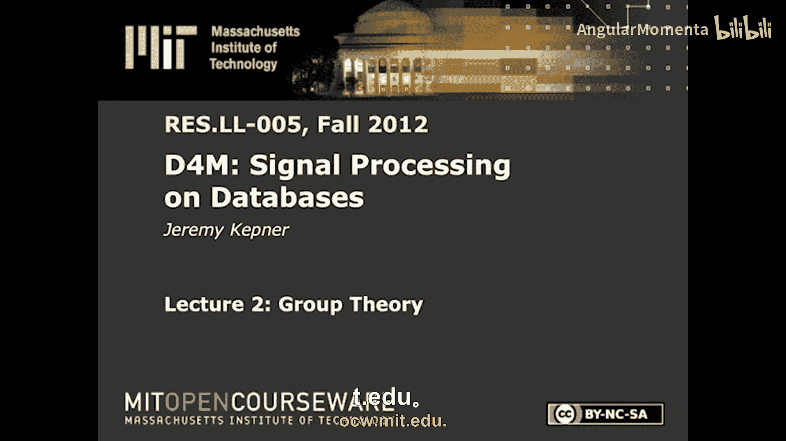
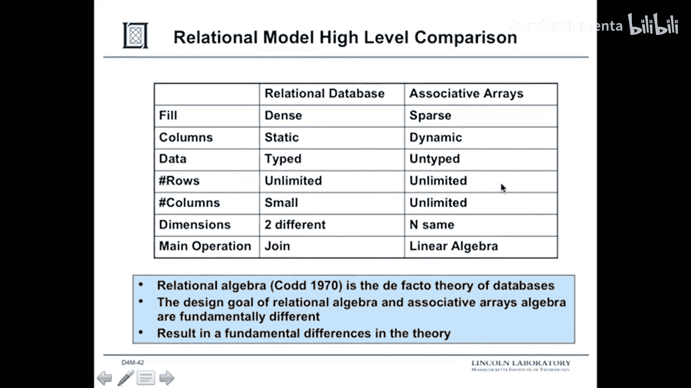

# 【麻省理工】大数据与机器学习数学-｜-MIT-RES.LL-005-D4M-Signal-Processing-on-Databases,-Fall-2012-p08-08-2.-群论--BV1eEtTzhE4F_p8-

The following content is provided under a Cative Commons license。

 Your support will help Mi T OpenCourseware continue to offer high quality educational resources for free to make a donation or to view additional materials from hundreds of Mit courses。

 Visit Mitopcourseseware at Ocw。 Mt Eduu。

All right， I wanna thank you all for coming to the。

Third lecture of the Sign processing on databases class。

we will go just to remind folks all the material is available in the distribution of the software。

 which。You all have in your Lgrid accounts。Here。We're going to go to lecture 2。Coures。

 course which brings together。Signal processing， which is based on detection theory。

 which is based on linear algebra with databases which are based on。

Stings and searching and sort of really bring those two concepts together in this course so that we can use the mathematics that we know from detection theory and apply it into new domains。

嗯。I'm glad to see we have a full house again， so so far I've failed and scar。

Off people so let's see if we can do a better job I think this course will do a much this particular lecture should do a very good job of that。

嗯。We're going to be getting into a little bit some more of the mathematics。That underpins。

The Assoocative array construct that is in the deform technology that we're using in the class。And。

Gets into some group theory concepts that may might be a long time since any of you had any of that or even recall what that is it's actually not that complicated personally this is my favorite lecture in terms of it really gets into sort of the deeper underlying elements。

I would fully expect it to make your head hurt a little bit。

 We're going to do sort of a fairly rapid。Blast through the mathematics here and you won't really have to know this really to effectively。

Use it， although it's good to know that it exists。And and that there might be pieces of it that you'll want to drive into deeper and so you know really the title of this talk is called Spreadsheets Big Tables and the Algebra of Associative Ars。

 we've lectured on that topic in the past and so with that we will get right into it。

So here's the outline for the lecture and I should say。

 you know there's a balance between the lecture and then we'll have some examples。

 this particular lecture will be a little bit more heavy on the lecture side and the example piece is a little bit shorter and so a little bit more lecture。

 a little less example on this particular。Clas so we're going to talk about kind of a mathematical concept for what are spreadsheets and in the introduction here。

 talk about what our theoretical goals are and then really what associated rates are getting into the mathematical definitions。

 what is the group theory and then sort of leading into the sort of traditional linear algebra vector spaces and other types of things just sort of getting you a sense of So this really is what connects。

Those two things at the deeper mathematical level。So what are spreadheets and big tables，So啊。

Spreadsheets。Particularly， obviously Microsoft Excel tends to dominate the spreadsheet world。

Are arguably the most commonly used analytic structure on earth。Probably 100 million people。

 if not a larger number， use a spreadsheet。Every single day， you know？

Perhaps a good fraction of the planet now has used a spreadsheet at some point， the other。Big tables。

 which are these large triple store databases that we have discussed in prior lectures。

Are really what is used to store most of the analyzed data on Earth， so Google。Amazon。

 they all have these giant triple store databases， which can be looked at， thought about as gigantic。

Dantic spreadsheets， really rows and columns and values and stuff。

And the power is that they really can simultaneously store diverse data。You know。

 you can hold in the same data structure of strings and dates and integers and reels and all different types of data。

And you can treat them very differently。 You can treat them as we've shown here。

 This is just one spreadsheet。 We can treat it as a matrix， We can treat it as you know， functions。

 hash tables， you know， little mini databases all in the same spreadsheet。

 we can kind of hold this information。 So it's a very powerful。Concept， the spreadsheet。

Yet we lack any formal mathematical basis for this。In fact。

 I looked up in the American Mathematical Association and the Siam databases the word spreadsheet。

Okay， and it did not appear in a single title or an abstract other than say， you know。

 maybe with reference to some softwareer， but the this， this core thing that we use。Every day。

 every single time we do a Google search， we're using it， every single time we do a spreadsheet。

 we're using it has no formal mathematical structure。

And so that seems like a little bit of a problem。maybe we should have some formal mathematical structure。

 and so this mathematical thing called an associative array actually gives us a mathematical structure that really encompasses this in a fairly nice way。

 I'm sure there's cases that it doesn't， but the core of what it is really， really works。

 So I think that's a powerful concept。So what is our overall goal here。

 so we want to create a formal basis for working with these types of data structures in a more mathematically rigorous way。

This allows us to create better algorithms because we can now apply the traditional tools of linear algebra and detection theory to these types of data。

It saves time in terms of generally if you have the mathematical background。

 you can implement things using a lot less code， which usually means a lot less lines and often you can build on top of existing optimized libraries which give you better performance and we throw out a number of 50 x less effort for those with the required training they can do this and that is something that we've observed。

A number of occasions。And。You know， it's， it's good for managers too。

 I've tried to have recruit group leaders at Lincoln Laborator。 It's like you really should。Use D4M。

 I could connect it to SAP， no problem， you'll really。

 you know and get them feeling like they're actually doing programming again， you know。

Haven't had too many takers of that yet so hopefully we can you know maybe as you folks start using it。

 they'll see using it binding to the various enterprise databases at the laboratory is very easy to do and using D4M to analyze it's fairly easy to do so so you know I actually use it now instead of like if I'm going to use Excel I'll often just be like no I'll just write a CSV file and just use D4M for manipulating basic Excel types of operations just because it feels a lot more natural to me and so you I certainly have done that。

So we're going to get into this associative array concept。

 which we discussed in some of the earlier lectures， we're going to get into more deeply now but but。

Theum。The real。Benefit of the Associative array concept is that naturally pulls together four different ways of thinking about your data into one。

Structure， and you can apply the reasoning from any of these four ways of thinking sort of interchangeably now。

So we can think about data。As as associative arrays， that is arrays that are indexed by words。

 this is similar to what Pel does and hashes of hashes。

 where we can have row keys that are words and column keys that are words and then values that are words or numbers。

This concept is one to one with our triple store databases so we can go naturally from triples to this and inserting data into a database and get。

 you know you know if our data is an Associative array， we can very quickly say。

 please insert it into a database and if we do a query。

 it can return an associative array to us very nicely。This obviously connects to graphs。

 so if we want to store relationships and graphs between vertices and any entities。

 so we have Alice Bob cited。Which is dual to the linear algebraic matrix formulation of graphs。

 you know， Aliceice and row Alices column column Bob， you know， their edge associated between them。

 So we have these four very powerful ways of looking at our data。

 and they're now all sort of brought together as one concept。

So I kind of argue it's sort of one of the best deals in math you'll get， you know， if you know one。

 you get the other three for free right and that's really what the whole point of math is right is if you give me a whole bunch of information。

 I can calculate something else that you didn't know and typically in signal processing。

 that deal is more like well， if you give me 50 pieces of information， I can give you the 501 here。

 if you give me one， you know， I can give you three， so it's a really good bargain。嗯。

As a little anecdote， I was working with my daughter。

 teaching her the parallel geometry lines problem， you know， parallel lines。

I was telling this is the best deal in math right because you know one angle and you get the other seven free so we're not quite as good as that that's probably the best deal in math going and that's why they teach it so much as if you know one angle you get the other seven for free here we you know one of these concepts you essentially get the other other for free so it's a very powerful concept and and it's really kind of at the core of the benefit of this technology。

As much as possible， we try and make it that any operation on an associative array returns another associative array。

So this gives you sort of the mathematical concept of closure。

 Linear algebra works because the vast majority of operations on a。

 on a matrix return another matrix。 And so you can compose these together mathematically and create sequences of operation。

 which are conceptually easy to think about， so。Because of that。

 we can create operations like adding Associative arrays， subtracting Associative arrays。

 anding them， oing them， multiplying them together。

 and the result of every one of these operations will be another associative array。

And so that's a very powerful， powerful concept。And likewise， we can do very easy query operations。

 We if we want to get row， Alice and Bob， Ro， Alice， Rose is beginning with Al， Rose， Alice2 Bob。

 the first two rows， everything equal to 47 and every single one of these will return another sociative array。

 So so again， this compositional concept is very， very important It's not to say we don't use the triples formulation too。

 and we have routines that very quickly bounce you back and forth between them because there are times is like no。

 I want to view this as a set of triples， and I want to do operations that way as well。

 So we support them both but but this this is really sort of the core composable aspect。 In fact。

 most people initially develop。Their codes in this formalism and then maybe change some of their lines to working on native triples if they need to get some improvement in performance。

 memory handling or the like that so and we certainly do that too。

These associative arrays are actually very easy to implement in the whole deformum library。

It's probably a little larger now， but when I wrote this， it was about 2000 lines。

Which is very easy to do in programming environments that have first class support for two dimensional arrays。

Operator overloading or overloading operators like crazy here， the plus the minus the an parentheses。

 all that kind of stuff。And also have first class support for Sprse linear algebra internal under the covers we're using Sprse linear algebra like crazy to make all this work。

Of the languages on Earth that have those features， MATLAb is by far the most popular one。

 which is why we have chosen that language to implement these features。

There are other languages that have these features and you can implement that。

 but there are other languages that。The don't and if you want to implement deform of those languages you certainly can。

 you just have to write more code， so this is sort of the language in which it can be done in the minimum amount of code。

And again， we find that you know， for complex analytics that people typically can get their work done with。

50 times less code than the ocoant Java and SQL。And this naturally leads to high performance parallel implementations。

 because these are all arrays and matrices。 And we have a very well established literature in the community about how to do parallel linear algebra。

 how to do。Make matrices work in parallel。 It's a very well studied discipline。

 and we have a lot of technology。Just to remind people of how we actually store the data in our databases and how the data will often come out in our associative arrays。

 we use this exploded schema。 So if we had data that looked like a standard table here with some kind of key and。

You know， three columns here with。Different values associated with every one of them。

 if we were to insert these into a standard， say SqL type table， we would just simply create a。

A table like this in SQL。But if we wanted to look up anything quickly。

 we would have to create ancillary tables that would store indices to allow us to do things very quickly。

 and if we wanted to add a totally new type of data， we would have to rethink our schema。Um。

 so what we typically do is we create this exploded schema because our triple stores are very comfortable storing。

You know， dynamically storing very large numbers of columns。

 So we essentially typically take the the type and append the value。

So we create a series of triples here usually with some minimal information for the actual stored value。

 something we would never want to look up again， by itself。

 this doesn't give you much because most of these triple stores have an orientation。

 typically row oriented so you can get any row quickly with relatively little effort。And。

And so but what if we also store the transpose of that。

 we now create a table pair such that we can look up any row or column。Very quickly。

 and so essentially we've indexed all the data and you can now do things very， very quickly。

 so that's a very powerful powerful concept and we exploit it all the time。 And of course。

 this whole concept looks very much like an associative array mathematically we can treat it as an associative array。

All right， so that's sort of the easy part。I think we've covered a lot of this before in the previous lectures。

 Now， we're going to get into some of the more mathematical elements， which aren't necessarily hard。

 You know， they just impose notation that。That that that we don't use in our regular day to day work lives So we're going to talk about whether are the values of associations。

 keys， functions and getting to things like matrix multiply。Alrighty， so。Mathematically， we treat。

An associative array as sets of keys and values。That are drawn from infinite strict totally ordered set。

 we'll call it S。AndYou might like， what is that， What is an infinite strict tooder set is just a set where there's an ordering。

Where basically any two elements of the set， there's a function that will tell you。

 you know one is greater than the other， and they also have an equal operation too。

 so it will tell you that you know if I give it any two values I can ask the question is one greater than the other or the equal。

 so that's the strict。So， so that encompasses a lot。

Obviously it encompasses the usual things like real numbers and integer and things like that。

 but it also encompasses strings if we impose an ordering on them。

And we will choose lexographic ordering almost always to be our order。In fact， in the implementation。

 we sort of impose that we always use lexographic ordering we don't really have another。

Ordering that is readily at， at， at our disposal。So given those keys and values。An associative Ray。

I is a partial function。From a set。A D dimensional set of keys。To a value。

 So we have the vector of keys。 So typically D will be 2。

And you know this the first K1 will be the row key and then a column key。

 and it will map on a partial function。From the D keys to one value。So it will look like this。

An associative array with a vector of keys， typically two， I will have a value。V I。

And that it is empty otherwise。So this is its function because we only define it where these keys exist。

So you can imagine that every single associative array is is a function over the entire space of all possible keys。

 but we're only giving you the ones that are defined and everywhere else it's undefined。 Okay。

 this is actually a fairly large break from linear algebra where we can have。

Functions that are really a matrix is really a function of the indices， the Ij indices。

 which are integers here。 we allow them to be anything。

 and we formally support the concept of a completely empty row or column。

 So associative arrays don't allow that。 They only give you the information。

 They only store non empty information。And in our implementation， we tend to store zero as。

Equient to null in this space， because the underlying sparse matrix implementation does that zero is essentially en treated as the null character。

So that's a big difference is that now we can still use our linear algebraic intuition。

 but that's the fundamental difference here。So binary operations on any two associative arrays。

 so I have Associative array A1 and A2 with this binary operation。Okay。A。

Defined essentially by two functions。The sort of upper function here。

 which says how we're going to treat the keys。So if we have two associative arrays， there are keys。

 some of them can overlap， some of them can not overlap。

 and our function will either choose to look for the union or the intersection of those。So。

 for instance， if we do addition， that's most associated with unioning。The two， the underlying keys。

 if we do other operations like and。That's most consistent with。Interssecting the two sets of keys。

So obviously if it's union like the result will always be non empty。

 if the function is intersection like， then there's a possibility you can do a binary operation and the result will be an empty associative array。

So we have that sort of。Choice there。Okay， and we we choose union and intersection because they're the ones that are。

 we could do other functions， but they're the ones that are formally covered in set theory and keep us from having to relax this very general。

Condition here， we have， we can have equality so we can check for for intersection。 And so。

 so we're okay there。In the instance。Of where you so we have。An Associative array， okay？

A1 with a set of keys here K I and a value V1 and another associative array with an intersecting。

K I with V2， then a 3 K I will be。Given by this function。Okay。

It's either going to be V you know the keys overlap so if KI are the same。

 they'll overlap and so there you go and likewise with this。

 you have this choice if it could either be a union in our intersection。

And then what we do with the values is like we now have a collision is what we'll call these two keys from two associate survey。

 the row keys and column keys arere the same， well now we want to do something。

We this we apply this function F， which we call the collision function。

And that will determine what the actual result is， what the new value in A3 will be。If。

One of these was an intersect， was empty。Then obviously， the union of this。

We don't even have to worry about it。 right， That's part of the kind of the way we approach this。 if。

 if。If yourre。There is no collision， so that means you're applying your function with this。

 then F is never called。So we always just do that or that， so if it's a union function。

 then you just get V， if it's an intersection function。

 then you would just get the empty set and the underlying function never is called。

And you might like， well， why would I care about that， Well， later on。

 I'm going to get to do with deal with things like。What is the zero？

In this math or what is one in this math， and this will allow me to sort of address some of those cases by saying。

 look we can kind of if there's no no key intersection， we can do that。

So the high level usage of associatedso age is essentially dictated by this mathematics。And again。

 part of the reason we chose this very general definition is that。By definition， numbers。

 realels and integers are all included here。 we have not done， we've not thrown them out。

 and we've also included strings。 I should say， at any time， we can say， look。

 our values are just real numbers。And then we essentially get the full power of linear algebra。

 But that's true of this sort of card that we always try and play last。Okay。

 we try and keep our mathematics as broad as we can， and if then there's particular instances like。

 oh， well。I need the values to be real numbers or complex numbers or integers or whatever。

 we can always say all right， the values are that and now we get a whole bunch of additional properties。

 but we sort of try and build up the mathematics in this general way first and then sort of play that later。

QuestionYes。The way要。The general definition。第3。General the。And be。啊。

So I believe that actually spreadsheets store things as R1， R2。

 R3 internally and C1 that they actually use an internal triple representation and then project that into this integer space you know what the actual spreadsheet does。

 I think it kind of depends on the specific spreadsheet so just so the question was。

They can't really hear you on this mic was is is this more than you need to do a spreadsheet。

 Could you just not have just get away with just integer indexing。 and I would say， perhaps。

I don't really know and as I said， I think internally。

 they actually do something that's more akin to this than certainly when you do math in Microsoft Excel。

It has letters there， you give it， you， A1， B1， those types of things。Letters。Yeah， yeah。

 one could view it that way， but people like it， so we do what people like， right an。第月。蛋糕。Yeah。

 after。row and。Also sort so there's three。all those。So I'm sure they do some hasing。感のじ。

ItCertain you try that that way。a be spreadhe。Or receiving。far away。基本はま。No， it doesn't do that。

 It obviously， it does compress。 Yes， yeah， so， so mathematically。

 it may be more than what is minimally required to do spreadsheet。 We will discover， though。

 it is very useful。 and in a certain sense， allows you to do things with spreadsheets that are hard to do。

In the existing technologies， which is why I use it。

 there's operations that I can do with this that are very natural and the spreadsheet data is there and I would like to be able to do it。

JeremyYes。binary operator twice。そし。你先。So on the keys， it will be。Union， all right。

Where the value is an intersection with an empty set。

 we don't care what the actual numerical thing is we'll just return the other thing。

Where there is a collision。 And so now you have to resolve。 And that's kind of why we get。

A lot of mileage here because most of the time we have very few collisions。

 And so the it's not like we have to worry about huge things。 So in where there are collisions。

 if the values are numbers。Then we'll just do the normal edition。If the values are strings， okay。

 then it's somewhat undefined what we mean there。 Okay， and I forget a D4M。Throws an error。

In that situation， if the values were strings， it might default to just doing something like taking the max or the men and saying。

You tried to add two things for which the formal edition。

 you know collision function doesn't really make sense and I'm just going to put something in there。

 we can test that out， you know， at the end of the class。诶睇。Yes。

 it has to be a function the type of the value， because if I'm going to add a real number with a string。

 what do I do。You know， because I can do that， yes another question。Previous one。

 it seems like in the case for an addition。There might be cases where you'd actually want union that add。

Intersection the。It dependss on what the nus。Oh， there are so many functions where you can think。

 well， I kind of like to have it mean this in this context pass？I want you to union then operate。

 I want you to intersect， then operate， or do they all just assume some the most logical and do。

So the question was。The bigger level question was， sometimes。

You maybe would like plus to mean some of the other conceptual ways that we would mean it。 Okay， so。

 in fact， we see that a lot。 There's a lot of things， okay， now。In fact。

 we'll get into that space and there's hundreds， thousands。

 millions of potential possible algebras that you could possibly want。

So what we have done is we think about the function。

 and we think about it in this mathematical context。

 and we see what its mathematical implications are in terms of。

 is it consistent with the overall group theory of the mathematics。

 in which case we know that if someone uses it， that the intuition will carry through。

 or is it kind of forking them off into some， It's something you might want to do。

 but it really the result is now taking you into a sort of an undefined space。

 So that's kind of a thing we we we use for for doing that。

 We don't have the formal support in this of a。Multiply operation that allows you to pass in you know。

 an arbitrary。Function for doing that。 I should say there are various tricks that allow you to do that in just a couple lines or two。

 you know you basically what you can do is if you you start with like give me the intersection of the unions first now I know I have only collisions now give me the values apply whatever operator you want stuff the values back in and you're done。

 And so you can kind of work your way through that。

 And by doing that you' work you're sort of kind of。

We you're doing it in ways such that you know yeah you're outside of an algebra here you're just kind of doing what you're doing it so encourage people to do that。

 but i'm just telling you in terms of how we choose what functions we pull and formally support there's and there's a few that I've been wrestling with for a long time you know for a very long time。

😡，And and just， you know， haven't been able to decide what to do。

 maybe I should just pick a decision yeah。like a real simple example if that array 123。

 array B was noO3， there would be only one collision。No， if it was an addition， it was。So one， two。

 three， and then the other one was null， null。So whether so you mean。

 but they have the same column or something like these are vectors， these are row vectors。

 So so basically we have a one column vector。With three， another column with one。

 And when we add them together。You would get a three。Because it would be union。

 it would union the keys， and then the only addition operation would be performed on the collision。

If we did or an and operation， then the result would just be。

One an associated rate with one element in it。So。And lots。It depends on the operation。

 so plus formally is closer to set addition and so therefore is a union operation and is formally closer to set intersection。

 and so it's an intersection operation there， regardless in both cases。

 the collision function is only applied where there is a collision。Yes。Operation。说去的。Well， so union。

 so the keys are a part of a set， and so they get the union and intersection properties of strict totally or which is the intuitive use of union。

嗯哼。😊，If you' only define binary。So sure。是。So they get， we'll get into that a little bit later。

 but they essentially have the binary operations of a strictto ordered set。

 which is equality and less than。Yes， yes， well there's a few more， there's another 40 some slides。

But actually， you've gotten a lot of the good question here。 So， so the thing， though。

 to recognize is that there's a lot of choices here and the algebra you are in is determined by the function that you choose and that we actually you'll find yourself switching between different algebras fairly frequently。

 That's how we use spreadsheet。 Sometimes we do this operation。

 And now we're in this algebra and we do this operation。 And now we're in this algebra。

 So that's the big thing to kind of。Get away there。 So let's get into this a little bit more detail。

 That's sort of the big overall。So I think we've talked about this that let acid is an influence strict totally or set。

Total order。Is an implementation， not a theoretical requirement。 So。

 so the fact that we were imposing this infinite strict。That that they're totally ordered。

 that we don't just allow equality is more of an implementation detail。

 It is very useful for me to internally store things in order so I can look things up quickly。

 However， mathematically， strictly， if we just had a test of equality。

 we probably the all the math hangs together there。All values and keys are drawn from the set。

 and the liable operations on them of you know， two values or keys is know less than equal to or greater than。

 So those are the three functions that we essentially allow。St Toot said only is two。

 but which is less than and less than or equal to， but you get essentially the third one for free。

In addition， we have the concept of three special symbols here， which we've talked about。

 which is the null， the empty set。A least element in the sets and a maximal element of the set。

 so v less than or equal to plus infinity is always true and plus infinity as we're saying it is an element of the the maximal element is a part of this set。

Greatd than equal to affinity is negative infffinity is always true。

 and the empty set is the like an all set theory， the empty set is a formal member of of。All sets。So。

Now we'll talk about， did that sort of get to your question about about the operations that are defined on the keys？

生于。Right。Right， so then we talked about the collision functions and there serves two sort of contextual functions here。

 Union intersection because those' the two operations that make sense and then three conditions less than equal to or greater than that is in order to preserve。

This strict toorder set， once I go to values that are realels or integers， I have more operations。

 but if I'm just limiting myself to values that are members of a trick stricttooder set。

 this is all I have。So that means that you have sort of d plus5 possible outcomes to any collision function。

That is you could have the collision function actually choose。

To put out the value of its underlying key。It could produce V1 or V2 or empty or minus infinity or plus or sets of these。

So that's a fairly finite choice of results。If we're going to stay in this sort of restricted thing。

 we have a very limited number of things that can actually happen when you're actually applying a collision function on a particular。

You know， where there's an intersection， you have a fairly finite number of things。However。

 the total number of combinations of these functions。Gives a very large number， you know。

 and their function pairs gives a very large number of possible algebras。

I did a back of o calculation since it was 10 to the 30th， it might be even more to that and in fact。

 it might be formally infinite for all I know so but that was an easy calculation。

 there's a lot of possible algebras。嗯。And this is a fairly impressive level of functionality。

 given our relatively small numbers of assumptions that we have here。

But we are going to focus here on just the nice collision functions。

 the ones that seem to feel like they give us intuitively useful things。So。

We are not going use keys as outputs to our function here。Okay， we will in some contexts。

 but in for this is it is the so the results and we're going to say the results are always single valued。

 we're not going to deal with with results， expand our values to be sets of values。

 but although in certain contexts we will do that but mathematically let's restrict ourselves for that。

We're going to know tests on special symbols and we're just going to basically say our collision function can be essentially。

 you know if we have V less than v2 the answers can be one of these five， it's equal to these。

 it can be one of these four， if it's greater than these it can be one of these five。

 so that gives a fairly limited number of possible collision functions。

And all these properties are consistent with strict totally ordered set。And generally。

 when we handle a value of this， it's handled by the union intersection function first。

 it never actually gets passed through to this。To this function。All right， so let's。Move on here。

And just as I said， well， what about concatednation， In fact。

 there are contexts where we will want the results to be。

We want to concatenate a couple of strings together or something like that。And you know。

 that's fairly supported， I think， you know， the results can be the sets themselves。

You would have a new special symbol， which is the set itself。

You have now different collision functions so you have union and then that one of union values or intersect and then union values and union and intersection so those are your functions there and there's actually a few instances I think we've already showed one of them and one of the examples where we actually do this so I just sort of throwing that in there that concatenation is a concept that we do think about I don't think we've developed the formalism as richly in a situation where the values are simply single single values but it's certainly we certainly can and do do that。

Yes。然后先。This one here？可以再强一。There oneYeah， I could have I might have a typo here。

 I should double check that so。Yeah， so the union that。All right。

 so that should be intersection and that should be union。

And that should be intersection and that should be union， so I just got them flip flop there。

 so thank you full marks to you。Itll make that change。All right， so that one is intersection。

 correct？And。This。Yes。3。Should be intersection。嗯。Very good。

 We'll check into the SVN in the next downtime it will be part of your display。永 on。All right。

 so one of the things we're eventually going to work towards is trying to make matrix multiply work in this context。

Okay， we've already talked about the duality between the fundamental operation of graph。

 which is breadth for search and vector matrixtri multiply。

 we continue to want to be able to use that， it's a very powerful feature。

And what we find is that in graph algorithms where we're dealing with things on strings or other types of operations。

 that most graph algorithms can be reduced to operations， what are called on semi ring。

 So those are generalizations of normal linear algebra， whereby your two core operations here。

 what is called the elementwise multiply in the element addition operation are this has the property of being associative and distribute over the plus operation and plus has the property of being associative and commutative And examples of this include the traditional matrix multiply plus。

And multiply Min dot plus。Or max do plus in fact， there's a whole sub branchch of algebra called max plus algebras。

 which which do this， another one is or dot and and other types of things。

 so mathematically you know semi rings are certainly well studied。More in the context of。

Specific algebras like min dot plus min plus or max plus or something like that。

 Here's kind of with the associatedsoative arrays we're dealing with while， you know。

 you could be hopping and popping back and forth between， you know， within the same expression。

 you could be moving back and forth between these different algebras。

 So I think that's a little bit different。 We're taking sort of a bigger。

View a more data centric viewer data can be of different kinds and then impose upon it different algebras as we move forward。

And the real theory questions that we're trying to answer here is we have this concept of associative arrays。

 which is。Kind of new， we have the traditional of linear algebra， and there's going to be areas。

Where they overlap， or the ideas， your intuition from linear algebra and your intuition from associative arrays will be very。

 very well connected。 Okay， and there's going to be places where associative arrays。

Give you new properties that you didn't have in linear algebra。

 and those will allow you to do new things。And there's going to be cases where your linear algebra intuition is wrong。

That is taking your linear algebra intuition and then applying it to associative arrays。

Will will lead you into things that won't make sense and so this is kind of what we're trying to sort of give people a sense here of where you know where they overlap。

 where you should watch out and where there's new properties that you didn't know about that you should maybe take advantage of。

The， the biggest one being the universal conformance of。

Addition and multiplication of all Associative arrays。 So any two associateci arrays。

 regardless of their size。Can be multiplied and added to each other。

Unlike traditional linear algebra， where we have very strict constraints about the dimensions of matrices in order for them to be added。

 and we do use this all the time。We use this all the time。

 essentially almost exactly in the example that we talked it was a question that was brought up earlier。

 we can add a vector of three elements and a vector of five elements and and have something that makes sense。

 Okay， Likewise， we can multiply a 10 by 12 with a 6 by 14 and have something that actually makes sense。

 So that's a very powerful concept。 And I'd say it's used one of the most commonly used features。

All right， so we've done the basic definition now we're going to sort of kind of probably move a little bit quicker here into the group theory。

 So the group theory is when you pick various functions。

 what kind of algebras result of that so we're going to talk about binary operators and then get into commutative monooids semi rings and then something we call the Fd so。

Our joke there is that so a field is what when you do the traditional mathematics of linear algebra。

 you're doing them over the real field or the complex field of numbers。

 it's a set of numbers with certain defined properties， okay。

When we impose this condition that we are doing with strict tooroid sets。

 we don't have an additive inverse。 There's no way to formally subtract two words from each other。

 We can't have a string and a negative string， so we don't get like a and minus a。

 which is part of a field。So we have a F which is a field without an inverse so mathematicmaticians are very funny and when they do this。

 they often will drop the eye or something like that， you know to make that concept。

 So we will be doing math over a we can have much of the properties of linear algebra we just have to recognize that we don't have additive inverse。

 So it's sort of like vector spaces over Fs。Or sometimes they're called semi vector spaces。

 you can put semi in front of anything and it's like it's a little bit of this。

 but minus something so。So this is kind of our operator roadmap。

 so you see here we began with three definitions。We've narrow we will have narrowed it down to 200 operators of interest of those。

Kind of nice collision functions and union functions， there's about 200 combinations that work well。

We will find that 18 of those operators are associative。

 so not associative in terms of associative array， but associative in terms of the normal formal mathematical concept of associivity。

We will find it and so those form what are called semigroup， 14 of them are commutative。

 which means they are a billion semigroup。Comutity is not really something that is like。

knowThat just means that you can switch the order of operations。

 you know A plus B is the same as B plus a。Not something that you kind of is a strict requirement。

 but gosh， it's sort nice to have to not have to be like oh no， I switch the order。

 And now the answer is different。 So traditional matrix multiply is like that， right。

 It's like if you switch， you know， A times B is not the same thing as B times a。

 And so and we will have that at 12。 But commut is really nice。

 We then take these 14 operations and explore all their possible pairs at 196 of them。

 We look at which one of them distribute， There's 74 that distribute。 So they form semi rings。

 We then look to see if we have an an identity and an annihilator。

 do we have some special store some of our special symbols。

 can they perform that role in which case they can form。A failed。

 and then we can create essentially vector semi spaces or vector spaces over these Fs and we'll have about 18 of them when we're all done。

 And the good thing is when you get all done with this。

 all the ones that you like are still in the game， you know and。Fewer than ones you might like。

Some of my favorites， you know， they don't get as far down this this path as you want。

 but then you have these properties and you're like， okay。

 I have vector space properties and other types of things。

And I'm sure some of you will find issues or comments or criticisms。

 we haven't written this up formally in journals， I've been desperately trying to hire abstract algebraists at summer students and have not been successful so far。

 so if you know any abstract algebraosis that would like to work on this。

 we would be happy to pay them to help us work on this。

If we extend our definition of values to include sets I。e。 to include concatenation。

 this is essentially what it does。 You know adds for functions here。

 they actually make it through all these operations here， and they basically keep on going。

 but then they fall away here when we try and get to this final filled step。 So， but you know。

 this is still a very useful space to be in。All right。

 so let me explain a little bit of how we sort of navigate this space。

So if we limit ourselves to special。Sort of function combinations that are associative and communicative。

 So just remember， associative just means you can group your parentheses however you want。

I always have to look it up。Never once been like， associate， I mean， I just。

 I don't know thiss never been intuitive to me， but that's the grouping of parentheses。

Comutivity just means that you can flip。So these are our functions。 So these are all the 18 here。

 and then the grade ones grade out of the ones you lose because of the commutivity。

 So basically this function， which is just left， which just says return the left value， you know。

 in all circumstances well， obviously that's not commutative and the right value。 and quite frankly。

 left and right are sort of silly functions， right， you should just。Kind of。You know。

 sometimes almost essentially a no op if you knew you wanted the left value just。

Take the left value and move on so that doesn't really so then we're left with a lot of the ones that were like essentially union max。

 so basically take the max value union min， I call this the intersection delta function just return。

 it only gives you an answer if the values are the same this is essentially the union this is sort of like the Xor function。

 if there's a collision。Blowat away and then there's various sort of other kind of more unusual combinations here dealing with the the special functions we tend to kind of really live mostly here。

These tends to be the ones that really are the ones you use a lot。

 haven't really used these too much。All right， and so we're left with these abilian。

 what are called abilian semigroup or these 14 highlighted one here。我就是。

So a billion is a semigroup that is commutative， that's all it means。

So basically it means you have associivity and then it's a billion if you add commutivity to it。

So any sets of numbers that obey grouping operations and our commutative is a billion。I mean。

 I think Ab Bell did a lot more that he didn't need to get his name associated with that， you know。

 it could have just been called a sometimes just called a commutative semigroup。You know， so。

 you know it's lucky when you get your name added to some really trivial operation。

 I mean he did a lot of things so but they threw him on here and in fact， in group theory。

 they complain about this and there are numerous rants about how they've named all their groups after people and they don't tell you anything。

 you know， as opposed to other branches of of mathematics would simply just call this a commutative semigroup so。

Or just a commutative associative group。 you know， that might be even more， more， more。More。

And of all the different properties， most of them you can combine in whatever you want。

 there's almost a different infinite number of groups， so there's certain ones that are most useful。

Let's see here， so now we start。What's。A group and a semi group。I want to say。Oh。

 it's in an a billion group without inverses， so semi group there。

 so these are all a billion semigroup or a billion groups without inverses or commutative associative groups without inverses。

 you know， so you know， you see the problem， you know？And so I guess he studied them a lot。

 so he got his name associated with them and improved their properties and stuff。So啊。

We have 14 of those that form 196 pairs。 so these will begin to。

So we want to look at the ones that are distributive。

 so that basically means we have our multily we assign one of those operators to be the addition operation。

 the other to be the multiplication operation， and we need to show that it is distributive and of those 19674 operator pairs are distributive。

 these are called semi rings or they could be called ring。

 so a semi ring is a ring without an inverse， so rings without inverses and without identity elements and if you look at the various definitions。

 I mean， there's the Wikipedia definition， which mathematicians will say is that's not really a true definition there's a Wolfrain。

Math role definition， which is more rigorous。嗯。And they often disagree on this stuff。

I tend to be like， you know， if Wikipedia says it's true。

 then most people on the planet earth believe that that is what is true。 And so therefore。

You should be aware that that is the truth that most people will believe so so I don't know which one we've chosen here。

 whether it's the Wikipedia or the wolfram， there's also various encyclopedias that define this stuff too。

Yes。If I would？Ring。啊。Well， a ring would be this and it would have inverses and identity elements。

So it's basically something that satisfies that's distributive。All right。

 and has inverses and identity elements。But if you type ring in in you the Wi， you know。

 the Wiki And I should say it's the great thing about Wikipedia is like all the definitions are linked。

 So you just like by after 7 or 8 clicks， it kind of all holds together。 So it's， it's pretty nice。

 And Wolfram is the same way。 You can kind of， if you want to just just enough knowledge to。😊。

Be dangerous then they really， you know the Internet that's the Internet's your friend right。

 so so moving on here， and this is something that's less important， but you know。

 kind of for completeness if we're going to head towards vector space we need to address。

 which is the concept of identity elements。So the additive identity。

 so zero is the additive identity， if you add it in a normal， when you think of normal math。

 you add zero to something， it doesn't change it。😡，All right。

 and the choices for additive identity elements could be。

 we have three special symbols and we could pick them。We have the multiplicative identity。

 which is one and the multiplicative annihilators。So of the choices here。

 we have 12 semi rings with the appropriate zero， you know， these zeros and ones。

We have four that actually have two combinations。And we have 16 total operations。

Of the 60 six operators， these are different operators。

 and again we call these spells without inverse， I'll get into a little bit more。So for instance。

We are。And we can skip that。So just a better way to look at that is these are our operator pairs。

Okay， and we wanted to see which one of them sort of form these。Theseese， these。

Fd so the ones that distribute are marked with the D here， the ones that distribute and have a 0。

1 operator pair that works are shown in the square here， and some of them have two。

 So if I pair make plus union min and multiply intersection min and I define zero to be the empty value and plus to be I mean one to be plus infinity。

 then I can create。诶 yeah。Ael essentially out of that。

I had a lot of debate with someone about this one。Whether I can have plus infinity B the0 element and have it be less than。

The one element， you know was the requirement that zero actually be less than one was sort of in this definition so。

I think it's kind of like when I talk to math manager' like God， it's kind of what you want。

 you know， then you make it that so so this is show the full space of things that are possible。

If we go back to our concatenation operators here， so these were our four concatenation operators。

And our。Our functions are collision functions。And this shows you what that set looks like。

 so these are the four by four pairs here。All operators。

 you know they all distribute and six of these 16 of these form semi rings because you're able to construct these various euros and this isn't like rigorous you know。

 I mean someone could I probably I might have messed one up or few up here or there or something like that。

 but this just kind of gives you a sense of the space that we're working on。Probably。Probably。

So let's get into now we're going to kind of really move it forward here so we get into vector spaces so we can have Asci array vector edition。

 again， all associatedci razor conformance。We have。The concept of scalar multiplication。

 which is essentially applied to all values。So one of the things I really struggle with。

 so scalar multiplication kind of makes sense， right。

 if I have an associative array and I multiply it by a scalar。

 I can imagine just applying that to the an intersection sense only to the key the keys that are defined by one。

Scalar addition， though。Is very difficult。The scalar addition only apply to if I have a scalar plus an associated rate does only apply to the keys。

 or is a scalar really。The associative array is's defined everywhere over all things so it's infinite so that's something I struggle with so when you ask why is Scalar addition not supported indeed for them it's because like I don't know what it's supposed to mean。

 you know， and and you can easily just pop out the values， add whatever you want。

 stuff them back in and be on your way and then you're safe。U so in the vector space that we form。

 you know， it meets the plus requirements， it commutes， it's associated， we have an identity。

But we have no inverse， so we have to be careful。 that's why we don't have that。 And a vector space。

 it meets the scalar requirements。 So all associatedsoci array operator pairs that yield Fs also result in vector spaces without inverse versus maybe we call these vector semispaces。

 I don't know what or vector spaces over a fell or something like that。

What kind of properties here will have scale identities that's great。

 you can create subspaces that makes sense too the concept of a span。 Yes。

 you can definitely do concepts of spans。 Does span equal a subspace。

 so this is a big question in vector space theory your spans have you know in subspaces is there not sure linear dependence is a you know is there a nontrivial linear combination of vectors equal to the plus identity。

You really can't do this without an additive inverse and so that becomes a little bit so we really kind of need to redefine linear independence。

 which we can do， but there's a lot of the proofs of linear independence and dependence that rely on the existence of inverses and you probably could you know circle your way around that。

Question， are you just missing。Both。Both， yeah。Yep， yeah。

So one of the things is consider a linear combination of two associatedsoci array vectors under what conditions do they create a unique result？

So this really depends on what you choose。 So for instance， if have if we have a vector。

 you know a1 and a2， when we multiply it by coefficients A1 and a2 and we use these as our plus and our multiply and this is our0 and 1。

 you know where are a1 uniquely determined。You know， and so， for instance， if I pick， in this case。

 are canonical identity vectors， which is a1， is equal to infinity and。Minus infinity here。

 then we find that we can you know cover the space very nicely if we do it the other， we can't。

 a better way to view that is in the drawing here。So here's my whole space of coefficients。

 A1 and A2。And we see that a1 and A2 uniquely define a result with these basis vectors and A1 and A2 are completely degenerate with these basis vectors。

 So depending on the kinds of basis vectors you have。

 you can create unique stuff or not unique stuff。You give yourselves actual values here。

 you know basically if a1 is just equal to this value and a2 is equal to this value。

 this shows you what that looks like， there's places where it's unique。

 there's places where they're the same and there's places where one of them is unique but the other is not unique。

 so again there's a very rich possible you can construct you know using associative raise basis vectors a very rich set of things。

And the same thing goes with multi valued vectors， again， different types of spaces here。

 we really need to kind of work this out， anybody's interested。

 we're very interested having people help us work this stuff out。Uh， even going， you know。

 which of these operations make sense？Transpose makes total sense。

 Transposing of associative arrays makes total sense since a very efficient operation， by the way。

 in D4M。You can do transpos very efficiently， it works out very nicely。诶。Special matrices。

 sub matrices， zero matrices， square matrices， diagonal matrices。 Yes。

 although diagonal matrices are a little bit tricky。Upper lower triangular， yes。

 you can kind of do this skuw symmetric no hermeian。

 not really elementary and row columnish sort of row column equivalentvalence sort of under certain conditions。

 so there's cases， these are all things you can do in linear algebra and sometimes you can do them with Asso arrays and sometimes you can't。

You have to think about them。Matrix multiply is sort of our crown jewel， always conform it。

 can multiply any sizes whenever you want。诶。There's two ways to think about this。

 You can make your head hurt a little bit when you start dealing with the null elements。

And like when does the union operator get applied and when does the？So when you do computation。

 there's two ways to formulate a matrix multiply， there's the inner product。Formulation。

 which is typically what people use when they actually program it up。

 because it tends to be more efficient。 That's basically you take each row in each column。

 you do an inner product and then do the results。ok。Mathematically， from a theory perspective。

 you get yourself in less trouble if you think in terms of the outer product formulation。

 which is basically you take each row and vector。😡，You do their outer product to form a matrix。

 and then you take all of these and then combine them all together。

 with with the operation and that theoretically that actually keeps you staying here。

 and that's the way to think about it mathematically。A variety of matrix multiplies examples。

 I won't go into them here， obviously they depend heavily on what our collision function。

 you know G is here gives you different values and different behaviors。The identity element。

Maybe a left identity， right identity。In some senses， it seems to be okay。

 but there's not really the Iineine available is a little bit tricky。Inverses， boys。

 is it hard to construct inverses when you don't have。Underlying inverses， it's just really tricky。

And so probably are not going to get anything looks like an inverse。

You can do eigenvectors in certain restrictive cases sort of。

 And there are actually papers written about this， but it's only on very。

Then the row and column keys need to be the same and stuff。 And so， you know。

One thing I really would like to explore is the pseudo inverse。

 So pseudo inverse8 plus satisfies these properties。

 And I actually think that we are probably be pretty good shape for pseudo inverse。

 And the pseudo inverse is what you need to solve the least squares problem。

 And I think solving the least squares problem is actually something we might really be interested in doing in some of our problems。

 So I do need to work this out if people would like to。Explore this with me。

 We have a whole set of theorems that we'd like to prove spanning theorems， Line appearance。

 identities， inverses， determinants， pseudoinverts， eigenvectors， convolutions。

 All these for which of these， you know， do these apply A lot of good math that could be done here。

 Call to arms for those of people who are interested in this type of thing。And so just to summarize。

 you know the algebra of associatedci Ras provides kind of this mathematical foundation。

 I think I've tried to show you the core parts that are really well solid and expand that to the point so you can see where it is。

 well， we don't really know exactly what should be happened here and give you a little bit of logic you know behind how we do this。

A small number of assumption really yields really a rich mathematical environment。

And so I have a short code example， which is really just。It's not really teaching or anything。 No。

 no， it's just to show you that I。Tested all these properties using D4M。

Wwhich was nice and really in a very kind of a spreadsheet kind of style and so I'm just going to show you that there's really just one example takes a few seconds to run but and then the assignments so these are in in this part in the directory oh。

Thank you。And then the assignment should you show do it is now sort of if you didn't do the last assignment。

 well you're going to need to do that to now do this assignment。

 So basically for those of you who did the last assignment。

 array of a drawing and looking at the edges and stuff like that。

 I want you to think about that associative array and think about which kind of these operations would make sense if you were to try and add them or multiply them or whatever。

Just explode that a little bit and just write up， you know， okay。

 I think these kind of operations would make sense here。

 you know addition would make sense if it's union and the collision function is is this or something like that you know you'll have to think about what your values are could just be your values or just one you know something like that you might be like oh my values are 01 and I want one plus1 to equals zero so you might have an or or an x or operation or something like that so just sort of think about what your example was and think about these ideas a little bit and just write a few sentences on kind of what that means。

The last side here is just we don't really get this question。

 but if you want to compare kind of what the difference between associative arrays are and the algebra defined by COD that sort of is the basis of SQL。

 this is just a little table that sort of describes some of the differences there。

