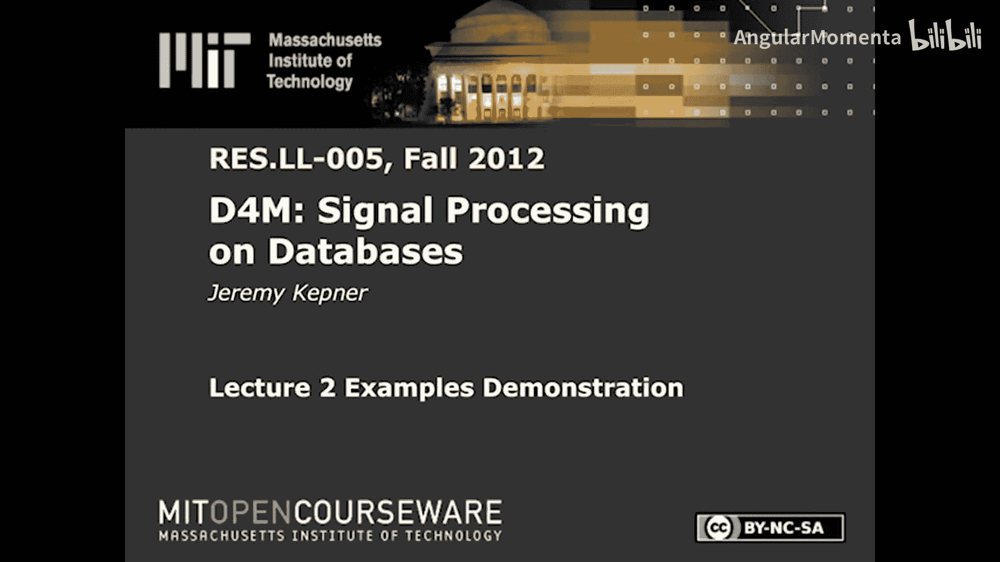
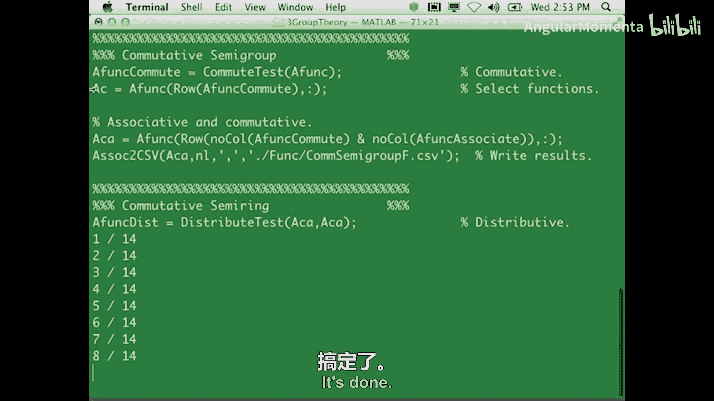
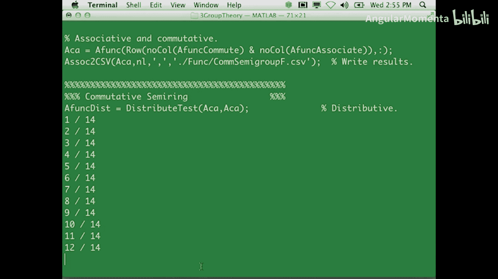
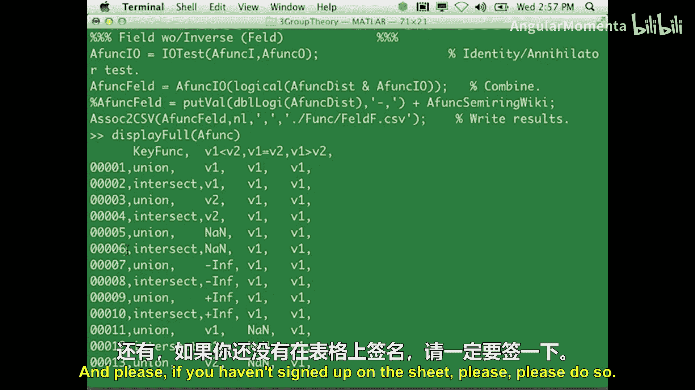
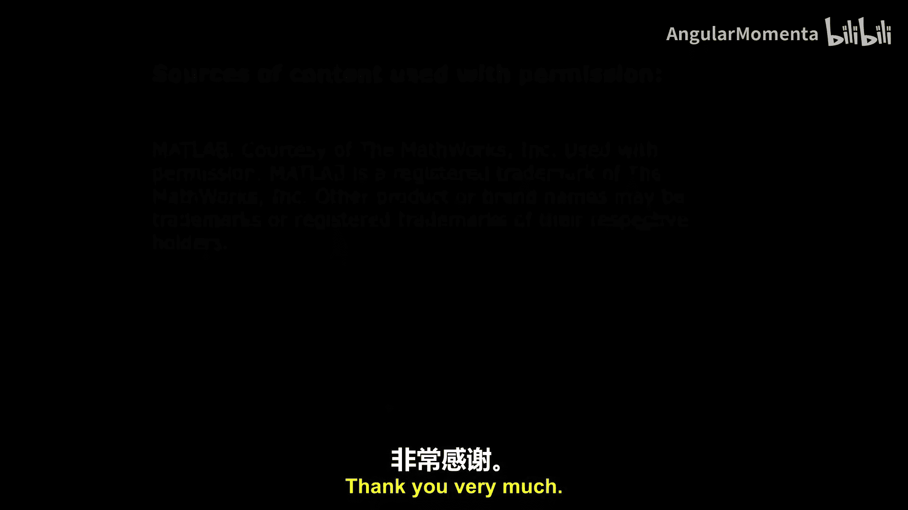

# 【麻省理工】大数据与机器学习数学-｜-MIT-RES.LL-005-D4M-Signal-Processing-on-Databases,-Fall-2012-p09-09-2.-示例演示--BV1eEtTzhE4F_p9-

The following content is provided under a Cative Commons license。

 Your support will help Mi T OpenCourseware continue to offer high quality educational resources for free to make a donation or to view additional materials from hundreds of Mit courses。

 Visit Mitopcourseseware at Ocw。 Mt Eduu。

And so again， we go here back up to the examples。Intro。Group theory。Start it up。All right。

 and then our first sample is group theoryory one。And it just goes through and basically I sort of came up with a way and a spreadsheet to define the functions I was looking at and then start quick combinations of them and then do very simple tests on associivity and distributed and all that stuff if you actually look at the tests I do you might be like you might blanch you be like really you said that you declared that it was fully associative。

 it's not like I went and did formal proofs for every of these things I just sort of did some very quick numerical tests the semi- ring test actually takes a while here as as you can see。

嗯。And this will take a minute here and it。2月呢。Appears to be hanging， Oh， no， it's not go。

And we'll let it go through that。So in fact， while， it does that。乜嘅。Look at。So basically。

 these were inputs。Yeah。嗯。So basically I have kind of my different what I call the sort of the key function。

 I have union and intersection， and then I have the sort of the three possible conditions。

 V1 less than V2 v1 equal to V2 v1 greater than V2， and then essentially the different types of。

Of operators， you know， the results that can occur from those。And so this is。A CSV file。

And we read it in as Associative right， and so you know it looks like a spreadsheet and I can actually have columns named V1 less than V2。

You know， very powerful。 and in fact。I'm even able to pass that column into the MATLb Eval function and have it actually executed。

Which is nice。 So I can use， you know， I can actually have code in my column or row names and then have。

😊，You knowO performed based on that， which is I think a nice thing that you can do when you have。

 you know rows， when you allow strings to be in your set。

 likewise MATLb will formally parse Nan as Nan and plus minus minus inf and so I can get all that functionality out of there。

Os。All right， and then it goes through， let's see here。

And these are just different tests that we do on those。

Here。

Its done。So there。Not a number。 I sort of， yeah， I kind of。

 I like I use that as kind of like it has a lot of the properties of null when you add it to different functions。

 so I kind of。I'm just I'm like yeah I'm using that for that and it works out pretty well so it' it's I tripE failure state modes or whatever it's how it's supposed to be it appears like that。

 you know。I can't remember if there's a plus nan and a negative naan as well。 No， no， it's just naan。

Yeah， yeah。Yeah。And then actually it goes through here， and I think。

See what we doing these are just various little ways of inputting， these are just different values。

 just different little spreadsheets that you can make for exploring these different types of things and you can just write them as little CSV files。

 very useful。Construct here。I do apologize for length the time is taking， I think。

Um having the quick time video recording going at the same time is causing the poor computer to sweat a little bit more than it does normally。

 usually doesn't take this long。是。

The outputs that it comes up with。So these it basically writes all these out。Look at here。

This shows I ask it to basically。You know。Generate all those 200 pairs。

 so it will do for different each key and every whatever it can go and just generate those for me。

 so I just create this little thing and it goes through and just sort of creates this whole function and then writes that out as the CSV itself。

 which is very convenient again， these are things you can do。

I think this is the one where we came up with all the Fs。Yeah， it doesn't really。Fit there。

 But you can see these are the pairs that it found。 and it shows this is the zero operator。

 And again， this is all done with D4M kinds of values that it can store， you know。

 different types of things。 This is how we made all the tables that are in the。Oh。

 it's writing out results， means it's done。

There we go。 And so the main one I just want to show you is that we read in that function。

 funk range， and we permed it。And if you do display full。A funk。

You can see there's the full combination of values as we saw there so there's really nothing here for you it's not I expect you to go using DRM to do group theory things or stuff there's not really the point of these examples I did。

 it's more just showing that you can you know when when you go into this larger space。

Problems that you might not solve linear algebraically all of sudden it's like oh yeah you know if I have strings and other types of things it really opens up the flexibility I thought that was very neat that you could do this and it just handled the data very nicely and without any any real any real difficulties so so with that that's the end of this lecture I don't know if there's any final questions before。

We proceed， all right， very good and please， if you haven't signed up on the sheet。

 please do please do so， thank you very much。

