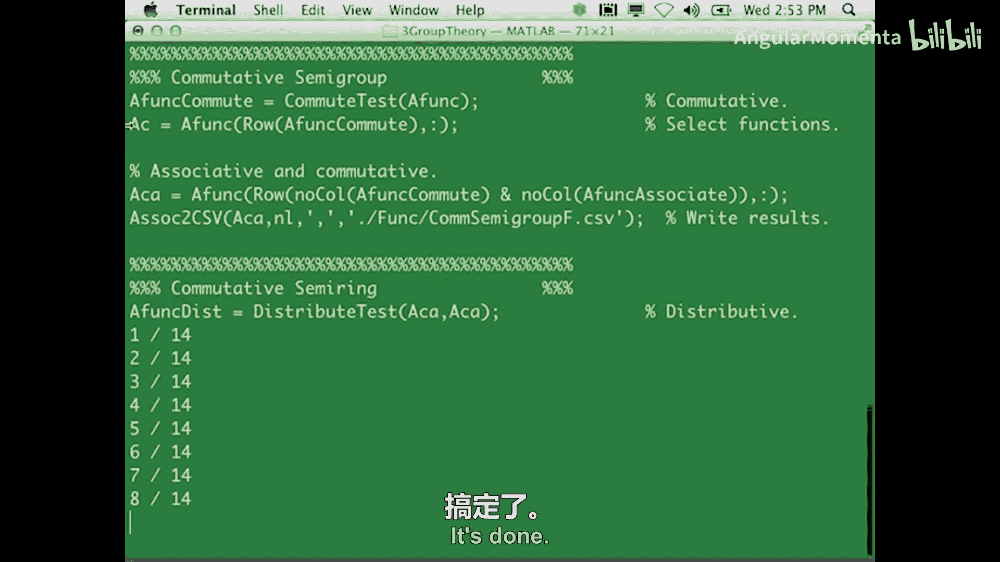
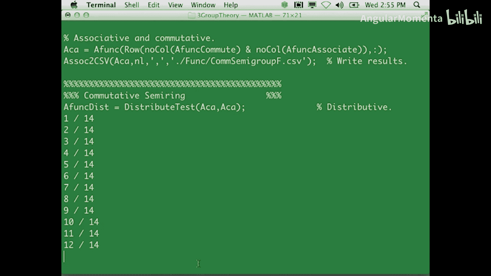
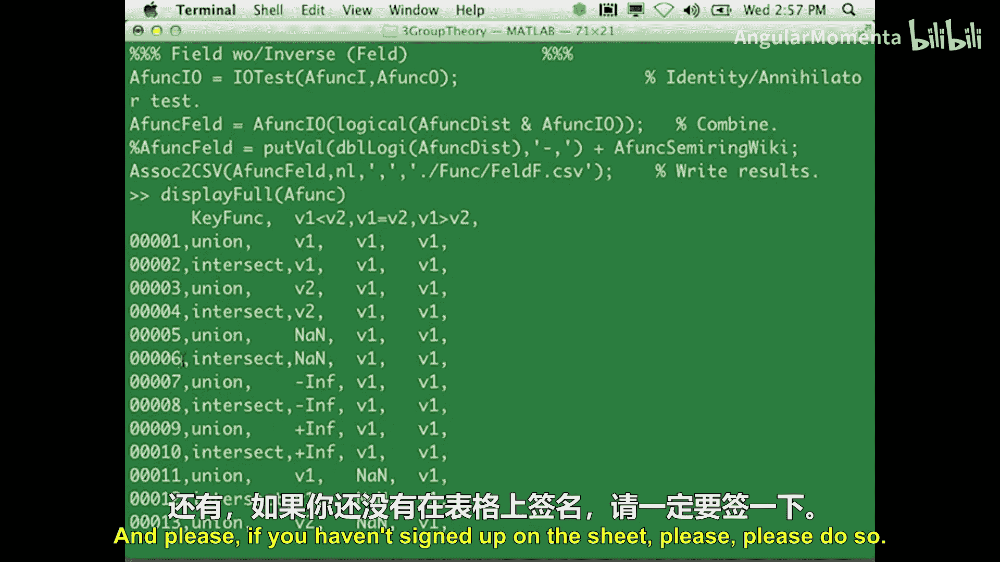

# 麻省理工大数据与机器学习数学：09：示例演示 🧮


在本节课中，我们将通过一个具体的示例，演示如何利用D4M（数据库上的信号处理）工具进行群论相关概念的探索。我们将看到如何通过简单的CSV文件定义函数，并进行组合与测试，从而展示D4M在处理非传统数据类型和复杂代数结构时的灵活性。

上一节我们介绍了D4M的基本概念和其在处理字符串等复杂数据上的优势。本节中我们来看看如何将这些优势应用于一个实际的数学探索场景。

## 示例：群论探索

我们从一个名为 `group_theory_1` 的示例开始。该示例的核心思想是，通过电子表格的形式定义一系列函数，然后利用D4M快速组合这些函数，并对它们的性质（如结合律、分配律）进行简单的数值测试。

以下是该示例的主要步骤和逻辑：




1.  **定义输入函数**：我们首先定义关键的“键函数”，包括集合的**并集**（`union`）和**交集**（`intersection`）。同时，我们考虑变量 `V1` 和 `V2` 之间的三种可能关系：`V1 < V2`、`V1 == V2`、`V1 > V2`。基于这些关系，可以定义出多种操作符及其可能的结果。
    ```matlab
    % 示例：从CSV文件读取函数定义
    A = Assoc('','','');
    A = CSVSparse('function_definitions.csv');
    ```

2.  **读取与解析数据**：这些函数定义被存储在一个CSV文件中。D4M可以将其作为关联数组读入。CSV文件的列名可以包含像 `V1 < V2` 这样的表达式，D4M甚至能利用MATLAB的 `eval` 函数来执行这些列名中的代码，这为动态定义行为提供了强大支持。
    ```matlab
    % 利用列名中的代码进行求值示例
    columnName = 'V1 < V2';
    result = eval(columnName); % 假设V1和V2已在上下文中定义
    ```

3.  **执行测试**：程序会遍历所有可能的函数组合，并对它们执行简单的数值测试，以验证其是否满足某些代数性质（如半环测试）。这些测试并非严格的数学证明，而是快速的数值验证。
    ```matlab
    % 伪代码：对函数组合进行测试循环
    for i = 1:length(functions)
        for j = 1:length(functions)
            testResult = testAssociativity(functions(i), functions(j));
            recordResult(testResult);
        end
    end
    ```




4.  **处理特殊值**：示例中使用了 `NaN`（非数字）值。`NaN` 在很多场景下具有类似“空值”或“失败状态”的属性，D4M和MATLAB能够很好地解析和处理它，这有助于构建健壮的函数逻辑。

5.  **生成与输出结果**：测试完成后，程序会生成所有可能的函数对及其测试结果。D4M能够方便地将这些结果（可能包含各种数据类型）写回CSV文件，便于后续分析。
    ```matlab
    % 将结果关联数组写入CSV文件
    CSVSparse('test_results.csv', resultAssoc);
    ```


通过调用 `displayFull(A_funk)`，我们可以查看所有函数值的完整组合表，这与我们在理论部分看到的表格是一致的。

## 核心价值与总结

本节课中我们一起学习了如何利用D4M进行一个具体的数学结构探索示例。这个示例的目的并非期望大家使用D4M进行深入的群论研究，而是为了展示一个关键点：**当我们将问题空间扩展到传统线性代数方法不易解决的领域时，D4M处理字符串和复杂数据类型的能力极大地提升了灵活性**。




整个过程表明，我们可以用直观的CSV文件定义问题，利用D4M高效地进行组合与测试，并轻松地管理输入输出，而无需应对复杂的数据转换或底层编程难题。这体现了D4M在支持跨学科、探索性研究方面的实用价值。