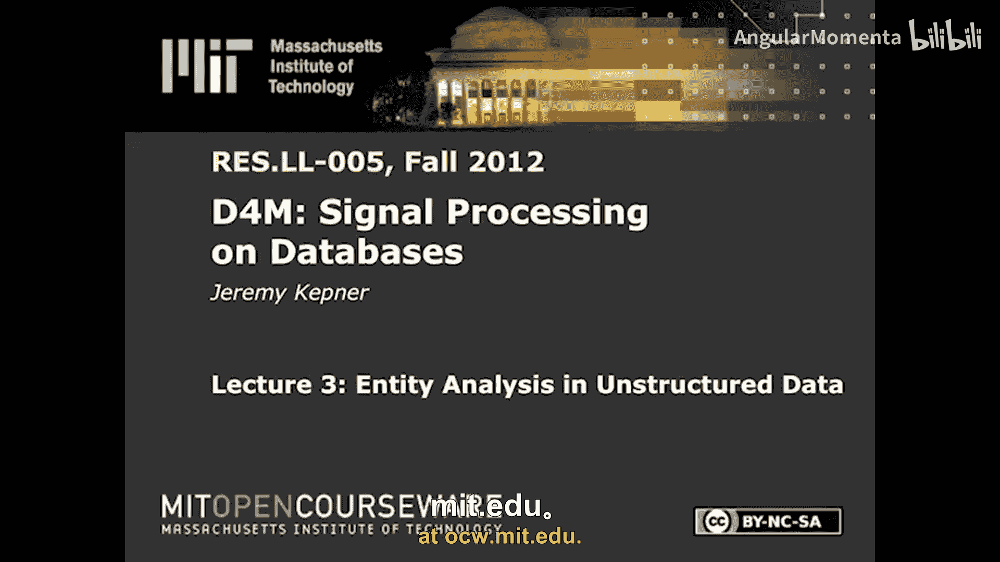
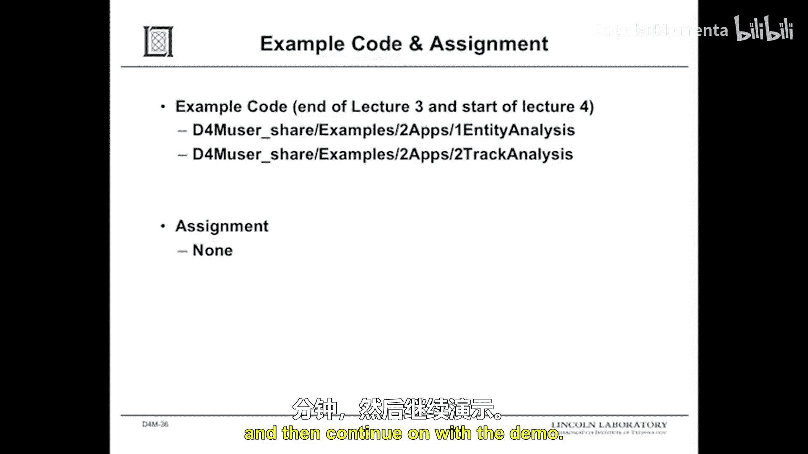
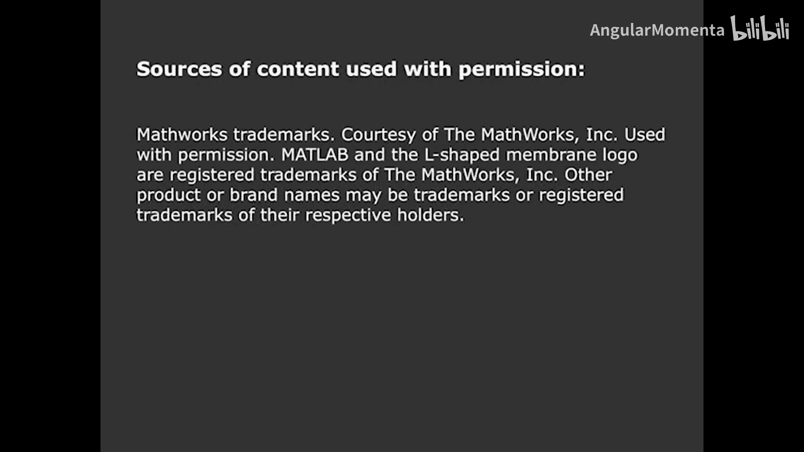

# 【麻省理工】大数据与机器学习数学-｜-MIT-RES.LL-005-D4M-Signal-Processing-on-Databases,-Fall-2012-p10-10-3.-非结构化数据中的实体分析--BV1eEtTzhE4F_p10-

The following content is provided under a Cative Commons license。

 Your support will help Mi T OpenCourseware continue to offer high quality educational resources for free to make a donation or to view additional materials from hundreds of Mit courses。

 Visit Mitopcourseseware at Ocw。 Mt Eduu。

All right， we're going to get started here， everyone。And。

I know we have a lot going on here at the lab today， and I'm very pleased that。

Those of you decided to。Choose us today over all the other things that are going on。

 so that that's great， I'm very pleased。嗯。I wanted to say I think I've provided。

Feedback to everyone who submitted there earlier。First， homework。

Over the the weekend and I was very impressed and pleased by those of you who did the homework。

 I think you really embrace the spirit of the homework。Very well。

I know the homework that just happened is one that kind of really builds on that for those of you who didn't do the first one。

 then you're kind of let left out a cold and。But I would like to give my congratulations for those who took on that second homework。

 which was。Significantly。Definitely required a fair amount of contemplation to serve。

Attt that homework， so I want to thank those of you who did that。

So we're going to get started here and so we're going to bring up the。The slides here。

So we're going to be getting a little bit more。We're kind of entering the second of the three sections。

 we these first three courses here that really was the first part。

Did a lot with motivation and a lot with theory。 And now we're going to do stuff that's a little bit more。

You know， we'll be continuing that that that trend we still always have plenty of motivation and a little bit of theory。

 but getting more and more towards things that feel like the things you might actually really do。

And so we're kind of entering into that next phase of the course here。 So let's get started here。

 So this is the。Lecture 0，3。We'll have some example here from some real data。And talking about that。

啊。Here's the outline of the course。Actually， just foring that's sort of somewhat mandatory for those of you who are just joining us or are watching on the web and have jumped ahead to this lecture。

 the title the class of Sign processing on databases。

 two words that we don't normally see together or two phrases signal processing。

 which is really alluding to detection theory， formal detection theory， and its linear algebraic。

Foundations and databases， which is really alluding to dealing with strings and unstructured data and graphs。

 and so we're in this course talking about a technology G4M which allows us to pull these two views together and so again。

 we're now the lecture 03 and we will continue on this journey that we have started。

Here's the outline。A little bit of of history， I'm going to talk about kind of how the web became the thing it is today。

 which I think talks a lot about why we invented the deform technology。

 So it's going to talk about the specific gap。That it fills and talk a little bit about the deformed technology。

 some of the results that we've had， and then hopefully today the demo is a more substantive and so we'll spend more time on that than we did last time or last time was more theory and the demo is really fairly small so。

For those of you who don't remember back in the ancient。

Priorial days of the web back in the early 90s。诶。You know， this is what it looked like。

So if I talk about the hardware side of the web， it was quite simple。So。There we go。

 a hardware side of the web was。All sunboxes， and we all had our sun workstations。

 and they were clients and they were servers and they were databases。

And the databases that we had at the time were。SQL databases。

 Oracle was sort of really kind of just beginning to。Get going then。

 Cyi bass was sort of a dominant player at that stage。啊。

This is sort of the an example of the very first modern web page。Or website that was built。

 It was built by。I'm sure there are other people who are doing very similar things at the same time。

 so it's among the first it's difficult to not going to be like Al Gore and say I invented the internet。

 but a friend of mine， Don Bory and I were working for a company called Visual Intelligence Corporation which is now part of GE and we had a data set and an SQL database and we wanted to make it available。

And there were a lot of thick client tools that came with our si based package for doing that。

 but we found them a little bit。Cunky， and so a friend of mine， Don， he' downloaded this。He said。

 hey， I found this new software， I found a beta release of this software called NCSA Mosaic。

And so for those of you who don't know， NCSO Mesaic was the first。Browser。

And it was invented at the National Center for Supercomputing App。

And they released it and then it was awesome， it changed everything。

I just say no prior to that and not to disrespect anybody who invented anything， but HTTP and H。

We're dying。They' had actually come out in 1989。And everyone like， this is silly。 What's this。

 I do't have to type this Hp。 And then there's this H， and it's just very clunky and stuff like that。

 And it was。Getting it's clocked pretty well cleaned by another technology called Gopher。

Which existed at which was developed the University of Minnesota， which was a much easier interface。

 The server was a lot better。 The it was a lot easier to do links than an Hm。

 And it was just a menu driven text base。Way to do that。Well， mosaic。Created。

A gui front end to H and allowed you to have pictures。

And that changed everything That just absolutely。 that was， that was。

 And it just sort of caught on like wildfire。 But it was just a beta at that point in time。

 And I don't think it could really do pictures， but it was still， it rendered fonts nicely。

 And Gopher did not。 Gopher was like just plain text。

 So you could have like underlying and bold and the links were very clear。 You could click out them。

 You could even have indentense and bullish。 You could imagine organizing which something that would be look like a web page today。

And so so we had that and they're like， oh， well we'll talk to our database using that。

 we'll use you know HTT put to post a request the server。

a the mosaic server was so bad we actually just used the Gopher server to talk to the mosaic browser and so we would do puts and then we used a language called Pearl。

 which many of you know because it actually had a direct binding to sibase and so we would take that format it。

And and create SQL queries and then it would send us back strings。

 which we would then format as HTML and approach the browser and it was great， you know。

 it was like very， very， very nice and it was sort of kind of the first modern you know web page that we did in 1992 and essentially a good fraction of the internet kind of looks like this today。

Our conclusion at that time was that this browser was a really。Lousy goy。

And that HTTP was really trying to be a file system。

 but it was really bad file system and PEarl was really bad for analysis and SQL really wasn't。

 you know it's good for credit card transaction， but it wasn't really good for data in and out so our conclusion was this is an awful lot of work just to kind of view some documents。

And it won't catch on our conclusion was it won't catch on so with that conclusion。

 so that's sort of under maybe I'm underscoring my judgment for the entire course that you know I decided that we decided this was a bad idea。

So after that， we had sort of what we call the Cammbrian explosion of the internet。

 which is we have an explosion， you know， on the hardware side we had。You know。

 big giant data centers， merging servers and databases， which is great。

 And we had all these new types of hardware technologies here。

 laptops and tablets and iPhones and all that kind of stuff。

 So the hardware technology went forward and leaps and bounds and then the web the browsers really took off you know all of them。

 you know all these different browsers you can still I have the mosaic sort of logo back there still a little bit because they're still showing for those of you don't know。

😊，啊。The author of Mosaic and NCSA was a guy by the name of Mark Andreesson。

 He left NCSA and formed a company called Netscape。

 which actually at a moment in time was the dominance。 They were the Internet。 You know。

 they were like。嗯。They got crushed， you know， although I think Mark andreen made a fair amount of money。

And。And but they did open source all their software。

And so they basically rewrote mosaic from the ground up。

And that became Mozilla and Firefox and all that， so that's still around today。

Sfari may have borrowed from this。 I don't really know。When Netscape was dominating the internet。

 Microsoft needed to they're like this week， you know。

 first they thought the internet was going to be a fad and then they're like， all right。

 this is serious， we need a browser。And so they then Mosaic had actually been spun out of the University of Illinois into a company called Spyglass。

 which may actually still exist today and then。Microsoft bought。The browser。

 which was the original NTSA mosaic code。And that became Internet Explorer。

 So it's still around today。 This is Chrome。 And as far as I know。

 Chrome is a complete rewrite from the ground up。 So， you know， that's。

And probably some of the other like opera and other browsers around today are complete them。

 but they still use it it's a browser to use HTML still uses the basic put Get syntax。Our SQL。

 we're still using it today， we have a whole explosion of technologies， Oracle being very dominant。

 but you know MySQL， SQL server， other types of things。

 Ibaase still around very very common and we we still have a you know we have the two major servers out there。

 Apache and Windows。So Apache was the Mesaic server and just you know， Apache was。

It's a patchy server。Meaning it was very buggy。 So it was the Apache server and that became Apache。

 So that was the new mosaic server became Apache because it was Apache server。 And so so。

 and I bet they borrowed code from Gopher side that's why the gopher。

 I think is still showing there a little bit。 We've had a proliferation of languages that are very similar。

 So people in terms of gluing these two together。 Java， et cetera， all that type of stuff。

But the important thing to recognize is that this whole architecture was not put together because somehow we felt the web browser was the optimal tool or SQL was the optimal tool。

 or these languages were the optimal tool。😡，They were just things that were laying down that could be repurposed for this job。

 And so that's why they're not necessarily the optimal thing。 So， but nevertheless。

 our conclusion has to be slightly revised that it would not catch on because obviously it did catch on the desire to share information was so great that it overcame the high barrier entry。

 you know， just to you know， set up a web page or something like that。

Now things have changed significantly we're not the first people to observe that this sort of original architecture is somewhat broken for this type of model。

 and so today the web looks a lot more like this。😡，We still have our awesome client hardware。

 which is great， we have servers and databases that have now moved of out of the data center into shipping containers and other types of things。

 which is great。😊，Increasingly our interfaces will look a lot more like video games。

 I would tell you that a typical app on the iPad feels a lot more like a video game than a browser。

 which is great， so we've really kind of moving beyond the browser as a dominant way for getting our information。

And companies like Google and others recognize that if you're just presenting data to people and you're not doing。

 say credit card transactions， then a lot of the features of SQL and those types of databases are maybe more than you need。

 and you can actually make these sort of very scalable databases more simply that are called triple stores。

😡，And so Google big table being the original sort sort of one react is another。

 a Cassandra is another H bases is another， a cumulula。

 which is the one we use in this class is's another so this whole new technology space has really driven you know that and has made that a lot more scalable and people。

But unfortunately in the middle here， we're still very much left with much of the same technology。

 you know， and this is kind of the last piece， this sort of glue that and so our conclusion is now that you know it's a lot of work to view a lot of data。

 but it's a pretty great view and we can really view a lot of data。

 but we still have this middle problem， there's this gap。And so we're trying to address that gap。

 and so we address that gap with D4M， so DformM is formally designed from the ground up to be something that is really designed to work on triples。

 the kind of data we store in these modern databases and do the kind of analysis in less code than you would otherwise。

So D4M， which stands for dynamicyna distributedtri dimensional data model。

 which is sometimes you know and quotes databases for MatTLab because it happens to be written in MALB。

 it connects the triple stores which can view their data as very large sparse matrices of triples with the mathematical concepts of Associ arrays that we talked about last class。

 that's essentially what DformM does for you。So that's kind of one sort of holistic view of the technology space that we're dealing with here。

Another way to view at it which is I'm going to talk a little bit about kind of how the technologies that we have brought this to you。

 I'm going to tell you a little bit about LOgrid and what we do there because you're going to be using you're using your Lgrid accounts for this and so I want to tell you a little bit about that。

So。Eello grid is the core。Supercomputer at Lincoln Laboratory。And we're here to help。You know。

 with all your computing needs。Likewise， we're here to help with your D4M needs if you have a project and you think it would be useful to use DformM in that project。

Please contact us。 You don't have to just take this class and think that you're on your own。 I mean。

 we are a service。 we will help you。Do the schemas， get the code going。

 get it sort of adapted to your problem， that's what we do。Eellogriid。

 we about we have actually well over this， but you know just so I don't have to keep changing the slide。

 we always say it's about 500 users， about 2000 processors it's more than that to our knowledge it's really the world's only desktop interactive supercomputer。

 it's dramatically easier to use any other supercomputer and as a result as an organization。

 we have the highest fractions of staff using supercomputing on a regular basis of any organization just because it's so easy and it's also kind of been the foundation。

 the vision for supercomputing and entire state of Massachusetts。

 all of our ideas have been adopted by other universities in the state and moving forward。

Not really the technology that we're talking about today。

But something that is really kind of the bread and butter of vello grid is our parallel malla technology。

Whi is now going to be celebrating its 10th anniversary this year。

 and it's really a way to allow people to do parallel programming relatively easily。D4M。

Interacts seamlessly with this technology and so you will also be doing parallel database codes by the end of this as well with this technology。

 so we have this thing called parallel Matlab if you're an Ngrid user。

 you are entitled to or you almost always get the book on parallel Matlab and allows you to take things like matrices and chop them up very easily to do complicated calculations and almost every single parallel program that you would want to write can be written with just addition of a handful of additional functions。

And so， and we get to use what is called the distributed race parallel program model。

 which is generally recognized as by far。The best of all the parallel programming metals。

 if you are comfortable with multidimensional arrays。Everyone at MIT is， so this is easy， however。

 this is not generally true thinking in matrices is not a universal skill or universal training and so it is a bit of a sometimes we do say this is software for the 1% so you know it it is not for everyone but if can if you do have this knowledge and background allows you to do things very。

 very naturally and as you know we've talked about all of our associated arrays is using looking at data in matrices and so these two technologies come together very nicely。

And we're really the only place in the world where you can routinely use this model。

 this is the dominant model that people use when they do parallel programming which is generally and you might say。

 well why do I say it's the best well we run contests。

 there's a contest every year where we bake off the best parallel programming models and distributed rays and high levelvel environments wins every year and so it's kind of the best model if you can understand it。

It wouldn't be a class on computing in 2012 unless we talked about the cloud。

 so we definitely need to talk about the cloud and to make it simple for people。

 we're going to divide the cloud into sort of two halves you can subdivide the cloud into many。

 many different components。嗯。😊，There's what we call utility cloud computing。

 which is what most people use the cloud for。So Gmail， what are enterprise services。

 calendars online， all that kind of stuff， basic data sharing， photo sharing and stuff like that。

 that's what we call utility， cloud computinguting， computing。

 people who do you know you can do human resources on the cloud， you can do accounting on the cloud。

 all this type of stuff that's on the cloud and it's very， very successful business。

What we mostly focus is one is called data intensive， cloud computing。

 you know it's based on Hadoop and other types of technologies。

 but even still a lot of that is technologies that are used by large scale cloud companies。

 but they don't really share with you。Google。Although it's often called Hadoop。

 Google doesn't actually use Hadoop。 Hadoop is based on a small part of the Google infrastructure。

 Google's infrastructure is vastly larger than that。

 and they don't just let anybody log into and say， oh。

 go ahead and mine all the Google data they provide they expose it through services allow you to do some of that。

 but the core technologies that they do。 they don't expose in all large companies。

 they don't expose that to you。 they give you selected services and such。

 but this is really what we're focused on is the state intensive。

If I wanted to further subdivide the cloud into。You know， from from an implementer's perspective。

 if you。Own a lot of computing hardware。 I mean， hundreds of kilowatts or megawatts of computing hardware。

 You're most likely doing one of these four things。You could be doing。

You could be doing traditional supercomputing， which we all know and love。

 which is sort of closest to what we do in Elgrid。You could do traditional database management systems。

 so every single time you use a credit card， make a purchase。

 you're probably connecting to a traditional database management system。

You could be doing enterprise computing， which mostly this day this day and age is run out of VMware。

 so this is the VMware。Loal， and so so you could be doing that。 So that's， you know。

 all the things I earlier mentioned or this new kit on the block， big data。

 which is all the buzz today using Java and map produce and and other types of things。

 The important thing to recognize is these four areas。

 each of these are multi tens of billions of dollars。Industry。

 the IT world has gotten large enough that we now see specialization down to the hardware level。

 the hardware， the processors that these folks use is different。Likewise。

 for these folks and these folks， you see specialization of chips now to these different types of things。

 So each of these is at the center of a multi billion dollar ecosystem。

 and they each have pros and cons， And sometimes you can do your mission wholly in one。

 but sometimes you have to cross。 And when you do cross。

 it can be quite a challenge because these worlds are not necessarily。Compible。

 and I would say just to help people understand Hado one。

 one one must recognize that it's that it's very much。

Java is the firstclass citizen in the Hadoop world， it is a world。

 the entire infrastructure is written in Java， it's designed so that only if you only know Java you can actually administer and manage a cluster。

 which is why it's become so popular， there are so many Java programmers and now，just no Java。

 and they download Hadoop， and they have rudimentary access to some computer systems they can sort of cobbled together。

 A cluster。 I should say the same thing occurred in the sea in Fortran community in the mid90s。

 There was a technology called MP。In factThis is the MPI logo today。

 which allowed you if you knew C and Fortran had rudimentary access。

On a network of set of workstations， you could create a cluster with MPI and that really sort of began the whole sort of parallel cluster computing revolution。

 this does the same thing in Java and so for Java programmers that's you know it's been a huge success in that regard。

Just so you don't how where we sit in with that， so we have LOgrid here。

 which has really made traditional supercomputing a feel。Interactive and on demand and elastic。

 So that's one of the things that we do。 that's allgrid， very， very unique。 You launch your job。

 It runs immediately。 That is different than the way every other supercomputing center in the country is run。

Most super community centers are run by you， write your program and you launch it and you wait until the queue says。

That it's run and in fact。Some centers will even use as a metric of success how long their weight is。

It's kind of like a restaurant， right， You know how how many years do you have to wait to get a good reservation or a good doctor。

 right？ And I remember someone saying， oh， our system is so。So successful that our weight is a week。

You hit submit and you will have to wait a week to run your job。

 so we don't really feel that's not really consistent with the way we do business around here。

 you're under very tight deadlines， so we created a very different type of system 10 years ago。

 which sort of feels more like what you people are trying to do in the cloud。In the Hadoop community。

 there's been a lot of work to try and make databases what these technologies give you is sort of efficient search。

 and so there are a number of databases that have been developed that sit on top of Hadoop。

 HB being one and a cumulula being another you which to my knowledge is the highest performance。

Open source Tri store in the world and will probably will remain that way for a very long time。

 and so we will be using the aummulator database。And then we've created bindings to that。

 so we have our D4M technology， which allows you to bind to databases。

 and we also have something called Elogrid map produceuce。

 a map produceuces sort of the core programming model within the Hadoop community。

It's such a trivial model it almost doesn't even deserve a name。

 it's basically like write a program given a list of files。

 each program runs on each file independently。 I mean， it's a very。

 very simple model it's been around since the beginning of computing。

 but you know it's become the name has become popularized here and and we now have a way to do map produced right in Elgrid it's very easy and people enjoy it And if you're you can of course。

😡，Do the same thing with other technologies in Ellogrid， but for those people。

 particularly if you're writing Java or not MatTLAb。

 we don't recommend people use this for MATLAb because we have better technologies for doing that。

 but if you're using Python or Java or other programs， then MApro is there for you。

As we move towards combining so our big visions to combine big， big compute and big data。

 and so we have a whole stack here as we deal with new applications， text， cyber， bio。

 other types of things， the new APIs that people write the new types of distributed databases。

 so it's really affecting。Everything。Just an example of the Hadoop architecture just so you know you've had this course。

 you should at least have a few minutes so if someone askeds what' is Hadoop。

 you know what know what it does， This is the basic architecture， so you have a Hadoop mapre job。

You submit it and it goes to a job tracker， the job tracker then breaks that up into subtasks。

 each of which has its own tracker， those tasks then gets sent to the data nodes in the architecture and it gets those data nodes。

 and name node keeps track of the actual names of the things， it's a very simple Hadoop cluster。

 this is the different types of nodes that are and processes in the architecture。

Haoop's strengths and weaknesses。 Well， its it does allow you to distribute pricing a large data's it's sort of。

Best use case is。If you wanted to， let's say you had an enormous number of log files。

And you decided you only wanted to search them once for one。Stng。

That's the perfect use case for Hado。If you decide， though。

 that you would like to actually do more than one search。😡，You know， then it's not。

 it doesn't necessarily always make sense， so it's basically designed to run GE on an enormous number of files。

And I kid you not， there are companies today that actually do this， like at production scale。

 all their analytics are done by just gripppping enormous numbers of log files。

Needless to say that the entire database community you know cringes and rolls over in their graves if they're not alive at this。

 because we have solved this problem with by creating in by indexing our data and that allows you to do fast search and people。

 that's why people have invented databases like HBase and acumul。

 which should sit on top of a Duke because they recognize that。

 you know really if you're going to search more than once， you should index your data。Again。

 it is very scalable， it is fundamentally designed to have extremely unreliable hardware in it。

So it is quite resilient， it does this resiliency at a cost。

 it relies on a significant amount of replication。Typically。

 the standard replication in an Hadoop cluster is a factor of three。

If you're in the high performance storage business。

 this also makes you cringe because this makes you you're paying 3 x。

For your storage we have techniques like RA， which allow us to do that， but again。

 the expertise required to set up a cluster and do 3X replication is relatively low。

 and so that makes it very appealing to many， many， many folks， and so it's very useful that。嗯。

Some of the difficulties， the scheduler in Hadoop is very immature。

It is schedulers are very well defined， there's about two or three standard schedulers in the supercomputing community they each about 20 years old。

 they all have the same 200 features。And you need about 200 features to really do a proper scheduler。

Ioop is about。4our or five years old and it's got about that many features and so you do often have to deal with collisions。

 it's easy for one user to hog and monopolize the entire cluster。

 you're often dealing with various overheads from the scheduler itself so that and this is well known to the Hadop community they're working on it actively and we will see all that。

You know， it's not an easy multi user environment and as I've said before。

 it fundamentally relies on the fact that the JVM。Is on every node because when you're sending a program to every node。

 the interpreter for that must exist on every node， and by definition。

 the only language that you're guaranteed to at every node in a Hadoop cluster is Java。

Any other language。Any other tool has to be installed and become a part of the。

The image for the entire system so that it can be run on on every node。 So that is。

 that is something that one has to be aware of。 And we' certainly seen is like， oh。

 I wrote these great。Programs in another language。 And it's like， well， can't I just run them like。

 no that that that doesn't exist， you know， even distributing a fat binary can be be difficult because it has to be distributed through the Hadoop distributed file system。

 All data is distributed there。 and that is not。You have to essentially write a wrappper program that Ben recognizes where to get your binary and then。

Then execs that thing and it can be tricky。The basic LO grid map produced architecture simplifies this significantly。

 although this maybe doesn't look like it。It basically you know essentially you call egan map mapRuce。

 it launches a bunch of what are called mapper tasks。

 it runs them on your different input files when they have done。

 they've created output files and then runs another program if you specified that they combine to the output so that's the basic model of mapR which is you have what's called a map program and a reduced program and the map program is given a list of files。

 it runs those program one at a time each one of them generates an output and a reduced program pulls them all together。

All right， so that's our little tutorial on Hadoop and because I felt an obligation to explain that to you。

 we couldn't be a big data course without having going that。

 but it's very simple and very popular I expect it to be maintain its popularity for a very long time you know I think it will evolve and get better but for the vast majority of people on planet Earth。

This is really the most accessible form of parallel computing technology that they have available。

 so we should all be aware of Hadoop and its existence and what it can do because many of their customers use Hadoop and we need to work with them。

All right so getting back now to D4M， I think I've mentioned a lot of this before。

 the core concept of D4M is multidimensional associated arrays again Dform is designed to sort of overcome for those of us who have more mathematical expertise。

 we can do much more sophisticated things than you might be able to do in Hadoop again it allows you to look at your data in four ways at once you can view it as 2D matrices and reference rows and columns with strings and have values that are strings。

 it's one to one with a triple store so you can easily connect a databases again it looks like matrices so you can do linear algebra and also between the duality between adjacency matrices and graphs。

 you can also think about your data as graphs。This is composable， as I've said before。

 almost all of our operations that perform an As array return another Associative array and so we have we can do things like add them。

 subtract them， and them or them multiply them， and we can do very complicated queries very easily and these can work on associate arrays and if we're bound to tables they can also do that。

Speaking of tables I've already talked about our schema in this class that we always use。

 so if your standard data might look like this， say this is a cyber record， a source IP domain。

 a destination IP， this is sort of the standard tabular view we explode it by taking the source pending the value to it which creates this very large sparse table here。

 which will naturally go into our triple store of course by itself it doesn't really gain as anything because most tables have either our rowb or column base the databases that we are working with our rowb which allow you to do fast look up of a row key however。

 once we've exploded the schema if we also store the transpose we now can index everything here quickly and effectively effectively to the user it looks like we have indexed every single string in the database with one schema which is very nice very powerful stepping stone for。

Re。All right， I'm going to talk a little bit about what we have done here。

 So I'm just going to go over some basic analytics and show you a little bit more code。

 So for example， heres our table。And you know， with these various。

 so this could be viewed as the sparse matrix， we have various source Is here。

 and I want to just compute some very elementary statistics on this data。I should say。

Computing things like sums and averages may sound like not very sophisticated statistic。

It's still extraordinarily powerful。And we are amazed how valuable it is。

Because it usually shows you right away。The bad data。In your data， and you will always have bad data。

 But for many of them， and this is probably the first。

Bit of value add we provide to almost any customer that we work with on D4M is it's the first time anybody's actually sort of looked at their data and totality and being able to do these types of things。

 And so the usually the first thing we do is like， all right， we've loaded their data in a Sche out。

 We've done some basic sum。 we'll say。Do you know that you have the following stuck on switches。

You know，8% of your data all has this value in this column which absolutely can't be right。You know。

 and 8% could be a low enough number that you might not just encounter it through routine reversal。

 but it will stand out in just the most rudimentary histogram， you know， extremely。

 And so that's an usually incredibly valuable Pete ofbys like oh my goodness。

 though usually like there's something broken in our system or you'll be like， you know。

 you have this column， but it's almost never filled in。

 and it sure looks like it should be filled in。 So these switches are stuck off。

And so that's often a， you know， I encourage when you do the first thing to just kind of do the basic statistics on the data and see where things are working and where things are broken and usually you can then either。

Fix them and most of the time when we tell a customer like。

We're just letting you know these these are issues in your data we can work around them。

 we can sort of ignore them and still proceed or you can fix them yourselves and almost always like no。

 we want to fix that ourselves。 that's something that's fundamentally broken in our system。

 We want to make sure that that data is correct because usually that data is flowing into all other places to and being acted on and so that's one thing we were going to we're introduce some basic statistics here。

 we're going to compute how many times each column type appears we're going to compute how many times each type。

😡，Appears we'll compute some covariance matrices， just some very， very simple types of things here。

All right。Let here so this is the basic implementation。So we're going to give it a row。

 a set of rows that we're looking at here。 this can be very large。We have a table binding tea。

So we say， please go and get me。All the all those rows。

 so we get the whole swath of rows and now we'll return that as an associative array。

And then normally I shorten this is double loggi， but we since the table always contains strings and returns strings values。

 the first thing we need to just kind of get rid of those because we're going to do math。

 so we turn them into logicals and then we turn them back into double so we can do math。啊。

You can actually pass regular expressions。 You can also do the starts with command。

 We want to get the source IP。 just we're just interested in source IP domain。

And the first thing we do is find some popular columns。 so we just type some。

 and that it shows us popular columns。 we want to find popular pairs。

 Its covariance matrix calculation there。Or square in and find domains with many destination Ipiece。

An example in this data set is this was the most popular in the data set that we had。

 these are the most popular。Things that that appeared here。

And you can see this is all fairly reasonable stuff thatello being。

 a lot of New England Patriots fans in this data set， all ads。Stples。

 these are the types of things that shows you right away。Here's the covariance matrix of this data。

So as you can see， it's symmetric， obviously there's a diagonal and you have it has the bipartite structure that is there's no destination to destination IP links。

 there's no， and you we have source IP to destination， domain， all that type of stuff exactly。

The covariance matrix is often extremely helpful thing to look at because it'll be the first time it shows you the full interrelated structure of your data。

 and you can quickly identify dense rows， dense columns， blocks， chunks。

 sub things where you want to look at chunks that aren't going to be interesting because they're very。

 very dense or very， very sparse Again， a very， very just sort of survey type of tool。

A little shout out here to our colleagues and the other group who developed structured knowledge space。

 structured knowledge space is a very powerful analytic data set。诶。

I kind of tell people it's like the Google search where when you type a search key。

 it starts guessing what your next answer is。But Google does that based on a sort of a long sort of analysis of all the different types of searches people have done。

 and it can make a good guess。 SKS does that much more deeply in that it maintains a database on a collection of documents。

 and in this case if you type Afghanistan， it will then show you will then actually go and count the occurrences of different types of entities in those documents and then show you what the possible next keyword choices can be。

 so in the actual data itself， not based on a set of cached queries and other types of things。

I'm not to say I don't really know what Google actually does。

 I'm just guessing I'm sure they do use some data for guiding their search。

 but this is a fairly sophisticated analytic。😡，And one of the big sort of wins for we knew we were on the right track with DForum is that this has been implemented in hundreds or thousands of lines of Java SQL。

 and we're going to show you how we implemented in one line。Indeed， for。So， let's。

Let's go over that algorithm。 So here's an example of what my data might look like。

 I have a bunch of documents here。 I have a bunch of entities where an entity appears in a document。

 I have a dot。I'm going to have my associative array over here。

 which is you know from matching from the strings to the reels and my two fats are facets are just going to be two columns names here so I'm going to pick a facet。

Y1 and y2， So I'm going to pick these two columns all right。And then so basically。

 that's what this does， this says get me y1 and get me y2。

I'm using this bar here to say I'm going to knock away the facet name afterwards so I can and them together so that gets me all the documents that basically contain both UN and Carl and then I can go and compute the count that you saw on the previous page there just by doing this matrix multiply so I and them。

 I transpose them and I matrix multipied to get them together and then there we go。😡，All right。

So now I'm going to get into the demo and I think we have plenty of time for that。

 I'll sort of set it up and then we'll take a short break。

People can have cookies and then we'll get into the demo。

 which really begins to show you kind of a way to use D4M on real data。

So the data we're going to work with here is the Reuters corpus。

 so this was a corpus of data released in 2000 to help spur research in this community we're very grateful for Reuters to do this。

 they gave the data to NIS who actually stewards the data set it's a set of Reuters news reports over this particular timeframe。

 the late the mid-90s。And it's like 800，000 total and what we have done。

 we're not actually working with the straight Reuters data。

 we've run it through various parsers that have extracted just the entities， so the people。

 the places in the organization so it's sort of a summary you very terse summarization of the data if that it's really sort of a derived product the data is power law。

 so if we look at the documents per entity you see here that you know certain people。

 places and organizations you know appear a few of them appear。

 lots of places and most of them are appear in just a few documents and you see the same thing when you look at the entities per documents。

 so there's essentially you could view this as computing the ind and the out degrees of this bipartite graph and it has the classic power loss shape that we expect to see in our data。

So with that， we're going to do it in the demo and just to summarize， so just you know recall。

 you know you the evolution of the web has really created a new class of technologies。

 we really see the web moving towards you know gamet interfaces。

 triplestore databases and technologies like D4M for doing analysis。

 very new technology and just so the for the record， there is no assignment this week。

So for those of you who are still doing this one as yay， the example。

 actually we won't do both of these today we'll just do one of them。

 oh when I keep making this mistake， I fix it I'll fix it later but it's in the examples directory we've now moved on to the second subfolder apps entity analysis and you guys are encouraged to run those examples which we will now do shortly so we will take a short five- minute break and then continue on with the demo。

