# 【麻省理工】大数据与机器学习数学-｜-MIT-RES.LL-005-D4M-Signal-Processing-on-Databases,-Fall-2012-p11-11-3.-示例演示--BV1eEtTzhE4F_p11-

The following content is provided under a Cative Commons license。

 Your support will help Mi T OpenCourseware continue to offer high quality educational resources for free to make a donation or to view additional materials from hundreds of Mit courses。

 Visit Mitopcourseseware at Ocw。 Mt Eduu。

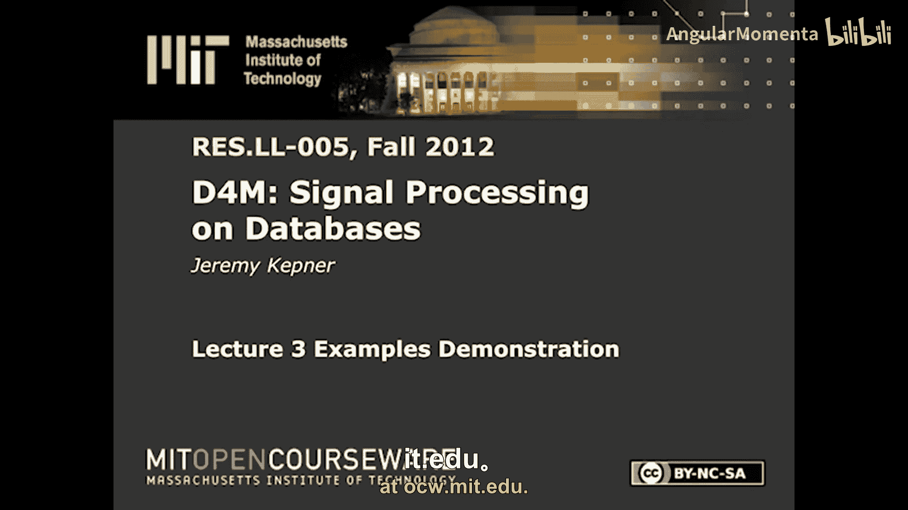

Welcome back， we're now going to get into the demo portion of lecture 03。And so these demos are in。

The D4M API directory in the examples， we're going to now weve moved on from kind of the intro into the applications。

And we're going to deal this one where we're dealing with entities extracted from this data set。

 so we go into the entity analysis directory。Start my shell here。

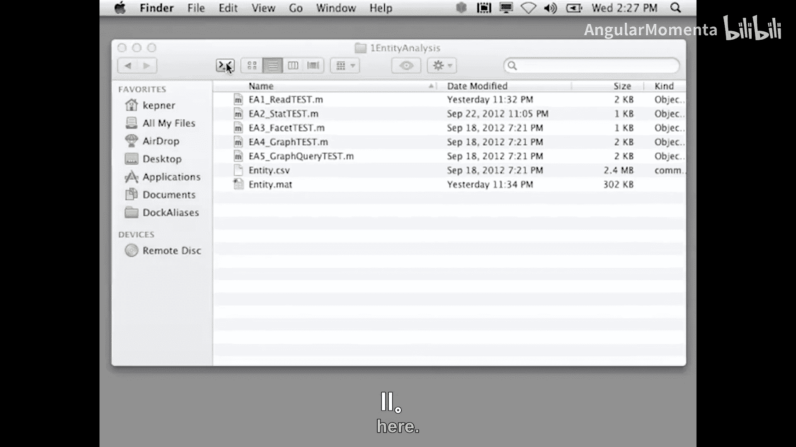

嗯。So。😔，Yeah。嗯。Or our Matlab session here。诶。I always run MATLb from the shell。

 if you prefer to run it from the ID， that's fine。And again。

 our DformM code runs in a variety of environments。Not just Matlab。Right。

Right so that started up here。 so let's。

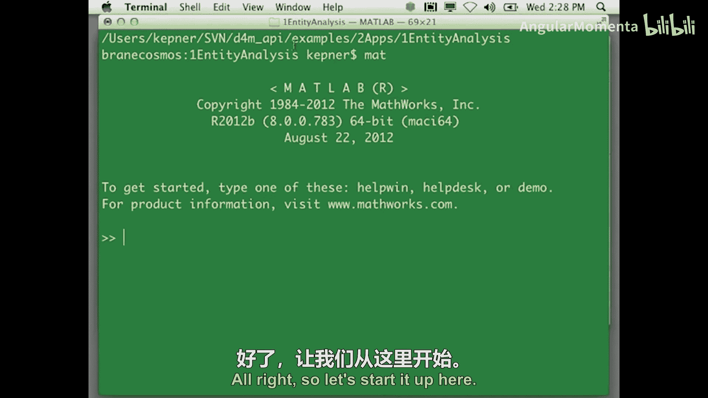

That' before we do that， let's look at our data set here。So this is a nice little data set。

 it's about 2。4 megabytes of data。So， and this is the Reuters some of the Reuters documents processed through our。

Enity extractor。here at Lincoln Laboratory。 and so if I look at this， say with Microsoft Excel。

Try that。All right， so you can see that pretty clearly right。

 so we basically just have a row key here to read this in， we have a document column。

Which is the actual。It right now。That's the actual document that it appears in， we have the entity。

happen to be alphabetical here the way it comes out。We have the word position in the document。

 So this tells you that this entity appeared in this these positions in this document。

 and then various types， location， person， organization， those types of things。

 So that's what we extracted from these documents。There's no verbs here， and we just tell you。

 a person， a place， an organization up appeared in this document and would say anything about what they're doing or anything like that。

But this just shows examples of the kind of data that we have here。All right， so。What's that。Sa。

Excel。

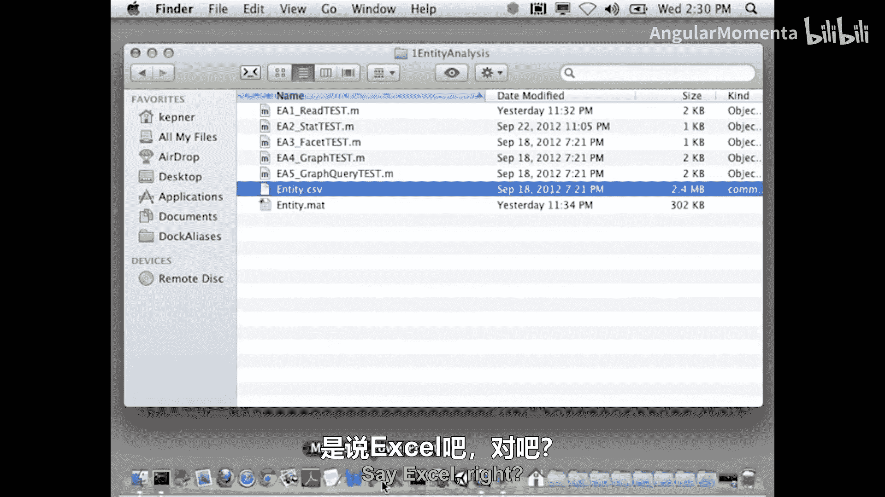

Right。So the first thing we're going to do is the first script is entity analysis1。

 we're going to read the data in。And actually， let's。All right， there we go。

So and this is this first line just read this in we have。

 it's a fair amount of data we're turning it all into an associative array。

 we have actually some faster parsers that will read it in。

know but the just the read CSV is kind of the most general purpose one that's fairly nice。

So this's going to go and we'll go back， it's running a whole bunch of stuff here。And then。

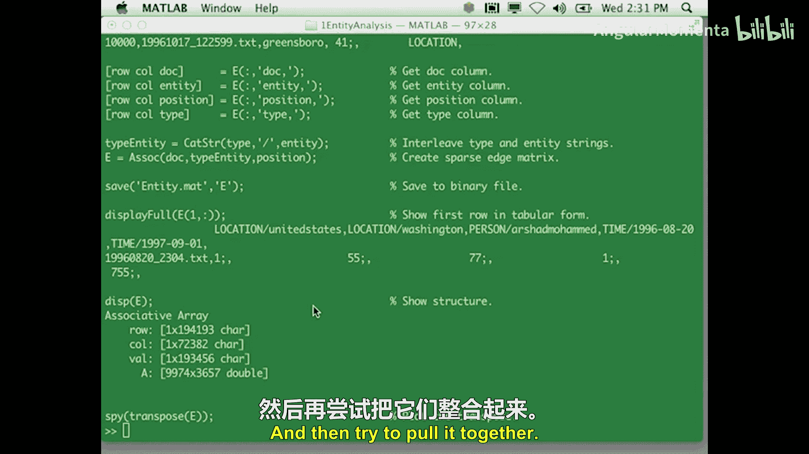

Tries to pull together its。Es。

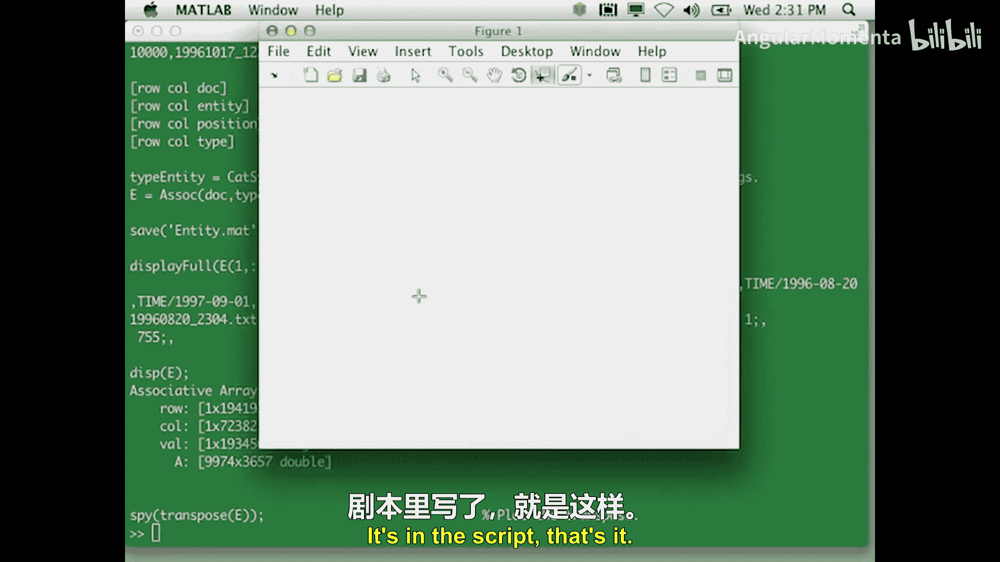

All right。So let's take a look at what we did here。

We read in the data into essentially an edge list Associative array。

Just just displayed the first few rows here so you can see。 so it's alphabetized。

 Alexographically sorted the first。Columns always， it's something to be aware of that you know one and this is then followed by 10 is then followed by 100 then 1000 in this sort。

 here's the documents， here's the entity， there's the position。

 so it just looks like the normal table that we read in， but it is associated right。

'Not going to want to sort of。Pull this into our exploded schema。

 and this table didn't necessarily come to us in the easiest format to do that in。

 so there's a few tricks that we have to do。So we're going to go and get。Each document。Basically。

 so we have a row， a column and the doc， so that's the value。

 so this is whenever you do a query in associative array。

 one of the powerful things about MatTLb is you can change you're going have variable numbers of output arguments and you can change the behavior。

So if I just wanted this to return， if I just set this to， you know， A equals E this。

 I would have just an associative array vector， but if I give it three output arguments I'll say， oh。

 I'll give you the triples。That went into constructing that。

Because sometimes that's what you want to do， also it's faster。Because to do this。

 every time I do a subassociative array， I effectively have to pull out the triples and then reconstitute the associative array and that can take some time and it just saves you a step it goes directly to the triples。

 which is nice。So I basically say give me the document column， give me the entityity column。

 give me the position column and now I have all of these， and since I know they're dense。

 I know that you know these are all lined up the first dock string and energy string and position string and type string are all。

Or all all so that's me exploiting a little bit I know that this is a dense table and I'm not going to have any missing there。

Now I'm going to interleave the type and entityity strings。

So I have this this function called cat string。So basically capturing takes one string list and another string list。

 and then it leavess them with a separator， a single character separator。

And now I can construct a new sparse matrix， which is has docs for the row key。

 this new thing called type entity to be the columns。

 and then I'll just throw the position in as the value。

And so that is our exploded schema that we just talked about done for us in a couple lines。

 there's other functions that can do that for us well。

 And since I don't want to repeat this because it took a little while to read it in。

 I'm just going to save it as a。As a MA labb。Binary， which will then read in。

Very quickly from now on， which is nice so I can save it。There we go。

Just to show you if I show you the first entry here。😡，So。In in the row。And then this just shows you。

 you know， the the this is the。The different types of columns that were in that。In that data set。

 So this is their row key here and the various column。 These are the different columns。

 And then it shows you how many， you know the locations of the word。By display it。

 I see that I ended up creating an associative array that consisted of。Almost 10000 unique。

Documents and 363600。57 unique entities in that。In that that data set。

And then we're going to take a look at that， we can do spy and transpose。And if we look at here。

S in on that。And you can see， you know。We can see different。Types of structures here。

Like on one of them。And that tells us that。The location Singapore appeared in this document。

In these two word positions。So。That's typically about how many lines it takes to take essentially a basic CSV file and cast it into the Associ array to start doing start doing real work that's typically what what we see。

If you find it's getting a lot longer than that， then that probably means there's a trick but you're not。

Whi you're not quite getting， you know， and again， we're always happy to help people do this very important step this first。

Taking your data and getting into this format so that you can do subsequent analysis on it。Alright。

s that。Let's go on to the next。Sample here。嗯。So I'm going to do basic compute some basic statistics on this。

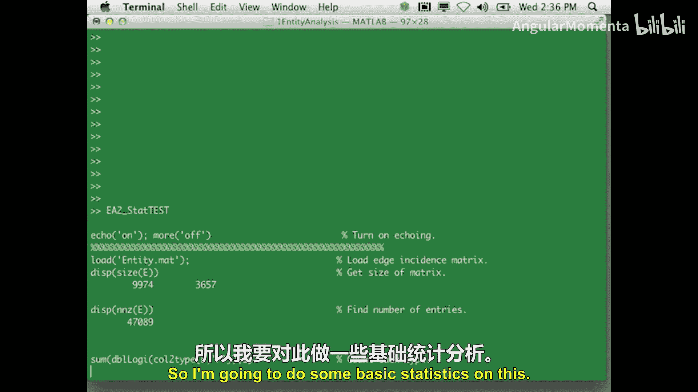

Righty。

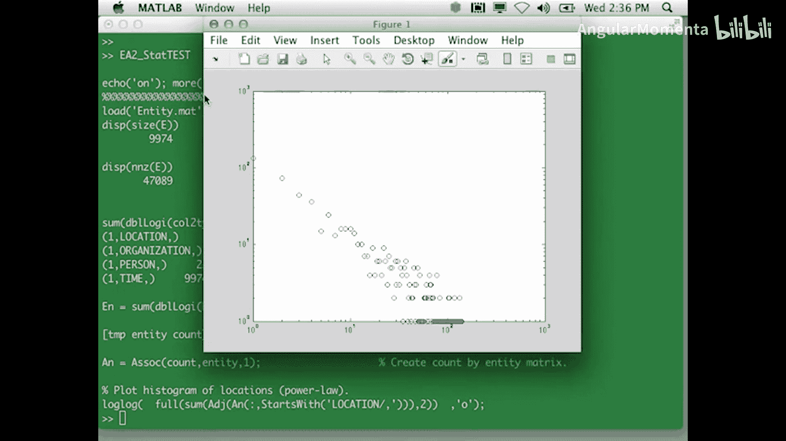

See， that took a lot less time loading it in from a binary。Much， much faster。Much， much faster。

 very fast。Faster than if you had put in a database and read it out of database。

 much faster have to write it out of a file， so we always encourage people to do that。嗯。

This just gets displays the size， so we have， you know that's what we had in the original data。

 and Nz shows the number of entries。So if we do N and Z that， that's the number of entries。Right。

I now want to undo what I did before， I want to convert it back into a dense table。

 I want to take all those values and convert， you know。

 I want to take all those things that I pen to into column because I just want to count how many I want to know how many locations。

 organization people I have。So we have this function here called call2 type and another function。

 Then I forget the precise name that does the reverse， which basically give me an associative array。

 Give me a delimiter for the columns。 And I'm going to now rip that back apart。

 stick that back into the value position。 And then you're going to now sort of essentially make it dense again。

 And so we do that。We then throw away the actual values， and so we do this double loggi。

 which converts it all to once， and then we can sum the rows。

 so we collapse along the rows now we have count that tells me that in this data set I had 9 9600 locations。

 organizations， people， time， those are the distincts。Once's there。All right。

Let's see we can count each entity so we have our thing here。 we just do the count。

 We can find the triples of this。 so basically I've just done a sum。

 so this is the original exploded schema I basically summed all the rows together。

 so I now'm getting an count for each unique entity。And I can find instead。

 if one another way to get the triples is just to use the fine command works the same way that doesn't Mattly。

 but will' now give you a set of triples， a attempt which we don't really care about because we've collapsed that dimension only all once。

 the actual entity in the count。And I'm going to create a new associative matrix out of that。

 So we now have count in the entity。And I'm going to apply a histogram of that。

 so I'm going to go with my count things。 I'm just going to dip the locations out of that。

 So using the starts with command， I say get me all locations。

I'm now going to do real math and I say give me the adjacency matrix。

 which just returns a regular sparse matrix， and I can do some full log， log done。

 Now this is the classic。

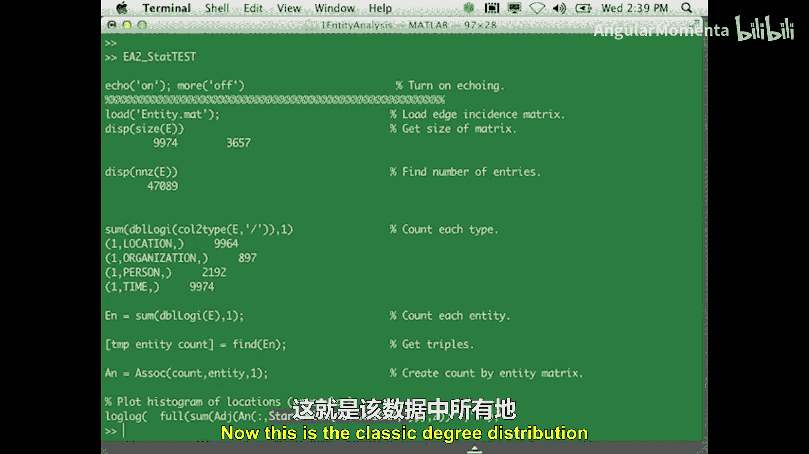

Degreee distribution of all the locations。In this data， and it shows us that certain locations。

Are very common， a few of them are very common， and a few locate either as they appear in most of the documents and a lot of locations。

Only appear in one document。 So this is the classic what we call power law degree distribution。

 Again， always a good thing to check。 Sometimes you can't do this on the full data set。 Its so large。

 but just even a sample， just to sort of， you kind of want to know this from the beginning。

 Am I dealing with something that looks like a power law。 So like everything else or oh。

 what do you know， I see a big spike here。Well， what's that about， you know。

 or it looks like a bell curve or something like that。 And so this is just really， you know。

Computing means good， Comp basic histograms very good。 Without this basic information。

 it's really hard to advance in detection theory。 And so。

 and this is probably where we take a slightly different philosophical approach than a lot of the data mining community。

 which tends to focus on just finding stuff that's interesting where we tend to focus on understanding the data。

 modeling the data， coming up with models for what we're trying to find and then doing that。

 rather than just sort of。Show me something interesting the data show me a low probability covariance or something like that。

 which tends to be more the basis of sort of the data mining community。

Although no doubt I probably offended them horribly by simplifying it that way。

 in which case I apologize to people in the negative mining community but here you know we more traditional detection theory and the first thing you want to do is get the distribution so you can like typically one thing you'll do immediately is like you know what？

We put essentially what we call low pass and high pass filter on it。

Things that only appear once are so unique that they give us no information and things that appear everywhere。

 again， give us no information about the data so you might just have a low pass and a high pass filter that just sort of eliminates these high end and low end types of things。

 very standard signal processing technique that's just as relevant here as elsewhere。

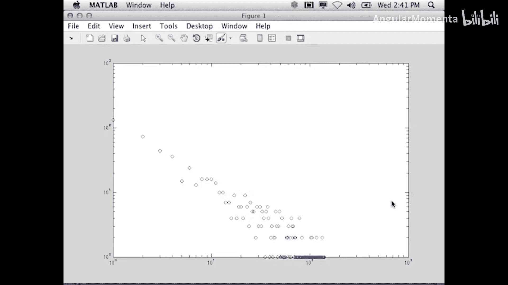

Alrighty。So statistics， histograms， all good things， easy to do in DorM on our data。

Don't be afraid to take your data， bump it back into regular Matlab arrays and just do the regular things you that you would do with MatLb data with MatLb matrices。

 we highly encourage that now we're going to do the facet。

Hourrithm that I talked about in the lecture。Let's do that。Right here so。Once again。

 we've loaded our data in very quickly。We've decided to convert it directly to numeric。

 which is we're getting rid of all those word positions because we don't really care about them。

I'm gonna pick。So one thing I like about this data and for those of us who are a little older。

 you know we remember the news of the 1990s you know this is all Chiter memory9 for those of you a little younger who are in elementary school this will not mean anything to you but it's like。

 oh yes， a lot of stuff about the Clintons in this data。

 so that's always one so the first facet we're going to do is we want to look at the location New York。

And the person Michael Chang， does anybody remember who Michael Chang was？Tennis player， yes。

 he was kind of like this。Hip tennis player used to battle Andre Agassi。

 so I don't know how long his career really lasted， but he was a very。

 this is kind of right at his peak， I believe so now there was to show you that equation that I showed you in the slides wasn't lie so we take our edge or incidence matrix we put in the look picked a column New York。

Then we then pick the column Michael Chang， we need to do this no call thing because we now have a column vector with a column Michael Chang。

And a column New York。 And if we added them together， well， they should have no intersection。

 So if we do the no call， it sort of pops those two column names way。

 So now they're effectively both one， and we can hand them together to find all the documents that contain both New York and Michael Chang。

So we do that， so we've added them together， this is now a new column vector， okay。

And we transpose it to make it a row vector， and then when we matrix multiply it back against the original data。

 we've just computed the histogram of all the other entities that are in the documents that contain both Michael Chang and New York and as we can see Michael Chang appears three times so that tells us there are three documents and New York appears three times。

But we also see Czech Republic and Austria and Spain and the United States。

Anyone to guess why Czech Republic？Was Ivonne Ldeel still playing then。

 I'm just wondering if he had a lot of matches against him。 And then。

 or would he'd already kind of be into fade or something like that。 I don't know。

 Probably some It's probably had some checkzech arch rival or something that。

 Or maybe there was just a tournament。 And these are the type of thing with the Reuters data sets。

 You do have the bonus is that the。The person who types the article always puts the location of where they filed it so so New York could always be and he's just because the person happens to be based in New York and they typed it from New York or something like that。

 so so that's always fine。We can normalize this。So what I'm going to do is take。

the facets that we computed here and normalize it by their sums。Okay。

 so this just the fastest is just showing me how many times something showed up。

 But it doesn't tell me if it's like， well， is that something that is really common or really rare。

 So now we want to look at places at things that were。

We want to see of the other entities that appeared in these documents， how many of them are really。

 really popular and how many of them really just only appear in these documents with Michael Chang in New York。

So as you can see here， so we have Belarus， Czech Republic。Virginia， for some reason。

 and this just shows you look， these are in a lot of the， these have a very low， you know。

 they're being divided by a fairly large number， which means that they appear in a lot of places。

 so they happen to appear in these same set of documents。

 but they happen to appear in a lot of documents。😡，As opposed to。

Michael Joyce or Virginia wade that's a tennis tournament right the Virginia wade tennis tournament or something like that these appear more common and more likely to be something that is like oh that's a real sort of。

Relation that exists between these， these entities。It just shows you how you that， again。

 very powerful。Very powerful technique， basic covariance type of math， so fast search very powerful。

All right， so I think we're now that was three， so we're moving on to four。

So now we're going to do some stuff with grass。All kinds of graphs here all kinds of graphs。

All right。So once again， we loaded in our data very quickly。We're just going to make a copy of it。

And then I'm going to basically now convert the original thing to numbers。

 so get rid of those positions， and now we're going to do well so before we did essentially the facets of the correlation between two things。

 but the real power of D4M is that for about the same amount of work we can correlate everything simultaneously。

So we're going to do square in， which basically is the same as e transpose times Z a little bit faster when we're doing self correlationres。

 but not too much， we could have typed e transpose times E。

And then we we're going to show the structure of that。 So remember we had 36。Hundd57 unique entities。

 So now we've constructed a square matrix。That's 3600 by 3，600 unique entities。

 and we're going to plot that。

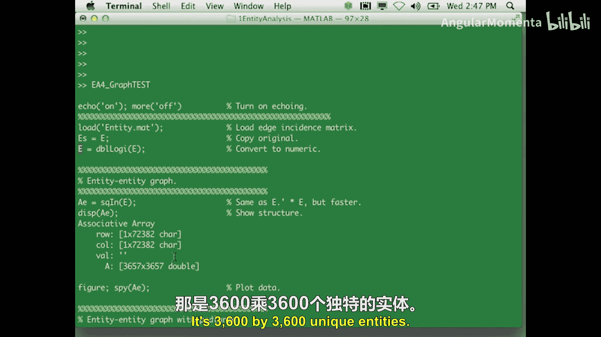

Let's see here。2。One here。So that is。

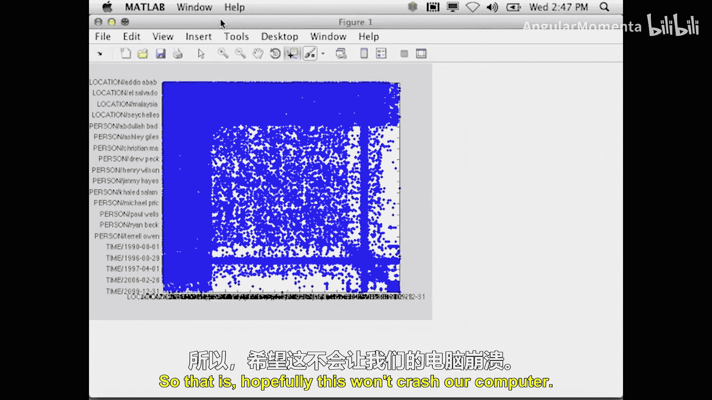

Hopefully this won't crash our computer So this is the location by location this is the full entity entity correlation matrix here。

 You can see all the structure。 These are the location。

 So this this block here is location by location correlation。 This block here is person。

Person correlation is obviously has a dense diagonal。 it's symmetric。

 And then down here are the time time correlations。 And so these， in fact。

 the first thing you'll probably notice is these dense blocks of time have to deal with the fact that this is a finite set of Reuters documents。

 There's only 35 unique。Days or times associated with the documents themselves。

 So those are showing you that the times that are associated with the document reference。

 So that would be a very， this type of structure shows， oh， well。

 if I want to just get the times that were。You know， associated with reporting。

 I can get that or if I want to do they're referring to some date。

 and you can see theres there's times that are in the past and in the future and various types of things like that。

And that shows you the structure， so this is a very nice structure we can zoom in here。

And then you see N more substructureors emerge here。And what's that one？Thisす。United States。

 very popular dense。 You see that very dense thing like the United States here。 Who's this。

 is probably America or something like。United Nations Security Council very popular oh we're the organizations here。

 yeah， we don't have those so many of them， but it's the most popular so you can just just sort of get this feel of the data very powerful because this is often。

For the most part， when you work with your customer and you do this。

 you can be just about 100% sure you're the first person to actually get a view。

 a high level view of the overall structure of the data。

 again a very powerful perspective because they simply just don't have a way to do this and using the sparse matrix as a way to review the data is very。

 very。All right。that。So we did the entity entity graph again。

 what we do is just whenever we take an incidence matrix and we sort of square it or correlate it。

 then the result is an adjacency matrix or a graph between those two things so again adjacency matrices are a projection from the incidence matrix we've lost some information we've always thrown away some information in doing that。

 but often that's exactly what we wanted it。 we want to project it down into a subspace that we find more interesting。

Something else that we can do is let's just look at the people beginning with J。All right。

So I'm going to just get gray little。Starts with entity range here with our starts with command。

 I can pass that into to here to grit the adjust just the records that have the entityP。

 and I'm going to do the correlation of them using this pedigree preserving matrix multiply that we have this very special one so we'll go take a look at that。

And that will explain that what I mean by pedigree preserving。

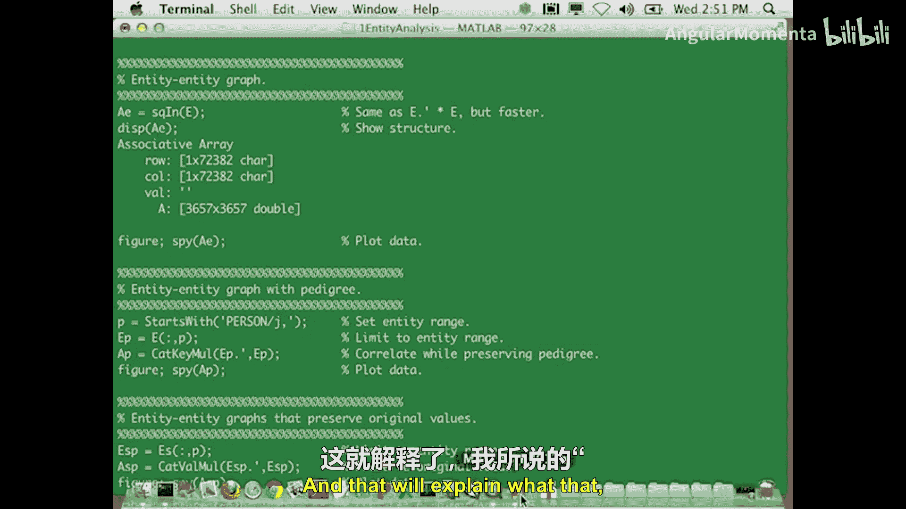

So we go here。So again， this shows you the。All the people that appear together beginning with the name J。

 and it's， of course， again， symmetric matrix， the dense diagonal。Let you click on it。 It tells you。

 So Jennifer Hurley and James Harvey appeared in this document together。

 So when we do that special matrix multiply， it doesn't preserve the values and the normal matrix multiply sense。

 Instead， it preserves the label of the common dimension that's eliminated it。

 So when you do matrix multiply， you're eliminating a dimension。

 we now take that common intersection and throw that in the value。

 So you can now say Jennifer Hurley， James Harvey， we're connected by this document。

 And so very powerful tool for doing that。You notice I restricted it to J。 Why did I。

 Why didn't just I do the whole thing， We you see this dense。Diaagonal here。That's click。So。

If you had a very popular person。Look at all the hits we're going to get when we correlated with itself。

Okay。This becomes a performance bottleneck when we start creating enormously long values。

And so we always have to be careful when we do these pedigree preserving correlations。 If'。

 if it's correlating one set with another， we're not going to have a dense diagonal。

 it's going to be fine。 But if we're correlating something with itself。

 we always have to be on the lookout that we might be creating these dense diagonals in which case we could have an issue that we might create a very。

 very large value and。The fact of the matter is the way we sort the strings。Is。

We convert the list to a dense car matrix， and then call the Matlab sort routine。

 It's the only way we can sort it。And so the width of that matrix is the length of the longest。

String in the list。So they're all about the same length。 It's fine。

 But if you have mostly things that are 20 characters。

 and then you have something that's 2000 characters long and you create a00000 by 2000 matrix。

 you have just consumed an awful lot of memory and sorting that and all that just sort。

 So whenever people say it's slow where they run on a memory， it's almost always because。

They're creating， they have a string list and we're trying to manipulate by sorting and one of the values in that string list is just extremely long。

So that's just a little caveat there very powerful technique you have to watch out for this diagonal and there's ways to work around it that usually are data specific。

 but again a very powerful this pedigree preserving correlation。

 something that usually people want and especially since we almost usually store just like a one in the value。

We're not really throwing away any information， sometimes we want it because we want to count how many times that those happen if we didn't do the pedigree preserving the cat key mall。

 then weve gotten a value of three here and so we could have counted that would have told us sometimes we do them both one that gives us the count one that gives us the pedigree and just store them both and there's different things that we want that we do with one versus the other so again having fun with the different types of matrix multiplies that we can do in the space of associative race。

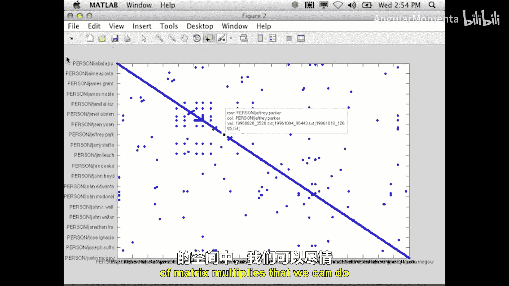

All right， we're running out of time here， but I think we're almost done。 Oh so let me just see here。

 and then we did the document document correlation。 So this is the square out。

 which is E times E transpose。 and we'll just take a quick look at that。 So again。

 here we are figure4。This just shows us which documents are closely related to each other。

 Which documents have a lot of common entities。 So this just says here that these two documents share。

 you know， had one common entity with them， you know， other ones。

I'm just clicking around to you're not having a lot of luck finding one that's got a lot in it。

So maybe maybe around here， now， no， right， well， certainly if I click on the diagonal。Wow。

These are basically prettyrs sparse correlations between these documents。So all right。

 and I think we'll go now to the last。Example， is there last example， yes， for one last for last one。

Yeah。啊。Al'm readyy。So now we'll do the stuff I showed you so far is pretty。Easy stop。

Pretty sophisticated by a lot of the standards that are out there in terms of being able to do sums and histograms and basic correlations that's often significantly beyond what is just sort of the run of the mill which will just run into if you just go into a place that does doing basic analysis。

 So again， we load it， we convert everything to numeric。

 we've now squared it so we created the graph。 now I wanted to get rid of that annoying diagonal。

 So I got the diagonal out。 So just so you know so all I did is I take I know it's a square。

 so I can do certain things without worrying so I can basically take the adjacency matrix that just give me a regular matlabs sparse matrix。

 I can now do take the dig of that。 And since it's a square I can just take those two subtract them from each other and just insert it back in without any。

Harm done， knowing it's like， look， I took a。A square adjacency matrix out did some em emmbulation stuff it back in。

 the dimensions are the same， you know， it should be， it should be okay。

 I might have an issue that I may have introduced an empty row or an empty column， you know。

 which could cause me a little problems。I'm not going to get the triples of that。

Because I want to normalize the values here， so I'm going to get the diagonals showed me how many counts are in each document。

 so I want to normalize any entities in a document by because sometimes you'll get a document it's like。

 and here's the list of every single country that have participated in this UN meeting。

And it'll have 100 in some countries， so a country appearing in that document is not such a big deal because all the countries appear in that。

So this allows us to do that， we can if we want to do a correlation。

 we take the actual value and then divide it by the minimum。

 the least document that'd be the maximum number of hits you could get in the correlation。

We can now do multifacetqueries so we want to do location against all people。

 and so here's a more complicated query which says find me all people that appeared more than four times and with a probability greater than 0。

3 and with respect to New York so here's New York in all these different people who are basically these are people that appeared with New York and almost exclusively appeared with New York so。

So John Kennedy， so this is his son that know was still alive at that time， you know。

 was sort of very popular in the news and and so let's focus on him so let let's get John Kennedy。

 let's get his neighborhood so we can go into his get all the people other people who appeared in documents with John Kennedy and we can plot that neighborhood and。

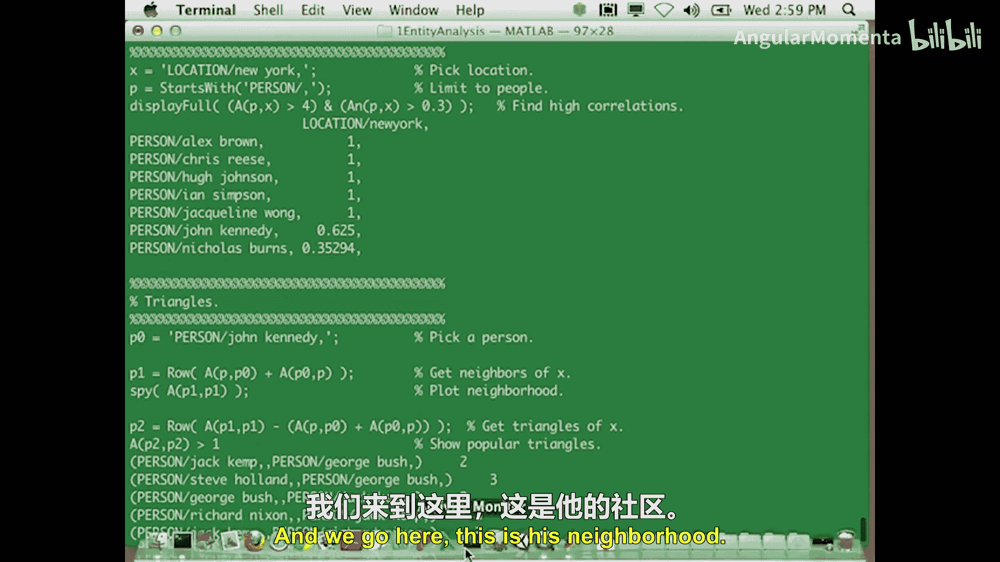

If we go here， this is his neighborhood so there's John Kennedy， his rows and columns。

 and then these are all the other people that appeared with him。

 you see this dense row column and then these are what are called the triangles。

 So these are other people who appeared in documents together。You know。

So George Bush and Jim Wright appeared in a document together， but not necessarily with John Kennedy。

And we can actually find those people by just doing this basic arithmetic gear and this shows us all the triangles。

 all the other people who also appeared in documents together who appeared with John Kennedy and so thats that's what you're at So with that we will we're running a little bit late here so we will wrap it up and you know again encourage you to go into your code and run these examples and try them out and this should give you the first sense of really kind of working with some real data and playing the stuff so thank you very much。

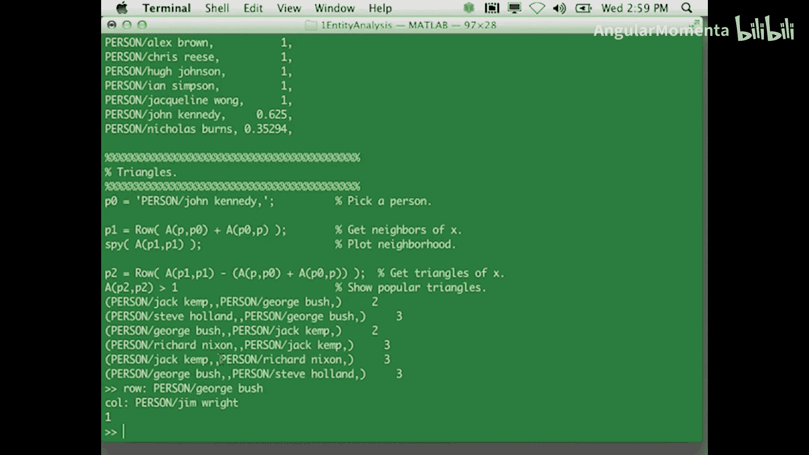

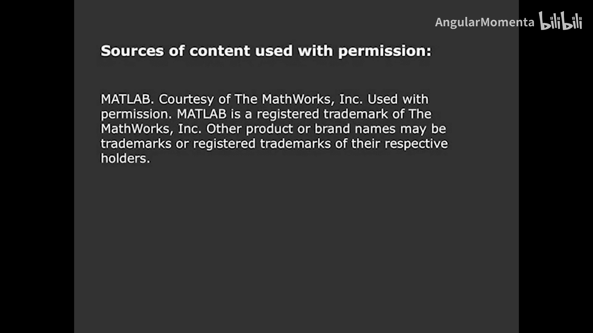