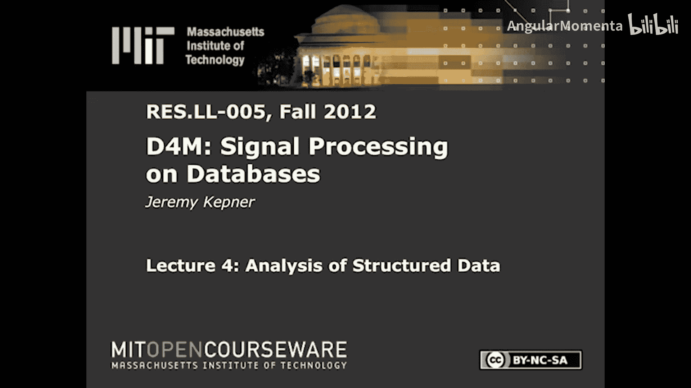
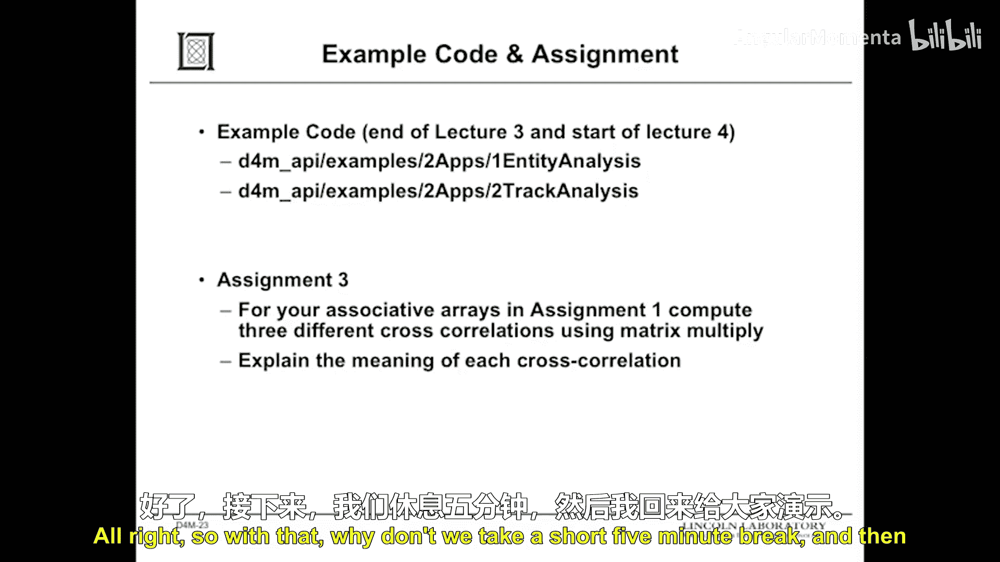

# 【麻省理工】大数据与机器学习数学-｜-MIT-RES.LL-005-D4M-Signal-Processing-on-Databases,-Fall-2012-p12-12-4.-结构化数据分析--BV1eEtTzhE4F_p12-

The following content is provided under a Creative Commons license。

 Your support will help MIT OpenCoursewareare continue to offer high quality educational resources for free to make a donation or to view additional materials from hundreds of mit courses。

 Visit mitopencourseourseware@ocw。mt。edu。

so I want to thank you all for coming。As the yeah。Holiday season comes along here。Dssing that。

people are getting distracted with other things， so a little bit more of an intimate setting today so encourage people take advantage of that。

 ask questions， it's often a lot easier to do when there aren't as many people in the room。

 so certainly encourage you to do that。So let's get right into this。Right。Fortunately。

 the mic actually doesn't pick that up at all for the most part。

But you all can hear the drilling above， yeah。So。All right， so this is lecture。

Four kind of went out of order。To get our special Halloween lecture in last time。

But we're going to be talking a little bit more about the analysis of what we call structured data。

And we're doing more structured type analyses on unstructured data。Again。

 the course is signal processing on databases。This is where we bring the ideas of detection theory and apply them to the kinds of data we see in databases。

 strings， and other types of things there。And。So this lecture is going to talk a little bit more about。

We're going to get into a little bit more sophisticated analytics。

 I think up to this point we've done fairly simple things， basic queries using the technology。

Pretty prettyt simple correlations， pretty simple stuff now we're going to begin to kind of go。

A little bit more sophisticated in some of the things we do， and again。

 I think as things get more complicated， the D4M technology becomes its benefits become even more apparent。

Xiao。So we're just going to get right into this， you know， going to show you our very generic schema。

going to talk a little bit more about some of the issues that we encounter when we deal with particular databases the database we're going to be using for this course is called acumullo。

 and so I'll be talking about some issues that are more a cumullo specific。So。

Aimillo is a triple store。And。诶。And so the way we read data into our triple store is using what we call this exploded。

Transpose pair schema。So， we have。S。We have。An input data set。

That might look like a table like this with。Maybe our row key is going to be somehow based on time。

 and then we have various columns here， which may or may not contain various data。

And then the first thing we do is we basically explode because our triple stores can hold an arbitrary number of columns and can add columns dynamically without any。

Without any cost， we explode the schema by appending our column one and its value together。

In this way， we then just took a value could be anything of like one。

 anything that we wouldn't want to search on。诶。And then we have a row key here。

 I'll get into back a little bit why we've done the row key in this way。 And so by itself。

 this doesn't give us any real advantage， but in a cumullo or any other triple store or in just in Dorm sosociative arrays。

 we can store the transpose of the table， which means that all these columns。Are now rows。

 and this particular database is a row oriented database。

 which means it can look up any row key with constant。

Access so you can look up row keys very quickly and D4M a lot we hide this from you so that whenever you do inserts。

 it does you know if you want this to happen， it will store the transpose for you and so you look like you just have a giant table where you can look up any row key or any column key very very quickly and makes that very easy to do very complicated analytics。

One little twist here that you may have noticed is that I have flipped。This time field here。

And taking it from， essentially。Little Indian and made it big Indian。

And I've always been an advocate of having row keys that have some meaning in them sometimes in databases。

 they just create sort of arbitrary random hashes。Think we have enough random data in the world that we don't necessarily need to create more。

 and so if we can have meaning in our row keys， I think it's very useful because it just makes it that much easier to debug data that actually has meaning。

嗯。And so I've often advocated for creating having a row key be a time like key。

 I think it's good to have time like keys。And。By itself， there's nothing wrong with having a a。

A little Indian rogue key。Except when you go。Parallel。

 if this database is actually running on a parallel system， you can run into some issues。

People have run into these issues， which is why I now advocate essentially doing something else。

 you know， with the ro key more like this。In particular。Acuulo， like many databases。

 when it goes parallel， it takes the tables and it splits them up。And it splits them up by ro keys。

 So it creates continuousuous blocks of ro keys on different processors。If you have。诶。

Little Indian time roki。 It means every single insert。Will go to the same processor。

 and that will create a bottleneck。 And then what will happen over time， It will then migrate。

That data to the other processor， so it can be a real bottleneck if you have essentially a little Indian roki。

嗯。If you have a big Indian row key， if it just uses， it will then break up these things。

 and then when you insert your data， it will sort of naturally just cause that to spread out over all the systems。

 So that is if your data is coming in in some kind of time order， which。You know， happens。

 we definitely see people coming in that you know yesterday， you know。

 today's data comes in today and tomorrow's data comes in tomorrow and you don't want to have it all that data just hitting one processor or one compute node in your parallel database。

Other databases have more sophisticated distribution things they can use as sort of a round robin or a modular type of。

 you know it'll create a hash that does a modular so that it doesn't have that eliminates that type of hotspot but for now we just recommend that people use use this。

This does make it difficult to use the row key as your actual time value and so what you would want to do is also stick。

 have a column called time。That had the actual time in it and then you could actually directly look up and time in that way so that's just a little nuance there。

 good sort of design feature， probably something that you wouldn't run into for quite a while but we've definitely had people hey I went off and implemented exactly the way you've suggested and but now I'm going parallel I see this bottleneck and I'm like oh so I'm going to try and correct that right now and tell people that this is the right way to do it。

So starting out simple， we're just going to talk about kind of one of the simplest analytics you can do。

 which basic getting basic statistical information from your data set。

 So if this is our data set now we have a bunch of know row keys here time like with some additional stuff to make them unique。

 unique rows and then we have these various columns here。

 some of which are the gray ones are I'm saying are filled in and the white ones are empty and so what I want to do is just grab a chunk of rows。

 okay and then I'm going to compute basically how many times each column appears， essentially some。

I'll sum by type， so I'll show you how we can sort of look at if we wanted to compute just how many entries there were in column one or column two。

 computing the covariance， computing type and pair covariances are all different things that we can do。

So I'm going to do all those statistics on the next slide， all those analytics。

 which if you were to do them in another environment would actually be。

You would write a fair amount of code， but here we can do them。

 and each one of them is essentially a one liner。So here is my set of roks。唔该。

I've just created a list of ro keys that have essentially a comma。As the separator here。Oh there。I'系。

嗯。AndThen this is our table T so in the notation we often just refer table T。

 this is a binding to an a cumulo table or it could be any table。

 really any database that we support and so this，This of this little bit of code here says。

 returnturn me all the rows given by this list of rows here and all their columns so we're using the MATLb notation。

 colon means return all the columns。This will then return these results in the form of an Associative array。

Now， since the values。Of that are strings。 in this case， maybe strings of values of one。

 We have this little function here called double loggi。

 which will just basically say ignore whatever the value is and just make it。 If it's got an entry。

 give it a one or otherwise ignore it。 So this is a shorthand for。

For it basically does a lot can does a logical， and then it does a double so we can do map on it。

 So this is our query that gets us our rows and returns them as an associative array with numeric values。

We then compute the column counts。 So that's just the Matlab sum command， which says basically。

This tells you the dimension that's being compressed。

 so it's compressing the first dimension which the rows so it's basically collapsing it into a row vector so it's just summing so that just would tell us now we could then for all those rows count how many occurrences of each unique column of each column type there was。

And then。We can then get。The covariance， the type type covariance by just doing a transpose a or square in。

 these do the same thing。This is usually slightly faster， but not a lot。

 and so that just does us the column type column type covariance， very simple。And then finally。

 we have this function。Which essentially。Undoes our exploded schema。

 So let's say we wanted to return it back to the original dense format where we have essentially four columns column 1。

2，3， and 4， and we wanted the value put back into the value position So we have this function called to type with this and I don't know if the name makes sense or not。

 but that's what we called it and basically it just says， oh。

 this is the delimiter so it takes each one of those splits it back out and stuffs it back in。

 and so then you now have。That associative array you could then do a sum again on that to just get like I want to know just how many column one instances。

 column two instances， column3 is there were are and likewise。

 just doing a transpose a or square n would then do the covariance of that And I would tell you of those higher level types。

 How many of there worse。 So this is a lot of high level information really highly recommend that people do this when they first get their data because it really uncovers a lot of bad data right from the get go。

 you'll discover。Columns that are just like， wow， these two column types never appear together。

And that doesn't make sense。 There's something wrong there or why is this column？You know。

 exploded column， why is it so common when that doesn't make sense， you know， so again， it's very。

 very useful for doing things and we always recommend people start with this analytic。So again。

 that's very simple stuff we've talked about it before。

Let's talk about some more sophisticated types of analytics that we can do here。

So I'm going to build what I call a data graph， so this is just a graph。😡，In the data。

 it may not actually be a real， you may have some other graph in mind， but this is the data supports。

Has a particular kind of graph in it。So what we're going to do here。Is we're going to set。

A couple of a starting column here。Okay， C0， that'll be our set of startdom columns。Okay。

 and we're going to set a column， a set of allowed column types。

So we're going to be interested in certain column types。

 and we're going to create a set of clutter columns。 These are columns that we don't want to。

 we want to ignore。 You know， we want to they'， they're either very， very large or whatever。

 And so the basic algorithm is。That。We're going to get all the。TheThe column。

 all the we're going to get all column， a result is going to be called C1 here。Okay。

 and that's going to be all rows in C0。That are of type C， T and excluding columns。😡。

CL so this is a rather complicated join type of thing that people often want to do you know they want to do these types of things。

 look I want to get all these rows， but I only care about these particular types of columns and I don't really care about or I want to expressively eliminate certain clutter columns that I know are just like always pointing everywhere。

😡，So let's go look through the D4M code that does this sort of complicated type of join， okay？

So I'm going to specify my C0 here and this could be a whole list it doesn't it's just it could be a whole list of starting columns。

I'm going to specify my column types， and in this case I'm going to have two column types。

I'm going to say create a string called starts with， which essentially creates a column range。

 one column range around column1 and run column range around column 3。

 and then I'm going to specify a clutter column here。Whi is just this A and again。

 it could be a whole list as well。All right。 So step1 here is。Is I'm going to pass。

 I'm assuming that this table is bound to one of these exploded transpo pairs。

 So it will know when I give it columns to look up to then point to the correct table。

So we have a C0 here and it will say， all right， please return all row you know all the data that contains C0。

Basically， all those rows。I'm then going to say now just I just， I don't care about their values。

 I just want the rows， so this is an associative array and this command row just says just give me those rows。

 so basically I had a column。😡，Ive returned all the rows， but now I just want the row keys。

I'm now going to take those row keys and pass them back。Into the row position。

 so now I will have gotten all the entire row。So basically， I got a column。I took those rows。

 and now I'm going and striping and painting and getting the whole row。

 So now I have every single and since I don't care about the actual values。

 I just want them to be numeric。Okay， I I I just use the double loggi command。

 so basically I've done a rather complicated little piece of query here in terms of get me all columns that contain all rows that contain a certain column。

And so that's now an Associative array。I then I'm going to reduce to specific allowed columns。

 So I'm going to pass in。I'm going to say please give me just the ones of these particular column types。

 so I got the whole row， but now I just want to eliminate。Those。

I could have probably actually put this in here。But whether it's more efficient or not to do it here or here。

 it's six of one1 half dozen the other， I try and make my table queries just either only columns or only rows。

 it tends to make things simpler。So。So now we do that， we have just those types。

And now I want to eliminate。The clutter columns。So I have a which is just of these type and I want to then eliminate any of the columns that are in this basically column1。

 so I had column one is one of my types but I don't care about that and so I can just do subtraction I can just basically say oh。

 go get the clutter columns and subtract them from the data that I have and now I'm just going to get those columns all right。

And I have now the set of columns I now have C1， so I've completed the analytic I just described in if you you grabing like four lines。

 rather sophisticated analytic。I could then proceed to look for additional clutter， for instance。

 I could then basically query。Say please give me those stick the C1 back in and then sum it up and look for things that had a lot of values and continue this process this is an example of something I might want to do when I had this data set so these show you the kinds of kinds of things more sophisticated analytics that you can do。

I want to talk a little bit about data graphs in terms of what are the things you can do here。

 what has supported the topology of your data， remember。

This this edge list has direction when you have graphs。

 they can very well have edges that have a direction。 And a lot of palinines people say， well。

 I want to get the whole graph。 I'm like， well。If you're doing essentially things that are based on breadth first search。

You may not be able to get。The whole graph， because you're never going at it from the correct direction。

So you are definitely limited by the natural topology of your data。So for example， here。

 let's say I start with c0 as column 1a。So I now have。Essentially this vertex a， let's call it。

And now here。I say， okay， I now want to get。All give me the whole row of all of all I'm going to do。

 give me all the rows that you know， the rows and that。 All right。 So then these do guys pop up。

So I get another A and I get a B， so I got a B here， that's good。And then I'm going to go proceed。

 go down again， I'm like， all right， I'm going to then now say， all right。

 give me all the rows that contain those columns。hoops。And I go down。Gan。Right and I got the see。

 did I get a see？No I never got a seat， I never got a seat in any one of these， you know。

 even though it's all in the data and probably all connected， I never actually got a seat。So。Oh。

 there I got the C now when I did the second time， I got the C。There we go。

So this is an example of a series of bread searches that result in getting the whole。

Graph but the graph had this topology and would naturally admit that。

So certainly in this particular case， the data and the queries were good for this with what we call a star because essentially it's a vertex with everything。

Going into it。Let's take a different graph。This is what we call a cycle。

So we see we have a little cycle here going like this， we start again with A。We get our。Columns。

 you get c1s across here。And that's kind of the end of the game。You know。We get A's。We get a B。

But we're not going to get anything else when we call them back up we're not going to get anything else。

 And so we're basically stuck here at B we weren't able to get to C or D。

 So these are kind of a little more subtle things than one has to worry about and。

And once you see it， it's kind of oh， of course， I can't do， I'm not going to get the whole graph。

But you'd be amazed at how many teams we like， I wanted the whole graph and I just can't do it and it's like。

 well。You don't have the edges going in the right direction， you know， for you to do that。

 you're going to have to think things through a little bit more。Xo。I just want to。

 it's kind of a little。Catch that I want to point out to people because it is something that people can run into。

We're going to do a little a different type of analytic here I've changed some of my columns here。

Have some I'm going to be， let's call these coordinates I'm going to have now with my data set an x and a Y coordinate that I'm storing in different。

Rows and columns as I want to do some kind of space windowing。

 I want to find all data within a particular X and Y a coordinate。All right。

So I'm going to do is I'm going to select。A set of data here are a set of rows。

 and I'm going to give a space。Polygon。And I'm going to query those get the data。

And then I'm going to extract the space coordinate from the values there。

 and I'm going to return to all columns that are within our my space space window here。And again。

 this is good for finding all in a particular space window。嗯。😊。

If you're concerned that you're going to be getting an awful lot of like if you have like a。

Let'd say you have a coordinate that goes through New York， you know。

 and you're concerned that that's just going to you don't want to get， you don't want New York。

 but you happen to be on the same latitude or longitude in New York。

You can do something called meinization， which basically is essentially imagine taking your strings of your coordinates。

And interleaving them。And now you've essentially created。An ASII based grid。Of the entire。

Planet and so that's a way of sort of if you want to quickly filter down you can get a box and then go back and do the detailed coordinates to prevent yourself from having to do。

 so that's a standard trick and there's variety of meinization schemes that people use for interleaving coordinates in this way I think Google Earth has a standard box now as well I find this the simplest because you literally just take the two strings and and interleave them and if you have a space you can actually then do with variable precision because like if you just like oh space I don't know and it all will kind of works out pretty nicely and you can read the coordinate right there。

 you know like the first one is the you know and you can include the plus and minus signs for latitude longitude So you know maybe not the most efficient a scheme but one that's human readable and I'm a big advocate of human readable types of types of data schemes。

All right， so let's actually do that analyticstic。 So again， so I created my。Got selected my rows。

Got my X and Y coordinates in those rows。And then figured out。

Which columns they were that satisfied that。All right， so let's do that now in code。Yes。See here。

 So we have the。Let mean。All right。So we have I gave it in this case I gave it a row range so you can do this is what a range query looks like if you give any either an associate array or a table something that is a triple。

 essentially that's a string，Coal and another string， it will treat that as a range query。

And we actually support doing， if you have multiple sets of triples， it should handle that。

 which is good。I'm going to specify my bounding box here， essentially a box and。

I happen to do with complex numbers just for fun， just because complex numbers are a night way to store。

You know。coordinateords on a two dimensional plane and MALb supports them very nicely complex numbers are our friends。

 so there you go， but I could have just as easily had a set of x of y vectors。

So I'm going to get all the rows， so I query that very good， we have that。

And then so that just gives me that set of data， all those rows。I then use my starts with my X and Y。

Okay， to get just the columns of those x's and y's。

And I'm now going to convert those exploded schema back into a regular table。

WithWith this call to type function so that basically takes those values。

So it takes those coordinate values， so like we saw， it takes these coordinate values here。Okay。

 like the01 and it puts it back into the value position。And then so now I have。

 though it will still be a string in the value position。

 which our associate universe can handle fine， but I now want to really treat it like a number。

So we just have overloaded the standard MATLb string to numb function。

Wwhich will convert those strings and we'll store them back you now have an associated rate with numbers in them so we call this Axy and now we can do something we basically can extract the X values here so we have AXy and say。

 all right give me the x column and then AXy and give me the Y column。

And then Matlaab has a built in function called in polylygon。Whi you give it a polygon。

 so I give it the real and the imaginary parts of our my polygon here S and the x and Y coordinates and will return in you know。

 essentially the value of is that。Is that in there？

And which is great because you know there are many dissertations written on the in polygon problem and it's nice that we have a nice built in MatLb function to do that。

And then now I have that and I can just pass that back into the original A so I do find so this actually returns a logical of zeros and ones。

 if I do find then that will return a set of indices and I just pass those indices back into a and then I can get those columns and there we go all very standard MATLb like syntax again this is a fairly complicated analytic if you were doing this using other tech technologies I mean I'm sure all of us would be writing a fair amount of code and this is just the kind of thing that we can do very easily in D4M。

啊。Another analytic， which is probably a bit of a stretch， but I was just having fun here。

 is doing convolution non strings。Which is a little odd。

But I gave it a whirl so so what we want to do is we want to convolve some of our data with a filter。

 I mean， convolving with filters is a standard type of thing。

So it's the standard way we use do detection here， and so the way we do that。IsOnce again。

 I'm setting a I give a list of rows that I want here。

 I'm going to create a filter which is just essentially a box of you four essentially four wide box。

So I get my rows， all right。And then I， I。啊。嗯。Convert them to numeric。

And I'm going to do my convolution on the X columns。ok。So let's see here， so I'm going to get these。

 I'm getting， I'm basically I'm getting all the X coordinates， all right。

I'm going to sum all of those。Okay， so I basically now have all those。All right。

 and now I'm going to pop those back into their values。

And now I can do a convolution and this convolution works if。

One of the axes is sort of like an integer sequence type of thing so you can do you know it tries to extend that naturally。

 so something to play around with， you know if you want to do convolutions we' sort of support it and I'm sure if anyone have you do play around it we'd be glad to hear your experiences think about how we should extend it。

So these are all sort of basic standard first order statistical analytics that one can do on data sets and we can support them very very well。

 let's do some more complicated what I would call second order analytics。All right。

So I'm going to do something called a it's a complicated join essentially。

 what I would call a type pair。So what I want to do here is I want to find all rows that contain。

Values of that have that I want to find rows that have both。A value of type1 and of type 2。

 so I'm going to specify this to be you know basically x to be type 1 and y to be type 2。

 and I want to find all data that you know has has entries in both those very so very standard type of join type of thing。

And this is done a little bit more complicated than we need it to be just to show you kind of some of the richness here。

 you could kind of take a fork at any， we could probably do this whole thing in about two lines。

 but I'm sort of kind of showing you some additional sort of features of D4M in the spirit of this analytic。

😡，So again， I'm just going to use a range query here， so I have this range。

 I'm going to have my type 1 B starts with x and my type 12 B starts with y， so I do my query。

 I convert all the string ones to numeric ones and then what I'm going to do is I'm going to basically allright。

Get me all the columns of type 1。Allright。Sum them all together。

Find everything that equals then and I only care about the ones that are exactly equal one。

 So like I don't if I had two x's， I'm like， no， I don't want those。 I want exactly one X in。

This row。All right。피 피 피。And then I'm going to take those rows that have exactly1 x。

I'm going to put pass them back into a， so I now just get the rows that have exactly 1 x。 right。

 I'm going to filter it again with CT1 and CT2， although I don't need to do that。Alright。

And I'm going to sum it again。And now I'm going to say all right。

Getive me the only ones that are exactly two。 so I know my x is exactly one。

 So in order for it to be exactly two， that means my y also had to have only exactly one entry in it。

 so now I have the data that just has exactly one of each of those。😡，All right。嗯。😊。

Now I want to create sort of like a cross correlation pair mapping of this。Okay。

 so I'm actually going to look for x's across columns that appear。

 say I want to look for x's that appear more than one in one with more than one y or a y that appears with more than1 x。

So there's a variety of ways to do that here what I'm doing is so I've gotten the rows of a that have exactly one x and Y。

 I now pass that back in my seat to get the x's again。And。

One of the things that we've done that's kind of nice is we've overloaded the syntax of this query on our Associative arrays and in our table queries such that if it only has one argument。

 it will return an associative array， but if you give it three output arguments。

 it will return the triple。So in this case， the row， the column and the value。

 and I don't care about the row and the value， I just care about the column。

 but that's a nice way we're often want to in certain cases we want to bump back and forth between the triples representation and the Associative array implementation now you always can use the fine command around any associative array just as you can in normal MATLb matrices and that will return the triple。

The advantage of doing it here is that when I is that it's faster because。

What we actually do when we do the query internally is we actually get the triples。

And then converted to an associative array and if you just say I want the triples。

 we can just shortcut that and give you the triples right away。

 So sometimes if you're dealing with the very large associative arrays or some operation that's just you know this is this I want to get some more performance back then working especially like if you're like well I only care about one thing I don't care about all of the values I don't really need to be a full associative array then that's a great way to to sort of short circuit that so do that here and now we can construct a new associative array。

 which is just taking the x's and the y's and creating a new associative array with those all right and that just shows me the correlations you know between the x's and the y's and I can then find Ct basically x's that have more than one y so I just sum them there or y's with more than one x's again these are very similar to analyticss that people want to do and again very simple。

to do and again showing you some of the different types of syntax that are available to you in D4M。

 again， if you're used to using MALA， these types of tricks are very natural。

 we're just showing you that they also exist within D4M。So here's another one。

So I wanted to find column pairets C1 and C2。And get allCOs C1 and C2 and find the rows that have just one entry in C1 and C2。

And it basically checks to see of data pairs are present in the same row， again。

 something that people often want to do。 got a complicated type of joint。

 So here we have a set of columns 1， C1， a set of columns C2。All right。I want to create this。

 I want to sort of interleave these together into a pair。Okay。

 so I want to create some concept of a pair。 and so we have this function here called cat stringing。

 which basically will take two strings and another delimiter。And we'll basically。

 if they have the same number of strings， we'll just interleave them together。

 If one of these is just a single string， it will just then essentially prepen or append that。

 So for instance， if you were wondering how we actually create these exploded values of like call1 and B。

 that's just basically using this function here。 we t we had the values。 We had the columns。

 we put the essentially the pipe thing in the middle and it just merges them together。

 So we now have sort of interleave these two together。 So we'll now have something like。

Call 1 B pipe。 Call 3 B pipe。Coma as the the separator。

 So now I can create a set of pair mappings from C1 to its pairs。Okay。

 that's A1 to its pairs and A2 its pairs。I can get the columns of those A1 and A2。

 and then I can find all the pairs by essentially through this combination of matrix multiplies and additions and et cetera。

 So a very sort of complicated analytic done very nicely。

And then there's a whole bunch of different ones you can do here。

 these are almost semantic extension the column types may have several different types and you want to do so for instance。

 if I have a pair of columns here， column 1 and column 3 I could say well that also implies this column 3 equals column1。

 that's one kind of sort of a pair reversal type of thing。

 you'll have extensions you might say look if I have a column 1 a that also implies that really there should also be a column 2 a and other types of things like that and so these are just types of things that people do with pairs that are often very useful。

And I think that basically brings us to the end of the lecture portion of the class。So again。

 just the exploded schema really allows you to do this very rapidly with your data and you can implement very efficient graph analytics as a sequence of essentially row and column queries because we use this very special exploded transpose pair schema and increasingly as you become more and more skilled with this。

 you will discover that many， many， many of your analytics really reduced to matrix matrix multiplies that matrix matrix multiply really captures the full sort of all to all。

Correlation that you want to do without having to kind of you know。Figure things out。All right。

 so I'm now going to go and show some not these specific analytics。

 but some analytics that are more sophisticated based on the Reuters data set。

 if you remember a few weeks ago， we we worked with the Reuters data set。嗯。And so。Let's see here。

 so we did we already did the entity analysis application a few weeks ago。

 I'm going to now do basically what happens when you construct tracks。

 which is a more sophisticated structured analytic。And。

The assignment I'll send out was basically doing more cross correlations。

 For those of you who have kept it going here this far and continuing to do the homeworks。

 I'll send this homework out to you， which is basically just cross correlating the data sets that you have。

 again， and not a。Not an assignment that really requires you having done the previous assignments。

 just any data set， pull it into an associate array。

 and then new matrix multiplies to figure out the cross correlations and what they mean。All right。

 so with that， why don't we take a short five minute break and then I'll come back and show you the demo。

