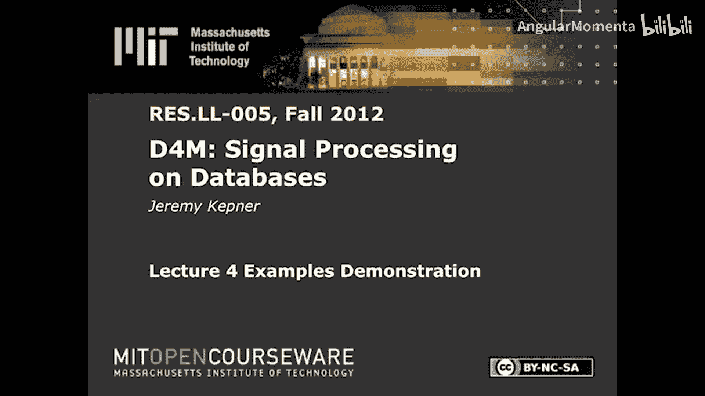
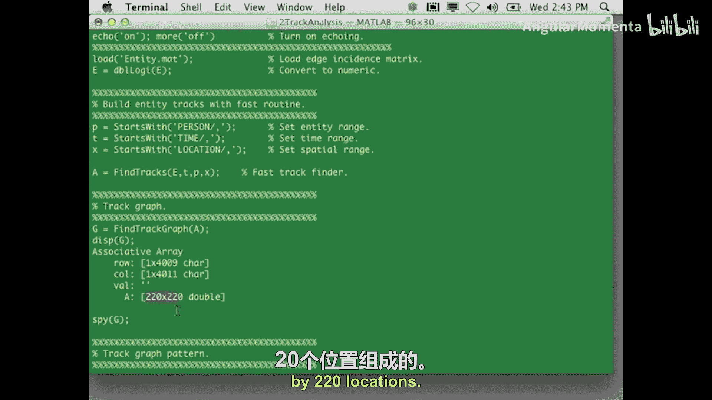
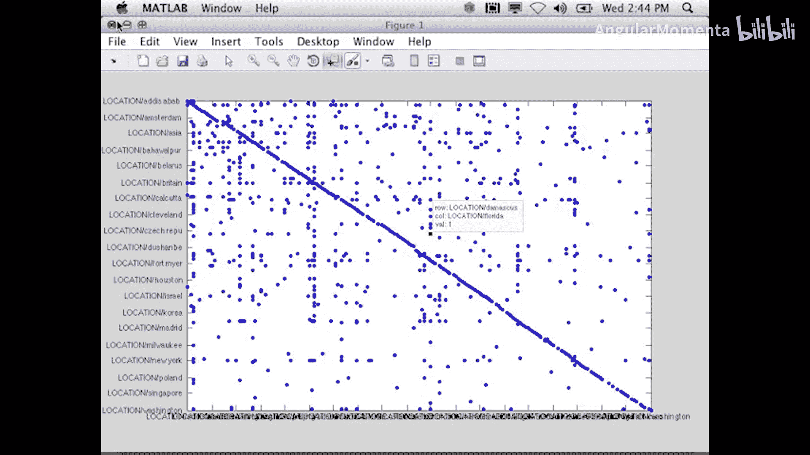
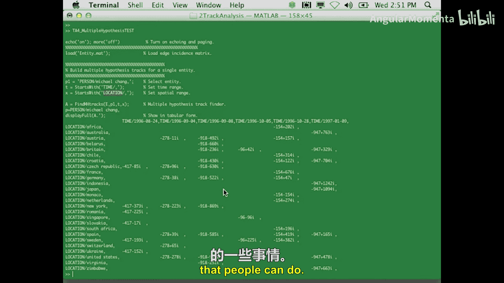

# 【麻省理工】大数据与机器学习数学-｜-MIT-RES.LL-005-D4M-Signal-Processing-on-Databases,-Fall-2012-p13-13-4.-示例演示--BV1eEtTzhE4F_p13-

The following content is provided under a Cative Commons license。

 Your support will help Mi T OpenCourseware continue to offer high quality educational resources for free to make a donation or to view additional materials from hundreds of Mit courses。

 Visit Mitopcourseseware at Ocw。 Mt Eduu。

All right， we're back。So I think we just went over just sort of a tour of some of the more complicated analytics that people can do and now we're going to show some examples of not those specific analytics。

 but using the Reuters data that we had before some of the analytics that we can do here so again again this is in the D4M API we go into the examples directory。

 its apps， and now we're going to deal with tracks。And this is。This is this is the data set here。

 The data actually， this entity dot mat was actually created in the previous。

And this entity analysis actually creates this entity dot map the same， same file。

So we just have over here。

So let's get started。And。Just to remind people， we do load entity。That。See we have this E here。

 that's the data。It represents。Essentially。Almost 10000 documents and 3600 entities in that。

 if we do spy。Yida。Transpose。Better。And so there you go。

That is the entire data set against bypl very useful tool for doing that so you can see we have locations and people and times in this data set。

And we also have organizations in here。Can zoom in on that。 We want to。

You you can see these are the locations and then the organizations and the people。

Seeing them a little bit more。Actually， look at the actual values here and you see there's this calm popular location here。

 What is that。That's the United States。 Yes， the United States does appear a lot in Reuterss documents。

 as would expect。 What do we think this one is here， Any guesses。What。Yeah， oh。

 see it's already there in New York。 Yes， we can read。All right。Organizations。

 anything really popular here， and maybe this guy is popular。International Red Cross， right。

 and people here we don't have any really popular people in this list。Ahmad Shah Maud。

 I have no idea who that person was back in 1996。Anyway， so that's the data。And you see by the way。

 every single time you click because when we make those spy plots。

 I have it make do some compression on the strings just to make it work but we actually always print out onto the screen。

 the full exact string， sort of like I want that string you can just then copy it if you want to say copy and paste it or something like that or the full person or something like that you can then copy that。

And pacee that know。Do something like that， right。That， this guy。And there show。

 that's all the documents that contain。This person's name。

 and then this shows the character position I believe that they appeared in the document， so again。

 have all kinds of fun。诶。Oh。It gets us all those rows。

As those rows back in and let's say we want to do starts。With。See here how about organization？

Everyone correct my spelling here。 I'm going to type this from organization。And slash all right。

 there we go。And。Yeah， I always get that wrong stars with。Starts with scenery。All right。

 there you go。 So this shows you all the organizations that are cited in the documents that contained this person's name。

 you know， and you see how it kind of。And this is kind of the spirit of it right， I mean。

 it's like just oh， I want that。 I can get that oh and then I could then say， all right。

 well give me， you know， and you could just keep going and going and going， you know， if I did RCV。

 you know of that right， it would now return those as triple。 So R those are all the documents C。

 those are all the columns V there we go you get you get the idea So again very。

 very powerful type of syntax there All right。So I' just give you sense of the data that we're looking at so let's look at the first example here。

 so we're going to do track analytic build test so this is going to build some tracks out of this data so I have these documents and they have locations in them and people and times。

 so I could say hey， if there's a person and a location and a time in a document。

 you know maybe I could call that sort of a track。Right， so let's do that。 So what do we do here。

 So the first thing we did is we loaded the data。The string values are those character positions。

 We don't really care about those。 So we're going to just get rid of them and just convert it to numeric like we like we've always been doing here。

 And then I'm going to say my。Thing that I'm want to track is going to be anything starting with person。

 So I said that and my time thing is going to be anything starting with time and my location thing is going to be anything here starting with location。

 So I've done this starts with to get these ranges。

And now the first thing I'm going to do is I want to limit。

My data to only rows that contain that have at least one of of all three of those。

 So I'm not dealing with。 I have a person and a location and no time whatever I'm just going to clean that up。

 So basically， I get all the people。And I sum that， basically I sum all sum across the columns。

 so I basically compress the columns。And then I sum the rows。All right。There we go。Some those。

I get then， all three。And then I filter them back out。

 And that just reduces this to the ones that contain just。The ones that have these。Let's see here。

 So now I want to collapse these into I want to create essentially just want to get edges and times。

So I can do that with the call to types syntax and the valve to calls syntax and going pop back in。

Bpping back and forth between that。 so I get a set of edges， the edge list。

 which is essentially the document and the time and now I'm going to combine these back together into a new associative array which is essentially still has the same text label edge which is essentially the document but it has columns of time and the value as space all right and then I'm going to do another one which is again。

 same has a row which is the document or the edge and it has a column of space and a value of time and now I can construct a track from this through this wonderful sparse matrix multiply。

So essentially， I transpose ETX。And then I'm going to just get the people。

And convert those numeric values。And then we do this cat value mall。

 which will actually convert that。 So and I can also these are time tracks。

 and these are space tracks。 And again， it's a little difficult to explain to you exactly why this works。

 why these matrix multiplies give us the answer that we're going for because you're going to have to like sit and think about the actual matrices。

 So this is a great example to go do and then explore these various associative arrays to actually see why these matrix multiplies actually。

Give us the answer that we want。 so， in fact， we can take a look at those。

So I' look at figure one here。So this shows us basically and I plotted the transpose of this。

 but so we have basically the people all right， and then these are times and so basically for each row here。

 I have a listing of times， then if I click on one of them。It'll give me a location。Okay。In fact。

 I think that numbers the number of times that appears。So basically we have here the person。

 Daniel Smith was in a document with a timestamp of 1996， November 12 oh， that's almost yesterday。

 and then the location New York appeared once in that。You have any here。

Here's another one and so so this is a track of sorts we basically have a person and a set of times and a set of tracks。

That's one kind of track。Another kind of track here is now we have person and locations。

So that was the other matrix multiplly that we did， and so now we have person Carol King， location。

 Buffalo and on this time。So those are two different ways of representing the tracks。 Obviously。

 these are triples， but then you can use either of these matrices to do additional queries and other types of things。

All right， so that just shows you how using matrix multiplies and other types of things you can construct more sophisticated graphs or data structures in this case。

 tracks， which is very interesting。I of thing。Let's move on to the next one， that's going to be Ta2。

So there's a slightly more sophisticated track builder against the one I read I read the data in。

 I create my three sort of categories here， the sort of the object and the time and the location or the coordinate。

 and then I have a。A function here called F tracks。

 which actually just goes and creates those tracks that I essentially did in the last。Last section。

To be honest with you， the reason I did that is because some of those matrix multiplies used to be really。

 really slow。And so I did a sort of special function that took advantage of certain parts of properties of the data to make it find these tracks much faster。

 Eventually I broke down and just optimize the matrix multiply。

 And so now that in the past when I ran that last query before it would have taken like a minute to actually run the analytic which which got annoying。

 So I optimized it。 but we still have this code this code is you know shows all kinds of little tricks and techniques for doing things that are you slightly better and using triples instead of associate arrays if you want to do optimization。

 So we leave it here。 but but the matrix multiply performance is now pretty good that these tricks are less necessary。

 So we want to do here， we have this track now。 and I want do a track query。 So I have a person here。

Michael Chang。Another person， Javier， Sanchez。Now， Michael Chang was a tennis player at this time。

 Was Javier Sanchez also a tennis player at this time。I don know。

 I think there was a heavier Sanchez that was a tennis player at that。So we just want to look。

 we're going to just do essentially here A and just say give me of this track。

And say give me the listings for these two people， P1 P2。

 and then we use our display full command to sort of make them in a nice neat tabular format and you see here basically here is Javier。

 Sanchez's listing okay and here's Michael Changs and you see there's no overlap here。

 we don't ever have them in the same time or same place。

We can also do things like track windows so we can say I want to set a time range here。

And a location， Australia， so if you have our track thing here and I say all right。

 give me the time range T and then equal to all locations， Australia。

 this shows me all tracks that essentially went through this location in this time window and these are the different folks that list they list Sanchez Melissa Russo。

 whoever that was， Michael Chang and Michelle Martin。

 So those are just like an example of a more sophisticated analytic and here we're using the fact that for our associative arrays。

 okay we actually have defined equals equals。So this only works though if x is a constant。

So it will check the value to see if that value， if it's a string。

 if it's equal to that string or if it's a numeric value。

 if it's equal to that to that numeric value， but it only works with。A constant。

 one could argue that maybe I should make this work for a list of。Of strings。

 But then the Matlab syntax doesn't really work there either。 If I have a matrix equals equal to。

A list of， I don't know。 I don't know if that really works。

 So we try and preserve the matlab syntaxt where we can。 And again。

 then we're just getting the columns。 Again， this thing returns。 and associate array is equal equals。

 It returns the associate array of all things that are equal to that。

 And then we can look at their columns。All right。Moving on here。Next one is T。

So those are fairly simple track builders。 Let's begin to do something that's， I think， kind of。

You could imagine。You know， doing that track analytic。

 one could imagine doing that with existing techniques that are out there。

 existing tools and stuff like that。 It would be long。 You would write a lot of code to do it。

 but you could， you could you could do it。 Now， let's do some things where you'd be like， wow。

 this is really something that it would just be prohibitively complicated to do it using other techniques。

Alright。So once again， we load our data， we convert it to numeric。

 we get our object and our time and our space keys， we find our tracks。

 and then we've built something called find track graph。All right。

 and this is actually not that complicated， but it is more than like one or two lines。

 but what it does， it says， okay， I have this track， this track is a sequence of locations okay。

 in a particular time order well now I want to build a graph that's location by location so if a track started in one location and then when its next destination was another you know that will of course that create a new graph okay so I now have a new graph which is essentially 220 by 220 locations。

Okay， and we can actually take a look at that。And that's this graph here。So this basically says。

You know，There was a track that started in Belgium， and then its next stop was Albania。

Or here's another one。 It started in Australia。And in Colombia， and obviously， we have a dense。

Dagonal here because of you know， by definition， well。

 actually a lot of times they that's just the way it works。And so again， here's Damascus， Florida。

 all this type of thing， so now we've created a new graph of these tracks。

Alright。Now we can do something like a track。Pattern。

 so let's say I just want to look at the tracks associated with。

People associated with the Or International Monetary Fund。

So I'm going to do I'm going to starts with person， okay， and I'm going to limit my data。

 so I have my I'm going to basically limit it to data that begins with the organizational now buildinging a new graph G0。

Okay， fine track graph of just that data set。So I've basically taken my a， which is this graph。

 I said， oh， just go back and find me the people associated with the International Monetary Fund。

 And now I can do things like， all right。Because this track graph。

 the value is the number of times that occurred。So for instance， if I say。

 show me now all edges that occurred more than twice。All right， and。

Where the tracks that were due to people associated the International Money tax Fund were greater than 20%。

Of all the tracks that occurred so basically I'm looking for something that happened more than twice in that you know IMF folks did more than twice and of all the data。

 the IMF people did it you know a lot of the time so we're in a lot of people wasn't just a really really popular track and so we see here now we get Kaarachi and Afghanistan so we had essentially at least two of those and all of them where people associated with the IMF。

 Afghanistan， Britain， here's Britain and England well obviously that's a little bit。Go up。

Written and England are the same thing right at a certain percent here's Islamabad Islamabad， Moscow。

 Moscow so this just shows you the kinds of things that you can that you can do with type thing again this is a very sophisticated type of analytic you were to try and do these things using existing types of things。

If you knew this was the analytic to do and someone handed the to and said go implement it using another technique。

 you definitely could do it。 But discovering the analytic using existing techniques would be very。

 very time consuming。 And this is this kind of tools very。

 very easy for you to explore and get the anatic just right。 And I would say that in certain sense。

 what D4M is doing here is doing the same rule that we've always used Matabb for in single signal processing。

 people use it to play with their algorithms to figure out their algorithms。

 get their algorithms right。 like they know this will give us the right answer。

 And then when they deploy it and actually make it part of real system。

Sometimes they'll just take the MatLb code and make it a part of the real system。

 but more often and not， the target system or the target application will require you to port it to some other language。

 maybe C+ plus maybe Java for deployment reasons we still see that happening today that you know algorithm development is one thing deployment is another thing。

 even if people use the same language for doing algorithm and and deployment。

 usually the deployment people end up having to completely rewrite with the algorithm analyst wrote anyway because the algorithm analyst had a certain things that they were concerned about and the deployment person will have completely different issues that they have to worry about。

 but I think Dra allows you to still do that same kind of model on this new types of data very。

 very in a very useful and productive way and sort of get the productivity that we want out of that。

All right， and I think let's see here。 So finally， one last thing， a more complicated analytic。

Which I call sort of a multiple hypothesis tracker。Essentially。

 what we're doing here is we're loading the data。We're going to just focus on one person here。

All right， and then the locations are you know specified by time I mean the time is specified by the time column and location specified location and then I'm going to have this function called fine multiple hypothesis trackers for Michael Chang with respect to the data set E and what this does is this says all right in the previous thing I was basically just making kind of one pick you know if I had a document and Michael Chang was in it and there was multiple locations and times I would just sort of pick one of those locations and times here I'm now going to show you for Michael Chang for each document all the locations in times So here's basically you know Africa and time and let's see here maybe we can make this little smaller。

Then。Little smaller。There we go， you can barely see that， but you see here。

 so this basically shows all the times。All the locations and this shows you， you know。

 essentially the full in theory， the true track could be going through any any one of theses there's multiple there's into a single track really for Michael Chang。

 there's multiple potential tracks and then this complex value I have store here just because I'm using comp is the first one is the character distance。

The location is。To this， so that Michael Chang appears in a particular word position in the documents。

 and it tells me that Austria appears 278 characters before him and that the timestamp。Appears。

11 characters before his name。And so over here you see the timestamp。Yeah。

Appears this is a different document and appears you know but with a certain same time this show appears in a different different locations so you can then use this data to actually go back and say。

 you know what I only want I want to pick the words that are closest to Michael Chang and I want that to actually be the real track for Michael Chang so。

That just shows you kind of the more complicated things that we can do with that。So with that。

 that leads us to the end of the examples and if there's any questions， be happy to take them now。

All right， good， I'm just showing you some of the kinds of things that people can do。

And so there am。

