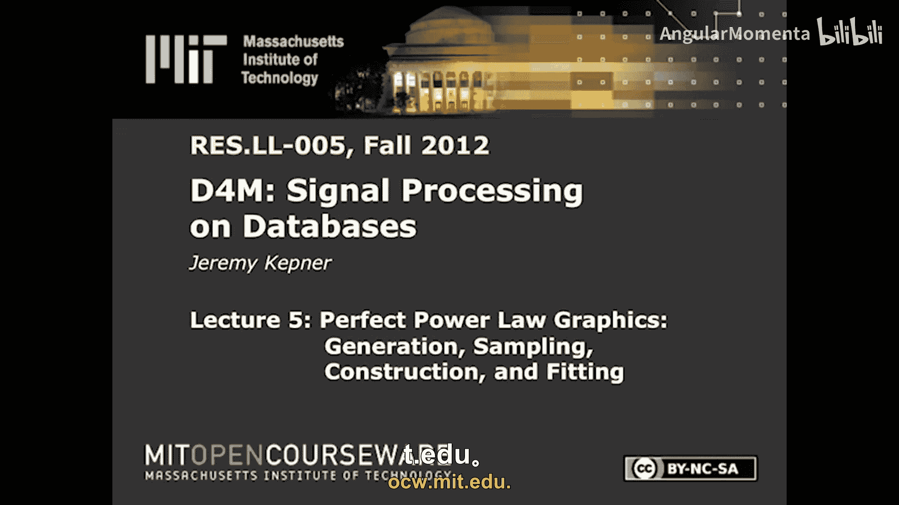
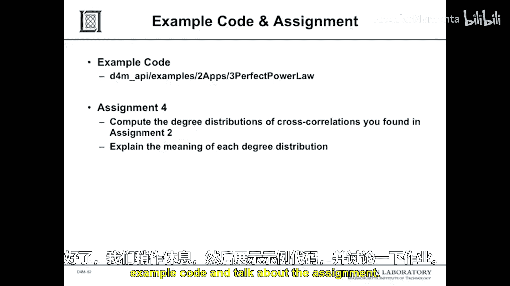
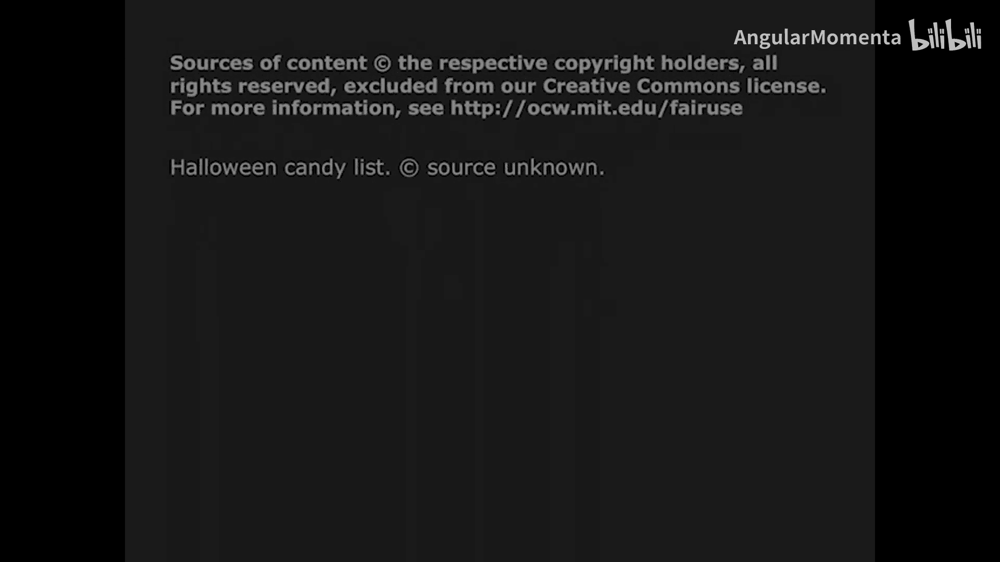

# 【麻省理工】大数据与机器学习数学-｜-MIT-RES.LL-005-D4M-Signal-Processing-on-Databases,-Fall-2012-p14-14-5.-完美幂律图——生成、采样、构建与拟合--BV1eEtTzhE4F_p14-

The following content is provided under a Cative Commons license。

 Your support will help Mi T OpenCourseware continue to offer high quality educational resources for free to make a donation or to view additional materials from hundreds of Mit courses。

 Visit Mitopcourseseware at Ocw。 Mt Eduu。

Welcome， happy Halloween。And for those of you watching this video at home。

 you'll be glad to know the whole audience has joined me and they're all dressed out in costumes。

 you know， and it's a real fun day here as we do this， so making me not feel alone in my costume。

 you know， a lot of moral support there， so that's great。So yeah， yeah so。

So this is a lecture lecture 05 on signal processing on databases just for recap for those of you who missed earlier classes or。

Going is out of order on the web。The you know， signal processing really alludes to detection theory。

 finding things which alludes to the underlying mathematical basis of that， which is。

Lar algebra and the database is really refers to working with unstructured data。

 strings and other types of things， two things that aren't really talked about together。

 but we're bringing them together here because we have lots of new data sets that require it。

And so this this talk is probably the one that's getting most into something that we would say relates to detection theory because we're going to be dealing with a lot with background data models and in particular power laws and methods of constructing power law data sets methods of。

Sampling and fitting and using that as a basis for doing doing。The kind of work that you want to do。

So moving in here， so there just our outline itself we got a lot of material to go over here today。

 this is all sort of using the data set when we get into the data that we talked about in the last lecture。

 which is this Reuters data so we'll be applying some of these ideas to that data。

So just go to an introduction here， then I'm going to get to sampling theory and subsampling theory。

 various types of distributions and then end up with a writer's data set。

So the overall goal of this lecture is to really develop a background model for these types of data sets that is based on what I'm calling a perfect power law。

 and then we're going to basically after we can construct a perfect power law。

 we're going to sample that power law and look at what happens when we sample it。

 what are the effects of sampling it， and then we can use the power law to look at things like deviations and such。

Now you might ask well why are we so concerned about backgrounds and power laws and it's because here's sort of the basis of detection theory on one slide so in detection theory。

 you know you basically have a model which consists of noise and a signal and you have two hypotheses H0 which is the there's only noise in your data and H1 that there's signal plus noise and so essentially when you do detection theory。

 what you're doing is。Given these models， okay， you can then compute sort of optimal filters for answering the question。

 is there a signal there or is it just just noise， that's essentially what detection theory boils down to。

In this data now when we deal with graph theory， you know it's obviously not so clean in terms of our dimensions here。

 you know we'll have some kind of high dimensional space and our signal will be projected into that high dimensional space。

 but nevertheless the concept is still just as important that we have noise and a signal and that's what we're trying to do here。

Detection theory works in the traditional domains that we've applied it to because we have a fairly good model for the background。

 which tends to be Gaussian random noise is sort of the kind of the fundamental sort of distribution that we use。

InIn lots of our data sets， and if we didn't have that model。

 it would be very difficult for us to proceed with much of detection theory。

And the Gaussian random noise model works because in many respects if you're collecting sensor data。

 you really will have Gaussian physics going on you also you know law of large numbers in terms of if you have lots of sort of different distributions that are pulled together they will end up beginning to look like a Gaussian as well so that's sort of what we have in many the traditional fields that we've worked in in signal processing。

 but now we're sort of in this new area where a lot of our data sets arise from artificial processes。

 processes that are a result of human actions be it data on a network be it data in a social network be it other types of data that have sort of a strong sort of artificial element to them。

 we find that the Gaussian model does not sort of reveal itself in the same way that we've seen in other sets so。

What we need this。 We really need a background model， so we have to have to do something about it。

 so there has been a fair amount of research in literature to come up with sort of first principles。

 methods for creating power law distributions in data sets we talked a little bit about these distributions in the previous lectures and they've met with mixed results。

 it's been difficult to sort of come up with what is the underlying sort of physics of the processeses that result in certain vertices and graphs having enormous number of edges and other vertices only having a few and so there has been work on that encourage you to look at that literature here we're going to do much more of a。

And sort of go it from from the reverse direction， which is。

 let's begin by coming up with some way to construct a perfect power law with no concept of well。

 what is the underlying physics motivating this， essentially a basic linear model for a perfect power law。

That we probably can do。 and then we'll sort of go， go from there。

 And linear models are something that we often use in our business。 And it's a good。

 good first starting point。 So along those lines。This is a way to construct， you know。

 a perfect power law in a matrix。 So let me this is basically a slide of definitions here。

 So let me spend a little time going through them。 So we're going to represent our graph or our data as a random matrix。

Basically of zero where there's no connection between these are are this is a set of vertices connected with another set of vertices。

 there are n out of these vertices and in of these vertices， if you have a dot here。

 the row corresponds to the vertex that the edge left and the column corresponds to the vertex that the edge is going into。

So this adjacency matrix A is just going to be constructed by randomly filling this matrix with entries。

And the only real constraint on them is that when you sum a。

 we're going to allow multiple edges so you can have more values aren't just 0 and one。

 but they can have more than that。 But when you sum sum the matrix A， all its values up。

 you get a value M， which is the total number of。Of edges in in the graph。

 So we have essentially a graph with this could be a bipartite graph or not， but you know。

 with essentially n out。Vertices and invertices and M total edges。The perfect power law。

 we're going to have essentially two perfect power law laws here， one on the out degree。

 So if you sum these。Rs， okay and then you do a histogram。

 you're going to want to produce a histogram that looks something like this。

 so you have an out degree for each vertex and this would show how many vertices have that out degree and so our power law says that these points should fall on a slope with a negative power law coefficient of alpha out so that's essentially the one definition there。

 and then we likewise have another going in for the other degree so the in degrees have their own power law。

So these are the definitions， this is what we're saying is a perfect power law。

 so we're saying a perfect power law has these properties。

And we're going to attempt to construct it We have no physical basis for saying why the data should look this way。

 we're just saying this is a linear model of the data and we're going to construct it that way。😡。

And again， these can be undirected， multied， we can allow self loops and disconnected vertices and hyper edges。

 anything you can get by just randomly throwing down values onto a matrix。

 and again the only constraint is that the sum in both directions is equal to the number of edges。

So given that， can we construct such a thing， Well。

 it turns out we can construct such a thing fairly simply and so in MatTLb。

 we can construct a perfect power log graph with this four line function here。

 we'll construct this it will construct a degree distribution that has this property and we the three a number parameters to this distribution are alpha which is the slope。

D max， which is the maximum degree vertex， and then this number N D。

 which is roughly proportional to the number of bins that we're going to have here。

 essentially the number of points is not exactly that， but roughly proportional to that。

And so when you do this little equation here， the first thing that you will see is we are going to be creating a logarithmic spacing of bins。

 We kind of need to do that here but at a certain point we get a below a value where the spacing will be will have essentially one bin per integer and so these are two very separate regime。

 we're going to have one which is called the integer regime where basically each integer has one you know is represent a bin and then a transitions to a logarithmic regime and you might say this is somewhat artificial。

 It's actually very reflective of what's really going on。

 We really see here you know we really have a Dmax。

 we really have almost always account at one and then know we have a count at two or three and then they start spreading out and so this is just an artificial way to create this type of distribution。

 which is a perfect power law distribution。So it's a very simple。

 very efficient code for creating one of these， it has a smooth transition from what we call the innerteger bins and the logarithmic bins。

And it also gives a very nice sort of what we call poor man slope estimator。

 So there's a lot of research out there about how do you estimate the slope of your power law。

 And there's all kinds of algorithms for doing this。 Well。

 the simplest way is just to take the two endpoints。

 Take the first point and the last point and you know you're perfectly fitting two points。

 and you could argue you're perfectly fitting the two most important points。 and you get this nice。

 simple value for the slope here。 in addition， you can make the argument that regardless of how you bin the data。

 you will always have these two bins， you will always have a bin a D max and you will always have a bin at one。

 and all the other bins are kind of kind of be somewhat。A matter of choice or of fitting。

 And so again， that's another reason to rationalize alpha。

 So I would say if you see if you plot your data and you have to estimate an alpha that I would just sort of say。

 well here's here's what you do and it's as good an estimate of alpha as any and it's very nicely defined。

 So we we call that when we talk about estimating the slope here。

 this is the forming that we're going to use。So so far。

 this code is just construct a degree distribution， Ie， the degree。

 and the number of a vertices with that degree will be the outputs of this perfect power law function。

We still。Have。To assign that degree distribution to an actual set of edges。 Okay。

 and here's the code that will do that for you， It will say given a degree distribution。

 it will create a set of vertices。That do that。Now。The actual。

Pairing of the vertices into edges is arbitrary， and in fact。These。Are all different。

Adjacency matrices for the same degree distribution。

That is every single one of these has the same degree distribution in the both the rows in the column。

 So the actual which vertices are connected to which is a second order statistic。

 So the degree distribution in those first order through。

 but how you want to connect those vertices up is somewhat arbitrary。

 And so that's a free a freedom that you have here。 So for example。

 if I just take the vertices out of here。 And I just say all right， every single vertex in your list。

 I'm just going to pair it up with yourself。I will get into JCC matrix that's all diagonals。

 essentially all self loops。If I take that list and just randomly reorder the vertex labels themselves。

 then I get something that looks like this， if I just randomly reorder the edge pairs。

 if I look like I get something like this look like this and if I randomly relabel both the vertices and reconnect the vertices into different edges。

 I get something like this and for the most part， when we talk about our randomly generating our perfect power laws。

 we're going to talk about this。😡，which is probably most like what we really encounter is essentially something that's equivalent to randomly labeling your vertices and then randomly taking those vertices and randomly pairing them together。

So。That basically talks about how we can actually construct a graph from our perfect power law edge。

 Now， so this is a forward model， given a set of these these sort of three sort of parameters。

 we can generate a perfect power law。 But in if we're dealing with data。

 we often want slightly different parameters。 So as said before three parameters were alpha。

 which is greater than0 Dmax。Wwhich is which is the degree of the highest degree in the data。

 which we're saying is greater than one。 And then this parameter Nd。

 which roughly corresponds to the number of bins。 So we can generate a power law model for any of these values here that satisfy these constraints。

 So that's a large number。 However， what will' typically see is that we want to want to use these parameters。

 so we'll want to have an alpha a number of vertices in a number of edges as more often the parameters we want to work with。

And we can compute those by inverting these formulas that is if we compute the degree。

 we can sum it to compute the number of vertices， and likewise we can sum the distribution times the degree to get the number of edges so given these and alpha and our model we can invert these all right。

 and what you see here is for a given value of alpha the allowed values of n and M。

Given that that is the values of N& M that will be power law。

 And so what you see is that not all combinations of vertices。

 vertex count an edge count can be constructed in power law。 There's a band here。

 There's a logarithmic graph， it's a wide band， but there's a band here of a allowable。

Data that will produce that。 and typically what you see is kind of the middle of this band is like a ratio of around 10。

 which happens to be kind of the magic number that we see in lots of our data sets when people say I have power law data。

 someone will ask you， what's your edge to vertex to ratio And the long we say it's like 8 or 10 or 20 or something like that。

 And again， you see， it's because in order for it to be power law data。

 at least according to this model it has to fall into this band here。

You'll also see this is a very nonlinear function here and we'll get into fitting that later and it's a nasty。

 nasty function to invert because we have integer data and data that's almost continuous and it's a nasty nasty business we can do it。

 but it's kind of a nasty business so but given an alpha and an M that are consistent。

 we can actually then generate a DMmax and an Nd that will sort of best fit those parameters。😡。

So let's do an example here。😡，So I didn't just dress up in this crazy outfit for nothing。

 we have a whole Halloween theme to our lecture today。

So this is when I go trick or treating with my daughter。

 of course our favorite thing is to do the distribution of the candy when we're done and so this shows last year's candy distribution we'll see how it berries as you can see。

 Hershey's chocolate bars not surprisingly extremely popular， what else is popular here。

 Swedish fish， not so popular， nestestle crunch bar is not so popular again I actually found this somewhat who this list hasn't changed since when I went trick or treating。

This is a tough list to break into， you know getting a new candy that makes it to Halloween worthy candy is pretty hard so this year shows the distribution of all the candy that we collected and here's some basic information so we had 77 pieces of candy or distinct edges we had 19 types of candy our edge to vertex ratio was four the DMmax was 15 so we had 15 Hershey's kisses N1 that's that we had eight types of candy that we only got one of and then our power was slope was alpha。

And then our fit parameters to this when we actually fit where we got 7721 and an em room with 3。7。

 and this shows you the data， so this is the candy degree and this is the number and this shows you what we measured。

 this is the poor man's slope here， this is the model and then one thing we can do is actually which is very helpful is we can rebd the measured data using the bins extracted from the model and that gets you these red。

嗯。X's here or plus signs here， and we'll discover that's very important because the data you have is often very rarely bin in a way that's proper for looking at for seeing the proper distribution and we can actually use this model to come up with what a better set of bins would be and then bin the data with respect to that。

😡，So that's just an example of this in actual practice。

So now that we have a mechanism for generating imperfect power law。

Let's see what happens when we sample it， let's see what happens when we do the things to it that we typically do to clean up our data。

 I bring this up because in standard graph theory as I've talked about in previous lectures。

 we often have。What we call random。Undirected Erdish Rei graphs。

 which are basically vertices without direction and usually the edges are unweighted。

 so we just have like a0 or a1。 so very simplified simplified graphs。I'm actually going to it。

Getting a little hot here in the top hat。So a lot of our graph theory is based on these types of graphs。

And as we've talked about before that our data tends to not look like that。

 but so one of the things we do so that we can apply the theory to that data is that we often make the data look like that。

 so we'll often make the data undirected， we'll often make the data you know basically unweighted and other types of things so that we can apply all the theory that we've developed over the last several decades on these particular types of very well studied graphs so now that we have a perfect power law graph we can see what happens if we apply those same corrections to the data。

And so here's what we see。 So we generated a perfect power law graph alpha is 1。3。 the Dmax was 1000。

 or Nd was 50。 This generated a data set with 18000 vertices and 84000 edges。

 And so here is a very simple way to make it。We're going to make it undirected by basically taking the matrix and adding its transpose and then taking the upper diagonal this is actually the best way to make an adjacency matrix undirected to take that upper upper portion because a lot of the statistics you Q well you won't basically it saveds you having to do with a lot of annoying factors of two so a lot of times we'll just do a plus a transpose but then you get these annoying factors of  two laying around and so this is a way to sort of not do that so we're getting rid of we've made it undirected。

We're made it undirected by doing that， we're going to make it unweighted by basically doing converting them everything to a 01 and then back to double so that makes it unweighted and then we're getting rid of the diagonal so that eliminates self loops。

So。So we've done all these things， we've cleaned up our data in this way， and so what happens？Well。

 so the the triangles were the input model。 Well now we've cleaned up our data and we see this sort of。

Mess that we've done to our data。And， in fact。I'll call this call this of keeping with our Halloween theme here we'll call this our witch is broom distribution here and if anybody's looked at degree distributions on data will be like you'll recognize this shape instantly because you have kind of this bendiness coming up here and then sort of fanning out down here very common thing that we see in the data sets that we plot and in fact there's not an insignificant amount of literature devoted to trying to understand these bumps and wiggles and do they really mean something underlying about the physical phenomenon that's taking place and while it's the case that those bumps and wiggles may actually be representative of some physical phenomenon based on this we also have to concede the fact it's also consistent with our cleaning up procedure that is the thing we're trying to do to make our data better is introducing nonlinearar。

Phenomena on the data， which we may confusedfuse with real phenomena so this is a very much a cautionary tale。

And so based on that， I certainly encourage people not to clean up their data in that way and sort of keep the directness。

 don't throw away the self loops， keep the weightedness。

 do your degree distributions in this way and live with the fact that that's what your data really is like and try and understand it that way rather than try and clean it up in this way。

 sometimes even no choice， the algorithm that you have will only work on data that' have been cleaned up in this way。

 but you have to recognize you are introducing a new phenomena a highly- nonlinear process that's cleaning up and you have to be careful about that。

So。However， given that given that we've done this， is there a way that we can recover the original power law？

So we can try that。 So we have here is the data that we this the original data that we。

Cleaaned up is now these circles okay and we're going to take that data set and compute an alpha and an N&M from it for using our our inversion formulas and then compute what the power law of that would be so that's this the triangles so here here's our poor man's alpha fits this is our model。

All right， this is what the model is， these triangles here is the model we're saying。

 And then we can say， aha， let's use the bins that came from this model to rebin this。

 these circles onto these red plus signs here。 So that's our new data set。

 And what you see is that we've done a pretty good job of recovering。The original power law。

 So if we had data that we observed to look like this， we wouldn't be sure it was a power law。 like。

 we don't know。's like， well， what's this bend here and what's this fanning out here。

 But then if you go through this process and rebid it， you' be like， oh， now。

 that really looks like a power law。 And so that's a way of recovering the power law that we may have lost through some filtering procedure。

Here's another example， so what we're going to do is essentially take our matrix and compute the correlation of it。

We've talked a lot about you know if we say of an incidence matrix。

 we multiply it to do a correlation in this case we're treating our random matrix as not an adjacency matrix but as an incidence matrix a randomly generated incidence matrix and so these are again the parameters that we use we're converting it to unweighted all zeros and ones and then we are correlating it with itself to construct the adjacency matrix taking the upper diagonal and then removing the diagonal and this is the result of what we see so here's our input model again the triangles and then this is the measured the measured what we get out from there and if you saw this you might be like wow that's a really good power law。

In fact， I've certainly seen data， I mean most of the time I would feel， yeah。

 that is a power law distribution， we absolutely have a power law distribution。However。

 if we then apply our procedure。So again， we have our measure data。Okay。

 we're going to do our parameters here。Get our poor man's alpha parameter and then fit the triangles and the new fit。

Okay， and then we use those bins to reb and we see here that when we actually reb the data。

We get something looks very much not like a power dust law distribution。

 So here's an example of reverse。 before we had data that didn't look like a power law。

 but when we rebid it， we recovered the power law here we have data that may you know just sort of in this random meaning。

 may look like a power law， we actually see it has this bump and in continuing with their Halloween theme。

 we can call this the witches nose distribution because it comes along here as this giant bump and then goes back to a power law。

 And this actually there's meaning for this。 that we will and we will see this later in the actual data that this is not just that when you do these correlation matrices。

 certain types of them， particularly self-corres， very more likely will produce this type of distribution。

But again， even though we have this bump， you would still argue that our linear power law is still a very good first order fit。

So we've still captured most of the dynamic range of the distribution and this is now a delta from that and so we're very comfortable with that right we start with our linear models that models most of the data and then we have a second order if we wanted to we could go in and come up with some kind of second order。

 subtract a linear model from here and you would see sort of some kind of hump you know distribution here and you could then model your data as a linear model plus some kind of correction again。

 very classic signal processing way to deal with our data and certainly seems as relevant here as anywhere else。

Let's see here。And here again， so the power law can be preserved as we talked about there。

 so moving on， another phenomenon that's often documented in the literature。Is called densification。

 In fact， there's many papers written on what is called densification。

 This is the observation that if you construct a graph， okay。

 and you compute the ratio of the edges to vertices。Over time， that ratio will go up。

And there's a lot of research talking about the physical phenomenon that might produce that type of effect。

And so while that physical phenomenon might be there。

 it's also a byproduct of just sampling the data。So for instance， here。

 what we're going to do is we created our perfect power law graph。And we're going to sample it。

 we're basically going to take sub samplesles of that data。And we're going to do it in little chunks。

 about 10% of the data at a time。And the triangles and the circles show when we look at each set of data independently。

 and then we have these lines that show what happens when when we sort of do it cumulatively when we basically we take 10% of the data than 20% of data than 30% and move on here and we have two different ways of sampling our data here。

 random is I'm just taking that whole matrix and I'm randomly picking edges out of it。

And what you see is that each sample。Okay， has a relatively low vertex to， I mean。

 edge to vertex distribution。 But as you add more and more and more and up， it gets denser。

 And this is just simply the fact that。Given a finite number of vertices， okay？You eventually。

 if you kept on adding edges and edges and edges， eventually it would go， this would become infinite。

 if you add an infinite number of edges to a finite similar a vertices。

 then the it will get denser and denser and denser and denser。

 And this is sort of a byproduct of treating these as sort of zero and once， you know。

 and and not and not recognize。 So so this just did naturally occurs through through sampling。

The linear sampling here is where basically I'm taking whole rows at a time。

 or I could have taken whole columns at a time。 So I'm taking each row and mention the All right。

 I'm dropping them down。 And there you say it's constant。So I'm basically for each。

 I'm essentially taking a whole vertex and adding at a time and here the sampling is somewhat independent of it。

 the densification， you know， if you sample it whole rows。

 the density of that will be the same as if you so this is just good to know and good to know about sampling and these phenomena can take place and how sampling can play an important role in the data that we observe。

Another phenomenon that's been studied extensively is what happens to the slope。

Of the degree distribution as you add data。 And again， we do the exact same type of sampling。

 And you see here that when we just， you know， this data had a slope， I believe， a 1。3。

And you can see if if we sample it randomly， just take random vertices that the slope starts out very。

 very high and each sample stays stays high。 But when we start accumulating them。

 they start converging on the true value from from converging from abola above。 And likewise。

 and you do linear sampling you have a direction in the opposite the opposite way。

 And they both end up converging onto the true value here at 1。3。 And so again。

 this just shows that the slope of your degree distribution is also very much a function of the sampling。

 it could be also be a function of the underlying phenomenon。 but again。

 a cautionary tail that one needs to be very aware of how one sampling。 And again， these these。

These perfect power law datas are a very useful tool for doing that。

 so if you have a real data set and you're sampling in some way and you want to know what is maybe real phenomenon versus what is sampling effects。

 if you go and generate a perfect power law that's an approximation of this data。

 you can then very quickly see which phenomena just a result of sampling a perfect power law and which phenomena are maybe indicative of some deeper underlying correlations between the data。

 so again， a very useful useful tool here。Moving on。

 we're going to talk about subampling and one of the problems that we have is very large data sets and often we can't compute the degree distribution on the entire data set or we can't。

 you know and this has sort of been a bread and butter signal processing for years where if we want to compute a background model that we don't just simply sum up all the data that we randomly select。

Data from the data set and we use that as a model of our background。

 and that's a much more efficient way from a computational and data handling perspective than simply computing the mean or the variance based on the entire data set。

So again， you know we need good background estimation in order to do our anomaly detection and again it's prohibitive to traverse the data。

 so the question is can we accurately estimate the background from a sample？

So let's see what happens， we have a perfect power law。

 we can look at what happens when we sample that。So we've generated a power law okay and this is not this I' changed I've changed this may look like the degree distribution。

 but it's actually a different plot， so this is showing every single vertex in the data set。😡。

All right， and this shows the in degree of that vertex and we've sorted them。So， the highest degree。

Vertex is over here and the lowest degree vertex is over here。Okay。

 so this is all all the vertices okay and so this is the true data and this is what happens when we take a 140 sample。

 I just say I'm only going to take 140 the edges， what does it look like。

Some relatively simple math here， which I won't go over。

 but it's therefore we can actually come up with the correction allows us to sample that data based on the median distributions。

 I apologize for the slides we will correct them for the web and we when we go out there so all right。

 so moving on。So one of the things we talk about sampling and we talk mainly about sort of single distributions。

 we can also talk about joint distributions。So。We can actually use the degree as a way of labeling the vertices and look at them So it's a way of sort of compressing。

 you know if we just say we're going to label each vertex by its degree。

 this is a way of compressing many degree many vertices into into a smaller dimensional space way to look at that and we can then count the correlations。

 we can look at the distribution of how many edges are there from vertices of this degree to vertices of that degree。

 and so it's a tool for projecting our data and understanding what's going on and we can also then reb that data with a power law which will make it。

 more easily understood。😡，So if we look here。We see that。We have the the degree distribution。

 So this shows us the for a perfect power law data for vertices with this degree in and this degree out how many。

How many edges there were between them。 And as you see here， you know， obviously。

 there was a lot of vertices here between low degree edges and not so much here。

 But this is somewhat a misnomer because of the way the data comes out。

 we're not really binning it properly。 However， if we go and fit a perfect power law to this data。

 All right， and then pick a new set of bins based on those。Okay， so re the day we can see here。

That we get a much smoother uniform distribution。 So while here。

 we may have thought that this was an artificially low。You know， dense。

 not dense reasons is artificially high， what you see here is when you reb this and this that there's a very sort of smooth distribution from what we expect for our perfect power law here。

 that this is a fairly uniform distribution with respect to that and so basically essentially puts more bins where we where we actually have data as opposed to wasting bins over here where we don't worry have any data。

Using our perfect power law model， we can actually compute analytically what this should be。

So here's an example of what that looks like and again， very similar to what we see。And given。

The data。And a model for the data， we can then compute the ratio of the observed to the model to get a sense of what data is unusual versus what we expect from a perfect or linear fit。

And we see that very clearly here， so this is the data just dividing the data by the model。Here。

 and you see again， you see all this data appears like it's， you know， this is the ratio。

 the log of the ratio。 And so it's zero means that it's essentially the ratio is one。

 So all of this is expected。 And then we see all these fluctuations here。

 things that are higher than we expected and things that are lower than we expected。

 And so this is the classic the point the time where you see this most is whenever they look show you a map of the United States by county of some。

You know， maybe like it's classic is like a cancer cluster or heart disease or any phenomena。

 and what you see is that certain counties in the western part of the United States are extremely healthy and certain counties are just deadly。

And it's just the fact that they're very sparsely populated and so you're dealing with small numbers effect here。

 So basically， this is just showing you oscillations between zero and one here。

So what we call Pson sampling。 And so it makes it very difficult to know what what those what those are。

 However， if we rebin the data and then divide by the model。

 we see that the vast majority of our data as expected is in this very sort of。You know。

 in this normal regime。Another thing we can actually do is we can look at like the most unexpected data set so we can look at the sort of the most。

Typical data Oh these got moved here， didn't they I don't know what's going on with the PowerPoint today but this shows us the surpluses。

 the deficits and the most typical。 So here's like you know the most extreme bin。

 the most underrepresented bin and the sort of the most average bin and these are the areas that they correspond to in the real data。

 So you can use this defined extremes based on a statistical test。And again， you see that here again。

we have these different that shows what the measured over expected is versus measured and you can see this is the original data set and this is the rebin data set and you see the rebinning sort of removes a lot of these very sparse points over here and gives you very narrow distribution over around what you expected。

You can actually go and find the selected edges if you want。

So this just shows the different types of edges， the you know the maximum。

 if you actually want to go and look at those edges， this would be the maximum。

 these would be the minimum and these are the other types so it's a useful thing。

 you can then go say， all right， we found that we have an artificially high correlation between vertices with this degree and this degree we can then backtrack and find out which specific vertices there are and see if that's anything that's interested。

We can also use this plot to look at these questions of edge order。😡。

And so hopefully this will work today， so here's if I randomly select vertices and I compute their degree versus basically what we did before we subsample and then compute over what is expected。

And we play this。 And you can just see here we get this sort of。When we randomly select the vertices。

 you know， we basically get kind of a。Typical you know they each sample looks very much the same again up there in these high degrees。

 we have this poson sampling effect where we have some just you know this is we have no vertices so we get a0 which is sort of lower than expected and if we have like two vertices we get higher than expected and so again we still have that poson effect。

Interestingly， if we do linear sampling， which is we take whole rows at a time。

 we get a very different type of phenomenon。So you see you get these。

When whenever you do run into a high degree row by definition， it is unusual。Which again。

 means you have to be very careful。 You're going to run into this high degree row eventually by sampling。

 which you have to be careful。 It's like， oh， my goodness， this is very， very unusual type of thing。

 So again， cautionary tale about about sampling。All right。

 so we've talked a lot about the theory here， let's get into some real data。

So this is our Reuters data again， I showed it to you the other day。

 the various document distributions we had in this case， 800，000 documents， 47。

000 extracted entities for a total of 6 million essentially edges。

 so it's a bipartid graph or essentially between documents and four different types and we can now look at the different degree distributions of the different classes and see what we have。

So the first one we want to look at are the locations。And so we look at the。

Distribution of the documents and the entities。 So basically imagine we took。

So we're very clear here， so what I'm doing is just taking this part of the matrix and the distribution of the documents is summing up the row。

 summing this way and the distribution of the locations is summing up and down along the columns so for each one of these types we can do those different types we have essentially two different degree distributions。

 one associated with the documents and one associated with the entities。

So this shows us our document distribution， so we have the measured data， we have our fit。

 we have our model and then our rebinning and you know you could say that this is approximately a power law and then when you rebin it that this sort of S shapeped effect is still there which probably means it's really there there's something going on in the data that really is making this Boeing effect and so that's really there likewise here we have our model。

We have the measure data， we have our model alpha， which is the blue line， we have the model fit。

 and then our rebinning and again you could say the power law models a pretty good fit。

 but again we have something going on here， some kind of phenomenon going on there。

And we can need this for each type， we can look at the organizations。And again。

 we don't have as many organizations again， similar types of phenomenon here。

 This is so sort of sparse， it's difficult to really say what's going on here。

Of course we do do people， which is of course our。People always are the first thing that you talk about when you talk about power law distributions。

 and again， very nicely， we have our measured data and our fit。 And again。

 we see this sort of bent broom distribution here， know bending and then with sort of this fan out effect here。

 But then when we model it and reb it， we get something that looks much more like a true power law。

 And you can see that very nicely here with the with the actual person data very very good power law。

 So this sells us that regardless of with this underlying。

Data looks like this probably really is a power law distribution。

And then we have the times and again， the similar type of thing here。诶。

Differentent types of things and we actually have a little spike here the Reuters data has a certain sort of collection of times associated with the actual filing of events there's only 35 of them and so we do get a little spike here which is actually what we expect although you wouldn't see that and really clearly in the true data but when you rebin it this bump comes out fairly clearly so again proper binning extremely important。

We can look at our correlations as well。 So let's just look at the person。

 person correlations and again。What we saw here is sort of we see this as the raw data。

 So something looks very much like a power law。 But when we go through a rubining process。

 we see this。which is no's effect here really in the data so this to tell you to first order its power law。

 but you actually have this correlation taking place here right here。

 so that's something that really seems to be taking place。

The sameYou see the same thing when we do time， you know again。We can look at documents。

 let's now look at sampling， so again this is the same sampling and we did we're going to now basically look at the document densification。

 so this is selecting whole rows we select a whole document so we're getting a whole row。

And this just shows you the four different types here and you see that they they behave exactly as expected。

 Each individual sample is reflective of the overall densification because you're taking whole rows now let's take the entities So now we're cutting across these and now you see something that looks much more like random sampling when you randomly select an entity that's sort of a random set of documents and again the individual samples。

 but when you start summing them up， you see that they get denser and denser and denser so know individual document is a sort of a good sample of the overall distribution when you pick a person as as you take a higher fraction of the data you're going get more and more and more with that。

So again， all consistent with what we saw before。A little noisier to see here， but trust me。

 the power law X point also behaves exactly as we expected， likewise。

 this is essentially linear sampling and here's the random sampling behaving exactly as we expected。

We can look at the joint distributions。So here's the actual， this is the location cross correlation。

 so they's showing you basically the document versus entity degree distributions。

So this is the measured。And it's been reb。 This is measured divided by the expected。

 so is the expected re。 this is the measure divided by the model and here's the model and the expected divided by the model and you can basically compare all these different types to use statistical different different statistical tests and actually we can find here the measured re divided by the expected re we can get to our sort of our surpluses and deficits and other types of things and the actual data And so here you see something that maybe looks like a artificially high grouping here。

 some artificially low and some expect them you can then use these as ways to actually go and find anomalous documents or documents are like if you say look this is the most typical type of thing you know I mean people like well why would you try and find the most normal Well a lot of times you want to be able to like in terms of summarization be like here's a very representative。

You know， set of documents， they have the statistical properties that is very consistent with everything else because people willm like。

 well what does that mean to be that So again， a very useful way to look at the data。

Do the same thing with organization again you know basically get the measured re。

 the measured divided by the expected， the expected re， the model。

 if we fit the model and the various different sort of ratios of all of them which you can do to find various sort of outliers and such again a very useful interesting that it picked the most representative one way up here so that's an interesting so here's a very unusual representative sample。

So， so。Persons， you can do the same thing and and I guess one of the things I'm also trying is that you see that these。

These all don't look the same。Right I mean hopefully from looking at these it's like this one。

 the location distribution is clearly you know a little similar to the organization distribution。

 but the Persian distribution looks very different and the time distribution looks very different so you see that you have to be careful about sort of sometimes we'll just take all these different categories and lump them together in one big distribution and here's a situation like these are really pretty different things and you really want to treat them as sort of four distinct classes of types of things。

So as an example of selected edges， you know， this just shows the most typical。

 this just shows a sort of various sort of。Entities that were selected in a very representative document。

 and this is a very low degree you know various sentence so this might be you show you entities here's the kind of surplus example just going in and actually finding those edges。

Same with same with person， sort of very sort of generic people， you know higher degree。

 here's a very low， so this person Jeremy Smith is very unusual in terms of what they connected with。

A surplus ones here。I can't really read that over there。

 but just examples of things that you can actually use this to go in and actually find things。

All right， so that brings the end to the lecture part so just again developing this background model is very important for the graphs based on the perfect power log gives us a very simple heuristic for creating a linear model we can then really sort of quantify the effects of sampling which is very important again traditional sampling approaches can easily create- nonlinearar phenomenon that we have to be careful of and be aware of and allows us to develop techniques for comparing real data with power law fits that we can then use the statistical tests for finding unusual bits of data so very classic detection theory here。

 know come up with a model for the background， create a linear fit for that background。

 then use that model to then quantify the data to see which things are unusual again just using very classic detection theory techniques。

 again having a background model being sort of the linchpin of doing that and I'm not saying that。

This is very recent work you know， this is this parallel model。

 you know something we did in the last year or so we just published it you know this summer。

 I can't guarantee that in three or four years from now that this people will still be using this model because it is very new。

 but I think，This is representative of the kinds of things that will be in three or four or five years that people。

 it may not be this， but something like this to sort of characterize our data。

 and so I think it's very useful there。All right， so with that we will take a short break and then we will show the example code and talk about the assignment。

Very good， thank you very much。

