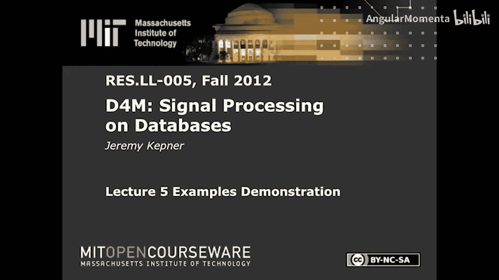
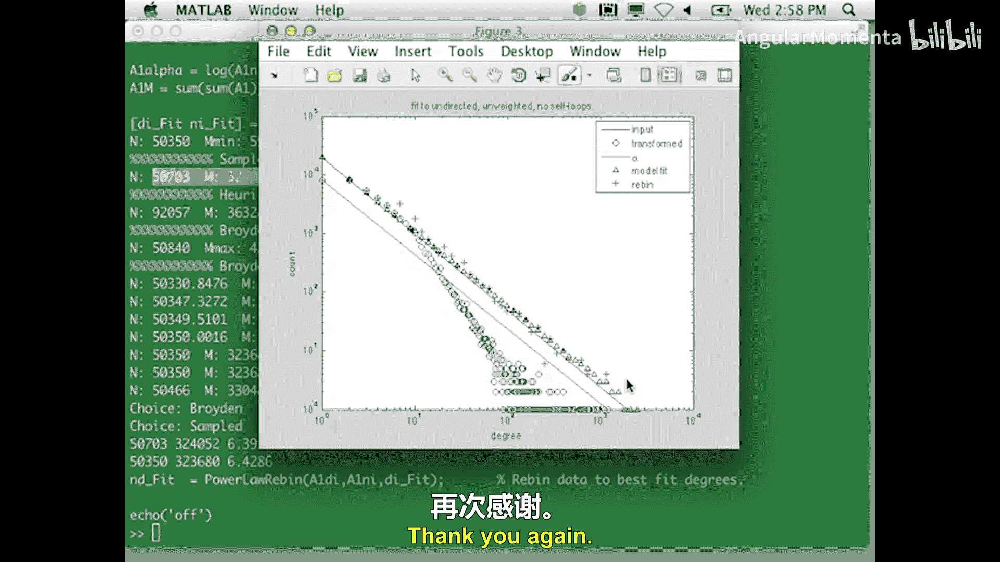
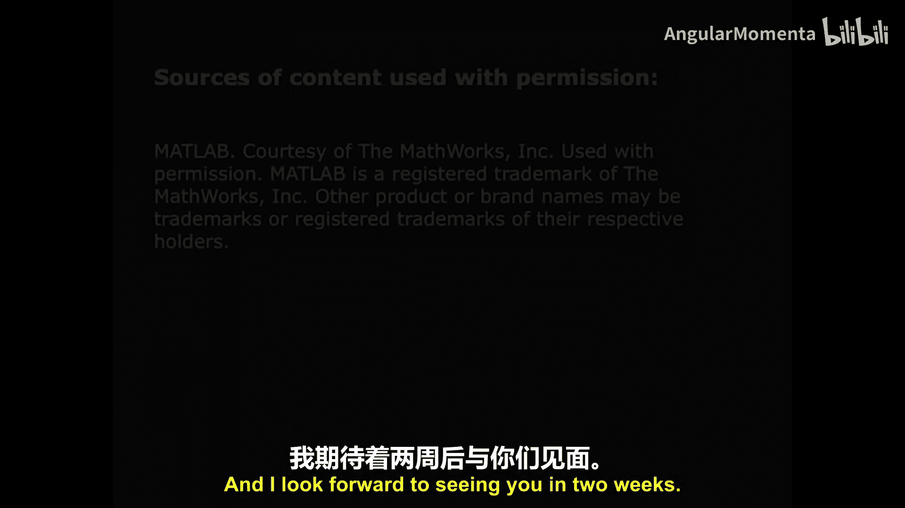

# 【麻省理工】大数据与机器学习数学-｜-MIT-RES.LL-005-D4M-Signal-Processing-on-Databases,-Fall-2012-p15-15-5.-示例演示--BV1eEtTzhE4F_p15-

The following content is provided under a Cative Commons license。

 Your support will help Mi T OpenCourseware continue to offer high quality educational resources for free to make a donation or to view additional materials from hundreds of Mit courses。

 Visit Mitopcourseseware at Ocw。 Mt Eduu。

All right。We're going to now show some of the examples。诶。And。So again， they're in our directory here。

 examples。We're now in the sort of section two， so we're going to go to applications。

And we have a section called Perpower law。The actual example codes are all these ones called PPL 1，2。

3， and 4， we have actually a lot of other functions in here。Whi are actually really useful functions。

 they're the functions that do all this stuff and maybe they should actually get folded into the main deform distribution。

 they're here right now， they probably could be cleaned up a little bit as part of homework。

 but these are again very useful functions for allowing you to generate and fit these types of things。

All right， so I have。I started my MATlab session。And there we are， and so we will do the first。1。

Going along here。Figures。Rightri。All right。So if we go and look at what we did here。

 so the first thing we did is。Is we set our parameters for our power perfect power law fit。

 so we set alpha of 1。3 a Dmax of 1000 then about approximately 30 bins。We called our function here。

 which is in this directory， which is power law distribution。

 which will create a power law distribution from these three parameters。

And then the first thing we did is just plot that distribution。We go here。Fig one。

You can see there is that distribution， so our perfect power law distribution with these parameters。

Very nicely， very nicely done。Then then moving along， we can compute。

 This is how you compute the total number of。Vertices from the distribution， we just sum。

Comp you the notal number of edges， we can sum there， and then we see that the total vertices was 18。

187， 84，000 edges with an edge to vertex ratio of 4。6。We now have。

A function called edges from distribution。 So I pass in the distribution。

 essentially the degrees and the counts， it will then generate a set of vertices。

That is consistent with that distribution。Right。And now I'm going to create some permutations。

Basically of these vertices， I''m going to randomly permute the edge hoarder with these two sets here。

 so if I basically make a random permutation of the number of edges，Okay。

 that allows me to permute the edges， and I can also randomly permute the vertex labels themselves。

 and then I can look at these different。Permutations to see what kind of graph they've created。

 So if I don't permute the data， I just have a 0 here。Okay。

 I just pass in the vertices that were created， I create a no non permmun adjacency matrix。Okay。

 I can then look at that。And that just shows you this is the adjacency matrix。 This isn't implied。

 It just shows you that I just created a vertex that's entirely self loops。Not very interesting。

 but nevertheless， completely consistent with a perfect power law degree distribution， so。Likewise。

 if I just permute the edges。So basically， I take my permutation here and I just permute that。

Okay this is just not permuting the vertex labels， but just permuting the edges。The next figure here。

 here3。right and we get this distribution basically star vertex n vertex looks very random。

 fairly random， however， you see the highest degree vertices are up here at 00。

 because that's the order in which the generator spits them out。

 it gives you the highest degree vertices first and so although we've reconnected them with different edges。

 you see that they's still their vertex label still have an intrinsic order which is corresponding to vertex degree。

I should say this generates this naturally。 It's a very common way to。

 if you have arbitrary vertices and you want to put them on an adjacency matrix。

 one of the first thing to do is just to reorder them according to degree。

 you'll always get some kind of structure that emerges there。

 and it's an often an easier way to of see what's going on there。

 And as you can see from the previous data you saw if you ordered things by degree and you saw this type of distribution be like。

 aha， that looks a lot like a power law distribution just from kind of the scatter of the dots。

So moving on here， so now we're just going to permute the vertex labels。

 so we are not permuting the edges， just the vertex labels。And so， if you see。

And then by permuting the vertex labels， it looks random， but fairly sparse。

 that's because we still every single time， you know we've moved the vertex labels around。

 but all the edges associated with that vertex pair still will shipped around and think we haven't done anything to break them up。

Whereas before we broke up the edges， but we didn't change the labels。And so then the final one。

 which is the one that we typically do when we want to create random is we permute both。

The vertices and the edges， all right， to create sort of a truly random looking adjacency matrix。

And there you see something and and now what you can also see here is these high degreeeg vertices you know do stand out。

 this is a very standard power law distribution you'll see these sort of dense rows and and columns in there that are indicative of these very high degree nodes when we when we didn't when we just permuted the edges but not the vertices。

 these high degree rows and columns all got shifted up into the corner of the plot so so again another way to sort of begin to look at the data in a way to sort of recognize structure I think these adjacency matrices once you start looking at them and you begin to certain get a comfort film them this is we do with other types of data we begin to learn what they look like this is a very good way to look at the data because you can look at a fair amount if I were to actually plot the graph of 18000 vertices as a traditional graph with vertices and lines connecting them it would just be。

The entire screen would be blue， there would be no way to properly position those vertices here。

 you know this is 84，000 data points and I can still kind of see it a little bit。

This is kind of the limit， 100，000 edges is kind of the limit of what you can put on any plot to really see it unless there's some sort of hidden structure that allows you to like really。

 really move it all together， but the adjacency matrix is a great way to look at fairly large graphs。

So we generally do that， so this is just this this is the procedure create。You know。

 your perfect power law distribution。Create some edges， create some permutations。

 and then permute it， and then off you are， you've just created a randomized perfect power log graph again。

This is an example of a code where you probably might even just take this program and adjust it to suit your needs。

And then I think we did that， and then finally we plotted the degree distribution of a3 just to see show you that I'm not lying and again。

 the triangle was the original and the blue was the thing and you see both throughout all those permutations our degree distribution。

Remain the same， even though they look， those would be completely different graphs。

 their degree distributions are identical。AllRight。So let's move on here。All right。

So this is just showing so we've actually rolled this up all into one function here for you。

 ran a power law matrix if you give it an alpha， a Dmax and an ND。

 it'll do those three steps for you that I had in the previous chart all in one thing and produce an adjacency matrix that's a perfect power law based on these parameters and again you saw we have the same number of vertices that we saw in edges and ratio that we saw before so that's all the same now we're going to transform this data。

 clean up this data by making making it unweighted。Undirected we're going to eliminate self loops。

 we're going to take the upper triangleular part。 here's another one with's unweighted。

 no self loops， different versions of them， and then we do you can see what those looks like。

So if we look at the first one here。So this just shows the unweighted what unwaiting。

 just basically making the data unweighted does to the data set。

 so the triangles are the original data and just making it unweighted how it distorts that data set。

We go here。This just shows you what happens when you make it undirected。

So unweighted means we took everything， everything all the any cases where we had vertices with more than one connection to them。

 if something had five connections， now it just gets one connection。

And so that was a fairly big distortion。A perfect example is like if you take like a person's social network graph and if you were to make it unweighted。

What you're saying is that the connection you have with your spouse is identical to with someone that you emailed once or that you friended once and I think we all agreed that that's a fair amount of information that's lost there and so again。

 encouraging folks to not to be aware of that and to sort of be careful of when they're doing again。

 making it undirected just means we basically if I phone you a lot or I cite you a lot in papers。

 know that's the same as you citing me a lot， which you lose some information there， again。

 and this just shows the kind of distortion that we get from just making it undirected。

And then again， this shows what happens when you do no no self loops。 Well， this。

 there's not a lot of self loops。 So we only have affected a few vertices here。 So in this case。

Eliminating self loops is not a terribly distorted， doesn't really distort the data very much at all。

Then finally， this shows the the upper correlation matrix。

 so when we correlated the two basically multiplied adjacentja image together， again。

 showing what we saw before。All right， moving on。hYou get to see the plots that got eliminated from。

By PowerPoint。Malab has defeated PowerPoints attempts to deny you your education， so。All right。

 so again， what we're doing here is we're creating a perfect power law。All right。

 this is a bigger one。 I wanted a lot of vertices， so this time we had 50，000 vertices， 329。

000 edges with a ratio of six and a half。We create our vertices。 We randomize the edge order。

 et cetera。 Now we're going to randomly pick。Just a sub samplele of these。 And what does Fs said it。

 It's 140th。 So I'm just going to take one40th of all the vertices， okay。

Now I'm going to go and compute that degree and I'm going to basically subs sampleample all of these and later what you'll see。

 so let's just take a look at that。So this just shows that chart here。

 so this is the original data again， this is the vertex we're sorting by the vertices by degree here。

 so this is the highest degree vertex， these are the lowest degree vertex。

OkayAnd each vertex is getting a dot here。 So we have 50000 vertices。 They all get a dot。

 They all get a dot here。 and we've only taken a 40th thumb。

 And this just shows you here you know kind of what the if if you only take a 40th of them and then compute their sample。

 this is what you what you get Now standard sampling sampling theory would say， aha well。

 I know how to correct for this。 the way I correct for this is I just multiply my sample data by 40。

 I only took one 40th， that means， you know， whenever I measured it。

 the true value should be 40 times higher。So we can look at that in figure two。

 so this is the true sample。All right。So again， which we see for our high degree vertices here。

 This is the highest degree vers here again。 So this is the high degree vertices。

 These are the low degree vertices。 I don't know if I said that opposite when I mentioned it before。

 This is the highest degree vers。 And you see that by sampling the data。

 we're doing a very good job on the high degree vertices， we're sampling them just fine。 And that's。

That's kind of why statistics works right you know。

 you if something is really not rare and you sample going get you're going to get a good estimate。

 however， for these low degree vertices over here， what you see by multiplying。

By 40 were significantly overestimating their probability。All right， as I say。

 this is the curve that proves that optimus and pessimists are both correct。😡。

There are so many rare things that if the world is a power law distribution。

 it means that there are so many rare events in the world， some of them are going to happen to you。

So it means if you're an optimist， go play the lottery。All right， if you're pessimist， it means yeah。

 lightning could hit you and you had her just be you know stick and stay inside so there's just so many rare things that you know some of them are gonna to some really rare things are going to happen to you in your lifetime most likely those rare things that are very mundane you know。

So， so， but we can correct for this and so we have some some basically a way here of deriving calculations。

 we compute the parameters of our distribution and through these two functions。

 compute degree correction and apply degree correction， we can actually go back and sort of say。

 all right， given that we believe the data is power law。And we've sampled it。

 Can we then come up with a more uniform correction that basically gives us a better estimate that works at both the high and the low end。

And。That's what you see here so basically we haven't changed the correction hasn't changed here。

 but we've lowered we've downgraded these lower ones and essentially what we're doing is instead of just using the average as the statistic we're using the median so we're using essentially a quantile based correction here。

 50th percent quantile based correction here and that causes us to lower the estimates of these vertices and so there will be a better estimate in terms allow you to do do the sampling of that。

All right， very good。And our final demo。All right， so now what we're doing is doing power law fitting。

Okay， and so we have the routines for doing that so again here's our distribution to a power law of 1。

3 we've set Dmax to be 2000 and about 60 ish bins， we create our power law distribution， it has 50。

000 vertices 329，000 edges ratios， so same as the one we did before。

We're going to make it undirected。Undirected and unweighted， undirected， unweighted， no self loops。

 to sort of standard corrections that we do。I'm going to compute the degree distribution of that data and plot it。

Or actually put it there now I'm going to then we have this function called power law fit。

 So if I compute this is I'm going to compute， so I compute the degree distribution。

So this function called app degree， which just gives us the distribution。

And I can find essentially the number of values with the one and the one that are maximum so get our this is estimating our poor mans slope。

 so we're computing the slope。We're counting the total number of edges here。

 And then we have this function called power law fit。Basically。

 we can plug in what the estimated alpha is， what the number of vertices is and the number of。

Edges is to find our best fit distribution。So this basically inverts those to those formulas I showed you。

 which is given a degree distribution that sums to a particular number of vertices and sums to a particular number of edges。

 can you give me a new DMmax and a new N D， these sort of。

Pameters that don't really have as much meaning to do that and so basically we use essentially a combination of three different techniques here because this is soline and there's this basically we remember I talked about integer bins and logarithmic bins if you look at that plot it showed there's that sort of bending it's a very sort of nasty manifold the surface of this function and it has a continuous part and a discrete part So what we do here is we do essentially a sampled search where we kind of randomly sample looking for a location。

 we do a heuristic search， which is sort of a kind of a simulated neo search and we also use is a brightons nonlinear essentially a variation of Newton's method to all try and find the best set of parameters that will fit this data never we rarely get an exact match which you can see here is choosing different ones and this gives you the kind of how it's doing from the sample search to show。

the number of vertices and the number of edges it was able to achieve， the heuristic search。

 you know， didn't do very well at all， and then the Bon search。Did a pretty good job， you know。

 and it it got us a pretty well。 So it choice first thing it actually actually。

 it ended up comparing all of these and it ended up choosing the sample search this one。

 This first one it did。 it like that best of all so。You look at that here。

So figure two just was the original。Original data。Figure 1 shows you the manifold of this space。

 and so plotted in this， this coordinate system of n versus M。 the dot is the vt that it found。

 It's actually here in this type， in this typeing these lines show the boundaries。

 But you can see this sort of very nonlinear manifold here。 This is sort of the continuous regime。

 This is the integer regime。 It cups right at the transition， Again。

 a very nasty function to try and try and invert， and which is why we used all those different techniques to invert it。

And then two and then figure three shows the results。

 so this black line shows the original model input that we provided。

 so that was the true model the circle shows the data after it was transformed we made it undirected。

 unweighted with no self loops。That's this。Alpha is this is our poor man's alpha。

 which you can see is almost identical to the original model。

 so even poor man's alpha does a very good job of fitting in this case。

This shows the triangle shows the model fit。 So when we fit the data we came up with that best fit it shows and we then created a new distribution。

 This is what it looked like。 And then the plus sign shows us rebinning that data onto the bins from the model。

 And you see that we've done a very nice job of recovering the original power law distribution after even after we did that distortion。

 So again， that sort of is the last example。 So I want to thank you。

 And then for the homework a lot of you did homework 2， which is great。

 I think homework3 wasn't such a great。Hit I'm going definitely rethink that one。

 but the next homework does not require you to have done homework3 if you did homework2 basically it's just saying compute a degree distribution okay and in fact you don't even need to have done homework too you can compute a degree distribution on your homework to or you can compute a degree distribution on any data set。

 for example， today is Halloween if you go trick or retreating with with with somebody yourself。

 your children， somebody else's children you can you can maybe email me what the you know the histogram of your candy and plot it on a degree distribution and maybe compute the poor man's alpha coefficient from that and the other coefficients from that would be a fun exercise to do so that'll be the next homework I'll email that out in the next couple of days and so look forward again And if you send me the homework prior to。

To next actual oh just a reminder， no class next week。No class next week。

 this room is being taken so but again， if you email me the homework prior to this time next week。

 I will give you feedback on it and still send me the homework after that I just won't give you any feedback on it so thank you again and look forward to seeing you in two weeks。

