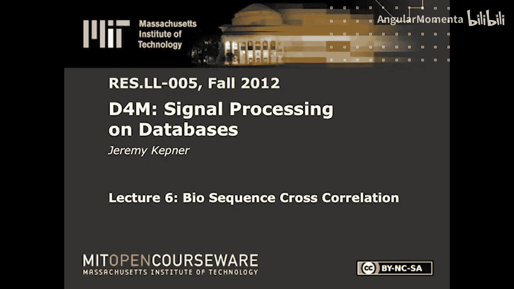
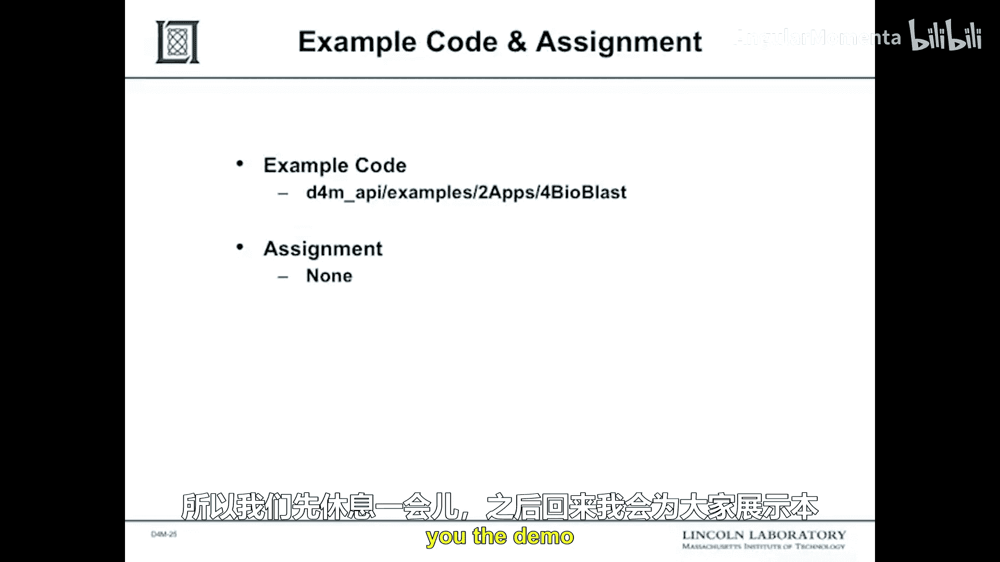

# 【麻省理工】大数据与机器学习数学-｜-MIT-RES.LL-005-D4M-Signal-Processing-on-Databases,-Fall-2012-p16-16-6.-生物序列互相关--BV1eEtTzhE4F_p16-

The following content is provided under a Cative Commons license。

 Your support will help Mi T OpenCourseware continue to offer high quality educational resources for free to make a donation or to view additional materials from hundreds of Mit courses。

 Visit Mitopcourseseware at Ocw。 Mt Eduu。

All right， so we'll。叼泳噶。Lecture 0，6 in the course today。 that's in the。

JustTo remindmin people it's in the docs directory here。And。

We're going to be doing a lot talking about a particular application。

Which I think is actually representative of a variety of applications that we do a lot of。

Things is similar statistical。Properties， a sequence。Cross correlation。So。Diving right in。

It's going to give you an introduction to this particular problem of genetic sequence analysis from a computational perspective。

嗯。And how the deform technology can really。Make it pretty。

 pretty easy to do the kinds of things that people like to do。

And then just talk about the pipeline that we implemented to implement this system。

Because as I've said before， when you're dealing with this type of large data。

The deformm technology is one piece， it's often the piece you use to prototype your algorithms。

To be a part of a system， you usually have to stitch together a variety of technologies， databases。

 obviously being an important part of that。So。This is a great chart。 this is the relative cost。

per DNA sequence。Over time here， over last。20 years。

So we're getting a little cut off here at the bottom of the screen。Xia。Think咁。So。诶。You know。

 this just shows Moore's law。 So we all know that that technology has been increasing at an incredible rate。

 And as we've seen， the cost of DNA sequencing is going down dramatically。 So the first DNA sequence。

You know， people nominally say it to sequence the first human genome was around a billion dollars。

And。They're expecting it to be。100 dollars。Within the next few years。So having your DNA sequenced。

Will become probably a fairly routine medical。Activity in the next。In the next decade。嗯。And so。

The data generated， you know， typically a human。Genome will have billions。Of。DNA sequences in it。

 and that's a lot of data。啊。Woulds actually。Perhaps even more interesting than sequencing your DNA。

Is sequencing the DNA of all the other things that are in you。

Which is sometimes called the metagenome。Take a swab and not just get。The DNA， your DNA。

 but also of all the other things that are a part of you。

 which can be 10 times larger than than than your DNA。 So depending on that。

 So they now have developed these high volume sequencers。

 Here's an example of one that I believe can do 600。Okay， no problem that 600。

Billion base pairs a day， so like 600 gigabytes of data a day。

And this is all data that you want to cross correlate， you know， I mean。

 its it's yours a it's so that's what this this is a tabletop。

Tabletop apparatus here that sells for a few hundred thousand dollars。

And they are even getting into portable sequencers that you can plug in with a USB。

Connection into a laptop or something like that to do you know more in the field types of things。

So why would you want to do this， you know， I think you abstract if you understand。

 oh that would be good， computation plays a huge role because this data is collected and it's just sort of abstract snippets of DNA。

 you know， just even assembling them into you know just your DNA into a whole process can take a fair amount of computation。

And right now， that is actually something that takes a fair amount of time。

And so to give you an example， here's a great use case， this shows， if you recall。

 in the summer of 2011， there was a violent E coli outbreak in Germany。

And not to single out the Germans， we've certainly had the same things occur in the United States and these occur all across the world。

 and so you know this shows kind of the time course of， you know， in May。

 you know the first cases starting appear and then those lead to the first deaths and then you know spikes and then you know that's kind of when you hit this peak is when they really identify the output。

And then they finally figured out what it is that's causing people and begin to remediate it。

 But you know until you kind of really have this portion， you know。

 people are still getting exposed to the thing。 usually before they actually nail it down there's lots of rumors flying around all other parts of the food chain are disrupted。

 you know， any single time， you know， a particular product is implicated。

 that's hundreds of millions of dollars of lost business as people just。Basically， you know。

 they say it's spinach and everyone stops buying spinach for a while。 Oh， it wasn't spinach。 sorry。

 it was something else。 And so that's so there's there's there's a dual duel you know。

 so they started by implicating this the cucumbers， but that wasn't quite right。

 They then sequenced the stuff。 and then they correctly identified it was the sprouts。

 at least I believe that was the time course of events here。 So， so。

And this is sort of the integrated number of deaths。And so， you know。

 the story here is obviously the thing we want to do most is when a person gets sick here here。

 wouldn't it be great to sequence them immediately？Get that information。

 know exactly what's causing the problem and then be able to start testing the food supply channel so that you can make a real impact on the mortality and then likewise not have the economic。

 you know， obviously the loss of life is the。Preeminent issue here。

 but there's also the economic impact which certainly the people who in those businesses would want to address so as you can see。

 there was a really sort of a rather long delay here between sort of when the outbreak started and the DNA sequence released and this was actually a big step forward in the sense that DNA sequencing really did ended up playing a role in this process as opposed to previously where it may not have and and people see that now and they would love to move move this earlier so you know and and obviously in our business and across it's not just this type of example。

 but there's other types of examples where rapid sequencing and identification would be very important and there's certainly investments being made to try and make that more possible。

So an example of what the processing timeline looks。Now， I mean。

 you have basically starting with a human infection， you know， and it could be a natural disease。

 obviously in the DoD they're very concerned about bioweapons as well， you know。

 so there's the collection of the sample， the preparation。

 the analysis and sort of the overall time to actionable data。And really。

 it's not to say processing plays everything on this。 But if he is part of a whole system。

 you could imagine if you could do onsite collection。you know。

 automatic preparation and then you know， very quick analysis。

 you could imagine shorting this cycle down to one day， which would be。

 you know something that would really make a huge impact。Some of the other useful sequences， useful。

 I'm sorry， rules for DNA sequence matching is quickly comparing two sets of DNA。iddentification。

 you know that is， you know， who is it， analysis of mixtures， you know。

 what type of things could you determine if someone was related to somebody else， you know。

 ancestry analysis which can be used in disease outbreaks， criminal investigation， personal medicine。

 you know the set of things is pretty pretty pretty large here。

So I'm now going to explain to you kind of fundamentally。

 what is the algorithm that we use for doing this matching。

 but we're going to explain it in terms of the mathematics that we've described before。

 which is these associative array， but to actually make it very。

 very easy to describe what's going on here。 I was to describe to you the traditional approaches for how we describe DNA sequence matching。

 it would actually be that would be a whole lecturing in Excel。

So let me get into that algorithm and so basically this is it。

One slide is how we do DNA sequence matching。So we have a reference sequence here。

 this is something that we know， a database of data that we know。

 and it consists of a sequence ID and then a whole bunch of you know what are called base pairs and this can usually be several hundred long。

😡，And you'll have thousands of these each that are a few hundred， maybe a thousand base pairs long。

And so the standard approach to this is to take these。Sequences and break them up into smaller units。

 which are called words or MERS。And a standard number is called a tenmer。

So basically what you would say is you take the first 10 letters and you say， all right。

 that's one10mer。Then you move it over one。And you say that's another 10 mer and so on and so forth。

 So you have， if this was a a sequence of fourth of 400 long， you would have 410 mers。 Okay。

 and then you're obviously multiplying the total data volume by a factor of 10 because of this thing。

 And so for those of us who know signal processing， this is just standard。Filtering nothing new here。

 very， very standard type of filtering approach。So then what we do is for each sequence ID， okay。

 this forms the row key of an associative array。And each 10 mirror of that sequence forms a column key of that 10 mirror。

 So you can see here each of these rows shows you all the unique 10 mirrors that appeared in that sequence。

😡，And then a column is know a particular tenmer， so as we can see certain ten0mers appear。

Very commonly， and some appear in a not so common way。So that gives us an associative array。

 which is a matrix， a sparse matrix where we have sequence I by tenmer。

 And then we do the same thing with a collection。 So we've collected， in this case。

 some unknown bacteria sample and we have a similar set of sequences here。

 And we do the exact same thing We have a sequence I。 and then the tenmer。

 And then what we want to do is cross correlate。 find all the matches between them。

 And so that's just done with matrix multiply。 So a1 transpose a2 will then result in a new matrix。

 which is reference sequence I by unknown sequence I。

 and then it will then the value in here will be how many。

Matches they had and so generally you look if say 400 you know， was the match。

 then you would be looking for things， you know， well above 30 or 40 matches between them。

 you know or true match would be maybe。50，60，70% of them match。

 and so then you can just apply a threshold to this to find the true true matches。

 So very simple and you know there are large softer packages out there that do this。

 They essentially do this algorithm with various twists and variations and stuff like that。

 But here we can explain the whole thing。Knowing the mathematics of associative arrays on one slide。

So。This。Calculation is what we call a direct match calculation。

 we're literally comparing every single sequences 10 MERS with all the other ones。

 you know and this is essentially what sequence comparison does。

And it takes a lot of computation to do this， you know， if you might have you know。

 millions of sequence IDs and millions of sequence IDs， this very quickly becomes you know。

 a large amount of computational effort。So we are， of course。

 interested in other techniques that could possibly accelerate this。

So one of the things we're able to do using the keymullo database is ingest this entire set of data。

As an associated array into the database and using a cumulus tally features。

 then tally have it essentially as we do the ingestion automatically tally the counts for each1mer so we can then essentially construct a histogram of all the  ten0。

 some 10mers will appear in a very large number of sequences and some10 mirrors will appear in not very many。

So。This is that。Itogram， or essentially a degree distribution we talked about degree distributions in another。

 this tells us that there's  one10 mirror that appears in you know 80 or 90% of all the sequences。

And then there's， you know， 20 or 30，10 mirrors that appear in just。A few。

 and then there's a distribution， as in this case， sort of almost a log normal curve that shows you you know that really。

 you know most of the 10 MERS seem to have appear in a few hundred。Sequences。And so。Now。

 one thing I've done here is create certain thresholds。To say， all right。If I only wanted。

 if I looked at that large sparse matrix of the data and I wanted to threshold how much of the data would I eliminate。

 so if I wanted to eliminate 50% of the data， I could set a threshold。

 let's only look at things that are less than a degree of 10，000。😡，And you might say， well。

 why would I want to eliminate these very， very popular things？Well， because they appear everywhere。

 a true match is they're not going to give me any information that really tells me about true matches。

 Those are going to be clutter。 Everything has them that two sequences share that particular tenmer doesn't really give me a lot of power in selecting which one it really belongs to。

😡，So like so I can do that， if I wanted to go down to only 5% of the data， I could say。

 you know I only want to look at 10 membersRS that are 100。

 you know that have that appear in 100 of these sequences or less。

 and if I wanted to go even further， you know， I could go down to is is 20， 30， 40， 50。

 and I would only have one half percent of the data I would have eliminated from consideration 99。

5% of the data。So。And then if I can do that， then that's very powerful because I can quickly take my sample data set。

 I know all the 10 MerRSit has， and I can quickly look it up against this histogram and say， no。

 I don't want to do any， I only care about this very small section of the data and I only need to do correlations from that。

So let's see how that works out。And I should say this technique is very generic。😡。

You could do it for text matching if you have documents， you have the same issue。

 very popular words are not going to tell you really anything meaningful about whether two documents are related to an it's going to be clutter and other types of records of that thing you know so in the graph theory perspective。

 we call these super nodes these 10 mirrors or super nodees， they have connections to many。

 many things and therefore if you try and connect through them。

 it's just going to not give you very useful information， you know， it's like。😡。

People visiting Google。Looking for all the records where people visited Google is not really going to tell you much。

 unless you have more information， and so it's not a very big distinguishing factor。So。

Here's an example of the results。Of doing of selecting a threshold this low threshold。

 eliminating 99。5% of the data， and then comparing our matches that we got with what happens when we used 100% of the data。

And so what we have here is the。True Tenmer match， and then the measured subampled match here。

And what you see here is that。You know， we get a very， very high success rate in terms of。You know。

 we basically detect all strong matches using only half percent of the data and you know。

 the number of false positives is extremely low。In fact。

 a better way to look at that is if we look at the cumulative probability of detection。

This shows this that if the actual match， if there was actually 100 matches between two sequences。

 we detect all of those using only 1/20th of the data。😡，And likewise。

 in our probability false alarm rate。We see that if you see more than a match of 10 in the subsample data。

 that is going to be a true match， essentially 100% of the time。😡。

And so this technique allows us to dramatically speed up。

The rate at which we can do these comparisons。 And you do have the price to pay that you have to preload your reference data into this special database。

 but。Since you tend to be more concerned about comparing with respect to it。

 that is a worthwhile investment。So that's just an example of how you can use these techniques。

 use the mathematics of associative arrays， and these databases together in a coherent way。

So we can do more than just。Find。So the matrix multiply I showed you before A1 times A2 transpose showed us the counts。

 the number of matches。But sometimes we don't want to know more than that。

 we want to know not just the number of matches， but please show me the exact set of 10 mes that cause the match。

😡，Okay， and so this is where， and I think we talked about this in a previous lecture。

 We have these special matrix multiplies that will actually take。The intersecting key。

In the matrix multiply and now assign that to the value field or concatenate。

 and so that's why we have this special matrix multiply called cat key mode。And so for instance。

 here， if we look at the result of that， which is ak。

 and we say show me all the value matches that are greater than6 in their rows and their columns together。

 now we can see that this sequence ID matched with this sequence I， and these were the actual 10 mes。

That generated that they had in common。Now clearly six is not true match in this little sample data set。

 we don't have any true matches， but this just shows you what that is like and so this is what we call a pedigreepreserving correlation that is it shows you the you know it doesn't just give you the counted it shows you where that evidence came from and you can track it back and this is something we do want to do all the time if you imagined two documents that you wanted to crosscorrelate。

You might say， all right， I have these two documents and I've crosscor their word matches。

 well now I want to know the actual words that matched， you know。

 not just the counts and you would use the exact same multiply to do that， you know。

 likewise you could do the word word correlation。Of a document。

 So that would be a transpose times a instead of a， a transpose。

 And then it would show you two words。 It would show you the list of documents that they actually had in common。

 So， again， this is a powerful， a powerful tool。Again， I should remind people when using this。

 you do have to be careful when you do say cat chol a1 times a1 transpose。

 if you do a square because you will then end up with this very dense diagonal and these lists we get extremely long and you can often run out of memory when that happens so you do have to be careful when you do correlations。

 these cat chole correlations on things that are going to have very large overlapping matches the regular matrix multiply。

 you don't have to worry about that creating dense you know that's not a problem。

 but that's just a little caveat to be aware of and there's really nothing we can do about that if you do square them you know and we've thought about creating a new function。

 which is basically squaring and basically not doing the diagonal and and we may we may end up you know making that if we can figure that one out。

So once you have those actual specific matches here。 So， for example。

 we have our two reference samples and we looked at the ones that were。Larger。

 so here's our two sequences。 this if we look back at the original data。

 which which actually stored the locations of that。 So now we're saying， oh。

 these two have a have six matches between them。 Let me look them up。

Through this one line statement here now I can see the actual 10mers that match and their actual locations in the real data。

 and from that I can then deduce that， oh， actually this is not six separate 10 me matches。

 but it's really two sort of this is one，2，3，4，5，67，8。

910110mer match and then I guess I think this is like a 17 match。

Right and likewise over here you get a similar type of thing so that's basically stitching it back together because that's really what you're trying to do is find these longer sequences where it's identical and then people can then use those to determine you know functionality and other types of things that have to do with that。

 so this is just part of the process of of doing that and it just shows by having this pedigree preserving matrix multiply and the ability to store string values in the value that we can actually preserve that information and and do that。

So that just shows you， I think a really great example。

 it's kind of one of the most recent things we did this summer in terms of the power of DM coupled with databases to really do algorithms that are completely。

 you know，Kind of new and interesting。And as algorithm developers。

 I think that's something that we are all very excited about。

So I'm now going to talk about how this fits into an overall pipeline， so once again。

 just for reminders， you know D4M。You know we've talked mostly about working over here in this space in the MAlab space for doing your analytics with associative arrays。

 but they also have ways we have very nice bindings to in particular， the cumullo database。

 but we can bind to about any database and here's an example if I have a table that shows you know all this data and I just wanted to get。

 please give me the column of this 10mer sequence I would just type that query and it will return that column for me very nicely so it's a very powerful binding to databases it's funny because a lot of people what I talked to them like。

They think DeepForum is either just about databases。

Or just about this assoative mathematics and because they usually kind of people take sort of they usually see it sort of more used in one one context or another and it's really about both it's really about connecting the two worlds together。

That particular application that we showed you， this genetic sequence comparison application is like you is a part of a pipeline like you would see in any real system。

 and so I'm going to show you that pipeline here。And so。You know， we have here the raw data。

 so FASA is just the name of the file format that all this DNA sequence。Comes in。

 which basically looks pretty much like a CSV file of what I just saw you。

I guess that deserves a name as a file format， but you know， so it' it's basically that。

And then one thing we do is we。Pse that data from the FAA data into a triples format。

Wwhich allows us to then really work it with it associative array。

 so it basically creates the 10 MERS and puts them into a series of triple files。

 a row triple file which holds a sequence ID， the actual 10M itself， list of those。

 and then the position of where that10M appeared in the sequence。And then typically what we do then。

Is we read。We write a program and this can be a parallel program if we want it that will then usually in MATLb using D4 that will read these sequences in。

And。We'll often just directly insert them without any additional formatting just we have a way of just inserting triples directly into the Acumo database and which is the fastest way that we can do inserts and then it will also convert these two associative arrays in MatTLb and we'll save them out as MAT files because this will take a little time to convert all of these things into files you're like well why would we do that well there's two very good reasons for doing that。

😡，One， Equilo database or any database is very good if we want to look up a small part of a large data set。

Okay， so if we have billions of records and we want millions of those records。

 that's a great use of a database。 However， there's certain times we're like no。

 we want to traverse the entire data。Well databases are actually bad at doing that if you say I want to scan over the entire database。

 it's like doing a billion queries you know and so there's overheads associated with that in that instance it's far more efficient to just save the data into these associator files which will read in very quickly and then you can just if you're like I want to do an analysis you know of the data in that way where I'm going to want I really want to work with 10% or 20% of the data then having these this data in this you know already parsed into this binary format is a very efficient way to run an application or an analytic that will run over all those files。

😡，It also makes parallelism very easily， you just let you know different processors process different files。

 you know that's very easy to do， we have lots of support for that type of model and so that's a good reason to do that and you know at worst you're doubling the size of the data in your database。

😡，Don't worry about it。 We double data and databases all the time databases are notoriously if you put a certain amount of data in you know they make it much larger cum though actually does a very good job of that。

 it won't really be that much larger， but there's no reason to not as you're doing the ingest to save those files and then you can do various comparisons。

 so for example you know we then can if if we save the。

The sample data as a MALb file we could read that in and then then do our comparison with a reference data that's sitting inside the database to get our top matches and that's exactly how this application actually work So this pipeline from raw data to an intermediate format to know sort of efficient binary format and insertion to then doing the analytics and comparisons and eventually you'll usually often have another layer which is you might create a web interface to something we're like okay this is now a full system you know a person can type in you know or put in their own data and then it will then call a function So again this is very standard how this stuff ends up fitting into an overall pipeline。

And it's certainly a situation where if you're going to deploy a system， you might decide。

 you know what， I don't want Matlab to be a part of my deployed system。 I want to do that。

 say in Jo or something else that's sort of more universal， which we certainly see people do。

 It still makes sense to do it。In this approach because the algorithm development in testing is just much much easier to do in an environment like D4M and then once you have the algorithm correct。

 it's now much easier to give that to someone else who is going to do the implementation in another environment and deal with all the issues that are associated with maybe doing a deployment type of thing so one certainly could use the MATLb or organ newocve code in a production environment。

 we certainly have seen that but often the case one has limitations about what can deploy and so it is still better to do the algorithm development in this type of environment than to try and do the algorithm in a deployment language like Java。

😡，One of the things that was very important。4。This database and is true of most parallel databases。

So。If we want to get the highest performance insert。

 that is we want to read the data insert it as quickly as possible in the database。

 typically we'll need to have some kind of parallel program running， in this case。

 maybe each reading different sets of input files and all inserting them into the parallel database。

😡，And so in a cumullo， they divide your table amongst the different computers。

 which they call tablet servers。😡，And it's very important to avoid the situation where everyone is inserting and all the data is inserting into the same tablet server。

 you're not going to get really very good performance。Now。

 the way acumullo splits up its data is similar to many other databases。 it it's called sharding。

 sometimes they call it， it just means they split up the table。

 but the term the database community uses they call it sharding。

 What they'll do is they'll basically take the table and they'll sign certain row keys。In this。

 in a cumulus case， certain contiguous sets of ro keys to particular。Tablet servers。So， you know。

 if you had a data set that was universally split over the alphabet。

 then and you were going to split it， the first split would be between， you know， M&N。

And so this is called splitting。 And it's very important to try and get good splits and choose your splits so that you get good performance。

 Now， D4 M has a native interface that allows you to just say。Here are。

 I want these to be the splits of this table。 You can actually compute those and assign them if you have a parallel instance in the class。

 you will only be working on the databases that we will set up for you。

 We have set up for you are all single。Notode instances they do not have multiple tablet servers so you don't really have to deal with splitting。

 it's only an issue in parallel， but it's certainly something to be aware of and as often the key。

 you know people will often have a very largemullo instance and they may only be getting not very you know the performance they would get on just a two node instance because and usually it's because their splitting needs to be done in this proper way。

And this is true of all databases， not just a cumula， but other databases have the exact same issue。

Acccuullo is called acuullo because it has something called accumulators。

Which is what actually makes this whole bioinformatics application really go。

Which is that I can denote a column in a table。😡，To be an accumulator column。

 which means whenever a new entry is hit， some action will be performed。 In this case。

 the default is addition。And so a standard thing we'll do in our schemas as we've already talked about these exploded transpose pair schemas that allows us to do fast lookups and rows and columns is okay create two additional tables。

 one of which holds the sums of the rows and one of which holds the sums of the columns。

 which then allows us to do these very fast lookups of the statistics。

 which is very useful to know how do we avoid accidentally looking up columns that will that are present in the whole database。

 An issue that happens all the time is that you'll have a column that's essentially almost a dense column in the database and you really。

 really， really don't want to look that up because it's basically giving you the whole database。

 Well， with this。Accumulator， you can look up the column first and it we'll give you count and be like。

 oh yeah， and then you can just say nope， I want to look up everything but that column。

 so very powerful， very powerful tool for doing that。That's also another reason why we construct。

The associative array， when we load it for insert， because we。

 when we construct the associative array， we can actually do a quick sum。

Right then and there of whatever piece we've read in。

 And so then when we send that into the database， we've dramatically reduced the number of the amount of talling it has to do。

 And this can be a huge time saver because if you don't do that， you're essentially。

reinserting the data two more times because when you've inserted it into the table and it transposed and to get the accumulation effect you would have to directly insert it。

 but if we can do a pres sum that reduces the amount of work on that accumulator table dramatically and so again that's another reason why we do that。

So let's just talk about some of the results that we see。So here's an example on a。Let's see。

 this is an eight no database， and this shows us the ingest rate that we get using different numbers of ingeters。

 So this is different。Programs all trying to insert into this database simultaneously。

 and this just shows the difference between having zero splits and in this case。

35 splits is is was the was the optimal number that we had and you see it's a rather large difference and you don't get you know you get some benefit with multiple inserters。

 but that sort of。Ends when you when you don't do this。

 So this is just an example of why you want to do that。

Another example is with the actual human DNA database that shows us our insert rate on doing using different numbers of。

Of inserters。And。Yeah， so this is this is eight tablet servers。

 and this just shows the different number of ingess here。 And since we're doing proper splitting。

 we're getting very nice scaling。 And this is actually the actual output from from achemia though it actually has a nice little。

Meter here that shows you what it says you're actually getting， which is very。

 very nice to be able to verify that， you know that you and the database both agree that your insert rate is so this is insert rate here。

 So you see we're getting about 4000400000 entries per second。

 which is an extraordinarily high number in the database community，Just to give you a comparison。

 it would not be uncommon if you were to set up a MySQL instance on a single computer and have one inserter going into it to get maybe 1 thousand inserts per second on a good day and so you know this is essentially the core reason why people use a cumullo because of this very high insert and query performance。

And this just shows our extrapod runtime if we wanted to， for instance。

 ingest the entire human FAFSA database here of 4。5 billion entries， we could do that in eight hours。

Which would be a very reasonable amount of time to do that。So in summary。

 what we were able to achieve with this application。Is this shows one of these diagrams。

 I think I showed one in the first lecture。 This is a way of sort of measuring our productivity and our performance。

 So this shows the volume of code that we wrote， and this shows the runtime。

 So obviously this is better down here。 and this shows blast。

So blast is the industry standard application for doing sequence match。

 And I don't want in any way to say that we are doing everything B does。 B is almost。

A million lines of code。 It does lots and lots of different things。

 It handles all different types of file formats and little nuances and other types of things。

But at its core， it does what we did。And we were able to basically do that in。You know。

150 lines of D4M code。And using the database。We were able to do that。100 times faster。

And so this is really the power of this technology， is to。

Allow you to develop these algorithms and implement them in this case。

 actually you leverage the database to essentially replace lookups with computations in a very intelligent way in a way that's knowledgeable about the statistics of your data and that's really the power and this is the types of results that people can get and this whole result was done with one summer student。

you know， very smart summer student， but you know we were able to put this whole system together in about a couple of months and this is from a person who knew nothing about a chullo or DformM or anything like that good they were smart。

 they they were good good solid Java background and very energetic。

 but you know these are the kinds of things we've been able to see。So just to summarize。

 you we again we see see you know I think just these types of techniques are useful for document analysis and network analysis and DNA sequencing。

 this is really summarizing all the applications that we've talked about。

 you know we think there's a pretty big gap between doing the data analysis tools that are really algorithm developers need and really D4M is really allowing us to use a tool like MATLb for traditional role in this new domain。

 which is algorithm development， figure things out。

 getting things right before you can then hand it on to someone else to implement and actually get in a production environment。

So with that that brings the end to the lecture and then there's some examples where we show you this stuff and there's no homework other than I sent you all that link。

To see if your access to the database exists， Did everyone raise your hand。

 Did you check the link out。Yes， you logged in， it worked。You saw a bunch of databases there。

 okay but doesn't work because the next class is the sort of the penultumimate class。

 I'm going to go through all these examples and the assignment will be to run those examples on those databases so you will be really using D4M touching a database。

 doing real analytics， doing very complicated things。

 The whole class is just going to be a demonstration of that everything we've been doing has been leading up So the concepts are in place so that you can understand those examples fairly easily。

 All right， so we will take a short break here and then we will come back and I will show you the demo this week's demo。

Yeah。Yeah。Yeah。Yeah。그。

嗯。