# 【麻省理工】大数据与机器学习数学-｜-MIT-RES.LL-005-D4M-Signal-Processing-on-Databases,-Fall-2012-p17-17-6.-示例演示--BV1eEtTzhE4F_p17-

The following content is provided under a Cative Commons license。

 Your support will help Mi T OpenCourseware continue to offer high quality educational resources for free to make a donation or to view additional materials from hundreds of Mit courses。

 Visit Mitopcourseseware at Ocw。 Mt Eduu。

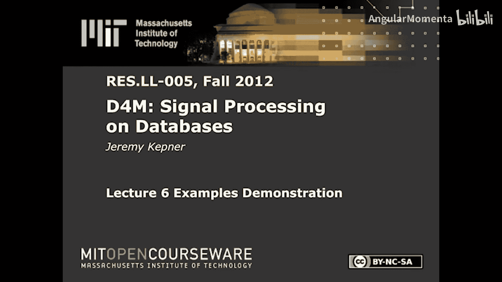

Alrighty， so we're back。 We're going to do the examples for the we just sort of described in the previous。

Notes， and again， once again， these are in the。If you have your deform directory here， they're in。

Examples。Applications。Bioblast。This shows you the two programs are going to run。

 we just have two examples。And then we're going to be comparing two pieces of actual data。

 So if you look at this。This shows you。You know what？What that data looks like。

 so sequence ID and then very long。Long sequences here。

 and not all they it'd be sure nice if they were all the same length。

 but they certainly are not the same length。 You know， they vary dramatically here。

 you can see you know， there's probably one that's look at that guy。 What's he doing Super long。

 So this is this is a reference bacteria data set。 This is known data。

 And this is a sequence here of some data taken from somebody's palm。This is open source data not。

And so yeah， so this is just an example of that。And so you can imagine one would want to do a comparison of the data。

You know of what the DNA sequences on a bacteria on the person's hand are with some reference data set so obviously we are not going to be using a data set。

 this is a very small data set here we're not going to be able to do we're probably not going we wouldn't expect to have any matches here and we're not going to have any。

 but this just shows you kind of how that works。

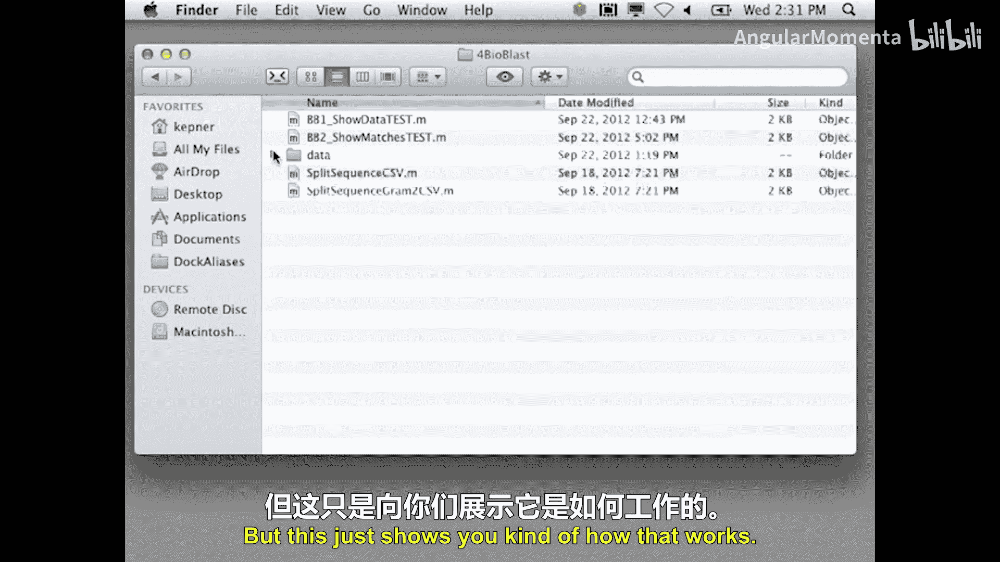

So。Here。And。So the first one here was this B1。It's just， basically。

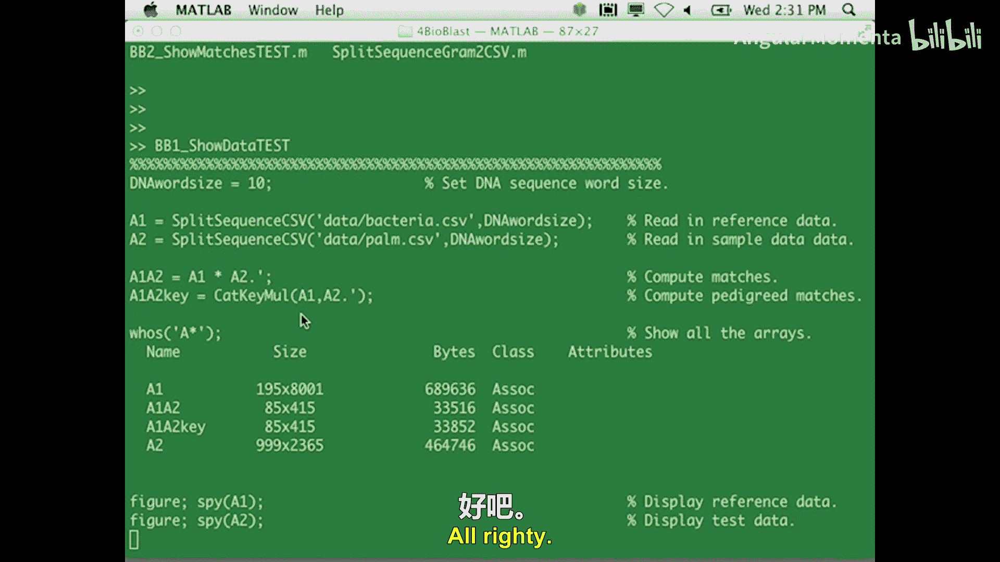

Alrighty。

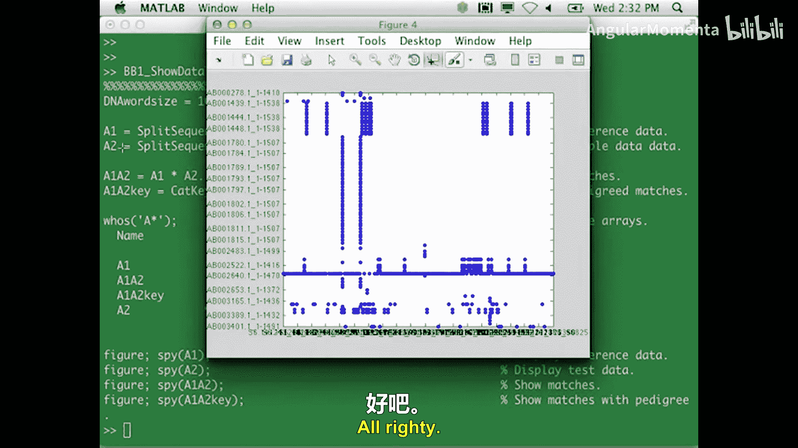

So what we've done is we set our word size。 We're going to use 10。Sequent 10 base pairs。

 So that's what we're basically dealing with 10 mers。

And wrote a little program here that what it does is given a CSV file。Faast a file and a word size。

 it then creates the associative array as we describe。 So basically， each sequence will be a row。So。

 for instance。We'll get into that and likewise， each 10 mirror will then be a column。

And so we do this for the two data sets。Here is our matrix multiply。

 So a1 times a2 transpose gives us a1 A2， and here is our pedigreed。

Matrix multiply the cat ch all A1， A2 transpose and give us a 1， A2 key。

 And so we can now look at that。 So a1 has 198。 That's the bacteria。 had 198。

Sequences with 80 and one unique10 meRS。A2 had。Thousand sequences with 2365 unique1merrs。

 And then when you matrix multiply them， you see that 85 of the 195。In the reference。

 had a match with 415 of the 999 in the sample。 So we're losing about half in each case。

Because the associatedsoci array does not store empty values。 There' is going to be no key。

 which is an empty， has an empty row， completely empty row or completely empty column。

So we can now look at those。

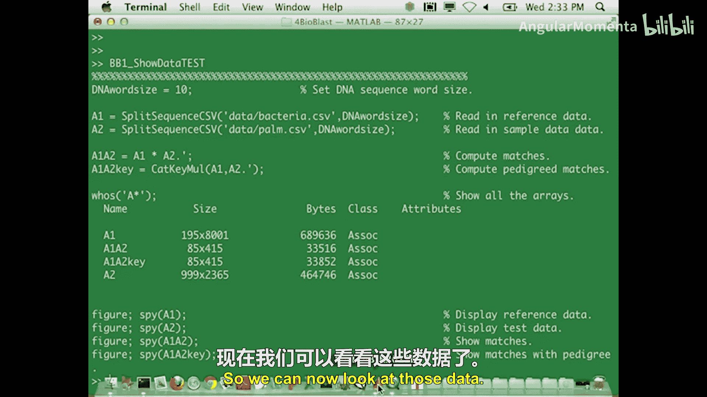

At data。 So if we look at。Figure one here。

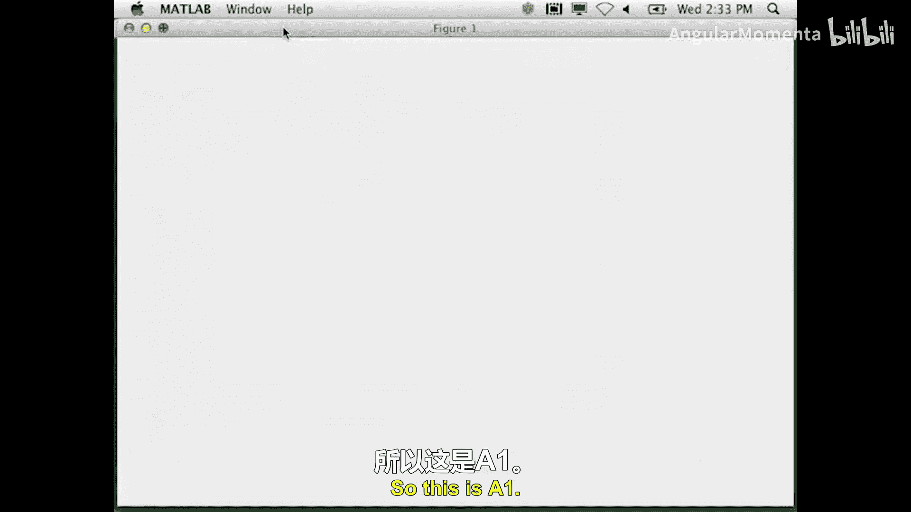

So this is A1。So this shows you again here when we zoom in。Right。

So that gives you a better sense of the structure。 you can actually click on that。 So here's。

 you know here's a 10 mirror that appears in an awful lot of things。 So basically this 10 me。

Pears an awful lot of things。嗯。You know， and here's these are examples of。You know。

 here's a row corresponding to a particular。Particular sequence， I D。So that's say1。

That's the reference A2， the sample， pretty much the same type of thing。

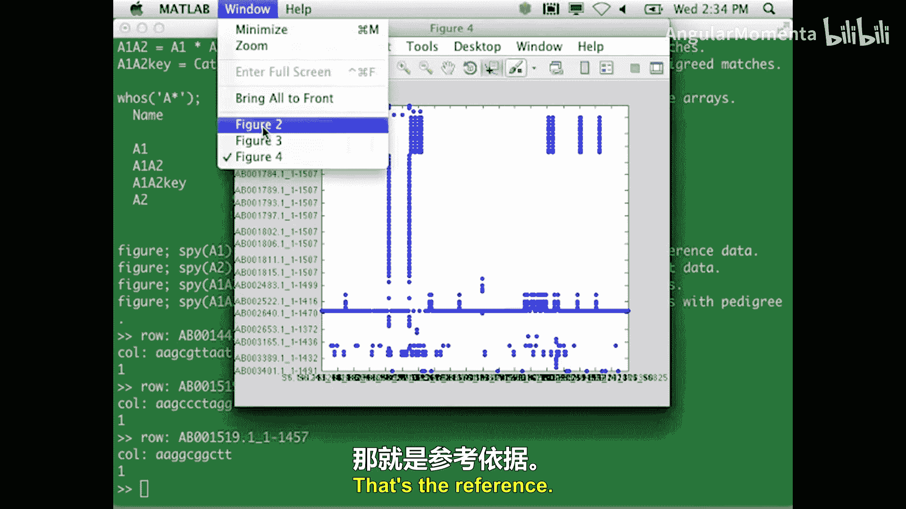

Although a little bit different structure more。Of these dense things， maybe。

Why don't even zoom in in one of these bbs here。See those types of wlobs。There。this guy。唔uii。

This guy begins with GCCAC and。GCCTT， and。Other types of things there。

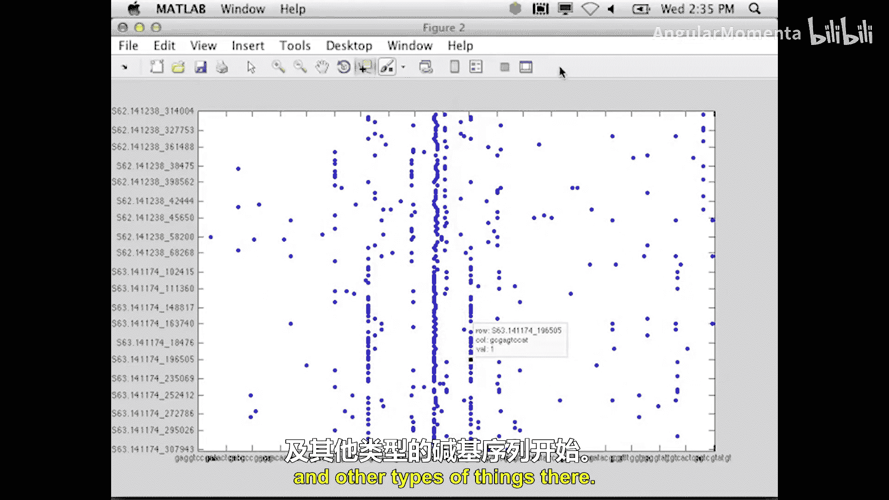

And then this is the cross so we go now to figure three。

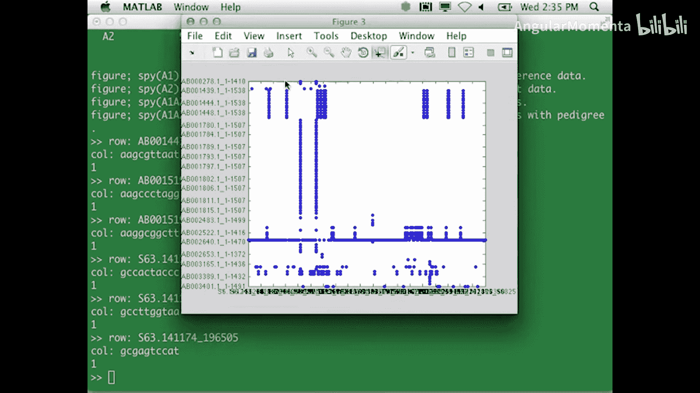

This is the cross correlation。Of all those， and it holds the count。So you can see here one， you know。

 one， most of these are just one， one， and unless I did some kind of thresholding， I couldn't。

Probably we couldn't even find the ones that were larger。

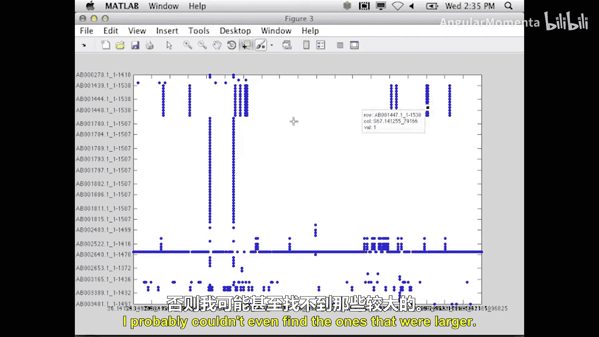

And then figure four here is our pedigree multiplication。 so now it shows you。

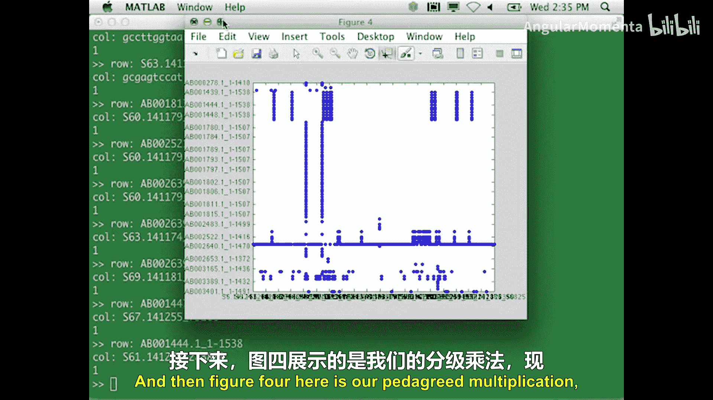

What the actual， So this tells us that this sequence ID and this you know。

 so this reference sequence ID and this sample sequence ID had a match at this tenmer。

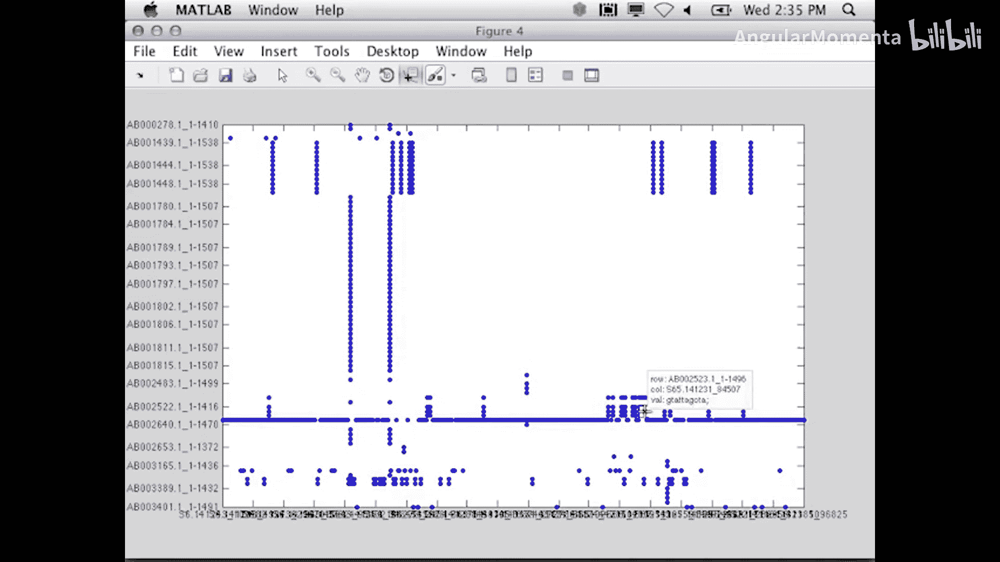

There we go。So we go back here and as you see， as I clicked on that， it printed out。

The full sequence。 So if you wanted to ever like just do a cut and paste and then put this in something else。

 So like if I wanted to look at this row， you know， I could then do a1。嗯。And that gives me that row。

You know。And I can do other things。 You know， I could do like， all right， let's。Some that。Yeah。

 I can send the。The columns up， that tells me there's 138 unique sequences in that sequence ID。

Those types of things。Alright。I think we pretty much covered。喂。Yeahep。

It's now gone on to the next example， and I apologize this takes a little bit longer to run。

Because now I'm doing two things when I read in the data。

 I'm doing the same thing I did before in terms of sencing， I want 10 meRS。

 and I'm going to read the data again with a slightly different function。

 and it's going to return two associative arrays。 This associative array was was the same as before which showed us the actual count。

How many times if you had a1 mirror and it counted？The next one。

Gives us a concatenated list of the positions。 So where。 So if it appeared five times。

 it will actually show us。Youll hold that information。

 a list of the five location is in the greater sequence。

 which then allows us to do those things I talked about before。So。This takes a minute to do that。

Probably with some optimization， I have no doubt that this could be could be made。那个。It faster。

And also， with the。Video recording going on。At of， lot of。Pressure on this。It not。

Just some additional information here in terms of the who's command， you know。

 so we basically did whose a to show me all the different associated array I have。

As you can see this tallies up the bytes that are associated， so our first Associative array。

 as you saw， was about 700 kilobytes， and that basically adds up。

All the data stored and all the data structures inside it。嗯。Usually does a pretty good job of that。

Likewise。 And as you can see， there's a significant reduction in the total size。Of that。

 And in this case， we didn't really add that much by adding the keys， you know。

 so this is a very nice data set for us to do our cat key all on。

 There was no dense diagonal or anything like that to get in our way there。

 So that was that was a very useful thing to have。 we're on least at least we're now on the second read。

So almost there。And being able to click on the thing it actually printed out is because。

When we actually do。The spy plot， in this case it works out pretty well because our keys are relatively short。

 but we do truncate that so if you have a row key or a column key that's very long when we do the plots。

 we truncate that and then you would never actually know what the true full string was so。

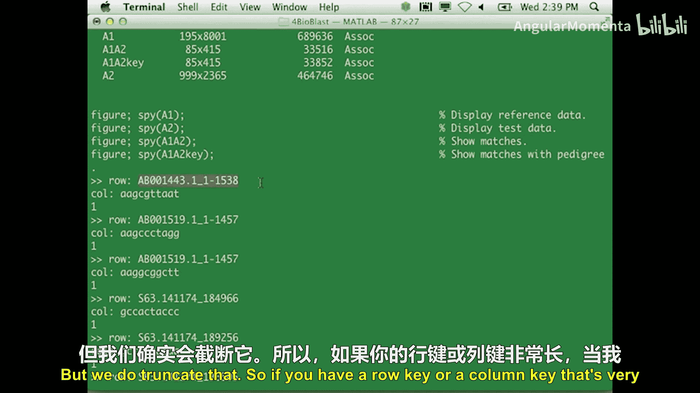

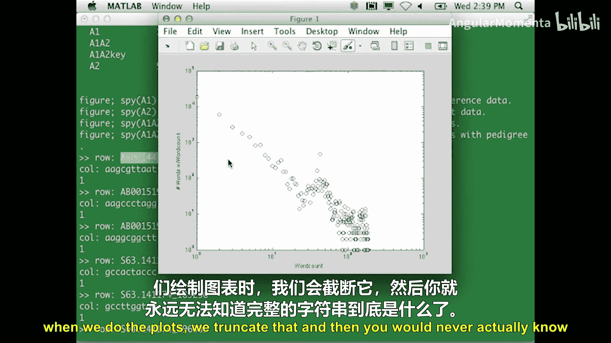

系。Finish there。Alrighty。So again， we read in the data。

And now I wanted to make a degree distribution of the data。

 so just like we did our degree distributions earlier。

 there's a great way to get a sense of the overall statistics。All right。

 so I 1 a1N and the way I do that is I have the Associative array A1 if I do the ADJ or adjacency matrix thing this basically just pops out the internal sparse matrix that's stored okay and now I can do regular math on that and we happen to have this little built in function called out degree which essentially does you know on the out direction。

 the appropriate sums and returns a sparse matrix which we can then plot in this log log form。

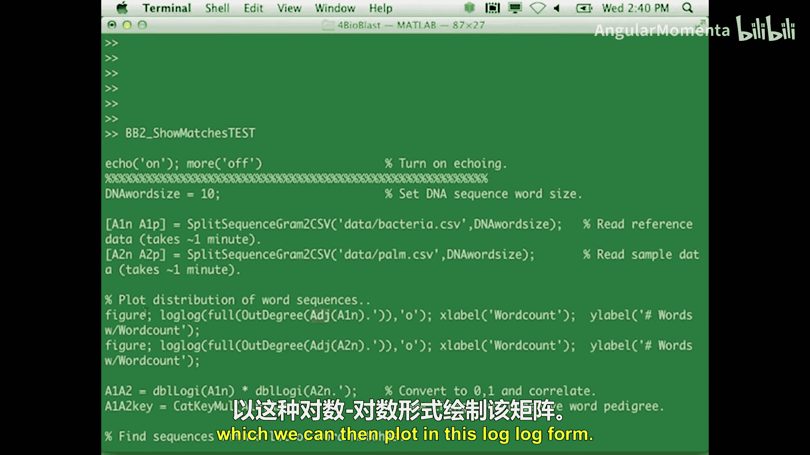

So， this is the。This is the reference data you see has this distribution here。

Wwhichch is very power law like， although as we saw in the earliest classes。

 unless we properly fit and bin this， we wouldn't really know if this was a power law or something like it。

 but probably our first order linear fit。Of a power law would be at least a good place to start as it usually is with this data。

嗯。Here's the other one。Would appear to be even more power lawlike， but again， until we've been it。

 we don't really know what happens when we start binning this stuff up here。

 maybe it will bow up in some way， maybe maybe it won't probably it would probably would look more like this。

嗯。A question for you or a good question is， you know。

 I showed you that other data set and it didn't look like this。 You know， you saw this。

 you saw a very kind of almost a log normal Gaussian distribution。And you might， well。

 because it's the same data， you know， it's still 10 mirror type of data。

 and so the only difference is the size。And so when you have 10merrs， you have。Since each one can be。

 you have four choices of letter。All right。You essentially have 2 million total possible tenmers。

So in this data set。In fact， we can count here， right if we do。

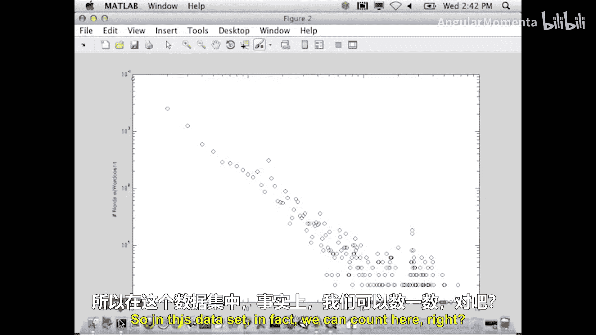

It's A1。 we do N and Z。We only have 274000 entries， so we're not fully sampling the 2 million。

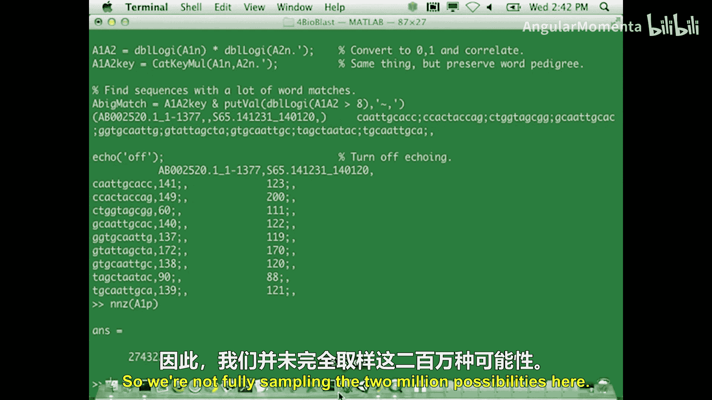

Possibilities here。The other data set that database was actually 500 million entries。

And so we're really fully sampling。 And so you're getting。

You know this this basically what's happening is you know， these guys are rare， they don't show up。

 you know， and they start getting， you know， more， you hitting them once and eventually begin to create this sort of more Gaussian distribution look or bell curve look you when you start fully sampling。

I don't know if that's generally true or not， but one could hypothesize that a lot of the data。

And this is just a guess that a lot of the day that we see is power law is because。

We're not fully sampling the total space that emerges or that total space is growing。

At a rate as as we sample it。 So like domain names。

 we haven't fully sampled the entire space of domain names in the name the set of domain names in the Internet continues to grow at a fairly significant rate。

 now， maybe one day。There will stop being new domain names。

 And then when we start doing our sampling， maybe our distributions on domain domain names won't look so power lot anymore。

 but more like a log normal distribution with a kind of a bell bell shape， just a hypothesis。

 but certainly many data we have。You know， don't。that now， of course。

 the easiest way for me to change this is instead of doing 10 MERS would be to do 20 MERS。Now。

 I've dramatically increased the space of possibilities。

 And so the odds of having just statistical matches start piling up are very， very low。

So that is certainly something that people do too and in the case for the calculation we were doing。

 we just got lucky。 We actually did not think Ten0Mr would be the right sampling for that data。

We thought it would be a higher number like a 15 me or 20 mere。

 and it turns out the 10 Mi was just actually spot on in terms of giving us this nice balance between sampling but statistical power that we could eliminate more common occurrences。

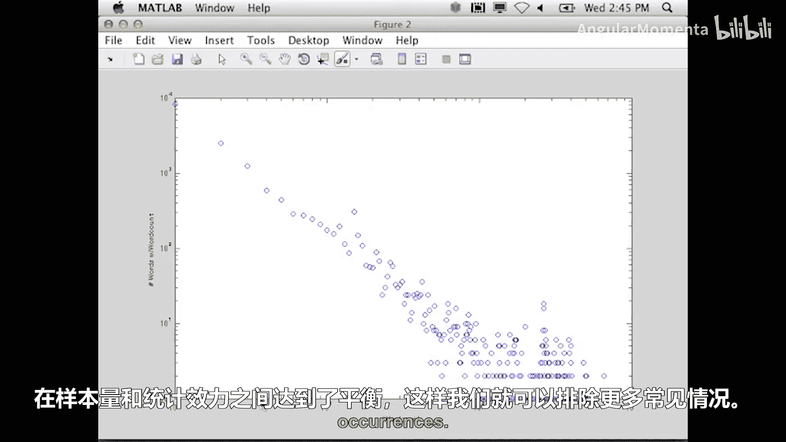

All right。We plotted the out degree again， a very useful technique， one should always do these basic。

 understand the overall statistics of one's data。We're doing the same cross correlation here。

That we did before， except since in that previous data set。

 the value didn't store the account that was a very fast read， we just。Had a， you know， all。

 all the values were one here。 we actually have a count。 And so we don't really care。That， you know。

 we don't want it the case in this particular correlation。 We don't care if like， well。

 this 1 mirror appeared 10 times in this one sequence and appeared three times in this other sequence。

 And when we multi them them together， we get a 30。

That's not really what we're really more interested in like， you know。

 how many unique ones did they each have， how many distinct ones did we each have。

 so we use the double ogi function to basically convert all our numbers back to just zeros and ones and then do that correlation again。

And then here we do and since the values don't matter when we do the cap chmo。

 we don't need to do that， and then we do the same correlation。And so here we are， we're finding。

The sequences that have a greater than8 match here。

 actually doing some fairly inside tricks here to do that。嗯。You might ask what is this put。

 So it's fairly clear what I'm doing here， right， I'm I'm taking this count and I'm saying。

 please return the subassociative array of all things with greater than a value of 8。

 more than 8 matches。 All right， that's good。Then I'm flooring that and'm saying， make that all。

You know， just ones， all right， and then I'm doing this trick here， which is called put vow。

 and I'm giving it this random string。Well， when I do that。

 so right now this is just an associated array without a value。 When I put that thing in there。

 since all my things have a value of one， and I'll have one string， it's now saying， you know what。

 I've just made all those values Tilda I like， why on earth would we do that？Well。

 it's because when I and them together， okay， the， you know， we have to decide what mathematically。

When we and two associative degrees together， if we recall the lecture。

 we talk about these collision functions。 we have to pick a collision function for the two strings。

 All right， and this key stores this pedigree list， which I really want to keep。

 And this just shows me which ones are the high match。 and I don't really care about that。

Well the default collision function when in doubt， throughout deformum is min。

So Tilde is leographically after。Every other printable character in the alphabet。

 So when I do a min here， I'm just going to always return the。These values here。

 so there was only one entry greater than8 and I handed them together it then did a min of Tilde with this whole string here and it said aha C is less than Tilda I'm just going to give you the C and so there we go on so it's cute's this is just a cute trick。

 but it's a way of sort of using the collision function in the group theory that we talked about in the earlier lectures to get a very nice you know just selecting the one that I want here。

And so that's what that does。And then there you can see so of this sequence ID and this sequence ID。

 they had eight matches or greater than eight matches and this was the exact。

10 mes that actually matched。Okay， and then we can go back before and look up those two sequences。

 compare them side by side in the original data and then we see these were the actual positions here and you would probably look at these well what do we think here。

 well， 137 and well 138 that's right now， 139，14141。And then jumping all the way to 149。

 So it looks like those guys are all part of one long group。

But then 60 and 172 and 130 are probably isolated 10 MERS。And then over here， what do we have。

 We have 111。 No， but we do have 1，19，120，121，122，123。 So that's probably also a。You know。

 a bigger group match and so you probably in fact， those all line up with this're they're except for the 149 here。

 but I actually know。Some of them match， some of the time。

 So there's they're each part of a larger piece， but not。Not necessarily overlapping in the same。

 they aren't contiguous with each other and that's the kind of thing that people who do this you know then really look at and of course。

 a real match would be more like something with many more sequences。

 this is all just random randomness and things like that so。All right。

 so that's the demo I want to thank you and again next week tell your friends who maybe have or not who weren't here today that that is the one lecture。

 if you had to come to one lecture in this entire class。

 I didn't tell you that at the beginning you noticed， right？

Because then you would have skipped the other seven but no it'll be what we've done before we'll really make that a allows you that's the real one and you will then be able to go when you leave that lecture。

 run all those examples on those test databases that we have there from your Lgrid accounts and have all that kind of fun and then really and we really want you to do that because we release Dformm on the web we need people to test it you know it's much better if you guys find the issues and then and then we'll just make it make it better and likewise it's a step towards you guys actually using the technology and then。

And then for your actual application。

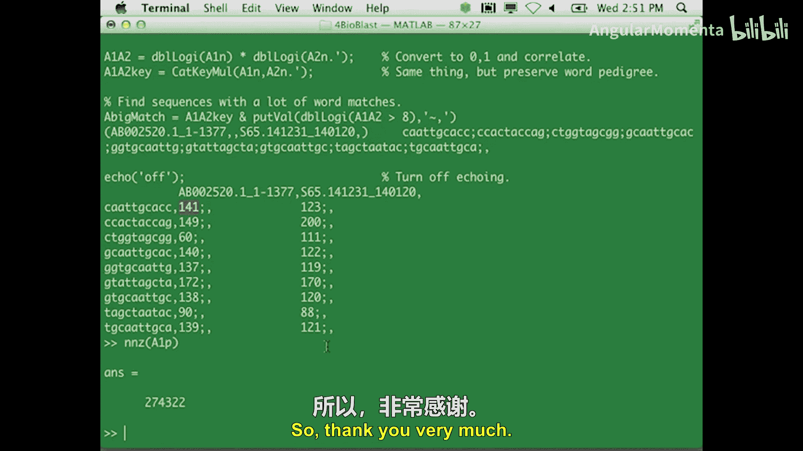

Thank you very much。

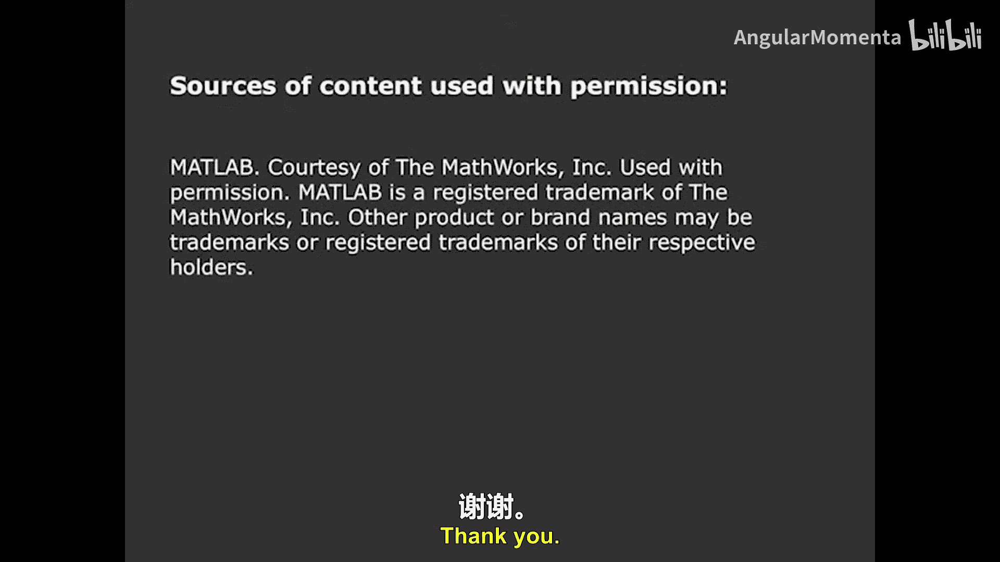